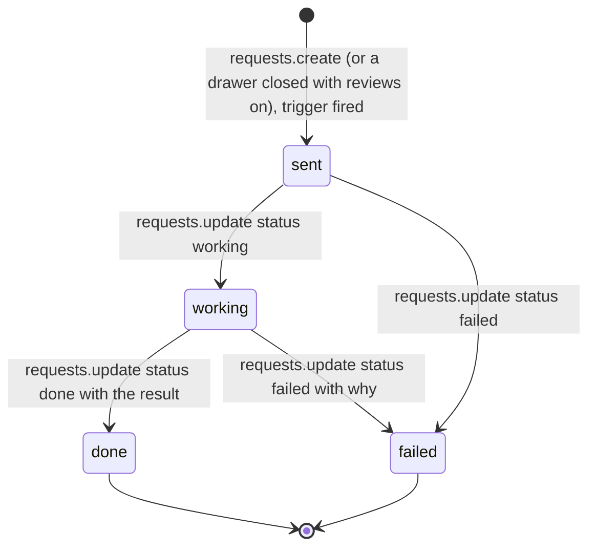

# Requirements: Advance POS

PART A — REQUIREMENTS (SRS). User-approved before build; frozen after; changes via ## Changes.

## Introduction

### Purpose
Advance POS is a point of sale for a shop or cafe, built to the bar of the leading systems (Square, Shopify POS, Toast, Lightspeed, Clover). A cashier rings up a sale in a few taps with no training, and the owner runs the shop from the same app: catalog, stock, cash, customers, staff, promotions, gift cards and reports. Money is exact, nothing financial is ever deleted, and every sensitive action is recorded. Cashiers sell and take payment; managers handle returns, voids, discounts over the limit, the cash drawer, stock, reports and staff; the owner does everything, including settings and permissions. An AI agent works on the same data through A2App with its own permission role. The app asks it, through requests the person can follow, to send a receipt, review a closed drawer session, draft a restock list, or answer a question about the business.

### Scope
**Goals**
1. A sale is rung up and charged from the sell screen alone: tiles, search or a scan add items, one Charge button opens checkout, and any mix of cash, card, gift card, store credit, points and the store's own tenders settles it.
2. The sale lives on the server as an open ticket. A reload, a second register or your AI agent sees the same sale, and a change made against an older version is refused (`stale`) rather than overwriting.
3. Paid sales, payments, drawer sessions, the stock and balance ledgers and the audit log are never edited or deleted. A mistake is corrected with a return, a void of an open sale, or an adjustment.
4. A payment repeated with the same key never charges twice, and a return never gives back more than was bought, at the price actually paid.
5. Every action in the app is an operation the agent can run, within the permissions the owner gives the agent role. The agent never takes cash or uses the drawer.

**Core functionalities:** sell screen with tiles, search, barcode scanning and a keypad · server-held open tickets · line and sale discounts, price overrides and tax exemption · automatic promotions and coupon codes · checkout with split tenders, tips and cash rounding · printed, gift and sent receipts · returns and exchanges · customer display · cash drawer sessions with X and Z reports · staff PINs, role permissions, manager approvals and a time clock · products with variants and option groups · stock ledger with average cost · customers with loyalty points and store credit · gift cards · reports with CSV export · audit log · deletion with preview · requests to your AI agent

### Approval
Approved by the user: 2026-11-04 — carried over from the published marketplace app `advance-pos` 1.0.0, whose requirements were approved when it was built; this document restates them in the framework's form without changing any feature.

## Product Description

### Product Perspective
`authMode: none`. The app binds loopback and has no accounts. People are identified inside the app: each signs in at a register with their PIN and gets a signed session token (`till`) naming them and the register. The agent is recognised by the app's agent token and acts with the `agent` role (AGENT_APP.md § Notes). manifest.json declares no integrations (`capabilities.integrations: []`) and the app calls no outside service (AGENT_APP.md § External data). Card payments are taken on the shop's own terminal and recorded with their approval code. Receipts sent by email or text go out through your AI agent's own tools. Receipts and Z reports print through the browser. The UI names no particular agent ("your AI agent").

### User Characteristics
Cashiers, managers and the owner of a shop or cafe. The sell screen is used all day by touch on a counter device, with a keyboard and a keyboard-wedge barcode scanner, and a receipt printer (58 or 80 mm). A second screen (a tablet or a monitor) shows the customer display. The back office (catalog, stock, customers, reports, team, settings) is used on a desktop or tablet. Phones from 360 px wide to wide desktops are in scope.

### Constraints
- C-1: One currency per store, set at setup with its ISO code and minor digits. The currency is fixed once sales are recorded. Every amount is stored as whole minor units. Operations take major units as text ("4.50") and answer minor integers with formatted readings alongside.
- C-2: Prices either include tax or exclude it (a store setting). Taxes are computed per rate on the order (sales and returns apart) and shared back to the lines, so lines add up exactly. Rounding is half away from zero.
- C-3: Per line: the price (or an approved override) plus options, times the quantity. Each line gets one item discount: a manual one, otherwise the best of the automatic and code promotions (including buy X get Y). Then the order discount is shared over the discountable lines by largest remainder.
- C-4: Cash rounding (to any step, such as 0.05 or 0.10) applies only to cash paying the last of the balance, and is recorded on the sale.
- C-5: Quantities may have up to 3 decimals for items sold by weight; items sold by the piece take whole numbers.
- C-6: A sale is an order: open while it is rung up, paid when its balance reaches zero, void when it is abandoned. An open sale with payments taken cannot be cleared until they are voided. Paying the last of the balance gives the receipt number (the store's prefix and its next number, 1001 at first), moves stock, issues or tops up gift cards, earns points and updates the customer's history.
- C-7: Order changes carry `expected_version` and are refused with `stale` when the sale changed meanwhile. Payments carry a `client_ref` (unique), so a repeated attempt never charges twice.
- C-8: A return is a line with a negative quantity, linked to the line it returns, at the price that was paid. A line can never be returned beyond what was bought, and returning everything refunds exactly the line. A return without a receipt needs the `return` permission.
- C-9: PINs are 4 to 8 digits, unique among active staff, and stored as a salted SHA-256 hash. Wrong PINs are rate limited: after 8 wrong PINs within a minute, PINs are refused until the minute has passed ("Too many wrong PINs. Wait a minute and try again."). A session lasts 16 hours. At least one active owner always remains.
- C-10: Roles owner, manager, cashier and agent each have a set of 18 permissions (sell, discount, price_override, tax_exempt, return, void, no_sale, cash_moves, open_shift, close_shift, view_reports, manage_catalog, manage_stock, manage_customers, adjust_balances, manage_discounts, manage_staff, manage_settings) and a largest discount without approval. The owner role always has everything. By default a manager has everything but manage_settings, with a 100% limit; a cashier has sell, discount, open_shift, close_shift and manage_customers with a 10% limit; the agent has sell, view_reports, manage_catalog, manage_stock, manage_customers and manage_discounts with a 0% limit. Only an owner changes permissions or owners.
- C-11: A missing permission can be granted for one action by the PIN of someone who has it, recorded as the approver. The agent has no approval path. Taking cash, giving cash back, signing in, and opening, using and closing the drawer need a person at the register; the agent is refused.
- C-12: Every collection changes only through the operations. Request hooks refuse direct API creates, updates and deletes and name the operation to use. PIN hashes, salts and the session secret are hidden fields the API never returns.
- C-13: Paid sales, payments, drawer sessions, cash moves, the stock and balance ledgers and the audit log are permanent. Everything else (products, variants, categories, taxes, option groups, discounts, gift cards with no history, customers, registers, staff with no history, time entries, requests, open orders) can be deleted, after a preview of what it affects or why it is refused.
- C-14: Codes are unique across the store: a SKU or barcode belongs to one variant. Names are unique ignoring case for registers, staff, categories, taxes and option groups; customer emails (ignoring case) and phones are unique; gift card codes and discount codes are unique ignoring case. Each person has at most one open time entry, and each register at most one open drawer session.
- C-15: Products have up to three options (such as Size and Color) whose combinations are their variants. Each variant has its own SKU, barcode, price, cost (a moving average on receiving) and stock.
- C-16: Fixed vocabularies. Role: owner, manager, cashier (and the agent role). Order status: open, paid, void. Line kind: item, custom, gift_card. Tender: cash, card, gift_card, store_credit, points, other. Stock reason: sale, return, receive, adjust, count, damage, loss, opening. Balance account: points, credit, gift_card. Cash move: pay_in, pay_out, no_sale. Discount kind: percent, amount, bogo; scope: order, item; applies: all, categories, products; mode: manual, auto, code. Request kind: receipt, shift_review, restock, question; status: sent, working, done, failed. Card reference: off, optional, required. Tip basis: before_tax, after_tax. Sold by: each, weight. Color slot: neutral, accent, blue, green, amber, red, violet, graphite. Actor: staff, agent, system.
- C-17: Product pictures are PNG, JPEG or WebP up to 5 MB (thumbnails 160 and 480 px). The logo is PNG, JPEG, WebP or SVG up to 2 MB. CSV imports are up to 20 MB.
- C-18: The first run seeds one settings row (not set up, USD with 2 digits, prices excluding tax, no cash rounding, tips off with presets 10, 15 and 20%, card reference optional, loyalty off, receipts numbered from 1001 on 80 mm paper, drawer required before payments, negative stock allowed, low stock at 5, lock after 5 idle minutes, automatic drawer reviews on). Setup adds the owner and the first register. No products, customers or sample data are seeded.
- C-19: No emoji appears anywhere; icons are line icons. The app names no particular AI agent, and what the agent does is recorded with the actor `agent`.

### Assumptions
- A-1: Volume ceiling: one store with a few registers. Lists page their results: sales 50 per page (up to 500), products up to 5,000 per call (200 by default), customers and gift cards up to 1,000, stock moves up to 1,000, the audit log up to 500, drawer sessions up to 500, requests up to 200. The toolkit's rate limit allows 300 operation requests per minute.
- A-2: The machine running the app is the shop's own, and its local time is the shop's time. Report days are local `YYYY-MM-DD` days, and stored times are UTC.
- A-3: Barcode scanners act as a keyboard (USB or Bluetooth "keyboard wedge"). Receipt printers print through the browser.

## Features

### Module: Frame
- F-FRM-1: On wide screens the user can reach every page from a slim icon rail on the left in groups: Sell, Sales, Customers; Products, Stock, Promotions and gift cards; Cash drawer, Reports, Team, Activity, Requests to your AI agent; with Settings, Lock the register and the signed-in person at the bottom.
- F-FRM-2: The user sees the current page marked with an accent bar on its rail button. Hovering a button shows the page's name.
- F-FRM-3: The user sees counts on Requests (open requests) and Stock (items running low).
- F-FRM-4: On phones the user can navigate with a bottom bar: Sell, Sales, Customers, Products, a menu for the remaining pages, and the person.
- F-FRM-5: WHEN a page needs a permission the person's role lacks THE SYSTEM SHALL leave it out of the rail and, if it is opened, show "This page needs a manager" with "Back to selling".
- F-FRM-6: The signed-in person's menu shows their role and register and offers "Clock in or out", "Change my PIN", "Open the customer display" and "Lock the register".
- F-FRM-7: The user's back buttons follow the app's own trail of pages and never leave the app.
- F-FRM-8: WHEN a newer version of the app has been deployed THE SYSTEM SHALL reload an open page onto it, waiting while a dialog is open.
- F-FRM-9: The user can use every page from a 360 px phone to a wide desktop. On the register, touch targets are at least 44 px.
- F-FRM-10: WHEN the host switches the theme pack, light or dark mode, or custom colors THE SYSTEM SHALL recolor the app from the host's theme tokens with contrast checks. Only the state colors (red, green, amber) stay fixed.
- F-FRM-11: The user sees line icons only, no emoji, and the agent called "your AI agent". Help lives in tooltips.

### Module: Setup and signing in (setup, auth, staff, timeclock)
- F-SUP-1: WHEN the store is opened for the first time THE SYSTEM SHALL show "Set up your store": the store (business name, and the phone and address printed on receipts), money and tax (currency, which sets its minor digits, a tax name and rate, and whether prices include tax), and the owner's name and PIN typed twice.
- F-SUP-2: WHEN setup is finished THE SYSTEM SHALL create the owner, the tax rate and the first register ("Register 1") and open the app signed in.
- F-AUTH-1: The user sees a lock screen with the store's logo or name, the time and date, and a PIN pad that takes the keyboard too.
- F-AUTH-2: The user can sign in at this device's register with their PIN, or switch the pad to "Clock in or out" to record their shift on the time clock without signing in.
- F-AUTH-3: WHEN the store has more than one register THE SYSTEM SHALL let the lock screen choose which register this device is.
- F-AUTH-4: WHEN a PIN is wrong THE SYSTEM SHALL answer in place and shake the dots. Wrong PINs are rate limited (C-9).
- F-AUTH-5: WHEN the register has been idle for the minutes set in settings (0 never), when the person locks it, or after every sale when that is set THE SYSTEM SHALL lock it. The open sale stays on the server.
- F-AUTH-6: WHEN the store server cannot be reached THE SYSTEM SHALL say "The store server is not answering" ("Sales are kept on the server, so nothing is lost.") with Try again.
- F-AUTH-7: The signed-in person can change their own PIN with their current one.

### Module: Sell (catalog, products, orders)
- F-SELL-1: The user sees a product grid beside the sale: one search field, category tabs (Favorites first when there are any, All, each category, and Keypad), and the tiles.
- F-SELL-2: The user sees square tiles showing the product's picture, or its initials in the product's color (or its category's). The name is centered under the tile and rolls when too long, and the price (a "+" when variants differ, per unit for weight) shows under it when the store shows prices on tiles. Tiles mark the number of variants and Low or Out stock.
- F-SELL-3: The user can tap a tile to add it. WHEN the product has variants to choose, required options or a weight THE SYSTEM SHALL ask once, in the item sheet.
- F-SELL-4: The user can search by name, SKU or barcode. Enter on a code adds it, and a keyboard-wedge scanner adds a product anywhere on the page without clicking. An unknown code says "No product has the code <code>".
- F-SELL-5: The user can enter an amount that is not a product on the keypad (a name on the receipt, with or without tax), or sell a gift card from it.
- F-SELL-6: The user can choose in the item sheet the variant (one button row per option, with combinations that do not exist turned off), the options of its option groups with their minimum and maximum ("Choose 1", "Optional, up to 3"), the quantity or weight, and a note.

### Module: The sale (orders, customers, discounts)
- F-TKT-1: The user's sale is stored on the server as an open ticket, so a reload, a second register or your AI agent sees the same sale. WHEN the sale changed on another screen THE SYSTEM SHALL reload it rather than overwrite it.
- F-TKT-2: The user can name a ticket, add a note, and pick up any open ticket again from any register.
- F-TKT-3: WHEN the user starts a new sale while the current one has lines THE SYSTEM SHALL offer to keep it open under a name or to clear it.
- F-TKT-4: The user can add a customer (search, or create one) and sees their points and store credit.
- F-TKT-5: The user can tap a line to change its quantity (or weight), set a price with a reason (permission `price_override`), give a discount by percent or amount with a reason and quick chips, change options and the note, choose whether a returned item goes back in stock, or remove it. Removed lines are recorded.
- F-TKT-6: WHEN a discount goes over the person's limit, or a price is changed without the permission THE SYSTEM SHALL ask for a manager's PIN.
- F-TKT-7: The user can give a discount on the whole sale by hand, from a saved promotion, or with a coupon code, and remove tax from the sale (permission `tax_exempt`).
- F-TKT-8: The user sees automatic promotions apply on their own and show on the line: percent or amount off items, categories or the whole order, a minimum spend or quantity, buy X get Y, scheduled days, hours and dates, and coupon codes.
- F-TKT-9: The user sees the totals (subtotal, discounts, tax per rate or "Tax removed", tip, cash rounding, paid so far) and one big button that reads Charge, Refund, Complete or Pay the rest with the amount due.
- F-TKT-10: The user can, from the sale menu, open the drawer without a sale, pay cash in or out, return or exchange, and clear the sale with a reason. WHEN payments were taken THE SYSTEM SHALL refuse to clear the sale until they are voided.
- F-TKT-11: WHEN the store requires an open drawer and it is closed THE SYSTEM SHALL say "The drawer is closed. Open it to take payments." and open the drawer before checkout.

### Module: Checkout and receipts (payments, orders)
- F-PAY-1: The user can charge with cash (suggested notes, a keypad for the cash given, and the change shown large), card from the shop's own terminal (the approval code or last 4 digits recorded when the store asks), gift card (scan or number, with a balance check), store credit, loyalty points, and the store's own tenders with a reference.
- F-PAY-2: The user can split a payment across any tenders, or split it evenly (1/2 to 1/5 of what is left). The amount left is always shown.
- F-PAY-3: The user can add a tip from the presets (up to 5 percentages), "No tip" or another amount, when tips are on.
- F-PAY-4: The user can void a payment taken by mistake before the sale completes (permission `void`). Gift card, credit and points go back.
- F-PAY-5: WHEN a payment is submitted twice THE SYSTEM SHALL charge it once.
- F-PAY-6: WHEN the balance is negative THE SYSTEM SHALL refund it the same ways (a new gift card for a gift-card refund).
- F-PAY-7: WHEN the balance reaches zero THE SYSTEM SHALL finish the sale: a receipt number, stock goes down, gift cards are issued or topped up, points are earned, and the customer's history updates.
- F-PAY-8: The user sees the change due large (or what was paid or refunded), the receipt number and the points earned, with Print receipt (58 or 80 mm), Gift receipt (without prices), Send by email or phone through your AI agent, and New sale (which locks first when set).
- F-PAY-9: The user can show the customer a second screen (`#/display?register=<id>`, no sign-in) with the cart line by line, what they save and the total live, then a thank-you and the change.

### Module: Returns and exchanges (orders)
- F-RET-1: The user can return items from a past sale found by scanning or typing its receipt number or from recent sales, choosing the quantity of each line and whether it goes back in stock, or returning everything.
- F-RET-2: WHEN items are returned THE SYSTEM SHALL refund them at the price actually paid and never more than was bought.
- F-RET-3: The user can add new items to the same sale for an exchange, and settle the difference to cash, card, store credit or a gift card.
- F-RET-4: The user can return a product without a receipt, which needs the `return` permission.
- F-RET-5: The user can finish an even exchange with Complete.

### Module: Sales (orders)
- F-ORD-1: The user can list Paid sales, Open tickets, Cleared sales or All, search by receipt number, customer or ticket name, and show only sales with returns. People who may see reports choose the days; others see today on this register.
- F-ORD-2: The user can open a sale's page with its lines, the returns made from it, its history, totals, payments (with voided ones), customer, note and why it was cleared.
- F-ORD-3: The user can print a paid sale's receipt or gift receipt, send it through your AI agent, and start a return from it.
- F-ORD-4: The user can clear an open ticket from its page, or open it on the register.

### Module: Cash drawer (shifts)
- F-CSH-1: The user can open the drawer with a counted float (by note and coin, or a total).
- F-CSH-2: The user can pay cash in, pay cash out, and open the drawer without a sale. Each is recorded.
- F-CSH-3: The user sees the live X report of the open session and its cash in and out.
- F-CSH-4: The user can close the drawer by counting (by note and coin, or a total) against what it should hold. The difference (short or over) is recorded and the Z report is kept and can be printed.
- F-CSH-5: The user can see every register's state and past sessions with their expected and counted cash and difference, print their Z reports, and send one to your AI agent for a review.
- F-CSH-6: WHEN automatic reviews are on and a drawer is closed THE SYSTEM SHALL ask your AI agent to review the session.

### Module: Team (staff, timeclock, permissions)
- F-TEAM-1: The user can add and edit people with a name, role, PIN, color, email and phone, and turn off someone who left (their sales keep their name).
- F-TEAM-2: The user can see the time clock: entries per person with hours, and add or correct entries, recording who corrected them.
- F-TEAM-3: The owner can set what each role may do (manager, cashier and your AI agent), including the largest discount without approval.
- F-TEAM-4: WHEN a person lacks a permission THE SYSTEM SHALL let someone who has it approve that one action with their PIN, recorded as the approver.

### Module: Products and stock (products, categories, modifiers, taxes, stock)
- F-PRD-1: The user can list products with search, a category filter, a stock filter (low or out, out, counted), archived ones, and a favorite switch per product, and import and export them as CSV.
- F-PRD-2: The user can edit a product: name, category (pick one or make a new one), sold by each or by weight or length with its unit, description, up to three options whose combinations are its variants (each with price, cost, SKU, barcode, stock counting, opening stock and low level), the option groups sold with it, its picture or tile color, favorite, and its tax (the store default, another rate, or no tax).
- F-PRD-3: The user can archive a product (it leaves the sell screen) and put it back on sale.
- F-PRD-4: The user can edit categories (name, color, order) and option groups (options with prices, minimum and maximum choices).
- F-STK-1: The user sees the stock value at cost, the units, the low and out counts, and the levels of counted items, filtered by all, low or out, or out.
- F-STK-2: The user can receive a delivery (with a unit cost that updates the moving average cost), count, adjust, and write off damaged or lost stock, scanning one item after another.
- F-STK-3: The user can see every stock movement (sales, returns, deliveries, counts, adjustments, damage, losses, opening stock).
- F-STK-4: The user can ask your AI agent for a restock list from what is low and what sells.

### Module: Customers and gift cards (customers, giftcards)
- F-CUS-1: The user can list customers sorted by name, last visit, spend or points, search them, and import and export them as CSV.
- F-CUS-2: The user can keep a customer's contact, notes, tags, tax exemption, marketing consent and birthday.
- F-CUS-3: The user sees a customer's spend, visits, average sale, points (and what they are worth), store credit, sales, balance history and linked gift cards, and can start a new sale for them.
- F-CUS-4: The user can adjust a customer's points or store credit with a reason (permission `adjust_balances`). Each balance is an append-only ledger.
- F-GFT-1: The user can sell a gift card as a line (issued or topped up when the sale is paid) and redeem it as a tender.
- F-GFT-2: The user can see what is outstanding on gift cards, list and search cards, see each card's balance and history, issue a card without a sale, adjust a balance, and disable or turn a card on. Every movement is recorded.

### Module: Promotions (discounts)
- F-PROMO-1: The user can make a promotion given by hand at the register, applied by itself when its rules match, or unlocked by a code.
- F-PROMO-2: The user can set a promotion's kind (percent off, amount off, buy X get Y), what it applies to (the whole sale, or some items: everything, categories or products), a minimum spend or quantity, days, hours and a date range, whether it needs a manager, and whether it is on. Its uses are counted.

### Module: Reports and activity (reports, calendar)
- F-RPT-1: The user can report over any date range (today, yesterday, the last 7 or 30 days, this month, last month, this year, or chosen dates, stepping earlier or later), for one register or staff member or all.
- F-RPT-2: The user sees net sales, number of sales, average sale and gross profit with margin, each against the same number of days before; sales by hour (one day) or by day; payments; and a summary (gross sales, returns, discounts, net sales, tax, tips, rounding, collected by tender, cost and profit).
- F-RPT-3: The user can break sales down by product, category, staff member (with hours worked and sales per hour), customer, payment, discount, tax rate, weekday, hour or register.
- F-RPT-4: The user can export CSV files of items sold, of sales, and of each breakdown.
- F-RPT-5: The user can ask your AI agent a question about the numbers. The answer arrives in Requests.
- F-ACT-1: The user can read the permanent audit log of sign-ins and wrong PINs, removed lines and cleared sales, price changes, discounts and tax removed, returns, voided payments, drawer opens, cash in and out, drawer open and close, stock, balances, and changes to staff, permissions and settings, each with who did it and who approved it, filtered.

### Module: Requests (requests)
- F-REQ-1: The user can follow every request to your AI agent (send a receipt, review the drawer, restock list, question) with its state (waiting for your AI agent, working on it, done, could not do it) and the answer.
- F-REQ-2: The user can ask a question about the business from Requests and from Reports, ask for a restock list from Stock, send a receipt from a sale, and ask for a drawer review from the drawer.

### Module: Settings and records (settings, registers, taxes, records)
- F-STG-1: The user can change settings one section at a time, each saved on its own: Store, Receipts, Taxes, Payments, Loyalty, Registers, Register rules.
- F-STG-2: The user can set the store's name, address, phone, email, website, tax number and logo; the receipt header, footer, width (58 or 80 mm), prefix and next number, with a live preview; and whether prices include tax, with tax rates and one default.
- F-STG-3: The user can set payments: whether card payments ask for the approval code (do not ask, optional, required), cash rounding, the notes and coins counted, other ways to pay, and tips (presets and whether they are figured before or after tax).
- F-STG-4: The user can set loyalty: points per amount spent, what a point is worth, and the minimum to redeem.
- F-STG-5: The user can add, rename and turn off registers, open each one's customer display, and choose which register this device sells as.
- F-STG-6: The user can set the register rules: open the drawer before taking payments, sell items that are out of stock, show prices on product tiles, lock when idle for some minutes, lock after every sale, ask your AI agent to review every closed drawer, and the low stock level for new items.
- F-REC-1: The user can delete any record that is not permanent (C-13) after a preview of what it affects. WHEN a record cannot be deleted THE SYSTEM SHALL say why (for example a product with sales history, to be archived instead).

### Agent (via A2App)
- F-AGT-1: The agent can perform every action of the app through the 73 operations in ## Operations Design, across the modules app, setup, auth, settings, permissions, registers, display, staff, timeclock, catalog, categories, taxes, modifiers, products, stock, customers, giftcards, discounts, orders, payments, shifts, reports, calendar, requests and records, within the agent role's permissions.
- F-AGT-2: The agent can read the conventions, its permissions, the sale lifecycle, the error codes and the recipes for each request from `app.guide`, and today's picture from `app.status`.
- F-AGT-3: By default the agent can ring up sales and take non-cash payments, read reports, and manage the catalog, stock, customers and promotions. The owner can change what the agent may do in Team, Permissions.
- F-AGT-4: WHEN the agent calls an operation its role does not allow THE SYSTEM SHALL refuse it and say that the owner can allow it. WHEN the agent tries to take or give cash, sign in, or open, use or close the drawer THE SYSTEM SHALL refuse it.
- F-AGT-5: The agent can take a `receipt_requested` task and send the 40-column receipt text to the contact with its own tools, reporting the result with `requests.update`.
- F-AGT-6: The agent can take a `shift_review_requested` task and report what is unusual in a closed drawer session (cash differences, voids, removed lines, refunds, no-sale opens, discounts), without changing anything.
- F-AGT-7: The agent can take a `restock_requested` task and draft a restock list from low stock and the last 28 days of sales, without changing stock.
- F-AGT-8: The agent can take a `question_asked` task and answer from the store's own numbers, read only.
- F-AGT-9: WHEN the agent calls `records.delete` THE SYSTEM SHALL answer `approval_required` until the person has approved that call.
- F-AGT-10: WHEN the agent changes anything THE SYSTEM SHALL record it with the actor `agent`.

## Non-Functional Requirements
- N-1: A change made at another register or by the agent appears on every open screen without a manual refresh. Views reload 150 ms after the last realtime change to a collection they watch (the customer display after 120 ms).
- N-2: Pricing is computed once, on the server (`lib_pricing.js`), on every change to a sale, so the register, the receipt, the reports and the agent show the same totals to the minor unit.
- N-3: A scan is told from typing as a burst of at least 4 characters averaging under 40 ms per key, ended by Enter or Tab or a short pause.
- N-4: The idle lock is checked every 10 s, and a session that expired locks the register at the next check.
- N-5: The operations allow 300 requests per minute (the toolkit's default rate limit).
- N-6: Every page is usable from 360 px wide up to wide desktops; back-office pages are 1280 px wide at most, and the sell screen fills the page.

## Data Requirements
- **settings** (module: settings): setup_done (boolean), business_name (string, max 120), address (string, max 600), phone (string, max 60), email (string, max 200), website (string, max 200), tax_number (string, max 80), receipt_header (string, max 600), receipt_footer (string, max 600), receipt_width (enum), logo (binary), currency (string, max 3), currency_digits (number), prices_include_tax (boolean), cash_round_to (number), denominations (json), tips_enabled (boolean), tip_presets (json), tip_basis (enum), card_reference (enum), tenders (json), loyalty_enabled (boolean), points_per_unit (number), point_value (number), points_min_redeem (number), receipt_prefix (string, max 12), next_receipt (number), require_shift (boolean), allow_negative_stock (boolean), low_stock_default (number), lock_idle_minutes (number), lock_after_sale (boolean), auto_shift_review (boolean), permissions (json), secret (string, max 200), created (datetime, server-set), updated (datetime, server-set), show_tile_prices (boolean).
- **registers** (module: registers): name (string, required, max 60), active (boolean), current_order (string, max 40), display_message (json), created (datetime, server-set), updated (datetime, server-set).
- **staff** (module: staff): name (string, required, max 80), role (enum, required), pin_hash (string, max 128), pin_salt (string, max 64), active (boolean), color (enum), email (string, max 200), phone (string, max 60), last_signed_in (datetime), created (datetime, server-set), updated (datetime, server-set).
- **timeclock** (module: timeclock): staff (ref, required → staff), clock_in (datetime, required), clock_out (datetime), note (string, max 400), edited_by (ref → staff), created (datetime, server-set), updated (datetime, server-set).
- **categories** (module: categories): name (string, required, max 60), color (enum), sort (number), created (datetime, server-set), updated (datetime, server-set).
- **taxes** (module: taxes): name (string, required, max 60), rate (number), is_default (boolean), created (datetime, server-set), updated (datetime, server-set).
- **modifier_groups** (module: products): name (string, required, max 60), min (number), max (number), options (json), sort (number), created (datetime, server-set), updated (datetime, server-set).
- **products** (module: products): name (string, required, max 120), category (ref → categories), description (string, max 2000), image (binary), color (enum), tax (ref → taxes), tax_exempt (boolean), modifier_groups (list<ref> → modifier_groups), option_names (json), sold_by (enum), unit (string, max 12), favorite (boolean), sort (number), archived (boolean), created (datetime, server-set), updated (datetime, server-set).
- **variants** (module: products): product (ref, required → products), title (string, max 120), options (json), sku (string, max 64), barcode (string, max 64), price (number), cost (number), track_stock (boolean), stock (number), low_at (number), position (number), archived (boolean), created (datetime, server-set), updated (datetime, server-set).
- **customers** (module: customers): name (string, required, max 120), phone (string, max 60), email (string, max 200), notes (string, max 2000), tags (json), tax_exempt (boolean), marketing (boolean), birthday (string, max 10), points (number), credit (number), visits (number), spent (number), last_visit (datetime), created (datetime, server-set), updated (datetime, server-set).
- **gift_cards** (module: orders): code (string, required, max 40), balance (number), issued (number), status (enum), customer (ref → customers), last_used (datetime), note (string, max 400), created (datetime, server-set), updated (datetime, server-set).
- **discounts** (module: discounts): name (string, required, max 80), kind (enum, required), value (number), scope (enum, required), applies (enum), categories (list<ref> → categories), products (list<ref> → products), mode (enum, required), code (string, max 40), min_subtotal (number), min_qty (number), buy_qty (number), get_qty (number), days (json), start_time (string, max 5), end_time (string, max 5), starts_on (string, max 10), ends_on (string, max 10), manager_only (boolean), active (boolean), uses (number), created (datetime, server-set), updated (datetime, server-set).
- **shifts** (module: shifts): register (ref, required → registers), number (number), status (enum, required), opened_by (ref → staff), opened_at (datetime), opening_float (number), closed_by (ref → staff), closed_at (datetime), counted (number), counts (json), expected (number), difference (number), note (string, max 2000), report (json), actor (enum), created (datetime, server-set), updated (datetime, server-set).
- **cash_moves** (module: records): shift (ref, required → shifts), kind (enum, required), amount (number), reason (string, max 200), staff (ref → staff), approved_by (ref → staff), actor (enum), created (datetime, server-set), updated (datetime, server-set).
- **orders** (module: orders): number (string, max 24), status (enum, required), register (ref → registers), shift (ref → shifts), opened_by (ref → staff), closed_by (ref → staff), customer (ref → customers), label (string, max 60), note (string, max 1000), order_discount (json), applied_discount (json), tax_exempt (boolean), items (number), subtotal (number), discount_total (number), tax_total (number), total (number), tip (number), rounding (number), paid_total (number), change_total (number), balance (number), cost_total (number), taxes (json), has_returns (boolean), return_status (enum), points_earned (number), paid_at (datetime), voided_at (datetime), void_reason (string, max 400), voided_by (ref → staff), actor (enum), version (number), created (datetime, server-set), updated (datetime, server-set).
- **order_lines** (module: records): order (ref, required → orders), kind (enum, required), variant (string, max 40), product (string, max 40), category (string, max 40), name (string, required, max 160), variant_title (string, max 120), sku (string, max 64), qty (number), unit (string, max 12), unit_price (number), list_price (number), refund_amount (number), modifiers (json), price_override (json), line_discount (json), auto_discount (json), tax_id (string, max 40), tax_name (string, max 60), tax_rate (number), gross (number), discount (number), order_discount (number), tax (number), net (number), total (number), unit_cost (number), return_of (string, max 40), returned_qty (number), restock (boolean), gift_code (string, max 40), note (string, max 400), position (number), created (datetime, server-set), updated (datetime, server-set).
- **payments** (module: payments): order (ref, required → orders), tender (enum, required), label (string, max 60), amount (number), tendered (number), change (number), reference (string, max 80), gift_card (ref → gift_cards), customer (ref → customers), points (number), status (enum, required), shift (ref → shifts), register (ref → registers), staff (ref → staff), approved_by (ref → staff), actor (enum), client_ref (string, max 64), voided_at (datetime), created (datetime, server-set), updated (datetime, server-set).
- **stock_moves** (module: stock): variant (string, required, max 40), product (string, max 40), name (string, max 300), reason (enum, required), delta (number), after (number), unit_cost (number), order (string, max 40), batch (string, max 40), note (string, max 400), staff (ref → staff), actor (enum), created (datetime, server-set), updated (datetime, server-set).
- **account_moves** (module: records): account (enum, required), customer (string, max 40), gift_card (string, max 40), reason (enum, required), delta (number), after (number), order (string, max 40), payment (string, max 40), note (string, max 400), staff (ref → staff), actor (enum), created (datetime, server-set), updated (datetime, server-set).
- **events** (module: calendar): kind (string, required, max 40), staff (ref → staff), approved_by (ref → staff), actor (enum), register (string, max 40), order (string, max 40), amount (number), detail (string, max 600), data (json), created (datetime, server-set), updated (datetime, server-set).
- **requests** (module: requests): kind (enum, required), title (string, max 200), body (string, max 4000), order (string, max 40), shift (string, max 40), customer (string, max 40), contact (string, max 200), status (enum, required), result (string, max 20000), request_id (string, max 40), staff (ref → staff), created (datetime, server-set), updated (datetime, server-set).

## External Interfaces
- **Human (browser):** one View served by PocketBase at the app's own origin. Behind the setup screen and the PIN lock screen it has the hash routes `#/` (Sell), `#/orders` and `#/order?id=…` (Sales), `#/products` and `#/product?id=…`, `#/stock`, `#/customers` and `#/customer?id=…`, `#/promotions`, `#/reports`, `#/drawer` (Cash drawer), `#/team`, `#/activity`, `#/requests` and `#/settings`, plus the item sheet, checkout and the dialogs opened from them. The customer display `#/display?register=<id>` needs no sign-in and shows only that register's sale. Input is touch, mouse and keyboard, keyboard-wedge barcode scanners, image files (product pictures, the logo) and CSV files (products, customers). Output is receipts, gift receipts and Z reports printed through the browser (58 or 80 mm), and CSV downloads (products, customers, items sold, sales, breakdowns).
- **Agent (A2App):** the modules and collections in AGENT_APP.md § Modules; operations exactly as declared in ## Operations Design; tasks with the capabilities `receipt_requested`, `shift_review_requested`, `restock_requested`, `question_asked` (events.json). No other machine interface is offered to agents; the app's own screens call their own routes.

## Out of Scope
- Taking card payments through a payment processor or a connected terminal. The card is charged on the shop's own terminal, and the app records it with its approval code.
- More than one currency per store, or changing the currency once sales are recorded.
- Editing or deleting paid sales, payments, drawer sessions, cash moves, the stock and balance ledgers or the audit log. Mistakes are corrected with returns, voids of open sales and adjustments.
- Sending receipts by email or text from the app itself. Your AI agent sends them with its own tools.
- Accounts or sign-in beyond the staff PINs (`authMode: none`).
- Products with more than three options.
- The agent taking or giving cash, signing in, using the drawer, or approving an action with a PIN.
- Printing other than through the browser.
- Emoji, and naming a particular AI agent.

## Quality of Life
- Quick discount chips on a line, and quick reasons for cash in and out ("Change from the bank", "Milk from the shop next door", "Change for a customer").
- A product without its own color wears its category's color on its tile, and a picture that fails to load shows a placeholder.
- The amount pad types like a card terminal (typing 450 gives 4.50), and the PIN pad shows dots, never digits.
- The receipt settings show a live preview at the printer's width.
- A customer's page starts a sale for them on the register, and a sale's page opens its ticket or starts its return there.
- The customer display shows "Welcome" when idle and "You save" when discounts apply.

PART B — TECHNICAL SPECIFICATION.

## System Overview
PocketBase 0.39 (JS hooks, migrations) + React 19 / Vite / Tailwind 4 View in `frontend/` built into `pb/pb_public/`, on the `blueprint-pocketbase-kit` toolkit. The View calls the app's own routes `/api/ops/<group>/<verb>` (`ops.pb.js`). The generated `a2app_routes.pb.js` serves the same handlers to agents as `POST /api/ops/<name>`. Domain logic lives in `pb/pb_hooks/lib_*.js`: the pricing engine in `lib_pricing.js`, the sale lifecycle in `lib_orders.js`, permissions and approvals in `lib_auth.js`. Record guards live in `hooks.pb.js` and `lib_rules.js`.

Modules → navigation map:

| Module (manifest) | Where a person meets it | Route |
| --- | --- | --- |
| `setup` | First-run setup screen | (before any page) |
| `auth` | Lock screen; the person's menu (lock) | (before any page) |
| `catalog`, `orders`, `payments` | Sell screen: tiles, the sale, the item sheet, checkout | `#/` |
| `orders` | Sales list and a sale's page | `#/orders`, `#/order` |
| `display`, `registers` | Customer display; Settings › Registers | `#/display`, `#/settings` |
| `products`, `categories`, `modifiers` | Products (products, categories, option groups) and a product's page | `#/products`, `#/product` |
| `taxes` | Settings › Taxes; a product's tax | `#/settings`, `#/product` |
| `stock` | Stock (on hand, history) | `#/stock` |
| `customers` | Customers and a customer's page; the customer picker in the sale | `#/customers`, `#/customer` |
| `discounts`, `giftcards` | Promotions and gift cards | `#/promotions` |
| `shifts` | Cash drawer; the drawer dialogs on the sell screen | `#/drawer` |
| `reports` | Reports | `#/reports` |
| `staff`, `timeclock`, `permissions` | Team (people, time clock, permissions); clock in or out on the lock screen | `#/team` |
| `calendar` | Activity (the audit log) | `#/activity` |
| `requests` | Requests to your AI agent; ask buttons on Reports, Stock, a sale and the drawer | `#/requests` |
| `settings` | Settings sections | `#/settings` |
| `records` | Delete buttons with their preview, on every page that owns the record | — |
| `app` | No screen: `app.guide` is the agent's starting point, and `app.status` feeds the rail counts | — |

Rail order: the mark, then Sell, Sales, Customers · Products, Stock, Promotions and gift cards · Cash drawer, Reports, Team, Activity, Requests to your AI agent · Settings, Lock the register and the person. Phone bar: Sell, Sales, Customers, Products, a menu holding the rest, and the person.

## UI Design
- **Design system:** the agent-app UI kit 0.6.0 vendored in `frontend/src/kit` (system-managed). It supplies the `--agent-app-*` tokens in `theme/tokens.css`, the theme bridge, the shell with its error boundary and toasts, and the PocketBase client. The app extends the kit in `frontend/src/app/theme.css` and `lib/themeColors.ts`, following Inventory and CAD Workshop: an icon rail, a warm palette with dark accent cards, and compact density. It sets its own font (Manrope Variable via `@fontsource-variable/manrope`) and base radius (`--agent-app-radius: 6px`), with corner steps `--ps-r-sm` 4 px, `--ps-r` 6 px, `--ps-r-md` 8 px and `--ps-r-lg` 10 px. It derives every `--ps-*` color (shell, card, row, row-hover, sand, ink, ink-2, muted, line, hair, solid, dark, dark-2, accent and their on-colors) from what the kit tokens resolve to, and re-derives them on each theme change. Surface scopes `.ps-on-dark`, `.ps-on-sand`, `.ps-on-ink` and `.ps-on-card` re-point accent and muted text. Product tiles, categories and staff avatars take one of eight color slots (`--ps-tile-<slot>` with `--ps-on-tile-<slot>`). Only `--ps-red` (#de4b33), `--ps-green` (#4f9a6c) and `--ps-amber` (#e2a43a) are fixed. The widgets are written once in `components/ui.tsx` (Panel, PropSection, PageHeader, Button, IconButton, ButtonGroup, TextLink, Badge, Empty, the field classes, Select, Field, Toggle, Modal, useConfirm, Popover, Segmented, Tabs, Spinner, Kbd, Stat), `components/common.tsx` (Avatar, SlotPicker, MoneyField, SearchField, DateRange, StockBadge, OrderBadge, LoadMore, Kpi, Delta) and `components/pads.tsx` (PinPad, AmountPad, AmountReadout, Stepper). Charts are app-drawn (`charts.tsx`: Columns, Bars). Icons come from lucide-react.
- **Layout:** a full-height app on the shell color. On wide screens a 60 px icon rail with a hairline border sits on the left. The sell screen fills the whole page area, with the products on the left and the sale on the right (320 to 400 px wide). Every other page sits in a 1280 px column. The back office is compact: 28 px controls with 6 px corners, flat panels with a hairline border and 8 px corners, dialogs with 10 px corners, and dense rows split by hairlines. Pages with a side column use `1fr` plus a 280 to 360 px column from 1024 px, and KPI rows go from two to four tiles. The sell screen, its dialogs, checkout and the lock screen are touch surfaces (`.ps-touch`): every control there is at least 44 px. The type scale is 12, 13, 14, 15 and 26 px, with hierarchy from weight and color, and spacing follows a 4 px grid. On phones a 56 px bottom bar replaces the rail.
- **Screen — Setup:** primary object: the new store · primary action: finish setup (after the owner's PIN typed twice) · states: field hints ("Printed on receipts", "Prices look like <sample>", "4 to 8 digits; you sign in with it"); "Does not match" under the second PIN; a rate outside 0 to 100 is marked; a list of what the app does sits beside the form · narrow: one column.
- **Screen — Lock screen:** primary object: the PIN pad · primary action: "Sign in" (or "Clock in or out") · states: the store's logo or name, the time and date; "Enter your PIN" or "Enter your PIN to clock in or out"; a wrong PIN shakes the dots and shows the reason in place (`role="alert"`); with several registers, "This device is" chooses one; "This store has no register turned on" and "Could not reach the store server" when they apply · unreachable: "The store server is not answering" with Try again · narrow: a 340 px column centered.
- **Screen — Sell (home):** primary object: the open sale · primary action: the Charge button (Charge, Refund, Complete or Pay the rest, with the amount due) · empty: the sale reads "No items yet"; the grid reads "No products yet" ("Add products in Products, import a CSV, or ask your AI agent to set up the catalog."), "Nothing in this category" or "Nothing matches "<q>""; Open tickets reads "No other open tickets" · drawer closed: "The drawer is closed. Open it to take payments." · error: the kit's error toast with the operation's message, or "The register cannot reach the store server. Check the connection and try again."; a stale sale reloads ("This sale changed on another screen; it was reloaded") · narrow: the products fill the screen and the sale opens from a dark bar above the navigation showing the item count and the amount due; a back button returns to the products.
- **Screen — Item sheet and line dialog:** primary object: one item · primary action: "Add to sale" (or Save for a line) · states: option buttons for combinations that do not exist are off; groups read "Choose 1", "Choose at least <n>", "Optional, up to <n>"; a line shows "Returning" for a return, "Why the price changed" when the price differs, "Put back in stock" ("Off for damaged items that cannot be sold again."); a change above the limit opens the manager approval · narrow: the dialog takes up to 94 % of the width.
- **Screen — Checkout:** a full-screen dialog (inset with rounded corners from 768 px) · primary object: what is left to pay (or refund) · primary action: the take button ("Take <amount> cash", "Card payment approved", "Take <amount>", "Give back <amount> in cash", "Card refund done") · states: the dark left card shows "To pay", "Left to pay" or "To refund", the tip choices, the cash rounding and the payments so far, each with its void; the tenders are radios; "Split the payment" opens the part amount with 1/2 to 1/5 shortcuts and "More than the <amount> left" when too much; card shows "Then confirm here once it is approved." and asks for the approval code when the store does; gift card reads "Check the card first" until its balance is checked · done: the change (or "Paid <amount>" / "Refunded <amount>"), "Receipt <number>", points earned, Print receipt, Gift receipt, the email or phone field with Send ("Your AI agent is sending it to <contact>"), and New sale · narrow: the due card and the tenders stack; from 768 px the due card is a 280 to 380 px column.
- **Screen — Returns dialog:** primary object: the receipt being returned from · primary action: return the chosen lines · states: "With a receipt" or "Without a receipt"; "Recent sales" or "Matching sales" ("No paid sales found"); each line with its quantity and "Back in stock"; "Everything on this sale was already returned." · narrow: the dialog takes up to 94 % of the width.
- **Screen — Sales:** primary object: sales as a dense table (receipt, updated, customer or ticket, staff, items, total, status) · primary action: open a sale · states: Paid, Open tickets, Cleared, All; the date range for people who may see reports ("Today on this register" for others); a "With returns" switch; "<n> sales · <total>" · empty: "No sales in these days" or "No open tickets" · narrow: the table scrolls inside its panel.
- **Screen — Sale page:** primary object: one sale · primary action: Print, Gift receipt, Send, Return items (paid), or Clear and open on the register (open) · states: the status badge and when; Items, Returns from this sale, History, Totals, Payments ("Voided"), Customer, Note, "Why it was cleared"; Send opens "Send the receipt" ("Your AI agent is sending the receipt"); a missing sale reads "This sale could not be found" with All sales · narrow: the side column moves under the lines.
- **Screen — Products:** primary object: the catalog table · primary action: "New product" · tabs: Products, Categories, Option groups · states: filters ("All categories", "Any stock", "Low or out", "Out of stock", "Stock counted"), an Archived switch, Import (a dialog that checks the file first and reports counts or the first problem row) and Export · empty: "No products yet", "No products match", "No archived products", "No categories yet", "No option groups yet" · success: "Saved <name>", "Imported …" · narrow: the table scrolls inside its panel.
- **Screen — Product page:** primary object: one product and its variants · primary action: Save ("Add product" for a new one) · states: "Archived: not on the sell screen" with "Put back on sale"; options with their values make a table of combinations (price, barcode, count stock, opening or on hand, low at); "Each option needs a different name."; a picture over 5 MB is refused; delete opens the preview · narrow: the side column (sell screen look, tax) moves under the details.
- **Screen — Stock:** primary object: counted variants · primary action: Receive, with Count and Restock list beside it (the stock dialog switches between received, counted, adjusted, damaged and lost, and takes one scanned item after another) · tabs: On hand, History · states: KPI tiles (stock value at cost, units on hand, low, out of stock); "Your AI agent is drafting a restock list"; status filters · empty: "No stock is counted yet" ("Turn on Count stock for a product, or receive a delivery."), "Nothing matches", "No stock movements in these days"; an unknown scan reads "No product has the code <code>" · narrow: the tables scroll inside their panels.
- **Screen — Customers and a customer's page:** primary object: customers · primary action: "New customer" and opening one · states: sort (By name, Last visit, Spent the most, Most points), Import and Export; the page shows Spent, Average sale, Points (or Visits), Store credit, Sales, Balance history, Details and Gift cards, with Edit, Adjust balance and a new sale · empty: "No customers yet" ("Add customers at the register when you ring them up, or import a list."), "Nobody matches", "No sales yet", "No points or credit yet", "None linked" · narrow: the side column moves under the sales.
- **Screen — Promotions and gift cards:** primary object: promotions, then gift cards · primary action: "New promotion", "Issue a gift card" · states: each promotion reads Running or Waiting with an on/off switch; the editor groups kind, what it applies to, how it is given, conditions, and "Needs a manager"; gift cards show what is outstanding, filters (All cards, With a balance, Active, Disabled), and a card's balance, history, adjust and disable · empty: "No promotions yet", "No gift cards yet" ("Gift cards are sold at the register from the keypad or the sale menu."), "No card has that number" · narrow: the editor's two columns stack.
- **Screen — Cash drawer:** primary object: this register's open session · primary action: "Open the drawer" when closed; otherwise "Close the drawer", with No sale, Pay in, Pay out and X report (print) · states: "The drawer is closed" ("Count the float to start taking cash."); "This session so far" (the live X report) and "Cash in and out" ("No cash paid in or out"); the close dialog shows "Should be", "Counted" and the difference (Short or over), then "Drawer closed" with the Z report to print and "Your AI agent was asked to review this session; its findings arrive in Requests."; past sessions open with their Z report, Print and "Ask your AI agent to review"; every register's state reads "Open since …", "Closed" or "Turned off" · empty: "No sessions in these days" · narrow: one column.
- **Screen — Reports:** primary object: the chosen days · primary action: change the days; Export items sold and sales; "Ask your AI agent" · states: KPI tiles with the change against the days before; "Sales by hour" or "Sales by day"; Payments; Summary; Breakdown with its dimension, including "Hours worked" and "Sales per hour" for staff · empty: "Nothing in these days" · success: "Asked your AI agent; the answer arrives in Requests" · narrow: the KPI tiles take two columns and the side column moves under the charts.
- **Screen — Team:** primary object: people, the time clock, permissions · tabs: People, Time clock, Permissions · states: a person reads "Cannot sign in" when turned off; time entries with hours and "Working" for an open one, "Add a time entry" and "Correct <name>'s entry"; permissions per role with "Largest discount without approval", and "Only an owner can change permissions." for others · empty: "No team yet", "No time entries in these days" · success: "Saved <name>", "Time entry saved", "Permissions saved".
- **Screen — Activity:** primary object: the audit log · states: rows by kind (Signed in, Wrong PIN, Line removed, Sale cleared, Price changed, Discount, Tax removed, Return, Payment voided, No sale, Paid in, Paid out, Drawer opened, Drawer closed, Stock, Balance, Permissions, Settings, …) with who did it and who approved it; filters; "Show more" · narrow: rows wrap.
- **Screen — Requests:** primary object: requests to your AI agent · primary action: "Ask about the business" · states: each request reads its kind (Send a receipt, Review the drawer, Restock list, Question) and its state (Waiting for your AI agent, Working on it, Done, Could not do it) with the answer; "Sent to your AI agent" · empty: "No requests".
- **Screen — Settings:** primary object: the store's settings · sections listed on the left (a scrolling row on phones): Store, Receipts, Taxes, Payments, Loyalty, Registers, Register rules · states: each section has its own save bar ("Settings saved", "Nothing changed"); the receipt preview at the printer's width; "No tax rates: nothing is taxed"; a logo over 2 MB is refused.
- **Screen — Manager approval:** a dialog over any screen · primary action: "Approve" with a PIN · states: "Someone who may <permission> enters their PIN. It is recorded with the action."; a wrong PIN or someone without the right is answered in place, and the prompt stays open until the action is done.
- **Screen — Delete preview:** a dialog · states: "Delete <name>?" with what goes with it and "This cannot be undone.", or "This <kind> cannot be deleted" with the reason (such as a product with sales history, or the default tax rate); success toasts "Deleted <name>".
- **Screen — Customer display:** no rail, no sign-in · states: "Choose a register" without one; "Welcome" when idle; the lines ("Return: …" for returns), "Subtotal", "You save", and "Total", "Left to pay" or "Refund"; "Thank you!" and "Your change" when paid · narrow: one column; from 768 px the total sits in a side column (320 to 420 px).
- **Formatting:** money is formatted with `Intl.NumberFormat` in the browser's locale with the store's currency and digits ("$4.50", "¥450", "4,50 €"); a zero never shows a minus, and changes are signed "+$4.50" / "−$4.50". Typed amounts accept "." or "," as the decimal mark and spaces or apostrophes as grouping. Numbers use tabular figures. Quantities show whole numbers plain and weights to 3 decimals. Times and dates use the browser's locale; moments read "Today <time>", "Yesterday <time>" or "<day> <month>, <time>", with the year outside the current year; ages read "just now", "4 min ago", "2 h ago". Durations read "7 h 25 min". Receipt numbers are the store's prefix and number (1001 and up). Tiles without a picture show two letters ("FW"); avatars show initials. Screens show names, not record ids; empty values are words ("Walk-in", "Never", "Not yet", "None chosen", "Store default", "No tax").

## Quality Conformance

- **Q1 Completeness & IA:** orientation comes from the icon rail on wide screens: the current section has an accent bar, hovering a button shows its name, and counts sit on Requests and Stock. On phones the bottom bar does the same, with the menu button marked when the page lives in it. Every page has a title header, detail pages (a sale, a product, a customer) have a back button that follows the app's own trail, and the person's menu names them and their register. Pages a role cannot use are left out of the rail, and opened directly they say "This page needs a manager". The modules map to screens as in ## System Overview. Only `app` (the agent's guide and the rail counts) has no screen of its own. Names hold app-wide: sale, ticket, receipt, register, drawer, session, product, variant, option group, promotion, gift card, points, store credit, request, "your AI agent". Working sets that outgrow a screen have search, filters, date ranges and "Show more": sales, products, stock and its history, customers, gift cards, the audit log, the time clock and drawer sessions.
- **Q2 Design system:** tokens are the kit's `--agent-app-*` set, extended by the derived `--ps-*` colors and corner steps (see ## UI Design). Components never hardcode a hex color; the exceptions are the three fixed state colors and the shadows in `theme.css`. Semantic roles: the ink primary button for a screen's main action, the dark charge card for what is due, red for destructive actions, errors and "Out", amber for "Low", green for a finished sale, the eight color slots for tiles, categories and avatars. Type is Manrope Variable on the 12/13/14/15/26 px scale. Icons are lucide-react only, with no emoji anywhere. Light and dark come from the host (the kit theme bridge), and each scheme re-derives every `--ps-*` token with contrast checks (`themeColors.ts`).
- **Q3 Layout & composition:** spacing follows a 4 px grid. The sell screen is touch-first (tiles, keypads, one dark charge card) and fills the page; the back office is compact (28 px controls, hairline panels, dense tables) in a 1280 px column. Each page has one primary button in its header. Amounts use tabular figures and sit right-aligned in tables and totals. Long names truncate with an ellipsis, and a tile's name rolls. Lists page with "Show more" instead of numbered pages.
- **Q4 Interaction:** affordance states: a pointer cursor on everything clickable (a `theme.css` base rule), hover fills, and a not-allowed cursor on disabled controls. Destructive actions use the app's own dialogs (Radix; never `window.confirm`) whose copy names the target and the consequence: the delete preview ("Delete <name>?" with what goes with it, "This cannot be undone."), "Clear this sale?" (with a reason, kept in the activity log), and voiding a payment ("Taken by mistake"). Keyboard: the PIN and amount pads take digits, Backspace, Escape to clear and Enter to submit; Enter on a search adds an exact code; a wedge scanner works anywhere on the sell and stock screens; Escape closes dialogs. Inputs are constrained rather than validated: the amount pad types like a card terminal, quantities are whole unless the product is sold by weight, split amounts above what is left are marked, and option combinations that do not exist are off.
- **Q5 State & feedback:** each screen's states are listed in ## UI Design. Busy buttons show a spinner and are disabled while they run, and every payment carries its own `client_ref`, so pressing twice never charges twice. Success reads back where the person is looking: a toast ("Saved <name>", "Payment voided", "Permissions saved"), the done screen of checkout, and the realtime reload of every view. Requests to the agent read back as "Sent to your AI agent", their state on Requests, and the answer when it arrives. The frame shows a spinner until the store's data arrives, and lists show an empty area until their first load (see ### Conventions and overrides). Load and write errors surface as the kit's error toast with the operation's message; the PIN pads and the approval prompt show theirs in place.
- **Q6 Motion:** entrances (`ps-rise`) take 220 ms on `cubic-bezier(0.22, 1, 0.36, 1)`; dialogs and menus pop in over 140 ms (`ps-pop`). A wrong PIN shakes (320 ms), a too-long tile name rolls (8 s loop), the status pulse loops over 1.6 s and spinners turn every 0.9 s. Under `prefers-reduced-motion: reduce`, these animations are removed.
- **Q7 Content:** the voice is plain and short ("Enter your PIN", "your AI agent"), in sentence case, and the interface explains itself through what it shows, with help in tooltips. Error copy says what to do: "Open the drawer on <register> first", "The drawer is closed. Open it to take payments.", "Payments were taken on this sale. Void them in checkout first, or finish the sale.", "Too many wrong PINs. Wait a minute and try again.", "The register cannot reach the store server. Check the connection and try again.". A refusal for the agent says the owner can allow it in Team, Permissions. Terminology is fixed: sale, ticket, receipt, drawer, session, return, exchange, promotion, gift card, points, store credit.
- **Q8 Accessibility:** contrast is computed at runtime for each theme by `themeColors.ts` using the WCAG ratio: muted, secondary and state text reaches 4.6:1 against the surfaces it sits on, text on the dark card 4.6:1, and each color slot's text is solved for contrast on its tint. Focus: dialogs and checkout are modal (Radix dialog) and trap focus; Escape closes them. Icon-only buttons carry `aria-label` and `title`. The rail and the settings sections mark the current page with `aria-current="page"`; tenders are radios with `aria-checked`, pressable choices use `aria-pressed`, and switches use `role="switch"`. Announcements: the PIN pad's digit count is `aria-live="polite"` and its error is `role="alert"`. Targets: on the touch surfaces every control is at least 44 px; in the back office controls are 28 px. Meaning is never color alone: stock states read "Low" and "Out", and sale states are written words.
- **Q9 Responsiveness:** the range is a 360 px phone to a wide desktop. Below 768 px the 56 px bottom bar replaces the rail, the sale opens from a dark bar above it, toasts lift above it, and checkout fills the screen. From 768 px the sell screen shows the products and the sale side by side and the customer display gets its side column. From 1024 px pages with a side column use it and KPI rows show four tiles. Dense tables scroll inside their panels on narrow screens.
- **Q10 Performance:** at A-1 the sell screen loads the whole catalog once (`catalog.register`) and every change to a sale is priced on the server in one call. Lists are bounded on the server: `orders.list` 1–500 (default 50), `products.list` 1–5,000 (default 200), `customers.list` and `giftcards.list` 1–1,000, `stock.moves` 1–1,000, `events.list` 1–500 (default 100), `shifts.list` 1–500, `requests.list` 1–200, `reports.breakdown` 1–5,000. Product pictures have 160 px and 480 px thumbnails. The font is one variable font.
- **Q11 Caching & freshness:** static: the built bundle has content-hashed asset names, and the document shell is served `no-store` by the toolkit's SPA header. Data: operation responses carry no cache headers, and the View keeps them only as in-memory view state; the device remembers which sale it shows and its register. Freshness comes from one realtime hub that subscribes to 21 collections once at startup; each view reloads 150 ms after the last change to a collection it watches (120 ms for the customer display), and a sequence guard drops stale responses. An open sale changed elsewhere is reloaded (`stale`) instead of overwritten. An open page compares its script with the served one on every reconnect after the first and whenever the tab becomes visible, then reloads, waiting while a dialog is open.
- **Q12 Data integrity:** money is stored as integers. Unique indexes: register, staff, category, tax and option group names (ignoring case); variant SKU (ignoring case) and barcode when set; customer email (ignoring case) and phone when set; gift card codes; discount codes when set; receipt numbers when set; payment `client_ref` when set; one open time entry per person; one open drawer session per register. Relations are real relation fields. Every collection changes only through the operations (request hooks refuse API writes and name the operation), and the ledgers (orders once paid, payments, shifts, cash moves, stock moves, account moves, events) are permanent. Multi-step writes run in one transaction: every change to a sale with its repricing, payments and their voids, finishing a sale (number, stock, gift cards, points, customer history), returns, stock changes, balance adjustments, imports (all or nothing), drawer open, cash moves and close, setup, deletes, and requests. Order changes are guarded by `version`. Migrations are additive and replay on a fresh database. The starter `items` collection was removed by the schema migration, and the earlier one stays as applied history.
- **Q13 API:** beyond the adapter, the app's own routes `/api/ops/<group>/<verb>` (37 GET reads, 36 POST writes) are what the View calls; agents reach the same handlers through the adapter. Parameters are read by typed readers in `lib_util.js` that answer 400 naming the parameter. Errors share the shape `{ status, message, code }`, and the `code` is what the View acts on: `approval_needed` opens the manager approval, `signed_out` locks the register, `stale` reloads the sale. Other codes include `forbidden`, `setup_needed`, `shift_needed`, `not_open`, `options_needed`, `register_needed` and `contact_needed`. Statuses: 400, 401, 403, 404, 409, 429 and 500. Lists take `limit` and `page` and are bounded as in Q10. Payments are safe to repeat with the same `client_ref`. Stack traces are never returned.
- **Q14 Architecture:** UI is in `frontend/src/app` (pages, components, `components/sell`, lib), the application logic in `pb/pb_hooks/lib_*.js`, routes in `ops.pb.js`, and record guards in `hooks.pb.js` with `lib_rules.js`. The UI calls the same operations the agent calls (`lib/api.ts`), and pricing exists once, on the server (`lib_pricing.js`). Shared widgets exist once in `components/ui.tsx`, `common.tsx` and `pads.tsx`. Store-wide data (settings, catalog, status) has one source, `lib/context.tsx`, and the session one, `lib/session.tsx`. Money and time formatting live in `lib/format.ts`. Configuration lives in manifest.json and the toolkit's launcher.
- **Q15 Resilience:** the app calls no outside service. A payment retried after a dropped connection carries the same `client_ref` and is recorded once. A sale changed on another screen answers `stale` and is reloaded. When the store server cannot be reached the lock screen says "The store server is not answering" with Try again, calls toast "The register cannot reach the store server. Check the connection and try again.", and the page reloads onto the current build when the server comes back. A request whose trigger was refused is still saved, and the person is told the agent was not asked. A render crash shows the kit's "Something went wrong" panel with "Reload app". Hook errors are caught and logged, and never shown raw.
- **Q16 Security & privacy:** with `authMode: none`, the app binds loopback and its read rules are open (`""`), while every create, update and delete rule is closed (`null`) and request hooks refuse API writes. PIN hashes and salts and the session secret are hidden fields. The framework adapter runs its host check, framing policy and credential checks before any app hook. The app's own operations require a caller: a signed session (`till`, from a PIN) or the agent's `.agent-token` sent as `X-A2App-Token`, checked against the role's permissions. PINs are salted and hashed, unique, and rate limited; sessions are signed and last 16 hours. The agent never handles cash and has no approval path; `records.delete` needs the person's approval through the adapter. The toolkit sets rate limits (30 auth requests and 300 operation requests per minute). Runtime credentials (`.agent-token`, `.principal`, `.superuser`) are git-ignored and never shipped.
- **Q17 Observability:** hook errors log `[pos] op failed:` for 5xx operation errors. The toolkit adds `[handler-error] <METHOD> <path>: <message>` for uncaught handler errors. The UI kit's console relay ships browser `console.error`/`console.warn` and uncaught errors to `logs/frontend_console.log`. Every sensitive action is also in the permanent audit log (Activity). Health is `/api/_a2app`, the adapter's identity document.
- **Q18 Version control:** the app was committed as one change with its sibling ("Added two new POS Agent Apps"). `.gitignore` excludes credentials, `pb/pb_data/`, the PocketBase binary, the built View `pb/pb_public/`, `frontend/node_modules/`, framework runtime state under `.a2app/`, and `logs/`. The app builds from a clean checkout with the manifest pipeline alone (`install`, `build`, `start`).

### Conventions and overrides
The published app is restated here unchanged, so these are standing decisions of the approved build, not new work. Revisit any of them when the app is next modified.
- Q5.2 (designed loading): there are no skeletons. The frame shows one spinner until the store's data has loaded, and lists keep an empty area until their first load.
- Q5.4 (designed error states): a failed load or write is reported by the kit's error toast with the operation's message; a detail page that cannot load shows the message in place. Only the PIN pads and the approval prompt render errors of their own.
- Q11.2 (declared data policy): operation responses carry no Cache-Control. They are never cached beyond in-memory view state, and they are refreshed by realtime changes.
- Q15.1 (timeouts): the app makes no outside calls. The View's calls to its own backend use the PocketBase SDK without a client-side timeout.
- Q17.1 (structured logs): app log lines are prefixed text (`[pos] …`, `[handler-error] …`), not a structured schema; the audit log is the structured record of what happened.
- Mirrored global rules: none recorded for this app.

## Process Flows

Work the app asks an agent for (`receipt_requested`, `shift_review_requested`, `restock_requested`, `question_asked`): each is a row in `requests` that the person follows, plus an A2App task.

A sale:

```mermaid
stateDiagram-v2
  [*] --> open: orders.add or orders.update without an order
  open --> open: lines, discounts, customer, tip (each change repriced, version guarded); payments.add for part; payments.void
  open --> paid: the balance reaches 0 (receipt number, stock, gift cards, points, customer history)
  open --> paid: orders.complete for an even exchange
  open --> void: orders.void / Clear this sale (payments voided first)
  paid --> [*]: returns start a new open sale (orders.return)
  void --> [*]
```

Drawer session:

```mermaid
stateDiagram-v2
  [*] --> open: shifts.open with a counted float
  open --> open: shifts.cash pay_in, pay_out, no_sale; cash payments and refunds
  open --> closed: shifts.close with the count (difference and Z report kept; review asked when on)
  closed --> [*]
```

Gift card: issued when a sale with its line is paid (or by `giftcards.save` without a sale), topped up the same way, redeemed as a tender, adjusted by hand, and disabled or turned on again. Every movement is a row in `account_moves`.

## Operations Design
| Operation | Module | Entity | appliesWhen | Params | Flags |
| --- | --- | --- | --- | --- | --- |
| app.guide | app | — | — | — | readOnly |
| app.status | app | — | — | — | readOnly |
| setup.status | setup | — | — | — | readOnly |
| setup.complete | setup | — | — | business_name: string!, currency: string!, currency_digits: number, prices_include_tax: boolean, tax_name: string, tax_rate: number, owner_name: string!, owner_pin: string!, register_name: string, address: string, phone: string | — |
| auth.unlock | auth | — | — | pin: string!, register: string! | — |
| auth.session | auth | — | — | till: string | readOnly |
| settings.get | settings | — | — | till: string | readOnly |
| settings.update | settings | — | — | business_name: string, address: string, phone: string, email: string, website: string, tax_number: string, receipt_header: string, receipt_footer: string, receipt_width: enum, receipt_prefix: string, next_receipt: number, currency: string, currency_digits: number, prices_include_tax: boolean, cash_round_to: string, denominations: string, tips_enabled: boolean, tip_presets: string, tip_basis: enum, card_reference: enum, tenders: string, loyalty_enabled: boolean, points_per_unit: number, point_value: string, points_min_redeem: number, require_shift: boolean, allow_negative_stock: boolean, low_stock_default: number, lock_idle_minutes: number, lock_after_sale: boolean, auto_shift_review: boolean, show_tile_prices: boolean, remove_logo: boolean, till: string, approve_pin: string | — |
| permissions.update | permissions | — | — | permissions: string!, till: string | — |
| registers.list | registers | — | — | till: string | readOnly |
| registers.save | registers | — | — | id: string, name: string, active: boolean, till: string, approve_pin: string | — |
| registers.focus | registers | — | — | order: string, message: string, register: string, till: string | — |
| display.get | display | — | — | register: string! | readOnly |
| staff.list | staff | — | — | till: string | readOnly |
| staff.save | staff | — | — | id: string, name: string, role: enum, pin: string, current_pin: string, active: boolean, color: enum, email: string, phone: string, till: string, approve_pin: string | — |
| staff.clock | staff | — | — | pin: string, action: enum, till: string | — |
| timeclock.list | timeclock | — | — | staff: string, from: string, to: string, till: string | readOnly |
| timeclock.save | timeclock | — | — | id: string, staff: string, clock_in: string, clock_out: string, note: string, till: string, approve_pin: string | — |
| catalog.register | catalog | — | — | till: string | readOnly |
| categories.list | categories | — | — | till: string | readOnly |
| categories.save | categories | — | — | id: string, name: string, color: enum, sort: number, till: string, approve_pin: string | — |
| taxes.list | taxes | — | — | till: string | readOnly |
| taxes.save | taxes | — | — | id: string, name: string, rate: number, is_default: boolean, till: string, approve_pin: string | — |
| modifiers.list | modifiers | — | — | till: string | readOnly |
| modifiers.save | modifiers | — | — | id: string, name: string, min: number, max: number, options: string, sort: number, till: string, approve_pin: string | — |
| products.list | products | — | — | q: string, category: string, favorites: boolean, archived: boolean, stock: enum, sort: enum, limit: number, page: number, till: string | readOnly |
| products.get | products | — | — | product: string!, till: string | readOnly |
| products.lookup | products | — | — | code: string!, till: string | readOnly |
| products.save | products | — | — | id: string, name: string, category: string, price: string, cost: string, sku: string, barcode: string, track_stock: boolean, stock: number, low_at: number, option_names: string, variants: string, tax: string, tax_exempt: boolean, modifier_groups: string, color: enum, favorite: boolean, sold_by: enum, unit: string, description: string, sort: number, archived: boolean, remove_image: boolean, till: string, approve_pin: string | — |
| products.import | products | — | — | csv: string, dry_run: boolean, till: string, approve_pin: string | — |
| products.export | products | — | — | archived: boolean, till: string | readOnly |
| stock.levels | stock | — | — | status: enum, q: string, till: string | readOnly |
| stock.change | stock | — | — | reason: enum!, lines: string!, note: string, till: string, approve_pin: string | — |
| stock.moves | stock | — | — | variant: string, product: string, reason: enum, from: string, to: string, limit: number, page: number, till: string | readOnly |
| customers.list | customers | — | — | q: string, sort: enum, limit: number, page: number, till: string | readOnly |
| customers.get | customers | — | — | customer: string!, till: string | readOnly |
| customers.save | customers | — | — | id: string, name: string, phone: string, email: string, notes: string, tags: string, tax_exempt: boolean, marketing: boolean, birthday: string, till: string, approve_pin: string | — |
| customers.adjust | customers | — | — | customer: string!, account: enum!, delta: string!, note: string!, till: string, approve_pin: string | — |
| customers.import | customers | — | — | csv: string, dry_run: boolean, till: string, approve_pin: string | — |
| customers.export | customers | — | — | till: string | readOnly |
| giftcards.list | giftcards | — | — | q: string, status: enum, limit: number, till: string | readOnly |
| giftcards.get | giftcards | — | — | code: string!, till: string | readOnly |
| giftcards.save | giftcards | — | — | id: string, code: string, amount: string, status: enum, customer: string, note: string, till: string, approve_pin: string | — |
| giftcards.adjust | giftcards | — | — | code: string!, delta: string!, note: string!, till: string, approve_pin: string | — |
| discounts.list | discounts | — | — | mode: enum, till: string | readOnly |
| discounts.save | discounts | — | — | id: string, name: string, kind: enum, value: string, scope: enum, applies: enum, categories: string, products: string, mode: enum, code: string, min_subtotal: string, min_qty: number, buy_qty: number, get_qty: number, days: string, start_time: string, end_time: string, starts_on: string, ends_on: string, manager_only: boolean, active: boolean, till: string, approve_pin: string | — |
| orders.list | orders | — | — | status: enum, q: string, register: string, customer: string, staff: string, returns: boolean, from: string, to: string, limit: number, page: number, till: string | readOnly |
| orders.get | orders | — | — | order: string!, till: string | readOnly |
| orders.add | orders | — | — | order: string, kind: enum, variant: string, code: string, product: string, qty: number, modifiers: string, price: string, reason: string, amount: string, name: string, tax: string, gift_code: string, note: string, expected_version: number, till: string, approve_pin: string | — |
| orders.line | orders | — | — | line: string!, qty: number, price: string, reason: string, discount: string, modifiers: string, note: string, restock: boolean, name: string, expected_version: number, till: string, approve_pin: string | — |
| orders.remove | orders | — | — | line: string!, expected_version: number, till: string | — |
| orders.update | orders | — | — | order: string, customer: string, label: string, note: string, discount: string, code: string, tax_exempt: boolean, reason: string, tip: string, tip_percent: number, expected_version: number, till: string, approve_pin: string | — |
| orders.return | orders | — | — | from: string!, order: string, lines: string, all: boolean, till: string, approve_pin: string | — |
| orders.void | orders | — | — | order: string!, reason: string, till: string | — |
| orders.complete | orders | — | — | order: string!, till: string | — |
| orders.receipt | orders | — | — | order: string!, till: string | readOnly |
| payments.add | payments | — | — | order: string!, tender: enum!, amount: string, tendered: string, reference: string, gift_code: string, label: string, client_ref: string, register: string, till: string, approve_pin: string | — |
| payments.void | payments | — | — | payment: string!, reason: string, till: string, approve_pin: string | — |
| shifts.current | shifts | — | — | register: string, till: string | readOnly |
| shifts.open | shifts | — | — | float: string, counts: string, register: string, till: string, approve_pin: string | — |
| shifts.cash | shifts | — | — | kind: enum!, amount: string, reason: string, register: string, till: string, approve_pin: string | — |
| shifts.close | shifts | — | — | counted: string, counts: string, note: string, register: string, till: string, approve_pin: string | — |
| shifts.list | shifts | — | — | register: string, from: string, to: string, limit: number, till: string | readOnly |
| shifts.get | shifts | — | — | shift: string!, till: string | readOnly |
| reports.summary | reports | — | — | from: string, to: string, register: string, staff: string, till: string | readOnly |
| reports.breakdown | reports | — | — | by: enum!, from: string, to: string, register: string, staff: string, limit: number, till: string | readOnly |
| reports.export | reports | — | — | kind: enum, from: string, to: string, register: string, staff: string, till: string | readOnly |
| events.list | calendar | — | — | kind: string, staff: string, order: string, from: string, to: string, limit: number, page: number, till: string | readOnly |
| requests.create | requests | — | — | kind: enum!, order: string, contact: string, shift: string, body: string, till: string | — |
| requests.list | requests | — | — | status: enum, kind: enum, limit: number, till: string | readOnly |
| requests.get | requests | — | — | request: string!, till: string | readOnly |
| requests.update | requests | — | — | request: string!, status: enum, result: string | — |
| records.delete | records | — | — | collection: enum!, id: string!, preview: boolean, till: string, approve_pin: string | destructive |

## Original requirements

The requirements as published for CraftBot, kept verbatim as the source the sections above restate.

Binding. The bar is the current leading point of sale systems (Square,
Shopify POS, Toast, Lightspeed, Clover): a cashier rings up a sale in a few
taps with no training, and the owner runs the shop (catalog, stock, cash,
customers, staff, promotions, reports) from the same app. Money is exact,
nothing financial is ever deleted, and every sensitive action is recorded.

##### Who uses it

- Cashiers: sell, take payment, print or send receipts, look up a sale.
- Managers: returns, voids, discounts over the limit, cash in and out,
  closing the drawer, stock, reports, staff.
- The owner: everything, including settings and permissions.
- Your AI agent: through the same operations (the `agent-app` CLI) with
  its own permission role. It sends receipts, reviews each closed shift,
  drafts restock lists and answers questions about the business.

##### Money and numbers

1. One currency per store, set at setup (ISO code and its minor digits).
   Every amount is stored as whole minor units (cents); operations accept
   and answer major units as text ("4.50") and minor integers alongside.
2. Prices include tax or exclude it (a store setting). Taxes are computed
   per rate on the order, then shared back to the lines so lines add up
   exactly. Rounding is half away from zero.
3. Cash rounding (to 0.05, 0.10 or any step) applies only to cash paying
   the last of the balance and is recorded on the sale.
4. Quantities may have up to 3 decimals (items sold by weight).

##### Selling (the home page)

5. Home is the register: a product grid (favorites first, categories,
   search, barcode scan from any wedge scanner without clicking) beside the
   cart. Each product is a square tile showing its picture (or its initials
   in its color) with the name centered under the tile (a name too long
   rolls) and under it the price, when the store shows prices on tiles (a
   setting, on at first). Tap a product to add it; products with variants
   or required options ask once, in one small dialog. One big Charge button
   shows the amount due.
6. The cart is stored on the server as an open ticket: a reload, a second
   register or your AI agent sees the same cart. Tickets can be named and
   parked, and picked up again from any register.
7. Lines: change quantity, set a price (permission), discount by percent
   or amount with a reason (over the cashier's limit needs a manager PIN),
   note, remove. Order: customer, ticket name, note, order discount
   (manual, a promotion, or a coupon code), tax exemption (permission).
8. Automatic promotions apply on their own and show on the line:
   percent or amount off items, categories or the whole order, minimum
   spend, buy X get Y, scheduled days and hours, coupon codes.
9. Charge: cash (exact and next bills, change shown large), card from the
   shop's own terminal (approval code or last 4 recorded when the store
   asks), gift card, store credit, loyalty points, and the store's own
   tenders. Split across any tenders; split evenly. Tips with presets when
   enabled. A payment taken by mistake can be voided before the sale
   completes. Double submits never charge twice.
10. When paid: a receipt number, stock goes down, gift cards are issued or
    topped up, points are earned, the customer's history updates. The
    receipt screen offers Print (58 or 80 mm), Send through your AI agent
    and New sale.
11. Returns and exchanges are one flow: from a past sale, pick what comes
    back (never more than was bought, at the price actually paid), choose
    to restock, add new items for an exchange, and settle the difference
    to cash, card, store credit or a gift card. Returns without a receipt
    need the return permission.
12. A second screen shows the customer the cart and the total live.

##### Cash and shifts

13. Each register has a drawer session (shift): open with a counted float,
    pay in, pay out, open the drawer without a sale (recorded), a live X
    report, close by counting (by denomination or a total) against the
    expected cash, with the difference recorded and a Z report kept.
14. A store setting requires an open shift before selling.

##### Staff and permissions

15. Staff sign in at the register with a 4 to 8 digit PIN (stored as a
    salted hash); the register locks on demand, after idle minutes and
    optionally after each sale. Wrong PINs are rate limited.
16. Roles owner, manager, cashier and agent each have a set of permissions
    (editable by the owner). A missing permission can be granted for one
    action by a manager's PIN, recorded as the approver.
17. Time clock: clock in and out, entries editable by managers, hours in
    reports.

##### Catalog and stock

18. Products with categories, images, colors, description, tax rate (or
    exempt), favorites, modifier groups (options with prices, minimum and
    maximum choices), and variants built from up to three options (size,
    color); each variant has its own SKU, barcode, price, cost and stock.
    Codes are unique across the store.
19. Stock per variant from an append-only ledger: sales, returns,
    receiving (updates the average cost), adjustments with a reason, and
    counts. Low and out of stock views; stock value at cost.
20. Import and export products and customers as CSV.

##### Customers

21. Customers with contact, notes, tax exemption, marketing consent, visit
    and spend history, loyalty points and store credit (each an
    append-only ledger with adjustments by permission).
22. Gift cards: sold as a line (issued or topped up when the sale is
    paid), redeemed as a tender, balance lookup, adjustments by
    permission, every movement recorded.

##### Reports

23. For any date range (and register or staff member): gross sales,
    returns, discounts, net sales, tax, tips, rounding, total collected by
    tender, cost and gross profit, number of sales and average sale; by
    hour, day, category, product, staff member, tender, tax rate and
    discount; top sellers. CSV export of sales and of each breakdown.

##### Records and audit

24. Paid sales, payments, shifts, stock and balance ledgers and the audit
    log are permanent: a mistake is corrected with a return, a void (open
    sales only) or an adjustment, never by deleting. Everything else
    (products, variants, categories, taxes, modifiers, discounts, gift
    cards with no history, customers, registers, staff with no history,
    time entries, requests) can be deleted with a preview of what it
    affects.
25. The audit log records voids, removed lines, price overrides,
    discounts, returns, drawer openings, cash movements, shift open and
    close, sign in and failed PINs, approvals, and changes to staff,
    permissions and settings.

##### The AI agent

26. Every action in the app is an operation the agent can run
    (`agent-app run <project> <op>`); `app.guide` teaches the conventions.
27. Triggers hand work to the agent: send a receipt to a customer, review
    a closed shift, draft a restock list, answer a question about the
    business. Each is a request the person can follow in the app.

##### Design

28. The visual system follows Inventory and CAD Workshop: the icon rail,
    the warm palette and dark accent cards from Inventory, CAD Workshop's
    compact density (28 px controls, 4 to 10 px corners, hairline panels,
    dense tables). The register's touch targets are at least 44 px. Every
    color comes from the theme tokens with contrast checked in all 16
    packs, light and dark. Line icons only, no emoji. Hash routes.
29. The interface explains itself through what it shows; help lives in
    tooltips. Works from a 360 px phone to a wide desktop.
