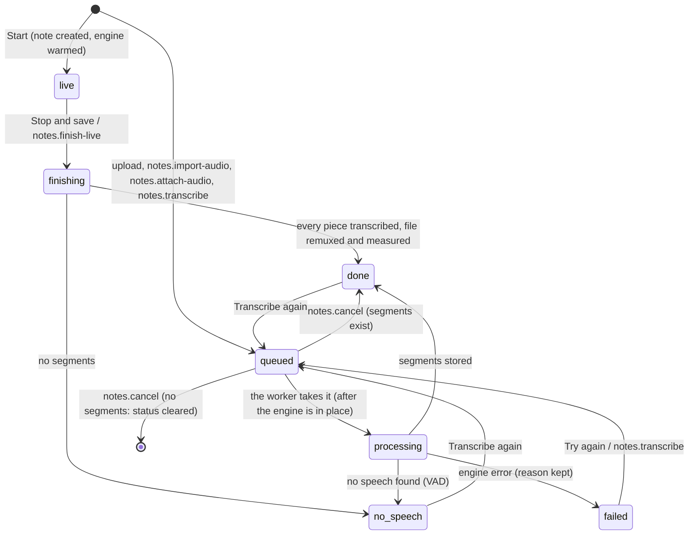
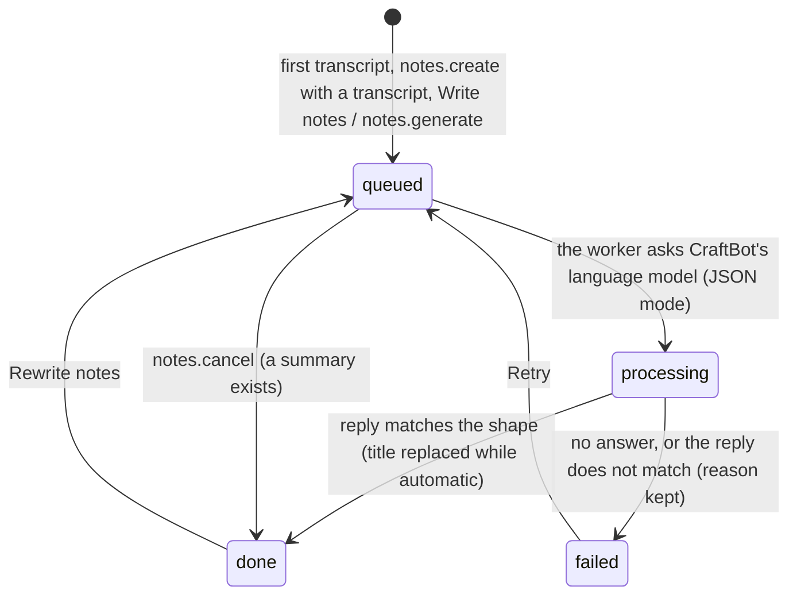

# Requirements: Audio Notes

PART A — REQUIREMENTS (SRS). User-approved before build; frozen after; changes via ## Changes.

## Introduction

### Purpose
Audio Notes is a meeting-notes app for one person on their own Windows PC, used in the browser with no accounts or sign-in. Its one job is to turn what was said into notes. It records meetings, interviews, lectures and voice memos (the microphone, a call's tab audio, or both mixed) with a live transcript, imports audio and video files, and takes pasted transcripts. Audio is transcribed on this PC by a local Whisper engine, and the speakers are told apart by voice (Person 1, Person 2, ...). CraftBot's language model then writes the summary, key points, decisions and action items with owners and due dates. A weekly digest, search across transcripts, and Markdown, TXT and SRT export complete it. An AI agent works on the same notes through A2App. The declared operations run the same handlers the app's screens call.

### Scope
**Goals**
1. A recording shows its transcript while it runs, each sentence about 2.5 s after it is spoken (measured median). Stop leaves a note that finishes its transcript and queues its AI notes with no further step.
2. Every note with audio ends its transcription as done, "no speech found" or failed with a reason. Silence never becomes invented text, and a completely silent recording (peak at -91 dBFS) is reported as silent.
3. A note with a transcript gets its summary, key points, decisions and action items from CraftBot's AI, or a failure with the reason and Retry. A reply that does not match the expected shape is never patched up.
4. A recording survives a closed tab or a crash: every second is backed up in the browser and offered for saving on the next load.
5. Every operation the screens use is available to an agent through the same handler, and every note save by any route obeys the same record rules.

**Core functionalities:** live recording with a live transcript · audio and video upload and import · pasted transcripts · transcription on this PC (Whisper, 99 languages) · speakers told apart by voice · AI-written notes · action items · search and filters · weekly digest · Markdown, TXT and SRT export · audio player · recording recovery · first-run speech engine download

### Approval
Approved by the user: 2026-11-04 — carried over from the published marketplace app `audio-notes` 1.0.0, whose requirements were approved when it was built; this document restates them in the framework's form without changing any feature.

## Product Description

### Product Perspective
`authMode: none`. The app is for one person on their own PC and serves on loopback only. The `notes` and `live_chunks` collection rules are open for that reason, and its own operation routes still require a caller (the View or the agent's credential) for writes. manifest.json declares no integrations (`capabilities.integrations: []`). Speech is processed only on this PC: ffmpeg, whisper.cpp with Silero VAD, and the sherpa-onnx speaker diarizer, run as local programs. The engine (about 408 MB) is not part of the app package. The backend downloads it once from each project's official release (github.com, huggingface.co, files.pythonhosted.org), pinned to one build and checked file by file against SHA-256, using only Windows' own `curl.exe`, `tar.exe` and `certutil.exe`. The app has no language model of its own: the notes are written by CraftBot's language model through the host bridge (`_craftbot_bridge.js` `callLLM`, JSON mode). The app does not use a cloud speech service. Inside CraftBot the app runs in a cross-origin frame, and the host must delegate `microphone` and `display-capture` to it.

### User Characteristics
One person who records their own meetings, online calls, interviews, lectures and voice memos, or brings in recordings made elsewhere. They use a desktop browser on the same Windows PC that runs the app: the microphone, a shared browser tab or the screen, and files on disk. The layout also works at narrow widths, with one pane at a time.

### Constraints
- C-1: Days are local calendar days `YYYY-MM-DD` and must be real days (2026-02-30 is refused). "Today" is the machine's local date, and the View never shifts a day through UTC.
- C-2: A note's JSON fields keep their shapes on every save, whoever writes (`lib_notes.normalize`): `segments` [{start, end, text, speaker}], `key_points`, `decisions`, `attendees`, `people_found` and `people_removed` as lists of strings, `speaker_names` as {label: name}, and `action_items` [{id, title, assignee, due, done}], where `due` is a real day or "".
- C-3: Whenever a note has segments, its transcript is derived from them: one line per segment, written "Person 1: text" once the speaker is known. Without segments, the transcript is the text a person pasted.
- C-4: Fixed vocabularies. Source: recording, upload, import, text. Transcript status: queued, processing, done, no_speech, failed, live, finishing. Notes status and people status: queued, processing, done, failed. An empty status means that step never ran. The status fields are owned by the background lanes.
- C-5: The AI reply must be one JSON object with every key present: title (at most 80 characters asked for, 200 kept), overview (1–3 sentences), summary (3–6 sentences), key_points (3–10), decisions, and action_items with title, assignee and due. A reply that is not that shape fails the run and is never repaired. A due date that is not a real day is dropped. The notes are written in the language of the transcript, from facts stated in it.
- C-6: The AI replaces the title only while `title_auto` is true. Setting a title by hand (the title field or `notes.update`) turns it off for good.
- C-7: Writing the notes again replaces the overview, summary, key points, decisions and action items, and the title while it is automatic. Attendees and the user's own notes are kept, and the AI never changes the user's own notes.
- C-8: Speakers are told apart by their voices, never by names read in the text. People are Person 1, Person 2, ... in order of first speech. A voice heard for less than max(3 s, 1% of the speech) is a fragment, and a voice counts as one of K people only when it, plus the smaller voices, says at least 1/2K of the speech. When that merges voices, the diarizer runs again with that many clusters. A count set by the user (`speaker_count`, 0–20; 0 = detect the number) replaces the count rule.
- C-9: The attendee list is the user's. A name the user removes is remembered (`people_removed`) and is never added back by detection, and a name put back is forgotten there. A new detection removes people an earlier detection added and no longer hears, and names the user typed are never touched. "Detect speakers" and `notes.detect-people` clear the removed list, so the attendees gain every speaker.
- C-10: Renaming a speaker or attendee changes their transcript lines, the attendee list and the action items assigned to them. Renaming to another speaker's name merges the two. Names are at most 80 characters, and a renamed voice keeps its name through later detections (`speaker_names`).
- C-11: A `note_id` accepts the record id or the note's exact title, ignoring case. When several notes share that title, the call answers 409 and lists their ids.
- C-12: Files: an uploaded or attached audio or video file is at most 2 GB. `notes.import-audio` takes mp3, wav, m4a, aac, ogg, oga, opus, webm, flac, wma, aiff, aif, amr, mp4, m4v, mov, mkv, avi and 3gp. A live piece is a 16 kHz mono WAV of at most 20 MB, cut by the browser at the first pause after 2.5 s and never longer than 8 s.
- C-13: Text limits: title 200 characters (required, never empty), category 100, overview and summary 20,000, the user's notes 200,000, transcript 2,000,000. A language is `auto` or a two- or three-letter lowercase code.
- C-14: A transcription never starts for a note without audio, one already queued, processing or finishing, or one still being recorded. Notes are never written without a transcript, or while they are already being written. Speaker detection needs audio and a finished recording, and only one detection runs per note at a time.
- C-15: Recording never substitutes a source: a refused or missing source is an explained error. A microphone whose signal never rises above -100 dBFS is marked "no signal" and cannot be started. The record dialog always opens on Microphone.
- C-16: The speech engine comes only from pinned official releases, and every download and every file taken out of one is checked against its SHA-256 before it is moved into place. A mismatch stops the setup, and nothing unchecked is run. Shadow boots (`CRAFTBOT_APP_ENV=shadow`) never start the download by themselves.
- C-17: Nothing is seeded: a fresh install has no notes.

### Assumptions
- A-1: Volume ceiling: one note holds a meeting of a few hours. A two-hour meeting is about 120,000 characters of transcript and a few thousand segments (migration 1700000002), the transcript field holds 2,000,000 characters, and an audio file up to 2 GB. The sidebar loads the light fields of every note at once, and `notes.list` returns at most 500.
- A-2: The machine running the app is the user's own Windows 10 or 11 PC (it ships `curl.exe`, `tar.exe` and `certutil.exe`), and its local date is the user's date.
- A-3: Measured on an i7-6700 (AGENT_APP.md § Engine): the small model with greedy decoding on half the logical CPUs transcribes at about 0.24× real time, so a 26-minute meeting takes about 6 minutes. Speaker detection of a real 35-minute call took 284 s (two passes) and 113 s with a fixed count.
- A-4: CraftBot (or the framework bridge's harness) answers the language-model call. Without it, writing notes fails with "CraftBot's AI did not answer. Check that CraftBot is running and its model works, then retry."

## Features

### Module: Frame (sidebar)
- F-FRM-1: The user sees a sidebar with the app name, a Record button, an upload button, a "More ways to add" menu (Upload audio or video, New note from text), a search box, a filter, the notes, "Weekly digest", and the speech engine's status at its foot.
- F-FRM-2: WHILE a recording runs THE SYSTEM SHALL show "Recording <m:ss>" on the Record button, and the button opens the recording's page.
- F-FRM-3: The user can search notes and transcripts. The search matches the title, context, summary, transcript, the user's notes and the attendees, starts 250 ms after typing stops, and has a clear button.
- F-FRM-4: The user can filter the list to all notes (with their count), starred notes, or one category.
- F-FRM-5: The user sees the notes newest first, grouped as Today, Yesterday, This week, Last week, Upcoming, or by month. Each row shows a source icon (recording, file or text), the title, the date, the length and the category ("Recording now" while recording), a status icon (recording, processing, failed, no speech found), and a star when starred. "No notes yet." shows when there are none, and "Nothing matches." when a search or filter hides them all.
- F-FRM-6: On wide screens the user can collapse the sidebar into a narrow rail (expand, new recording, upload, starred notes, weekly digest, and the engine dot) and expand it again. The choice is remembered in this browser.
- F-FRM-7: The user sees the engine status line with a colored dot: "Checking speech engine...", "Preparing speech engine download...", "Downloading speech engine... <n>%", "Speech engine download failed", "Speech engine not installed", or "<model>, on this PC".
- F-FRM-8: The user can drop audio or video files anywhere on the page to upload them, under "Drop audio or video to transcribe".
- F-FRM-9: WHEN no note is open THE SYSTEM SHALL open the newest note. With no notes, the page shows "Record your first note" with Record and Upload.
- F-FRM-10: On screens narrower than 768 px the user sees either the list or a note at full width, with a back arrow from a note or the digest to the list.

### Module: Recording (notes, records)
- F-REC-1: The user can start a recording from "New recording" by choosing what to record (Microphone; Microphone + call audio; Tab or screen audio only), the microphone, the spoken language (Detect automatically or one of 18 listed languages) and the category (Meeting, Interview, Call, Lecture, Brainstorm, Voice memo, Personal, General). The microphone, language and category are remembered in this browser, and the dialog always opens on Microphone.
- F-REC-2: The user sees every microphone with a live level meter and its state: "Checking...", "Default microphone", "Working", or "No signal at all: muted, unplugged or a virtual device". WHEN the selected microphone sends no sound THE SYSTEM SHALL keep "Start recording" disabled and offer "Use <name>" for the loudest working microphone.
- F-REC-3: WHEN the microphone or the tab capture cannot be opened THE SYSTEM SHALL say why and what to do: access blocked, not connected, used by another app, not allowed in the frame, sharing cancelled, no audio shared, or the browser cannot record here.
- F-REC-4: WHEN a recording starts THE SYSTEM SHALL create its note ("Recording, <date and time>", with an automatic title) and open its page. That page is the recorder: Paused or Recording, the elapsed time, a waveform, the source, Pause or Resume, "Stop and save", and Discard.
- F-REC-5: The user sees the transcript fill while recording, each sentence a couple of seconds after it is spoken, under "Live transcript" with a "Listening" indicator. The view follows new lines unless the user has scrolled away, and the "My notes" tab can be written while recording.
- F-REC-6: WHILE recording THE SYSTEM SHALL warn in red after 3 s with no signal at all, and in amber after 10 s with nothing heard above room noise. It also says when a source stops: the microphone disconnected, the tab audio stopped, or the source stopped and the recording was saved.
- F-REC-7: WHILE the user looks at another page during a recording THE SYSTEM SHALL show a slim bar on top with the state, the time, a waveform, Open, and the recorder's controls.
- F-REC-8: WHEN the user presses "Stop and save" THE SYSTEM SHALL send the remaining pieces and the audio file, finish the transcript, and queue the AI notes. It toasts "Recording saved. Finishing the transcript...", or "Recording saved. Transcribing on this PC..." when the live transcript could not start.
- F-REC-9: The user can discard a recording after "Discard this recording?" ("The recording and its note will be thrown away. This cannot be undone."). Its note is deleted.
- F-REC-10: THE SYSTEM SHALL back up every second of a recording in this browser. WHEN a recording was not saved (closed tab, restart, crash) THE SYSTEM SHALL show "Unsaved recording from <date> (<length>) was recovered." with "Save as note", which puts it back into its own note when that note still exists, and Discard.
- F-REC-11: WHEN a note is still being recorded but not in this window THE SYSTEM SHALL show "This recording is not running in this window" with "Finish with the transcript so far" and Delete.
- F-REC-12: WHEN a finished recording cannot be saved to the app THE SYSTEM SHALL keep it in the browser and say "The recording could not be saved to the app. It is kept in this browser; save it from the banner."

### Module: Adding notes (notes)
- F-ADD-1: The user can upload one or more audio or video files (picker or drop) of up to 2 GB each. Each becomes a note titled by its file name and is transcribed on this PC ("Uploaded. Transcribing on this PC..."). A larger file is refused with "<name> is larger than 2 GB."
- F-ADD-2: The user can create a note from text ("New note from text") and paste a transcript from Zoom, Teams, Meet or anywhere, then press "Write notes".

### Module: Note page (notes)
- F-NOTE-1: The user sees the note's meta row: a category chip, a date chip that opens the date picker, the length, the detected language, a star, and a "More actions" menu.
- F-NOTE-2: The user can edit the title in place. Enter saves and Escape reverts, and a title set by hand is never replaced by the AI.
- F-NOTE-3: The user can, from "More actions": Export as Markdown, Download transcript (.txt), Download subtitles (.srt), Download audio, Transcribe again..., Rewrite notes, Duplicate and Delete. Each item is disabled when it does not apply.
- F-NOTE-4: The user sees where the note is in its pipeline, with the one action that moves it on: waiting for the speech engine download (with its percent), waiting to transcribe (behind another recording), preparing the audio, transcribing on this PC (percent and time left), finishing the transcript, "CraftBot is writing the notes", transcription failed (the reason, Try again), notes not written (the reason, Retry), no speech found (Transcribe again), completely silent (Delete it), engine not installed, or not transcribed yet (Transcribe). Cancel is offered while work is queued or running.
- F-NOTE-5: The user can play the audio: play and pause, back and forward 15 s, the position slider with times, volume and mute, and a speed of 0.75×, 1×, 1.25×, 1.5× or 2×. Clicking a transcript sentence or a turn's time plays from there, and the sentence being played is highlighted.
- F-NOTE-6: The user can transcribe again with a chosen spoken language ("Transcribe recording" or "Transcribe again"). The current transcript stays until the new one is ready, and existing notes stay as they are until rewritten.
- F-NOTE-7: The user can rewrite the notes from the transcript. When notes exist, "Rewrite the notes?" asks first.
- F-NOTE-8: The user can duplicate a note with its audio, transcript and notes, as "<title> (copy)".
- F-NOTE-9: The user can delete a note after "Delete this note?" ("<title>" and its recording will be deleted for good.). Work running on it stops.
- F-NOTE-10: The user can star and unstar a note, and change its category and date.

### Module: Notes tab (notes)
- F-NTS-1: The user sees Summary, Key points (with the count), Decisions (with the count), Action items ("<n> of <m> done") and Context. Each part is edited in place and saves when the field loses focus.
- F-NTS-2: The user can add, edit and remove key points ("Add a point") and decisions ("Add a decision"). Clearing a point's text removes it.
- F-NTS-3: WHEN a note has no notes THE SYSTEM SHALL show "No notes" (there was no speech), "No notes yet" with "Write notes" (a transcript exists), or "Notes come from the transcript".

### Module: Action items (actions)
- F-ACT-1: The user can add an action item ("Add an action item"), tick it done, and edit its text, owner and due date in place. The due date reads like "Oct 8" with a relative date while open. Clearing the text or pressing the remove button deletes the item.
- F-ACT-2: The user can remove the done items with "Clear <n> done".

### Module: Transcript tab (notes)
- F-TRN-1: The user sees the transcript as turns: the speaker's avatar, name and start time, with the sentences flowing in paragraphs split at pauses of 2 s or more, or after 40 s.
- F-TRN-2: The user can correct every sentence (Edit, then "Done editing"), copy the transcript with timestamps, download it as Text (.txt) or Subtitles (.srt), and see the number of lines.
- F-TRN-3: The user can rename a speaker from the turn's name or its pencil, and the new name applies everywhere in the note.
- F-TRN-4: A note without audio shows a box to paste or type the transcript, with "Write notes" (or "Rewrite notes"). A transcript without timed lines is edited as one text, and a note still waiting says "The transcript appears here when transcription finishes."

### Module: My notes (notes)
- F-MINE-1: The user can write their own notes on the note, including while recording. CraftBot reads them as context and never changes them.

### Module: People (notes)
- F-PPL-1: The user sees the attendees as chips and can rename one (everywhere in the note), remove one, add people by name, or clear all.
- F-PPL-2: WHEN a note's audio has been transcribed THE SYSTEM SHALL tell its speakers apart by voice and list them as Person 1, Person 2, .... The user can run "Detect speakers" again and set how many people speak (Auto count, or 1 to 8 speakers), and a toast reports "Detected <n> speakers", "No speech found to tell speakers apart", or the failure.
- F-PPL-3: The user sees people the detection heard who are not on the list under "Also heard:", and can add each one or "Add all".

### Module: Weekly digest (digest)
- F-DIG-1: The user can view one Monday-to-Sunday week and move to the previous week, back to this week, or to the next week (never past this week).
- F-DIG-2: The user sees the week's totals: Notes, Recorded, Open actions (with the done count), and People.
- F-DIG-3: The user sees each note of the week with its title, date, length, attendees, summary ("No summary yet." when there is none), decisions, and action items whose check boxes tick them. Open, or the title, opens the note.
- F-DIG-4: The user can copy the digest as Markdown or download it as "Weekly digest <week start>.md".
- F-DIG-5: WHEN a week has no notes THE SYSTEM SHALL show "Nothing recorded this week".

### Module: Speech engine (engine)
- F-ENG-1: WHEN the app first launches without its speech engine THE SYSTEM SHALL download the engine once and show a banner above every page with the progress. Recordings and uploads made meanwhile wait and are transcribed as soon as it is ready.
- F-ENG-2: WHEN the download fails THE SYSTEM SHALL show the error with Retry. A partial download resumes where it stopped.
- F-ENG-3: WHEN the engine is not installed and is not downloading THE SYSTEM SHALL show "The speech engine is not installed" with Download.
- F-ENG-4: THE SYSTEM SHALL transcribe in 99 languages, detected automatically unless one is set. A live recording left on automatic keeps the language its first piece was heard in.

### Agent (via A2App)
- F-AGT-1: The agent can perform the app's operations: the 23 operations in ## Operations Design, across the modules notes, actions, digest and engine.
- F-AGT-2: The agent can find and read notes (`notes.list` with search, category, starred and date filters; `notes.get` with the transcript, timed segments and pipeline status).
- F-AGT-3: The agent can add audio from a local file (`notes.import-audio`) or a pasted transcript (`notes.create`, which writes the notes in the background unless `generate` is false), and follow the work with `engine.status` or `notes.get`.
- F-AGT-4: The agent can edit a note (`notes.update`), duplicate it, redo the transcription (optionally in a set language), rewrite the notes, redo the speaker detection (optionally with a known count), rename a speaker, and cancel queued or running work.
- F-AGT-5: The agent can list every open action item across notes, soonest due first and optionally for one assignee (`actions.open`), and add, edit, complete, delete and clear done items.
- F-AGT-6: The agent can export a note as md, txt or srt (`notes.export`) and read a week's digest with its ready-to-share Markdown (`digest.week`).
- F-AGT-7: The agent can finish a recording whose page stopped while recording (`notes.finish-live`) and retry a failed engine download (`engine.install`).
- F-AGT-8: WHEN the agent calls a destructive operation (`notes.delete`, `actions.delete`, `actions.clear-done`) THE SYSTEM SHALL answer `approval_required` until the person has approved that call.
- F-AGT-9: WHEN a note is written by any route (the UI, an operation, the background lanes or a raw record write) THE SYSTEM SHALL apply the same record rules (C-2, C-3, C-1).
- F-AGT-10: The app hands no work to an agent as tasks: events.json declares no events, and the notes are written by CraftBot's language model through the bridge.

## Non-Functional Requirements
- N-1: A spoken sentence appears in the live transcript about 2.5 s after it is spoken (measured median). Pieces are 2.5–8 s, whisper's encoder window is sized to the piece, and the engine is warmed when a recording starts.
- N-2: Transcription runs at about 0.24× real time on the reference PC (A-3).
- N-3: New work starts within a couple of seconds. Each lane (batch, live, speakers, setup) idles on its wake flag until 2 s before the next minute's cron tick.
- N-4: The note list refreshes 150 ms after the last realtime change to `notes`, and a deleted note leaves it at once. The engine status is read every 1.5 s while a note is in the pipeline or the engine is downloading, and every 30 s otherwise.
- N-5: A note that was processing when the app stopped is queued again at boot, and an orphaned engine process is killed.
- N-6: Live pieces are sent in order, one at a time, each tried up to three times (1 s and 2 s apart). Stop waits until every piece is on the server before the note is told to finish.
- N-7: An engine download retries 3 times, gives up connecting after 30 s, and aborts a transfer slower than 1 KB/s for 60 s.

## Data Requirements
- **notes** (module: notes): title (string, required, max 200), category (string, max 100), date (string, max 50), duration (number), starred (boolean), audio (binary), overview (string, max 20000), summary (string, max 20000), my_notes (string, max 200000), transcript (string, max 2000000), action_items (json), created (datetime, server-set), updated (datetime, server-set), title_auto (boolean), source (enum), language (string, max 10), detected_language (string, max 10), transcript_status (enum), transcript_error (string, max 2000), segments (json), notes_status (enum), notes_error (string, max 2000), key_points (json), decisions (json), attendees (json), peak_db (number), people_found (json), people_removed (json), people_status (enum), people_error (string, max 2000), speaker_count (number), speaker_names (json).
- **live_chunks** (module: records): note (ref, required → notes), seq (number), offset (number), audio (binary, required), created (datetime, server-set).

## External Interfaces
- **Human (browser):** one single-user View served by PocketBase at the app's own origin, with no URL routes. The sidebar, the note page (Notes, Transcript and My notes tabs, the player, attendees, the recorder while recording), the weekly digest, the New recording and Transcribe dialogs, and the engine and recovery banners are all switched in place. Input: the microphone, a shared tab's or the screen's audio, audio and video files (picker or drop), and typed or pasted text. Output: Markdown, TXT and SRT exports, the audio file, the digest as a .md file, and copies to the clipboard.
- **Agent (A2App):** the modules and collections in AGENT_APP.md § Modules; operations exactly as declared in ## Operations Design. No other machine interface is offered to agents; the app's own screens call their own routes.
- **Third-party services (backend only):** `files.pythonhosted.org`, `github.com`, `huggingface.co`.

## Out of Scope
- More than one person: accounts, sign-in, sharing or shared links. The first version's unused share fields were removed (migration 1700000002).
- Transcription in the cloud, or a language model of the app's own. Speech is transcribed only on this PC, and the notes come from CraftBot's language model.
- Naming speakers from what is said: voices are told apart, and the names come from the user.
- A speech engine for operating systems other than Windows: the engine is Windows programs fetched with Windows' own tools.
- Shipping the speech engine inside the app package: it is downloaded on the first launch.
- Export formats other than Markdown, TXT and SRT, plus the original audio file.
- Translating notes: they are written in the language of the transcript.
- Work handed to an agent as tasks: the app declares no events.
- Sample notes: nothing is seeded.

## Quality of Life
- The last microphone, spoken language and category are remembered for the next recording, and the sidebar's collapsed state is remembered.
- The newest note opens by itself, and a duplicated or recovered note opens once it is made.
- While transcribing, the pipeline box estimates the time left ("<n>% done, about <length> left").
- Copy buttons show "Copied" for 1.5 s.
- People the detection heard but who are not listed are offered under "Also heard:".

PART B — TECHNICAL SPECIFICATION.

## System Overview
PocketBase 0.39 (JS hooks, migrations) + React 19 / Vite / Tailwind 4 View in `frontend/` built into `pb/pb_public/`, on the `blueprint-pocketbase-kit` toolkit. The View calls the app's own routes `/api/ops/<group>/<verb>` (`ops.pb.js`); the generated `a2app_routes.pb.js` serves the same handlers to agents as `POST /api/ops/<name>`. Recorded and uploaded notes and live pieces are created through the records API, so the record hooks in `notes.pb.js` see every write. Domain logic lives in `pb/pb_hooks/lib_*.js`: notes and exports (`lib_notes.js`), the batch lane (`lib_worker.js`), the live lane (`lib_live.js`), speakers (`lib_people.js`), the engine and its download (`lib_engine.js`, `lib_setup.js`), the AI prompt and reply check (`lib_ai.js`). Four cron lanes run every minute: `audio_notes_worker`, `audio_notes_live`, `audio_notes_people` and `audio_notes_setup`.

Modules → navigation map:

| Module (manifest) | Where a person meets it | Route |
| --- | --- | --- |
| `notes` | Sidebar list, search and filter; the note page (meta row, title, attendees, pipeline box, player, Notes, Transcript and My notes tabs); New recording dialog; upload and "New note from text" | — (no URL routes) |
| `actions` | "Action items" on the note page's Notes tab; the check boxes in the weekly digest | — |
| `digest` | "Weekly digest" at the foot of the sidebar | — |
| `engine` | The engine banner above every page, the status line at the sidebar's foot, the pipeline box | — |
| `records` (`live_chunks`) | No screen: the recorder sends the live pieces | — |

Sidebar order: Record, upload, "More ways to add" · search · filter · notes by date · Weekly digest · engine status. Collapsed rail: expand, new recording, upload · starred notes, weekly digest · engine dot.

## UI Design
- **Design system:** the agent-app UI kit 0.6.0 vendored in `frontend/src/kit` (system-managed). It supplies the `--agent-app-*` tokens and theme packs in `theme/tokens.css`, the theme bridge (host theme, or `prefers-color-scheme` standalone), the shell with its error boundary and toasts, and the components the app uses: Button, Dialog (Radix), Select, Spinner, Progress, EmptyState, DropdownMenu, Stat and StatGrid, RelDate, IdentityChip, useConfirm, useRecord and useDebounce. The app adds no tokens of its own. Its extensions are `components/ui.tsx` (SelectField, DateChip, MetaItem, UnderlineTabs, SectionTitle, IconButton), `components/fields.tsx` (the inline-editing primitives TextBlock, TitleField, InlineInput, NameInput, AddButton, BulletList), and `styles.css` (pointer-cursor rules and the `an-listen` dots). State colors use Tailwind's red (recording, failures), amber (warnings, the starred star, paused) and emerald (done, working) scales, with darker text shades and `dark:` variants. Type scale: 12 (captions, timestamps), 13 (secondary and meta), 14 (UI body), 15 (reading text) and 26 px (page titles), plus the recorder's 28 px clock. Hierarchy comes from weight and color, spacing follows a 4 px grid, and controls in a row share a height (28 px chips, 32 and 36 px buttons). The font is the kit's `--agent-app-font`. Icons come from lucide-react.
- **Layout:** a full-height two-pane frame. From 768 px a 288 px sidebar (or a 56 px rail when collapsed) sits beside the main column, which scrolls on its own. The note page and the digest are centered columns at most 768 px wide with 24 px side padding (40 px from 768 px). The engine and recovery banners sit above them, at most 896 px wide. Below 768 px one pane shows at a time: the list at full width, or the open note or digest with a back arrow. Sections on the note page sit on the canvas under section titles. Boxes (pipeline, recorder, transcript, player) are bordered surfaces with 12 px corners.
- **Screen — Empty (no notes):** primary object: none yet · primary action: Record (Upload beside it) · loading: a full-page spinner until the list arrives · empty: "Record your first note" with "Record a meeting or drop in an audio or video file. It is transcribed on this PC as you go, then CraftBot writes the summary, decisions and action items." · error: a first-load failure shows "Could not load notes: <message>" · narrow: the sidebar takes the full width.
- **Screen — Sidebar:** primary object: the notes · primary action: Record · states: "No notes yet." or "Nothing matches."; status icons on rows (pulsing red dot while recording, spinner while processing, warning when failed, muted speaker when no speech was found); "Recording <m:ss>" on the Record button; the engine line with its dot (gray while checking, pulsing amber while downloading, green when ready, red otherwise) · narrow: full width, shown instead of the note; the collapse button and the rail exist only from 768 px.
- **Screen — Note page:** primary object: one note · primary action: the pipeline box's action (Transcribe, Try again, Retry, Cancel) or reading and editing the notes · loading: a spinner until the note arrives · missing: "This note was deleted." · states: the pipeline box (F-NOTE-4) as a status box, amber for warnings and red with `role="alert"` for failures; the tabs Notes, Transcript and My notes (Transcript or Live transcript and My notes while recording or finishing); the empty states of F-NTS-3 and F-TRN-4; "Audio could not be played" when the player fails · in-flight: dialog buttons spin while working, edits save when a field loses focus · success: toasts "Note deleted", "Note duplicated", detection results; copies show "Copied" · confirm: "Delete this note?", "Rewrite the notes?" · narrow: a back arrow appears at the start of the meta row, and chips wrap.
- **Screen — Recording (the note page while recording):** primary object: the running recording · primary action: "Stop and save" · states: Recording (pulsing red dot) or Paused (amber), the clock, the waveform (newest on the right, the oldest clipped when narrow), the no-signal and quiet warnings, source notices, "Listening" at the end of the live transcript, then "Transcribing the last few seconds" while finishing · confirm: "Discard this recording?" · the slim bar replaces the panel on other pages · narrow: the controls wrap under the clock.
- **Screen — New recording (dialog):** primary object: the source and microphone · primary action: "Start recording" (spins while starting; disabled while the selected microphone has no signal, access is blocked, or no microphone is chosen) · states: "Allow microphone access in the browser prompt to see your microphones.", "No microphone is connected to this computer.", the per-device states (F-REC-2), the tab-sharing note ("After you press Start, the browser asks what to share: pick the meeting tab (or the entire screen) and switch on Share tab audio."), and the start error in place (red, or muted when sharing was cancelled) · narrow: the dialog is min(94vw, 34rem) wide, at most 92 % of the viewport tall, and scrolls inside.
- **Screen — Transcribe (dialog):** primary object: the spoken language · primary action: Start (spins while sending) · copy: "Runs on this PC. The current transcript stays until the new one is ready.", and, when notes exist, "Your notes stay as they are. Use "Rewrite notes" afterwards to update them from the new transcript."
- **Screen — Weekly digest:** primary object: one Monday-to-Sunday week · primary action: switch the week · loading: a spinner · empty: "Nothing recorded this week" ("Notes dated in this week show up here with their summaries, decisions and action items.") · states: four stat tiles ("Open actions" in the warning tone while any are open, good otherwise); "Copy as Markdown" turns to "Copied"; "Copying was blocked by the browser." on failure · narrow: the stat grid has four columns from 1024 px, and a back arrow leads to the list.
- **Screen — Banners:** the engine banner (F-ENG-1 to F-ENG-3) shows the step, the megabytes done of the total, a progress bar and the percent, or the error in red with Retry. The recovery banner (F-REC-10) shows one amber row per unsaved take, with "Save as note" spinning while it saves.
- **Formatting:** days come from `toLocaleDateString` in the browser's locale with a short month ("Oct 8, 2026" on the page, "Oct 8" in lists and items), and list groups read Today, Yesterday, This week, Last week, Upcoming, "<Month> <year>" or Undated. Clock times read "1:15" or "1:02:05", and lengths "45 s", "26 min" or "1 h 7 min". Download sizes read "172 MB", and speeds "1.25x". Due dates add the kit's relative date. Numbers that change use tabular figures. Screens show titles and names, not record ids. Empty values are words: "Set date", "Due date", "Owner", "No category", "-" for nothing recorded, "--:--" for an unknown length. No money is shown.

## Quality Conformance

- **Q1 Completeness & IA:** the sidebar is always present from 768 px (a rail when collapsed): the open note is marked with the selected fill and `aria-current`, and Weekly digest with `aria-current="page"`. Below 768 px the back arrow returns to the list. Every feature is reachable from the sidebar, the note page's meta row and "More actions" menu, its tabs, and the pipeline box. The modules map to screens as in ## System Overview; only `records` has no screen. Names hold app-wide: note, recording, transcript, notes (the AI-written part), action item, attendees and speakers (Person 1, ...), weekly digest, speech engine, CraftBot. The note list, the one working set that grows, has search across transcripts, a starred and category filter, and date groups.
- **Q2 Design system:** tokens are the kit's `--agent-app-*` set, and the app adds none (see ## UI Design). Components draw surfaces, text, borders, accent and selection from those tokens. State meaning uses Tailwind's red, amber and emerald scales consistently: red for recording, failures and destructive hovers, amber for warnings and paused, emerald for done and working. The type scale is 12/13/14/15/26 px plus the 28 px recorder clock, with weight carrying hierarchy. Icons are lucide-react only, with no emoji. Light and dark come from the host through the kit's theme bridge (or `prefers-color-scheme` standalone), and state text carries its own `dark:` shade.
- **Q3 Layout & composition:** spacing follows a 4 px grid, and the reading column is at most 768 px wide. The primary action is the accent Record button in the sidebar, and on a note the pipeline box's single action. The note's title is the one 26 px heading, with sections below in reading size. Rows in the sidebar truncate the title and meta with an ellipsis, while the page shows the full title wrapped. The sidebar lists every note in date groups without pagination (A-1), loading only light fields.
- **Q4 Interaction:** a base rule in `styles.css` gives the pointer cursor to every clickable element (buttons, roles, labels with inputs, sliders, date inputs, inline-editable text until focused) and `not-allowed` to disabled buttons and selects. Destructive actions use the kit's own confirm dialog (Radix, never `window.confirm`), naming the target and the consequence: "Delete this note?" ("<title>" and its recording will be deleted for good.), "Discard this recording?" ("The recording and its note will be thrown away. This cannot be undone."), "Rewrite the notes?" ("The summary, key points, decisions and action items will be replaced. Attendees and your own notes are kept."). Small removals (an action item, a point, an attendee, "Clear all", "Clear <n> done") act at once (see ### Conventions and overrides). Keyboard: inline fields save on Enter or blur and revert on Escape; the title saves on Enter; a transcript sentence plays on Enter or Space; dialogs close on Escape. Inputs are constrained rather than validated: native date pickers, fixed lists for category, language, speed and speaker count, "Start recording" disabled for a dead microphone, menu items disabled when they do not apply, names capped at 80 characters.
- **Q5 State & feedback:** each screen's states are listed in ## UI Design. Busy dialog buttons spin and stay disabled, which guards against double submission. Edits apply in place and save on blur, and the realtime list and the note page update without a refresh. Long work frees the user: the pipeline box shows the step and its progress ("You can keep working; notes are written automatically when it finishes."), the sidebar row shows a spinner, and the result arrives live. Loading is a spinner (see ### Conventions and overrides). Failures show their reason in place with the action that retries (pipeline box, engine banner, record dialog), and operation errors surface as the kit's toast with the operation's message.
- **Q6 Motion:** motion is small and functional: Tailwind's spinners and pulses for running work and the recording dot, the 1.2 s three-dot `an-listen` indicator while listening, color transitions on hover, the 1.5 s "Copied" state, and the smooth scroll that follows new live lines. There are no entrance animations. The app defines no `prefers-reduced-motion` rule (see ### Conventions and overrides).
- **Q7 Content:** the voice is plain, second person and sentence case ("Record your first note", "You can keep working; notes are written automatically when it finishes."). Error copy says what happened and what to do: "Microphone access is blocked. Click the microphone icon in the address bar, allow it for this site, then try again.", "No audio was shared. Pick the meeting tab (or "Entire screen") and switch on "Share tab audio" / "Share system audio".", "The AI reply could not be used (<reason>). Retry to ask again." Operation errors name the parameter and give a valid example ("attendees must be a JSON list of strings, e.g. ["Sarah Chen","Marcus Lee"]"). The app names CraftBot as the one that writes the notes. Terms are fixed: note, recording, transcript, notes, action item, attendees, speakers, weekly digest, speech engine.
- **Q8 Accessibility:** contrast comes from the kit's tokens in every theme pack, light and dark, and state text uses darker shades (red-700, amber-800) with lighter `dark:` shades. Focus: kit buttons draw a 2 px `focus-visible` outline, selects and transcript sentences show a ring, inline fields show a border on focus, and controls that appear on hover also appear on keyboard focus. Dialogs are Radix modals that trap focus and close on Escape. ARIA: `radiogroup` and `radio` for the source and microphone choices, `checkbox` with `aria-checked` on action items, `tablist`, `tab` and `aria-selected` on the tabs, `role="status"` or `role="alert"` on the pipeline box, warnings, banners and the live "Listening" line, `aria-label` and `title` on every icon button, `aria-current` on the open note and the digest, and labels on status icons. Meaning is never color alone: statuses and warnings are written out, and the dead-microphone state shows its own icon and text. Targets: buttons 32–36 px and chips 28 px (see ### Conventions and overrides for smaller ones).
- **Q9 Responsiveness:** below 768 px one pane shows at a time (the list, or a note or the digest with a back arrow), and the collapse rail exists only from 768 px. The meta row and the attendee chips wrap, the recorder's controls wrap under the clock, the slim recording bar wraps, and its waveform clips its oldest bars. The record dialog is min(94vw, 34rem) wide and scrolls within 92 % of the viewport height. The digest's stat tiles go to four columns from 1024 px. Long titles wrap on the page and truncate in rows.
- **Q10 Performance:** the sidebar list loads only light fields (`LIST_FIELDS`: no transcript, segments or long text), so a worker save does not download every transcript again. Search asks the server for matching ids only. The note page loads one record. The engine status is polled at 1.5 s only while work runs and at 30 s otherwise. Server caps: `notes.list` 1–500 (default 50); `notes.get` leaves out the transcript and segments on request (`include_transcript`). Audio loads with `preload="metadata"`. There are no images besides icons.
- **Q11 Caching & freshness:** static: the build is fingerprinted by `pb-build.mjs` into content-hashed assets, and the toolkit serves the document shell `no-store`. Data: operation responses carry no cache headers and are held only as view state. Freshness: the list subscribes to `notes` and refetches 150 ms after the last change, and a deleted id is remembered so that an older reply cannot bring it back. The open note is the kit's `useRecord`, which reloads on its own changes. The digest reloads whenever the list refreshes, and the engine status is polled (N-4). Writes invalidate through the same realtime path. Inline fields keep their draft while focused, so a background save never overwrites what someone is typing.
- **Q12 Data integrity:** one `notes` collection holds each note. Its JSON fields are shape-checked, its dates validated and its transcript derived on every create and update, whoever writes (`notes.pb.js` → `lib_notes.normalize`). Every operation's change to a note runs read-change-save in one transaction (`lib_notes.mutate`), so two writers (the UI, the live lane, the worker) never save over each other. `live_chunks` relate to their note with cascade delete, refuse updates and deletes through the API, and are deleted once transcribed. Days are validated text, lengths are whole seconds, and peaks are dBFS numbers; there is no money. The migrations replay on a fresh database. 1700000002 renamed `sessions` to `notes` and carried the old comma-joined attendees and highlights into lists, and later ones add fields, then drop two counters that are no longer used (1700000006, 1700000007). No indexes are declared.
- **Q13 API:** beyond the adapter, the app's own routes `/api/ops/<group>/<verb>` (GET reads, POST writes) are what the View calls; agents reach the same handlers through the adapter. Every parameter is read by the typed readers in `lib_ops.js` (text, required, true/false, whole numbers with their range, string lists, JSON lists, days, language codes), which answer 400 naming the parameter. Errors share PocketBase's shape `{ status, message }`, with 400, 404, 409 and 500 used for their meaning. `notes.list` is bounded (Q10). Uploads are multipart with a 2 GB body limit. Exports return `{ filename, mime, content }`. Stack traces are never returned.
- **Q14 Architecture:** UI is in `frontend/src/app` (components, `recorder/` for capture, live pieces and the browser backup, `api.ts`, `data.ts` for the live list and engine status, `format.ts`, `types.ts`). The application logic lives in `pb/pb_hooks/lib_*.js`, routes in `ops.pb.js`, and record hooks and the four cron lanes in `notes.pb.js`. The UI calls the same operations the agent calls, so every rule has one server implementation (`lib_notes.js`). Inline editing exists once in `fields.tsx`, and dates, lengths and the category and language lists live once in `format.ts`. Configuration lives in manifest.json and the toolkit's launcher.
- **Q15 Resilience:** engine downloads use `curl.exe` with 3 retries, a 30 s connect timeout and a stall abort, resume partial files, and check SHA-256 before use. A failure stops with its message ("... Check the internet connection, then retry.") and waits for Retry. The language-model call through the bridge times out after 120 s (CraftBot) or 300 s (the framework harness), and an empty answer fails the run with "CraftBot's AI did not answer. Check that CraftBot is running and its model works, then retry." A piece that cannot be sent is retried three times, and the audio file still holds it. Recordings are backed up to IndexedDB every second and offered for recovery. A note left `live` can be finished with the transcript so far. Interrupted work is queued again at boot, orphaned engine processes are killed, and deleting a note stops its process. When the backend is unreachable, the kit toasts "Network error — is the backend running?". A render crash shows the kit's "Something went wrong" panel with "Reload app".
- **Q16 Security & privacy:** with `authMode: none`, the collection rules are open (`""`) because the app is single-user and binds loopback. `live_chunks` refuse updates and deletes. The framework adapter runs its host check, framing policy and credential checks before any app hook. Writes to the records API and to the app's own operation routes require a caller: the View, or the agent's `.agent-token` sent as `X-A2App-Token`. Destructive operations need the person's approval through the adapter. Audio, transcripts and notes stay in `pb/pb_data`, and the transcript, the user's notes and the attendee names are sent only to the host's language model to write the notes. The engine runs only files checked against pinned SHA-256 values. The toolkit sets rate limits (300 requests per minute on `/api/ops/`). Runtime credentials (`.agent-token`, `.principal`, `.superuser`) and the downloaded engine are git-ignored and never shipped.
- **Q17 Observability:** hook errors log prefixed lines through `console.error`: `[audio-notes] op failed:` for 5xx operation errors, plus lines for failed transcriptions, remuxes, live pieces, warm-ups, finishing, speaker detection, unusable AI replies, crashed jobs, the engine setup, the boot requeue and the shutdown. The toolkit adds `[handler-error] <METHOD> <path>: <message>`, and the kit's console relay writes browser errors to `logs/frontend_console.log` (capped at 2 MB). `engine.status` reports the live state of every lane: the running job with its stage and percent, the queue sizes, the live and speaker lanes, and the setup. Health is `/api/_a2app`, the adapter's identity document.
- **Q18 Version control:** commits are per app and per change ("Audio-Notes Living UI", "added Attendee feature", "auto detect attendee feature", "Fix audio note issue and revemp UI/UX", "fix audio note agent app issues"). `.gitignore` excludes credentials, `pb/pb_data/`, the PocketBase binary, the built View `pb/pb_public/`, `frontend/node_modules/`, framework runtime state under `.a2app/`, `logs/`, and the downloaded engine (`engine/bin/`, `engine/models/`, `engine/.download/`). The app builds from a clean checkout with the manifest pipeline alone (`install`, `build`, `start`), and the engine arrives at runtime.

### Conventions and overrides
The published app is restated here unchanged, so these are standing decisions of the approved build, not new work. Revisit any of them when the app is next modified.
- Q4.3 (undo): there is no undo. Deleting a note and discarding a recording are confirmed, while removing an action item, a point, a decision or an attendee, "Clear all" and "Clear <n> done" act at once.
- Q5.2 (designed loading): there are no skeletons. The app, a note and a week of the digest each show one spinner until their data arrives.
- Q5.4 (designed error states): a failed first load of the list shows one line, "Could not load notes: <message>", and operation errors are the kit's toast with the operation's message. The pipeline box, the engine banner and the record dialog have their own designed failure states.
- Q6.3 and Q6.4 (reduced motion, pausable loops): no `prefers-reduced-motion` rule is defined. The spinners, the recording and "writing the notes" pulses, the listening dots and the smooth scroll still move, and the pulses loop while their work runs.
- Q8.3 (announcements): toasts are not in a live region.
- Q8.4 (24 × 24 px targets): the action-item check box is 18 px and the attendee remove button 20 px.
- Q11.2 (declared data policy): operation responses carry no Cache-Control. They are held only as view state and refreshed by realtime changes and the engine poll.
- Q13.4 (bounded lists): `actions.open` returns every open action item, and `digest.week` every note of its week, without a limit.
- Q15.1 (timeouts): the View's calls to its own backend use the PocketBase SDK without a client-side timeout.
- Q16.5 (personal data in logs): an AI reply that cannot be used is logged with its first 2,000 characters, which can include text from the transcript.
- Q17.1 (structured logs): app log lines are prefixed text (`[audio-notes] …`, `[handler-error] …`), not a structured schema.
- Mirrored global rules: none recorded for this app.

## Process Flows

Transcript of a recorded note (live lane), and of an uploaded, imported or attached file (batch lane):

Notes and speakers after a transcript:

Speaker detection follows the same queued → processing → done or failed path in its own lane, queued after every transcription of audio and on "Detect speakers" / `notes.detect-people`.

Speech engine setup: `pending` (starts by itself within a minute) or `off` (a shadow boot waits for `engine.install`) → `downloading` / `installing` file by file, each checked against SHA-256 → `ready`; any failure → `failed` with the message, and Retry / `engine.install` → `downloading` again, resuming partial files.

## Operations Design
| Operation | Module | Entity | appliesWhen | Params | Flags |
| --- | --- | --- | --- | --- | --- |
| notes.list | notes | — | — | q: string, category: string, starred: boolean, from: string, to: string, limit: number | readOnly |
| notes.get | notes | — | — | note_id: string!, include_transcript: boolean | readOnly |
| notes.create | notes | — | — | title: string, date: string, category: string, transcript: string, my_notes: string, attendees: string, generate: boolean | — |
| notes.import-audio | notes | — | — | path: string!, title: string, date: string, category: string, language: string | — |
| notes.update | notes | — | — | note_id: string!, title: string, date: string, category: string, starred: boolean, overview: string, summary: string, my_notes: string, attendees: string, key_points: string, decisions: string, language: string, action_items: string, transcript: string | — |
| notes.delete | notes | — | — | note_id: string! | destructive |
| notes.duplicate | notes | — | — | note_id: string! | — |
| notes.transcribe | notes | — | — | note_id: string!, language: string | — |
| notes.generate | notes | — | — | note_id: string! | — |
| notes.attach-audio | notes | — | — | note_id: string!, duration: number | — |
| notes.finish-live | notes | — | — | note_id: string! | — |
| notes.detect-people | notes | — | — | note_id: string!, speakers: number | — |
| notes.rename-speaker | notes | — | — | note_id: string!, speaker: string!, name: string! | — |
| notes.cancel | notes | — | — | note_id: string! | — |
| notes.export | notes | — | — | note_id: string!, format: enum | readOnly |
| actions.add | actions | — | — | note_id: string!, title: string!, assignee: string, due: string | — |
| actions.update | actions | — | — | note_id: string!, action_id: string!, title: string, assignee: string, due: string, done: boolean | — |
| actions.delete | actions | — | — | note_id: string!, action_id: string! | destructive |
| actions.clear-done | actions | — | — | note_id: string! | destructive |
| actions.open | actions | — | — | assignee: string | readOnly |
| digest.week | digest | — | — | week: string | readOnly |
| engine.status | engine | — | — | — | readOnly |
| engine.install | engine | — | — | — | — |
