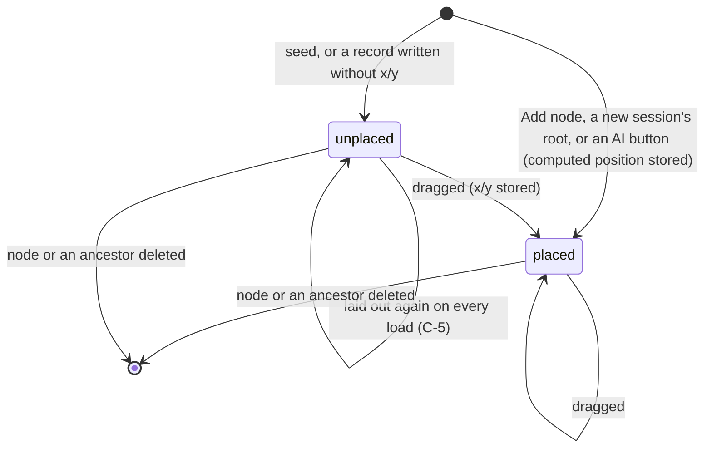

# Requirements: Brainstorm Graph

PART A — REQUIREMENTS (SRS). User-approved before build; frozen after; changes via ## Changes.

## Introduction

### Purpose
Brainstorm Graph is a brainstorming board for one person, used in the browser with no accounts or sign-in. Its one job is to grow a topic into a tree of questions, answers and ideas that the person can see whole.

The person creates named sessions. Each session is anchored by a root node that holds its topic. The tree grows by hand: add a child, edit, drag, delete. It also grows with the AI buttons: Expand, Answer and AI Explore, plus an AI summary.

The same tree is shown three ways:
- a pannable, zoomable graph canvas;
- a collapsible outline;
- a summary.

An AI agent works on the same sessions and nodes through A2App. Its operations do what each click does and write the same records, including where a new card lands on the canvas.

### Scope
**Goals**
1. A session created from a title and a topic opens with the topic as its root idea node in the middle of the canvas.
2. A node added by hand or by an AI button appears as a card below its parent. It is moved further down while another card is in the way, and it keeps its place when the session is opened again.
3. Deleting a node removes its whole subtree, and deleting a session all its nodes, each after a confirmation.
4. One session reads the same in the Graph, Tree and Summary views: every node has the same type, parent and depth in each.
5. Every action a person can take is available to an agent, as an operation or as the same plain record write, and produces the same records.

**Core functionalities:** sessions · graph canvas · tree outline · summary view · node add, edit, move and delete · automatic card placement · AI expand, answer, explore and summary · agent operations

### Approval
Approved by the user: 2026-11-11 — carried over from the published marketplace app `brainstorm-graph` 1.0.0, whose requirements were approved when it was built; this document restates them in the framework's form without changing any feature.

## Product Description

### Product Perspective
`authMode: none`: a local tool for one person (Original requirements: "No auth; single-user local tool"). The app serves on loopback, and its collection rules are open (`""`).

**Integrations and AI.** manifest.json declares no integrations (`capabilities.integrations: []`). The AI buttons and the AI operations ask a language model through the app's host, and the app has no model of its own:
- CraftBot answers when it launched the app;
- under the Agent App Framework, the framework bridge answers with the connected harness's own model;
- with neither, each AI call reports "AI is unavailable (app not running inside CraftBot)" and writes nothing.

**The View.** It is the app's original frontend, kept unchanged. A browser-side adapter (`frontend/src/app/services/apiAdapter.ts`) runs it on PocketBase:
- it translates the frontend's calls into PocketBase record calls and the app's AI routes;
- it computes where cards go on the canvas.

**Deliberately absent:** live sync between screens, cross-links between nodes (the tree's only edges are parent links), and any export.

### User Characteristics
One person brainstorming alone, typically for a few minutes to an hour at a time. They mostly use a desktop or laptop browser with a mouse or trackpad: the canvas is driven by dragging and the wheel. On narrow windows the session list stacks above the canvas.

### Constraints
- C-1: The screens show three node types, and the stored `kind` uses other names:
  - question (blue) is stored as `question`;
  - answer (green) is stored as `insight`;
  - idea (the accent colour) is stored as `idea`. A `task` or empty `kind` is also shown as idea, and the app never writes `task`.
- C-2: Every node belongs to exactly one session and has at most one parent in it. A node without a parent is a root. Parent links are the only edges, and the app never changes a node's parent or session after creation.
- C-3: Deleting a session deletes all its nodes. Deleting a node deletes all its descendants. Both cascades are done by the database.
- C-4: Text limits:
  - a session title is required, at most 255 characters;
  - a session topic is at most 2000 characters, and the New Session dialog requires it;
  - a node's text is required, at most 2000 characters.

  Dialog input is trimmed, and the topic is never edited after creation.
- C-5: A card's position is `x`/`y` on a 3000 × 3000 canvas, and `0`/`0` means "not placed". An unplaced card is laid out again on every load:
  - roots take slots at (1500 + 280·k, 400);
  - children go 220 below their parent, siblings spread 280 apart around it;
  - a slot whose 260 × 160 box overlaps another card moves down by 220, up to 8 times.
- C-6: A new session's root node is an idea that holds the topic, stored at (1500, 400).
- C-7: The AI buttons write fixed shapes:
  - Expand adds up to 3 children of type question;
  - Answer adds one answer child, to question nodes only;
  - AI Explore runs 2, 3 or 5 steps, and each step adds up to 4 ideas under one branch, or as new roots when the session is empty.

  The computed position of every node the AI adds is stored.
- C-8: The AI Explore dialog's choices shape the run:
  - effort is the number of steps, each one model call;
  - the walk starts at the chosen node, or (Auto) at every branch tip, a node with no children, shallowest and oldest first;
  - breadth-first grows the oldest waiting branch next, so every tip is grown before the walk goes deeper; depth-first grows the newest, so it keeps drilling into the ideas it just added. Each step's new ideas join the walk;
  - the prompt names the branch and asks for side-by-side angles (breadth-first) or narrower ideas that drill into it (depth-first).

  The walk stops early when no branch is left, or when a later step gets no answer from the model.
- C-9: The first start seeds one session, "Welcome brainstorm". Its root question "How could we use this board?" has three children ("Plan a product launch", "Map out blog post topics", "What is blocking the team?"). All four are unplaced.
- C-10: Each node stores who made it (`created_by`). Nodes the AI buttons or an agent's operations create are `agent` and read "Created by AI"; the person's own are `user` and read "Created by you". An empty value, as on the seed, reads as the person's.

### Assumptions
- A-1: Volume ceiling: 500 nodes per session, the most the screens load and lay out (the 500 oldest), and 500 sessions in the sidebar list.
- A-2: The machine running the app is the user's own, and the app binds loopback.
- A-3: A language model's answer to one node fits the 2000-character node limit. A longer answer fails to save.

## Features

### Module: Frame
- F-FRM-1: The user sees one screen: a 220 px sessions sidebar on the left, and on the right a 48 px toolbar above the current view.
- F-FRM-2: The user can collapse and expand the sessions sidebar with the toolbar's list button.
- F-FRM-3: WHEN a session is open THE SYSTEM SHALL show its title and node count ("<n> nodes") in the toolbar, plus the AI Explore button.
- F-FRM-4: The user can switch between the Graph, Tree and Summary views with the toolbar's three-button toggle. The Graph view keeps its pan and zoom while another view is shown.
- F-FRM-5: WHEN the app starts THE SYSTEM SHALL show "Loading…" until the session list has loaded, then the sidebar with no session open.
- F-FRM-6: WHEN the session list cannot be loaded THE SYSTEM SHALL show an error banner above the view.
- F-FRM-7: WHEN the host switches the theme, or between light and dark, THE SYSTEM SHALL recolour backgrounds, surfaces, text, borders and the accent from the host's tokens. The brutalist theme flattens every corner. Question blue, answer green and error red stay fixed.
- F-FRM-8: The user sees the outcome of every action as a toast at the top right.
- F-FRM-9: WHEN the window is narrower than 768 px THE SYSTEM SHALL stack the session list (full width, at most 160 px tall) above the toolbar and the view.

### Module: Sessions (sessions)
- F-SES-1: The user sees every session in the sidebar, most recently changed first, each showing its title and topic on one line each.
- F-SES-2: WHEN there are no sessions THE SYSTEM SHALL show "No sessions yet. Create one to start."
- F-SES-3: The user can create a session from the "+" in the sidebar header, in the "New Brainstorm Session" dialog. It asks for a session title and a topic to explore. Create stays disabled until both are filled, and Enter in either field creates it.
- F-SES-4: WHEN a session is created THE SYSTEM SHALL add its root node, an idea holding the topic, in the middle of the canvas and open the session.
- F-SES-5: The user can open a session by clicking it. The open session is marked with an accent tint and an accent bar on its left.
- F-SES-6: The user can rename a session inline from its pencil icon. Enter or the check saves, and Escape or the cross cancels. An empty name changes nothing.
- F-SES-7: The user can delete a session from its trash icon after confirming "Delete session?" ("This will delete the session and all its nodes."). It is deleted with all its nodes, and the most recently changed remaining session opens.
- F-SES-8: WHEN the app is first started THE SYSTEM SHALL contain the example session "Welcome brainstorm" (C-9).

### Module: Graph view (nodes)
- F-GRA-1: The user sees the open session as cards on a 3000 × 3000 canvas with a dot grid. A curved line joins each child to its parent, from the bottom edge of the parent's card to the top of the child's.
- F-GRA-2: The user can navigate the canvas:
  - pan by dragging the background;
  - zoom with the mouse wheel around the pointer, or with the zoom buttons around the centre, between 25 % and 200 % (the percentage is shown);
  - "Reset & fit" to centre the session at 100 %.
- F-GRA-3: WHEN a session is opened THE SYSTEM SHALL centre the view on its cards at 100 %.
- F-GRA-4: The user sees on each card:
  - its type badge in the type's colour;
  - a person or robot icon for who created it;
  - a spinner while an AI button works on it;
  - its text, clamped to four lines.
- F-GRA-5: The user can drag a card to a new place. Its lines follow while dragging, and the position is stored on release.
- F-GRA-6: The user can click a card without dragging it to open the node's detail.
- F-GRA-7: WHEN the pointer is over a card THE SYSTEM SHALL show its actions: Expand, Answer (on questions only), add a child, and delete.
- F-GRA-8: WHEN a card has no stored position THE SYSTEM SHALL lay it out as in C-5.
- F-GRA-9: WHEN no session is open, or the open one has no nodes, THE SYSTEM SHALL show "Create a session to start brainstorming".

### Module: Tree view (nodes)
- F-TRE-1: The user sees the open session as an outline indented by depth. Each row shows a coloured type dot, the text on one line, and a robot icon on nodes the AI made.
- F-TRE-2: The user can collapse and expand any branch with its chevron.
- F-TRE-3: The user can click a row to open the node's detail. Hovering a row shows the same actions as a card: Expand, Answer (on questions only), add a child, delete.
- F-TRE-4: WHEN the session has no nodes THE SYSTEM SHALL show "No nodes yet. Create a session to start."

### Module: Nodes (nodes)
- F-NOD-1: The user sees three node types: question (blue), answer (green) and idea (the accent colour).
- F-NOD-2: The user can open a node's detail and read its type, "Created by AI" or "Created by you", its depth, and its full text.
- F-NOD-3: The user can switch the detail to "Edit node" with the pencil, change the type and the text, and Save. Save is disabled while the text is empty, and Ctrl/⌘+Enter saves.
- F-NOD-4: The user can add a child under any node in the "Add node" dialog, choosing a type (Question by default, or Answer or Idea) and the text. Add is disabled while the text is empty, and Ctrl/⌘+Enter adds.
- F-NOD-5: WHEN a child is added THE SYSTEM SHALL place it below its parent, after its siblings, moved down while another card is in the way, and store the position.
- F-NOD-6: The user can delete a node after confirming "Delete node?" ("This will delete the node and all its descendants."). Its whole subtree is removed.

### Module: AI buttons (nodes, sessions)
- F-AI-1: The user can press Expand on any node. The AI adds up to three follow-up questions as its children, each placed and stored on the canvas.
- F-AI-2: The user can press Answer on a question node. The AI writes a two-to-three-sentence answer as an answer child, placed and stored.
- F-AI-3: The user can open AI Explore from the toolbar and choose:
  - a search strategy (breadth-first or depth-first);
  - an effort (2, 3 or 5 steps);
  - a start node (or Auto, "start from the branch tips").

  Starting it runs that many steps as in C-8. Each step makes the AI add up to four new ideas under one branch, or new roots when the session is empty, each placed and stored.
- F-AI-4: WHILE AI Explore runs THE SYSTEM SHALL show the "AI Explore running" dialog with a step counter that moves on as each step finishes. Afterwards it toasts "AI explored <n> steps", counting the steps run, or "Nothing left to explore" when no node was added.
- F-AI-5: WHILE an AI button runs THE SYSTEM SHALL disable the AI Explore button, and Expand and Answer on the node it works on.
- F-AI-6: WHEN no language model answers THE SYSTEM SHALL write nothing and show "AI is unavailable (app not running inside CraftBot)".
- F-AI-7: The user sees the nodes the AI buttons or an agent made marked "Created by AI" (robot icon), also after a reload (C-10).

### Module: Summary view (sessions)
- F-SUM-1: The user sees the open session's counts: nodes, questions, answers, ideas, and how many levels deep it goes.
- F-SUM-2: WHEN the Summary view opens, or the open session or its node count changes, THE SYSTEM SHALL ask the AI for a short summary and show it under "Session Summary". The summary is 3–5 bullet points ending with a suggested next step. Refresh asks again.
- F-SUM-3: The user sees "Explored Nodes": every node listed by depth, then by creation, with its type.
- F-SUM-4: WHEN the session has no nodes THE SYSTEM SHALL show "Create a session and add some nodes first." and ask nothing of the AI.

### Agent (via A2App)
- F-AGT-1: The agent can perform every action a person can. It uses the 10 operations in ## Operations Design (modules sessions and nodes), or a plain record write where the app itself makes one: rename a session, delete a session, move a card.
- F-AGT-2: The agent can read a session as the person sees it with `sessions.get`: the counts, and each node's type, parent, depth and canvas position. `sessions.outline` gives the same tree as text.
- F-AGT-3: WHEN the agent creates a session, or adds or edits a node, through an operation THE SYSTEM SHALL write the same records and positions as the matching dialog, with every node it creates stored as `created_by: agent` (C-10).
- F-AGT-4: WHEN the agent calls `nodes.expand`, `nodes.ai-answer` or `sessions.ai-explore` THE SYSTEM SHALL do what the Expand, Answer and AI Explore buttons do, with the same prompts, types and stored positions. `sessions.ai-explore` takes the dialog's strategy, effort and start node (C-8). `sessions.summarize` gives the Summary view's AI summary.
- F-AGT-5: WHEN the agent calls `nodes.delete` THE SYSTEM SHALL answer `approval_required` until the person has approved that call. It then deletes the node with its subtree and reports the ids removed.
- F-AGT-6: WHEN no language model answers an AI operation THE SYSTEM SHALL answer 503 with "AI is unavailable (app not running inside CraftBot)" and write nothing.
- F-AGT-7: The agent's AI operations use the host's model: CraftBot's when it launched the app, otherwise the connected harness's own model through the framework bridge.

## Non-Functional Requirements
- N-1: A language-model call waits at most 120 s through CraftBot and 300 s through the framework bridge. The AI Explore dialog warns that each step can take up to about two minutes.
- N-2: Opening a session takes one request for up to 500 nodes, laid out in the browser.
- N-3: The screens refresh on the person's own actions only:
  - a session's nodes reload when it is opened;
  - the session list reloads when a session is created, renamed or deleted, or the page is reloaded.

  Changes made by an agent or another tab appear then.
- N-4: The layout serves desktop widths down to phone widths. Below 768 px the session list stacks above the toolbar and the view.
- N-5: The toolkit rate-limits agent calls to 300 operation calls and 1,200 record calls per minute.

## Data Requirements
- **sessions** (module: sessions): title (string, required, max 255), topic (string, max 2000), created (datetime, server-set), updated (datetime, server-set).
- **nodes** (module: nodes): session (ref, required → sessions), content (string, required, max 2000), kind (enum), x (number), y (number), created (datetime, server-set), updated (datetime, server-set), parent (ref → nodes), created_by (enum).

## External Interfaces
- **Human (browser):** one single-user View served by PocketBase at the app's own origin, with no routes. The views are switched in the toolbar:
  - the sessions sidebar and the toolbar;
  - the Graph, Tree and Summary views;
  - seven dialogs: New Brainstorm Session, Delete session, node detail and edit, Add node, Delete node, AI Explore, and AI Explore running.

  There is no file input or output.
- **Agent (A2App):** the modules and collections in AGENT_APP.md § Modules; operations exactly as declared in ## Operations Design. No other machine interface is offered to agents; the app's own screens call their own routes.
- **Third-party services:** none called directly. The language model is reached through the host: CraftBot's bridge, or the Agent App Framework's bridge.

## Out of Scope
- More than one person: accounts, sign-in, sharing.
- Links between nodes other than parent links, and moving a node to another parent or another session.
- Editing a session's topic after it is created.
- Creating a root node by hand. Roots come from creating a session, or from AI Explore on a session that has no root.
- Undo, redo and version history.
- Live sync of changes between tabs, or from an agent, while a session is open.
- Export and import of any kind: files, images, Markdown.
- Search across nodes or sessions.
- A language model of the app's own, and integrations.
- The Summary view's "Key Themes" and "Key Insights" sections, which are never filled and so never shown.
- Task-type nodes in the View.

## Quality of Life
- Ctrl/⌘+Enter saves the node editor and adds in the Add node dialog. Enter creates a session from the dialog. Enter and Escape commit or cancel a rename.
- The Graph view keeps its pan and zoom while another view is shown.
- Lines start at each card's measured bottom edge, so short cards have no dangling line.
- The AI Explore "Start from" list labels each node with its type and its first 44 characters.

PART B — TECHNICAL SPECIFICATION.

## System Overview
PocketBase 0.39 (JS hooks, migrations) + React 19 / Vite / Tailwind 4 View in `frontend/` built into `pb/pb_public/`, on the `blueprint-pocketbase-kit` toolkit.

**The View** is the app's original frontend, kept unchanged:
- components in `frontend/src/app/components`;
- state in `AppController.ts`.

Its data layer is `services/apiAdapter.ts`, a fetch adapter in the browser that does three jobs:
- it translates the frontend's calls into PocketBase's records API for `sessions` and `nodes`;
- it calls the app's AI routes `/api/ops/<group>/<verb>` (`ops.pb.js`);
- it computes card placement.

**The agent operations** live in `agent_ops.pb.js` and `lib_agent.js`. That library ports the adapter's placement and the AI prompts of `ops.pb.js`. The generated `a2app_routes.pb.js` serves every declared operation to agents as `POST /api/ops/<name>`.

Modules → navigation map:

| Module (manifest) | Where a person meets it | Route |
| --- | --- | --- |
| `sessions` | Sessions sidebar (list, New session, rename, delete); toolbar title and node count; AI Explore; Summary view | — (one screen; views switch in the toolbar) |
| `nodes` | Graph canvas and Tree outline (cards and rows, node detail and edit, Add node, Delete node, Expand, Answer) | — |

## UI Design
- **Design system:** the app keeps its original design system, the "CraftBot Browser Interface", in two places.
  - **Components:** `components/ui/index.tsx` has Button, Input, Textarea, Select, Checkbox, Toggle, Card, Alert, Badge, Modal, Table, EmptyState, Tabs and List.
  - **Tokens:** `styles/global.css` sets a 4 px spacing scale, radii of 4/6/8/12 px, type from 12 to 20 px, and an Inter-first system font stack.
  - **Host theme:** `styles/theme-bridge.css` maps those variables onto the kit's `--agent-app-*` tokens. The kit's theme bridge sets those from the host, so background, surfaces, text, borders and the accent follow the host theme. The brutalist theme flattens every corner.
  - **Fixed colours:** question blue `--color-info` (#3B82F6), answer green `--color-success` (#22C55E) and error red `--color-error` (#EF4444).
  - **Libraries:** icons are lucide-react, and toasts are react-toastify (top right, 3 s, coloured).
  - **Kit:** the agent-app UI kit 0.5.0 is vendored in `frontend/src/kit` (system-managed). It supplies the shell, the error boundary, the theme bridge and the console relay.
- **Layout:** one full-height screen.
  - **Sidebar:** a 220 px sessions sidebar on the left, with a "Sessions" header and a "+", that collapses to nothing.
  - **Toolbar:** a 48 px toolbar on the right. Its left side holds the sidebar toggle, the session title and a node-count pill; its right side holds AI Explore and the Graph/Tree/Summary toggle.
  - **View area:** the current view fills the rest.
  - **Graph:** a 3000 × 3000 canvas moved by transform, with 240 px wide cards that size to their text and zoom controls at the bottom right.
  - **Tree:** indented 18 px per level.
  - **Summary:** a content column of at most 800 px.
  - **Narrow:** below 768 px the sidebar stacks above the main area.
- **Screen — Sessions sidebar:** primary object: the sessions · primary action: "+" (New session) · empty: "No sessions yet. Create one to start." · per row: title and topic, with rename and delete icons on hover. The open session has an accent tint and a left bar · rename is an inline field with check and cross · delete asks first (Delete session dialog) · success: toasts "Session created", "Renamed", "Session deleted" · error: "Failed to create session", "Failed to rename session", "Failed to delete session", "Failed to load session" · narrow: full width, at most 160 px tall.
- **Screen — Graph view:** primary object: the open session's cards · primary action: hover a card for Expand, Answer, add a child or delete; click it to open its detail · loading: "Loading…" until the session list arrives · empty: "Create a session to start brainstorming" · in-flight: a spinner on the card an AI button works on, whose Expand and Answer are disabled · success: toasts "Expanded with AI", "Answered with AI", "Node added", "Deleted"; new cards appear in place · error: the AI's message ("AI is unavailable (app not running inside CraftBot)") or "Expand failed", "Answer failed", "Delete failed" · narrow: the canvas fills the area under the stacked sidebar.
- **Screen — Tree view:** primary object: the open session as an outline · primary action: click a row to open its detail; hover actions as on cards · empty: "No nodes yet. Create a session to start." · in-flight: a spinning "⟳" on the row an AI button works on · narrow: rows truncate with an ellipsis.
- **Screen — Summary view:** primary object: the session's counts and AI summary · primary action: Refresh · empty: "Create a session and add some nodes first." · loading: "Synthesizing your brainstorming session…", and the Refresh button reads "Generating…" · error: the message in red under the counts · narrow: the counts wrap.
- **Screen — Node detail and edit (dialog):** primary object: one node · primary action: the pencil, "Edit this card".
  - **Read view:** a strip with the type pill, "Created by AI"/"Created by you" and "Depth <n>", above the full text in large type.
  - **Edit view:** titled "Edit node", with Type and Content (the field grows to 400 px), the hint "⌘↵ to save", and Cancel / Save. Save is disabled while the text is empty and shows a spinner while saving.
  - **Feedback:** success toasts "Saved"; error toasts "Save failed".
- **Screen — Add node (dialog):** primary object: the new child · primary action: Add (disabled while the text is empty) · fields: Type (Question by default) and Content ("Enter your question, answer, or idea…") · success: "Node added" · error: "Failed to add node".
- **Screen — Delete node (dialog):** "Delete node?" with "This will delete the node and all its descendants." · Cancel / Delete (danger).
- **Screen — Delete session (dialog):** "Delete session?" with "This will delete the session and all its nodes." · Cancel / Delete (danger).
- **Screen — New Brainstorm Session (dialog):** "Session title" ("e.g. AI Research") and "Topic to explore" ("e.g. Artificial Intelligence") · primary action: Create, disabled until both are filled.
- **Screen — AI Explore (dialogs):** the launch dialog has the search strategy toggle with a one-line explanation of each choice, Effort (Low 2 / Medium 3 / High 5 steps), and Start from ("Auto — start from the branch tips", or any node). It notes that each step can take up to about two minutes · primary action: "Start Exploring" · in-flight: the "AI Explore running" dialog with a spinner and "Exploring — step <x> of <n>…", where <x> is the step under way: it moves on as each step finishes · success: "AI explored <n> steps" or "Nothing left to explore" · error: the AI's message or "Explore failed".
- **Formatting:** no dates, money or record ids are shown.
  - **Numbers:** node counts read "<n> nodes", and zoom reads "<n>%".
  - **Types:** type badges are in upper case on cards and in the detail. The Summary outline names the type in lower case.
  - **Text:** a card clamps it to four lines. The tree, the sidebar and the outline show one line with an ellipsis. The detail shows the full text with its line breaks.
  - **Depth:** reads "Depth <n>", counting the root as 0.

## Quality Conformance

- **Q1 Completeness & IA:** the app is one screen. The sidebar lists every session and marks the open one, and the toolbar names the open session with its node count. The view toggle shows the active view. Every node action sits on the card or row itself, and the session actions on the sidebar row, so nothing is more than a hover away. The modules map to that screen as in ## System Overview. Names hold app-wide: session, node, question, answer, idea, Expand, Answer, AI Explore. The working sets are the session list, which is unpaginated with 500 at most, and the open session's nodes, explored by panning, zooming or collapsing branches. There is no search.
- **Q2 Design system:** tokens are the app's original variables in `global.css`, mapped onto the kit's `--agent-app-*` tokens by `theme-bridge.css`. Only the three type colours and the error red are fixed. Shared widgets exist once in `components/ui/index.tsx`, with icons from lucide-react. The components also carry their own `<style>` blocks, and the canvas lines and card shadows use fixed rgba values (### Conventions and overrides).
- **Q3 Layout & composition:** the frame is fixed: a 220 px sidebar and a 48 px toolbar. The Graph view is free-form: cards are 240 px wide and placed by C-5 or by dragging. The Tree indents 18 px per level, and the Summary column is at most 800 px wide with its outline indented 16 px per level. Long text is clamped on cards and truncated with an ellipsis in single-line places.
- **Q4 Interaction:** cards, rows and buttons show a pointer cursor and a hover state, and a card lifts slightly on hover. A movement of more than 4 px turns a press on a card into a drag, and anything less opens the detail. Deleting a node asks first ("Delete node?"), and so does deleting a session ("Delete session?"). Keyboard: Ctrl/⌘+Enter saves the editor and adds in the Add dialog, Enter creates a session, Enter and Escape commit or cancel a rename, and Escape closes any dialog. Inputs are constrained: Create, Add and Save stay disabled until their text is filled.
- **Q5 State & feedback:** each screen's states are listed in ## UI Design. The app shows "Loading…" until it has the session list. An AI button shows a spinner on its node, and AI Explore shows its progress dialog. While any AI call runs, the AI Explore button is disabled, and so are Expand and Answer on that node. Every action ends in a success or error toast. An error toast carries the AI's message when there is one. A failed load of the session list shows an error banner.
- **Q6 Motion:** dialogs fade in and slide up over 150 ms. Cards and buttons change over 100–150 ms on hover, and the sidebar collapses over 180 ms. Spinners turn once a second. There is no reduced-motion variant (### Conventions and overrides).
- **Q7 Content:** labels are short and in sentence case ("Session created", "Expanded with AI", "Nothing left to explore"). Errors show the operation's own message when it has one ("AI is unavailable (app not running inside CraftBot)"), or else a plain "Failed to …". The AI Explore dialog explains each strategy in one line and warns about wait times. Terminology is fixed: session, topic, node, question, answer, idea.
- **Q8 Accessibility:**
  - **Dialogs:** `role="dialog"` with `aria-modal`. Escape or a click on the backdrop closes them. The Add and Edit text fields and the rename field take focus when they open.
  - **Focus and labels:** a 2 px accent outline marks `:focus-visible`. Icon-only buttons are named by `title`, and the dialog close button by `aria-label`.
  - **Meaning beyond colour:** cards and the detail show the type as a written badge. The tree's type dot carries a `title`.
  - **Contrast:** colours come from the host theme's tokens.
  - **Known gaps** (### Conventions and overrides): cards and tree rows are mouse-operated elements that the keyboard cannot reach, and dialogs do not trap focus.
- **Q9 Responsiveness:** the app is desktop-first. Below 768 px the sidebar stacks above the main area at full width, and its list scrolls within 160 px. Panning, zooming and dragging cards use mouse events and the wheel, with no touch gestures (### Conventions and overrides).
- **Q10 Performance:** at A-1, opening a session is one request for at most 500 nodes, and the layout is computed in the browser. The session list is one request of at most 500 rows. There are no images or web fonts. The Summary view asks the AI once each time it opens, or when the session or its node count changes.
- **Q11 Caching & freshness:** static: the built assets have content-hashed names, and the toolkit serves the document shell with `Cache-Control: no-store`. Data is kept only as in-memory view state:
  - a session's nodes reload when it is opened;
  - the session list reloads after a create, rename or delete, or a page reload;
  - there is no realtime subscription, so changes made elsewhere appear on the next of those (N-3).
- **Q12 Data integrity:**
  - **Schema rules:** the schema enforces required fields, text limits, the `kind` values and the single relations. Its two cascades remove a session's nodes and a node's subtree.
  - **No uniqueness or app hooks:** there are no unique indexes, and the app adds no record hooks of its own. The toolkit's backstop checks the View's record writes against the field definitions.
  - **Non-atomic View writes:** the View's two-step writes are separate requests: a session and then its root, and an AI route and then the placement and type patches.
  - **Atomic agent writes:** the agent operations make the same writes in one transaction.
  - **Migrations:** they replay on a fresh database. The seed adds the example session once.
- **Q13 API:** the View calls PocketBase's records API for sessions and nodes, and the app's routes `/api/ops/<group>/<verb>` for AI. Agents reach the declared operations through the adapter at `POST /api/ops/<name>`, with the protocol envelope. Operation errors are `{ error }` with 400, 404 and 503, plus 500 for an unexpected failure in an agent operation. The handlers check every parameter and never return stack traces.
- **Q14 Architecture:** the code splits into three parts.
  - **View:** the components (MainView, SessionSidebar, GraphView, NodeCard, TreeView, SummaryView), the state in `AppController.ts`, and the data layer and placement in `apiAdapter.ts`.
  - **Server:** `ops.pb.js` holds the AI routes the View calls, and `agent_ops.pb.js` with `lib_agent.js` holds the agent operations.
  - **Agent routes:** `a2app_routes.pb.js` is generated.

  The placement rule and the three AI prompts exist twice, in the View's adapter and in `lib_agent.js` (### Conventions and overrides). Configuration lives in manifest.json and the toolkit's launcher.
- **Q15 Resilience:** an AI call that gets no answer degrades to the 503 message, with nothing written. A failed summary leaves the Summary section empty. The adapter answers every View call with a well-formed result rather than throwing. Language-model calls time out after 120 s (CraftBot) or 300 s (framework bridge). A render crash shows the kit's "Something went wrong" panel with "Reload app".
- **Q16 Security & privacy:**
  - **Access:** with `authMode: none`, collection rules are open (`""`) because the app is single-user and binds loopback. The framework adapter runs its host check, framing policy, credential checks and rate limits (N-5) before any app route. The app's own operation routes require a caller: the View, or the agent's credential.
  - **Approval:** the destructive `nodes.delete` needs the person's approval.
  - **Data leaving the app:** the AI prompts send the session topic and node texts to the host's model and nowhere else. Nothing else leaves the app.
  - **Credentials:** runtime credentials (`.agent-token`, `.principal`, `.superuser`) are git-ignored and never shipped.
- **Q17 Observability:**
  - **Server logs:** agent operations log `[brainstorm-graph] agent operation failed:` for unexpected failures, and the toolkit logs `[handler-error] <METHOD> <path>: <message>` for uncaught handler errors.
  - **Browser logs:** the kit's console relay ships browser errors and warnings to `logs/frontend_console.log`, capped at 2 MB.
  - **Health:** `/api/_a2app`, the adapter's identity document.
- **Q18 Version control:** commits are per app and per change ("Fix UI tokens", "Brutalist theme fix"). `.gitignore` excludes:
  - credentials;
  - `pb/pb_data/` and the PocketBase binary;
  - the built View `pb/pb_public/` and `frontend/node_modules/`;
  - framework runtime state under `.a2app/`;
  - `logs/`.

  The app builds from a clean checkout with the manifest pipeline alone (`install`, `build`, `start`).

### Conventions and overrides
The published app is restated here unchanged, so these are standing decisions of the approved build, not new work. Revisit any of them when the app is next modified.
- Q2 (no hardcoded colours): the canvas lines and the card and dialog shadows use fixed rgba values, and each component carries its own `<style>` block next to the shared widgets.
- Q6 (reduced motion): there is no `prefers-reduced-motion` variant. The motion is limited to short fades, hovers and spinners.
- Q8 (keyboard and focus): cards and tree rows are mouse-operated elements, not keyboard-focusable controls. Dialogs close on Escape but do not trap focus. Icon buttons are named by `title`.
- Q9 (touch): the canvas uses mouse and wheel events only.
- Q11 (freshness): there is no realtime subscription. A change made outside the person's own actions appears when the session is opened again or the page reloads.
- Q12 (atomic multi-step writes): the View's two-step writes are separate requests. The agent operations make them in one transaction.
- Q14.4 (one implementation per rule): the card-placement rule and the AI prompts are implemented twice. The View has them in `apiAdapter.ts` and `ops.pb.js`, and the agent operations in `lib_agent.js`. They are kept in step by hand and checked by a scenario that runs both and compares the stored records.
- Mirrored global rules: none recorded for this app.

## Process Flows

Card position:

An AI button (Expand, Answer, AI Explore) runs four steps:
1. The model is asked through the host bridge. An empty answer ends the flow with the 503 message, and nothing is written.
2. The new nodes are saved unplaced, with `created_by: agent`: Expand writes `idea` children, Answer one `insight`, and AI Explore up to four `idea`s.
3. The session is laid out with them.
4. Each new node's position is stored, and for Expand its type is set to `question`.

AI Explore repeats the four steps once per step of its effort, on the branch C-8 picks; an empty answer after the first step ends the run with what was added. The View runs these steps as separate requests, and the agent operations run steps 2–4 in one transaction.

## Operations Design
| Operation | Module | Entity | appliesWhen | Params | Flags |
| --- | --- | --- | --- | --- | --- |
| sessions.summarize | sessions | — | — | session_id: string! | — |
| sessions.outline | sessions | — | — | session_id: string! | readOnly |
| sessions.get | sessions | — | — | session_id: string! | readOnly |
| sessions.create | sessions | — | — | title: string!, topic: string! | — |
| sessions.ai-explore | sessions | — | — | session_id: string!, strategy: enum, effort: enum, start_node_id: string | — |
| nodes.add | nodes | — | — | parent_id: string!, content: string!, type: enum | — |
| nodes.edit | nodes | — | — | node_id: string!, content: string, type: enum | — |
| nodes.expand | nodes | — | — | node_id: string! | — |
| nodes.ai-answer | nodes | — | — | node_id: string! | — |
| nodes.delete | nodes | — | — | node_id: string! | destructive |

## Changes
- 2026-11-11 defect fixes: the user asked for the published app's known defects to be fixed. Who made each node is stored in the new `created_by` field, so the "Created by AI" mark survives a reload and also shows on nodes an agent's operations create (C-10, F-AI-7, F-AGT-3); AI Explore's strategy, effort and start node now shape the run, its prompts and the number of nodes added, and `sessions.ai-explore` takes the same three choices (C-7, C-8, F-AI-3, F-AI-4, F-AGT-4); deleting a session asks "Delete session?" first (F-SES-7, Q4). An agent still deletes a session with a plain record delete, which has no approval step, so AGENT_APP.md tells it to ask the person first.
- 2026-11-11 follow-up: the "AI Explore running" counter follows the real steps, moving on as each one finishes, instead of advancing every 4 s (F-AI-4).
