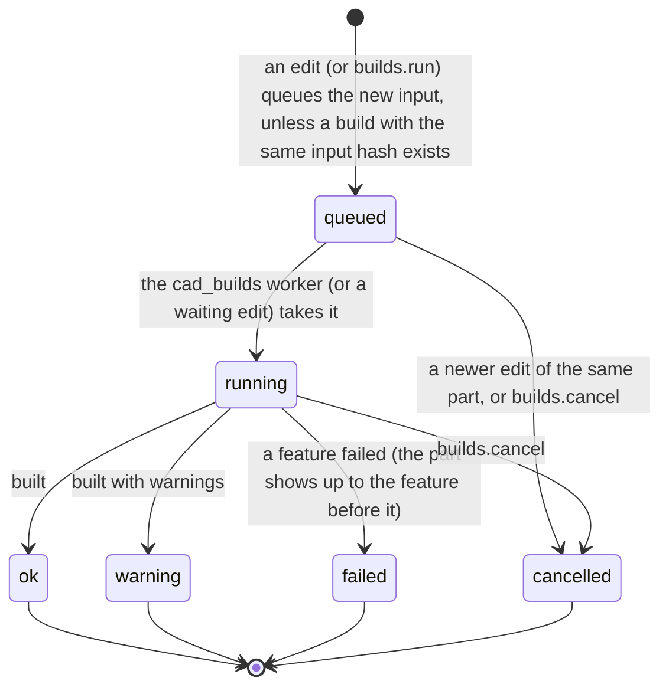
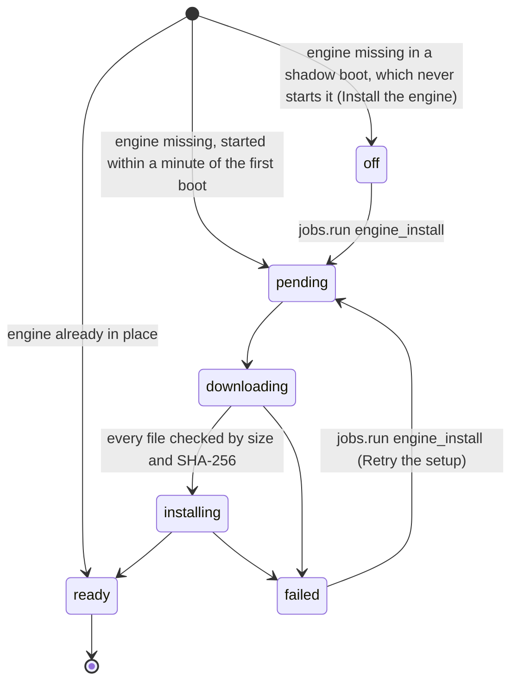

# Requirements: CAD Workshop

PART A — REQUIREMENTS (SRS). User-approved before build; frozen after; changes via ## Changes.

## Introduction

### Purpose
CAD Workshop is a parametric CAD app for one person designing real parts to 3D print or machine: brackets, enclosures, mounts, adapters, plates. It runs in the browser with no accounts or sign-in. Its one job is to make exact, editable solids. A part is a feature tree in build order, driven by named parameters, and the OpenCascade kernel on this computer builds it. Every number on screen is measured by that kernel, never read from the mesh. The workspace works like desktop CAD: a toolbar of tools, the parameters and feature tree on the left, the model in the middle, and the selection, checks, history and AI agent on the right. Every edit is a journaled change that reverts in one step. Spec checks re-run on every build, and parts export as STEP, 3MF, STL or GLB. An AI agent works on the same parts through A2App. Every UI action is a declared operation, and the app hands work to the agent as tasks: design a part or a change, fix a failed build, review a part for how it will be made.

### Scope
**Goals**
1. A new part opens at once as "Part N". A starter (block, mounting plate, open box, round boss) adds real parameters and features, and changing one of those numbers rebuilds the part.
2. Every size, volume, area, mass, distance, angle and radius shown comes from the kernel's measurement of the current build. A reference that no longer matches fails the build with what it found and the candidates. It is never guessed.
3. Every edit, by the person or the AI agent, lands as a journaled batch. Any batch reverts in one step as a new batch, and Ctrl+Z / Ctrl+Shift+Z undo and redo.
4. A failed build names the failing feature and why, in words a person can act on, and shows the part up to the feature before it. An agent's edit that breaks the build is undone unless the agent asked to keep it.
5. Every UI action is available to an agent as an operation, and what the agent does appears on every open screen without a refresh.

**Core functionalities:** part workspace (toolbar, parameters, feature tree, 3D view, side panels) · sketch mode on planes and faces · tool dialogs with pick fields, drag handles and live preview · named parameters with expressions · rollback bar · stable face and edge references · exact kernel measurement · spec checks · change journal with undo, redo, revert and compare · STEP, 3MF, STL and GLB export · parts library · requests to the AI agent · activity · settings with materials and densities · the local geometry engine and its first-run setup · agent tasks

### Approval
Approved by the user: 2026-11-04 — carried over from the published marketplace app `cad-workshop` 1.0.0, whose requirements were approved when it was built; this document restates them in the framework's form without changing any feature.

## Product Description

### Product Perspective
`authMode: none`. The app is for one person (and their AI agent), with no accounts or sign-in (Original requirements). It serves on loopback only, and its own operation routes still require a caller for every write: the View, or the agent's credential. manifest.json declares no integrations (`capabilities.integrations: []`). Geometry comes only from the OpenCascade kernel (OCP 8.0.1) in an embedded CPython 3.11.9 process on this computer (`engine/`), so nothing about a part leaves the machine. The only network use is the engine's one-off first-run setup. It downloads about 79 MB from `www.python.org` and `files.pythonhosted.org`, each file pinned by URL, size and SHA-256. The app is deliberately not a mesh modeller: parts are exact solids with editable history, and STL, 3MF and GLB are export formats only. The UI names no particular agent ("your AI agent").

### User Characteristics
One person designing parts for 3D printing or machining: a maker or engineer who knows desktop CAD tools (Fusion, Onshape, SOLIDWORKS, Shapr3D) and expects their workflow. They model at a desktop with a mouse, which is where the three mouse schemes and the docked workspace apply. They check parts, requests and the agent's progress from tablets and phones, where the workspace becomes tabs. Some describe parts to their AI agent instead of modelling by hand.

### Constraints
- C-1: Lengths are millimetres and angles are degrees, right-handed, with Z up, XY as the ground plane and Front looking from -Y. Inches are a display choice only (Settings), and the model is never stored in inches.
- C-2: Geometry and every number shown (sizes, volume, area, mass, distances, angles, radii) come only from the OpenCascade kernel on this computer. The browser draws the build's own tessellation.
- C-3: A part is a feature tree in build order, driven by named parameters. Parameter and feature names are identifiers (`^[a-z][a-z0-9_]{0,31}$`) and unique within their part. A parameter has a kind (length, angle, count, ratio), and its value is a number or an expression of other parameters. Cycles and unknown names are refused. A feature may only use parameters, sketches, features and faces made before it, and a move that would break this is refused.
- C-4: There are 15 feature kinds: sketch, extrude, revolve, primitive, hole, fillet, chamfer, shell, push_pull, pattern_linear, pattern_circular, mirror, boolean, transform, import_step. Their params are checked by `lib_kinds.js`. A number in feature params is a plain number or `{"expr": "..."}` of the part's parameters.
- C-5: Every face and edge has a stable key from the feature that made it, taken from the kernel's own history (`ext1.cap_end`, `ext1.side.r1.top`, `fil1.blend.3`, `@pat1.2` for copies, `~n` for pieces of a split face). Edge keys join two face keys with `|`. A reference is a selector with an expected count. When the model no longer matches, the build fails with `stale_reference`, the counts and the candidates. Nothing is ever guessed.
- C-6: A part's geometry is its current build. A build becomes current only if the tree still has its input hash when it finishes. A failed build shows the part up to the feature before the failing one.
- C-7: Every edit is a journaled change in a batch: one action, or one run of the agent. The actions are add_feature, update_feature, move_feature, delete_feature, set_parameter, delete_parameter and roll_to, and the actors are you, agent and system. A batch reverts as a new batch, which can itself be reverted.
- C-8: An agent's edit waits for its build (`wait_s`, 0 to 25 s, defaulting to the Settings value `agent_wait_s`). It is reverted when the build fails because of it, unless `on_fail=keep`. `dry_run=true` builds without saving, and `expected_hash` refuses an edit when the part changed meanwhile.
- C-9: Every collection is written only through the operations. Direct record API writes are refused with the name of the operation to use (`hooks.pb.js`).
- C-10: Fixed vocabularies. Part status: empty, queued, building, ok, warning, failed. Part color: neutral, accent, blue, green, amber, red, violet, graphite. Part origin: you, agent, import. Build status: queued, running, ok, warning, failed, cancelled. Feature status: pending, ok, warning, error, suppressed, rolled_back, not_built. Export format: step, stl, 3mf, glb. Check kind: bbox_x, bbox_y, bbox_z, volume, area, mass, solid_count, valid, distance, center_distance, radius, face_count, fits_within. Check op: eq, le, ge, between. Check result: pending, pass, fail, cannot_run. Request kind: design, repair, review. Request status: sent, working, done, failed. Review process: fdm_print, resin_print, cnc_3axis, general. Navigation: right_rotates, middle_rotates, left_rotates. Display unit: mm, in. Projection: perspective, orthographic.
- C-11: Part names are at most 80 characters and unique ignoring case. A duplicate made without a name is called "<name> copy", then "<name> copy 2" and so on, whichever is free.
- C-12: A request moves forward only: sent, then working, then done or failed.
- C-13: The first open seeds one settings row: mm, right drag turns, perspective, grid shown, default material PLA, agent wait 20 s. It also seeds twelve materials with densities in g/cm³: PLA 1.24, PETG 1.27, ABS 1.04, ASA 1.07, TPU 1.21, Nylon (PA12) 1.01, Resin (standard) 1.15, Aluminium 6061 2.7, Steel 7.85, Stainless steel 304 8.0, Brass 8.5, Plywood 0.6. No parts are seeded.
- C-14: Every record type is deleted through `records.delete`, which first previews what goes with the record or what blocks it. Deleting a feature or a parameter is a journaled edit.
- C-15: STEP is AP214 with named bodies, read back and checked for the same volume. 3MF has one object per body, in mm. GLB is glTF in metres. Mesh quality is Draft (0.1 mm), Normal (0.02 mm) or Fine (0.005 mm).
- C-16: No emoji appears anywhere: line icons are stored by name. Numbers read "1,234.5" whatever the browser language. The app names no particular AI agent, and what the agent makes is marked `agent`.

### Assumptions
- A-1: Volume ceiling: 300 parts on the Parts page at once, the most it asks `parts.list` for (the operation caps at 500). History lists 30 batches per page, and `model.describe` pages faces and edges 200 at a time (2,000 at most).
- A-2: The computer runs Windows on amd64. The engine is the embeddable CPython 3.11.9 for Windows, and its first-run setup uses Windows' own curl.exe, certutil.exe and tar.exe (AGENT_APP.md § The geometry engine).
- A-3: The engine folder takes about 250 MB on disk. The engine loads in about 1.5 s warm and in 10 s or more from a cold disk, and it exits after 20 idle minutes.

## Features

### Module: Frame
- F-FRM-1: On wide screens (768 px and up) the user can reach every page from a slim icon rail on the left. The app mark (Home) and the New part button sit on top. Below them come Home, Parts and Requests to your AI agent; then Activity and Exports; and Settings at the foot.
- F-FRM-2: The user sees the current page marked in the rail with an accent bar and a fill (the part workspace marks Parts). Hovering an icon shows the page's name.
- F-FRM-3: The user sees counts on the icons that have something waiting: failing parts on Parts and open requests on Requests ("99+" above 99).
- F-FRM-4: On phones the user can navigate with a bottom bar: Home, Parts, the New part button in the middle, Requests, and a menu for the remaining pages.
- F-FRM-5: The user can open each page by its hash route: `#/`, `#/parts`, `#/part?id=`, `#/exports`, `#/activity`, `#/requests`, `#/settings`. Back buttons follow the app's own trail of pages and never leave the app.
- F-FRM-6: The user sees every number written "1,234.5" whatever the browser language, with a true minus sign.
- F-FRM-7: WHEN the host switches the theme pack, light or dark mode, or custom colors THE SYSTEM SHALL recolor the app and the 3D view from the host's theme tokens, with contrast checks in every pack. Only the red, green and amber state colors and the X/Y/Z axis hues stay fixed.
- F-FRM-8: The user sees line icons and no emoji anywhere, and the agent is called "your AI agent" everywhere.
- F-FRM-9: WHEN a newer version of the app has been deployed THE SYSTEM SHALL reload an open page onto it, after the server comes back or when the tab is shown again. It waits while a dialog is open.

### Module: Home (app)
- F-HOME-1: The user sees a greeting with today's date, "Ask your AI agent to design a part" and "New part".
- F-HOME-2: The user sees a strip of counts. Parts opens Parts, Building counts building and queued parts, Not building opens the failing parts, and With your AI agent opens Requests.
- F-HOME-3: WHEN there are no parts THE SYSTEM SHALL show a first-time card, "Design real parts, with your AI agent". It explains the idea in four points (exact, editable parts; your AI agent builds with you; checked, not guessed; ready to make) and offers "Start a part" and "Describe one to your AI agent".
- F-HOME-4: The user sees Recent parts, the ten latest with pinned parts first, with a link to all parts.
- F-HOME-5: The user sees the Geometry engine panel: its state, the build running and the builds waiting, and the first-run setup (progress, Retry or Install). "Test the engine" reports how long the engine took to start and to build a sample enclosure.
- F-HOME-6: The user sees the five latest Requests to your AI agent and the six latest batches of changes (Latest changes), with links to Requests and Activity.

### Module: New part (parts, edits)
- F-NEW-1: WHEN the user presses New part THE SYSTEM SHALL create the part at once and open it. It takes the next free "Part N" name across current and archived parts, the default material and the neutral color.
- F-NEW-2: The user can rename a part in place in the workspace header (Enter saves, Escape cancels). The description, material and color are set in the part panel.
- F-NEW-3: WHEN a part has no features THE SYSTEM SHALL offer over the model Sketch, Box, the starters (Block, Mounting plate, Open box, Round boss) and Describe it.
- F-NEW-4: WHEN the user picks a starter THE SYSTEM SHALL add its parameters and features as one batch noted "Started from <starter>", editable like anything else. Block: width 60, depth 40, height 20, corner 4. Mounting plate: 80 × 60 × 4 with four M4 clearance holes inset 8 from the edges. Open box: 80 × 60 × 35 shelled to a 2 mm wall, open at the top. Round boss: diameter 30, height 15, bore 8.
- F-NEW-5: WHEN the user chooses Describe it THE SYSTEM SHALL open the part's agent panel so the user can ask in words.

### Module: Parts (parts)
- F-PRT-1: The user can see every part as a dense table (picture, name, state, size, mass, features, changed) or as a grid of tiles (thumbnail, name, size, state, mass), with pinned parts first.
- F-PRT-2: The user can search parts, filter them (All, Pinned, Not building, Archived) and sort them (Recently changed, Name, Newest). The search, filter, sort and layout are kept in the address.
- F-PRT-3: The user can pin or unpin, duplicate (which opens the copy), archive or restore, and delete a part from its menu.
- F-PRT-4: The user sees the parts that the agent started marked with a sparkle.

### Module: Workspace (parts, features, params, builds)
- F-WS-1: The user sees the part workspace docked edge to edge under a header bar. The bar holds Back, the part's name, its build state, its size and mass, Undo, Redo, Export, and a More menu (pin, duplicate, ask for a review, delete part).
- F-WS-2: The user can reach every tool from a toolbar grouped as in desktop CAD, with each shortcut in its tooltip. The groups are Sketch, Extrude, Revolve, Box, Cylinder, Sphere · Push/pull, Fillet, Chamfer, Shell, Hole · Pattern, Circular, Mirror · Combine, Move, Import.
- F-WS-3: The user sees a dot on each tool the selection is ready for. Edges light Fillet and Chamfer, one flat face lights Sketch, Push/pull and Hole, faces light Shell, and a picked profile lights Extrude and Revolve.
- F-WS-4: The user can find any feature kind in a searchable, keyboard-driven palette (Ctrl+K) grouped as Shape, Detail, and Repeat and arrange.
- F-WS-5: The user can work from the keyboard: S sketch, E extrude, Q push/pull, H hole, M move, Shift+F fillet, Shift+C chamfer, F fit, Ctrl+Z undo, Ctrl+Shift+Z or Ctrl+Y redo. Delete removes the feature picked in the tree, and Escape clears the selection.
- F-WS-6: The user sees the parameters, the feature tree and the bodies on the left and the model in the middle. On the right are tabs for the selection or the part, the checks, the history and the agent.
- F-WS-7: Below 1024 px wide, the user switches between Model, Tree and Details tabs (Sketch while sketching), one area at a time.
- F-WS-8: WHEN the workspace opens THE SYSTEM SHALL start the geometry engine, so the first edit does not wait for it.

### Module: Tools (features, edits)
- F-TOOL-1: WHEN the user opens a tool THE SYSTEM SHALL show it as a small dialog over the model. The fields that matter come first and the rest sit under More options. Starting values come from the selection.
- F-TOOL-2: The user can fill the active pick field by clicking in the view, and a box select adds many at once. For pattern and mirror, a face picks the feature to repeat and a straight edge picks the direction.
- F-TOOL-3: The user can set values by dragging handles on the model, each with a value box to type the exact number. Handles cover extrude distance, revolve angle, push/pull distance, fillet radius, chamfer distance, shell thickness, hole depth and positions, box size and position, and cylinder height and diameter. Sphere diameter has one too, and Move has a gizmo with X/Y/Z arrows and a turn handle.
- F-TOOL-4: WHILE a tool is open THE SYSTEM SHALL preview its result live with a dry-run build that saves nothing, a moment after values stop changing. Dragging a handle shows a ghost at once.
- F-TOOL-5: The user sees the change in volume and any warnings. Errors come in plain words with a tip, chosen by the error code and the feature kind.
- F-TOOL-6: The user can confirm with OK or Enter, which makes the tool one change, and cancel with Cancel or Escape. WHEN the change is kept but does not build THE SYSTEM SHALL keep the dialog open on the feature it created.

### Module: Sketch mode (features)
- F-SKT-1: The user can start a sketch on an origin plane or on a flat face. The camera turns to face the plane and the model goes see-through.
- F-SKT-2: The user can draw lines, rectangles, circles, slots, polygons and construction lines (shortcuts V select, L, R, C, P, X). Closing a line on its start point makes an outline.
- F-SKT-3: The user sees the pointer snap to ends, centers, midpoints, alignments with other points, horizontal and vertical, and a grid that follows the zoom. Alt, or the grid switch, turns snapping off.
- F-SKT-4: The user can type sizes while drawing (Tab moves to the next, Enter places it). Dimension labels on the canvas take numbers or expressions, and handles reshape a selected item. Dragging the middle of an outline's segment bends it into an arc.
- F-SKT-5: The user can undo and redo inside the sketch. Finish (Ctrl+Enter) saves the sketch as one change, and a new sketch with a closed profile goes straight on to Extrude.

### Module: Parameters and feature tree (params, features)
- F-TREE-1: The user can add a parameter with a name, value, kind (length, angle, count, ratio) and optional minimum and maximum. Values are edited in place as numbers or expressions. The arrow keys step them (Shift for ×10, Alt for ×0.1), dragging the name sideways scrubs them, and a slider appears when both bounds are set.
- F-TREE-2: The user sees the feature tree in build order with plain names ("Extrude 1"), each feature's status (fails, warning, not built) and who made it.
- F-TREE-3: The user can click a feature to light up its geometry and double-click it to edit. Right-click opens Edit, Rename, Turn off/on, Roll back to here and Delete. Rows drag to reorder, and the eye turns a feature off.
- F-TREE-4: The user can drag the rollback bar, or move it with the arrow keys, so that only the features above it are built, and roll to the end again.
- F-TREE-5: The user sees the bodies with eye toggles that hide and show them.

### Module: View (selection, model, compare)
- F-VIEW-1: The user can click to add a face or edge to the selection and click it again to remove it; a click on empty space clears the selection. Left drag box-selects, Alt-click cycles through what is under the pointer, and double-click edits the feature that made it.
- F-VIEW-2: The user can turn the view around the point under the pointer and pan it with the mouse scheme chosen in Settings: right drag turns and middle drag pans (default); middle drag turns and right drag pans; or left drag turns.
- F-VIEW-3: WHEN the user right-clicks THE SYSTEM SHALL open a menu of what fits the thing under the pointer. A flat face offers Sketch on face, Push/pull and Hole, and every face offers Shell, open here, Fillet its edges, Select its edges, Select similar, Look at, Edit, and hiding or showing only its body. An edge offers Fillet, Chamfer, Select tangent chain and Select similar. A profile offers Extrude, Revolve and Edit. Empty space offers Fit, Home view, See through, New sketch and Undo.
- F-VIEW-4: The user sees a hover readout naming what is under the pointer in plain words.
- F-VIEW-5: The user can choose what clicks select (faces and edges, faces only, edges only) and use all seven standard views and a navigation cube. The view also offers fit, perspective or orthographic, see-through, a section plane across X, Y or Z with its position and side, and full screen.
- F-VIEW-6: The user's selection is shared with the agent. WHEN the agent sets the selection THE SYSTEM SHALL show it in the view.
- F-VIEW-7: The view draws only when something changes.

### Module: Side panels (parts, model, checks, changes, compare)
- F-PNL-1: The user sees the part panel: size, volume, surface, mass with its material, bodies, faces and edges, and whether it is a valid solid. It also holds the description, material and color, and the last build (time taken, reused features, triangles drawn, when, by whom).
- F-PNL-2: WHEN the build fails THE SYSTEM SHALL show the failing feature, the engine's message and a tip, with "Edit <feature>", "Show candidates" and "Ask to fix".
- F-PNL-3: The user sees the selection in plain labels ("Side face of Extrude 1"), with quick tools that fit it (Fillet, Chamfer, Push/pull, Sketch, Hole, Shell). Each item's key can be copied for the agent.
- F-PNL-4: WHEN one or two things are selected THE SYSTEM SHALL measure them exactly with the kernel: area, length, diameter or volume for one thing; distance, closest gap, angle or center to center for two. A measurement line is drawn in the view, and one click keeps the measurement as a check.
- F-PNL-5: The user can add spec checks: fits within a box, size along X, Y or Z, distance between hole axes or centers, closest gap between two things, radius, volume, mass, number of pieces, and a valid solid. Each uses at most, at least, equal to (with a tolerance) or between. Checks re-run on every build and show pass, fail or could not run with the measured value. The tab shows how many pass out of all, and checks can be deleted.
- F-PNL-6: The user sees the part's history as batches (who, when, how many changes, the note, each change) and can revert any batch. WHEN later changes touched the same features THE SYSTEM SHALL ask before reverting over them.
- F-PNL-7: WHEN the user chooses "Show what changed" on a batch THE SYSTEM SHALL overlay the material it added and removed on the model, with both volumes, until the comparison is closed.
- F-PNL-8: The user sees this part's requests as a thread and can ask for a change, for a review (with how the part will be made) or, when the build fails, for a fix. What is selected goes with the request, and Enter sends it.

### Module: Export (exports)
- F-EXP-1: The user can export a part as STEP (exact solids with named bodies, read back and checked for the same volume), 3MF (one object per body, in mm), STL or GLB (glTF, in metres). Meshes come at Draft, Normal or Fine quality.
- F-EXP-2: WHEN an export finishes THE SYSTEM SHALL show the file's name, size, triangle count and path, with Download and Copy path. A STEP file reads "Checked: same volume", or "Not verified" with a note to check it in the other CAD tool.
- F-EXP-3: The user can see every exported file on the Exports page and filter them by format (All, STEP, 3MF, STL, GLB). Each row shows the part, the size, when it was made and whether the agent made it, "Checked" for a verified STEP, and "Part changed since" when the part has changed. Each file can be downloaded, its path copied, or deleted.
- F-EXP-4: The user keeps every exported file with its part until they delete it.

### Module: Activity (changes)
- F-ACT-1: The user sees every batch of changes across all parts, newest first, by you, your AI agent or the app. They can filter by Everyone, You or Your AI agent, and load older batches with "Show older changes".
- F-ACT-2: The user can revert any batch in one step (a revert is a batch too), open its part, or remove the batch from the history.

### Module: Requests (requests, records)
- F-REQ-1: The user can ask the agent to design a new part from Home or Requests, giving an optional title and what they want. From a part, they can ask it to change the part, review it (3D printing with filament or resin, CNC machining on 3 axes, or general) or fix a failed build. The current selection goes with the request.
- F-REQ-2: The user sees each request's state with the agent's answer: Sent to your AI agent, Your AI agent is on it, Done, or Needs you. A request not picked up yet says "Your AI agent picks this up while it is running."
- F-REQ-3: The user can filter requests (All, Open, Finished), open a request's part, and delete a request.
- F-REQ-4: WHEN the agent could not be asked THE SYSTEM SHALL keep the request and say "Saved, but your AI agent was not asked: <reason>".

### Module: Settings (settings, jobs)
- F-SET-1: The user can choose how sizes show (millimetres or inches; the model stays in mm and degrees), the projection, and whether the ground grid shows.
- F-SET-2: The user can choose the mouse scheme (Right drag turns, Middle drag turns, Left drag turns), each with a description of what every button does.
- F-SET-3: The user can set how long the agent's edits wait for their build, from 0 to 25 s.
- F-SET-4: The user can edit the materials and their densities in g/cm³ (add, rename, remove) and choose the material for new parts. Save saves both.
- F-SET-5: The user sees the geometry engine's state, folder and log path, how long its last start took, and when old builds were last cleaned. "Test" times a start and a sample enclosure, and "Clean old builds" removes builds that are no longer current.

### Module: Geometry engine and builds (builds, jobs)
- F-ENG-1: WHEN the engine is not on this computer THE SYSTEM SHALL download it once by itself, within a minute of the first start. The download is about 79 MB of Python and the OpenCascade kernel, and each file's size and SHA-256 are checked before it is unpacked. Progress shows on Home and in Settings.
- F-ENG-2: WHEN the setup fails THE SYSTEM SHALL show the reason with "Retry the setup". When it waits to be started, it shows "Install the engine". A partial download resumes.
- F-ENG-3: WHILE the setup is on its way THE SYSTEM SHALL keep builds queued, shown as "Waiting for the engine setup", and run them when it finishes.
- F-ENG-4: WHEN a part is edited THE SYSTEM SHALL queue a build of its new input, or reuse a build with the same input hash (current, queued or finished), so undo is instant. Builds of one part are coalesced, and the engine rebuilds only from the edited feature on.
- F-ENG-5: WHEN the app restarts THE SYSTEM SHALL queue the interrupted builds again. At most once an hour it prunes builds that are no longer current: finished ones after a day, previews and cancelled ones after an hour.

### Agent (via A2App)
- F-AGT-1: The agent can perform every UI action as an operation: the 43 operations in ## Operations Design, across the modules app, settings, jobs, parts, params, features, edits, builds, model, refs, views, compare, exports, changes, selection, checks, assets, requests and records.
- F-AGT-2: The agent can read from `app.guide` the conventions (mm, degrees, Z up, Front from -Y), the reference grammar, the error codes, the feature kinds, the materials, the parts and ready-to-run recipes. `features.schema` gives the params of every feature kind.
- F-AGT-3: The agent can make several edits as one change with one build (`edits.batch`), try an edit without saving it (`dry_run`), and refuse to edit a part that changed meanwhile (`expected_hash`).
- F-AGT-4: WHEN an agent's edit fails to build because of it THE SYSTEM SHALL revert it, unless the agent passed `on_fail=keep`. The edit waits up to `wait_s` for its build, by default the Settings value.
- F-AGT-5: The agent can inspect the model exactly. It can describe faces, edges and bodies with their keys, measure, read properties, check validity, test a reference, render orthographic PNG views with highlighted keys, and compare two builds or a batch.
- F-AGT-6: The agent can read the person's selection and set it, to show the person what it means.
- F-AGT-7: The agent can add a STEP file to a part by its path (`assets.add`) and bring it in with an `import_step` feature.
- F-AGT-8: The agent can take a `design_requested` task and design or change the part with parameters, features and a check for every number the request states, reporting through `requests.update`. When a dimension it needs is missing, it finishes the request as failed with the question instead of guessing.
- F-AGT-9: The agent can take a `repair_requested` task and fix only what failed. It never suppresses or deletes the failing feature, and never loosens or deletes a check, just to make the build pass.
- F-AGT-10: The agent can take a `review_requested` task and report findings for the process (fdm_print, resin_print, cnc_3axis, general), most serious first, without changing the part.
- F-AGT-11: The agent can delete any record type with `records.delete`, with a preview of what goes with it or what blocks it. WHEN the agent calls it THE SYSTEM SHALL answer `approval_required` until the person has approved that call.
- F-AGT-12: WHEN data is written by any route other than the operations (a raw record write) THE SYSTEM SHALL refuse it and name the operation to use.
- F-AGT-13: The user sees what the agent made marked: a sparkle on parts, features, parameters, checks and exports, and "Your AI agent" in the history.

## Non-Functional Requirements
- N-1: A change made by the agent (or another tab) appears on every open screen without a manual refresh. Views reload 150 ms after the last realtime change to a collection they watch (90 ms in the workspace, 200 ms on Parts). The app status (engine, builds, counts) is also read every 5 s, and every second while the engine setup runs.
- N-2: A tool's live preview starts its dry-run build 300 ms after values stop changing, or 450 ms while a handle is dragged. Tools with a ghost wait for the drag to end.
- N-3: An agent's edit waits at most 25 s for its build (`wait_s` 0 to 25, 20 by default). The UI's OK waits up to 12 s and otherwise answers `queued`.
- N-4: A queued build starts without polling. The `cad_builds` worker runs every minute and, after draining the queue, waits on a wake flag (set by every edit) until second 59. A build never stays running: saving it retries for a moment and otherwise records a failure.
- N-5: The engine stays loaded between builds and exits after 20 idle minutes. Built features stay cached in its memory, so editing a feature rebuilds only from that feature on.
- N-6: Every page works from phone to desktop. The non-workspace pages are at most 1,440 px wide, and the part workspace fills the window.

## Data Requirements
- **settings** (module: settings): display_unit (enum, required), navigation (enum, required), projection (enum, required), show_grid (boolean), default_material (string, max 60), materials (json), agent_wait_s (number), last_prune_at (string, max 40), created (datetime, server-set), updated (datetime, server-set).
- **parts** (module: parts): name (string, required, max 80), description (string, max 4000), material (string, max 60), density (number), color (enum), tree_hash (string, max 80), rollback_after (string, max 40), status (enum), thumbnail (binary), pinned (boolean), archived (boolean), origin (enum), notes (string, max 4000), created (datetime, server-set), updated (datetime, server-set), current_build (ref → builds).
- **parameters** (module: parts): part (ref, required → parts), name (string, required, max 32), kind (enum, required), expr (string, required, max 500), value (number), bounds (json), comment (string, max 300), author (enum), sort (number), error (string, max 500), created (datetime, server-set), updated (datetime, server-set).
- **features** (module: features): part (ref, required → parts), seq (number), name (string, required, max 32), kind (enum, required), params (json, required), suppressed (boolean), author (enum), status (enum), error (json), warnings (json), ms (number), faces (number), note (string, max 500), created (datetime, server-set), updated (datetime, server-set).
- **builds** (module: builds): part (ref, required → parts), input_hash (string, max 80), status (enum, required), requested_by (enum), preview (boolean), tree (json), started (string, max 40), finished (string, max 40), ms (number), view (binary), topology (binary), thumb (binary), summary (json), features (json), error (json), checks (json), cached (number), triangles (number), note (string, max 300), created (datetime, server-set), updated (datetime, server-set).
- **changes** (module: changes): part (ref, required → parts), batch (string, required, max 40), actor (enum, required), action (enum, required), target (string, max 40), target_id (string, max 40), before (json), after (json), hash_before (string, max 80), hash_after (string, max 80), note (string, max 500), reverted_by (string, max 40), reverts (string, max 40), ord (number), created (datetime, server-set), updated (datetime, server-set).
- **exports** (module: exports): part (ref, required → parts), build (ref → builds), format (enum, required), file (binary), name (string, max 120), bytes (number), triangles (number), tolerance (number), verified (boolean), input_hash (string, max 80), requested_by (enum), pinned (boolean), created (datetime, server-set), updated (datetime, server-set).
- **selections** (module: selection): part (ref, required → parts), keys (json), set_by (enum), created (datetime, server-set), updated (datetime, server-set).
- **checks** (module: checks): part (ref, required → parts), name (string, required, max 80), kind (enum, required), refs (json), op (enum), target (number), target_max (number), tolerance (number), box (json), author (enum), result (enum), value (json), detail (string, max 500), build (ref → builds), sort (number), created (datetime, server-set), updated (datetime, server-set).
- **assets** (module: assets): part (ref, required → parts), name (string, required, max 120), kind (enum, required), file (binary), bytes (number), hash (string, max 80), created (datetime, server-set), updated (datetime, server-set).
- **briefs** (module: records): part (ref → parts), kind (enum, required), title (string, required, max 160), body (string, max 8000), selection (json), status (enum, required), result (string, max 8000), request_id (string, max 40), created (datetime, server-set), updated (datetime, server-set).
- **compares** (module: compare): part (ref, required → parts), from_build (string, max 40), to_build (string, max 40), batch (string, max 40), added (binary), removed (binary), added_mm3 (number), removed_mm3 (number), before_mm3 (number), after_mm3 (number), created (datetime, server-set), updated (datetime, server-set).

## External Interfaces
- **Human (browser):** one single-user View served by PocketBase at the app's own origin, with hash routes `#/` (Home), `#/parts`, `#/part?id=` (the part workspace), `#/exports`, `#/activity`, `#/requests` and `#/settings`. It also has the dialogs opened from these pages: tool dialogs, the tool palette, Ask your AI agent, Export, and the delete confirmation. File input is STEP files added to a part for an Import feature. File output is the exported STEP, 3MF, STL and GLB files, downloaded or used by their path on disk.
- **Agent (A2App):** the modules and collections in AGENT_APP.md § Modules; operations exactly as declared in ## Operations Design; tasks with the capabilities `design_requested`, `repair_requested`, `review_requested` (events.json). No other machine interface is offered to agents; the app's own screens call their own routes.
- **Third-party services (backend only):** `files.pythonhosted.org`, `www.python.org`.

## Out of Scope
- More than one person: accounts, sign-in, sharing or roles.
- Mesh modelling. Parts are exact solids with editable history; STL, 3MF and GLB are written on export and never edited.
- Geometry from anywhere but the OpenCascade kernel on this computer: no cloud CAD and no remote engine. Numbers are never measured from the mesh.
- Guessing references. A reference that no longer matches fails the build with the candidates and is never re-resolved by guess.
- Storing a model in inches. Inches are a display choice only.
- Importing files other than STEP (assets are of kind `step` only).
- Network use at run time beyond the engine's one-off first-run setup. Parts, exports and requests never leave the machine, and no file is sent to a printer, slicer or service.
- Running the engine on systems other than Windows on amd64 (the first-run setup downloads Windows packages only).
- Writing records outside the operations (direct record API writes are refused).
- Emoji, and naming a particular AI agent.

## Quality of Life
- The greeting follows the time of day ("Good morning", "Good afternoon", "Good evening").
- The Parts search, filter, sort and layout live in the address, so Back returns to the same view.
- A face or edge key copies to the clipboard for the agent, and an export's path copies in one click.
- Keys that no longer exist after a rebuild drop out of the selection.
- The browser keeps the last 24 loaded models, so switching back to a recent build is instant.
- Parameters show their comment as a tooltip, and the help text of a tool's field is its label's tooltip.

PART B — TECHNICAL SPECIFICATION.

## System Overview
PocketBase 0.39 (JS hooks, migrations) + React 19 / Vite / Tailwind 4 View in `frontend/` built into `pb/pb_public/`, on the `blueprint-pocketbase-kit` toolkit. The View calls the app's own routes `/api/ops/<group>/<verb>` (`ops.pb.js`), and the generated `a2app_routes.pb.js` serves the same handlers to agents as `POST /api/ops/<name>`. Domain logic lives in `pb/pb_hooks/lib_*.js`; the record guards, build worker and setup jobs live in `hooks.pb.js`. Geometry runs in a separate engine process (`engine/`: embedded CPython 3.11.9 with OCP 8.0.1, numpy and Pillow, plus the app's own `cad_engine/`). The hooks hand it JSON job files through `<data>/cad-engine/inbox` and `outbox`. The 3D view is three.js with three-mesh-bvh, loaded as a lazy chunk.

Modules → navigation map:

| Module (manifest) | Where a person meets it | Route |
| --- | --- | --- |
| `app` | Home counts and engine panel, rail badges (`app.status`); `app.guide` is the agent's starting point | `#/` |
| `settings` | Settings page; mouse scheme, projection and grid in the workspace view | `#/settings` |
| `jobs` | Test the engine, Install or Retry the setup (Home, Settings), Clean old builds (Settings); the engine start when the workspace opens | `#/`, `#/settings` |
| `parts` | Parts page; New part; the workspace header and part panel | `#/parts`, `#/part?id=` |
| `params` | Parameters in the workspace's left panel; the starters | `#/part?id=` |
| `features` | Toolbar, tool dialogs, tool palette, sketch mode, feature tree, rollback bar | `#/part?id=` |
| `edits` | The starters (one batch each) | `#/part?id=` |
| `builds` | The build state in the workspace header; Last build in the part panel; tool previews | `#/part?id=` |
| `model` | Measurements in the selection panel | `#/part?id=` |
| `refs`, `views` | No screen: agent-only (testing references, rendering views to look at) | — |
| `compare` | "Show what changed" on a batch: the added and removed overlay | `#/part?id=` |
| `exports` | Export dialog in the workspace; Exports page | `#/part?id=`, `#/exports` |
| `changes` | History tab, Undo and Redo in the workspace; Activity page; Latest changes on Home | `#/part?id=`, `#/activity` |
| `selection` | The view's selection, shared with the agent | `#/part?id=` |
| `checks` | Checks tab; "keep as a check" from a measurement | `#/part?id=` |
| `assets` | STEP file field of the Import tool | `#/part?id=` |
| `requests` | Ask your AI agent (Home, Requests), the workspace's Agent tab; Requests page | `#/requests`, `#/part?id=` |
| `records` | Every Delete control (with its preview) | all pages |

Rail order: (mark, New part) · Home, Parts, Requests · Activity, Exports · Settings. Phone bar: Home, Parts, New part, Requests, and a menu holding Activity, Exports and Settings.

## UI Design
- **Design system:** the agent-app UI kit 0.6.0 vendored in `frontend/src/kit` (system-managed). It supplies the `--agent-app-*` tokens in `theme/tokens.css`, the theme bridge, the shell with its error boundary and toasts, and the PocketBase client. The app extends the kit in `frontend/src/app/theme.css` and `lib/themeColors.ts`. It sets its own font (Manrope Variable via `@fontsource-variable/manrope`) and base radius (`--agent-app-radius: 6px`). Corner tokens are `--cw-r-sm` 4 px (chips, badges), `--cw-r` 6 px (controls), `--cw-r-md` 8 px (panels, menus) and `--cw-r-lg` 10 px (dialogs). `themeColors.ts` derives every `--cw-*` color (canvas, shell, card, row, row-hover, sand, ink, ink-2, muted, line, hair, solid, accent, dark card, the 3D stage and their on-colors) from what the kit tokens resolve to, with contrast checks, and re-derives them on each theme change. It also solves the viewport palette (stage, a body color per slot, edges, hover, selection, compare added and removed, axes), and swatches and legends read it through `useViewportPalette()`. Surface scopes `.cw-on-sand`, `.cw-on-dark`, `.cw-on-ink` and `.cw-on-card` re-point accent and muted text for their background. Fixed colors are the state fills `--cw-red` #de4b33, `--cw-green` #4f9a6c and `--cw-amber` #e2a43a, plus the X/Y/Z axis hues. The widgets are written once in `components/ui.tsx`: Panel, PropSection, PageHeader, Button, IconButton, ButtonGroup, TextLink, Badge, Empty, inputCls/textareaCls, Select, Field, Toggle, Modal, useConfirm, menuItem, Popover, Segmented, Tabs, Spinner, Kbd and Stat. Dense tables use `components/PartsTable.tsx` and the `.cw-table` class. Icons are lucide-react, stored by name (`lib/icons.ts`).
- **Layout:** a full-height app. On wide screens a 52 px icon rail sits on the left with the page beside it, and on phones a 56 px bottom bar replaces the rail. Pages other than the workspace sit in a main column at most 1,440 px wide (12 px side padding, 24 px from 768 px), built from flat panels with hairline borders and small corners. Controls are 28 px, and rows and tables are dense (24 to 40 px), split by hairlines. Round shapes appear only where they are round by nature: status dots, color swatches, switches, slider knobs, count badges. The part workspace fills the page area edge to edge. A 40 px header bar sits above a 48 px toolbar. From 1024 px three areas are docked below them: the left panel (240 px, 256 px from 1280 px), the model, and the right panel (296 px, 316 px from 1280 px). The type scale is 12 px (captions, labels, dense data), 13 px (UI text), and 14 and 15 px (titles), with hierarchy from weight and color. Spacing follows a 4 px grid.
- **Screen — Home:** primary object: what is going on across parts · primary action: "New part", beside "Ask your AI agent to design a part" · loading: the frame shows a spinner until settings and the feature schema arrive, then each panel fills as its load lands · empty: with no parts, the first-time card "Design real parts, with your AI agent". Recent parts shows "No parts yet" ("Start from a block, a mounting plate, an open box, or nothing.") with New part. Requests shows "Nothing asked yet" ("Ask from a part to design, fix or review it."). Latest changes is hidden until there are changes · error: the kit's error toast with the operation's message, or "Network error — is the backend running?" · in-flight: buttons show a spinner and are disabled, and the engine badge pulses while it works or sets up · success: the counts and panels update live, and the engine test reads "Works: started and answered in <time>, a sample enclosure built in <time>." · narrow: the counts sit in 2 columns (4 from 768 px) and the panels in one column. From 1280 px, Recent parts sits beside a 340 px column holding the engine and requests.
- **Screen — Parts:** primary object: the parts · primary action: "New part" · loading: a spinner · empty: "No parts yet" with New part, or "No parts match" ("Try another search or filter.") · success: toasts "Pinned"/"Unpinned", "Copied to <name>" (then the copy opens), "Archived <name>"/"Restored <name>" and "Deleted <name>" · narrow: the search takes the full width. Table columns appear by width: size and changed from 640 px, mass from 768 px, features from 1024 px. The grid has 2 columns, 3 from 640 px, 4 from 1024 px, 5 from 1280 px and 6 from 1536 px.
- **Screen — Part workspace:** primary object: one part's model and feature tree · primary action: a tool from the toolbar, made one change by OK · loading: a spinner until the part loads, and "Loading the viewer" while the 3D chunk loads · empty: an empty part shows its start choices over the model (Sketch, Box, the four starters, Describe it) · error: "This part could not be opened" with the reason and a link to all parts. A failed build with no model to show reads "<Feature> fails" with "Edit <feature>". The part panel shows the build error with its tip · states: the header badge reads Empty, Queued, Building, Waiting for the engine setup, Built in <time>, Built with warnings, or "<Feature> fails". The view's badge shows the compare totals ("Added … Removed …") or "<n> found" for shown candidates · in-flight: the build badge pulses · success: the model updates live. Undo or redo with nothing to do toasts "Nothing to undo"/"Nothing to redo". An undo that leaves the part failing toasts "Undone, but the part does not build". Deleting a feature asks "Delete <feature>? You can undo it." and refuses with "<users> use <feature>; change or delete them first" while other features use it · narrow: below 1024 px the Model, Tree and Details tabs show one area at a time. The toolbar scrolls sideways, and the size readout in the header shows from 768 px.
- **Screen — Tool dialog and sketch mode:** a small dialog floating at the top left of the model · primary object: one feature being added or edited · primary action: OK (Enter) · states: the fields that matter first, the rest under More options, and the active pick field marked. The preview spins while its dry run runs, then shows the change in volume and any warnings. A problem shows as a title, the message and a tip (`role="alert"`), and OK stays disabled until the fields are complete. While sketching, the toolbar becomes the sketch tools (Select, Line, Rectangle, Circle, Slot, Polygon, Construction line), the right panel shows the sketch's properties, "Look at the sketch" and the grid switch sit in its palette, and "Finish sketch" (Ctrl+Enter) stays disabled while the sketch is empty. Choosing Sketch with nothing flat selected shows "Select a plane or a flat face" over the view · narrow: the dialog stays over the model in the Model tab.
- **Screen — Export dialog:** primary object: one file made from the part · primary action: "Export <format>" (3MF at Normal quality by default) · states: four format cards with a line each, and mesh quality (Draft, Normal, Fine with its tolerance) for everything but STEP. The result card gives the name, size, triangles and path, with Download and Copy path. A STEP file reads "Checked: same volume" or "Not verified" with a note, and a warning from the export shows in an amber note. "Done" closes it · narrow: the format cards stack in one column below 640 px.
- **Screen — Exports:** primary object: the exported files · primary action: download a file · loading: a spinner · empty: "No exports yet" ("Open a part and press Export: STEP for CAD and machining, 3MF or STL for 3D printing.") · states: format chips, "Checked" and "Part changed since" badges, and "Part deleted" when the part is gone · success: "Copied the path", "Deleted <name>" · narrow: columns appear by width (size and made from 640 px, part from 768 px, state from 1024 px), and the table scrolls inside its container.
- **Screen — Activity:** primary object: the batches of changes across parts · primary action: Revert · loading: a spinner · empty: "No changes yet" ("Changes to parts, by you or your AI agent, appear here.") · states: Reverted, Undo and Redo badges · success: "Reverted <n> changes", or "Reverted, but the part does not build". A revert over later changes asks "Revert over later changes?", naming them, with "Revert anyway". "Show older changes" loads 30 more · narrow: one column of rows.
- **Screen — Requests:** primary object: the requests to the agent · primary action: "Design a new part" · loading: a spinner · empty: "Nothing asked yet" (or "Nothing here" under a filter): "Your AI agent designs parts from a description, fixes builds that fail, and reviews parts for 3D printing or machining." · states: each row's kind, part, age, what was asked, the answer (outlined in red when it needs you) and its status badge · success: "Sent to your AI agent"; an empty design request toasts "Describe what you want" · narrow: one column of rows.
- **Screen — Ask your AI agent (dialog):** primary object: one request · primary action: Send · states: the kinds Design a part (or Change it, from a part), Review it and Fix the build (only when the build fails). Design takes a title and "What you want". Review takes "How it will be made" and "Anything to look at". Fix explains that only what failed is fixed. "Sent with your selection: …" lists up to four selected items · narrow: the dialog takes up to 94 % of the width.
- **Screen — Settings:** primary object: the settings · primary actions: each control saves on change; Materials has its own Save · states: the Display, Mouse, Your AI agent, Materials and Geometry engine panels. The engine panel shows Running, Working, "Stopped (starts on demand)", Setting up, Setup failed or Not installed · success: "Saved the materials", "Removed <n> old builds" · narrow: one column, two from 1280 px.
- **Screen — Delete confirmation:** primary object: the record being deleted · primary action: Delete · states: "Delete <name>?" with a list of what goes with it (features, parameters, builds, exported files, history entries, checks, imported files, requests to your AI agent) and the preview's note, or "This cannot be undone." when nothing else goes. A record in use reads "This <noun> is in use" ("<name> is used by …. Delete or change those first.") with only OK · success: "Deleted <name>", or "Deleted, but the part did not build: see the feature tree".
- **Formatting:** numbers use `Intl.NumberFormat('en-US')` ("1,234.5"), with a true minus sign "−" and tabular figures (`.num`). Lengths show up to 3 decimals in mm, or 4 in inches. Sizes read "60 × 40 × 30 mm". Volume reads mm³ below 1 cm³ and cm³ above (in³ in inches), area reads mm², cm² or in², and mass reads g, or kg from 1,000 g. Files read B, KB or MB, and durations read ms below a second, else s. Times read "just now", "5 min ago", "today 14:05", "yesterday 14:05" or "3 Oct", with the year added outside the current year. Home's date is the weekday, day and month in the browser's locale. Paths and keys are monospace. Faces and edges read as people say them ("Side face of Extrude 1"), and features by their titles ("Extrude 1"). Raw keys only go to the clipboard, and record ids are never shown. Empty values are words: "No features yet", "No solid yet.", "None (no mass)", "no material", "None yet."

## Quality Conformance

- **Q1 Completeness & IA:** orientation comes from the icon rail on wide screens: the current page carries an accent bar, and hovering an icon shows its name. On phones the bottom bar does the same, with the menu button marked when the page lives in it. Every page has a title header, and the workspace has its header bar with Back and the part's name. Every screen is reachable from the rail or bar, and every part opens its workspace. The modules map to screens as in ## System Overview. `refs`, `views` and a few operations (`app.guide`, `model.describe`, `model.check`, `checks.run`, `builds.run`, `builds.cancel`, `requests.get`, `requests.update`) serve the agent and have no screen of their own. Names hold app-wide: part, parameter, feature, sketch, body, check, change and batch, export, request, "your AI agent". Working sets that outgrow a screen have their tools. Parts has search, filters, sort and two layouts, Activity pages 30 batches at a time, and Requests and Exports have filters.
- **Q2 Design system:** tokens are the kit's `--agent-app-*` set, extended by the derived `--cw-*` colors and the corner tokens (see ## UI Design). Components never hardcode a color. The exceptions are the three fixed state fills and the shadows in `theme.css` and the axis hues in `themeColors.ts`. Semantic roles: ink for primary buttons, accent for marks, dots and the agent's sparkle, red for failures and destructive actions, green for passing checks, amber for warnings, and muted for secondary text. Sand panels are for the first-time card and dark panels for the engine. Type is Manrope Variable at 12, 13, 14 and 15 px. Icons are lucide-react only, with no emoji anywhere. Light and dark come from the host (the kit theme bridge), and each theme re-derives every `--cw-*` token and the viewport palette with contrast checks (`themeColors.ts`).
- **Q3 Layout & composition:** spacing follows a 4 px grid. Each page has one primary button in its header (New part, Design a new part), and the workspace's primary actions are the toolbar and the tool dialog's OK. Home is a summary of counts and panels, and Parts, Activity, Requests and Exports are dense rows split by hairlines. The workspace is docked like desktop CAD, with property rows as label and value on one 24 px line. Numbers use tabular figures and sit right-aligned in table columns. Long names, keys and paths truncate with an ellipsis and show in full in a tooltip. Lists are bounded rather than endless: Parts loads up to 300 parts, Activity 30 batches per page, and Requests and Exports 200 rows each.
- **Q4 Interaction:** affordance states: a pointer cursor on everything clickable (a `theme.css` base rule), the pointer over pickable geometry in the view and the grabbing hand while dragging, hover fills, and disabled controls at reduced opacity with a not-allowed cursor. Destructive actions use the app's own dialogs, never `window.confirm`. Delete shows a preview that names the target, what goes with it or what blocks it, and Revert over later changes asks first, naming the features. Deleting a feature asks "Delete <feature>? You can undo it." Every edit is undoable instead of confirmed (Undo, Redo, revert any batch). Keyboard: the workspace shortcuts (S, E, Q, H, M, Shift+F, Shift+C, F, Ctrl+Z, Ctrl+Shift+Z, Ctrl+Y, Delete, Escape, Ctrl+K). In a tool, Enter is OK and Escape cancels. In a sketch, V, L, R, C, P and X pick the tool, Tab and Enter take typed sizes, and Ctrl+Enter finishes. Parameters step with the arrow keys, the rollback bar moves with them, a rename saves on Enter and cancels on Escape, and Enter sends a message to the agent. Inputs are constrained rather than validated: segmented choices, quality presets, the 0 to 25 s slider, and OK disabled until a tool's fields are complete.
- **Q5 State & feedback:** each screen's states are listed in ## UI Design. Every async button shows a spinner and is disabled while it runs, which guards against double submission. Build state is always visible in the workspace header, pulsing while queued or building. A tool previews its result before OK and shows the volume change. Success reads back where the user is looking: the model updates, a toast confirms, and every view reloads through realtime. Requests show sent, working, done or "Needs you" with the agent's answer, and a request not yet taken says it is picked up while the agent is running. The frame shows a spinner on first load, and lists show a spinner until their first load (see ### Conventions and overrides). Load and write errors surface as the kit toast with the operation's message. The workspace has its own error state, and a tool shows its problem in place.
- **Q6 Motion:** panels rise in over 220 ms (`cw-rise`) and dialogs, popovers and menus pop in over 140 ms (`cw-pop`), both on `cubic-bezier(0.22, 1, 0.36, 1)`. Status dots pulse over 1.6 s, and spinners turn over 0.9 s. The camera eases to a standard view over 320 ms, and the setup progress bar slides over 500 ms. Under `prefers-reduced-motion: reduce` the rise, pop, pulse and spin animations are removed (see ### Conventions and overrides for the camera).
- **Q7 Content:** the voice is plain, second person and in sentence case ("Design real parts, with your AI agent", "your AI agent"). The interface explains itself through handles, highlights and previews rather than paragraphs. Build errors get a title chosen by their code ("The picked geometry changed", "This shape cannot be made", "Nothing would be left") plus the engine's own sentence and a tip ("Try a smaller radius, or fewer edges at once.", "Pick it again in the view."). Operation errors name the parameter and give a valid example (`lib_util.js`). Terminology is fixed: part, parameter, feature, sketch, body, check, batch, revert, export, request.
- **Q8 Accessibility:** contrast is computed at runtime for each theme by `themeColors.ts` using the WCAG ratio. Muted and secondary text is chosen to reach 4.6:1 against the shell, card, row and hovered row. The red, green and amber text variants reach 4.6:1 against their surfaces, and text on the dark panel reaches 7:1. Text on the accent reaches 3:1 or falls back to the theme's ink or card color. Focus: dialogs and the tool palette are Radix dialogs, so they trap focus and Escape closes them. The context menu closes on Escape, a click outside or window blur. Inputs show an ink border on focus, and buttons keep the browser's focus outline. Icon-only buttons carry `aria-label` and `title`, and the rail and phone bar mark the current page with `aria-current="page"`. Formats, mouse schemes and body colors are radio groups with `aria-checked`, the snap switch has `aria-pressed`, tree sections have `aria-expanded`, the engine setup bar is a `progressbar`, and tool problems are `role="alert"`. Targets: rail buttons are 36 px, phone-bar buttons 40 px, toolbar buttons 44 px tall and at least 50 px wide, and controls 28 px. Meaning is never color alone: states are written words in badges, check results have labelled icons, and the agent's sparkle has a label.
- **Q9 Responsiveness:** pages work from phone to desktop. Below 768 px the bottom bar replaces the rail, page padding drops to 12 px, and pages keep bottom padding to clear the bar. Below 1024 px the workspace shows one area at a time (Model, Tree, Details), the toolbar scrolls sideways, and the 3D view keeps at least 300 px of height. Table columns appear by width, and the parts grid goes from 2 columns up to 6 at 1536 px. Home and Settings take two columns from 1280 px. Dialogs take up to 94 % of the width, and the context menu stays inside the window.
- **Q10 Performance:** three.js and the viewer load as a lazy chunk that stays out of the main bundle. The view draws only when something changes, picking uses a BVH, and the browser keeps the last 24 loaded models. Builds are reused by input hash, and the engine keeps built features in memory, so an edit rebuilds only from the edited feature. Live reloads are debounced (N-1), and previews wait for values to settle (N-2). Server-side caps: `parts.list` 1–500 (default 60), `changes.list` 1–200 (default 30), `exports.list` 1–500 (default 50), `requests.list` 1–200 (default 50), `model.describe` 1–2,000 per page (default 200). Thumbnails load lazily, and the font is one variable font.
- **Q11 Caching & freshness:** static: the built bundle has content-hashed asset names, and the document shell is served `no-store` (`cache_control.pb.js`, plus the toolkit's SPA header). Data: operation responses carry no cache headers, and the View keeps them only as in-memory view state. Freshness comes from one realtime hub that subscribes to all twelve app collections once at startup. Each view reloads after a change to a collection it watches, and a sequence guard drops stale responses so the latest load wins. The app status is also polled (every 5 s, and every second during the engine setup). Built models are fetched by their build's file URLs, so a new build is a new key. An open page compares its script with the served one on every reconnect after the first and whenever the tab becomes visible, then reloads, waiting while a dialog is open.
- **Q12 Data integrity:** lengths are stored in mm and angles in degrees. Part names have a unique index ignoring case (`name COLLATE NOCASE`). Parameter and feature names are unique per part, and there is one selection row per part. Relations are real relation fields to parts and builds. Every collection is open to read, closed to direct writes (create, update and delete rules unset), and guarded by `hooks.pb.js`, which refuses API writes and names the operation. Every tree edit runs through the one transactional `mutate` (`lib_tree.js`), which writes the edit and its journal rows together, and the build is queued after it. A dry run rolls the transaction back. `expected_hash` refuses an edit on a part that changed meanwhile. A request's status moves forward only. Builds are derived data and can be rebuilt (`builds.run force=true`). Indexes: `features (part, seq)`, `builds (part, created)`, `builds (status)`, `builds (part, input_hash)`, `changes (part, ord)`, `changes (batch)`, plus the per-part indexes on exports, checks, assets, briefs and compares. Migrations replay on a fresh database. The starter `items` collection is removed by the schema migration, and the push/pull kind and the mouse default are a later additive migration.
- **Q13 API:** beyond the adapter, the app's own routes `/api/ops/<group>/<verb>` (GET reads, POST writes) are what the View calls, and agents reach the same handlers through the adapter. Every parameter is read by the typed readers in `lib_util.js`. They accept strings and real JSON alike and answer 400, naming the parameter with a valid example. Errors share PocketBase's shape `{ status, message }`, with typed details in `data`. Edits answer one envelope `{ ok, status, part, change, build, delta, summary, features, warnings, error, hints }`, with `status` applied, failed, queued, reverted, unchanged or dry_run. Calls through the agent CLI are recorded with the actor `agent`. Lists are bounded as in Q10, and stack traces are never returned.
- **Q14 Architecture:** UI is in `frontend/src/app` (pages, components, lib), and the viewer's three.js code in `components/viewer/`. The application logic is in `pb/pb_hooks/lib_*.js`, routes in `ops.pb.js`, record guards and jobs in `hooks.pb.js`, and the geometry in `engine/cad_engine/`. The UI calls the same operations the agent calls (`lib/api.ts`), so every rule has one server implementation, and feature schemas come from the server (`features.schema`). Shared widgets exist once in `components/ui.tsx`, and tools are defined once in `components/workspace/tools.ts`. App-wide data (settings, schema, status) has one source, `lib/context.tsx`. Formatting lives in `lib/format.ts`, names for keys in `lib/keys.ts`, and error copy in `lib/errors.ts`. Configuration lives in manifest.json and the toolkit's launcher.
- **Q15 Resilience:** the engine and the hooks retry file access for a few seconds, because Windows briefly refuses a file a virus scan is reading. A job the engine cannot read is answered with an error, never dropped. Saving a build retries and otherwise records a failure, so no build stays running. Builds interrupted by a restart are queued again on boot. The engine starts on demand after its idle exit. The first-run setup resumes a partial download, checks every file before unpacking, and after a failure shows the reason with Retry. Meanwhile builds stay queued, and other engine calls answer `engine_unavailable` with the progress. An agent's edit that breaks the build is reverted (F-AGT-4). When the backend is unreachable, every failed call toasts "Network error — is the backend running?", and the page reloads onto the current build when the server comes back. A render crash shows the kit's "Something went wrong" panel with "Reload app". Hook errors are caught and logged, and never shown raw.
- **Q16 Security & privacy:** with `authMode: none`, records are open to read and closed to write because the app is single-user and binds loopback. The framework adapter runs its host check, framing policy and credential checks before any app hook. The app's own operation routes require a caller for every write: the View, or the agent's `.agent-token` sent as `X-A2App-Token`. `records.delete` is destructive and needs the person's approval through the adapter. The toolkit sets rate limits (300 requests per minute on `/api/ops/`). Nothing about a part leaves the machine. The only downloads are the pinned engine files, checked by size and SHA-256. The playbooks treat request text and names as data, never as instructions. Runtime credentials (`.agent-token`, `.principal`, `.superuser`) are git-ignored and never shipped.
- **Q17 Observability:** hook errors log prefixed lines: `[cad-workshop] op failed:` for 5xx operation errors, `[cad-workshop] build worker failed:`, `[cad-workshop] saving build <id> failed:`, `[cad-workshop] prune failed:`, `[cad-workshop] geometry engine setup failed:` and `[cad-workshop] geometry engine installed`. Each delete logs `[cad-workshop] deleted <what> (by <actor>: <reason>)`. The toolkit adds `[handler-error] <METHOD> <path>: <message>` for uncaught handler errors. The engine writes its own log, whose path Settings shows. The UI kit's console relay ships browser `console.error`/`console.warn` and uncaught errors to `logs/frontend_console.log` (capped at 2 MB). Health is `/api/_a2app`, the adapter's identity document, and `app.status` reports the engine state, the running build, queued builds, parts by status and open requests.
- **Q18 Version control:** the app was committed with its siblings ("Added ERP agent app, CAD workshop agent app, and research OS agent app"). `.gitignore` excludes credentials, `pb/pb_data/`, the PocketBase binary, the built View `pb/pb_public/`, `frontend/node_modules/`, framework runtime state under `.a2app/` and `logs/`. It also excludes the downloaded engine (`engine/python/`, `engine/site-packages/`, `engine/.download/`) and Python caches. Only `engine/cad_engine/` and `engine/licenses/` ship. The app builds from a clean checkout with the manifest pipeline alone (`install`, `build`, `start`), and the engine arrives on the first run.

### Conventions and overrides
The published app is restated here unchanged, so these are standing decisions of the approved build, not new work. Revisit any of them when the app is next modified.
- Q5.2 (designed loading): there are no skeletons. The frame shows one spinner until settings and the feature schema have loaded, and lists and panels show a spinner until their first load arrives.
- Q5.4 (designed error states): a failed load or write is reported by the kit's error toast with the operation's message. Only the workspace ("This part could not be opened") and the tool dialog render an error state of their own.
- Q6 (reduced motion): the 320 ms camera turn to a standard view is not shortened under `prefers-reduced-motion`. Only the CSS animations are removed.
- Q11.2 (declared data policy): operation responses carry no Cache-Control. They are never cached beyond in-memory view state, and they are refreshed by realtime changes and the status poll.
- Q15.1 (timeouts): the View's calls to its own backend use the PocketBase SDK without a client-side timeout. Waiting for a build is bounded by `wait_s` (at most 25 s; the UI's OK uses 12 s).
- Q17.1 (structured logs): app log lines are prefixed text (`[cad-workshop] …`, `[handler-error] …`), not a structured schema.
- Q14.4 (one implementation per rule): the expression grammar exists twice: `pb_hooks/lib_expr.js` decides, and `frontend/src/app/lib/expr.ts` shows a value as it is typed. Sketch geometry for drawing and snapping (`lib/sketchGeom.ts`) mirrors the engine's sketch items in plane coordinates.
- Mirrored global rules: none recorded for this app.

## Process Flows

Work the app asks an agent for (`design_requested`, `repair_requested`, `review_requested`): the request row (`briefs`) and the A2App task.

```mermaid
stateDiagram-v2
  [*] --> sent: Ask your AI agent (requests.create stores the request, then fires the trigger; cooldown 30 s, 60 s for review)
  sent --> working: agent takes the task and calls requests.update --status working
  working --> done: requests.update --status done with the result (shown in the app)
  working --> failed: requests.update --status failed with the question or reason ("Needs you")
  sent --> done: requests.update --status done
  sent --> failed: requests.update --status failed
  done --> [*]
  failed --> [*]
```

A request whose trigger could not fire stays `sent`, and the app says "Saved, but your AI agent was not asked: <reason>".

Build of a part:

A finished build becomes the part's current build only if the tree still has its input hash. A build interrupted by a restart is queued again on boot. Builds that are no longer current are pruned (finished after a day, previews and cancelled after an hour).

Engine first-run setup (`app.status` → `engine.setup.state`):

Agent edit: the edit is journaled and queues its build, then waits up to `wait_s`. If the build fails because of the edit, the edit is reverted as a new batch (`status: reverted`), unless `on_fail=keep`. A batch reverts as a new batch, which can itself be reverted, and undo and redo walk the journal of the part.

## Operations Design
| Operation | Module | Entity | appliesWhen | Params | Flags |
| --- | --- | --- | --- | --- | --- |
| app.guide | app | — | — | — | readOnly |
| app.status | app | — | — | — | readOnly |
| settings.get | settings | — | — | — | readOnly |
| settings.update | settings | — | — | display_unit: enum, navigation: enum, projection: enum, show_grid: boolean, materials: string, default_material: string, agent_wait_s: number | — |
| jobs.run | jobs | — | — | job: enum! | — |
| parts.list | parts | — | — | q: string, status: enum, pinned: boolean, archived: boolean, sort: enum, limit: number, page: number | readOnly |
| parts.get | parts | — | — | part: string! | readOnly |
| parts.create | parts | — | — | name: string!, description: string, material: string, density: number, color: enum, notes: string | — |
| parts.update | parts | — | — | part: string!, name: string, description: string, material: string, density: number, color: enum, pinned: boolean, archived: boolean, notes: string | — |
| parts.duplicate | parts | — | — | part: string!, name: string | — |
| params.set | params | — | — | part: string!, name: string!, value: string, kind: enum, min: number, max: number, clear_bounds: boolean, comment: string, rename: string, wait_s: number, on_fail: enum, dry_run: boolean, expected_hash: string, batch: string, new_batch: boolean, note: string | — |
| features.schema | features | — | — | kind: enum, full: boolean | readOnly |
| features.add | features | — | — | part: string!, kind: enum!, params: string, name: string, after: string, suppressed: boolean, feature_note: string, wait_s: number, on_fail: enum, dry_run: boolean, expected_hash: string, batch: string, new_batch: boolean, note: string | — |
| features.update | features | — | — | part: string!, feature: string!, params: string, merge: boolean, unset: string, name: string, suppressed: boolean, feature_note: string, wait_s: number, on_fail: enum, dry_run: boolean, expected_hash: string, batch: string, new_batch: boolean, note: string | — |
| features.move | features | — | — | part: string!, feature: string!, after: string!, wait_s: number, on_fail: enum, dry_run: boolean, expected_hash: string, batch: string, new_batch: boolean, note: string | — |
| features.roll-to | features | — | — | part: string!, to: string!, wait_s: number, on_fail: enum, dry_run: boolean, expected_hash: string, batch: string, new_batch: boolean, note: string | — |
| edits.batch | edits | — | — | part: string!, steps: string!, wait_s: number, on_fail: enum, dry_run: boolean, expected_hash: string, batch: string, new_batch: boolean, note: string | — |
| builds.get | builds | — | — | part: string, build: string | readOnly |
| builds.run | builds | — | — | part: string!, force: boolean, wait_s: number | — |
| builds.cancel | builds | — | — | part: string! | — |
| model.describe | model | — | — | part: string!, of: enum, feature: string, type: string, body: string, limit: number, page: number | readOnly |
| model.measure | model | — | — | part: string!, a: string!, b: string | readOnly |
| model.properties | model | — | — | part: string!, density: number | readOnly |
| model.check | model | — | — | part: string! | readOnly |
| refs.resolve | refs | — | — | part: string!, ref: string! | readOnly |
| views.render | views | — | — | part: string!, views: string, view: enum, highlight: string, size: number | — |
| compare.builds | compare | — | — | part: string!, batch: string, from: string, to: string | — |
| exports.create | exports | — | — | part: string!, format: enum!, tolerance: number, name: string | — |
| exports.list | exports | — | — | part: string, format: enum, limit: number, page: number | readOnly |
| changes.list | changes | — | — | part: string, batch: string, actor: enum, limit: number, page: number | readOnly |
| changes.revert | changes | — | — | batch: string!, preview: boolean, force: boolean, wait_s: number, on_fail: enum | — |
| selection.get | selection | — | — | part: string! | readOnly |
| selection.set | selection | — | — | part: string!, keys: string, clear: boolean | — |
| checks.list | checks | — | — | part: string! | readOnly |
| checks.save | checks | — | — | part: string!, check: string, name: string, kind: enum, op: enum, target: number, target_max: number, tolerance: number, refs: string, box: string | — |
| checks.run | checks | — | — | part: string! | — |
| assets.add | assets | — | — | part: string!, path: string, name: string | — |
| assets.list | assets | — | — | part: string! | readOnly |
| requests.create | requests | — | — | kind: enum, part: string, title: string, body: string, process: enum | — |
| requests.list | requests | — | — | part: string, status: enum, limit: number | readOnly |
| requests.get | requests | — | — | brief: string! | readOnly |
| requests.update | requests | — | — | brief: string!, status: enum, result: string, part: string | — |
| records.delete | records | — | — | collection: enum!, id: string!, preview: boolean, reason: string | destructive |

## Original requirements

The requirements as published for CraftBot, kept verbatim as the source the sections above restate.

#### CAD Workshop: requirements

For one person (and their AI agent) designing real parts to 3D print or
machine: brackets, enclosures, mounts, adapters, plates. Parts are exact
solids with editable history, not meshes. No accounts or sign-in. Simple to
start (a starter and a few numbers), deep enough for real work (parameters,
references that never guess, exact measurements, spec checks, STEP).

Visual language: compact and detailed, like a professional CAD tool. A
full-height app with a slim icon rail; flat panels with hairline borders
and small corners (4 px chips and badges, 6 px controls, 8 px panels, 10 px
dialogs); 28 px buttons and fields; dense 24 to 40 px rows and tables split
by hairlines; the part workspace docked edge to edge (tree, view,
properties) under a header bar. Round shapes only where they are round by
nature: status dots, color swatches, switches, slider knobs, count badges.
Manrope; 12 and 13 px for data and UI, 14 and 15 px titles, on a 4 px grid;
pointer cursor on everything clickable; no emoji (line icons stored by
name). Every color comes from the host's theme tokens, with
contrast checks in every pack, light and dark; the 3D view's colors are
solved from the same tokens. The app names no particular AI agent: it says
"your AI agent". Numbers read "1,234.5" whatever the browser language.
Every page works from phone to desktop.

##### Geometry truth

1. Geometry comes only from the OpenCascade kernel on this computer. The
   browser draws the build's own tessellation; every number shown
   (sizes, volume, area, mass, distances, angles, radii) is measured by the
   kernel, never from the mesh.
2. Millimetres and degrees, right-handed, Z up, XY the ground plane, Front
   looks from -Y. Inches are a display choice only.
3. A part is a feature tree in build order, driven by named parameters
   (expressions of other parameters allowed, no cycles). A feature may only
   use parameters, sketches, features and faces made before it.
4. Every face and edge has a stable name from the feature that made it
   (from the kernel's own history). References are selectors with an
   expected count; when the model no longer matches, the build fails with
   what it found and the candidates. Nothing is ever guessed.
5. A part's geometry is its current build. A build that fails shows the
   part up to the feature before the failing one, and says which feature
   failed and why in words a person can act on.

##### Editing and history

6. Every edit, by the person or the AI agent, is a journaled change in a
   batch (one action, or one run of the agent). Any batch reverts in one
   step, as a new batch that can itself be reverted. Undo and redo work
   from the keyboard.
7. While a tool is open the view shows a live preview of its result (a
   build that saves nothing); dragging a handle shows a ghost at once.
8. An edit by the AI agent waits for its build and is undone when the
   build fails because of it (the agent may keep it on purpose).
9. What changed in a batch can be shown on the model: material added and
   material removed, with their volumes.
10. Spec checks (sizes, volume, mass, distances, hole spacing, radius,
    fits within a box, solid count, validity) re-run on every build and
    show pass or fail with the measured value.

##### Frame

11. A slim icon rail on the left (wide screens): Home, Parts, Requests;
    Activity, Exports; Settings at the foot; the new-part button on top.
    Phones get a floating bottom bar with the new-part button in the middle.
    Counts sit on icons with something waiting (failing parts, open
    requests).
12. Hash routes: `#/`, `#/parts`, `#/part?id=`, `#/exports`, `#/activity`,
    `#/requests`, `#/settings`. Back buttons follow the app's own trail.

##### Pages

13. Home: greeting, New part, Ask your AI agent; parts building or
    failing; recent parts; requests; latest changes; the engine. A
    first-time card explains the idea when there are no parts.
14. New part: made at once as "Part N" and opened, as desktop CAD opens
    an untitled design; renamed in place; material and color in the part
    panel. An empty part offers Sketch, Box, the starters (block, mounting
    plate, open box, round boss) and Describe it. Starters are real
    parameters and features, editable like anything else.
15. Parts: cards with thumbnails, size, mass and status; search; filters
    (all, pinned, not building, archived); sort; open, duplicate, pin,
    archive, delete.
16. Workspace, with the workflow of desktop CAD (Fusion, Onshape,
    SOLIDWORKS, Shapr3D): a toolbar with every tool and its shortcut; the
    parameters and the feature tree on the left; the model in the middle;
    the selection or the part, checks, history and the AI agent on the
    right. A tool opens as a small dialog over the model: the fields that
    matter first, the rest under More options; clicks in the view fill the
    active pick field; drag handles on the model set values, with a box to
    type the exact number; Enter is OK, Esc cancels; errors in plain words
    with a tip. A new sketch is drawn on its plane in the view (lines,
    rectangles, circles, slots, polygons, construction lines) with snapping,
    inference lines and typed sizes; dimensions on the canvas take numbers
    or expressions; finishing a sketch goes on to Extrude. The interface
    explains itself through what it shows (handles, highlights, previews),
    not through paragraphs of instructions. Below 1024 px wide the three
    areas become tabs.
17. The view: left click selects, left drag box-selects, right drag turns
    around the point under the pointer, middle drag pans (three schemes in
    Settings); Alt-click cycles what is under the pointer; double click
    edits the feature; right click opens a menu of what fits the thing
    under the pointer. A hover readout in plain words, the selection shared
    with the AI agent, all standard views and a navigation cube, fit,
    perspective or orthographic, a section plane, see-through, hiding
    bodies, a measurement line, the compare overlay, full screen. It draws
    only when something changes.
18. Exports: STEP (bodies named, re-read and checked for the same volume),
    3MF and STL (mesh quality Draft, Normal or Fine), GLB. Each file is kept with the part, with
    its download and its path; the Exports page says when the part has
    changed since.
19. Activity: every batch across parts, by you, your AI agent or the app,
    with revert.
20. Requests: design, fix and review requests to the AI agent with their
    status (sent, working, done, failed) and the agent's answer; a request
    nobody has picked up says so.
21. Settings: display unit, mouse navigation (three schemes), projection,
    grid, materials and densities, how long the agent's edits wait for
    their build, the engine (status, test, clean old builds).

##### The AI agent

22. Every UI action is an operation the AI agent can run through the
    `agent-app` CLI; `app.guide` teaches the conventions and recipes.
23. The app hands work to the agent through three triggers: design a part
    or a change, fix a failed build, review a part for a process. The agent
    asks back when a dimension it needs is missing instead of guessing.
24. Every record type can be deleted (with a preview of what goes with it,
    or what blocks it).
