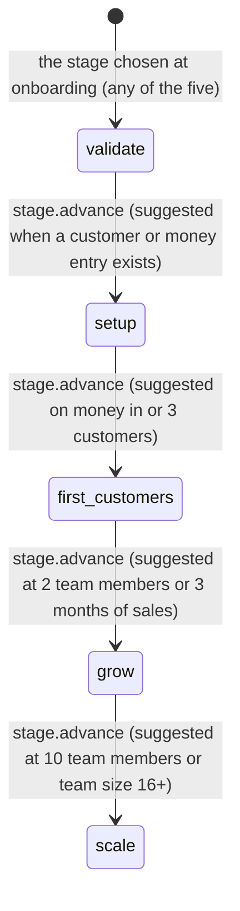
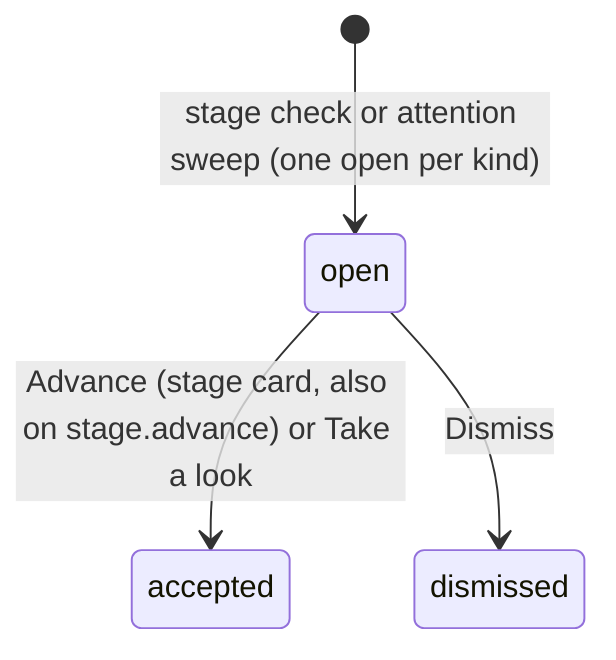
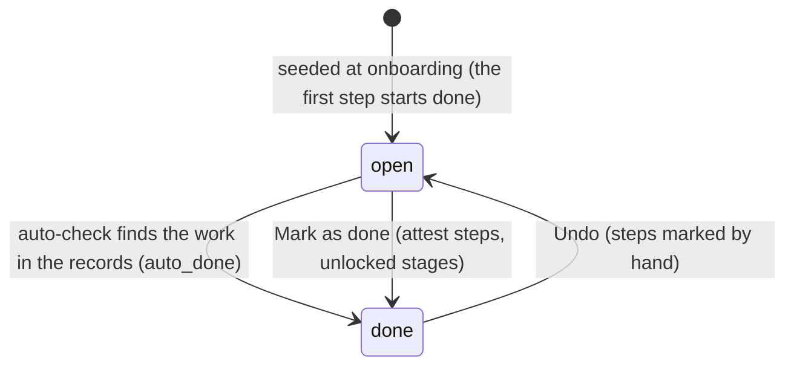
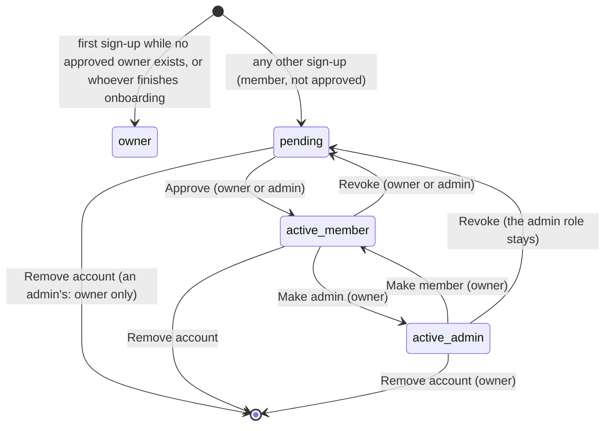
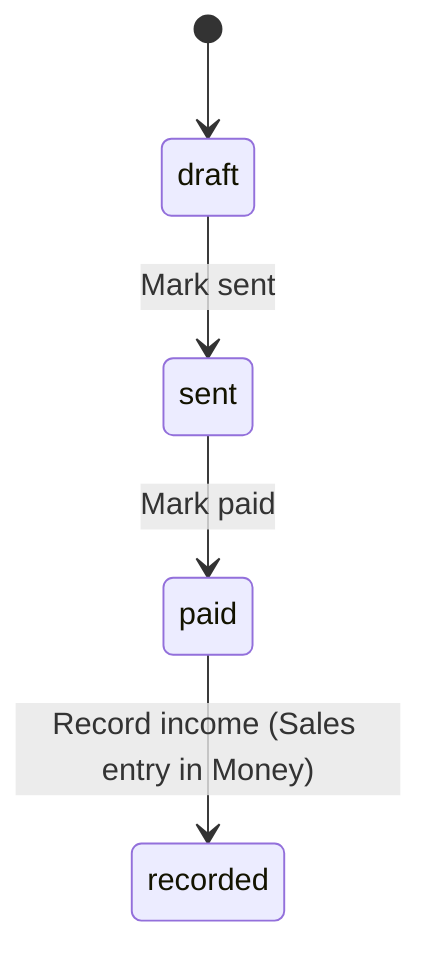

# Requirements: Company OS

PART A — REQUIREMENTS (SRS). User-approved before build; frozen after; changes via ## Changes.

## Introduction

### Purpose
Company OS is a company operating system for one small business, shared by its approved team. Its one job is to guide the company from idea to scale and keep its everyday records in one place. A Journey of plain steps runs through five stages (Validate, Set Up, First Customers, Grow, Scale), and the steps complete themselves when the records show the work was done. The records are the ones every management method converges on: the one-page plan, customers, money, a Kanban board, goals with a weekly scorecard and a roadmap, the team and its seats, meetings and issues, processes, marketing, notes and files. Modules switch on as the company grows, and the app suggests, never applies: stage changes and modules wait for a person. It is for founders and small teams who are not specialists. An AI agent operates the same records through A2App with 27 declared operations, and the app can ask an agent for a company checkup with one task (`company_checkup_requested`).

### Scope
**Goals**
1. A new owner gets from sign-up to a seeded workspace (vocabulary, modules, 30 Journey steps, starter metrics, a meeting ritual) by answering at most six questions, any of which can be skipped.
2. A Journey step whose work shows in the records is marked done without anyone ticking it: on load, when the Journey opens, after a customer or profile save, and daily at 06:00.
3. Nothing changes the company's stage or turns on a module by itself: the app opens a suggestion card, and only a person (or an agent through `stage.advance` and the modules records) applies it.
4. An account that is not approved reads and changes nothing; only the owner or an admin grants access, and only the owner manages admins.
5. Every figure a screen shows (cash and runway, pipeline value, scorecard, marketing readings) is computed from the stored records, and an agent can read the same figures through an operation.

**Core functionalities:** sign-in and approval · onboarding wizard · Journey with auto-detected steps · stage suggestions · module activation · Home dashboard with cash curve and calendar · customers and pipeline · money ledger and invoices · Kanban board with checklists and attachments · goals, quarterly priorities, weekly scorecard and roadmap · team directory, seats and hiring · meeting rituals and issues · processes with templates · marketing campaigns, content and channels · notes · file repository · one-page plan · settings and built-in workflows · CSV and print exports · AI drafts through the host bridge

### Approval
Approved by the user: 2026-11-11 — carried over from the published marketplace app `company-os` 1.0.0, whose requirements were approved when it was built; this document restates them in the framework's form without changing any feature.

## Product Description

### Product Perspective
`authMode: multi-user`, because one company's team shares the workspace. People sign in with email and password (PocketBase auth, through the kit's sign-in gate), and every business collection is readable and writable only by an approved account. Agents connect through the agent-app CLI as the app's operator. manifest.json declares no integrations (`capabilities.integrations: []`). The only outbound call is the host bridge's language model (`callLLM`), used by three draft-only assists and one optional paragraph in the weekly digest; without the bridge those assists answer 503 and everything else works. The app never sends, posts or pays anything: no email, no social posting, no payments, no bank or accounting connection. It is deliberately not an accounting or tax tool, and its formation guidance is general information, not legal advice.

### User Characteristics
One company's people: the owner (the first account, or whoever finishes onboarding), admins the owner names, and members. Accounts that are not yet approved see only a waiting screen. Most users are founders and small-business staff, not specialists, so every screen uses plain words and the company's own vocabulary (Clients, Customers or Guests). They use desktops through the working week and phones for quick checks: the sidebar becomes a drawer below 768 px. An AI agent works alongside them through the CLI only.

### Constraints
- C-1: Roles are owner, admin and member, plus an `approved` flag. When no approved owner exists, the next account to sign up becomes the approved owner; every other new account starts as a member who is not approved. Nobody changes their own access, and nobody changes the owner account. Role and approval change only through the member-access route (owner or admin; only the owner grants or removes admin).
- C-2: Stages, in order: validate (Validate), setup (Set Up), first_customers (First Customers), grow (Grow), scale (Scale). A stage's Journey steps are unlocked when the company's stage is that stage or a later one.
- C-3: Company types and their vocabulary packs: services (Client/Clients; Lead, Contacted, Proposal, Active, Past), retail_ecommerce (Customer/Customers; Lead, Interested, Ordered, Repeat, Inactive), food_hospitality (Guest/Guests; New, Regular, VIP, Lapsed), software_digital (Customer/Customers; Lead, Trial, Active, Churned), other (Customer/Customers; Lead, Active, Past). A customer's pipeline stage is one of its company's pack stages; an empty stage reads as the first.
- C-4: The Journey has 30 steps: 5 Validate, 6 Set Up, 6 First Customers (the sixth is "Plan your first promotion" for retail and food businesses, "Send your first invoice" for the others), 7 Grow and 6 Scale. Step kinds are form, module and attest; only attest steps are ticked by hand.
- C-5: Modules: customers, money, kanban, goals, team, meetings, processes, marketing. At onboarding Validate turns none on (suggests customers and kanban); Set Up turns on customers and money (suggests kanban and marketing); First Customers turns on customers, money, kanban and marketing (suggests goals, team, meetings and processes); Grow and Scale turn all on. Turning a module off hides its page and keeps every record.
- C-6: The stage engine suggests the next stage: Validate to Set Up when any customer or money entry exists; Set Up to First Customers when money came in or 3 customers exist; First Customers to Grow when 2 team members exist or money came in during 3 different months; Grow to Scale when 10 team members exist or the team size is 16–50 or more than 50. At most one open suggestion per kind exists.
- C-7: The attention sweep opens one "overdue follow-ups" card when any customer's follow-up date is past, and one runway card when cash on hand is above 0 and the last 90 days' average monthly net is negative and covers less than 4 months.
- C-8: Money and Settings are owner/admin pages. The Team page stays reachable for the owner and admins when the Team module is off, because it holds access management.
- C-9: Fixed vocabularies: invoice status draft, sent, paid; card and checklist state todo, doing, done; goal status active, reached, dropped; priority status on_track, at_risk, done; metric direction up, down; candidate stage applied, screening, interview, offer, hired, passed; meeting cadence weekly, monthly, quarterly, yearly; issue status open, solved; campaign goal awareness, leads, sales, loyalty; campaign status planned, active, paused, done; content status idea, draft, scheduled, published; content format post, email, ad, article, event, other; milestone status planned, in_progress, done, cut.
- C-10: Size limits: a stored file 50 MB; a Kanban card 10 attachments of 10 MB each; company values 5 (the first five kept); text fields as in ## Data Requirements.
- C-11: The app never sends, posts or pays anything, and the AI assists only draft: they fill empty fields or return text a person edits.

### Assumptions
- A-1: Volume ceiling: 2,000 records per collection. Every screen loads its collections whole (`getFullList`) and computes its figures in the browser, with no paging.
- A-2: One company per install: the first company record is the company, and onboarding refuses a second.
- A-3: The browser and the server share one time zone (the app runs on the person's computer or one shared host), so local-time readings (relative due dates, the current quarter) agree on both sides. "Today" and the scorecard's weeks are UTC calendar days on both sides, whatever the time zone.
- A-4: The host bridge's language model may be absent; every AI assist then says so and the page works without it.

## Features

### Module: Access and setup
- F-ACC-1: The user can create an account or sign in with email and a password of at least 8 characters on the kit's sign-in card ("Sign in" / "Create account").
- F-ACC-2: WHEN an account signs up and no approved owner exists THE SYSTEM SHALL make it the approved owner; otherwise it SHALL make it a member who is not approved.
- F-ACC-3: WHEN a signed-in account is not approved THE SYSTEM SHALL show only "Waiting for approval", with the account's email, "I've been approved — check again" and "Sign out", and SHALL refuse it every company record.
- F-ACC-4: WHEN no company exists THE SYSTEM SHALL show the onboarding wizard: a welcome screen ("Let's set up your company OS"), then six questions one per screen (company name, what it does, kind of business, where you are now, team size, what you want help with first), with step dots, "Skip for now", "Back", "Next" and "Finish setup".
- F-ACC-5: WHEN the wizard finishes THE SYSTEM SHALL create the company with its vocabulary pack, module rows, the 30 Journey steps (the first one done), the type's four starter metrics and a weekly meeting ritual ("Weekly Review" for a solo founder, "Weekly Team Meeting" otherwise), and SHALL make the person who finished it the approved owner.
- F-ACC-6: The owner or an admin can see the login accounts on Team > Access, split into "Pending approval" and "With access", each with its role and status.
- F-ACC-7: The owner or an admin can approve or revoke an account, and remove a member's account after confirming; only the owner can make someone an admin, make an admin a member again, or remove an admin. Nobody can change their own access or the owner's.
- F-ACC-8: The user can sign out from the foot of the sidebar, which shows their email.

### Module: Navigation
- F-NAV-1: The user sees a sidebar with the company's initials, name and stage, and links grouped as Home and Journey; Work (the customers word, Kanban, Money, Goals, Meetings, Marketing); and Company (Team, Processes, Notes, Files, Profile, Settings).
- F-NAV-2: WHEN a module is off THE SYSTEM SHALL hide its link, and WHEN the user is a member THE SYSTEM SHALL hide Money and Settings; the owner and admins always see Team.
- F-NAV-3: WHEN the user opens the page of a module that is off THE SYSTEM SHALL show "<Module> is not turned on yet" with what it does, whether it is recommended for the current stage, and "Turn on <Module>".
- F-NAV-4: WHEN a member opens Money or Settings THE SYSTEM SHALL show "This page is only visible to the company owner."
- F-NAV-5: On phones the user opens the navigation from a top bar into a drawer.
- F-NAV-6: WHEN the app loads with a company THE SYSTEM SHALL run the Journey auto-detection silently.

### Module: Home
- F-HOME-1: The user sees the company name and today's date, and can ask for a "CraftBot checkup"; a status line then says whether the agent is looking, done ("The note is waiting in Notes"), not yet connected, or could not complete it.
- F-HOME-2: The user sees open suggestion cards and can "Advance" (a stage card) or "Take a look" (other cards), or "Dismiss" them; recommended modules show with "Turn on".
- F-HOME-3: WHEN the Money module is on THE SYSTEM SHALL show cash on hand, this month's money in and out, a 90-day cash curve with a 60-day projection and run-out date, and a runway sentence.
- F-HOME-4: The user sees "This week in your company": each active module with how many records it gained in the last 7 days, linking to its page.
- F-HOME-5: WHEN the Goals module is on and a metric has weekly values THE SYSTEM SHALL show the first four active metrics' trends against their goals.
- F-HOME-6: The user sees a month calendar of follow-ups, due unfinished Kanban cards, unpaid invoice due dates and unpublished content, and can move between months.
- F-HOME-7: The user sees the Journey card: steps done of unlocked, a progress bar, the next step with its reason and "Mark it done" or "Do it now", and the three after it.
- F-HOME-8: The user sees "Needs attention": overdue follow-ups, priorities at risk and open issues, six at a time, each linking to its page.
- F-HOME-9: WHEN the Kanban module is on THE SYSTEM SHALL show the six open tasks due soonest, and the user can click a task's box to move it to the next status.
- F-HOME-10: WHEN the Goals module is on and priorities exist THE SYSTEM SHALL show "This quarter": priorities done of total and the first five with their status.

### Module: Journey
- F-JRN-1: The user sees the five stages on a vertical rail, each with its tagline and progress, the current one highlighted, finished ones checked and later ones locked with "Unlocks after <stage>".
- F-JRN-2: The user sees each unlocked stage's steps, one expanded with its reason and action; done steps are struck through and steps the records completed are marked as such.
- F-JRN-3: The user can mark a do-it-yourself step done, undo a step they marked, or follow "Do it now" to the page that does the work.
- F-JRN-4: WHEN every step of the current stage is done THE SYSTEM SHALL turn the next stage's lock into a button, and tapping it advances the company to that stage.
- F-JRN-5: WHEN the records show a step's work (a filled plan, a first customer, a first sale, logged meeting notes, and so on) THE SYSTEM SHALL mark the step done without anyone ticking it.
- F-JRN-6: WHEN the records suggest the company has outgrown its stage THE SYSTEM SHALL open a "Ready for the <stage> stage?" suggestion and change nothing until a person confirms.
- F-JRN-7: WHEN the stage advances THE SYSTEM SHALL mark the modules newly recommended for it as suggestions, never turning them on.

### Module: Customers
- F-CUS-1: The user sees the company's customers (named in its vocabulary) newest first, and can search them by name, email or note.
- F-CUS-2: The user sees a pipeline board with one column per pipeline stage, each with its count and total value, and can drag a customer to another stage.
- F-CUS-3: The user can add or edit a customer: name, stage, email, phone, follow-up date, value, business or person, note. WHEN a customer is saved THE SYSTEM SHALL re-run the Journey auto-detection and the stage suggestion.
- F-CUS-4: The user can delete a customer after confirming.
- F-CUS-5: The user can export the contacts as CSV and print a pipeline summary.

### Module: Money
- F-MON-1: The owner or an admin sees cash on hand with "Update", a runway sentence, and this month's money in, out and net.
- F-MON-2: The owner or an admin sees the ledger grouped by month with each month's net, can add an entry (direction, amount, category, date, note) and delete one after confirming.
- F-MON-3: The owner or an admin can add and edit invoices (number, customer, amount, status, issued, due, note), mark them sent and paid, and delete them after confirming; a sent invoice past its due date reads "Past due".
- F-MON-4: The owner or an admin can record a paid invoice as money in ("Record income"), which adds a Sales entry dated today and marks the invoice recorded.
- F-MON-5: The owner or an admin can export the ledger as CSV, and print a financial summary or a single invoice.

### Module: Kanban
- F-KAN-1: The user sees a board with To Do, In Progress and Done; each card shows its title, a progress ring, due date, checklist count, attachment count, a note marker and the person in charge.
- F-KAN-2: The user can add a task at the foot of a column and drag tasks between columns.
- F-KAN-3: The user can open a task to edit its title, status, due date and person in charge, and write its note in a Markdown editor that saves as they type.
- F-KAN-4: The user can add checklist items, cycle each through to do, doing and done, and remove them.
- F-KAN-5: The user can attach files to a task (up to 10, 10 MB each), open them and remove them.
- F-KAN-6: The user can delete a task after confirming.

### Module: Goals
- F-GOL-1: The user sees this quarter's priorities with their owner and status, and the goals for the year with how they are measured, and can add, edit and delete both (deleting asks first).
- F-GOL-2: The user sees the Numbers scorecard: the last 8 weeks for each active metric, cells tinted when a goal is met or missed, a 4-week average and a trend line.
- F-GOL-3: The user can type a weekly number into a cell, change it, or clear it.
- F-GOL-4: The user can add, edit and delete metrics (name, weekly goal, unit, direction, owner, order, active); deleting says how many weekly values go with it.
- F-GOL-5: The user sees the roadmap as a canvas of milestones joined by prerequisite arrows, with time dividers, pan and zoom, and a minimap.
- F-GOL-6: The user can add, rename, move, restyle (status), edit (title, description, status, quarter, target date, owner) and delete milestones, select several at once, copy and paste them, and undo.
- F-GOL-7: The user can connect a milestone to another as its prerequisite, and remove the link; WHEN a link would create a cycle THE SYSTEM SHALL refuse it with "That would create a cycle".
- F-GOL-8: The user can auto-lay-out the roadmap by dependency depth, and add, move, rename and remove time dividers ("WW <n>").

### Module: Team
- F-TEAM-1: The user sees the people directory with the seats each person holds (or their email) and whether they are active, and can add, edit and remove people (removing asks first).
- F-TEAM-2: The user sees the seats, each with up to five responsibilities and its accountable person or "No owner", and can add, edit and delete them.
- F-TEAM-3: WHEN the company is at the Grow stage or later, or a candidate exists, THE SYSTEM SHALL show the Hiring tab, where the user can add, edit and delete candidates and move them through the hiring stages.

### Module: Meetings
- F-MTG-1: The user sees the meeting rituals with their cadence, agenda and when each was last held, and can add, edit and delete them (deleting says how many notes go with it).
- F-MTG-2: The user can log notes and decisions for a ritual, and delete logged notes.
- F-MTG-3: The user can raise an issue, solve it with a solution, and delete it; the header counts the open issues.

### Module: Processes
- F-PRC-1: The user sees the processes with their category, owner and numbered steps, and can write, edit and delete them.
- F-PRC-2: WHEN no process exists THE SYSTEM SHALL offer the starter templates for the company's type, and the user can add one with "Use template".

### Module: Marketing
- F-MKT-1: The user sees the channel spend per month, campaign spend against budget, cost per customer and return on spend over the last 90 days, with a plain reading of them.
- F-MKT-2: The user sees campaigns grouped by status and filterable by goal, each with spend against budget, progress toward its target and its content count, and can add, edit and delete campaigns, set one active or mark it done.
- F-MKT-3: The user can record spend on a campaign, which adds a Marketing expense in Money dated today and adds the amount to the campaign's spend.
- F-MKT-4: The user can ask for three campaign ideas for a goal with AI and start a campaign from one.
- F-MKT-5: The user sees content grouped by status (idea, draft, scheduled, published) and on a calendar, can add, edit and delete content, move a piece to its next status, and draft its copy with AI.
- F-MKT-6: The user can add, edit and delete channels with their monthly cost, and sees where the money goes across paid channels.
- F-MKT-7: The user sees insights (return on spend, cost per customer, goals without a campaign, the most used channel, paid channels with nothing running, content in the next two weeks) and the funnel coverage per goal, and can start a campaign for an uncovered goal.

### Module: Notes
- F-NOT-1: The user sees notes as cards, pinned ones first, can search them by title, body or category, read one, and add, edit and delete notes.

### Module: Files
- F-FIL-1: The user can browse folders through a breadcrumb, switch between card, small card, list and tree views (remembered on this browser), search files by name, and sees the file count and storage used.
- F-FIL-2: The user can upload several files into the current folder, create folders, and drag a file onto a folder or a breadcrumb to move it.
- F-FIL-3: The user can open a file to preview it on its own page (image, PDF, video, audio or text) and download it.
- F-FIL-4: The user can delete a file, or a folder with its subfolders and files, after confirming.

### Module: Profile
- F-PRF-1: The user can write the one-page plan: why we exist, who we serve, what we offer, how we make money, three years from now, and this year; each saves when the field loses focus, and the header counts the filled sections.
- F-PRF-2: The user can keep up to five company values.
- F-PRF-3: The user can draft the empty plan fields with AI; filled fields are never overwritten.

### Module: Settings
- F-SET-1: The owner or an admin can rename the company and change its stage after confirming "Change stage to <stage>?", and sees whether the owner is recorded.
- F-SET-2: The owner or an admin can turn each module on or off; turning one off hides its page and keeps its records.
- F-SET-3: The owner or an admin can run each built-in workflow now (weekly review digest, Journey auto-check, stage check, attention sweep) and sees each one's last run and result.
- F-SET-4: WHEN it is 06:00 THE SYSTEM SHALL run the Journey auto-check, the stage check and the attention sweep, and record each run.
- F-SET-5: WHEN the weekly review digest runs THE SYSTEM SHALL write a "Weekly review <date>" note with the last 7 days' money, numbers, priorities, open issues and Journey progress, plus a short take from the AI when it is available.

### Agent (via A2App)
- F-AGT-1: The agent can read what the screens show through the read-only operations: the Home overview, the Journey, the customer pipeline, the Money summary, the scorecard, the marketing readings, the team, and stored files (content up to 10 MB).
- F-AGT-2: The agent can do the screens' multi-step and checked actions through operations that make the same changes and run the same follow-ups as the UI: company edits, Journey steps, customer saves, invoice income, campaign spend, weekly numbers, roadmap links and layout, process templates, file uploads (up to 20 MB) and card attachments.
- F-AGT-3: The agent can read and write the 28 business collections directly, as the screens do; login accounts are hidden from it.
- F-AGT-4: WHEN the company is not set up THE SYSTEM SHALL refuse the agent's operations with `no_company` and tell it to ask the person to finish onboarding in the app; onboarding and account access are never offered to agents.
- F-AGT-5: WHEN an agent operation targets a module that is off, a page the caller may not use, or a step or record the UI would not allow, THE SYSTEM SHALL refuse it with a code and a message saying what to do instead.
- F-AGT-6: WHEN an agent calls a destructive operation (`kanban.detach`, `roadmap.auto_layout`) THE SYSTEM SHALL answer `approval_required` until a person approves that call.
- F-AGT-7: WHEN a person asks for a CraftBot checkup THE SYSTEM SHALL queue one `company_checkup_requested` task (at most once a minute), and the agent writes or updates that day's checkup note.

## Non-Functional Requirements
- N-1: A change made by anyone (a person, an agent, a workflow) shows on every open screen without a refresh: each list subscribes to its collection and reloads 120 ms after a change.
- N-2: Journey auto-detection runs on every app load and Journey open, after customer and profile saves, and in the daily 06:00 tick.
- N-3: The app's operation routes accept 300 calls a minute per address, record routes 1,200 and sign-in 30.
- N-4: Toasts stay 4 s.
- N-5: An agent file upload is at most 20 MB, so its JSON request stays under PocketBase's 32 MB body limit; an agent download returns content up to 10 MB.

## Data Requirements
- **company** (module: company): name (string, required, max 160), what_it_does (string, max 2000), company_type (enum, required), stage (enum, required), team_size (enum), focus (json), vocab (json), onboarding_done (boolean), owner (ref → users), mission (string, max 2000), who_we_serve (string, max 2000), offer (string, max 2000), how_money (string, max 2000), values_list (json), three_year_picture (string, max 3000), year_goals (string, max 3000), cash_on_hand (number), created (datetime, server-set), updated (datetime, server-set).
- **modules** (module: stage): key (enum, required), active (boolean), suggested (boolean), activated_at (datetime), created (datetime, server-set), updated (datetime, server-set).
- **journey_steps** (module: journey): stage (enum, required), order (number), title (string, required, max 200), why (string, max 500), kind (enum, required), module_key (string, max 40), auto_rule (string, max 60), status (enum, required), done_at (datetime), auto_done (boolean), created (datetime, server-set), updated (datetime, server-set).
- **suggestions** (module: stage): kind (enum, required), title (string, required, max 200), body (string, max 1000), payload (json), status (enum, required), created (datetime, server-set), updated (datetime, server-set).
- **team_members** (module: team): name (string, required, max 120), email (string, max 255), note (string, max 1000), active (boolean), created (datetime, server-set), updated (datetime, server-set).
- **customers** (module: customers): name (string, required, max 160), is_org (boolean), pipeline_stage (string, max 40), email (string, max 255), phone (string, max 60), value (number), follow_up (datetime), note (string, max 3000), created (datetime, server-set), updated (datetime, server-set).
- **meetings** (module: records): name (string, required, max 120), cadence (enum, required), agenda (json), created (datetime, server-set), updated (datetime, server-set).
- **metrics** (module: goals): name (string, required, max 120), owner_member (ref → team_members), goal (number), unit (string, max 30), direction (enum, required), order (number), active (boolean), created (datetime, server-set), updated (datetime, server-set).
- **channels** (module: marketing): name (string, required, max 120), monthly_cost (number), note (string, max 1000), active (boolean), created (datetime, server-set), updated (datetime, server-set).
- **invoices** (module: money): number (string, required, max 60), customer (ref → customers), amount (number), status (enum, required), issued (datetime), due (datetime), recorded (boolean), note (string, max 1000), created (datetime, server-set), updated (datetime, server-set).
- **seats** (module: team): name (string, required, max 120), responsibilities (json), accountable (ref → team_members), created (datetime, server-set), updated (datetime, server-set).
- **candidates** (module: records): name (string, required, max 120), seat (string, max 120), stage (enum, required), note (string, max 2000), created (datetime, server-set), updated (datetime, server-set).
- **priorities** (module: records): title (string, required, max 200), quarter (string, max 20), owner_member (ref → team_members), status (enum, required), note (string, max 1000), created (datetime, server-set), updated (datetime, server-set).
- **goals** (module: goals): title (string, required, max 200), year (number), measure (string, max 300), status (enum, required), created (datetime, server-set), updated (datetime, server-set).
- **metric_entries** (module: records): metric (ref → metrics), week_start (datetime), value (number), created (datetime, server-set), updated (datetime, server-set).
- **processes** (module: processes): name (string, required, max 160), category (string, max 80), owner_member (ref → team_members), steps (json), created (datetime, server-set), updated (datetime, server-set).
- **meeting_notes** (module: records): meeting (ref → meetings), date (datetime), notes (string, max 8000), decisions (string, max 3000), created (datetime, server-set), updated (datetime, server-set).
- **issues** (module: records): title (string, required, max 300), detail (string, max 3000), status (enum, required), solution (string, max 2000), created (datetime, server-set), updated (datetime, server-set).
- **promos** (module: marketing): title (string, required, max 200), channel (ref → channels), date (datetime), status (enum, required), note (string, max 1000), created (datetime, server-set), updated (datetime, server-set), campaign (ref → campaigns), format (enum).
- **money_entries** (module: money): kind (enum, required), amount (number), category (string, max 80), note (string, max 500), date (datetime), created (datetime, server-set), updated (datetime, server-set).
- **notes** (module: workflows): title (string, required, max 200), category (string, max 80), body (string, max 30000), pinned (boolean), created (datetime, server-set), updated (datetime, server-set).
- **workflow_runs** (module: workflows): workflow (enum, required), status (enum, required), summary (string, max 3000), finished (datetime), created (datetime, server-set), updated (datetime, server-set).
- **roadmap_items** (module: roadmap): title (string, required, max 300), description (string, max 3000), status (enum, required), quarter (string, max 20), target_date (datetime), owner (ref → team_members), pos_x (number), pos_y (number), prerequisites (json), created (datetime, server-set), updated (datetime, server-set).
- **roadmap_dividers** (module: roadmap): label (string, required, max 40), x (number), created (datetime, server-set), updated (datetime, server-set).
- **campaigns** (module: marketing): name (string, required, max 160), goal (enum, required), status (enum, required), channel (ref → channels), start (datetime), end (datetime), budget (number), spend (number), target (number), result (number), note (string, max 2000), created (datetime, server-set), updated (datetime, server-set).
- **kanban_cards** (module: kanban): title (string, required, max 300), status (enum, required), due (datetime), note (string, max 5000), owner (ref → team_members), checklist (json), attachments (binary), order (number), created (datetime, server-set), updated (datetime, server-set).
- **files** (module: files): title (string, required, max 300), file (binary), size (number), mime (string, max 200), note (string, max 2000), created (datetime, server-set), updated (datetime, server-set), folder (ref → folders).
- **folders** (module: files): name (string, required, max 200), created (datetime, server-set), updated (datetime, server-set), parent (ref → folders).

## External Interfaces
- **Human (browser):** one View served by PocketBase at the app's own origin. It starts with the kit's sign-in card, then "Waiting for approval" for accounts not yet approved, then the onboarding wizard while no company exists. After that come the hash routes `#/home` (the default), `#/journey`, `#/customers`, `#/money`, `#/kanban`, `#/goals`, `#/team`, `#/meetings`, `#/processes`, `#/marketing`, `#/notes`, `#/files`, `#/profile` and `#/settings`. Exports download CSV files or open the browser's print dialog for a printable page. The owner and admins also see Money, Settings and Team > Access; a page whose module is off shows its "Turn on" prompt.
- **Agent (A2App):** the modules and collections in AGENT_APP.md § Modules; operations exactly as declared in ## Operations Design; tasks with the capabilities `company_checkup_requested` (events.json). No other machine interface is offered to agents; the app's own screens call their own routes.

## Out of Scope
- Accounting, bookkeeping, tax, payroll and legal advice. Money is a plain record of money in and out, and the Journey's formation steps are general guidance.
- Sending, posting or paying anything: no email, social posting, payments, bank feeds or calendar sync. Everything stays inside the app.
- Integrations of any kind, and AI beyond the three draft-only assists and the digest paragraph.
- More than one company per install.
- Currencies: amounts carry no currency symbol or conversion.
- Editing a ledger entry, logged meeting notes or an issue after it is saved, and reopening a solved issue (delete and re-add instead).
- Renaming files or folders, moving folders, and file notes in the UI.
- Changing the company type, vocabulary, focus, team size or "what it does" after onboarding.
- Password reset, changing an account's email or password, and account profiles.
- Agents running onboarding or changing account access.
- Deep links to a single record: the URL names the page only.
- Undo, except on the roadmap canvas.
- Languages other than English.

## Quality of Life
- The Files view mode is remembered on this browser.
- Searching notes and customers filters as you type.
- The weekly digest adds a short AI paragraph ("CraftBot's take") when the bridge is available.
- Process templates are offered on the empty Processes page, so a first process takes one click.

PART B — TECHNICAL SPECIFICATION.

## System Overview
PocketBase 0.39 (JS hooks, migrations) + React 19 / Vite / Tailwind 4 View in `frontend/` built into `pb/pb_public/`, on the `blueprint-pocketbase-kit` toolkit. The View writes most records directly through the PocketBase SDK, under collection rules that admit approved accounts only. It calls nine routes, which also refuse an account that is not approved, in `ops.pb.js` (`/api/ops/<kebab-name>`) for onboarding, member access, Journey auto-check, stage recompute and advance, workflows and the three AI assists; their domain logic is `lib_company.js` (vocabulary packs, Journey templates, module matrix, the auto-check, stage, attention and digest engines). `agent_ops.pb.js` and `lib_agent.js` add the agent operations (reads that compute each screen's figures, and writes that make the screens' checked and multi-record changes). The generated `a2app_routes.pb.js` serves the 27 declared operations as `POST /api/ops/<name>` through those same handlers. The onboarding and member-access routes are person-only and not declared. `access.pb.js` guards sign-up, and a daily cron (`companyOsDailyTick`, 06:00) runs the background workflows.

Modules → navigation map:

| Module (manifest) | Where a person meets it | Route |
| --- | --- | --- |
| `company` | Home (dashboard), Profile (plan, values), Settings (name) | `#/home`, `#/profile`, `#/settings` |
| `journey` | Journey, and the Journey card on Home | `#/journey` |
| `stage` (modules, suggestions) | Suggestion cards and recommended modules on Home, the stage select and module switches in Settings, the "Turn on" prompt | `#/home`, `#/settings` |
| `workflows` (notes, workflow_runs) | Settings > Workflows; Notes | `#/settings`, `#/notes` |
| `ai` | "Draft empty fields with AI" on Profile | `#/profile` |
| `customers` | Customers (list and board) | `#/customers` |
| `money` | Money (ledger, invoices) | `#/money` |
| `kanban` | Kanban, and open tasks on Home | `#/kanban` |
| `goals`, `roadmap`, `records` (priorities, metric_entries) | Goals (Goals, Numbers, Roadmap tabs) | `#/goals` |
| `team`, `records` (candidates) | Team (People, Seats, Hiring, Access) | `#/team` |
| `records` (meetings, meeting_notes, issues) | Meetings (Rituals, Issues) | `#/meetings` |
| `processes` | Processes | `#/processes` |
| `marketing` | Marketing (KPIs, Campaigns, Content, Channels, Insights) | `#/marketing` |
| `files` | Files, and Kanban card attachments | `#/files` |

## UI Design
- **Design system:** the Living UI kit 0.5.0 is vendored in `frontend/src/kit` (system-managed): the sign-in gate, shell (error boundary, toasts, theme bridge, console relay), PocketBase client and hooks, and primitives (Button, Input, Select, Dialog, Drawer, Tabs, Switch, confirm, charts). The app overrides the kit's `--lui-*` tokens in `frontend/src/app/theme.css` with the CraftOS Command Center language: warm cream and charcoal surfaces (`--lui-bg` #eceae5 / #141311, `--lui-surface` #f4f2ee / #1c1a17, `--lui-text`, `--lui-muted`, `--lui-border`), CraftBot orange as the only accent (`--lui-accent` #ff4f18, from the kit), `--lui-radius: 0` with every rounded utility flattened to sharp corners, hairline borders instead of shadows, and Inter (from the system font stack) with tabular figures for numbers. Status colors are Tailwind emerald, amber, red and sky, carried in pills and dots with words. Icons are lucide-react. The app's own primitives live once in `components/ui.tsx` (PageHeader, Section, ListRow, Pill, Dot, StatTile, IdentityChip, RelDate, AgoDate, MoneyAmount, ProgressRing, Edit and Delete buttons, ExportMenu, ghost empty states). Charts are hand-built SVG in `components/viz.tsx` (cash curve, metric panels, month calendar, constellation); the roadmap canvas is `NodeGraph.tsx`; the Markdown note editor is TipTap (`NoteEditor.tsx`).
- **Layout:** a fixed 240 px sidebar of three detached blocks (brand with stage, navigation, account) on desktop; a top bar with a left drawer below 768 px. The main column is centred at up to 1024 px (`max-w-5xl`) with a page header (icon, title, count, subtitle, actions) above the content. Boards (Customers, Kanban) are column grids; Home stacks a hero row, a momentum row, the calendar and two columns of lists. Dialogs hold every create and edit form. Density is compact: 13 px rows, 1 px borders, sharp corners.
- **Screen — Sign-in:** primary object: the account · primary action: "Sign in" / "Register" · the kit's card with Email and Password (at least 8 characters) and "No account? Register" / "Have an account? Sign in" · error: the server's message as a toast · narrow: one centred card.
- **Screen — Waiting for approval:** primary object: the signed-in account's standing · primary action: "I've been approved — check again" · copy names the account's email and says an owner or admin grants access from the Team page · secondary: "Sign out" · narrow: one centred card.
- **Screen — Onboarding wizard:** primary object: the company being set up · primary action: "Start", then "Next" and "Finish setup" · one question per screen with choice cards (type, stage, team size, focus) or a field (name, what it does), step dots, "Skip for now", "Back" · in-flight: a spinner with "Setting up your Company OS: your plan draft, your Journey, and the right modules…" · error: a toast ("Setup failed, try again") and the wizard returns · narrow: one column.
- **Screen — Home:** primary object: the company's state this week · primary action: the next Journey step, "CraftBot checkup" · suggestion and module cards on top, then the cash hero (Money on) beside "This week in your company", the momentum wall (Goals on), the month calendar, the Journey card, "Needs attention" and "Open tasks" (Kanban on), and "This quarter" (Goals on) · empty: each card says what fills it ("Record money in and out on the Money page and this becomes your cash curve.", "No open tasks. Add work on the Kanban board.") · narrow: the rows stack into one column.
- **Screen — Journey:** primary object: the five stages and their steps · primary action: "Mark as done" / "Do it now" / the lock that unlocks the next stage · loading: "Loading…" · success: "Step done. Nice progress.", "<Stage> stage unlocked." · narrow: the rail keeps one column.
- **Screen — Customers:** primary object: the customers · primary action: "Add <customer>" · tabs List and Board · search · empty: "No <customers> yet" over ghost rows or a ghost board · delete confirms "Delete <customer> "<name>"?" · narrow: the board shows 3 columns from 768 px and 5 from 1024 px, scrolling sideways, and stacks below.
- **Screen — Money (owner/admin):** primary object: cash and the ledger · primary action: "Add entry", "New invoice" · the cash verdict block with "Update", three stat tiles, tabs Ledger and Invoices, the export menu · empty: "No money recorded yet" with "Add your first entry"; "No invoices yet" · confirms "Delete this entry?", "Delete invoice #<n>?" · narrow: tiles in two columns.
- **Screen — Kanban:** primary object: tasks · primary action: "Add a task" in a column · empty: "No tasks yet" · the task dialog holds title, status, due date, person in charge, checklist, the Markdown note and files · confirm "Delete task "<title>"?" · success: "File attached" / error "Upload failed" · narrow: the three columns stack below 768 px.
- **Screen — Goals:** primary object: priorities, goals, metrics and milestones · primary action per tab: "Add priority" (Goals), "Add metric" (Numbers) · the Numbers tab holds the scorecard grid (scrolling sideways in its container) and the metric manager under "Advanced"; the Roadmap tab holds the canvas · empty: "No metrics yet", "No roadmap yet" with "Add the first milestone" · error: "Numbers only" for a non-numeric cell · narrow: the grid scrolls; the canvas pans.
- **Screen — Team:** primary object: people, seats, candidates and accounts · primary action per tab: "Add person", "Add seat", "Add a candidate" · tabs People, Seats, Hiring (from Grow or when candidates exist) and Access (owner/admin) · empty: "Nobody here yet" ("Add yourself first."), "No seats defined yet", "No candidates yet" · Access shows "Pending approval" ("No one is waiting.") and "With access", with Approve, Revoke, Make admin / Make member and "Remove account" · narrow: seats in one, two or three columns.
- **Screen — Meetings:** primary object: rituals and issues · primary action: "Add ritual", "Log notes", "Raise an issue", "Solve" · tabs Rituals and Issues · empty: "No meeting rituals yet", "No issues" · success: "Notes logged. The Journey sees this too.", "Issue solved" · narrow: one column.
- **Screen — Processes:** primary object: processes · primary action: "Write a process" · empty: "Start from a template" cards with "Use template" · success: "Added "<name>". Edit it until it matches how YOU do it." · narrow: template cards in one to three columns.
- **Screen — Marketing:** primary object: campaigns, content and channels · primary action: "New campaign", "Suggest ideas", "Add content", "Add channel" · four KPI tiles and a reading sentence above tabs Campaigns, Content (default), Channels and Insights · empty: "No campaigns yet", "No channels yet"; AI unavailable: "AI assist is unavailable right now. You can still plan campaigns by hand — the page works fine without it." · success: "Recorded as a Marketing expense in Money and added to this campaign." · narrow: KPIs in two columns, four from 1024 px.
- **Screen — Notes:** primary object: notes · primary action: "New note" · search · reading opens a dialog with Edit and Delete · empty: "No notes yet", "No notes match your search" · narrow: cards in one to three columns.
- **Screen — Files:** primary object: folders and files · primary action: "Upload", "New folder" · views card, small card, list, tree; breadcrumb; summary line (files and storage used); search · preview page with a back button, metadata and download · empty: "No files yet" · confirms "Delete "<title>"? This removes the file for good." and "Delete folder "<name>" and its <n> files? This can't be undone." · narrow: grids drop to two or one columns.
- **Screen — Profile:** primary object: the one-page plan · primary action: "Draft empty fields with AI" · six section cards and Values · success: "Saved"; AI: "Drafted <n> field(s). Edit them until they sound like you.", "Nothing to draft, the empty fields are already filled", "AI assist unavailable right now, the page works fine without it" · narrow: one column below 1024 px.
- **Screen — Settings (owner/admin):** primary object: company basics, modules, workflows · primary action: "Save" (name), the stage select, module switches, "Run" · stage change confirms in a dialog ("Journey steps and module suggestions follow the stage. Nothing is deleted.") · success: "<Module> is now on", "<Module> hidden. Its data is kept, not deleted.", "Workflow finished. See the result below." · narrow: label-left rows wrap.
- **Formatting:** amounts use the browser's number format with up to 2 decimals and no currency symbol; ledger amounts are signed (+ green for money in, − for money out) in tabular figures. Due dates read "Today", "Tomorrow", "Yesterday", "<n>d overdue" (red), "in <n>d", then "Nov 30"; past events read "<n>d ago", then the date. Invoice numbers read "#<number>". Quarters read "2026-Q4". Empty values read "-" or "—". Counts use tabular figures.

## Quality Conformance

- **Q1 Completeness & IA:** the sidebar is the orientation model: grouped Home/Journey, Work and Company, the current page marked with an accent bar and `aria-current="page"`, and only active modules listed. Home is the default route; each page has one header naming it. Module pages map one to one to manifest modules (## System Overview). One name per concept, in the company's vocabulary (Client, Customer or Guest). Long sets have their tools: search on Customers, Notes and Files; a goal filter on campaigns; status groups on content and invoices; the scorecard keeps 8 weeks.
- **Q2 Design system:** tokens are the kit's `--lui-*` set overridden in `theme.css` (## UI Design), with dark values under `[data-theme='dark']`. Semantic roles: orange accent for primary actions, the current page and the Journey; emerald for money in, done and goals met; amber for at-risk and over budget; red for overdue, past due and destructive; sky for new or sent. Sharp corners everywhere except genuinely round parts. Light and dark come from the host through the kit's theme bridge.
- **Q3 Layout & composition:** one content column of up to 1024 px with a page header, sections in 1 px bordered blocks, money and counts in tabular figures, long names truncated in rows. Each page has its primary action in the header. Home uses a three-column hero on wide screens; boards use equal columns.
- **Q4 Interaction:** every clickable element shows the hand cursor (`theme.css`). Row actions (edit, delete) appear on hover and focus. Every delete of a record goes through the kit's confirm dialog naming the record, and deleting a metric, ritual or folder says what goes with it; `window.confirm` is never used. Some changes apply at once: dismissing a suggestion, turning a module off (undone by turning it on), removing a checklist item or a card attachment, moving a card or customer. Stage changes confirm in a dialog. Keyboard: Enter submits forms and quick-add; on the roadmap Ctrl/Cmd+C, V, Z and A copy, paste, undo and select all, Delete removes the selection, Escape clears it. Drag alternatives: a customer's Stage in its form and a task's Status in its dialog; moving a file between folders needs a drag (see ### Conventions and overrides).
- **Q5 State & feedback:** each screen's empty state is a ghost preview with a sentence and an action (## UI Design); loading shows a spinner until the company and access are known. Buttons show a busy state while their call runs. Success shows as a toast and the live lists update; errors show the server's message as a toast, and the shell turns a network failure into "Network error — is the backend running?". A crash shows "Something went wrong" with "Reload app".
- **Q6 Motion:** pages enter with a 200 ms fade-and-rise (`cos-page`), a completed Journey stage pops its check (260 ms, `cos-pop`), and the Home constellation's centre pulses (3.2 s loop, `cos-pulse`); colour transitions use Tailwind's 150 ms default. Under `prefers-reduced-motion: reduce` all three animations are removed.
- **Q7 Content:** plain, friendly, sentence case, no jargon, no emoji; the vocabulary pack names customers in the company's words. Empty states say what the page is for and what to do first. Refusals and limits say why ("This page is only visible to the company owner.", "Numbers only", "AI assist unavailable right now, the page works fine without it"). The app says what it is not: "Not an accounting or tax tool", "General guidance, not legal advice".
- **Q8 Accessibility:** contrast comes from the token pairs in light and dark. Focus: kit buttons and inputs draw a 2 px accent outline on `:focus-visible`. Icon-only buttons carry `aria-label` (edit, delete, calendar months, navigation), decorative icons are `aria-hidden`, charts carry an `aria-label`, choice cards use `aria-pressed`, and the onboarding progress names "Step <n> of 6". Status is never colour alone: pills and badges carry words. Targets: buttons 32–40 px, row actions 32 px (see ### Conventions and overrides for the smaller status boxes).
- **Q9 Responsiveness:** phone to desktop. Below 768 px the sidebar becomes a top bar and drawer, and the Kanban columns and Home rows stack; from 640 px grids gain columns (notes, files, metrics), from 1024 px Home's hero and the customer board's five columns appear. The scorecard grid and customer board scroll sideways in their own containers; the roadmap canvas pans and zooms.
- **Q10 Performance:** each view loads its collections whole once (`getFullList`, A-1) and reloads 120 ms after a realtime change; the SDK's auto-cancellation is off so parallel views of one collection do not blank each other. Figures are computed in the browser with `useMemo`. Agent reads compute the same figures on the server in one call each. Charts are SVG with no chart library.
- **Q11 Caching & freshness:** the document shell is served `no-store, no-cache, must-revalidate` (`cache_control.pb.js`); built assets have content-hashed names. Record and operation responses carry no cache headers and are held as in-memory view state. Freshness comes from PocketBase realtime subscriptions on every collection a view shows, plus a module-change event that refreshes the sidebar at once.
- **Q12 Data integrity:** relations are real relation fields; meeting notes go with their meeting, weekly values with their metric, subfolders and files with their folder, and other references are cleared when their target is deleted. Selects hold the fixed vocabularies (C-9). Unique indexes: `modules.key`, and `metric_entries (metric, week_start)`. The company is one record by convention (A-2), not by index. Two-record agent writes run in one transaction; the UI's own two-record actions (record income, record spend) make two calls. The Journey and stage engines read records and write only steps, suggestions and runs. Scorecard weeks run Monday to Sunday in UTC calendar days (the days `todayStr()` gives) and are keyed by their Monday, in the View and the agent operations alike.
- **Q13 API:** the app's nine `/api/ops/<kebab-name>` routes answer `{ error }` with 400, 401, 403, 404, 409, 500, 502 or 503; the agent routes answer `{ error, code }` (codes such as `no_company`, `module_off`, `owner_only`, `not_approved`, `bad_param`, `not_found`, `too_large`). Through the adapter every declared operation answers the protocol envelope (`ok`, `result` or `code` and `message`), and destructive ones need approval. Lists are whole collections (A-1); errors carry no stack traces.
- **Q14 Architecture:** the UI lives in `frontend/src/app` (pages, components, lib), the domain engines in `lib_company.js`, the agent operations in `lib_agent.js`, routes in `ops.pb.js` and `agent_ops.pb.js`, the sign-up guard in `access.pb.js`. Shared widgets exist once (`ui.tsx`, `viz.tsx`), auth state once (`useAuth.ts`), company and module state once (`useCompany.ts`), op calls once (`ops.ts`), exports once (`export.ts`). The agent operations reuse `lib_company`'s engines and the UI's formulas.
- **Q15 Resilience:** the AI assists degrade to 503 with a plain message and the page keeps working; the weekly digest is written without its AI paragraph. Background workflow failures are recorded as error runs and logged. Journey auto-check calls from the UI are best-effort and silent on failure. Realtime unavailability leaves data loading without live updates. The shell's error boundary offers a reload.
- **Q16 Security & privacy:** `authMode: multi-user`. Every business collection requires a signed-in, approved account (`@request.auth.approved = true`), and so does every `/api/ops/*` route: an account that is not approved gets 403 (`not_approved` from the agent operations), while the agent, as the operator, is let through. Users read only themselves, except an approved owner or admin, who reads all accounts; nobody updates or deletes an account through the API, and the sign-up hook forces new accounts to pending. Access changes run through the member-access route with the owner/admin checks on the server. Money and Settings are owner/admin pages in the UI and in the agent operations. Agents act as the app's operator through the CLI credential; destructive agent calls need the person's approval; login accounts are hidden from agent data access. Credentials (`.agent-token`, `.principal`, `.superuser`) are git-ignored.
- **Q17 Observability:** hook errors log through `console.error` (`<route> failed: …`, `companyOsDailyTick failed: …`, `[company-os agent op] …`); the toolkit adds `[handler-error] <METHOD> <path>: …`, the adapter audits every agent operation and data write, and the console relay writes browser errors to `logs/`. Workflow runs are recorded in `workflow_runs` with status and summary, shown in Settings. Health is `/api/_a2app`.
- **Q18 Version control:** commits per change ("Upload company os as Living UI", "fix(company-os): survive kit re-vendoring and unblock first-user ownership"). `.gitignore` excludes credentials, `pb/pb_data/`, the PocketBase binary, the built View, `frontend/node_modules/`, `.a2app/` runtime state and `logs/`. The app builds from a clean checkout with the manifest pipeline alone.

### Conventions and overrides
The published app is restated here unchanged, so these are standing decisions of the approved build, not new work. Revisit any of them when the app is next modified.
- Q4.2 and Q4.3 (confirm what cannot be undone): removing a Kanban card attachment or a checklist item, and deleting a roadmap divider, apply at once without a confirmation.
- Q8.3 (announcements): toasts are not in a live region.
- Q8.4 (24 × 24 px targets): the status boxes on Home's open tasks and on Kanban checklist items are 16 px.
- Q8 (single-pointer alternative to dragging): moving a file between folders and placing a roadmap milestone need a drag; Auto-layout places milestones without one.
- Q2 (self-hosted fonts): Inter is named in the font stack but not bundled; systems without it fall back to the platform sans-serif.
- Q11.2 (declared data policy): record and operation responses carry no Cache-Control; they are refreshed by realtime subscriptions.
- Q15.1 (timeouts): the View's calls to its own backend use the PocketBase SDK without a client-side timeout.
- Q17.1 (structured logs): hook log lines are plain text; `workflow_runs` and the adapter's audit are the structured records.
- Mirrored global rules: none recorded for this app.

## Process Flows

Work the app asks an agent for (`company_checkup_requested`): the request row follows the A2App task.

```mermaid
stateDiagram-v2
  [*] --> pending: a person presses "CraftBot checkup" (60 s cooldown)
  pending --> claimed: agent takes the task (tasks next)
  claimed --> done: tasks complete; the day's checkup note exists in Notes
  claimed --> rejected: task failed or canceled
  pending --> rejected: task canceled
  done --> [*]
  rejected --> [*]
```

Company stage (suggested by the engine, applied only on confirmation):



Settings can also set any stage, forward or back, after its confirmation dialog; the Journey lock advances one stage at a time.

Suggestion card:



Journey step:



Account access:



Invoice:



## Operations Design
| Operation | Module | Entity | appliesWhen | Params | Flags |
| --- | --- | --- | --- | --- | --- |
| journey.autocheck | journey | — | — | — | — |
| stage.recompute | stage | — | — | — | — |
| stage.advance | stage | — | — | stage: enum! | — |
| workflows.run | workflows | — | — | workflow: enum! | — |
| ai.draft-plan | ai | — | — | — | — |
| marketing.ai_campaign_ideas | marketing | — | — | goal: enum | — |
| marketing.ai_content_draft | marketing | — | — | promoId: string, title: string, format: enum | — |
| company.overview | company | — | — | month: string | readOnly |
| journey.status | journey | — | — | — | readOnly |
| customers.pipeline | customers | — | — | query: string | readOnly |
| money.summary | money | — | — | — | readOnly |
| goals.scorecard | goals | — | — | — | readOnly |
| marketing.dashboard | marketing | — | — | — | readOnly |
| team.list | team | — | — | — | readOnly |
| files.download | files | — | — | file: string, card: string, filename: string | readOnly |
| company.update | company | — | — | name: string, cash_on_hand: number, mission: string, who_we_serve: string, offer: string, how_money: string, three_year_picture: string, year_goals: string, values: string | — |
| journey.set_step | journey | — | — | step: string!, done: boolean! | — |
| customers.save | customers | — | — | id: string, name: string, pipeline_stage: string, email: string, phone: string, follow_up: string, value: number, is_org: boolean, note: string | — |
| money.record_invoice_income | money | — | — | invoice: string! | — |
| marketing.record_spend | marketing | — | — | campaign: string!, amount: number! | — |
| goals.set_number | goals | — | — | metric: string!, week: string, value: number | — |
| roadmap.link | roadmap | — | — | prerequisite: string!, milestone: string!, remove: boolean | — |
| processes.use_template | processes | — | — | template: string! | — |
| files.upload | files | — | — | name: string!, content_base64: string!, folder: string, mime: string | — |
| kanban.attach | kanban | — | — | card: string!, name: string!, content_base64: string! | — |
| kanban.detach | kanban | — | — | card: string!, filename: string! | destructive |
| roadmap.auto_layout | roadmap | — | — | — | destructive |
