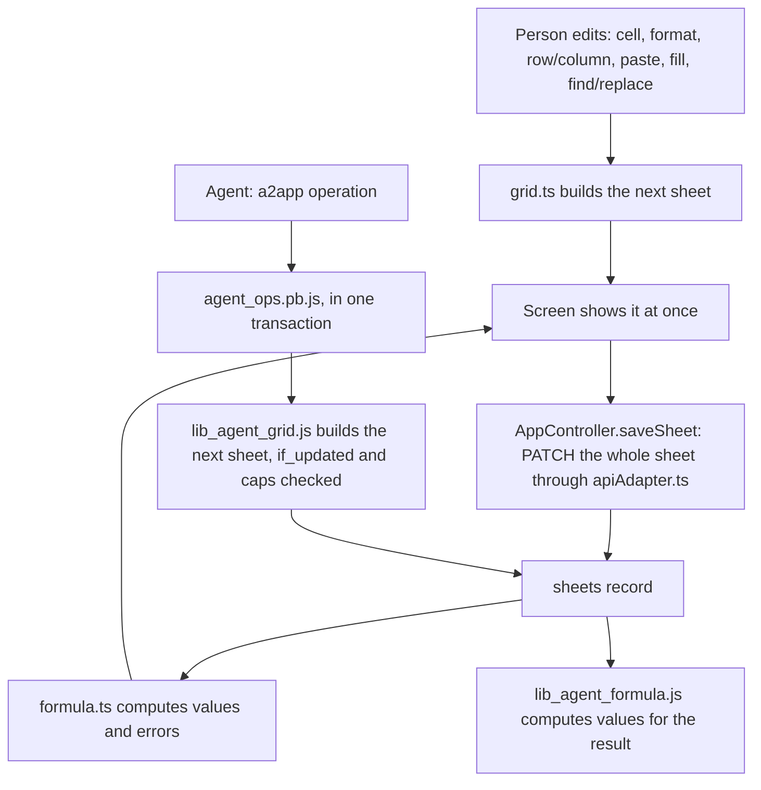

# Requirements: Craft Sheets

PART A — REQUIREMENTS (SRS). User-approved before build; frozen after; changes via ## Changes.

## Introduction

### Purpose
Craft Sheets is a small Excel-style spreadsheet that runs in the browser, with no accounts or sign-in. Its one job is quick spreadsheet work without opening an office suite: budgets, simple tables, quick calculations. It keeps one workbook of named sheets (tabs along the bottom). Each sheet is an editable grid where cells hold text, numbers and live formulas (`=SUM(A1:A10)`), with cell formatting, typed columns, find and replace, and CSV and Excel import and export. An AI agent works on the same workbook through A2App. Every action a person can take on the sheets is a declared operation, apart from undo, the Excel file formats and the person's selection. The operations run server-side ports of the screen's own code, so the agent sees the same computed values and stores sheets exactly as the screen would.

### Scope
**Goals**
1. A value or formula typed into a cell is saved at once and shows its computed result. A formula that cannot be computed shows one of seven error codes instead of a wrong number.
2. Inserting or deleting rows and columns keeps formulas pointing at the same data: references at or past an insertion shift, and a reference to a deleted row or column becomes `#REF!`.
3. A CSV or Excel file imports as new sheets (formulas kept), and a sheet exports as CSV values or the workbook as one Excel file.
4. An agent can read what a person sees in any range (raw content, computed value or error, display text, formatting) and make every data change a person can make. What it stores is byte-identical to a screen save.

**Core functionalities:** sheet tabs · editable grid · formula engine (21 functions) · cell formatting · typed columns · rows and columns (add, insert, delete, resize) · freeze panes · fill handle · copy and paste · find and replace · CSV and Excel import and export · undo and redo · agent operations

### Approval
Approved by the user: 2026-11-11 — carried over from the published marketplace app `craft-sheets` 1.0.0, whose requirements were approved when it was built; this document restates them in the framework's form without changing any feature.

## Product Description

### Product Perspective
`authMode: none`. Craft Sheets is a single shared workbook: everyone who opens the app works on the same sheets (Original requirements: "Single workbook, no authentication"). It serves on loopback only, and the framework adapter's host, origin and credential checks run before any app code. manifest.json declares no integrations (`capabilities.integrations: []`), and the app calls no outside service and no language model. The screen is the V1 View, unchanged. A client-side fetch shim (`frontend/src/app/services/apiAdapter.ts`) turns its V1 REST calls into records of one `sheets` collection, one record per sheet. Formulas are evaluated by the app's own engine (`services/formula.ts`, a port of the V1 Python engine), not by a spreadsheet library. CSV and Excel files are read and written in the browser with SheetJS. The app asks the agent for nothing (`events.json` declares no tasks).

### User Characteristics
One person, or anyone with the app open, making quick spreadsheets: budgets, lists, small calculations. They work mostly at a desktop browser with keyboard and mouse (arrow keys, Enter, Tab, F2, Delete, Ctrl shortcuts, drag to select, fill handle). The layout stays usable down to about 360 px wide, where the toolbar wraps and the grid scrolls. Use is occasional, a few sessions a week.

### Constraints
- C-1: A sheet is a grid of ordered columns and a row count. Columns are lettered by position (A, B, … Z, AA) and rows are numbered from 1. Cells are keyed by upper-case A1 references.
- C-2: A cell stores its raw content exactly as typed and, optionally, a format: bold, italic and underline (on or absent), `align` (left, center or right), and `bg` and `color` (`#rrggbb`). A cell exists only while it has content or formatting. Computed values are never stored; they are computed from the raw content on every load.
- C-3: Content starting with "=" is a formula. Other content is read as true or false (any case), a number (Python float syntax: `42`, ` 42 `, `1e3`, `-3.5`, `inf`, `nan`), or text.
- C-4: A column's type is text, number, date or currency, and it changes display only: number and currency columns align right, and currency shows US dollars. A type never validates input, and `date` has no date formatting.
- C-5: A new sheet is named "Sheet N" (N = number of tabs + 1) and has 12 text columns (A–L, 120 px wide) and 30 rows (28 px high). Sheet ids are integers assigned as the highest id + 1. Tabs keep creation order (position = number of sheets at creation), and nothing reorders them.
- C-6: Sheet names are at most 255 characters and need not be unique.
- C-7: Columns are at least 64 px wide and rows at least 20 px high, with sizes rounded to whole pixels. A sheet keeps at least one row and one column.
- C-8: Freezing pins 0 or 1 row and 0 or 1 column.
- C-9: Formula references are rewritten on insert and delete by a text rule: every letters-then-digits token in a formula shifts, including text inside quotes. A reference to a deleted row or column becomes `#REF!`.
- C-10: Import keeps at most 5,000 rows × 256 columns of each worksheet and cuts the rest.
- C-11: Formula results are rounded to 10 decimal places.

### Assumptions
- A-1: Volume ceiling: one sheet of 5,000 rows × 256 columns (the import limit). The screen renders every cell of the grid, so it stays comfortable at a few thousand cells. Agent operations answer in 30–50 ms on typical sheets and in 5–8 s on a 50,000-cell sheet.
- A-2: One person edits a given sheet at a time, and an agent works on a sheet the person is not editing at that moment.
- A-3: The person's browser locale formats the numbers they see.

## Features

### Module: Frame (app)
- F-APP-1: The user sees one screen: a toolbar on top, the formula bar under it, the grid filling the middle, and the sheet tabs along the bottom.
- F-APP-2: WHEN the app opens THE SYSTEM SHALL show "Loading Craft Sheets…" with a spinner, then open the sheet used last in this browser, or the first tab. WHEN the workbook has no sheets THE SYSTEM SHALL create "Sheet 1".
- F-APP-3: WHEN the backend cannot be reached THE SYSTEM SHALL show "Backend unavailable" with "Cannot reach the Craft Sheets backend. Make sure it is running." and a Retry button that reloads the page.
- F-APP-4: WHEN the host sends its theme (CraftBot, Normal, Ocean, Forest, Pastel or custom colours) or switches between dark and light THE SYSTEM SHALL recolor the app. It starts in the CraftBot dark theme.
- F-APP-5: The user sees short toasts at the top right for results and failures ("Deleted "<name>"", "Imported "<name>"", "Failed to save changes", "Could not import that file", "Export failed").
- F-APP-6: The user can use the app down to about 360 px wide: the toolbar wraps, the grid scrolls both ways, and the tab strip scrolls sideways.

### Module: Sheet tabs (sheets)
- F-TAB-1: The user sees one tab per sheet along the bottom, in creation order, with the open sheet highlighted.
- F-TAB-2: The user can open a sheet by clicking its tab. The app remembers the last opened sheet in this browser.
- F-TAB-3: The user can add a sheet with New in the toolbar or "+ Sheet" in the tab strip. It is named "Sheet N" and has 12 text columns × 30 rows.
- F-TAB-4: The user can rename a sheet by double-clicking its tab. Enter or leaving the field saves the trimmed name, an empty name is ignored, and Escape cancels.
- F-TAB-5: The user can delete a sheet with the × on its tab after confirming "Delete sheet?" ("This will permanently delete <name> and all of its data."). WHEN the last sheet is deleted THE SYSTEM SHALL open a fresh empty "Sheet 1".
- F-TAB-6: The user can freeze the first row and the first column with two toolbar toggles. Frozen rows and columns stay in view while the grid scrolls.

### Module: Grid and cells (cells)
- F-GRID-1: The user sees column headers (name and letter), row numbers, and each cell's computed value formatted by its column's type, or its error code in red.
- F-GRID-2: The user can select a cell by clicking, a rectangle by dragging, Shift-clicking or Shift+arrows, and add single cells with Ctrl- or Cmd-click.
- F-GRID-3: The user can move the selection with the arrow keys, Enter (down), Tab and Shift+Tab.
- F-GRID-4: The user can edit a cell by typing into it, double-clicking it or pressing F2. Enter commits and moves down, Tab commits and moves right, Escape cancels, and leaving the cell commits.
- F-GRID-5: The user sees the selected cell's reference and raw content (a literal or a formula) in the formula bar, and can edit it there. Enter or leaving the field commits a changed value, and Escape restores it.
- F-GRID-6: The user can clear the selected cells' contents with Delete or Backspace. Their formatting stays.
- F-GRID-7: The user can copy the selection (Ctrl+C) and paste it (Ctrl+V) inside the app, also onto another sheet. Values, formulas as written and formatting arrive at the selected cell, and the grid grows to fit.
- F-GRID-8: The user can paste tab-separated text from other programs at the selected cell. The grid grows to fit, and the cells keep their formatting.
- F-GRID-9: The user can drag the fill handle at the selection's corner down or right: a single number counts up by 1, two or more numbers continue their step, formulas shift their references, other content repeats, and formatting is copied.

### Module: Formulas (cells)
- F-FX-1: WHEN a cell's content starts with "=" THE SYSTEM SHALL evaluate it as a formula and show the result. Other content shows as typed, with numbers and TRUE/FALSE recognised.
- F-FX-2: The user can write cell references (A1) and ranges (A1:B5); `+ - * / ^`, parentheses and a leading minus; `&` to join text; the comparisons `= <> < <= > >=`; text in double quotes; and TRUE and FALSE.
- F-FX-3: The user can use the functions SUM, AVERAGE (AVG), MIN, MAX, COUNT, COUNTA, PRODUCT, MEDIAN, ROUND, ABS, SQRT, POWER, MOD, LEN, CONCAT (CONCATENATE), IF, AND, OR and NOT.
- F-FX-4: WHEN a formula cannot be computed THE SYSTEM SHALL show #DIV/0!, #CIRC!, #NAME?, #VALUE!, #REF!, #NUM! or #ERROR! in the cell. The error flows on to the formulas that use that cell.
- F-FX-5: WHEN a sheet is saved or loaded THE SYSTEM SHALL recompute every formula on it.

### Module: Formatting (cells)
- F-FMT-1: The user can make the selection bold, italic or underlined from the toolbar or with Ctrl+B, Ctrl+I or Ctrl+U. One press turns the style on or off for the whole selection, following the selected cell.
- F-FMT-2: The user can align the selection left, centre or right. Without an alignment, number and currency columns align right and the others left.
- F-FMT-3: The user can set a fill colour and a font colour from a 40-swatch palette, a custom colour picker, or None. The last 10 custom colours are remembered in this browser.
- F-FMT-4: The user sees the toolbar buttons reflect the selected cell's bold, italic, underline, alignment and colours.

### Module: Rows and columns (rows, columns)
- F-RC-1: The user can add a row at the bottom and a column at the right from the toolbar. A new column is a text column named by its letter; if another column already has that name (after a rename or a delete), it takes the next letter no column has, so names never repeat. Columns a paste adds to fit are named the same way.
- F-RC-2: The user can insert a row above or below from the row-number menu, and a column left or right from the column-header menu. Cells move, and formula references to moved cells follow. An inserted column is named by its letter; columns after it that are still named by their letter take their new letter, so an insert never gives two columns the same name (if another column already has the letter, the new one takes the next letter no column has).
- F-RC-3: The user can delete the selected cell's row or column from the toolbar, or a row or column from its menu. References to it become #REF!, and later references shift. A sheet keeps at least one row and one column.
- F-RC-4: The user can rename a column and set its type (Text, Number, Date, Currency) from its header menu. The type changes how values display.
- F-RC-5: The user can resize a column (at least 64 px) or a row (at least 20 px) by dragging the edge of its header.

### Module: Find and replace (cells)
- F-FND-1: The user can open Find & Replace from the toolbar or with Ctrl+F. It searches the raw content of every cell on the sheet, formulas included, ignoring case unless "Match case" is on, and shows "n of m" or "No matches".
- F-FND-2: The user can step through the matches with Find Next (or Enter), which selects and scrolls to each one in row order.
- F-FND-3: The user can replace the text in the current match with Replace, or in every match with Replace All.

### Module: Import and export (sheets)
- F-IO-1: The user can import a .csv, .xlsx or .xls file (a text file is read as UTF-8, with or without a byte-order mark, when it is valid UTF-8). Each worksheet becomes a new sheet named after the file (or after its worksheets when there are several), with formulas kept, up to 5,000 rows × 256 columns.
- F-IO-2: The user can export the open sheet as a CSV file of computed values, and the whole workbook as one Excel file (one worksheet per sheet, with formulas, their values and the column widths).

### Module: Undo (cells)
- F-UND-1: The user can undo and redo their own edits from the toolbar or with Ctrl+Z, Ctrl+Shift+Z or Ctrl+Y, up to 50 steps, while the page stays open.

### Agent (via A2App)
- F-AGT-1: The agent can perform every action of the screen except undo, the Excel file formats and selecting cells. It uses the 26 operations in ## Operations Design across the modules app, sheets, cells, rows and columns.
- F-AGT-2: The agent can read what the grid shows for any range with `cells.read`: raw content, computed value or error, display text and formatting. The values come from a server port of the app's formula engine; the display text is rendered en-US.
- F-AGT-3: WHEN an operation changes a sheet THE SYSTEM SHALL store it as the screen would, with the same cell encoding, reference rewriting and defaults. It returns what changed, before and after.
- F-AGT-4: The agent can import CSV text as a new sheet and export a sheet as CSV text, as the Import and CSV buttons do. On import, only YYYY-MM-DD and YYYY-MM-DD HH:MM[:SS] values become date numbers (server time zone).
- F-AGT-5: WHEN an operation would grow a sheet past 5,000 rows or 256 columns THE SYSTEM SHALL refuse it.
- F-AGT-6: WHEN a write carries `if_updated` and the sheet has changed since that value THE SYSTEM SHALL refuse it with 409.
- F-AGT-7: WHEN the agent calls a destructive operation (sheets.delete, rows.delete, columns.delete) THE SYSTEM SHALL answer `approval_required` until the person has approved that call.
- F-AGT-8: The `sheets` collection is not offered as a raw data entity, so agents change sheets through the operations only.
- F-AGT-9: The agent can read the app's conventions, the formula language and its error codes from `app.guide`.

## Non-Functional Requirements
- N-1: Every edit on the screen is saved at once, one save per action, and the sheet comes back recomputed.
- N-2: Agent operations answer in 30–50 ms on a typical sheet (a few hundred cells) and within 9 s on a 50,000-cell sheet.
- N-3: The screen is usable from about 360 px wide.
- N-4: Undo and redo keep 50 steps each.
- N-5: An agent operation's computed values equal the screen's for the same sheet. They were checked on 1,729 test sheets (17,305 formula cells), with no mismatch.

## Data Requirements

## External Interfaces
- **Human (browser):** one screen served by PocketBase at the app's own origin, with no routes. It has a toolbar, formula bar, grid and sheet tabs, plus the column and row menus, the colour pickers, the Find & Replace dialog and the delete confirmation. File input: .csv, .xlsx and .xls through Import. File output: `<sheet>.csv` (CSV button) and `workbook.xlsx` (Excel button) downloads.
- **Agent (A2App):** the modules and collections in AGENT_APP.md § Modules; operations exactly as declared in ## Operations Design. No other machine interface is offered to agents; the app's own screens call their own routes.

## Out of Scope
- Accounts, sign-in, sharing and roles: there is one workbook for everyone who opens the app.
- Live updates between open tabs, or between the screen and the agent. A tab re-reads a sheet only when the person switches to it or reloads.
- References to other sheets, absolute references (`$A$1`), named ranges, array formulas, and functions beyond the 21 listed.
- Number formats per cell (decimals, percent, dates), and any date formatting.
- Merged cells, borders, font size and family, wrapped text, conditional formatting, comments, charts, images, data validation, sorting, filtering, and hiding rows or columns.
- Reordering sheet tabs, and moving rows or columns by dragging.
- More than one frozen row or column.
- Cut (Ctrl+X).
- Undo history beyond the open page, and undo of an agent's changes.
- Import formats other than CSV, XLSX and XLS, and export formats other than CSV and XLSX. Agents get CSV only.
- Sheets larger than 5,000 rows × 256 columns through import or agent operations.
- Letting an agent see or change the person's selection or open tab.
- Requests from the app to an agent: the app queues no tasks.

## Quality of Life
- The last opened sheet is reopened in the same browser.
- The last 10 custom colours are kept for reuse in both colour pickers.
- The formula bar shows the hint "Enter a value or formula, e.g. =SUM(A1:A10)".
- Column headers, row numbers and tabs say what a click does in their tooltip ("Click to rename, change type, or delete", "Click to insert or delete this row", "Double-click to rename").

PART B — TECHNICAL SPECIFICATION.

## System Overview
PocketBase 0.39 (JS hooks, migrations) + React 19 / Vite / Tailwind 4 View in `frontend/` built into `pb/pb_public/`, on the `blueprint-pocketbase-kit` toolkit.

The View is the V1 frontend, unchanged:
- `App.tsx` installs the fetch shim `services/apiAdapter.ts` before anything renders, and the shim maps the V1 routes `/api/sheets[/{id}]` onto `sheets` records;
- `MainView.tsx` holds the open sheet and saves it whole after each action (`AppController.saveSheet`);
- `utils/grid.ts` makes every grid change;
- `services/formula.ts` computes values on every read;
- `utils/fileio.ts` (SheetJS) reads and writes the files.

Agents call `POST /api/ops/<name>` (`a2app_routes.pb.js`, generated). It runs the handlers in `agent_ops.pb.js`, the app's own routes `/api/ops/<group>/<verb>`. Those handlers sit on `lib_agent.js` and the server ports `lib_agent_formula.js`, `lib_agent_grid.js` and `lib_agent_csv.js`.

Modules → navigation map (the app has one screen and no routes):

| Module (manifest) | Where a person meets it |
| --- | --- |
| `sheets` | Tab strip (switch, add, rename, delete); New, freeze toggles, Import, CSV and Excel in the toolbar |
| `cells` | The grid and the formula bar; formatting buttons and colour pickers; Find & Replace; Delete key, copy and paste, fill handle; Undo/Redo (person only) |
| `rows` | Toolbar Row (add) and Row (delete); row-number menu (insert above or below, delete); row-edge drag |
| `columns` | Toolbar Column (add) and Col (delete); column-header menu (name, type, insert left or right, delete); column-edge drag |
| `app` | No screen: `app.guide` is the agent's quick reference |

## UI Design
- **Design system:** the app's own "CraftBot Browser Interface" design system:
  - **Tokens:** CSS variables in `frontend/src/app/styles/global.css`: primary orange `#FF4F18`, semantic success, warning, error and info, a gray scale, Inter and JetBrains Mono, 12–20 px type, a 4 px spacing scale, 4–12 px radii, 100/150/200 ms transitions, 28/34/40 px control heights, and a z-index scale.
  - **Themes:** `theme/themes.ts` holds the presets (CraftBot, Normal, Ocean, Forest, Pastel, each dark and light, plus custom colours). `applyThemeToDocument` applies one when the host posts `craftbot-theme` or `livingui-theme`.
  - **Components:** `components/ui/index.tsx` (Button, Input, Select, Checkbox, Toggle, Card, Alert, Badge, Modal, Table, EmptyState, Divider, Tabs, List).
  - **Icons and toasts:** icons are lucide-react, and toasts are react-toastify.
  - **Kit:** `app.css` (system) imports the UI kit's tokens, and `main.tsx` (system) mounts the app inside the kit's `Shell`. The kit is vendored into `frontend/src/kit`; in this folder that directory holds only its placeholder (see ### Conventions and overrides).
- **Layout:** one full-height column with:
  - the toolbar, a wrapping row of buttons in groups separated by vertical dividers;
  - the formula bar: a name box, "fx" and an input;
  - the grid, which takes the remaining height and scrolls both ways, with sticky headers;
  - the tab strip (36 px), which scrolls sideways.

  Grid geometry: a 48 px row-number column, a 28 px header row, cells padded 6 px, 13 px text, and thin borders.
- **Screen — Workbook (main view):**
  - **Primary object and action:** the open sheet's grid; editing cells.
  - **Loading:** a centred spinner with "Loading Craft Sheets…".
  - **Error:** "Backend unavailable" alert with Retry; save failures toast "Failed to save changes", and other failures toast their own message ("Could not open that sheet", "Could not create a sheet", "Could not rename the sheet", "Could not delete the sheet", "Could not import that file", "Export failed").
  - **Success:** "Deleted "<name>"", "Imported "<name>"" or "Imported <n> sheets from "<file>"".
  - **Selection marks:** the selected cell has a 2 px accent outline, a range has a translucent blue overlay, the fill handle is an 8 px accent square, and the fill target is outlined while dragging.
  - **Display:** error cells show their code in the error colour; a cell with a fill and no font colour uses dark text.
  - **Narrow widths:** the toolbar wraps, and the grid and tab strip scroll.
- **Screen — Column menu (popover from a column header):**
  - "Column name" field (saves on Enter or blur when the trimmed name changed);
  - a Type select (Text, Number, Date, Currency);
  - Insert left and Insert right;
  - Delete column, disabled when it is the only column.

  It closes on an outside click or Escape, and is kept within the viewport.
- **Screen — Row menu (popover from a row number):** Insert above, Insert below, and Delete row (disabled when it is the only row). It closes on an outside click or Escape.
- **Screen — Colour picker (popover from Fill color or Font color):**
  - "✕ None";
  - a 10 × 4 swatch grid;
  - a Custom row of remembered colours, and "+", which opens a colour input with Confirm.
- **Screen — Find & Replace (dialog):** Find (autofocus, Enter runs Find Next), Replace with, Match case, "n of m" or "No matches", and Find Next, Close, Replace and Replace All (disabled with no matches). It closes on Escape or an outside click.
- **Screen — Delete sheet? (dialog):** "This will permanently delete <name> and all of its data." with Cancel and Delete (danger). It closes on Escape.
- **Formatting:**
  - **Numbers:** `Intl.NumberFormat` in the browser's locale, up to 10 decimals with grouping. Currency columns use US dollars in the browser's locale. Booleans read TRUE/FALSE.
  - **Text and errors:** text shows as typed, and errors show their code.
  - **Dates and empty cells:** there is no date formatting, and empty cells are blank.
  - **Identifiers:** references are upper-case A1, and the formula bar shows raw content in the mono font. Sheet ids are never shown; tabs show names.

## Quality Conformance

- **Q1 Completeness & IA:** one screen holds everything.
  - Orientation comes from the highlighted tab (an accent top border and bold label), the name box showing the selected reference, and the header and row highlights of the grid.
  - Every action is reachable from the toolbar, the tab strip, a header or row menu, or a keyboard shortcut, and tooltips name what a click does.
  - The modules map to parts of the screen as in ## System Overview. Only `app` (the agent's guide) has no screen.
  - Terms are fixed: sheet, cell, row, column, formula, fill, import, export.
  - The working set that outgrows the screen, a big grid, scrolls with frozen panes available. Find & Replace locates content.
- **Q2 Design system:** tokens are the app's own CSS variables in `global.css`, overridden per theme by `themes.ts`.
  - Components use the variables. Fixed exceptions are the grid's selection blue (`rgba(59,130,246,…)`), dark text on filled cells (`#1a1a1a`), the swatch palette (data, not chrome), and the shadow of the colour popover.
  - Semantic roles: primary orange for the active tab, primary buttons, toggled formats, the selected cell and the fill handle; error red for error cells, the delete buttons and error toasts; muted text for headers and row numbers.
  - Icons are lucide-react only.
  - Dark is the default; light comes from the host's `craftbot-theme` message.
- **Q3 Layout & composition:**
  - **Spacing and grouping:** spacing follows the 4 px scale; the toolbar groups related actions between dividers (new; undo/redo; rows, columns and freeze; text style and alignment; colours; find; import and export). New is the one primary button.
  - **Density:** the grid is dense by design (28 px rows, 13 px text).
  - **Overflow:** long cell content is clipped with an ellipsis at the column width; long column names are clipped in the header; the tab strip and grid scroll instead of paginating.
- **Q4 Interaction:**
  - **Affordance:** pointer cursors on headers, row numbers, tabs and buttons; the cell cursor on cells; col-resize and row-resize on the edges; crosshair on the fill handle; disabled buttons dimmed (undo and redo when empty, Find & Replace actions with no matches, and Delete column or Delete row on the last one).
  - **Destructive actions:** only sheet deletion confirms, in the app's own dialog, which names the sheet and says it is permanent. Row, column and cell changes rely on Undo instead.
  - **Keyboard:**
    - arrows, Shift+arrows, Enter, Tab and Shift+Tab move or extend the selection; F2 or typing edits; Escape cancels; Delete or Backspace clears;
    - Ctrl+Z undoes, Ctrl+Shift+Z or Ctrl+Y redoes; Ctrl+B, Ctrl+I and Ctrl+U style; Ctrl+F finds; Ctrl+C and Ctrl+V copy and paste;
    - Enter saves a tab rename and the column name; Escape closes menus and dialogs.
  - **Inputs:** content is never validated; a bad formula shows its error code in the cell.
- **Q5 State & feedback:**
  - **Initial load:** shows a spinner, then the sheet, or the "Backend unavailable" alert.
  - **Edits:** every edit applies optimistically and is replaced by the saved, recomputed sheet.
  - **Failures and success:** a failed save or action toasts its message. Success is visible where the user is looking: the changed cell, tab or grid. Import and delete also toast.
  - **Undo/Redo:** the buttons enable and disable with the history.
  - There are no skeletons and no in-flight spinners on buttons (see ### Conventions and overrides).
- **Q6 Motion:**
  - **Dialogs:** they fade in over 150 ms with their panel sliding up 10 px.
  - **Transitions and spinner:** buttons, toggles and list rows transition over 100–150 ms; the loading spinner turns every 0.8 s.
  - **Live feedback:** resizing a column or row previews live, and the fill handle outlines its target while dragging.
  - There is no reduced-motion variant (see ### Conventions and overrides).
- **Q7 Content:**
  - **Voice:** labels are short and plain (New, Row, Column, Find, Import, CSV, Excel, Insert left, Delete row), in title or sentence case.
  - **Errors:** messages say what failed ("Could not import that file", "Cannot reach the Craft Sheets backend. Make sure it is running."). Operation errors for agents name the parameter and the grid's size, and say what to do ("B40 is outside the grid (columns A-L, rows 1-30). Add rows or columns first…").
  - **Terms and formula errors:** terminology is fixed (sheet, cell, row, column, formula). Formula errors use the spreadsheet codes.
- **Q8 Accessibility:**
  - **Grid semantics:** the grid is `role="grid"`, labelled "<sheet> grid", with `role="gridcell"` cells and a focusable container (`tabIndex=0`) for the keyboard. Resize edges are `role="separator"` with an orientation.
  - **Dialogs and menus:** dialogs are `role="dialog"` with `aria-modal` and close on Escape. The column and row menus are dialogs that close on Escape. The name box is labelled "Selected cell".
  - **Labels and focus:** icon buttons carry a `title`; inputs show a focus outline.
  - **Meaning beyond colour:** error cells show their code, not only red; frozen state is a toggled button.
  - **Contrast:** it comes from the preset themes, not computed at runtime.
  - **Target sizes:** 28–40 px controls, and grid cells are 28 px high.
- **Q9 Responsiveness:** from about 360 px to any desktop width.
  - The toolbar wraps onto several lines, the formula bar's input takes the free width, the grid scrolls horizontally and vertically, and the tab strip scrolls sideways.
  - Popovers are kept inside the viewport (the column menu at most 240 px from the right edge, the row menu 200 px).
  - Nothing switches layout at a breakpoint.
- **Q10 Performance:**
  - **Screen:** at A-1 it renders every cell of the open sheet. Column and row offsets for frozen panes are precomputed once per change rather than per cell.
  - **Loads:** sheet lists page 500 records at a time. Formulas are evaluated once per load or save, memoized per cell, with cycle detection.
  - **Agent operations:** they evaluate the sheet once per call (30–50 ms typical; 5–8 s at 50,000 cells). Each handler calls `require()` once, never inside per-cell helpers.
  - **Assets:** SheetJS is bundled with the View, and there are no image assets.
- **Q11 Caching & freshness:**
  - **Static:** the built bundle has content-hashed asset names, and the document shell is served `no-store` (`_compat_system.js`).
  - **Data:** responses carry no cache headers. The open sheet lives in React state, and the last opened sheet id lives in `localStorage` (`craft-sheets:lastSheetId`), as do custom colours.
  - **Freshness:** a sheet is re-read when its tab is opened and on reload. There is no realtime subscription and no polling, so changes made by an agent or another tab show only after a tab switch or reload (see ### Conventions and overrides).
- **Q12 Data integrity:**
  - **One record per sheet:** each sheet is one record with a unique integer `sid` (index `idx_sheets_sid`) and JSON fields for columns, cells and row heights (20 MB cap on cells).
  - **Screen saves:** the screen saves the whole sheet per action, normalised by the adapter (missing columns → 12 defaults, a non-positive row count → 30).
  - **Agent writes:** each agent operation reads, changes and saves its sheet in one transaction, assigns `sid` and position inside it, and checks the name length and field sizes before saving.
  - **Concurrency:** concurrent writers are last-writer-wins at the level of a whole sheet (see ### Conventions and overrides).
  - **Migrations:** the single migration creates the collection and replays on a fresh database.
- **Q13 API:**
  - **Routes:** beyond the adapter, the app's own routes are `/api/ops/<group>/<verb>` (GET reads, POST writes). Every parameter is read by typed readers in `lib_agent.js` that answer 400 naming the parameter.
  - **Error codes:** errors are `{ status, message }` (with `data.candidates` for an ambiguous name), and 400, 404, 409 and 500 are used for their meaning.
  - **List bounds:** `cells.read` pages up to 5,000 cells, `cells.find` lists up to 500 matches, and change lists stop at 200 entries with a count and a `truncated` flag.
  - **Concurrency:** writes take an optional `if_updated` guard. Stack traces are never returned.
- **Q14 Architecture:**
  - **View:** the View is in `frontend/src/app`: components, the shim in `services/`, pure grid logic in `utils/grid.ts`, files in `utils/fileio.ts`, and the formula engine in `services/formula.ts`.
  - **Agent operations:** they live in `pb/pb_hooks/agent_ops.pb.js` with `lib_agent.js`. The grid, formula and CSV rules are implemented twice, once for the browser and once as server ports (see ### Conventions and overrides).
  - **Configuration:** it lives in manifest.json and the toolkit's launcher.
- **Q15 Resilience:**
  - **Backend down:** an unreachable backend at start shows "Backend unavailable" with Retry.
  - **Failed saves:** a failed save toasts "Failed to save changes", and the screen keeps its optimistic state.
  - **Render crashes:** they are caught by the error boundary of the UI kit's `Shell`, which `main.tsx` mounts the app in.
  - **Agent operations:** a refused save or bad input becomes a 400 with the reason. A writing operation saves inside a transaction, so a failure leaves the sheet as it was. A reference chain deeper than 3,400 cells evaluates to `#ERROR!` instead of exhausting the server.
  - **Outside services:** none are called.
- **Q16 Security & privacy:**
  - **Rules:** with `authMode: none`, collection rules are open (`""`) because the app is a shared single workbook that binds loopback.
  - **Adapter checks:** the framework adapter runs its host, framing and credential checks before any app hook. The app's own operation routes require a caller: the View, or the agent's `.agent-token` sent as `X-A2App-Token`.
  - **Raw access:** `sheets` is not exposed to agents as raw records.
  - **Approval:** destructive operations need the person's approval.
  - **Rate limits and credentials:** the toolkit sets rate limits (300 requests per minute on `/api/ops/`). Runtime credentials are git-ignored, and no cell content is logged.
- **Q17 Observability:**
  - **Server errors:** operation errors at 500 log `[craft-sheets] agent op failed:` with the error, and the toolkit adds `[handler-error] <METHOD> <path>: <message>`.
  - **Browser logs:** the UI kit's console relay writes browser errors to `logs/frontend_console.log` through `/api/_console`.
  - **Health:** health is `/api/_a2app`, the adapter's identity document.
  - The template's UI snapshot reporting is answered inside the browser and reaches no server.
- **Q18 Version control:**
  - **Commits:** they are per app and per change.
  - **Ignored:** `.gitignore` excludes credentials, `pb/pb_data/`, the PocketBase binary, the built View `pb/pb_public/`, `frontend/node_modules/` and framework runtime state under `.a2app/`.
  - **Build:** the manifest pipeline (`install`, `build`, `start`) builds and serves the app once the UI kit is vendored into `frontend/src/kit`, which this folder does not carry (see ### Conventions and overrides).

### Conventions and overrides
The published app is restated here unchanged, so these are standing decisions of the approved build, not new work. Revisit any of them when the app is next modified.
- Q4.2 (confirm destructive actions): only sheet deletion confirms. Row, column and cell deletions on the screen rely on Undo. For agents, `rows.delete` and `columns.delete` are destructive operations that need approval, because agents have no undo.
- Q5.2 and Q5.3 (designed loading and in-flight states): one spinner covers the first load. There are no skeletons, and buttons show no in-flight state, because each save is quick and applied optimistically.
- Q6.3 (reduced motion): the dialog fade and slide are not removed under `prefers-reduced-motion`.
- Q8.1 (contrast): contrast comes from the preset themes and is not computed at runtime; custom host colours are applied as given.
- Q11.3 (freshness): there is no realtime subscription. An open tab shows changes only after a tab switch or reload, and its next save writes its whole copy of the sheet (AGENT_APP.md § The person's open tab).
- Q12.3 (concurrent writes): sheets are saved whole, last writer wins. Agent operations offer `if_updated` to detect a change between read and write.
- Q14.4 (one implementation per rule): the formula engine, grid changes, Find & Replace and CSV handling exist in the browser (`formula.ts`, `grid.ts`, `FindReplace.tsx`, `fileio.ts`) and as server ports (`lib_agent_formula.js`, `lib_agent_grid.js`, `lib_agent_csv.js`). The ports must follow every change to the browser code, and were checked equal on shared test sets.
- Q17.1 (structured logs): log lines are prefixed text, not a structured schema.
- Q18.3 (builds from a clean checkout): `frontend/src/kit` holds only `.gitkeep` here, while `main.tsx` and `app.css` import the UI kit from it. The kit must be vendored there before `build`. Every other app in the marketplace carries its copy.
- Mirrored global rules: none recorded for this app.

## Process Flows

How a change reaches the stored sheet, from the screen and from an agent:

Sheet tabs: creating adds a record with the next `sid` and position. Deleting the last record is followed by creating "Sheet 1", so the workbook is never left empty.

## Operations Design
| Operation | Module | Entity | appliesWhen | Params | Flags |
| --- | --- | --- | --- | --- | --- |
| app.guide | app | — | — | — | readOnly |
| sheets.list | sheets | — | — | — | readOnly |
| sheets.get | sheets | — | — | sheet: string | readOnly |
| sheets.create | sheets | — | — | name: string | — |
| sheets.rename | sheets | — | — | sheet: string, name: string!, if_updated: string | — |
| sheets.delete | sheets | — | — | sheet: string, if_updated: string | destructive |
| sheets.freeze | sheets | — | — | sheet: string, first_row: boolean, first_column: boolean, if_updated: string | — |
| sheets.import-csv | sheets | — | — | csv: string!, name: string | — |
| sheets.export-csv | sheets | — | — | sheet: string | readOnly |
| cells.read | cells | — | — | sheet: string, range: string, view: enum, limit: number, offset: number | readOnly |
| cells.find | cells | — | — | sheet: string, query: string!, match_case: boolean | readOnly |
| cells.set | cells | — | — | sheet: string, ref: string, raw: string, cells: json, if_updated: string | — |
| cells.paste | cells | — | — | sheet: string, start: string!, text: string!, if_updated: string | — |
| cells.clear | cells | — | — | sheet: string, range: string!, if_updated: string | — |
| cells.format | cells | — | — | sheet: string, range: string!, bold: boolean, italic: boolean, underline: boolean, align: enum, fill: string, font_color: string, if_updated: string | — |
| cells.fill | cells | — | — | sheet: string, source: string!, to: string!, if_updated: string | — |
| cells.copy | cells | — | — | sheet: string, from: string!, to: string!, to_sheet: string, if_updated: string | — |
| cells.replace | cells | — | — | sheet: string, find: string!, replace_with: string, match_case: boolean, ref: string, if_updated: string | — |
| rows.add | rows | — | — | sheet: string, count: number, if_updated: string | — |
| rows.insert | rows | — | — | sheet: string, row: number!, side: enum!, count: number, if_updated: string | — |
| rows.delete | rows | — | — | sheet: string, row: number!, count: number, if_updated: string | destructive |
| rows.resize | rows | — | — | sheet: string, row: number!, height: number!, if_updated: string | — |
| columns.add | columns | — | — | sheet: string, count: number, if_updated: string | — |
| columns.insert | columns | — | — | sheet: string, column: string!, side: enum!, count: number, if_updated: string | — |
| columns.delete | columns | — | — | sheet: string, column: string!, count: number, if_updated: string | destructive |
| columns.update | columns | — | — | sheet: string, column: string!, name: string, type: enum, width: number, if_updated: string | — |
