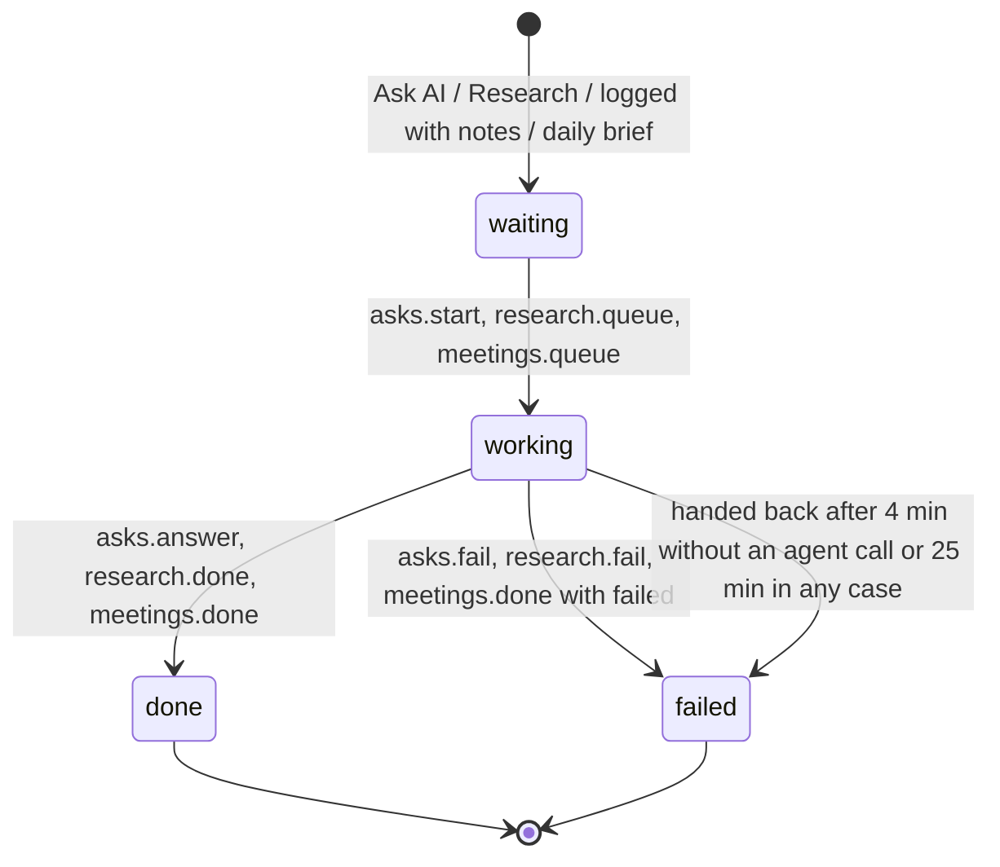
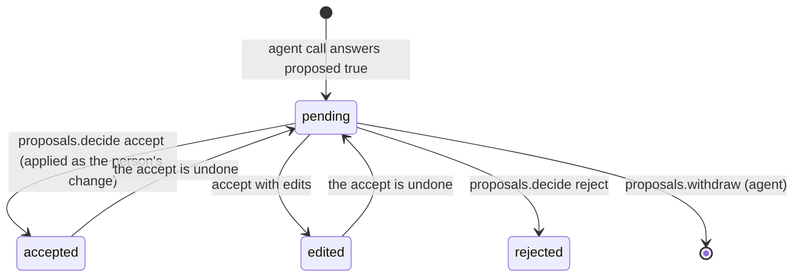
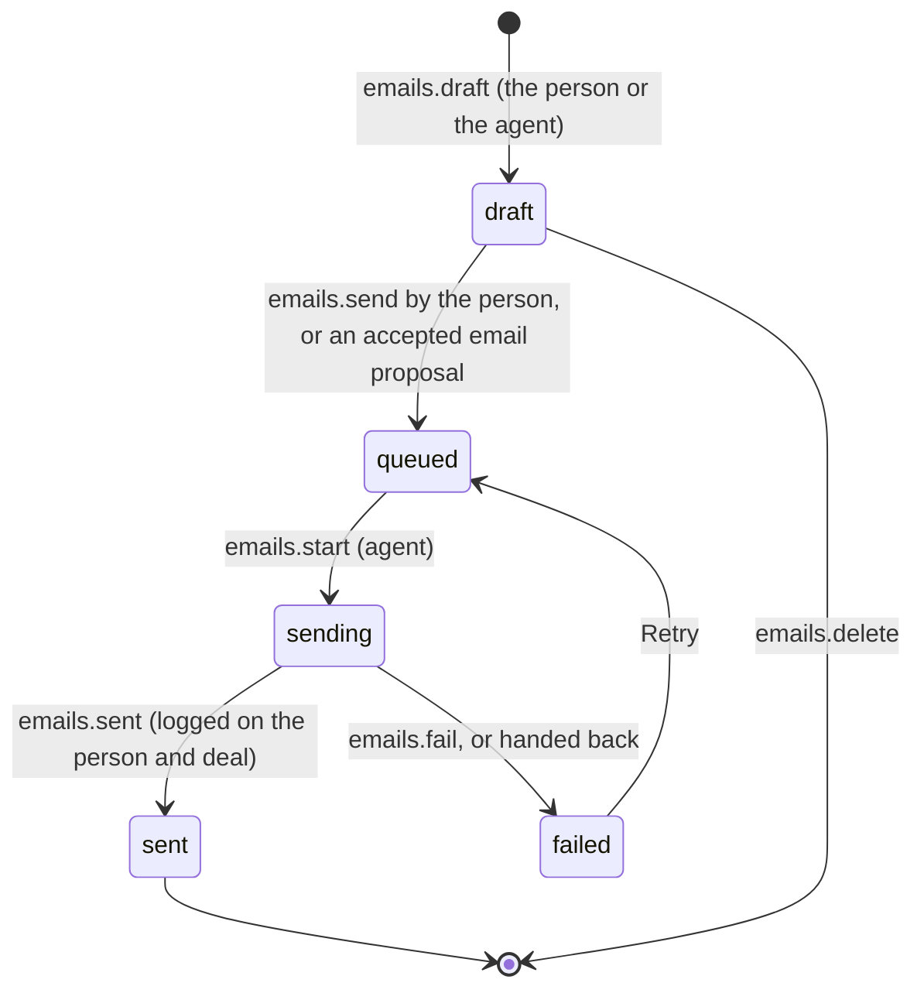

# Requirements: CRM

PART A — REQUIREMENTS (SRS). User-approved before build; frozen after; changes via ## Changes.

## Introduction

### Purpose
CRM is a relationship CRM for one person (a founder, a freelancer or a small team lead) who keeps people, companies and deals for several processes at once (sales, fundraising, hiring, partnerships) together with their AI agent. It is the same product as CRM System, in the Company OS visual language, with diagrams for the numbers and the network. It runs locally in the browser with no sign-in. Its job is to show who to contact today and how the business is doing. Every email, call and meeting lands on one timeline that drives relationship strength and keep-in-touch dates. Deals move through pipelines with a stage history. Home is a page of diagrams: won by month running into the forecast, the network as a constellation, a year of deals flowing stage to stage, and a month calendar. A Network map shows how the people, companies and deals connect. The AI agent works on the same data through A2App as a second actor with its own identity. Every UI action is a declared operation, and what the agent writes is marked as its own. What it may only propose waits in Review under the person's policy, and every change by anyone can be undone. The app hands work to the agent as tasks: questions and jobs, research, meeting reviews and emails to send.

### Scope
**Goals**
1. Every change, by the person, the AI agent or an import, is logged with its actor and run and can be undone; a whole agent run can be reverted at once.
2. An AI agent call that changes a value the person entered, moves, closes or reopens a deal, changes a deal's value, currency, close date or probability, merges, deletes or sends an email becomes a proposal in Review (current value, proposed value, evidence, source, reason, confidence), unless the person made that kind of change automatic.
3. People are unique by email and companies by root domain. An upsert updates the one match, creates a record when none matches, and refuses with the candidates when several match. Likely duplicates can be merged (reversibly) or dismissed.
4. Home answers "how is the business doing and what needs me" on diagrams and charts. It shows headline numbers against the period before (revenue pipelines only), won by month running into the forecast, the network, how deals move, what needs attention, the month's dated items, the pipeline by stage, won and lost, each fundraising and hiring pipeline, interactions and sources.
5. Every UI action is available to the agent as an operation, and what the agent changes appears on every open screen without a refresh.

**Core functionalities:** diagram dashboard · month calendar · network map · Today queue · people and company tables with presets, filters, saved views, lists and inline editing · record pages and peek with one timeline · deal boards and tables per pipeline with stage history · relationship strength and keep in touch · interactions, notes, tasks and emails · AI agent proposals and Review · activity log with undo, redo and run revert · reports · custom fields · CSV import and export · duplicates and merge · trash · exchange rates · AI agent policy · Ask AI · agent tasks

### Approval
Approved by the user: 2026-11-04 — carried over from the published marketplace app `crm` 1.0.0, whose requirements were approved when it was built; this document restates them in the framework's form without changing any feature.

## Product Description

### Product Perspective
`authMode: none`. The app is local and single-user with no login (Original requirements, "Who it is for"). It serves on loopback, and its own mutating operation routes still require a caller (the View or the agent's credential). The AI agent is the second actor: its calls arrive through the A2App adapter and are recorded as `agent`, grouped into runs. manifest.json declares no integrations (`capabilities.integrations: []`). The backend's only outbound call fetches the European Central Bank's daily reference rates (`www.ecb.europa.eu`) when the person or the agent asks (`fx.fetch`). The app deliberately has no mail server, no email or calendar connection and no language model of its own. Emails the person sends are queued for the AI agent, which sends them through its own email integration. Research, meeting reviews, answers and filling the CRM from email and calendar are all done by the person's AI agent through the operations. CRM shares CRM System's data model, rules and operations, adds `app.calendar` and a 12-week trend in `app.dashboard`, and keeps its own database. It has no conversion of earlier installs.

### User Characteristics
One person running several processes at once: a founder, a freelancer or a small team lead. They work in the CRM through the day. They start from Today and Home, log calls and meetings and move deals as they happen, and decide what the AI agent proposed in Review. They mostly use a desktop browser with the keyboard (Ctrl K, single-key actions, J/K lists). Phones and tablets are supported with a bottom bar, and mouse, keyboard and touch all work.

### Constraints
- C-1: Money is stored as an integer count of the currency's minor unit (ISO 4217 decimals per currency, from the app's list of 45 currencies), never a float. Operations take amounts as decimals ("2500" or "2500.00") and answer in minor units.
- C-2: Days are `YYYY-MM-DD` text, pattern-checked. Moments (an interaction's time, last interaction, stage entered) are ISO text. Birthdays are `MM-DD` or `YYYY-MM-DD`.
- C-3: Identity: people are keyed on their lowercased email and companies on their root domain (or, failing that, their exact name). Free-mail domains never make a company. A person with a work email gets their company found or created from the domain. `create` is refused when an email or domain already belongs to a record (the answer names it). `upsert` updates when exactly one record matches, creates when none does, and answers 409 with the candidates when several do.
- C-4: The AI agent writes directly, marked as its own with its source and run: notes, interactions, tasks, new people, companies and deals (in open stages), empty fields, values it wrote itself, and additions to list fields (emails, phones, domains, tags).
- C-5: For the AI agent, seven kinds of change become proposals unless the policy sets that kind to automatic: changing a value the person (or an import) entered; moving a deal to another stage; marking a deal won or lost or reopening it; changing a deal's value, currency, close date or probability; merging duplicates; deleting people, companies or deals; sending an email. Every kind starts as "propose".
- C-6: Only the person decides proposals, changes the policy, deletes pipelines, stages, lists and custom fields, and imports with "replace existing values". The agent undoes only its own changes. It edits only its own notes' text, and deletes only its own notes, interactions and tasks.
- C-7: Every change is logged with its actor (user, agent, import, system), run, field changes and undo. An undo is refused when something it touched changed again later. An agent run continues while its calls are less than 10 minutes apart.
- C-8: Deleting a person, company or deal moves it to the trash for 90 days, after which it is removed for good. A restore is refused when the record's email or domain now belongs to another record. A merge keeps the primary's values, fills its blanks from the secondary, combines emails, phones, domains and tags, and moves every note, interaction, task, deal and list membership. The secondary goes to the trash and its id keeps resolving to the primary. A merge is undoable.
- C-9: Stages have a kind (open, won, lost), a win probability, a rotting limit (days without activity) and a target time in the stage, plus a color (c1–c8). Every pipeline has a won and a lost stage, and open stages come before them. Weighted value = value × probability (the stage's, unless the deal sets its own). Every stage change is recorded as a stage event (deal, from, to, when, who, run).
- C-10: Each deal keeps its own currency. Open deals are valued in the home currency at the latest stored rate. A deal's home-currency value is frozen when it is won or lost. Amounts in different currencies are never added raw: a deal without a rate is left out of totals and counted. The home currency cannot change once any deal is won or lost.
- C-11: Revenue numbers (the dashboard's headline money, the forecast, won and lost, sources) count every pipeline kind except fundraising and hiring, unless a pipeline is passed.
- C-12: Relationship strength (0–100): each interaction in the last year adds its weight (meeting 3, call 2, email received 1.5, email sent or message 1), halved every 60 days, and the sum s maps to 100 × (1 − e^(−s/3)). 60 and up is strong, 30–59 good, below 30 weak, 0 no contact. It shows as 3 bars. The next keep-in-touch date is the last interaction plus the person's cadence in days.
- C-13: An interaction with an `ext_id` is logged once; logging the same `ext_id` again returns the existing one.
- C-14: Filters are lists of `{field, op, value}` conditions joined by `match: all|any`. The operators are is, is_not, contains, not_contains, starts_with, empty, not_empty, gt, gte, lt, lte, before, after, within_days, older_than_days, in and has_tag. Fields include computed ones (strength, last interaction, next touch, company, in list, open deals, days in stage, idle days, rotting) and custom fields (`custom.<key>`).
- C-15: Fixed vocabularies. Pipeline kinds: sales, fundraising, hiring, partnerships, other. Interaction kinds: email, call, meeting, message; direction in or out. Task kinds: todo, call, email, meeting, follow_up. Email statuses: draft, queued, sending, sent, failed. Proposal statuses: pending, accepted, edited, rejected. Confidence: high, medium, low. Ask kinds: question, job, explain, brief; ask statuses and agent states: waiting, working, done, failed. Company sizes: 1-10, 11-50, 51-200, 201-1000, 1001-5000, 5000+. Custom field types: text, number, currency, date, select, multi_select, checkbox, url, rating.
- C-16: Pipeline templates (stage: probability %). Sales: Lead 10, Qualified 25, Meeting 40, Proposal 60, Negotiation 80, Won, Lost. Fundraising: Target 5, Contacted 10, First meeting 25, Due diligence 50, Term sheet 75, Committed, Passed. Hiring: Sourced 10, Screen 20, Interview 40, Final round 60, Offer 80, Hired, Not a fit. Partnerships: Prospect 10, Intro call 25, Exploring 50, Agreement 75, Live, Closed. Other: New 20, In progress 50, Done, Dropped.
- C-17: A fresh install seeds one settings row (USD, not set up, every policy kind "propose", meeting review on, research of new records off, daily brief off at 08:00) and no records: there is no demo data.
- C-18: A meeting or call the person logs with a summary of at least 40 characters goes to the AI agent's meeting review when meeting review is on.
- C-19: The UI calls the agent "your AI agent", uses line icons only and no emoji, and marks every value the agent wrote.

### Assumptions
- A-1: Volume ceiling: 1,000 people and 1,000 companies per table view (what People and Companies load at once) and 2,000 deals per pipeline (what the board and the deals table load). The Network map loads up to 1,000 people, 1,000 companies and 1,000 open deals, and draws the 400 strongest people. List operations return at most 5,000 rows per call.
- A-2: The machine running the app is the user's own, and its local date and hour are the user's: today, overdue, birthdays and the daily brief hour.
- A-3: The person's AI agent is connected through A2App and sends email through its own email integration. Without one, a queued email ends as failed with the reason, and the person can open it in their own mail app instead.
- A-4: The European Central Bank publishes about 30 currencies on working days. Other currencies, or a home currency the ECB does not publish, are typed in by hand.

## Features

### Module: Frame
- F-FRM-1: On wide screens (from 768 px) the user sees a sidebar of three blocks on the cream page. The first is the workspace: an orange initials tile, the workspace name and "CRM · <owner>", and it opens Home. Next comes the navigation with a New button, then the AI agent's state.
- F-FRM-2: The user can reach every view from the navigation, grouped by job: Home and Today; Relationships (People, Companies, Network); Pipeline (Deals, Reports); AI agent (Review, Activity); Workspace (Setup). The current page is orange with a bar beside it.
- F-FRM-3: The user sees counts in the navigation where something waits: Today (tasks overdue and due today), Review (proposals and emails not sent, on an orange tile) and People (keep in touch due).
- F-FRM-4: The user sees the AI agent's block: "<n> jobs in hand" (pulsing), "<n> waiting to start" or "Ready for work", plus "<n> changes to review", which opens Review.
- F-FRM-5: The user sees a page header with the page's icon and title and a line about the page. On Home the title is the workspace name and the line is today's date. The header also holds the page's own actions (Home and Network put theirs there), Search with its Ctrl K hint, Ask AI, Undo and Redo.
- F-FRM-6: The user sees status chips in the header on very wide screens (from 1536 px): emails not sent and tasks overdue.
- F-FRM-7: The user can open the New menu to add a person, a company or a deal, log an interaction, add a task, write an email or import from CSV.
- F-FRM-8: On phones the user sees a compact header with the app mark, and navigates with a bottom bar: Home, Today, the New button in the middle, People, and a More menu listing the other views with their counts.
- F-FRM-9: The user can press Ctrl K to open a command palette. It finds people, companies and deals by name, email, domain, company, title or tag. It also goes to any view (Network included), pipeline board or list, creates anything, and asks the AI agent what was typed.
- F-FRM-10: The user can press Ctrl Z to undo and Ctrl Y (or Ctrl Shift Z) to redo their latest change. Outside record pages, P adds a person and D a deal; L logs an interaction and T adds a task outside record pages and Today.
- F-FRM-11: The user sees the Company OS look: a warm cream page with surface blocks floating on it (1 px border, no shadow), sharp corners everywhere (circles only for people and dots), Inter, small uppercase labels, and orange as the one accent. The accent marks the selection, actions and everything the AI agent proposes. Inside a block the CRM stays dense, with line icons and no emoji. Color carries meaning only: won and money in green; lost, overdue and errors red; attention amber; stage colors.
- F-FRM-12: WHEN no host theme pack or custom colors are set THE SYSTEM SHALL show the Company OS palette, light or dark. WHEN the host switches the theme pack, light or dark mode or custom colors THE SYSTEM SHALL use the host's colors and re-derive every app color from them, checked for contrast against the surface it sits on.
- F-FRM-13: WHEN the AI agent (or another tab) changes data THE SYSTEM SHALL update every open view without a manual refresh.
- F-FRM-14: WHEN a newer version of the app has been deployed THE SYSTEM SHALL reload an open page onto it after the server comes back or when the tab is shown again. It waits while a dialog is open.

### Module: Onboarding (setup)
- F-ONB-1: WHEN the app is opened before setup THE SYSTEM SHALL ask for the workspace name, the owner's name, the home currency and which pipelines to track: Sales, Fundraising, Hiring and Partnerships, at least one.
- F-ONB-2: The user can then bring people in one of three ways: ask the AI agent to fill the CRM from the last 90 days of email and calendar, import a CSV, or add someone by hand. They can also skip.
- F-ONB-3: The user starts from an empty CRM: no demo records are seeded.

### Module: Home (app.dashboard, app.calendar)
- F-HOME-1: The user can choose the range in the page header: this month, last month, this quarter, year to date or 12 months.
- F-HOME-2: The user can press "Brief me" to ask the AI agent to prepare the day: what matters today, who to follow up with, which deals are slipping, and drafts where a follow-up is due.
- F-HOME-3: WHEN changes from the AI agent wait THE SYSTEM SHALL show a banner, "<n> changes from your AI agent are waiting for you", with Review.
- F-HOME-4: The user sees six number tiles against the period before: open pipeline, weighted forecast, won, win rate, average deal and sales cycle. Sparklines show where there is a trend: new pipeline per week over 12 weeks, won over six months, and win rate over six months. Each tile opens where its work is (Deals or a report), and its tooltip states the formula.
- F-HOME-5: The user sees headline money numbers that count revenue pipelines only (every kind but fundraising and hiring), and the open pipeline names how many open deals have no rate.
- F-HOME-6: The user sees "Won" for the range over a revenue trend. Won by month for a year runs into what the pipeline should bring in the months ahead: expected dashed, best case dotted, today marked. Hovering shows a month's numbers.
- F-HOME-7: The user sees under the revenue trend what is expected over the next 6 months (weighted by stage probability) and the best case if every deal closes. It also counts the open deals without a close date that are left out, and "Forecast" opens the report.
- F-HOME-8: The user sees "Your network" as a constellation: the workspace's initials at the core, up to 8 of the strongest relationships orbiting closer the stronger they are, and up to 6 going cold on a dashed outer ring. Each person opens their page.
- F-HOME-9: The user sees the strength mix (strong, good, weak, no contact) under the constellation, and "Map" opens Network.
- F-HOME-10: The user sees "How deals move": the deals created in the last 12 months in one pipeline, flowing stage to stage. Each stage is a column as tall as the deals that reached it, and the band to the next stage is as wide as those that moved on. What dropped out or was lost pours to the floor, and the number won and the win rate show at the end. Hovering explains each band, and a stage opens the board.
- F-HOME-11: The user can pick the pipeline for "How deals move" and the pipeline-by-stage block from a menu when there are several pipelines. With one pipeline the block links to the Conversion report instead.
- F-HOME-12: The user sees "Needs your attention": tasks overdue and due today, deals going stale (with their idle days), open deals without a next step, people to get back in touch with (with avatars) and birthdays. Each row opens its list, and "All caught up" shows when nothing waits.
- F-HOME-13: The user sees a month calendar with an oversized today (day, month, year, weekday), previous and next month, and a legend of the kinds present. Days sit in a Monday-first grid: past days solid, today and the chosen day orange, days ahead framed, each with up to three dots for its kinds.
- F-HOME-14: The user can pick a day to list its items: tasks due, deals closing (with value), people to get back in touch with, birthdays, and meetings and calls held. Each item opens its record (a task opens Today). With no day chosen, the month's count per kind shows. Items without a record (a meeting logged with nobody) open nothing.
- F-HOME-15: The user sees the revenue pipeline by stage: value and weighted value per stage, counts, rotting counts and totals, and "Board" opens it.
- F-HOME-16: The user sees won and lost by month, with each month's win rate on hover.
- F-HOME-17: The user sees one block per fundraising pipeline (committed against the round target, weighted in talks, open conversations, stages by value) and per hiring pipeline (hired, in process, candidates by stage), each opening its board. A fundraising pipeline without a target offers "Set the round size".
- F-HOME-18: The user sees interactions per week by kind (meetings, calls, emails, messages), the range's count against the period before, and how many people were added.
- F-HOME-19: The user sees where deals come from: deals created in the range by source, as a donut with each source's win rate.
- F-HOME-20: The user sees "Coming up": tasks overdue or due today, and open deals expected to close within the next 30 days.
- F-HOME-21: The user sees the AI agent's block: changes to review, jobs in hand, its last run with what it changed, and Revert for that run.
- F-HOME-22: The user sees, at the foot of Home, how many people, companies and open deals the CRM holds.

### Module: Today (todos)
- F-TOD-1: The user sees tasks grouped Overdue, Today, Upcoming, Snoozed and Done today. Each shows its kind, what it is about, its notes and its date.
- F-TOD-2: The user can add a task with a due date from the quick-add line (N focuses it).
- F-TOD-3: The user can mark a task done or not done and delete it. They can snooze it to tomorrow, in 3 days or next week, and bring a snoozed task back now.
- F-TOD-4: The user can move through tasks with J/K, mark one done with X, snooze it to tomorrow with S, and open what it is about with Enter.
- F-TOD-5: The user sees a side panel with changes from the AI agent waiting (opening Review), deals going stale, open deals without a next step (each with "Task"), and people due a touch (each with a one-click "log a touch").
- F-TOD-6: The user sees tasks the AI agent created marked "AI".

### Module: People and companies (people, companies, lists, views)
- F-REC-1: The user can browse people or companies from a sidebar. It has all records and built-in presets. People: keep in touch due, recently added, strong relationships, going cold, birthdays soon, no company. Companies: with open deals, recently added, going cold. Below come lists and saved views, plus links to Duplicates and Trash.
- F-REC-2: The user sees a dense table with 32 px rows, avatars or company marks, strength bars, relative dates and tags. It marks values the AI agent wrote, records with a proposal waiting, and records being researched (a pulsing dot).
- F-REC-3: The user can search, sort by a column header, and filter with conditions (field, operator, value) joined by all or any, over built-in, computed and custom fields.
- F-REC-4: The user can choose the visible columns, remembered in this browser. They can save the filters, sort and columns as a view in the sidebar, or update the saved view they are on.
- F-REC-5: The user can edit a table cell in place by clicking it.
- F-REC-6: The user can select rows (checkboxes, shift-click for a range, or X). They can then tag them, add them to a list, take them off the current list, or send them to the AI agent to research. They can merge exactly two, or move them to the trash.
- F-REC-7: The user can create a list over people or companies from the sidebar.
- F-REC-8: The user can import from CSV and export the current table, with its search and filters, as CSV.
- F-REC-9: The user can move with J/K, open the peek with Enter (the full page with Shift+Enter, or Ctrl/Cmd+click on the name), select with X and search with /.

### Module: Network (people, companies, deals)
- F-NET-1: The user sees a map of who they know. Companies are squares sized by how many people work there, with their initials inside. People are circles sized and colored by relationship strength: green strong, blue good, amber weak, gray no contact yet. Open deals are orange diamonds.
- F-NET-2: The user sees lines where someone works and who is on a deal (dashed). A company appears when one of the people shown, or an open deal shown, belongs to it.
- F-NET-3: The user sees a layout from a force simulation seeded from the record ids, so the map holds still between visits. It fits the view when it opens.
- F-NET-4: The user can drag to pan, and zoom with the scroll wheel or the + and − buttons (0.25× to 4×), or fit the map again.
- F-NET-5: WHEN the user hovers a node THE SYSTEM SHALL light up its connections, dim the rest, and show its card: kind, name, details (a person's title, company and last contact; a company's industry and people; a deal's stage and value) and the number of connections. Clicking a node opens its record.
- F-NET-6: The user can show everyone, the warm relationships (strength 30 and up) or the people going cold (3 or more interactions, none in 60 days). They can turn deals on or off, and find nodes by name: matches are ringed and the rest dimmed.
- F-NET-7: The user sees counts of people, companies and open deals on the map, and a legend of the shapes and colors. Companies are always labelled; people and deals are labelled when zoomed in, when they connect to the hovered node, or when they match the search.
- F-NET-8: WHEN nobody matches the filter THE SYSTEM SHALL say "Nobody on the map yet", "No warm relationships yet" or "Nobody is going cold", with what to do next.

### Module: Record pages and peek (people, companies, deals, timeline, notes)
- F-PAGE-1: The user can open a person, company or deal as a full page with two panes that scroll on their own, or as a 520 px peek beside a list or board (Escape closes it).
- F-PAGE-2: The user sees a header with the avatar or mark and the name. It shows the title and company (people), domain, industry and location (companies) or pipeline, stage and company (deals). It also shows the tags, and "In the trash" and "AI researching" when they apply.
- F-PAGE-3: The user can act from the header: Log (L), Email (E, not for companies), Task (T) and Research (people and companies). A More menu adds a new deal with this record, adds a person here (companies), merges a duplicate into this, or moves the record to the trash.
- F-PAGE-4: The user sees a highlight strip. People: relationship, last contact, keep in touch, open deals, email, phone. Companies: relationship, last contact, people, open pipeline, industry, size. Deals: value, weighted value, expected close (or the won or lost date), days in stage against the target, last activity (marked when rotting) and next step.
- F-PAGE-5: The user sees tabs with counts. Overview holds Focus (waiting proposals, a missing next step on an open deal, open tasks, pinned notes), a note box and the latest history. The other tabs are Activity, Notes, Tasks, Emails (people and deals), People (companies and deals) and Deals (people and companies).
- F-PAGE-6: The user sees one timeline per record, newest first: interactions, notes, tasks, emails, stage moves and field changes, each with who made it. A company's timeline includes its people's interactions.
- F-PAGE-7: The user can work in the timeline: pin, unpin or delete notes, finish or reopen tasks, and edit and send or discard a draft or failed email.
- F-PAGE-8: The user can write a note in the note box (Ctrl+Enter saves, N focuses it).
- F-PAGE-9: The user sees a details sidebar where every built-in and custom field is edited in place. Values the AI agent wrote carry its mark, and hovering it shows when, from which source and in which run. The sidebar also lists the record's lists (add or remove), a person's work history, and when the record was added and changed.
- F-PAGE-10: The user sees on a deal a stage bar with the days spent in each open stage. Clicking a stage moves the deal there. Won, Lost (asking why) and Reopen close or reopen it.
- F-PAGE-11: The user can put people on a deal with a role and take them off (the person stays).
- F-PAGE-12: The user sees on a company its people (with last contact and strength), the people who used to work there, and a button to add a person.
- F-PAGE-13: WHEN the old id of a merged record is opened THE SYSTEM SHALL show the surviving record.
- F-PAGE-14: The user can restore a record in the trash from its page.

### Module: Deals (deals, pipelines, stages)
- F-DEAL-1: The user can switch pipelines from a sidebar showing open deal counts. The header shows the pipeline's open value, weighted value and, when set, its target.
- F-DEAL-2: The user sees a board with a column per open stage. Each column shows the stage color, the count, the total and the weighted value at the stage probability, and a + that adds a deal in that stage.
- F-DEAL-3: The user sees deal cards with the company, value and expected close (red when past), and days in stage (red past the stage target). The next activity shows as a dot: overdue red, today green, planned, or none amber. Cards also show the people on the deal, a red edge when rotting, and the AI mark when a proposal waits.
- F-DEAL-4: The user can drag a card to another stage or position. While dragging, Won and Lost zones appear at the bottom, and dropping on Lost asks why.
- F-DEAL-5: The user can switch to a table with value and weighted totals, presets (open deals, rotting, no next step, closing in 30 days, won, lost), sorting and inline editing. They can select rows (checkboxes, shift-click for a range) and move them to an open stage, tag them, or move them to the trash.
- F-DEAL-6: The user can search deals (/) and filter them with the same filter bar.

### Module: Capture (dialogs)
- F-CAP-1: The user can add a person: a name or an email is required; optional are title, company, phone, LinkedIn, source, keep-in-touch cadence, how they know them, tags and "Research with AI". A work email finds or adds the company.
- F-CAP-2: The user can add a company: a name or a website is required; optional are industry, size, location, source, tags and "Research with AI". Its domain keeps it unique.
- F-CAP-3: WHEN a new person's email or a new company's domain already belongs to a record THE SYSTEM SHALL show "Already in your CRM" and offer to open it, or say that it is in the trash.
- F-CAP-4: The user can add a deal: a name is required; optional are the pipeline, the stage (with its probability), value and currency, expected close, company, a person with a role, next step and source. Role suggestions follow the pipeline kind.
- F-CAP-5: The user can log a meeting, call, email or message (sent or received) with people, a deal, a time, a subject and what happened. THE SYSTEM SHALL update last contact, strength and keep-in-touch dates and reset a linked deal's rotting clock.
- F-CAP-6: WHEN the person logs a meeting or call with notes of at least 40 characters and meeting review is on THE SYSTEM SHALL send it to the AI agent's meeting review, and the dialog says so before saving.
- F-CAP-7: The user can add a task: a title, a due date (today, tomorrow, next week, no date, or a date), a kind (to do, follow up, call, email, meeting), a person, a deal and details.
- F-CAP-8: The user can write an email (to, cc, subject, message; "to" defaults to the person's primary email). They can save it as a draft, send it (queued for the AI agent to send from their email account), or open it in their own mail app instead.
- F-CAP-9: The user can import a CSV of people, companies or deals (comma, semicolon or tab). Columns are matched to fields and can be changed or skipped, and every row is previewed as new, update, skip or check. Existing values are only filled, unless the person turns on "Replace existing values". People and companies can be added to a list. The import is one change that can be undone.
- F-CAP-10: WHEN a person, company or deal is added from a dialog THE SYSTEM SHALL open its page.

### Module: Review (proposals, emails)
- F-REV-1: The user sees the AI agent's pending proposals grouped by record. Each shows its kind, title, age and confidence, the changes (the current value struck through, then the proposed one), the evidence quote, the reason and the source, linked when it is a URL.
- F-REV-2: The user can accept, edit then accept (field changes and emails), or reject each proposal. Y accepts, N rejects and J/K move between proposals.
- F-REV-3: The user can accept every high-confidence field change, stage move and value change at once. Emails, merges and deletes stay for the person to look at.
- F-REV-4: WHEN a proposal is accepted THE SYSTEM SHALL apply the change as the person's own. Undoing the accept puts the proposal back to pending.
- F-REV-5: The user sees an Emails tab: failed emails (with the reason, Edit, Retry and "Mail app"), queued and sending emails, and the latest 20 sent.
- F-REV-6: The user sees "History and trust": for each kind of change over 90 days, the accepted, edited and rejected counts with the acceptance rate. Each kind has a switch that lets the AI agent do it directly, and the decided proposals are listed below.

### Module: Reports (reports)
- F-RPT-1: The user can pick one of eight preset reports, each a chart above a table. Under Deals: Pipeline, Conversion, Forecast, Won and lost, Time in stage and Sources. Under Relationships: Activity and Relationships.
- F-RPT-2: The user can set the period where it applies (this month, last month, this quarter, last quarter, year to date, last year, last 12 months). Pipeline, Conversion, Forecast, Won and lost and Time in stage also take a pipeline.
- F-RPT-3: The user sees the formula behind each report's numbers under its chart.
- F-RPT-4: The user can open a deal from a report's deal rows, and a person from the activity and relationship lists.
- F-RPT-5: The user can download any report as CSV and ask the AI agent to explain it (Explain).
- F-RPT-6: The user sees in Pipeline the open deals, value, weighted value and rotting deals by stage, with deals that have no rate counted. In Conversion they see the share of deals created in the period that reached each stage, the share from the stage before, and the biggest drop.
- F-RPT-7: The user sees in Forecast six months of won, weighted and best case, plus the deals with no expected close. In Won and lost they see won and lost by month, the win rate, average deal and sales cycle against the previous period, and why deals were lost.
- F-RPT-8: The user sees in Time in stage the shortest, average and longest days per stage against its target. In Sources they see deals created by source (won, lost, win rate, won value, still open) and new people by source.
- F-RPT-9: The user sees in Activity the interactions per week by kind, tasks done, notes, and the people most in touch. In Relationships they see the strength mix, who is going cold, keep in touch now, the strongest relationships, and birthdays in the next 30 days.

### Module: Activity (activity)
- F-ACT-1: The user sees every change, newest first: who made it (you, the AI agent, an import, the system), when, its run, and the changed fields before and after. They can filter by who and show more.
- F-ACT-2: The user can undo or redo any entry that allows it, and undone entries are struck through.
- F-ACT-3: The user sees the AI agent's runs (how many changes, when, what, how many undone). They can review a run's entries and revert a whole run; changes touched again since are skipped and counted.

### Module: Setup (settings, policy, pipelines, stages, fields, lists, fx, import, dupes, trash)
- F-SET-1: The user can set the workspace name, their name, the home currency and the default keep-in-touch cadence for new people (not tracked, every month, every quarter, twice a year).
- F-SET-2: The user can add a pipeline from a template (Sales, Fundraising, Hiring, Partnerships) or a simple one. They can rename it, set its currency, set a fundraising round target, archive or unarchive it, and delete an empty one.
- F-SET-3: The user can edit a pipeline's stages: color, name, kind (open, won, lost), probability, and rotting and target days (open stages). They can move stages up or down, add one, and delete one after choosing where its deals move.
- F-SET-4: The user can add custom fields to people, companies or deals. Each has a label and a type (text, number, money, date, one of a list, several of a list, yes or no, link, rating 1–5), with options and an instruction for the AI agent. Deleting a field keeps its values, which come back if the field is added again with the same key.
- F-SET-5: The user can recolor, rename, open and delete lists; deleting a list keeps its people or companies.
- F-SET-6: The user can choose, per kind of change, whether the AI agent asks first (a proposal) or does it directly ("Do it, I can undo it").
- F-SET-7: The user can turn on meeting review, research of the people and companies they add, and a daily brief at a chosen hour, and write house rules the AI agent follows.
- F-SET-8: The user sees the currencies in use with their latest rate (or "No rate"). They can fetch today's European Central Bank rates, type a rate in, and see the stored rates with their source, each removable.
- F-SET-9: The user can import people, companies or deals from CSV and export each as CSV.
- F-SET-10: The user sees likely duplicate pairs of people or companies with the reason. They can merge a pair (the left one keeps its values) or mark it "Not the same".
- F-SET-11: The user sees the trash: deleted people, companies and deals with when they were deleted, each restorable, kept for 90 days.

### Module: Ask AI (asks)
- F-ASK-1: The user can ask the AI agent a question or give it a job from Ask AI in the page header, with suggestions while nothing has been asked. The agent sees what is on screen.
- F-ASK-2: The user sees each question's state ("Waiting for your AI agent", "Your AI agent is looking into it"), then its answer with links to the records used, or why it failed. They can delete it.
- F-ASK-3: The user sees the daily brief, Home's "Brief me" and report explanations arrive in Ask AI.

### Agent (via A2App)
- F-AGT-1: The agent can perform every UI action as an operation: the 130 operations in ## Operations Design. Their modules are app, search, setup, settings, policy, activity, asks, fx, people, companies, deals, timeline, dupes, trash, pipelines, stages, notes, interactions, todos, emails, research, meetings, proposals, lists, views, fields, import and reports.
- F-AGT-2: The agent can read from `app.guide` the workspace, the policy and house rules, and what it writes directly versus what it only proposes. It also returns the conventions (identity, money in minor units in answers and as decimals in parameters, dates, revenue pipelines), the pipelines and stages, lists, every field with its AI instruction, the filter operators, what is on screen, and recipes for each task.
- F-AGT-3: The agent can read what the person has open with `app.context`, and the counts behind the badges with `app.summary`.
- F-AGT-4: WHEN the agent writes notes, interactions, tasks, new records, empty fields, its own values or additions to list fields THE SYSTEM SHALL write them directly, marked as the agent's with their source and run.
- F-AGT-5: WHEN the agent makes one of the seven kinds of change in C-5 and the policy does not make that kind automatic THE SYSTEM SHALL answer `proposed: true` and record a proposal. The proposal holds the current and proposed values, the evidence, the source, the reason and the confidence.
- F-AGT-6: WHEN the agent tries to decide proposals, change the policy, delete a pipeline, stage, list or field, or undo the person's changes THE SYSTEM SHALL refuse with 403. The same applies when it rewrites or deletes the person's notes, or deletes the person's interactions or tasks.
- F-AGT-7: The agent can withdraw its own pending proposals and revert one of its runs (`activity.revert_run`). An import it runs only fills empty fields.
- F-AGT-8: The agent can take an `agent_asked` task and answer every waiting question or do every job: research, a draft, filling the CRM from email and calendar, a brief, or explaining a report. It calls `asks.start`, then `asks.answer` with links to records, or `asks.fail` with a reason.
- F-AGT-9: The agent can take a `research_requested` task. `research.queue` hands it up to 20 people and 20 companies, each with the person's note and its current fields. It fills fields with sources and ends each with `research.done` or `research.fail`.
- F-AGT-10: The agent can take an `interaction_logged` task. `meetings.queue` hands it the meetings and calls waiting for review, with their deal and the people's open deals. It proposes deal updates, adds follow-up tasks, drafts the follow-up email, and ends each with `meetings.done`.
- F-AGT-11: The agent can take an `emails_queued` task. It calls `emails.start` on each queued email and sends it through its own email integration exactly as written. It then calls `emails.sent`, which logs it on the person and deal, or `emails.fail` with the reason.
- F-AGT-12: WHEN work the agent took is left unfinished THE SYSTEM SHALL hand it back as failed with a reason after 4 minutes without an agent call, or after 25 minutes in any case. The reason reads like "Your AI agent stopped before finishing. Ask again.".
- F-AGT-13: WHEN a request to the agent is refused by the trigger cooldown or lost to a restart THE SYSTEM SHALL ask again within a minute while the work still waits.
- F-AGT-14: WHEN the daily brief is on THE SYSTEM SHALL ask the agent once a day, at or after the chosen hour, to prepare the person's day.
- F-AGT-15: WHEN the agent calls a destructive operation THE SYSTEM SHALL answer `approval_required` until the person has approved that call.
- F-AGT-16: The agent can read one month of dated items with `app.calendar` (`month` as YYYY-MM, default this month). The items are open tasks by due date, open deals by expected close, keep-in-touch dates, birthdays, and the meetings and calls logged. Each item has a date, kind, title, record and a short sub line.
- F-AGT-17: The agent can read with `app.dashboard` everything Home shows. That includes the 12-week trend of interactions, people added, and revenue deals created with their value.

## Non-Functional Requirements
- N-1: A change made by the agent (or another tab) appears on every open view without a manual refresh. Views reload 150 to 800 ms after the last realtime change to a collection they watch: tables and record pages after 250 ms, Today after 200 ms, the month calendar after 400 ms, Home after 700 ms, Network after 800 ms.
- N-2: Work for the agent is asked for at once and asked again every minute while it waits (`cr_agent`). The trigger cooldowns are 20 s for questions and emails and 30 s for research and meeting reviews.
- N-3: Relationship strength is recomputed nightly (`cr_nightly` at 03:23) and once in the first minute after a start. The nightly job also removes trash older than 90 days, and activity entries and answered or failed questions older than a year.
- N-4: The European Central Bank request waits at most 20 s.
- N-5: Every view is usable from phone width, with a bottom bar below 768 px, to a wide desktop, without horizontal page scrolling.

## Data Requirements
- **settings** (module: settings): workspace (string, max 120), owner_name (string, max 80), home_currency (string, max 3), keep_in_touch_default (number), policy (json), ui (json), brief_last (string, max 10), setup_done (boolean), created (datetime, server-set), updated (datetime, server-set).
- **companies** (module: companies): name (string, required, max 200), domains (json), primary_domain (string, max 253), industry (string, max 80), size (string, max 20), location (string, max 160), description (string, max 2000), linkedin (string, max 300), source (string, max 80), tags (json), last_interaction (string, max 30), strength (number), custom (json), prov (json), agent_state (enum), agent_note (string, max 500), deleted (string, max 30), merged_into (string, max 15), created (datetime, server-set), updated (datetime, server-set).
- **people** (module: people): first_name (string, max 80), last_name (string, max 80), emails (json), primary_email (string, max 254), phones (json), title (string, max 160), company (ref → companies), linkedin (string, max 300), location (string, max 160), birthday (string, max 10), how_met (string, max 500), source (string, max 80), tags (json), keep_in_touch (number), last_interaction (string, max 30), next_touch (string, max 10), strength (number), touches (number), custom (json), prov (json), agent_state (enum), agent_note (string, max 500), deleted (string, max 30), merged_into (string, max 15), created (datetime, server-set), updated (datetime, server-set).
- **employments** (module: records): person (ref → people), company (ref → companies), title (string, max 160), start (string, max 10), end (string, max 10), current (boolean), created (datetime, server-set), updated (datetime, server-set).
- **pipelines** (module: pipelines): name (string, required, max 80), kind (enum), currency (string, max 3), target (number), position (number), archived (boolean), created (datetime, server-set), updated (datetime, server-set).
- **stages** (module: stages): pipeline (ref → pipelines), name (string, required, max 60), position (number), kind (enum), probability (number), rot_days (number), target_days (number), color (string, max 20), created (datetime, server-set), updated (datetime, server-set).
- **deals** (module: deals): name (string, required, max 200), pipeline (ref → pipelines), stage (ref → stages), status (enum), value (number), currency (string, max 3), home_value (number), prob_override (number), expected_close (string, max 10), closed_at (string, max 10), lost_reason (string, max 300), company (ref → companies), source (string, max 80), next_step (string, max 300), next_step_date (string, max 10), stage_entered (string, max 30), last_activity (string, max 30), position (number), tags (json), custom (json), prov (json), deleted (string, max 30), merged_into (string, max 15), created (datetime, server-set), updated (datetime, server-set).
- **deal_people** (module: records): deal (ref → deals), person (ref → people), role (string, max 60), created (datetime, server-set), updated (datetime, server-set).
- **stage_events** (module: records): deal (ref → deals), pipeline (string, max 15), from_stage (string, max 15), to_stage (string, max 15), at (string, max 30), actor (string, max 12), run (string, max 24), created (datetime, server-set), updated (datetime, server-set).
- **lists** (module: lists): name (string, required, max 80), object (enum), color (string, max 20), position (number), description (string, max 300), created (datetime, server-set), updated (datetime, server-set).
- **list_entries** (module: records): list (ref → lists), person (ref → people), company (ref → companies), note (string, max 300), created (datetime, server-set), updated (datetime, server-set).
- **fields** (module: fields): object (enum), key (string, required, max 40), label (string, required, max 60), type (enum), options (json), ai_prompt (string, max 1000), position (number), created (datetime, server-set), updated (datetime, server-set).
- **notes** (module: notes): body (string, required, max 20000), person (ref → people), company (ref → companies), deal (ref → deals), pinned (boolean), by (string, max 12), run (string, max 24), created (datetime, server-set), updated (datetime, server-set).
- **interactions** (module: interactions): kind (enum), direction (enum), at (string, max 30), subject (string, max 200), summary (string, max 8000), people (list<ref> → people), company (ref → companies), deal (ref → deals), source (string, max 40), ext_id (string, max 200), by (string, max 12), run (string, max 24), agent_state (enum), agent_note (string, max 500), created (datetime, server-set), updated (datetime, server-set).
- **tasks** (module: todos): title (string, required, max 300), notes (string, max 4000), due (string, max 10), done_at (string, max 30), snoozed_until (string, max 10), kind (enum), person (ref → people), company (ref → companies), deal (ref → deals), by (string, max 12), run (string, max 24), created (datetime, server-set), updated (datetime, server-set).
- **emails** (module: emails): to (string, max 500), cc (string, max 500), subject (string, max 300), body (string, max 20000), status (enum), person (ref → people), deal (ref → deals), by (string, max 12), run (string, max 24), queued_at (string, max 30), sent_at (string, max 30), error (string, max 1000), created (datetime, server-set), updated (datetime, server-set).
- **proposals** (module: proposals): kind (string, max 20), object (string, max 20), target (string, max 15), title (string, max 300), changes (json), payload (json), evidence (string, max 2000), source (string, max 500), reason (string, max 1000), confidence (enum), status (enum), decided_at (string, max 30), applied (json), run (string, max 24), created (datetime, server-set), updated (datetime, server-set).
- **views** (module: views): object (enum), name (string, required, max 80), filters (json), match (enum), sort (string, max 40), dir (enum), columns (json), mode (enum), pipeline (string, max 15), position (number), created (datetime, server-set), updated (datetime, server-set).
- **aliases** (module: records): object (string, max 20), old_id (string, max 15), new_id (string, max 15), created (datetime, server-set), updated (datetime, server-set).
- **dupe_ignores** (module: records): object (string, max 20), a (string, max 15), b (string, max 15), created (datetime, server-set), updated (datetime, server-set).
- **fx_rates** (module: fx): currency (string, max 3), date (string, max 10), rate (string, max 24), source (string, max 20), created (datetime, server-set), updated (datetime, server-set).
- **asks** (module: asks): kind (enum), status (enum), question (string, max 4000), context (json), answer (string, max 20000), links (json), error (string, max 1000), requested_at (string, max 30), run (string, max 24), created (datetime, server-set), updated (datetime, server-set).
- **activity** (module: activity): actor (string, max 12), run (string, max 24), op (string, max 40), summary (string, max 500), target_type (string, max 20), target_id (string, max 15), undo (json), redo (json), changes (json), undone (boolean), created (datetime, server-set), updated (datetime, server-set).

## External Interfaces
- **Human (browser):** one single-user View served by PocketBase at the app's own origin. Its hash routes are `#/home` (the default), `#/today`, `#/people` and `#/companies` (`?id=` opens a record page, `?peek=` the side panel, `?preset=`, `?list=`, `?view=`), `#/deals` (`?pipeline=`, `?mode=table`, `?preset=`, `?id=`, `?peek=`), `#/network`, `#/review` (`?tab=emails|history`), `#/reports` (`?r=<report>&pipeline=`), `#/activity` (`?tab=runs`, `?run=`) and `#/setup` (`?tab=…`). The first-run onboarding, the command palette, the Ask AI panel and the capture dialogs open over these. File input is CSV files to import. File output is CSV exports of people, companies and deals and of each report. `mailto:` links open the person's own mail app.
- **Agent (A2App):** the modules and collections in AGENT_APP.md § Modules; operations exactly as declared in ## Operations Design; tasks with the capabilities `agent_asked`, `research_requested`, `interaction_logged`, `emails_queued` (events.json). No other machine interface is offered to agents; the app's own screens call their own routes.
- **Third-party services (backend only):** `www.ecb.europa.eu`.

## Out of Scope
- More than one person: accounts, sign-in, sharing, roles or teams of users.
- Converting the data of an earlier CRM System install (CRM System's own migration does that): a CRM install starts empty.
- Sending email from the app itself, or connecting it to a mailbox or calendar. Email goes out through the AI agent's own email integration (or the person's mail app), and email and calendar reach the CRM only through the agent or a CSV.
- An AI model of the app's own. Research, meeting reviews, answers, drafts and briefs are done by the person's AI agent.
- The AI agent deciding its own proposals, changing its policy, or deleting pipelines, stages, lists or custom fields.
- A report builder or custom dashboards: the reports are eight presets and Home's blocks are fixed.
- Moving or linking nodes on the Network map by hand: the map is drawn from the records, and changes happen on the records themselves.
- Exchange rates from any source other than the European Central Bank's daily reference rates or rates typed in by hand.
- Changing the home currency once a deal is won or lost, or adding amounts in different currencies without a rate.
- Import formats other than CSV (comma, semicolon or tab), and export formats other than CSV.
- Lists over deals: lists hold people or companies.
- Demo or sample data.
- Reminders or notifications outside the app: due work, the daily brief and answers show inside it.
- Emoji, and naming a particular AI agent in the interface.

## Quality of Life
- Toasts after a delete, a merge or a move to the trash say "Ctrl+Z to undo".
- Stage options in the new-deal dialog show each stage's probability, and the role suggestions follow the pipeline kind: Champion, Decision maker, Influencer and Contact for sales; Lead investor, Investor, Partner and Analyst for fundraising; Candidate, Referrer and Interviewer for hiring.
- The palette's last entry asks the AI agent whatever was typed, and Ask AI offers four starter questions.
- The visible table columns are remembered per object in this browser.
- Today's side lists show placeholder rows while they load, so an empty message never flashes first.
- Hovering a stage bar, a chart bar, a diagram or a number tile shows its exact amount or formula.
- Hovering a calendar day lists the kinds of items on it, and the constellation's people show their company, strength and last contact.
- The Network map's dotted grid moves and scales with the map, so panning and zooming stay legible.

PART B — TECHNICAL SPECIFICATION.

## System Overview
PocketBase 0.39 (JS hooks, migrations) + React 19 / Vite / Tailwind 4 View in `frontend/` built into `pb/pb_public/`, on the `blueprint-pocketbase-kit` toolkit. The View calls the app's own routes `/api/ops/<group>/<verb>` (`ops_app.pb.js`, `ops_data.pb.js`, `ops_deals.pb.js`, `ops_records.pb.js`, `ops_reports.pb.js`, `ops_review.pb.js`, `ops_work.pb.js`). The generated `a2app_routes.pb.js` serves the same handlers to agents as `POST /api/ops/<name>`. Domain logic lives in `pb/pb_hooks/lib_*.js` and the background jobs (`cr_agent`, `cr_nightly`) in `hooks.pb.js`. Every mutating operation runs through `lib_activity.run`, which records the change with its undo.

Modules → navigation map:

| Module (manifest) | Where a person meets it | Route |
| --- | --- | --- |
| `app` | Home (`app.dashboard`, and the month calendar from `app.calendar`); the navigation counts, the AI agent block and the header chips (`app.summary`); every view reports what is on screen (`app.ui`); `app.guide` and `app.context` are the agent's | `#/home` |
| `search` | Command palette (Ctrl K) | — |
| `setup` | First-run onboarding | — |
| `settings` | Setup › Workspace | `#/setup` |
| `policy` | Setup › AI agent; the automatic switches in Review › History and trust | `#/setup?tab=agent`, `#/review?tab=history` |
| `activity` | Activity (all changes, AI agent runs); Undo and Redo in the page header; Revert on Home's AI agent block | `#/activity` |
| `asks` | Ask AI panel; "Brief me" on Home; Explain on Reports; the palette's "Ask your AI agent"; onboarding's "fill it from your email and calendar" | — |
| `fx` | Setup › Currencies | `#/setup?tab=currencies` |
| `people` | People table, person pages and peek; people on the Network map and in Home's constellation | `#/people`, `#/network` |
| `companies` | Companies table, company pages and peek; companies on the Network map | `#/companies`, `#/network` |
| `deals` | Deals board and table, deal pages and peek; open deals on the Network map; "How deals move" on Home | `#/deals`, `#/network` |
| `timeline` | History on record pages and the peek | — |
| `dupes` | Setup › Duplicates (also linked from the People and Companies sidebars) | `#/setup?tab=duplicates` |
| `trash` | Setup › Trash | `#/setup?tab=trash` |
| `pipelines`, `stages` | Setup › Pipelines; the pipeline sidebar on Deals; the deal stage bar | `#/setup?tab=pipelines` |
| `notes` | Note box, Notes tab and pinned notes on record pages | — |
| `interactions` | Log an interaction dialog; timelines | — |
| `todos` | Today; Tasks tab; New task dialog | `#/today` |
| `emails` | Email dialog; Emails tab; Review › Emails | `#/review?tab=emails` |
| `research` | No screen: the agent's queue, filled by Research and "Research with AI" | — |
| `meetings` | No screen: the agent's queue, filled by logging a meeting or call | — |
| `proposals` | Review; Focus on record pages | `#/review` |
| `lists` | People and Companies sidebars; Setup › Lists; Lists on record pages | `#/people?list=…` |
| `views` | Saved views in the People and Companies sidebars | `#/people?view=…` |
| `fields` | Setup › Fields; custom fields in tables, filters and the details sidebar | `#/setup?tab=fields` |
| `import` | Import from CSV dialog | — |
| `reports` | Reports | `#/reports?r=…` |
| `records` | No screen of its own: work history, deal people, stage events, list entries, aliases, dismissed pairs and rates show inside other screens | — |

Navigation order: Home, Today · Relationships: People, Companies, Network · Pipeline: Deals, Reports · AI agent: Review, Activity · Workspace: Setup. Phone bar: Home, Today, New, People, and More holding the rest.

## UI Design
- **Design system:** the agent-app UI kit 0.6.0 vendored in `frontend/src/kit` (system-managed). It supplies the `--agent-app-*` tokens, the theme bridge, the shell with its error boundary and toasts, and the PocketBase client. The app extends it in the Company OS language in `frontend/src/app/theme.css` and `lib/themeColors.ts`. `theme.css` sets the Company OS palette as the default theme on `html:root`. Light is page #eceae5, surface #f4f2ee, text #191919, muted #6d6a63 and border #dcd9d1. Dark is #141311, #1c1a17, #edebe6, #a19d94 and #35332d. Both use the accent #ff4f18 with white on it, and a host theme pack or custom colors still win. It sets Inter Variable (`@fontsource-variable/inter`, 13/18 px body, `cv11` and `ss01`, headings at −0.02 em) and a zero base radius (`--agent-app-radius: 0`). It also flattens the kit's radius utilities and small shadows. `.cr-block` is a surface block (a 1 px border on the card color), and `.cr-label` is the 11 px uppercase label. `themeColors.ts` derives every `--cr-*` color at runtime from what the kit tokens resolve to, and re-derives them on each theme change. The derived colors are the page (`--cr-page`), card, row, row-hover, line, hair, ink, ink-2, muted, accent, accent-text, on-accent, accent-soft, and pos, neg and warn with text and soft variants. It also derives the tooltip and eight categorical colors (`--cr-c1`…`c8`). The base hues of green, red, amber and the categorical colors are fixed and shifted until they contrast with the card. The widgets are written once: `components/ui.tsx` (Btn, IconBtn, Spinner, Seg, Toggle, Select, Field, Empty, Chip, Modal, useConfirm, Popover, Menu, Kbd) and `components/controls.tsx` (pickers, MoneyInput, DateInput, Tabs, AiChip, Confidence, Avatar, CompanyMark, StrengthBars, ProvMark, TagsInput, Tag, Dot). Tables use `.cr-table` and `.cr-grid`. Charts are app-drawn SVG in `components/charts.tsx` (grouped bars with a line, stacked bars, donut, stack bar, sparkline, count-up). The diagrams are in `components/viz.tsx` (RevenueTrend, Constellation, PipelineFlow, MonthCalendar), each with a hover layer, and the Network map is drawn in `views/Network.tsx`. Icons come from lucide-react.
- **Layout:** a full-height app with no page scroll, on the cream page. On wide screens a 236 px sidebar of three blocks (workspace, navigation, AI agent) sits on the left with 10 px gaps. Beside it the page header runs over the view, which sits in a block of its own; Home lays out its own blocks. The header holds the page's icon, a 20 px title, a 13 px line about the page, the page's own actions, Search, Ask AI, Undo and Redo. Corners are sharp everywhere (circles only for people and dots), and blocks have a 1 px border and no shadow. Inside a block the CRM stays dense: 28 px controls, 30 px report rows and 32 px record-table rows, 12–13 px type, 11 px uppercase labels, and tabular numbers right-aligned. People, Companies and Deals have a 220 px sidebar inside their block from 1024 px, and Reports and Setup a 200 px sidebar from 768 px. Home is a column of blocks 10 px apart: the banner, then six tiles (2, 3 or 6 across). From 1280 px it continues in rows of 2 + 1 (revenue trend, network), 2 + 1 (how deals move, attention), the full-width month calendar, 1 + 1 (pipeline by stage, won and lost), the fundraising and hiring blocks, 2 + 1 (interactions, sources) and 1 + 1 (coming up, AI agent). A record page has a main column (content up to 860 px) and a 340 px details sidebar from 1024 px. The peek is 520 px wide beside the list from 768 px, and board columns are 272 px and scroll sideways. Network fills its block with the map: counts and the hover card at the top left, the legend at the bottom left, the zoom buttons at the bottom right. Modals are 22, 28, 36 or 48 rem wide and at most 86 vh tall. On phones a compact header and a 56 px bottom bar replace the sidebar.
- **Screen — Onboarding:** a block on the cream page under the app mark and "CRM" · primary object: the workspace being set up · primary action: "Set up my CRM" (disabled until a pipeline is chosen, with a spinner while saving), then one of three ways to bring people in, or "Skip for now" · error: a toast with the operation's message · narrow: the fields stack in one column.
- **Screen — Home:** primary object: the business over the chosen range, as diagrams · primary action: open the work behind a block or tile; "Brief me" · loading: a spinner until the first dashboard arrives, and a spinner in "How deals move" until its flow loads; later reloads dim the page slightly · empty: the revenue trend reads "Won deals and expected closes appear here as months go by."; the flow reads "No deals created in this pipeline in the last 12 months yet." or, without a pipeline, "Add a sales pipeline to see how deals move."; the calendar reads "Nothing dated this month." or "Nothing on this day."; without a revenue pipeline, "No sales pipeline yet: the money numbers count sales and partnership pipelines." with "Add one in Setup"; attention shows "All caught up"; other blocks read "Nothing in this period yet.", "No investors in this pipeline yet.", "No candidates in this pipeline yet.", "No deals created in this period." and "No tasks due and no deals closing in the next 30 days."; the AI agent block explains what will show there · in-flight and success: "Brief me" is disabled while it asks, then toasts "Asked your AI agent for a brief; it answers in Ask AI" (or "Queued for your AI agent: <reason>"); Revert asks "Revert this AI run?" and toasts "Reverted <n>" · error: toast · narrow: tiles 2 across (3 from 768 px, 6 from 1280 px), with sparklines from 640 px; blocks in one column below 1280 px; the calendar stacks today, the grid and the day list below 768 px; the page actions take their own row on phones, and the range tabs scroll sideways.
- **Screen — Today:** primary object: the task queue · primary action: add a task (quick add) or mark one done · loading: a spinner; the side lists show placeholder rows · empty: "Nothing to do today" ("Add tasks as you go, or log a meeting: your AI agent turns the follow-ups it implies into tasks."); the side lists read "No deal is going stale.", "Every open deal has a next step." and "Nobody is due. Set a cadence on the people who matter." · error: a side list shows "Could not load: <message>"; actions toast the message · success: "Done", "Reopened", "Snoozed to tomorrow", "Snoozed to next week", "Deleted (Ctrl+Z to undo)" · narrow: the side panel stacks under the list below 1280 px; the key hint bar shows from 768 px.
- **Screen — People and Companies:** primary object: the table of people or companies · primary action: "+ Person" or "+ Company", or open a row · loading: a spinner · empty: "No people yet" or "No companies yet", with "Add a person" (or company) and "Import CSV"; "Nothing matches" ("Try fewer filters."); on keep in touch, "Nobody is due" · selection: a bar with "<n> selected" and the bulk actions. Merge asks "Merge these two?" and Delete asks "Move to the trash?" ("<n> people go to the trash; you can restore them for 90 days.") · success: "Sent <n> to your AI agent to research", "Merged (Ctrl+Z to undo)", "View saved" · error: toast · narrow: the sidebar hides below 1024 px; the toolbar wraps; the table scrolls sideways inside its own container.
- **Screen — Network:** primary object: the map of people, companies and open deals · primary action: open a node; find on the map; show everyone, warm or going cold; deals on or off (in the page header) · loading: a spinner · empty: "Nobody on the map yet" ("Add people and companies, or ask your AI agent to fill the CRM from your email and calendar."), "No warm relationships yet" or "Nobody is going cold" ("Log calls, meetings and emails and relationships show here by strength.") · hover: the node's connections light up, the rest dims, and its card shows · narrow: the legend shows from 640 px; the page actions take their own row on phones; dragging pans, and the zoom and fit buttons stay in the corner.
- **Screen — Record page:** primary object: one person, company or deal · primary action: Log, Email, Task, Research, or Won, Lost and Reopen on a deal · loading: a spinner; an id that cannot be loaded shows the error with "Back to the list" · empty: "Nothing yet. Log a call, a meeting or a note and it shows here.", "No notes yet.", "No tasks yet.", "No emails yet.", "Nobody on this deal yet", "No people here yet", "No deals", "In no list" · confirmations: "Move to the trash?" ("<name> goes to the trash; you can restore it for 90 days."); "Merge into <name>" explains what moves; "Mark <deal> lost" asks why · success: "Moved", "Won: <deal>", "Marked lost", "Reopened", "Moved to the trash (Ctrl+Z to undo)", "Restored", "Sent to your AI agent to research" · narrow: the details sidebar shows from 1024 px; the highlight strip is 2 across (3 from 640 px, 6 from 1280 px); action labels show from 1024 px.
- **Screen — Peek:** primary object: the same record in a 520 px side panel: the header with icon-only actions, a 3-across highlight strip, the deal stage bar, Focus, the latest 8 history items with "All history", and the details · primary action: as on the page, plus "Open the full page"; Escape or × closes it · narrow: full screen below 768 px.
- **Screen — Deals:** primary object: one pipeline's deals · primary action: "+ Deal", or drag a card · loading: a spinner · empty: "No pipeline yet" with "Set up a pipeline"; an empty stage reads "Drop a deal here"; the table shows "No deals here" with "New deal" ("Deals you add to this pipeline show here." or "Try fewer filters.") · selection (table): a bar with "<n> selected", Move to stage, Tag and Delete, which asks "Move to the trash?" ("<n> deals go to the trash; you can restore them for 90 days.") · dragging: the card dims, a line marks where it will land, the column highlights, and the Won and Lost zones appear · success: "Won: <deal>", "Marked lost" · error: toast · narrow: the pipeline sidebar hides below 1024 px (the palette lists every board); the totals show from 768 px; the board scrolls sideways.
- **Screen — Review:** primary object: the AI agent's pending proposals · primary action: Accept · tabs: "Waiting for you" (count), "Emails" (count), "History and trust" · empty: "Nothing waiting for you" (with when the agent asks first), "No emails yet", "Nothing decided yet." · confirmation: "Accept the sure ones?" · success: "Applied", "Accepted: your AI agent sends it", "Rejected", "Accepted <n>" (and how many could not apply), "Sent to your AI agent again", "<kind>: automatic" or "<kind>: proposed first" · error: toast · narrow: one column up to 880 px; the tagline shows from 768 px.
- **Screen — Reports:** primary object: one preset report · primary action: change the period or pipeline, CSV, Explain · loading: a spinner · empty: "No deals created in this period." in Conversion and Sources; all-zero charts read "Nothing in this period yet." · success: Explain toasts "Asked your AI agent; the answer appears under Ask AI" or "Saved; your AI agent answers when it is next available" · narrow: the report list becomes a Report menu below 768 px; stat tiles 2 across.
- **Screen — Activity:** primary object: the change log · primary action: Undo or Redo an entry; Revert a run · tabs: "All changes", "AI agent runs" (count) · filters: Who (Everyone, You, AI agent, Imports) and a run chip · paging: "Show more" (100 at a time) · empty: "No changes yet"; "Your AI agent has not changed anything yet" · confirmation: "Revert this AI run?" · success: "Undone", "Redone", "Reverted <n>" (and how many were skipped because they changed since) · narrow: one column.
- **Screen — Setup:** primary object: the workspace's configuration in nine tabs (Workspace, Pipelines, Fields, Lists, AI agent, Currencies, Import and export, Duplicates, Trash) · primary action per tab: Save, New pipeline, New field, Save house rules, Fetch today's rates, Import or Export, Merge, Restore · empty: "No custom fields.", "No lists yet" ("Create one from the sidebar of People or Companies."), "No duplicates found", "The trash is empty" · confirmations: "Delete <stage>?", then where its deals move; "Delete <pipeline>?" ("An empty pipeline goes for good (undo in Activity)."); "Delete <field>?" (its values are kept); "Delete <list>?" (its members stay); "Merge" · success: "Saved", "Target saved", "Fetched <n> rates from the European Central Bank" or "No deals in other currencies yet", "Merged (Ctrl+Z to undo)", "Restored", "Deleted" · narrow: the tab sidebar becomes tabs across the top below 768 px.
- **Screen — Command palette:** primary object: search results and commands, in a dialog near the top of the screen · primary action: Enter picks the highlighted item · groups: People, Companies, Deals, Create, Go to, Lists, AI · arrow keys move and Esc closes · empty: "Nothing matches" · narrow: the dialog takes up to 94 % of the width.
- **Screen — Ask AI:** primary object: the questions and jobs for the AI agent, in a 420 px panel under the header's Ask AI button (94 % of the width on phones) · primary action: Send (Enter; Shift+Enter adds a line) · states: waiting, working (pulsing), the answer with record links, failed with the reason · empty: four suggested questions · error: "Saved, but your AI agent was not reached: <reason>".
- **Screen — Capture dialogs:** New person, New company, New deal, Log an interaction, New task, New email or Draft email, and Import from CSV, each with Cancel and a primary action that shows a spinner while it runs. Validation toasts: "Give a name or an email", "Give a name or a website", "Give the deal a name", "Say who it was with", "What is the task?". A duplicate shows the "Already in your CRM" panel. Success toasts: "Added <name>", "Logged" or "Logged. Your AI agent will review it and propose the follow-ups.", "Task added", "Draft saved", "Sent to your AI agent to deliver from your email" or "Queued; your AI agent sends it when it is next available", "Imported: <n> new, <n> updated, <n> skipped". The import preview footer counts new, to update and skipped · narrow: dialogs take up to 94 % of the width (96 % for the import), and two-column forms stack.
- **Formatting:** money uses `Intl.NumberFormat('en-US')` with the currency's ISO decimals and its symbol from the server's list ("$1,234.56"); negatives use a true minus ("−$1,234.56"). Headline and card amounts are compact ("$12.4K", "$1.2M", "$3.1B"; K from 10,000). Report CSVs carry plain decimals ("1234.50"). Percentages are whole numbers ("62%"). Days read "2 Sep 2026", or "2 Sep" within the current year, and months "September 2026". Home's header date and the calendar's weekday follow the browser's locale ("Wednesday, November 4"). Due and close dates read "today", "tomorrow", "yesterday", "in 3 days", "2 days ago", then a short date. Elapsed time reads "just now", "3 min ago", "3 h ago", "3 d ago", "2 mo ago" or "1.2 y ago", and durations "12 d". Screens show names, never record ids; agent runs show their last five characters ("run 7k2qp"). Empty values are words or a dash: "–", "Empty", "Never", "None", "Not set", "Not tracked", "Unknown", "no date".

## Quality Conformance

- **Q1 Completeness & IA:** the sidebar orients on wide screens. The navigation is grouped by job (Relationships, Pipeline, AI agent, Workspace), the current page is orange with a bar and `aria-current="page"`, and counts sit beside the views where work waits. The page header names the page with a line about it; on Home the title is the workspace and the line is today's date. On phones the bottom bar and its More menu do the same, with More marked when the page lives there. Every view is reachable from the navigation or bar and from the palette (Ctrl K). Every Home tile and block opens where its work is, and every node on the Network map opens its record. Modules map to screens as in ## System Overview. Only agent-side modules (`research`, `meetings`, `app.guide`, `app.context`) and the `records` group have no screen of their own. Names hold app-wide: person, company, deal, pipeline, stage, list, view, field, interaction, note, task, email, proposal, run, "your AI agent". Working sets that outgrow a screen have their tools. People and companies have search, presets, lists, saved views and filters. Deals show one pipeline at a time with presets, search and filters. Activity loads 100 entries at a time, and the map filters by warmth and finds by name.
- **Q2 Design system:** tokens are the kit's `--agent-app-*` set, given the Company OS palette by default and extended by the derived `--cr-*` colors (see ## UI Design). Components take colors only from `--cr-*` tokens, and `--cr-c1`…`c8` only tell categories apart (AGENT_APP.md § Gotchas). There are no radius utilities: corners are sharp by design, and `rounded-full` is kept for people and dots. The exceptions are the Company OS palette values in `theme.css` itself, the dialog overlay (black at 30 %), the calendar's dots on solid days (white at 85 %), the white text on red error toasts, the shadows and the print palette. Semantic roles: ink for primary buttons; orange for the selection, actions and everything the AI agent did or proposes; pos for won and done; neg for lost, overdue and errors; warn for attention; muted for secondary text. Type is Inter Variable from 10 px to 26 px, plus the calendar's 56 px today, with hierarchy from weight, tracking and small uppercase labels. Icons are lucide-react only, with no emoji. Light and dark come from the host through the kit's theme bridge, and each scheme re-derives every `--cr-*` token with contrast checks (`themeColors.ts`).
- **Q3 Layout & composition:** spacing follows Tailwind's 4 px scale, and blocks sit 10 px apart. Home's blocks align in rows of three columns from 1280 px. Each toolbar has one ink primary button ("+ Person", "+ Company", "+ Deal"), and Home's banner has Review. Home and Reports are visual; tables, Today and Activity are dense rows inside their blocks. Amounts use tabular figures, right-aligned in tables and totals. Long names, notes and emails truncate with an ellipsis in rows, cells and diagram labels, and the full value is on the record page or in its tooltip. Tables load their whole working set (A-1) instead of paginating. The Overview tab shows the latest 20 history items and the peek the latest 8, with the full history one click away.
- **Q4 Interaction:** a `theme.css` base rule gives every clickable element the pointer cursor. Elements fill on hover, and disabled controls drop to 45 % opacity with a not-allowed cursor. Destructive and broad actions use the app's own confirm dialog (`useConfirm` on a Radix dialog; never `window.confirm`), and its copy names the target and the consequence. The confirmations are "Move to the trash?", "Merge these two?", "Merge into <name>", "Revert this AI run?", "Accept the sure ones?", "Delete <stage>?" (then where its deals move), "Delete <pipeline>?", "Delete <field>?" and "Delete <list>?". Smaller removals apply at once and are undone with Ctrl+Z or from Activity: deleting a task or a note, discarding a draft, taking a person off a deal. Their toasts say so. Keyboard map:
  - Global: Ctrl K, Ctrl Z, Ctrl Y or Ctrl Shift Z, P, D, L, T.
  - Tables: J/K, Enter, Shift+Enter, X, /.
  - Today: J/K, X, S, Enter, N.
  - Record pages: L, T, E, N.
  - Review: J/K, Y, N.
  - Palette: arrow keys, Enter, Esc.
  - Cell editors save on Enter or blur and Escape cancels. The note box saves on Ctrl+Enter, and Ask AI sends on Enter.

  Dragging a deal has single-pointer alternatives: the stage bar and the Won, Lost and Reopen buttons on the deal page and peek. Inputs are constrained by selects (kinds, sizes, currencies, cadences, stages), money and date inputs, and buttons that stay disabled until the form can be saved.
- **Q5 State & feedback:** each screen's states are listed in ## UI Design. Buttons that save show a spinner and are disabled while they run, which guards against double submission. Success shows where the user looks: a toast, plus the live reload of every view. Agent work is visible as it happens. The sidebar's AI agent block shows "<n> jobs in hand" with a pulsing dot, "<n> waiting to start" or "Ready for work". Records being researched get a pulsing dot and the "AI researching" chip, and the Ask AI states and email statuses show too. Loading shows spinners (see ### Conventions and overrides). Load and write errors surface as a red toast with the operation's message.
- **Q6 Motion:** views fade in over 180 ms. Blocks, tiles and sections rise over 360 ms on `cubic-bezier(0.22, 1, 0.36, 1)`, staggered. Popovers and dialogs pop in over 160 ms. Bars grow over 560 ms (vertical) or 640 ms (horizontal), lines draw over 900 ms, the donut sweeps in over 640 ms, and numbers count up over 700 ms. The constellation's people pop in over 300 ms on `cubic-bezier(0.16, 1, 0.3, 1)`. Three animations loop: the network core pulses (3.2 s), the AI pulse runs while the agent has work in hand (1.6 s), and a hovered deal's lines flow on the map (1.6 s). Under `prefers-reduced-motion: reduce`, every `cr-*` animation is removed and count-ups show their value at once (see ### Conventions and overrides).
- **Q7 Content:** the voice is plain, second person and in sentence case ("your AI agent", "Bring your people in"). Error copy says what to do: "Give a name or an email", "Say who it was with", "The target is a number". Server messages name the parameter and the fix: "Won and lost deals keep their value in <home>; the home currency cannot change now", "The European Central Bank does not publish <code>; type rates in by hand", "<param> must be a number from <min> to <max>". Terminology is fixed (see Q1).
- **Q8 Accessibility:** `themeColors.ts` computes contrast at runtime for each theme with the WCAG ratio. Muted text reaches 4.8:1 against the card, row and row-hover surfaces, and ink-2 reaches 7:1. Accent text and the green, red and amber text variants reach 4.5:1. The accent, state and categorical marks reach 2.2–2.6:1 against the card, and text on the accent reaches 3:1. Focus: `:focus-visible` draws a 2 px accent outline. Dialogs are Radix dialogs with `aria-modal`, a title and an overlay, and Escape closes them. They are deliberately non-modal so pickers and menus drawn in portals stay usable, so focus is not trapped. Semantics: icon buttons carry `aria-label` and `title`; inputs without a visible label carry an `aria-label`; the navigation and the sidebars (views, lists, pipelines, deal presets, reports, Setup tabs) use `aria-current`; a table row's name and the reports' clickable rows take focus and open with Enter; the range tabs, Seg and the map's show filter are `radiogroup`/`radio` with `aria-checked`; Toggle is `switch`; menus are `menu`/`menuitem`; charts, diagrams and the map are `img` with a label; diagram tooltips are `tooltip`; the Deals toggle and kind buttons use `aria-pressed`. The constellation's people are buttons named for the person, and calendar days are buttons with a title listing their items. Meaning is never color alone: statuses are written words, rotting shows an icon and a tooltip, strength bars have a title, and the next-activity dot has a label. See ### Conventions and overrides for announcements, target sizes and the map.
- **Q9 Responsiveness:** the range is phone width to wide desktop. Below 768 px a compact header with the app mark and the bottom bar replace the sidebar. The page's own actions take their own full-width row, the peek is full screen, Reports' list becomes a menu, Setup's sidebar becomes tabs, the month calendar stacks, and toasts lift above the bar. From 640 px the header shows the page's line, the Search label and Undo and Redo, the tiles show sparklines and the map its legend. From 1024 px the list and pipeline sidebars, the record details sidebar and the action labels show. From 1280 px Home's rows go three across with 6 tiles, and Today's side panel sits beside the list. From 1536 px the status chips show. Tables, the board and the map stay inside their own containers, so pages never scroll sideways.
- **Q10 Performance:** at A-1, People and Companies load up to 1,000 rows, a pipeline up to 2,000 deals, and Home one `app.dashboard` call that builds the deal rows once. Home adds one `reports.funnel` call for the flow and one `app.calendar` call per month shown. Network loads up to 1,000 people, companies and open deals in one go and draws the 400 strongest people. Its force layout runs 320 iterations, or 220 above 150 nodes and 140 above 300, and skips repulsion between nodes far apart. Server caps: list operations 1–5,000 rows (default 500), `activity.list` 1–500, `activity.runs` 1–100, `asks.list` 1–200, `timeline.get` 1–1,000, `dupes.list` 1–500, `proposals.list` 1–1,000, `fx.list` 1–2,000, `search.all` 1–50, `research.queue` 1–100, `meetings.queue` 1–50, `reports.forecast` 1–24 months. Serializers take their modules once per call (`lib_query.mods()`), never per row, because `require()` costs about 1.6 ms. Realtime reloads are debounced (N-1). The font is one variable font, and there are no image assets.
- **Q11 Caching & freshness:** static: the built bundle has content-hashed asset names, and the document shell is served `no-store, no-cache, must-revalidate` (`cache_control.pb.js`, plus the toolkit's SPA header). Data: operation responses carry no cache headers, and the View keeps them only as in-memory view state. Freshness comes from one realtime hub that subscribes once at startup to the 21 app collections. Each view reloads after its debounce, and a sequence guard keeps only the latest response. App-wide data (settings, pipelines, lists, fields, views, counts) is kept live in one store. What is on screen (`app.ui`) lives in server memory, not the database, so it does not churn realtime. An open page reloads onto a new build after a reconnect or a tab show, waiting while a dialog is open.
- **Q12 Data integrity:** money is stored as integers, and days as pattern-checked text. Collections can be read by the View for live updates but not written through the records API: every write goes through an operation. Each mutating operation runs in one transaction (`lib_activity.run`) on a tracked handle that records every save and delete, so the change is undone as a unit. The undo is refused when something it touched changed later. Relations are real relation fields: person → company; deal → pipeline, stage, company; deal people, employments, list entries, notes, interactions, tasks and emails → their records. Unique indexes: `fields (object, key)`, `deal_people (deal, person)`, `fx_rates (currency, date)`. Uniqueness of emails and domains is enforced by the operations (409 with the candidates) on the indexed `primary_email` and `primary_domain`. Other indexes cover deals (pipeline, stage), company and deleted; people's email, company and deleted; stage events by deal and time; interactions by time, `ext_id`, company and deal; tasks by done and due; emails and proposals by status; and activity by run, target and time. Deletes are soft (`deleted`, `merged_into`, `aliases`). The one migration builds the schema on a fresh database.
- **Q13 API:** beyond the adapter, the View calls the app's own routes `/api/ops/<group>/<verb>` (GET reads, POST writes), and agents reach the same handlers through the adapter. Every handler runs through `lib_util.handle`. Its typed readers accept strings or JSON and answer 400, naming the parameter and showing a valid form ("filters must be a JSON list, e.g. [\"a\",\"b\"]"). Errors share PocketBase's shape `{ status, message }`, plus facts such as the candidates of an ambiguous match. The statuses used are 400, 403, 404, 409, 502 and 500. Lists are bounded as in Q10. `interactions.log` with an `ext_id` is safe to repeat. Stack traces are never returned.
- **Q14 Architecture:** UI is in `frontend/src/app` (views, components, lib), the domain in `pb/pb_hooks/lib_*.js`, routes in `ops_*.pb.js`, and jobs in `hooks.pb.js`. The UI calls the same operations the agent calls (`lib/api.ts`), so every rule has one server implementation. Examples: the write-or-propose decision (`lib_setup.mustPropose`), undo (`lib_activity`), identity (`lib_norm`), strength (`lib_interactions`), rates (`lib_fx`) and the calendar (`lib_reports.calendar`). Shared widgets exist once (`ui.tsx`, `controls.tsx`, `charts.tsx`, `viz.tsx`). One field spec drives table cells, the details sidebar and the filters (`fields.tsx`), and one provider opens every capture dialog (`dialogs.tsx`). A view's header controls go through `HeaderActions`, a portal into the page header. App-wide state has one source (`lib/store.tsx`), and money and date formatting live in one module (`lib/format.ts`). Configuration lives in manifest.json and the toolkit's launcher.
- **Q15 Resilience:** the ECB request has a 20 s timeout. Failure is a designed error: 502 "Could not reach the European Central Bank: …", or 409 when the ECB does not publish the home currency. Work for the agent always ends. A refused or lost request is asked again by the minute job, and work the agent leaves is handed back as failed with a reason (F-AGT-12). Failed emails can be retried or opened in the person's mail app. A failed call toasts the operation's message, and the page reloads onto the current build when the server comes back. A render crash shows the kit's "Something went wrong" panel with "Reload app". Hook errors are caught and logged, and never shown raw.
- **Q16 Security & privacy:** with `authMode: none` the app is single-user and binds loopback. Collections are readable by the View (list and view rules open) and closed to writes, so every change goes through an operation. The framework adapter runs its host check, framing policy and credential checks before any app hook. The app's own mutating routes require a caller: the View, or the agent's `.agent-token` sent as `X-A2App-Token`. Destructive operations need the person's approval through the adapter. Person-only operations are enforced on the server (C-6), and the agent cannot raise its own autonomy. The toolkit sets rate limits (300 requests per minute on `/api/ops/`). The only outbound call fetches the public ECB rates and sends no data. Emails leave only through the agent. Record text, notes, emails and imported files are data to the agent, never instructions (playbooks). Runtime credentials (`.agent-token`, `.principal`, `.superuser`) are git-ignored and never shipped.
- **Q17 Observability:** hook errors log prefixed lines: `[crm] op failed:` for operation errors at 500 and above, and `[crm] asking the AI agent failed:`, `settling unfinished work failed:`, `recomputing relationships failed:`, `daily brief failed:`, `emptying the trash failed:` and `pruning failed:` for the jobs. The toolkit adds `[handler-error] <METHOD> <path>: <message>`. The UI kit's console relay writes browser errors to `logs/frontend_console.log` (capped at 2 MB). The structured record is the `activity` collection: actor, run, operation, summary, target, field changes, and undo and redo for every change. Health is `/api/_a2app`, the adapter's identity document.
- **Q18 Version control:** commits are per change; the app was added in one commit together with its sibling's revamp ("Revamp the CRM system agent app and added a new CRM system agent app"). `.gitignore` excludes credentials, `pb/pb_data/`, the PocketBase binary, the built View `pb/pb_public/`, `frontend/node_modules/`, framework runtime state under `.a2app/`, and `logs/`. The app builds from a clean checkout with the manifest pipeline alone (`install`, `build`, `start`).

### Conventions and overrides
The published app is restated here unchanged, so these are standing decisions of the approved build, not new work. Revisit any of them when the app is next modified.
- Q5.2 (designed loading): there are no skeletons, except the placeholder rows in Today's side lists. Views show one spinner until their first load arrives.
- Q5.4 (designed error states): a failed load or write is reported by a red toast with the operation's message. Only the record page ("Back to the list") and Today's side lists ("Could not load") render an error state of their own.
- Q6.3 (reduced motion): spinners and Today's placeholder rows (`animate-pulse`) still animate under `prefers-reduced-motion`.
- Q8.2 and Q8.4 (keyboard operation, drag alternatives): the Network map's nodes are pointer-only. They are drawn as SVG and are not focusable, and the map pans only by dragging (zoom and fit have buttons). Every record on the map is reachable by keyboard from People, Companies, Deals and the palette.
- Q8.3 (announcements): toasts and the AI agent's status are not in a live region.
- Q8.4 (24 × 24 px targets): the interface is dense for desktop work. Some icon buttons are 20–22 px (new list, delete question, remove from a deal, stage and list tools), next to 24–32 px buttons. The navigation rows are 32 px tall, the phone bar's buttons 40 px, and the calendar's day buttons 32 × 36 px.
- Q11.2 (declared data policy): operation responses carry no Cache-Control. They are never cached beyond in-memory view state, and they are refreshed by realtime changes.
- Q15.1 (timeouts): the ECB request times out after 20 s. The View's calls to its own backend use the PocketBase SDK without a client-side timeout.
- Q17.1 (structured logs): hook log lines are prefixed text. The `activity` collection is the structured record of changes.
- Mirrored global rules: none recorded for this app.

## Process Flows

Work the app asks an agent for (`agent_asked`, `research_requested`, `interaction_logged`, `emails_queued`): the request row follows the A2App task. One request drains everything waiting in its queue.

```mermaid
stateDiagram-v2
  [*] --> pending: work queued (cooldown and hourly cap checked; refused or lost asks retried by cr_agent)
  pending --> claimed: agent takes the task (tasks next), task working
  claimed --> done: tasks complete with a summary
  claimed --> rejected: task failed or canceled
  pending --> rejected: task canceled
  done --> [*]
  rejected --> [*]
```

An item of agent work (a question or job, a person or company to research, a meeting or call to review):

A proposal (an AI agent change the policy keeps for the person):

An email:

A deal:

```mermaid
stateDiagram-v2
  [*] --> open: deals.create (first open stage by default)
  open --> open: deals.move (a stage event; rotting clock reset by activity)
  open --> won: deals.close won (close date set, home value frozen)
  open --> lost: deals.close lost (with a reason)
  won --> open: deals.reopen (by default the last open stage it was in)
  lost --> open: deals.reopen
```

A person, company or deal record: active → trash on delete (or as the secondary of a merge, with an alias to the survivor) → restored, or removed for good by `cr_nightly` after 90 days. Undoing a delete or a merge restores the records as they were.

## Operations Design
| Operation | Module | Entity | appliesWhen | Params | Flags |
| --- | --- | --- | --- | --- | --- |
| app.guide | app | — | — | — | readOnly |
| app.context | app | — | — | — | readOnly |
| app.summary | app | — | — | — | readOnly |
| app.dashboard | app | — | — | range: enum, from: string, to: string, pipeline: string | readOnly |
| app.calendar | app | — | — | month: string | readOnly |
| app.ui | app | — | — | view: string, selection: string, filters: string | — |
| search.all | search | — | — | q: string!, limit: number | readOnly |
| setup.get | setup | — | — | — | readOnly |
| setup.apply | setup | — | — | workspace: string, owner_name: string, home_currency: string, pipelines: string, keep_in_touch_default: number | — |
| settings.update | settings | — | — | workspace: string, owner_name: string, home_currency: string, keep_in_touch_default: number | — |
| policy.update | policy | — | — | update: enum, stage: enum, close: enum, deal_value: enum, merge: enum, delete: enum, email: enum, autonomy: string, auto_research: boolean, meeting_review: boolean, daily_brief: boolean, brief_hour: number, house_rules: string | — |
| activity.list | activity | — | — | actor: enum, run: string, target: string, limit: number, offset: number | readOnly |
| activity.undo | activity | — | — | entry: string | — |
| activity.redo | activity | — | — | entry: string | — |
| activity.runs | activity | — | — | limit: number | readOnly |
| activity.revert_run | activity | — | — | run: string! | destructive |
| asks.create | asks | — | — | question: string, kind: enum, context: string | — |
| asks.list | asks | — | — | status: enum, limit: number | readOnly |
| asks.get | asks | — | — | ask: string! | readOnly |
| asks.start | asks | — | — | ask: string! | — |
| asks.answer | asks | — | — | ask: string!, answer: string!, links: string | — |
| asks.fail | asks | — | — | ask: string!, reason: string! | — |
| asks.delete | asks | — | — | ask: string! | — |
| fx.list | fx | — | — | currency: string, limit: number | readOnly |
| fx.set | fx | — | — | currency: string!, rate: string!, date: string | — |
| fx.fetch | fx | — | — | currencies: string | — |
| fx.delete | fx | — | — | rate: string! | — |
| people.list | people | — | — | q: string, preset: enum, filters: string, match: enum, view: string, sort: string, dir: enum, limit: number, offset: number, deleted: boolean, list: string, company: string | readOnly |
| people.get | people | — | — | id: string! | readOnly |
| people.create | people | — | — | name: string, first_name: string, last_name: string, email: string, emails: string, phone: string, phones: string, title: string, company: string, linkedin: string, location: string, birthday: string, how_met: string, lead_source: string, tags: string, keep_in_touch: number, values: string, list: string, auto_company: boolean, note: string, reason: string, evidence: string, source: string, confidence: enum | — |
| people.upsert | people | — | — | name: string, first_name: string, last_name: string, email: string, emails: string, phone: string, phones: string, title: string, company: string, linkedin: string, location: string, birthday: string, how_met: string, lead_source: string, tags: string, keep_in_touch: number, values: string, reason: string, evidence: string, source: string, confidence: enum | — |
| people.update | people | — | — | id: string!, name: string, first_name: string, last_name: string, email: string, emails: string, phone: string, phones: string, title: string, company: string, linkedin: string, location: string, birthday: string, how_met: string, lead_source: string, tags: string, keep_in_touch: number, values: string, reason: string, evidence: string, source: string, confidence: enum | — |
| people.delete | people | — | — | id: string!, reason: string, evidence: string, source: string, confidence: enum | destructive |
| people.restore | people | — | — | id: string! | — |
| people.merge | people | — | — | primary: string!, secondary: string!, reason: string, evidence: string, source: string, confidence: enum | destructive |
| people.bulk | people | — | — | ids: string!, action: enum!, tag: string, list: string, field: string, value: string, note: string, reason: string, evidence: string, source: string, confidence: enum | — |
| people.export | people | — | — | q: string, preset: enum, filters: string, match: enum, view: string, columns: string | readOnly |
| people.research | people | — | — | id: string, ids: string, note: string | — |
| companies.list | companies | — | — | q: string, preset: enum, filters: string, match: enum, view: string, sort: string, dir: enum, limit: number, offset: number, deleted: boolean, list: string | readOnly |
| companies.get | companies | — | — | id: string! | readOnly |
| companies.create | companies | — | — | name: string, domain: string, domains: string, industry: string, size: enum, location: string, description: string, linkedin: string, lead_source: string, tags: string, values: string, list: string, note: string, reason: string, evidence: string, source: string, confidence: enum | — |
| companies.upsert | companies | — | — | name: string, domain: string, domains: string, industry: string, size: enum, location: string, description: string, linkedin: string, lead_source: string, tags: string, values: string, reason: string, evidence: string, source: string, confidence: enum | — |
| companies.update | companies | — | — | id: string!, name: string, domain: string, domains: string, industry: string, size: enum, location: string, description: string, linkedin: string, lead_source: string, tags: string, values: string, reason: string, evidence: string, source: string, confidence: enum | — |
| companies.delete | companies | — | — | id: string!, reason: string, evidence: string, source: string, confidence: enum | destructive |
| companies.restore | companies | — | — | id: string! | — |
| companies.merge | companies | — | — | primary: string!, secondary: string!, reason: string, evidence: string, source: string, confidence: enum | destructive |
| companies.bulk | companies | — | — | ids: string!, action: enum!, tag: string, list: string, field: string, value: string, note: string, reason: string, evidence: string, source: string, confidence: enum | — |
| companies.export | companies | — | — | q: string, preset: enum, filters: string, match: enum, view: string, columns: string | readOnly |
| companies.research | companies | — | — | id: string, ids: string, note: string | — |
| deals.list | deals | — | — | q: string, preset: enum, filters: string, match: enum, view: string, sort: string, dir: enum, limit: number, offset: number, deleted: boolean, pipeline: string, status: enum | readOnly |
| deals.get | deals | — | — | id: string! | readOnly |
| deals.create | deals | — | — | name: string!, value: string, currency: string, expected_close: string, probability: number, company: string, lead_source: string, next_step: string, next_step_date: string, lost_reason: string, tags: string, values: string, pipeline: string, stage: string, people: string, person: string, role: string, note: string, reason: string, evidence: string, source: string, confidence: enum | — |
| deals.update | deals | — | — | id: string!, name: string, value: string, currency: string, expected_close: string, probability: number, company: string, lead_source: string, next_step: string, next_step_date: string, lost_reason: string, tags: string, values: string, reason: string, evidence: string, source: string, confidence: enum | — |
| deals.delete | deals | — | — | id: string!, reason: string, evidence: string, source: string, confidence: enum | destructive |
| deals.restore | deals | — | — | id: string! | — |
| deals.merge | deals | — | — | primary: string!, secondary: string!, reason: string, evidence: string, source: string, confidence: enum | destructive |
| deals.bulk | deals | — | — | ids: string!, action: enum!, tag: string, list: string, field: string, value: string, stage: string, note: string, reason: string, evidence: string, source: string, confidence: enum | — |
| deals.export | deals | — | — | q: string, preset: enum, filters: string, match: enum, view: string, columns: string, pipeline: string | readOnly |
| deals.move | deals | — | — | deal: string!, stage: string, before: string, lost_reason: string, reason: string, evidence: string, source: string, confidence: enum | — |
| deals.close | deals | — | — | deal: string!, outcome: enum!, reason: string, evidence: string, source: string, confidence: enum | — |
| deals.reopen | deals | — | — | deal: string!, stage: string, reason: string, evidence: string, source: string, confidence: enum | — |
| deals.add_person | deals | — | — | deal: string!, person: string, people: string, role: string | — |
| deals.remove_person | deals | — | — | deal: string!, person: string! | — |
| timeline.get | timeline | — | — | object: enum!, id: string!, limit: number | readOnly |
| dupes.list | dupes | — | — | object: enum, limit: number | readOnly |
| dupes.dismiss | dupes | — | — | object: enum, a: string!, b: string! | — |
| trash.list | trash | — | — | — | readOnly |
| pipelines.list | pipelines | — | — | archived: boolean | readOnly |
| pipelines.create | pipelines | — | — | kind: enum, name: string, currency: string, target: string | — |
| pipelines.update | pipelines | — | — | pipeline: string!, name: string, currency: string, target: string, archived: boolean, position: number | — |
| pipelines.delete | pipelines | — | — | pipeline: string! | destructive |
| stages.create | stages | — | — | pipeline: string!, name: string!, kind: enum, probability: number, rot_days: number, target_days: number, color: string, position: number | — |
| stages.update | stages | — | — | stage: string!, name: string, kind: enum, probability: number, rot_days: number, target_days: number, color: string | — |
| stages.reorder | stages | — | — | pipeline: string!, stages: string! | — |
| stages.delete | stages | — | — | stage: string!, move_to: string | destructive |
| notes.list | notes | — | — | person: string, company: string, deal: string, limit: number | readOnly |
| notes.create | notes | — | — | body: string!, person: string, company: string, deal: string, pinned: boolean | — |
| notes.update | notes | — | — | note: string!, body: string, pinned: boolean | — |
| notes.delete | notes | — | — | note: string! | destructive |
| interactions.list | interactions | — | — | person: string, company: string, deal: string, kind: enum, from: string, to: string, limit: number | readOnly |
| interactions.log | interactions | — | — | kind: enum!, people: string, person: string, company: string, deal: string, at: string, direction: enum, subject: string, summary: string, source: string, ext_id: string, create_people: boolean, review: boolean | — |
| interactions.update | interactions | — | — | interaction: string!, subject: string, summary: string, at: string, kind: enum | — |
| interactions.delete | interactions | — | — | interaction: string! | destructive |
| tasks.today | todos | — | — | — | readOnly |
| tasks.list | todos | — | — | person: string, company: string, deal: string, state: enum, limit: number | readOnly |
| tasks.create | todos | — | — | title: string!, due: string, kind: enum, notes: string, person: string, company: string, deal: string | — |
| tasks.update | todos | — | — | task: string!, title: string, due: string, kind: enum, notes: string, person: string, company: string, deal: string | — |
| tasks.complete | todos | — | — | task: string, tasks: string, done: boolean | — |
| tasks.snooze | todos | — | — | task: string!, until: string | — |
| tasks.delete | todos | — | — | task: string! | destructive |
| emails.list | emails | — | — | person: string, deal: string, status: enum, limit: number | readOnly |
| emails.draft | emails | — | — | to: string, cc: string, subject: string, body: string, person: string, deal: string, send: boolean, reason: string, evidence: string, source: string, confidence: enum | — |
| emails.update | emails | — | — | email: string!, to: string, cc: string, subject: string, body: string | — |
| emails.send | emails | — | — | email: string!, reason: string, evidence: string, source: string, confidence: enum | — |
| emails.start | emails | — | — | email: string! | — |
| emails.sent | emails | — | — | email: string! | — |
| emails.fail | emails | — | — | email: string!, reason: string! | — |
| emails.delete | emails | — | — | email: string! | destructive |
| research.queue | research | — | — | limit: number | — |
| research.done | research | — | — | id: string!, note: string | — |
| research.fail | research | — | — | id: string!, reason: string! | — |
| meetings.queue | meetings | — | — | limit: number | — |
| meetings.done | meetings | — | — | interaction: string!, note: string, failed: boolean | — |
| proposals.list | proposals | — | — | status: enum, target: string, kind: enum, limit: number | readOnly |
| proposals.stats | proposals | — | — | — | readOnly |
| proposals.decide | proposals | — | — | proposal: string, proposals: string, decision: enum!, edits: string | — |
| proposals.withdraw | proposals | — | — | proposal: string! | — |
| lists.list | lists | — | — | object: enum | readOnly |
| lists.create | lists | — | — | name: string!, object: enum, color: string, description: string, ids: string | — |
| lists.update | lists | — | — | list: string!, name: string, color: string, description: string, position: number | — |
| lists.delete | lists | — | — | list: string! | destructive |
| lists.add | lists | — | — | list: string!, ids: string! | — |
| lists.remove | lists | — | — | list: string!, ids: string! | — |
| views.list | views | — | — | object: enum | readOnly |
| views.save | views | — | — | view: string, object: enum, name: string, filters: string, match: enum, sort: string, dir: enum, columns: string, mode: enum, pipeline: string | — |
| views.delete | views | — | — | view: string! | — |
| fields.list | fields | — | — | object: enum | readOnly |
| fields.create | fields | — | — | object: enum!, label: string!, key: string, type: enum, options: string, ai_prompt: string | — |
| fields.update | fields | — | — | field: string!, label: string, options: string, ai_prompt: string, position: number | — |
| fields.delete | fields | — | — | field: string! | destructive |
| import.preview | import | — | — | object: enum, csv: string!, mapping: string | readOnly |
| import.apply | import | — | — | object: enum, csv: string!, mapping: string, overwrite: boolean, list: string, file_name: string | — |
| reports.pipeline | reports | — | — | pipeline: string | readOnly |
| reports.funnel | reports | — | — | pipeline: string, range: enum, from: string, to: string | readOnly |
| reports.forecast | reports | — | — | pipeline: string, months: number | readOnly |
| reports.winloss | reports | — | — | pipeline: string, range: enum, from: string, to: string | readOnly |
| reports.stage_time | reports | — | — | pipeline: string, range: enum, from: string, to: string | readOnly |
| reports.sources | reports | — | — | pipeline: string, range: enum, from: string, to: string | readOnly |
| reports.activity | reports | — | — | range: enum, from: string, to: string | readOnly |
| reports.relationships | reports | — | — | — | readOnly |

## Original requirements

The requirements as published for CraftBot, kept verbatim as the source the sections above restate.

#### CRM: requirements

The research behind this design is `../../reports/CRM software UI UX survey.md`
(late 2026: Attio, Folk, HubSpot, Pipedrive, Salesforce, Close, Twenty,
Affinity, Clay, founder and open-source CRMs, AI agents in CRMs).

##### Who it is for

One person (a founder, a freelancer, a small team lead) who keeps people,
companies and deals for several processes at once (sales, fundraising,
hiring, partnerships, community) together with an AI agent (CraftBot) that
works through the same operations. Local, single user, no login. The agent
is a second actor with its own identity: every change carries who made it,
in which agent run, and can be undone.

##### Principles (from the research)

1. **Agents propose, the person approves, history remembers.** The server
   decides per operation whether an agent call writes or becomes a
   proposal (no vendor enforces this server-side; the client asking is not
   enough). Notes, interactions, tasks, new records and empty fields are
   written directly (tagged as the agent's, revertible). Stage moves,
   closing, deal value and close date, changing a value the person entered,
   merges, deletes and outbound email become proposals with the current
   value, the proposed value, an evidence quote, a source and a reason.
   The person can promote a kind of change to automatic once the
   acceptance rate shown next to it justifies it.
2. **Every change has an actor, a run and an inverse.** One activity log
   with undo/redo per change, revert of a whole agent run, Ctrl+Z.
   Deleted people, companies and deals go to a 90-day trash. Merges are
   reversible (undo) and the old id keeps resolving to the survivor.
3. **Identity on natural keys.** People are keyed on normalized email,
   companies on root domain. Upserts write when exactly one record
   matches, create when none does, and refuse (409 with the candidates)
   when several do. A person with a work email gets their company matched
   or created from the domain (free-mail domains are skipped). A duplicate
   review lists likely pairs (same email/domain, same name at the same
   company) to merge or dismiss. Merge precedence: the primary's values
   win, blanks are filled from the secondary, emails/phones/domains/tags
   are unioned, every link moves to the primary.
4. **Stage history from day one.** Every stage change is an event (deal,
   from, to, when, who). Time in stage, funnels, cycle length and rotting
   come from it. Stages have a win probability, a kind (open, won, lost),
   a rotting limit and a target time. Weighted value = value x probability
   (stage probability unless overridden). Each deal has its own currency;
   the home-currency value is frozen when the deal closes; amounts in
   different currencies are never added raw.
5. **Who to contact today.** Interactions (email, call, meeting, message)
   update last interaction and relationship strength (recency and
   frequency with decay, shown as 3 bars). Keep-in-touch cadence per person
   resets from the last interaction (Dex semantics). A Today queue joins
   tasks (overdue, today, upcoming, snoozed, done) with attention items:
   rotting deals, open deals without a next step, keep-in-touch due,
   proposals waiting, birthdays.
6. **Charts, not walls of tables.** Home is a dashboard (KPI strip with
   deltas against the previous period, pipeline by stage, forecast, won and
   lost by month, activity, relationships, sources, needs attention, AI
   agent). Reports are preset with a chart above a table, period and
   pipeline filters, click-through, CSV export, formulas in tooltips.

##### Data

| Collection | Holds |
|---|---|
| settings | workspace name, your name, home currency, keep-in-touch default, policy (autonomy per change kind, house rules, daily brief), setup done |
| people | first/last name, emails[], primary_email (unique), phones[], title, company, linkedin, location, birthday, how_met, source, tags[], keep_in_touch days, last_interaction, next_touch, strength, custom{}, prov{field: {by, at, run, source}}, agent_state, deleted, merged_into |
| companies | name, domains[], primary_domain (unique), industry, size, location, description, linkedin, source, tags[], last_interaction, strength, custom{}, prov{}, agent_state, deleted, merged_into |
| employments | person, company, title, start, end, current (job history; a past champion at a new company is a warm lead) |
| pipelines | name, kind (sales, fundraising, hiring, partnerships, other), currency, target, position, archived |
| stages | pipeline, name, position, kind (open, won, lost), probability, rot_days, target_days, color |
| deals | name, pipeline, stage, status, value (minor units), currency, home_value (frozen at close), probability override, expected_close, closed_at, lost_reason, company, source, next_step, next_step_date, stage_entered, last_activity, position, tags[], custom{}, prov{}, deleted, merged_into |
| deal_people | deal, person, role |
| stage_events | deal, pipeline, from, to, at, actor, run |
| lists, list_entries | lighter processes (Community, Newsletter VIPs) over people or companies |
| fields | custom fields per object: key, label, type (text, number, currency, date, select, multi_select, checkbox, url, rating), options, ai_prompt |
| notes | body, person/company/deal, pinned, by, run |
| interactions | kind (email, call, meeting, message), direction, at, subject, summary, people[], company, deal, source, ext_id (dedupe of synced items), by, run, agent_state |
| tasks | title, notes, due, done_at, snoozed_until, person/company/deal, kind, by, run |
| emails | to, cc, subject, body, status (draft, queued, sent, failed), person, deal, by, run, sent_at, error |
| proposals | kind, object, target, changes[{field, label, from, to}], payload, evidence, source, reason, confidence, status (pending, accepted, edited, rejected), decided_at, applied, run |
| views | saved views: object, filters, match, sort, columns, mode, pipeline |
| aliases | merged id -> surviving id |
| dupe_ignores | pairs the person said are not duplicates |
| fx_rates | currency rates to the home currency (manual or ECB) |
| asks | questions and jobs for the AI agent |
| activity | every change with actor, run, diff and undo |

##### Operations (the agent and the UI call the same ones)

Discover: app.guide, app.context, app.summary, app.dashboard, schema
(fields). Read: people/companies/deals list (filter grammar below), get,
timeline, search (everything), reports.*. Capture (written directly):
notes, interactions.log, tasks, records.create and upsert, filling empty
fields, AI fields. Change (proposal for the agent by default): update of a
value the person set, deals.move, deals.close, deals.reopen, deal value,
close date and probability, records.delete, records.merge, emails.send.
Review: proposals.list, proposals.decide (person only), proposals.stats.
Undo: activity.undo, activity.redo, activity.revert_run (the agent may
revert its own runs). Policy and lock-like settings are the person's only.

Filters: a list of conditions `{field, op, value}` joined by `match: all|any`.
Ops: is, is_not, contains, not_contains, starts_with, empty, not_empty, gt,
gte, lt, lte, before, after, within_days, older_than_days, in, has_tag.
Fields include computed ones (strength, last_interaction, next_touch,
company, in_list, open_deals) and custom fields (`custom.<key>`).

##### Agent triggers

| Trigger | When | Agent does |
|---|---|---|
| agent_asked | the person asks a question or gives a job (research, draft an email, import from email, prepare a brief, explain a report) | answers from the CRM with links, or does the job through the ops |
| research_requested | the person asks the agent to research people or companies (button, bulk, new records when auto-research is on) | fills empty fields with sources; proposes changes to the person's values |
| interaction_logged | a meeting or call is logged with notes and meeting review is on | proposes deal updates (stage, value, close date, next step), creates follow-up tasks, drafts a follow-up email |
| emails_queued | the person sends an email from the CRM | sends it through its own email integration and marks it sent (or failed with the reason) |

##### Screens

Icon rail: Home, Today, People, Companies, Deals, Review, Reports; Activity
and Setup at the foot; a New button. Title bar: view, workspace, status
chips, search (Ctrl K), Ask AI, undo, redo.

- **Home**: range (this month, last month, this quarter, year to date, 12
  months); KPIs: open pipeline, weighted forecast, won, win rate, average
  deal size, sales cycle; pipeline by stage; forecast by month; won and lost
  by month; activity per week by kind; relationships (strength mix, going
  cold); sources; needs attention; coming up; AI agent. The money numbers
  count revenue pipelines only (all kinds but fundraising and hiring), so a
  round or a salary never reads as sales; each fundraising pipeline gets a
  panel (committed against the round target, weighted in talks, stages) and
  each hiring pipeline one (hired, in process, candidates by stage).
- **Today**: tasks by Overdue, Today, Upcoming, Snoozed, Done, with
  attention items; J/K, X done, S snooze, Enter open; quick add.
- **People / Companies**: sidebar (all, keep in touch due, recently added,
  lists, saved views); a dense table (32px rows, avatars, strength bars,
  relative dates, tags), inline editing, column chooser, sorting, filter
  chips, bulk actions (tag, add to list, research with AI, merge, delete),
  CSV import and export; a 500px peek; a full record page.
- **Record page**: two panes scrolling on their own. Main: header (avatar,
  name, highlight strip of key fields, actions: log interaction L, note N,
  task T, email E, research with AI), tabs Overview (Focus: proposals,
  open tasks, pinned notes, next step; then the timeline), Activity, Notes,
  Tasks, Emails, and People/Deals for companies and deals. Deal pages show
  a stage bar with days in each stage. Details sidebar: every field inline
  editable with an AI mark on agent-written values (hover: run, time,
  source), lists, tags, custom fields, job history, strength.
- **Deals**: pipeline switcher; board (stage header with color, count,
  total and weighted; cards with company, value, close date, next-activity
  icon, time in stage turning red past the target, rotting tint, AI mark
  when a proposal waits), drag between stages, won/lost drop zones; table
  view; peek.
- **Review**: pending proposals grouped by record, current vs proposed,
  evidence quote, source, reason, confidence; Y accept, N reject, E edit;
  accept all; history with acceptance rates per kind and the switch to
  make a kind automatic.
- **Reports**: pipeline, conversion, forecast, win and loss (with lost
  reasons), time in stage, sources, activity, relationships.
- **Activity**: every change with undo/redo; AI runs with revert.
- **Setup**: workspace, pipelines and stages, fields, lists, currencies,
  AI agent (autonomy per kind, house rules, auto-research, meeting review,
  daily brief), import/export, trash.

Look: the sibling agent apps' shell (52px rail, title bar, flat panels split
by hairlines, 28px controls, 32px rows, tabular numbers, near-monochrome;
color for stages, strength, money won/lost, warnings and the accent for
selection and the AI agent; lucide line icons; light/dark from the host
theme; phone layout with a bottom bar). Light motion: views fade, charts
grow once, numbers count up.

##### Look (the CRM app)

The CRM app is the same product as CRM System in the Company OS visual
language: a cream page with floating surface blocks, sharp corners, Inter,
small uppercase labels and the CraftBot orange accent; Home adds the
revenue trend, the network constellation, the pipeline flow diagram and
the month calendar, and a Network view maps people, companies and deals.
Fresh installs start empty (no demo data).
