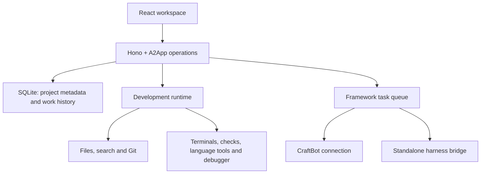

**The first release should let someone take a real project from setup through editing, agent assistance, execution, debugging, review and Git delivery—with CraftBot connected or with a standalone coding agent.**

Working name: **Development Studio**.

One change from my earlier recommendation: use the new framework’s **React + Hono + SQLite blueprint**. I verified that upstream includes an A2App task queue and harness bridge. That gives us a foundation for both operating the app and dispatching agent work. The globally installed CLI is older, so we should pin the framework source revision used for the build. [Framework blueprint](https://github.com/CraftOS-dev/Agent-App/tree/5e9c7a1e28fd4742cbb49e49188d63031f35c145/toolkits/blueprint-react-node)

**1. Define the release around three complete usage modes.**

| Mode | What the user can do |
|---|---|
| Manual | Create or open a project, edit, search, run commands, test, debug, review changes and use Git. |
| CraftBot | Assign work to CraftBot, answer its questions, follow progress, inspect results and accept changes. |
| Standalone agent | Connect a supported installed coding agent and use the same assignment and review workflow. |

Standalone AI requires a configured coding agent. Manual editing, building and testing work without an agent connection.

For the first release, I recommend these boundaries:

- Local, single-user application, with multiple saved projects.
- Windows as the first supported and verified platform; keep runtime code portable.
- One active agent writer per project.
- Full reference workflows for JavaScript/TypeScript and Python.
- Other languages supported through files, Git, terminals and configurable commands.
- Existing repositories and ordinary folders supported.
- One certified standalone connector, initially Claude Code through the framework bridge.
- CraftBot installation and operation treated as mandatory release requirements.

Remote development, simultaneous team editing, multiple agents editing one project, and an extension marketplace come after this release.

**2. Make project setup useful for existing work.**

The start screen offers **Open folder**, **Clone repository**, and **New project**, followed by recent projects and any work awaiting review.

Opening a project should:

1. Resolve and display the actual folder being opened.
2. Detect Git, project manifests and relevant toolchains.
3. Report what is available and what needs installation.
4. Suggest commands without running them automatically.
5. Let the user choose manual mode or an agent connection.

A project can contain several packages or services. Each run configuration has its own working directory, executable, arguments and environment references.

For a new project, offer an empty folder and a small set of verified starters. Agent-created projects follow the same review and execution workflow as changes to existing projects.

Existing uncommitted changes must remain intact. Opening a folder must never automatically initialise Git, stash files, install dependencies or change branches.

**3. Build a complete everyday editing workspace.**

The main screen should have a familiar layout:

| Area | Contents |
|---|---|
| Left | Files, search, development work and Git changes |
| Centre | Editor tabs, split editors, diffs and previews |
| Right | Agent conversation, plan, progress and questions |
| Bottom | Terminals, problems, checks and debugger |

The editor includes:

- Create, rename, move and delete files or folders.
- Tabs, split view, breadcrumbs and quick file opening.
- Find in file, project search and reviewed replacement.
- Syntax highlighting, completion, diagnostics and formatting.
- Line endings, encoding indicators and large-file handling.
- Markdown and image previews.
- Remembered layout, open files and cursor positions.
- Keyboard navigation and a command palette.

Use Monaco for the editor. Its API provides the editing component; VS Code extension compatibility would require additional work and is outside this release. [Monaco documentation](https://github.com/microsoft/monaco-editor)

Unsaved buffers need explicit protection: local recovery after refresh, dirty indicators, and a conflict view when the underlying file changes. An external write must never silently replace unsaved text.

**4. Give manual development a full execution loop.**

Users should be able to configure and run **install, develop, build, test, lint, format and custom commands**.

Each execution records:

- Project and working directory.
- Command and arguments.
- Start/end time and exit code.
- Output and generated artifacts.
- The source revision or content fingerprint used.

Provide real interactive terminals with resizing, interruption and multiple sessions. Long-running servers appear in a process list with their ports, logs and stop controls.

For web projects, detect the development URL and offer a preview. Serve project previews in a separate browser security context from the IDE, so project code cannot access IDE credentials or terminal controls.

For native, mobile, game and infrastructure projects, commands can launch the installed tools. The interface reports the resulting process or artifact; those projects should not be forced into a browser-preview workflow.

Terminal transport needs explicit authentication and origin checks. xterm’s documentation calls out that embedding a terminal exposes powerful host capabilities. [Terminal integration guidance](https://xtermjs.org/docs/guides/security/)

**5. Make agent work a first-class development activity.**

The user creates a work item with:

- A goal.
- Acceptance criteria.
- Selected files, code ranges, errors or logs.
- Relevant project instructions.
- Execution permissions.
- A chosen agent connection.

Initial actions should be **Plan**, **Implement**, **Diagnose**, **Write tests**, and **Review changes**.

An implementation request follows this sequence:

1. Check the connection, toolchain and project state.
2. Capture the starting revision and relevant context.
3. Prepare an isolated working area.
4. Queue the request and show whether an agent has claimed it.
5. Display the agent’s plan, reported progress and tool activity.
6. Surface questions with a clear answer/resume action.
7. Collect changed files, execution results and remaining concerns.
8. Present the result for review.

The app shows observable activity and agent-provided explanations. A successful agent process exit must not, by itself, mean the requested feature is complete.

Use separate state for the development work and the framework delivery task:

| Development work | Meaning |
|---|---|
| Draft | Being defined |
| Queued | Waiting for an agent |
| Running | Work is underway |
| Needs input | Waiting for the user |
| Ready for review | Results and changes are available |
| Applied | Accepted into the user’s working project |
| Rejected | Changes retained separately or discarded by choice |
| Failed / Cancelled | Stopped with an explanation |

A work item can have several attempts. Retrying creates a traceable attempt rather than overwriting the previous result.

**6. Connect CraftBot and standalone agents through one app contract.**

The app should expose a common set of development operations: inspect context, read files, propose or apply edits, run checks, report progress and submit results.

The connection layer handles the differences:

| Concern | CraftBot | Standalone agent |
|---|---|---|
| Dispatch | Verified CraftBot host connection | Framework harness bridge |
| Project access | Explicit project/work-item context | Same context through A2App |
| Progress | Supported host signals and app operations | Task progress and app operations |
| Completion | Reported result plus inspected changes | Same validation |
| Disconnect | Preserve work and show connection state | Same behaviour |

The new framework supports declared events through `schema.events` and `trigger(...)`, with a bridge that delivers queued work to a harness. We should use that mechanism rather than transplanting CraftBot-specific `triggers.json` files into the new blueprint. [Framework trigger contract](https://github.com/CraftOS-dev/Agent-App/blob/5e9c7a1e28fd4742cbb49e49188d63031f35c145/toolkits/blueprint-react-node/template/reference/blueprint.md)

CraftBot’s current marketplace integration uses an older contract, so compatibility needs an actual installation and round-trip test.

For release one, use A2App and the existing bridge. Keep the connection interface extensible for ACP later; ACP standardises editor-to-agent communication, but a second protocol implementation should not delay the first working release. [ACP documentation](https://agentclientprotocol.com/get-started/introduction)

Switching agents starts a new attempt with explicit context. We should preserve previous results without pretending different agents share a native conversation history.

**7. Make review, testing and Git part of the same workflow.**

Agent work should default to a separate Git worktree based on a recorded starting revision. For folders without Git, use a recoverable working copy and content-based change tracking.

The review screen brings together:

- File-by-file diffs, including additions, deletions and binary changes.
- The requested acceptance criteria.
- Tests, build results and diagnostics.
- Agent explanations and known limitations.
- Actions to request revisions, accept selected files, accept the change set or reject it.

Before applying changes, compare the destination with the starting snapshot. If the user or another tool changed it, show the conflict instead of overwriting it.

For release one, support acceptance by file and a conflict editor. Fine-grained hunk acceptance can follow.

Checks must be tied to the source they ran against. Editing that source marks the previous result **out of date**.

After accepting changes, the user can stage, unstage, commit, inspect history, fetch, pull and push. Publishing, deployment, force pushes and destructive Git operations remain explicit actions.

Add basic debugging for the two reference stacks: launch configuration, breakpoints, continue/step, call stack and local variables. Keep the debugger interface extensible through adapters.

**8. Use the framework for the app, with a separate execution service.**

The framework server and adapter remain system-owned. Our code lives in the schema, operation implementations, React interface and app-owned runtime modules.

Start the execution service through supported app-owned operations. Prove terminal streaming, cleanup and lifecycle management without editing locked framework files.

Use six A2App modules:

| Module | Responsibility |
|---|---|
| `workspace` | Projects, folders, repository identity and context |
| `workbench` | File operations, search and editor context |
| `execution` | Commands, terminals, checks and debugging |
| `changes` | Snapshots, diffs, review and Git |
| `agents` | Connections, work requests and attempts |
| `settings` | Preferences, permissions and runtime health |

SQLite stores projects, run configurations, work items, attempts, check results, change-set metadata and preferences. Project source files stay on disk as the source of truth. Terminal output and large artifacts use bounded storage.

Execution-changing operations must return a persisted result or a job identifier. Protected fields—approval state, trusted roots, execution authority and completion evidence—must not be writable through generic record updates.

**9. Specify recovery and permissions before implementation.**

These behaviours belong in the first release:

- Opening an unfamiliar project starts in inspection mode.
- Enabling execution clearly grants access to local development tools.
- Filesystem operations validate resolved paths, symlinks and Windows junctions.
- One app-managed agent writer holds the project’s write lease.
- Interrupted work remains inspectable.
- Cancellation immediately blocks new app-managed writes and requests agent termination.
- The UI distinguishes **stop requested** from **confirmed stopped**.
- A lost connection does not automatically repeat commands with uncertain outcomes.
- Restarting the app reconciles saved jobs with actual processes.
- Reconnecting the browser preserves running work and terminal sessions where possible.

Local shell commands and independently installed agents run with their operating-system permissions. A project folder or Git worktree provides organisation and change isolation; it does not provide a security sandbox.

Framework backups protect application metadata. Project files require their own Git history or checkpoints, and the interface should make that distinction clear.

**10. Build in milestones with observable exit criteria.**

| Milestone | Deliverable | Exit criterion |
|---|---|---|
| **0 — Framework and host compatibility** | Pinned framework scaffold, managed runtime, terminal transport, packaging and connector probes | Installs in CraftBot and standalone; completes a real agent round trip; shuts down owned processes cleanly |
| **1 — Manual workspace** | Project opening, editor, files, search, recovery and Git inspection | A user can modify an existing project without losing its prior work |
| **2 — Execution and diagnosis** | Terminals, run configurations, checks, preview, language services and basic debugging | Real JS/TS and Python projects can be built, tested, run and debugged |
| **3 — Agent development** | Work items, context, dispatch, progress, questions and cancellation | CraftBot and the standalone connector each complete a real coding task |
| **4 — Review and delivery** | Isolated changes, conflict handling, acceptance and Git delivery | Accepted changes reach the project safely; stale checks and conflicts are detected |
| **5 — Release verification** | Fresh installation, recovery tests, accessibility and distributable packages | All release scenarios pass on the packaged application |

Milestone 0 is deliberately first. If the current CraftBot host cannot import or operate the new framework app, we identify the exact compatibility change before investing in the full interface.

**11. Use these end-to-end scenarios as the release gate.**

| Scenario | Required outcome |
|---|---|
| Manual web development | Open, edit, run, preview, test and commit a real project |
| Manual Python development | Run, test and debug a real project |
| CraftBot implementation | Assign a feature, receive changes, review and apply them |
| Standalone implementation | Complete the same workflow without CraftBot running |
| Agent diagnosis | Supply a failing check, receive a fix and verify it |
| Human/agent conflict | Human edits survive; conflicting agent changes require resolution |
| Unsaved-buffer conflict | External writes never silently replace unsaved text |
| Cancellation | Further managed work stops and actual process state is reported |
| Crash and reconnect | Work history survives and interrupted processes are reconciled |
| Missing tools or credentials | Useful manual operation remains available with actionable errors |
| Non-Git project | Editing, execution, agent changes and recovery still work |
| Fresh package installation | Both distribution paths work outside the development checkout |

Run the framework gates, runtime integration tests and an independent browser walkthrough against these requirements. Verification must use the packaged app as well as the development instance.

**The first build step will be Milestone 0: prove the new framework, CraftBot compatibility, standalone dispatch and local execution together.** Once that passes, we can build the workspace against these workflows rather than discovering a host limitation after the editor is finished.

No application code has been changed yet.
