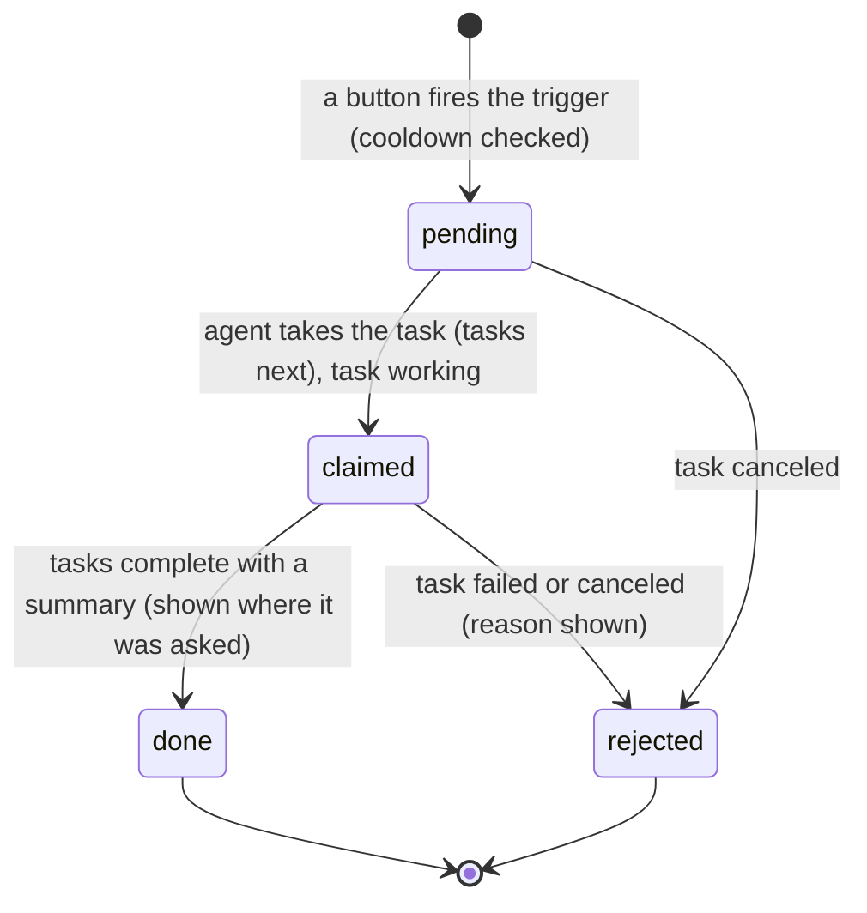
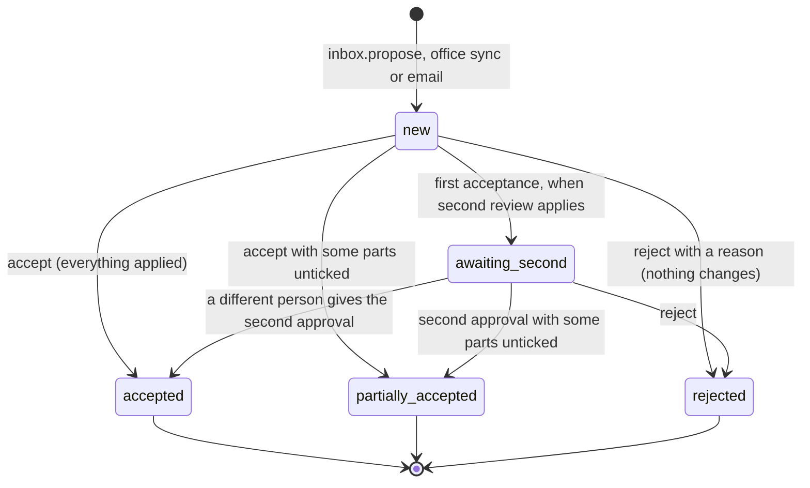
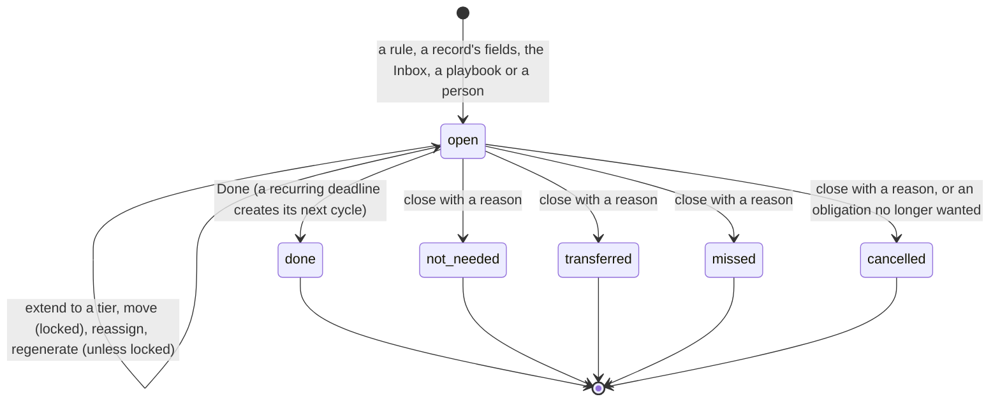
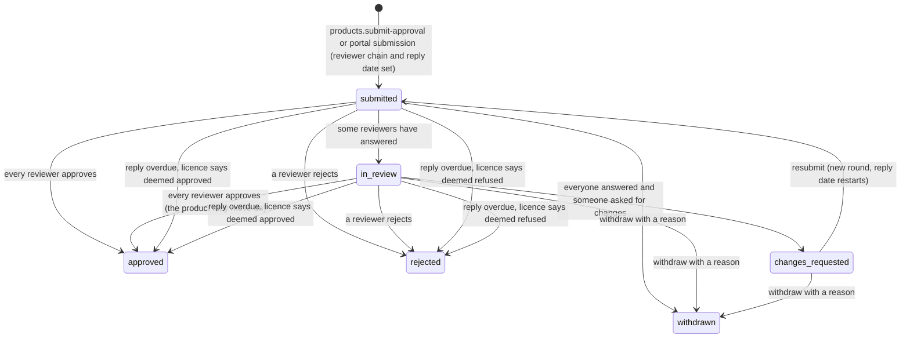

# Requirements: Entertainment IP Manager

PART A — REQUIREMENTS (SRS). User-approved before build; frozen after; changes via ## Changes.

## Introduction

### Purpose
Entertainment IP Manager is one register of an entertainment company's intellectual property, for anime producers and licensors, VTuber and virtual-talent agencies, and character and virtual-idol brands. Its one job is to show what the company owns, who may say yes to a use, and which dates follow from it. The character is the centre: each one is a stack of separately owned layers, and products, licences, songs, marks and cases link to the characters they use. Around it sit franchises, titles, talents, music, production committees, agreements with their grants, third-party permissions, licensed products with their approvals (監修), seals (証紙) and royalties, trademarks and designs in seven offices, enforcement cases, and fan guidelines. A rules-based engine explains every date, and "Can we?" answers a use per territory and names who decides. A team of internal staff signs in with roles, and licensees, committee members and outside reviewers use scoped portals in the same app. Everything reads in English or Japanese. CraftBot, the AI agent, works on the same data through A2App with 96 declared operations. The app hands it nine kinds of task: read a contract, a document or a sales report, check a product submission, draft takedown notices, scan marketplaces, re-read a guideline, answer a question, draft an email. Automation proposes and people decide: what CraftBot and the offices find lands in the Inbox, and CraftBot writes drafts only.

### Scope
**Goals**
1. Every deadline on screen can show why it falls on its date: the base date, the rule or clause, the offsets, office closures and the final date, in the reader's language.
2. Nothing that office data, CraftBot or email proposes changes a record until a person accepts it in the Inbox. With second review on, a statutory deadline proposed by automation needs a second, different person.
3. For a chosen asset, use, territory and period, "Can we?" gives a verdict in each territory. It names who decides (us, the window holder, or every committee member) and shows each check behind it.
4. External accounts see and act on only the records of the companies an admin linked them to, and a talent's legal identity is readable only by admins and that talent's managers.
5. Every view follows changes made by anyone, including CraftBot, without a refresh, and every page works at 400, 768 and 1280 px wide without page-level horizontal scrolling.

**Core functionalities:** sign-in with roles and first-run setup · business profiles and modules · Today · Inbox review door with second review · deadline engine with explained dates, events, rules and office calendars · franchises · characters and their rights stacks · talents with lifecycle playbooks, pre-stream check and identity vault · titles with copyright terms and clearances · music (songs, recordings, releases, societies, Content ID, setlist check) · Can we? · agreements and grants with conflict checks · production committees with windows, waterfall, distributions and consent · third-party permissions · licensed products, approvals (監修), seals (証紙) and royalty statements · trademarks and designs with office data, coverage, leak check and renewals · enforcement cases, notices, evidence and watch results · guidelines and fan permits · people and companies · external portals · reports and the daily digest · calendar feed · notifications · audit log · settings · English and Japanese · CraftBot tasks

### Approval
Approved by the user: 2026-11-04: carried over from the published marketplace app `entertainment-ip-manager` 1.0.0, whose requirements were approved when it was built; this document restates them in the framework's form without changing any feature.

## Product Description

### Product Perspective
`authMode: multi-user`, because an organization's staff share one register with roles, and outside companies (licensees, committee members, outside reviewers) sign in to scoped portals in the same app. Everyone signs in with email and password through the kit's sign-in gate. CraftBot connects through the agent-app CLI as the app's operator and acts with admin rights. manifest.json declares no integrations (`capabilities.integrations: []`). The backend alone calls three optional trademark office services (JPO `ip-data.jpo.go.jp`, USPTO TSDR `tsdrapi.uspto.gov`, EUIPO `api.euipo.europa.eu` or its sandbox), the European Central Bank's reference rates (`www.ecb.europa.eu`) and the Cabinet Office holiday list (`www8.cao.go.jp`). Every office credential is optional, and everything also works by hand. Digests sent by email or Slack go through CraftBot's own actions (`send_gmail`, `send_slack_message`) and fall back to in-app notifications. It is a separate app with its own database: the IP Manager it grew from stays unchanged (Original requirements, decision 1). It is deliberately not built on an office connection for China, Korea or Taiwan (those records are entered by hand), not on a language model of its own (CraftBot reads documents through tasks), and not on any sending of notices or emails (CraftBot writes drafts, people send).

### User Characteristics
The organization's staff work in the app through the day on desktops and laptops: admins, managers, the rights team, the licensing team, talent managers, contributors and viewers. The first account is the admin and sets the organization up. Outside companies sign in now and then to answer: a licensee proposes products, submits approval stages, files royalty statements and orders seals; a committee member answers consent requests and reads distribution statements; an outside reviewer decides the approvals assigned to them. People read in English or Japanese (Japanese by default). Phones and tablets are in scope down to 400 px wide, with a drawer for the navigation.

### Constraints
- C-1: Roles. Internal: admin, manager, rights (Rights team), licensing (Licensing team), talent_manager (Talent manager), contributor, viewer. External: licensee, committee_member (Committee member), reviewer. The server's levels are: read (every internal role), contribute (editors and contributors), edit (admin, manager, rights, licensing, talent manager), rights (admin, manager, rights), licensing (admin, manager, licensing), talent (admin, manager, talent manager), manage (admin, manager), admin. The UI hides what a role cannot do, and the server refuses it.
- C-2: The first account ever created becomes admin. Later sign-ups get the organization's default sign-up role (Manager, Rights team, Licensing team, Talent manager, Contributor or Viewer; Contributor by default). Nobody can change their own role in the app, the server accepts role changes from admins only, and the organization always keeps at least one admin.
- C-3: Business profiles switch modules on: anime ("Anime and film") turns on titles, committees, franchises, music, products, royalties and approvals; talent ("VTubers and virtual talent") turns on talents, permissions, guidelines, music, products, royalties and approvals; character ("Characters and virtual idols") turns on franchises, guidelines, products, royalties, approvals and music. Any module can be switched on or off later. Always on: Today, Inbox, Deadlines, Characters, Agreements, Can we?, Trademarks and designs, Enforcement, People and companies, Reports, Settings. Switching a module off hides its pages and links and deletes nothing.
- C-4: Languages are English and Japanese. Each person has a `ui_language`, the organization a default language (Japanese as shipped), and text the server generates (deadline titles, calculation steps, rule names, dimension labels, errors, notifications) exists in both. Operation errors are `{ error, error_ja }`.
- C-5: Trademarks and designs are kept in JP, US, CN, KR, TW, EM and WO. JPO, USPTO TSDR and EUIPO connections are optional; CN, KR and TW are entered by hand.
- C-6: Automation proposes, people decide. Office sync, CraftBot and email proposals land in the Inbox as items; an office change never writes a record directly. CraftBot's tasks only file Inbox proposals or write drafts (draft comments, notice drafts, email drafts), and the app never sends a notice to a platform.
- C-7: Every deadline comes from a rule, a record's own fields (an obligation), an office, the Inbox, a playbook or a person, and keeps its calculation steps. Deadline kinds: hard (Statutory), extendable, designated (Office-set), internal, reminder; the first three are statutory. Deadlines are closed with a status (done, not needed, transferred, missed, cancelled); every status but done needs a reason. A date a person moves is locked against recalculation. Only an admin can delete a deadline.
- C-8: A statutory deadline's target date is its due date less the target buffer (14 days as shipped); other deadlines target their due date. Reminders go to the assignee at the reminder thresholds (90, 60, 30, 14, 7 and 1 days as shipped; internal and reminder deadlines only from 7 days). Statutory deadlines that are overdue, or due within 7 days with nobody assigned, are escalated to admins and managers.
- C-9: Seeded organization settings: Japanese, JPY, work calendar JP, the seven offices of interest, target buffer 14 days, digest on at 08:00 in the app, second reviewer off, renewal default "Ask each time", approval reply time 5 business days, leak check lag 14 days, reference prefixes TM, D, AG, PR, EC and FP, automatic ECB rates, office sync on at 02:00. The organization is not set up until the admin finishes onboarding.
- C-10: Performers are private by default. A talent's legal identity (`talent_identity`) is read and written only by admins and that talent's managers, deleted only by admins, and never appears in lists, searches or exports. Suspension and termination reasons are kept in the audit log only.
- C-11: An external account sees only records whose `portal_users` include it. Hooks derive `portal_users` from counterparties, licensees, committee members and assigned reviewers, and only an admin links an outside account to the company it acts for. Portal accounts must pass record ids, never names.
- C-12: Money may be in any three-letter currency; forecasts and renewal costs are shown in the home currency. Exchange rates are stored per 1 EUR from the ECB, and currencies the ECB does not publish (TWD, VND) need a manual rate, which the ECB refresh never overwrites.
- C-13: Approval (監修) stages: proposal, concept, design, color proof, prototype, pre-production sample, final sample, packaging, advertising, mass production check. The seeded stage template lists proposal, concept, design, prototype, final sample, packaging and mass production check with reply days and reviewer kinds (our team, committee, original author, talent, outside reviewer). The reply is due in business days on the organization's work calendar. What a missed reply means comes from the licence: nothing, deemed refused or deemed approved.
- C-14: Product stages: proposal, contract, concept, design, prototype, final sample, packaging, mass production, on sale, sell-off, ended, cancelled. Mass production and on sale need an approved final sample unless the move is forced with a reason, and cancelling needs a reason.
- C-15: Royalty statement lines are priced by the server from the licence's royalty basis (retail × manufactured, retail × sold, wholesale net, net receipts, per unit, per seal, flat fee, revenue share, none); a person never types a line's rate or royalty. A recoupable minimum guarantee is credited first, and late interest applies after the due date.
- C-16: A committee's member shares must add up to 100% before a distribution can be issued. A use no window covers goes to every member for consent (Copyright Act Art. 65(2)), the request's outcome follows the committee's consent rule (## Process Flows), and a refusal needs a reason (Art. 65(3)).
- C-17: An outbound grant that conflicts with another counted agreement is refused unless an override reason is given; the reason stays on the grant and in the history. Grants of draft agreements do not count in Can we?.
- C-18: ISRCs (12 characters) and ISWCs (check digit) are validated on every save and stored in canonical form; an ISRC is unique.
- C-19: References are assigned by the server: trademarks and designs `TM-0001-JP` / `D-0001-JP` (filings of one family share the number), agreements `AG-0001`, products `PR-0001`, cases `EC-0001`, fan permits `FP-0001`, with the prefixes set in Settings.
- C-20: No em dashes in the app's own copy, hooks, migrations or operations.json (`scripts/i18n-check.ts`), and Japanese copy is natural business Japanese (Original requirements, quality bar).
- C-21: No sample data ships. Editable starter content does: the deadline rule catalogue (every rule with its legal basis), official fees, office holiday calendars, the rights dimension trees with English and Japanese labels, the approval stage template, and five guideline templates (fan works, clips, cover songs, AI use, one-day event licence).
- C-22: Deleting a record needs manager rights, and admin rights for deadlines, Inbox items, evidence, identities, rules and users. Nobody deletes their own account or the last admin, and every delete is in the audit log with its reason.

### Assumptions
- A-1: Volume ceiling: no number was approved for this app. Every list loads its whole collection at once (no paging), which suits one company's register. The fixed caps in the code are 5,000 audit-log rows per report run, 40 territory columns per Can we? question, 80 notifications in the drawer, and 20 search results in the command palette (25 by default for `portfolio.search`).
- A-2: The organization's work calendar (JP as shipped) is the calendar for business-day periods such as approval replies; office calendars move statutory deadlines to the next open day.
- A-3: Japanese public holidays come from the Cabinet Office list where it is reachable. China, Korea and Taiwan use the stored official rows, and China's 2027 list was not published at build time (AGENT_APP.md § External data).
- A-4: Rights answers come from the recorded agreements, windows and registrations only. They are not legal advice, and the copyright term is a guide.
- A-5: CraftBot is the agent the app hands work to. While no agent is connected a request stays pending, and the app says so after 20 s.

## Features

### Module: Access and setup (onboarding, settings, users)
- F-ACC-1: The user can create an account and sign in with email and password on the kit's sign-in gate.
- F-ACC-2: WHEN the first account is created THE SYSTEM SHALL make it the admin; later accounts get the organization's default sign-up role.
- F-ACC-3: WHEN the organization is not set up yet and the person is not the admin (and not an outside account) THE SYSTEM SHALL show only "Entertainment IP Manager is being set up", with the language switch, and open the app by itself once setup is done.
- F-ACC-4: The admin can finish setup on one page, "Set up Entertainment IP Manager": organization name, "What does your company do?" (Anime and film, VTubers and virtual talent, Characters and virtual idols; at least one), home currency, default language (日本語 or English) and the trademark offices of interest (JP, US, CN, KR, TW, EM, WO, all ticked at first). "Finish setup" stays unavailable until a name and a business are given.
- F-ACC-5: WHEN setup is finished THE SYSTEM SHALL switch on the modules of the chosen profiles (C-3), save the organization settings, and fetch exchange rates when automatic rates are on.
- F-ACC-6: The user sees only what their role allows: actions a role may not take are hidden or disabled, and the server refuses them with "Your role (<role>) cannot do this. Ask an admin to change your role."
- F-ACC-7: WHEN an outside account (licensee, committee member, reviewer) signs in THE SYSTEM SHALL show only its portal and My account.
- F-ACC-8: The user can switch the app between English and Japanese from the top bar; the choice is saved on their account and the whole app redraws in that language.
- F-ACC-9: An admin can invite a person (name, email, temporary password of at least 8 characters, role, language), change each account's role, edit its name and job title, and remove it, and sees what each role can do. Nobody can change their own role, and the only admin cannot be demoted or removed.

### Module: Frame (app)
- F-FRM-1: The user sees a sidebar with the organization's name and these groups: Work (Today, Inbox, Deadlines, Approvals), IP (Franchises, Characters, Talents, Titles, Music), Rights (Can we?, Committees, Agreements, Third-party permissions), Licensing (Products, Royalties and seals), Protect (Trademarks and designs, Enforcement, Guidelines and fans) and Organization (People and companies, Reports, Settings), with their account and "Sign out" at the foot.
- F-FRM-2: The user sees only the items of switched-on modules, and WHEN a page of a switched-off module is opened THE SYSTEM SHALL show Today instead.
- F-FRM-3: The user sees live counts in the sidebar: Inbox items waiting, deadlines overdue, and approvals past their reply date.
- F-FRM-4: Below 768 px the user opens the navigation as a drawer from a menu button in a top bar that shows the organization's name.
- F-FRM-5: An internal user can open search with Ctrl/Cmd+K or the search box and find franchises, titles, characters (every name variant), talents, songs (ISWC, society codes), recordings (ISRC), trademarks and designs (numbers in any format), agreements, products, cases and people, plus jumps to pages. The arrow keys move, Enter opens and Escape closes.
- F-FRM-6: An internal user can "Ask CraftBot" a question in plain words and read the answer in the dialog; CraftBot reads the records and changes nothing.
- F-FRM-7: The user sees their notifications (reminders, digests, Inbox alerts and the rest) in a drawer from the bell, which shows the unread count; opening one marks it read and shows its text with "Open", and "Mark all as read" clears the rest.
- F-FRM-8: WHEN anyone, including CraftBot, changes a record THE SYSTEM SHALL update every open view that shows it without a page refresh.
- F-FRM-9: The user sees one look in light and dark from the host: warm-neutral greys, one accent, sharp corners, 1 px borders instead of shadows, Inter, monospace references and office numbers, and a hand cursor on everything clickable.
- F-FRM-10: The user can use every page at 400, 768 and 1280 px wide with no page-level horizontal scroll; wide tables scroll inside their own box or turn into stacked rows.

### Module: Today (portfolio)
- F-TOD-1: The user sees the date and tiles for deadlines overdue, due this week, Inbox items waiting, approvals overdue (approvals module), royalty statements late (royalties module) and renewal decisions pending; each tile opens the matching filtered list.
- F-TOD-2: The user sees "My next deadlines": open deadlines due within 30 days or overdue that are assigned to them, then statutory ones nobody is assigned to.
- F-TOD-3: The user sees a month calendar of open deadlines, for themselves or everyone, and the deadlines of the chosen day.
- F-TOD-4: The user sees "Waiting for you": Inbox items to review (editors) and approvals that need their answer, up to six of each, with a link to the rest.
- F-TOD-5: The user sees the talent dates of the next 60 days (debuts, anniversaries, graduations, playbook tasks) when the talents module is on.
- F-TOD-6: The user can start from quick actions: record an event, add a deadline by hand, subscribe to the calendar feed, run a report.

### Module: Inbox (inbox)
- F-INB-1: WHEN office data, CraftBot or an email proposes a change THE SYSTEM SHALL file it as an Inbox item and change no record until a person accepts it.
- F-INB-2: The user sees the items waiting, accepted, rejected or all, filtered by kind (office change, document, contract read, royalty statement, permission, watch hits, proposal, email), each with its source, confidence and who proposed it. Decided items cover the last six months.
- F-INB-3: The user sees what accepting would do, previewed by the server: for an office change, the field differences and office events with the deadlines they create; for a document, proposal or email, the record, the event, its deadlines, extra deadlines and where each value was read; for a contract, the agreement's fields and its grants with their conflicts; for a royalty statement, lines priced from the agreement; for a permission, old and new values; for watch hits, each hit.
- F-INB-4: An editor can tick what to accept, edit the proposal (the record, the event and its date, deadlines, extra deadlines, agreement fields, statement period), and accept it, or reject it with a required reason.
- F-INB-5: WHEN second review is on and an item from automation would create a statutory deadline THE SYSTEM SHALL record the first acceptance, notify admins, managers and the rights team, and apply the item only when a different person gives the second approval.
- F-INB-6: On wide screens the user sees the list and the open item side by side; below 1024 px the item replaces the list with a link back. After a decision the next item waiting opens.
- F-INB-7: A person who cannot edit can read every item and is told who accepts or rejects them.

### Module: Deadlines (deadlines, calendar, rules, calendars, calendar-x)
- F-DL-1: The user can list deadlines open, closed in the last 12 months, or both, grouped as overdue, this week, next 30 days, 31 to 60 days, 61 to 90 days and later. Filters (window, assignee, category, kind, record type, jurisdiction, search) stay in the address.
- F-DL-2: The user can switch the list to a month calendar with dots per deadline by severity and see the deadlines of a chosen day.
- F-DL-3: The user can open "Why this date?" on any deadline and read its target, due and final or grace dates, each calculation step in their language, the legal basis and rule, whether it is locked, and for a closed one who closed it, when and why.
- F-DL-4: An editor can record what happened on a trademark or design, agreement, title, character or case: pick the event from the server's catalogue and its date, see the deadlines the rules would create with their explanations, untick any, and commit.
- F-DL-5: WHEN base dates of a record change THE SYSTEM SHALL show the deadlines that would move (from and to) before anything moves, and never move a locked one.
- F-DL-6: An editor can mark an open deadline done in one click; WHEN a recurring deadline is done THE SYSTEM SHALL create its next cycle and say so.
- F-DL-7: An editor can close one or many deadlines as done, not needed, transferred, missed or cancelled, with a closing date; every status but done needs a reason. The dialog says "Deadlines are never deleted. The status and reason stay in the history."
- F-DL-8: An editor can extend an extendable or office-set deadline to an extension tier from its rule, with a preview of the new date and its steps.
- F-DL-9: An editor can move one or many deadlines by days or to a date with a required reason after a preview; moved dates are locked against recalculation, and statutory ones need manager rights.
- F-DL-10: An editor can reassign one or many deadlines to a person or to nobody.
- F-DL-11: An editor can add a deadline by hand for a date no rule covers: the record or none, what needs to happen (with an optional Japanese title), due and optional final date, kind, category, assignee, legal basis and notes.
- F-DL-12: WHEN a deadline reaches a reminder threshold THE SYSTEM SHALL notify its assignee once per threshold, and WHEN a statutory deadline is overdue or due within 7 days with nobody assigned it SHALL notify the admins and managers.
- F-DL-13: The user can get a private calendar (iCalendar) link to their deadlines, or all deadlines for editors, subscribe to it from Google Calendar, Outlook or Apple Calendar, and replace the link after a confirmation, which stops the old one.
- F-DL-14: A manager or admin can add business days to a date on an office calendar or the organization's calendar and see the steps (Settings, Calendars).
- F-DL-15: WHEN a statutory deadline falls on a day its office is closed THE SYSTEM SHALL move it to the next open day and record that step.

### Module: Characters (characters)
- F-CHR-1: The user can list characters as cards, search them by any spelling (Japanese, kana, romaji, English, Chinese, Korean), filter by kind, franchise and status, and see who plays each one now.
- F-CHR-2: An editor can create or edit a character: name and names in every script, kind, franchise, titles it appears in, ownership model, status, debut date, birthday, profile, image, copyright line, announcement date (confidential until then), and its AI policy for training, fan AI art and voice cloning (not decided, not allowed, allowed if labelled, allowed).
- F-CHR-3: The user sees a character's page with Overview, Rights stack, Castings, Products, Songs, Permissions (each when its module is on), Trademarks, Deadlines, Documents and History.
- F-CHR-4: An editor can record the character's rights stack as layers (name, logo, design sheet, standing art, outfit, Live2D model, 3D model, emote, voice, persona and lore, jingle, other). Each layer holds a label and version, the layer it is based on, the creator, agreement and how we hold it, whether Arts. 27 and 28 are named, the non-exercise of moral rights, the credit line, portfolio use, territory limit, licence end, the commission and payment dates and fee, rework, and files.
- F-CHR-5: The user sees the chain verdict of the rights stack (clear, needs attention, blocks use) with what is wrong in each layer: unknown acquisition, an assignment that does not name Arts. 27 and 28 (Art. 61(2)), no non-exercise of moral rights, a licence ending, a payment overdue, the Freelance Act terms for individual creators, and expected layers not on file.
- F-CHR-6: An editor can record who voices or performs a character (voice, performer, motion, singing, voice and performer) from when to when, end a casting, and record a recast that ends one casting and adds the next in one step. Performers show by stage name only.
- F-CHR-7: WHEN a layer has a payment due or licence end date THE SYSTEM SHALL make it a deadline on the character.

### Module: Franchises (portfolio, franchises)
- F-FRN-1: The user can see franchises as a tree (a group inside an agency, a spin-off inside a series), search names in any script, filter by kind and status, and see how many characters and titles each holds.
- F-FRN-2: An editor can create or edit a franchise: name and names, kind, ownership model, status, the franchise it is part of, original work, production committee, description, image, style guide version and announcement date (confidential until then).
- F-FRN-3: An editor can keep a franchise's copyright lines: the © notice to print per territory, with a default line for everywhere else.
- F-FRN-4: The user sees a franchise's page with Overview, Characters, Titles, Agreements, Trademarks, Products and Committees (each when its module is on) and Documents, with a link to Can we?.

### Module: Talents (talents)
- F-TAL-1: The user can list talents by stage name with type, affiliation, lifecycle, debut, managers and the characters they play; legal identities never appear in the list.
- F-TAL-2: An editor (admin, manager, talent manager) can create or edit a talent: stage name and names, type, affiliation, agency, contract party, managers, privacy, revenue share (talent and agency percentages per category), channels, profile and notes. The lifecycle is chosen at creation and afterwards changes only through a lifecycle step.
- F-TAL-3: The user sees a talent's page with Overview, Characters, Permissions and Products (when their modules are on), Identity, Deadlines, Documents and History.
- F-TAL-4: An admin, manager or talent manager can record a lifecycle step (debut scheduled, debuted, hiatus, suspended, resumed, graduation announced, graduated, terminated), preview the playbook of dated tasks it lays out, untick tasks, and confirm; the lifecycle moves and the tasks become deadlines. Suspension and termination need a reason that is kept in the audit log only.
- F-TAL-5: WHEN a graduation is announced, a suspension starts or a contract is terminated THE SYSTEM SHALL show what still depends on the talent: characters voiced, products on sale or in production, trademarks and permissions.
- F-TAL-6: An admin, or a manager of that talent, can open and edit the talent's legal identity (legal name and kana, date of birth, email, phone, address, emergency contact, payment details, notes); everyone else sees that it is restricted.
- F-TAL-7: The user can run the pre-stream check: for a game or work (or a permission on file), platform, monetization and stream date, the answer is allowed, needs an application or blocked, with the reasons and the permission that decides it.
- F-TAL-8: WHEN a talent has a birthday or a debut date THE SYSTEM SHALL keep a yearly birthday and debut anniversary reminder.

### Module: Titles (titles)
- F-TTL-1: The user can see titles as one tree (series over seasons over episodes, films, OVAs, streams, books and the rest), search titles, authors or ids, and filter by type, franchise and status.
- F-TTL-2: An editor can create or edit a title with the facts the copyright term needs (creation and publication date, publication country, authors, author death year, author kind, made for hire), its rights basis, franchise, production committee, parent, episode number, language, announcement date and external identifiers (EIDR, ISAN, Media Arts Database, streaming service IDs, US copyright registration and others).
- F-TTL-3: The user sees a title's page with Overview, Copyright term, Clearances, Episodes, Agreements, Songs (music module), Deadlines, Documents and History.
- F-TTL-4: The user sees the title's copyright term in Japan, the US and the EU, with each episode timed on its own, ending on 31 December of the final year and labelled a guide, not legal advice.
- F-TTL-5: An editor can keep the production clearances of a title (original work licence, script, character design, music sync and master, voice cast, performer consent, footage, artwork, trademark and title searches, chain of title, committee consent, ratings, other) with status, provider, responsible person, due, cleared and expiry dates and a supporting document; due and expiry dates become deadlines.

### Module: Music (music, content-id)
- F-MUS-1: The user can work music in tabs: Songs, Recordings, Releases, Societies, Content ID, Setlist check and Unregistered.
- F-MUS-2: An editor can create or edit a song (the composition): title and names, ISWC, society work codes, lyrics language, our own or a cover, franchise, title, characters, tie-up use, first publication, copyright line, fan covers allowed and status. An ISWC that fails its check digit is refused.
- F-MUS-3: The user sees how complete a song's rights data is (writers and splits, ISWC, society registration, recordings with ISRC, publishing and master agreements) as a percentage with what is missing.
- F-MUS-4: An editor can record a song's writers and publishers with their shares per right category, and each society registration (JASRAC, NexTone, self-managed or other) with its shares and the tie-up uses the publisher reserves; a category that does not add up to 100% is flagged.
- F-MUS-5: An editor can create or edit a recording (the master): title, songs and medley shares, ISRC (12 characters, unique), version, duration, recording date, P-line, master owners, virtual singer, performers and characters, whether it was first captured in a film and the sound-only consent (Art. 91(2)). Master ownership that does not add up to 100% is flagged, and a released recording without an ISRC is flagged.
- F-MUS-6: An editor can make a new version of a recording (TV size, instrumental, a cappella, live, remix, cover, music video, other), which copies its owners and credits and carries its own ISRC (none until one is assigned).
- F-MUS-7: The user sees the performer and record-producer term end dates of a recording (Copyright Act Art. 101).
- F-MUS-8: An editor can keep releases (UPC, catalogue number, format, label, distributor, release date, territories, track list by disc and track).
- F-MUS-9: An editor can keep our contracts with JASRAC or NexTone (member number, entity, term, renewal, automatic renewal); the term end and the date to give notice before it become deadlines, and a draft work registration gets a deadline to submit it.
- F-MUS-10: An editor can keep Content ID assets with their ownership per territory, policy and administrator, claims in both directions, and an allowlist of channels. Recording a dispute or an appeal on a claim dates the 30-day or 7-day reply, and assets claimed for more than 100% in a territory are listed as conflicts.
- F-MUS-11: The user can check a singing-stream setlist: for each song, its backing, platform, archive, monetization and arrangement, the answer is OK, live only or blocked with the reasons; platform blanket licences cover the composition only.
- F-MUS-12: The user sees the songs that are published or released but not registered with JASRAC or NexTone or marked self-managed.

### Module: Can we? (rights)
- F-CAN-1: The user can ask Can we? for one or more franchises, titles, characters, songs or recordings, a use (media, product category, channel, platform, optional language), territories (or the presets Our offices, Asia and Regions; at most 40 at once), a period, exclusive or not, and whether it includes voice.
- F-CAN-2: The user sees one answer per asset and territory: availability (available, partly available, not available, no rights), the verdict (yes, yes with conditions, needs consent, no) and who decides (we decide, the window holder, or every committee member).
- F-CAN-3: The user can open a cell for every check in order: availability with the agreements behind it, who decides, the original-work licence, the chain of title per character layer, performer consent for sound-only uses (Art. 91(2)), talent status, trademark cover by Nice class, and the © line to print with a copy button.
- F-CAN-4: WHEN no window covers a use THE SYSTEM SHALL offer "Ask the committee" to open a consent request (for roles that may).
- F-CAN-5: The user sees that answers come from recorded agreements, windows and registrations only and are not legal advice, and is told when the question changed since the last answer.

### Module: Agreements (agreements, inbox grants)
- F-AGR-1: The user can list every agreement in and out with its reference, type, direction, counterparty, term, status and royalty, and filter by type, direction, status and "Ends within 90 days", or search.
- F-AGR-2: An editor can create an agreement by hand, or upload a contract "From a contract" so CraftBot proposes it in the Inbox.
- F-AGR-3: An editor can edit every term of an agreement, grouped as money, licensing, term, creator, talent and other (royalty rate and basis, advance, minimum guarantee, reporting, late interest, approval reply time and late outcome, copyright notice, samples owed, sell-off days, option and reversion dates, Arts. 27 and 28, moral rights and the rest).
- F-AGR-4: The user sees an agreement's page with Terms, Grants, Obligations, Products and Statements (when their modules are on), Documents and History, and a "Read by CraftBot" tag when it came from the Inbox.
- F-AGR-5: An editor can add grants (grant, holdback, restriction, reservation, window): the assets, each dimension's included and excluded values, exclusivity and term. The editor checks conflicts with every other agreement before saving.
- F-AGR-6: WHEN an outbound grant conflicts with another counted agreement THE SYSTEM SHALL refuse it unless an override reason is given, and keep that reason on the grant and in the history.
- F-AGR-7: WHEN an agreement's terms are saved THE SYSTEM SHALL generate its obligations as deadlines (statements, payments, options, notices, reversion, sell-off and the rest) and keep them in step.
- F-AGR-8: An editor can change an agreement's status; marking it expired, terminated or superseded asks first and says that open obligation deadlines still ahead are cancelled and its grants stop counting in Can we? and conflict checks.
- F-AGR-9: An editor can ask CraftBot for an email draft about the agreement for a purpose they choose or type (royalty report due, overdue payment, samples owed, renewal notice), optionally to an address.

### Module: Committees (committees, consent)
- F-COM-1: The user can list production committees (製作委員会) with title, form, status, members and lead company.
- F-COM-2: The rights team (admin, manager, rights) can create or edit a committee: name, title, franchise, form, status, formed and review dates, term end, buy-back window end, fiscal year end, distribution due days, lead company and promotion lead fees, consent rule, currency, © line and notes.
- F-COM-3: The user sees a committee's page with Overview (and its waterfall), Members, Windows, Who decides, Money, Consent, Deadlines and Documents.
- F-COM-4: The rights team can add members with investment, share of distributions, copyright share, roles, in-kind contribution and status; the totals are checked against 100%.
- F-COM-5: The rights team can record windows (窓口): which member decides and licenses which use, where, for how long, for which window fee. The first window creates the committee agreement.
- F-COM-6: The user can ask who decides a use for a committee title: the window holder, or every member when no window covers it.
- F-COM-7: The rights team can compute a distribution for a period from window receipts, deductions, window fees, the lead company, promotion and success fees, and see the pool and each member's amount. They can save it as a draft, issue it (members using the portal then see it) and mark it paid, and see recoupment against each member's investment.
- F-COM-8: The rights team can open a consent request for a use, record each member's answer (a refusal needs a reason, Art. 65(3)), close it with an outcome and a note, and ask CraftBot for a reminder email draft.

### Module: Third-party permissions (permissions)
- F-PRM-1: The user can list what game publishers, music rights holders and platforms allow our talents to stream: type, rights holder, platforms, monetization, archive rule, talents, status, last checked and end date, and filter by "Needs re-check" and "Ends within 60 days".
- F-PRM-2: An editor can record a permission: title, type, rights holder, game or work, source, guideline URL and revision, approval number, agreement, talents (or every talent of ours), characters, platforms, monetization, archive, content limits, credit line, regions, period, status, re-check interval and notes.
- F-PRM-3: An editor can record "Re-checked today" (no change, or what changed); WHEN it changed THE SYSTEM SHALL tell the managers of the talents it covers. The next re-check is scheduled.
- F-PRM-4: An editor can ask CraftBot to re-read the guideline; its findings arrive in the Inbox as a permission proposal.

### Module: Products and approvals (products, approvals)
- F-LIC-1: The user can list licensed products with reference, name, licensee, licence, characters, category, stage, sales start and retail price, filter by stage, licensee, licence, franchise, character and occasion, and open Can we? for a product's character.
- F-LIC-2: An editor can create or edit a product: product name, licence (which fills licensee, franchise, title and currency), what it shows (franchise, title, characters, talents, includes voice), what it is (category, channel, occasion, JAN, SKU, digital with its end date) and its sales (window, time zone, model, ship by, regions, retail price, currency). The reference is assigned and the stage starts at proposal.
- F-LIC-3: The user sees a product's stage stepper from proposal to ended and its tabs: Details, Approvals, Seals, Royalties (when their modules are on), Documents and Deadlines.
- F-LIC-4: Licensing staff can move a product to a stage. WHEN it moves to mass production or on sale without an approved final sample THE SYSTEM SHALL refuse unless "Move anyway" is ticked with a reason; cancelling needs a reason, and entering sell-off sets the sell-off end from the licence when it is empty.
- F-LIC-5: Licensing staff can submit an approval stage with notes and up to 10 images and pick outside reviewers. The server builds the reviewer chain from the licence (our team, committee, original author, talent, outside reviewers) and sets the reply date in business days.
- F-LIC-6: The user sees the approvals board, one column per approval stage (a list grouped by stage on phones), filtered by status, licensee, franchise, "Waiting on me" and "Overdue only"; overdue cards are marked.
- F-LIC-7: The user can open an approval to see its submitted images, the reviewer chain with every answer, the rounds so far, and what a late reply means under the licence.
- F-LIC-8: Staff with edit rights, or the reviewer named on a slot, can record a decision for the round: approve, request changes or reject (changes and rejections need a comment), the copyright line and logo check, numbered notes pinned on the images, reference images, and whether to move the product on when the stage is approved.
- F-LIC-9: WHEN a reviewer rejects THE SYSTEM SHALL reject the stage; WHEN every reviewer has answered and some asked for changes it SHALL ask for changes; WHEN every reviewer approves it SHALL approve the stage.
- F-LIC-10: Licensing staff can resubmit after changes (a new round; reviewers who asked for changes answer again and the reply date restarts) or withdraw an open approval with a reason.
- F-LIC-11: WHEN a reply is overdue and the licence says the stage is deemed approved or deemed refused THE SYSTEM SHALL record that outcome for the reviewers who did not answer.

### Module: Royalties and seals (royalties, seals)
- F-ROY-1: The user sees royalty statements with tiles for late, received but not paid, and disputed ones, filtered by status, licence and "Late only".
- F-ROY-2: WHEN a licence has reporting terms THE SYSTEM SHALL expect its statements period by period; an editor can also expect one by hand for a final accounting or an extra period.
- F-ROY-3: Licensing staff can add or replace a statement's lines (product, description, territory, manufactured, sold, retail and wholesale price, notes); the server prices every line and re-totals the gross, royalty due, minimum guarantee credit, late interest and payable.
- F-ROY-4: Licensing staff can recalculate a statement and record the amount received; a shortfall can mark the statement disputed, and full payment marks it paid.
- F-ROY-5: The user sees the minimum guarantee position of every active licence with one: guaranteed, earned, recouped, remaining, overage and paid.
- F-ROY-6: Licensing staff can record a seal (証紙) order for a product, issue it with a serial range (the next free range when none is given), and record the used, void and returned counts; WHEN they add up to the quantity THE SYSTEM SHALL mark the order reconciled.
- F-ROY-7: The user sees seals used against the manufactured quantity on royalty statements per product and licence; more seals used than manufactured is flagged.

### Module: Trademarks and designs (matters, coverage, renewals, offices, fx, import)
- F-TM-1: The user sees the register of trademarks and designs with reference, mark, office, numbers, classes, status, next deadline and expiry, filtered by status group (live and pending, live, pending, before filing, dead, all), type, office, franchise, character, talent and owner, as a table or grouped by family. Numbers match without punctuation.
- F-TM-2: An editor can enter a new trademark or design: office and route, mark or design title, mark type, family (new or existing), what it protects (franchise, character, talent), application number and filing date, owner, responsible person, priority claims, registration, and the classes with their goods and services. The filing date records the filing and creates its deadlines.
- F-TM-3: An editor can look up a filing by number at JPO, USPTO TSDR or EUIPO when connected and import it with its classes, history and deadlines; for CN, KR and TW, or an office that is not connected, the app says so and offers entry by hand.
- F-TM-4: The user sees a trademark's page with its numbers, status, owner and what it protects, and tabs for Overview (dates, how the expiry is worked out, leak check), Goods and services, Deadlines, Renewals, Family, Documents and History.
- F-TM-5: An editor can check a trademark with its office now; WHEN the office record differs THE SYSTEM SHALL file the differences in the Inbox and change nothing on the record.
- F-TM-6: An editor can create child filings from a mark (Madrid designations, priority filings, divisionals, related) in chosen offices, keeping all or some classes; each gets its filing and deadlines.
- F-TM-7: An editor can keep goods and services per Nice class (specification, status, in use, first use, use evidence), with a one-click set of the usual VTuber debut classes.
- F-TM-8: The user sees a mark or design family: its facts (mark type, word element, transliteration, translation, Vienna codes, disclaimer, strategy, announcement date, owner, what it is used on), every filing in it, its coverage and documents.
- F-TM-9: The user sees the trademark coverage of a character, talent or franchise: Nice classes by office as registered, pending or missing, with licensed categories and territories that have no mark behind them.
- F-TM-10: The user can run the leak check: from a filing date, an announcement date and an office, whether the filing would become public before the announcement (lag set in Settings, 14 days as shipped) and the first safe filing date.
- F-TM-11: An editor can import trademarks and designs from a CSV with a dry run first that shows what each row would do; a manager runs the real import, optionally creating deadlines from the dates.
- F-TM-12: The rights team (admin, manager, rights) can decide renewals one by one or in bulk: renew, renew some classes (trademarks), lapse (with a required reason, closing its deadline) or defer; paid renewals stay as they are. WHEN the grace period of a renewal decided as lapse has passed THE SYSTEM SHALL mark it lapsed and record the lapse on the mark.
- F-TM-13: The rights team can instruct the renewals decided as Renew to a provider with an optional PO number; the app marks them instructed and gives a letter (Japanese or English) and a CSV, and can ask CraftBot for the email draft.
- F-TM-14: The rights team can record a renewal payment; THE SYSTEM SHALL close its deadline, record the renewal on the mark and create the next cycle.
- F-TM-15: The user sees the renewal cost forecast for the next five years by year and office in the home currency, with the renewals that have no fee on file counted apart, and an editor can re-price renewals not yet instructed from the fee schedule and exchange rates.
- F-TM-16: An admin can save and test the JPO, USPTO TSDR and EUIPO connections (credentials optional and write-only; EUIPO sandbox; JPO calls left today), and a manager can sync every connected mark now and read the sync history. WHEN sync is on THE SYSTEM SHALL check every connected mark once a day at the sync hour.
- F-TM-17: WHEN automatic rates are on THE SYSTEM SHALL fetch the ECB reference rates once a day and re-price open renewals; a manager can refresh now and enter manual rates, and fee or rate edits re-price open renewals at once.

### Module: Enforcement (cases)
- F-ENF-1: The user can list cases with reference, title, type, forum, platform, status, characters and talents, opened date, assignee and next deadline; open cases show by default, filtered by type, status, forum and assignee, or searched by reference, title, platform or URL.
- F-ENF-2: An editor can open a case: title, type (counterfeit, impersonation, piracy, unauthorized derivative, clip guideline violation, defamation, harassment, leak, AI misuse, trademark conflict, Content ID, other), forum, our role, platform, other party, opened date, assignee, counsel, URLs and the rights relied on. The reference is given automatically.
- F-ENF-3: The user sees a case's action ladder (notice sent, platform request sent, takedown confirmed, counter-notice received, disclosure requested, complaint filed, suit filed, settled) and can record the next step, whose rules add the clocks that follow; notes explain the 7-day platform decision, the DMCA restore window, customs replies and log preservation.
- F-ENF-4: A rights editor can preview the notice the forum expects (DMCA, Japanese platform request, marketplace report, warning letter and the others) from the rights linked to the case, in the forum's usual language, Japanese or English, with what is missing; save it as the case draft; and copy it. Notices are never sent from the app.
- F-ENF-5: A contributor can add evidence: kind, capture time (shown in UTC and JST), URL, a file hashed with SHA-256 in the browser, who captured it, the chain of custody and a preservation date (5 years by default, 1 to 20), which becomes a deadline.
- F-ENF-6: The user can keep the case's outcome and settlement (amount, repeat-offence penalty, date, watch for repeats until, terms).
- F-ENF-7: An editor can review watch results (trademark watch hits, marketplace listings, impersonation, web): dismiss, monitor, escalate to a new case, or record the action taken; and import watch results from a CSV.
- F-ENF-8: An editor can keep platform rights-owner programs (Amazon Brand Registry, Mercari, Alibaba IPP, AliExpress, eBay VeRO, Rakuten, Yahoo! Auctions, YouTube, X, TikTok, other) with status, document validity and takedown statistics, and customs recordations with their right, linked mark and validity; their dates become deadlines.

### Module: Guidelines and fans (guidelines, fan)
- F-GDL-1: The user sees the published guidelines (fan works, clips, cover songs, AI use, one-day event licence, corporate, other) per franchise, talent or characters, the drafts, the starter templates and the superseded history.
- F-GDL-2: An editor can copy a starter template into an editable draft for a franchise, talent or characters, and edit a draft in Japanese and English with a sanitized preview.
- F-GDL-3: A manager can publish a draft; THE SYSTEM SHALL supersede the previous published guideline for the same scope.
- F-GDL-4: An editor can record fan and clip-channel applications (clip channel, fan permit, one-day event licence, fan game, other) under a guideline, and approve, activate, reject, suspend or revoke them; everything but approve and activate needs a reason, and the permit number is issued by the server.
- F-GDL-5: The user sees guideline violations (clip guideline and unauthorized derivative cases) with links into Enforcement.

### Module: People and companies (permissions: parties)
- F-PPL-1: The user can list the people and companies every agreement, credit or portal account points to, search names in any script, kana, other names and the company, and filter by kind and role.
- F-PPL-2: An editor can add or edit a person or company: name and kana, kind, roles, other names, email, phone, organization, country, address, external reference, IPI, society and notes.
- F-PPL-3: The user can open a person or company to see its credits in works, songs, recordings and characters, its agreements, committee memberships and products as licensee.
- F-PPL-4: An admin can link outside accounts to the company they act for, or remove that access after a confirmation; WHEN the link changes THE SYSTEM SHALL derive the portal visibility of every related record from it.

### Module: Portal (portal)
- F-POR-1: An outside account sees its portal with the linked companies' names, its role and a subtitle for that role. It is told when the account is not linked to a company yet, or when it acts for several companies.
- F-POR-2: A licensee sees its licences (type, term, royalty rate and basis, currency, the copyright notice to print, the approval stages with their reply days).
- F-POR-3: A licensee can propose a product under one of its active licences with images; the proposal is the first approval stage, and the reply date is shown.
- F-POR-4: A licensee sees its approvals with the reviewers' answers and comments, and can resubmit with new images after changes or submit a product's next stage.
- F-POR-5: A licensee can file the lines of an expected royalty statement (manufactured, sold, retail price per product, plus other lines) and sees the royalty the licensor calculates.
- F-POR-6: A licensee can order seals for a product and report the used, voided and returned counts.
- F-POR-7: A committee member sees its committees and the distribution statements issued to its company (pool, its share, its amount), and never other members' amounts or answers.
- F-POR-8: A committee member can agree to or refuse a consent request for its company; a refusal needs a reason (Copyright Act Art. 65(3)).
- F-POR-9: An outside reviewer sees the approvals assigned to it, those waiting for its decision first, and can approve, request changes (with what needs to change) or not approve, with marked-up images.

### Module: Reports and digest (reports, digest)
- F-REP-1: The user can run the standard reports in their language: open deadlines, trademark and design register, agreements ending, chain of title, renewal decisions, renewal cost forecast, product approvals, royalties and minimum guarantees, seals against production, committee distributions, third-party permissions, songs not registered with a society, licences without a trademark, enforcement cases, and the audit log (editors). Reports of switched-off modules are hidden.
- F-REP-2: The user sees a report as a sortable table with a column picker, exports what is shown as CSV, and sees the report follow its data as it changes.
- F-REP-3: The user can preview their own daily digest, and a manager can send everyone's digest now after a confirmation.
- F-REP-4: WHEN the digest is on THE SYSTEM SHALL send each person their digest once a day at the configured hour, in their language and with only the sections that have something. It goes in the app, by email or by Slack, and outside accounts get a portal digest. Saved report views scheduled for the day are included.

### Module: Settings (settings, rules, calendars, records)
- F-SET-1: The user sees Settings with the tabs their role allows: Organization (internal), Modules and People and roles (admins), Office connections, Calendars, Rules, Fees, Exchange rates, Rights dimensions, Import and Audit log (managers and admins), and My account (everyone).
- F-SET-2: An admin can change the organization settings: name, default language, home currency, work calendar, offices of interest, target buffer, reminder days, digest (on, hour, channel, Slack channel), second reviewer, renewal default, default sign-up role, approval reply time, leak check lag, the approval stage template, and the reference prefixes. Others read them.
- F-SET-3: An admin can change the business profiles and switch each of the ten modules on or off; switched-off modules keep their records.
- F-SET-4: A manager can keep each office's closure days (and make-up working days for China, Korea and Taiwan), and refresh Japan's list from the official source or regenerate computed days for US, EM and WO.
- F-SET-5: A manager or admin can read the deadline rule catalogue grouped by subject and office, each rule with its legal basis, and test a rule on a sample date with every step; nothing is saved. An admin can switch rules on and off and edit their offsets, names and titles in both languages, and a shipped rule says "This rule ships with the app. Check the legal basis before changing it."
- F-SET-6: A manager can keep the official fees per office (amount, currency, applicant size, per class, years, grace surcharge, in force from, source) and the rights dimension trees with English and Japanese labels and the Nice classes of each product category.
- F-SET-7: A manager can read the audit log (who, when, action, record, before and after, reason) filtered by dates, record type, action and person, and export it.
- F-SET-8: Every person can edit their name and job title, choose their language, get their calendar feed (internal accounts), opt out of the daily digest, and sign out, under My account.

### Module: Records and documents (records, inbox documents)
- F-REC-1: A person with delete rights can delete any record after the server previews what the delete takes along and what only loses its link; a reason can be given. The dialog says it cannot be undone and that the audit log keeps a copy.
- F-REC-2: WHEN a record is created, changed, deleted or decided through the app or an agent THE SYSTEM SHALL add an audit log entry with who, what changed and why; the audit log cannot be edited.
- F-REC-3: A contributor can upload documents (title, type, date) to a record and open them; documents show where they came from (CraftBot, the portal).
- F-REC-4: A contributor can hand a document to CraftBot from its row: "Docket this" on trademarks and cases, "Read the contract" on agreements, titles and talents, and "Read the statement" on licences we grant. The result arrives in the Inbox, and the row follows the request live.

### Agent (via A2App)
- F-AGT-1: The agent can operate the app through the 96 operations in ## Operations Design across the 39 modules of manifest.json, each running the same handler the app's screens use.
- F-AGT-2: The agent can start from `app.guide` (conventions and recipes), read the catalogue of event codes and modules from `meta`, and pass a record's id, reference, office number or exact name wherever an id is asked; an ambiguous name returns the candidates.
- F-AGT-3: The agent can create and edit plain records of the collections in AGENT_APP.md § Modules with `a2app data`; the server still validates them and derives references, portal access and deadlines.
- F-AGT-4: WHEN the agent calls a destructive operation (`records.delete`, `deadlines.close`, `deadlines.move`, `inbox.decide`, `renewals.decide`, `offices.save`) THE SYSTEM SHALL answer `approval_required` until a person has approved that call.
- F-AGT-5: The agent can file a proposal of any Inbox kind with `inbox.propose`, which changes nothing until a person accepts it.
- F-AGT-6: The agent can take an `agreement_extraction_requested` task (from "Read the contract" or "From a contract") and file one agreement draft with its grants and citations in the Inbox.
- F-AGT-7: The agent can take a `document_docketing_requested` task (from "Docket this") and file one document proposal with the event, its date and any extra deadlines in the Inbox.
- F-AGT-8: The agent can take an `approval_review_requested` task (from "Ask CraftBot to check against the style guide") and write draft comments on the approval in the reader's language, without deciding it.
- F-AGT-9: The agent can take a `royalty_statement_requested` task (from "Read the statement") and file the statement lines as reported in the Inbox; the app prices them.
- F-AGT-10: The agent can take a `takedown_drafts_requested` task (from a case's Notice tab) and save notice drafts on the case without sending anything or changing its status.
- F-AGT-11: The agent can take a `marketplace_scan_requested` task (from the Watch tab, for a character or franchise and chosen marketplaces) and file at most 30 suspected listings as watch hits in the Inbox, reporting nothing to any platform.
- F-AGT-12: The agent can take a `guideline_check_requested` task (from a permission) and file the changed fields of the guideline as a permission proposal in the Inbox.
- F-AGT-13: The agent can take a `portfolio_question_asked` task (from "Ask CraftBot") and answer from the records in the reader's language without changing any record.
- F-AGT-14: The agent can take an `email_draft_requested` task (from agreements, committee consent requests and renewal instructions) and create the email as a draft in the user's connected mailbox, or return its subject and body, without changing any record.
- F-AGT-15: WHEN the app hands the agent a task THE SYSTEM SHALL show the request on the screen that asked for it as sent, working, finished (with the result) or could not do, and say after 20 s when nothing has picked it up.

## Non-Functional Requirements
- N-1: A change made by anyone, including CraftBot, shows on every open view without a refresh: live lists refetch 120 ms after a realtime change, derived views (summaries, previews, reports, search) re-run quietly 200 ms after the last change, and single records in dialogs and drawers follow their own changes.
- N-2: Every page works at 400, 768 and 1280 px wide with no page-level horizontal scroll (Original requirements, quality bar).
- N-3: Every user-facing action has an `/api/ops` route and an operations.json entry, with role checks on the server (Original requirements, quality bar).
- N-4: Scheduled jobs: `eipm_hourly` at minute 5 (reminders and escalations, the digest from the configured hour, the lapse sweep, calendar upkeep for US, EM, JP and WO this year and next); `eipm_daily` at 03:45 (obligations from record fields such as birthdays, anniversaries, fiscal years and rolling report periods, and approval timeouts); `eipm_office_sync` at minute 20, acting once a day at the sync hour; `eipm_fx` at minute 30, one successful ECB fetch a day; `eipm_monthly` at 03:40 on the 1st (Japanese holidays and the JPO keep-alive call).
- N-5: Calls to the offices, the ECB and the Cabinet Office time out after 30 s (40 s for one office call), and a failure is a clean error recorded on the connection and in the sync history.
- N-6: The app's own operation routes accept 300 calls a minute per address, and sign-in accepts 30 a minute.
- N-7: Search in the command palette runs from 2 characters, 160 ms after typing stops, and returns up to 20 results.
- N-8: Approval replies are due a number of business days after submission (5 as shipped), counted on the organization's work calendar.

## Data Requirements
- **users** (module: records): password (string, required), tokenKey (string, required, max 60), email (string, required), emailVisibility (boolean), verified (boolean), name (string, max 255), avatar (binary), created (datetime, server-set), updated (datetime, server-set), role (enum), job_title (string, max 120), digest_opt_out (boolean), ui_language (enum).
- **settings** (module: settings): org_name (string, max 160), profiles (json), modules (json), default_language (enum), home_currency (string, max 3), work_calendar (string, max 3), target_buffer_days (number), reminder_days (json), digest_enabled (boolean), digest_hour (number), digest_channel (enum), slack_channel (string, max 120), second_reviewer (boolean), renewal_default (enum), default_signup_role (enum), jurisdictions (json), approval_stages (json), approval_sla_days (number), leak_lag_days (number), ref_prefix_trademark (string, max 12), ref_prefix_design (string, max 12), ref_prefix_agreement (string, max 12), ref_prefix_product (string, max 12), ref_prefix_case (string, max 12), ref_prefix_permit (string, max 12), onboarding_done (boolean), fx_auto (boolean), fx_updated (datetime), sync_enabled (boolean), sync_hour (number), last_digest (datetime), last_sweep (datetime), created (datetime, server-set), updated (datetime, server-set).
- **office_connections** (module: records): office (enum, required), enabled (boolean), sandbox (boolean), api_key (string, max 400), client_id (string, max 400), client_secret (string, max 400), username (string, max 200), password (string, max 400), token (string, max 4000), token_expires (datetime), has_secret (boolean), status (enum), last_check (datetime), last_error (string, max 2000), calls_today (number), calls_date (string, max 10), remaining_calls (number), last_sync (datetime), notes (string, max 1000), created (datetime, server-set), updated (datetime, server-set).
- **parties** (module: permissions): name (string, required, max 200), name_kana (string, max 200), kind (enum, required), roles (json), aliases (json), email (string, max 255), phone (string, max 60), organization (string, max 200), country (string, max 3), address (string, max 1000), external_ref (string, max 120), ipi (string, max 20), society (string, max 40), notes (string, max 4000), user (ref → users), portal_users (list<ref> → users), created (datetime, server-set), updated (datetime, server-set).
- **franchises** (module: portfolio): name (string, required, max 200), names (json), kind (enum), ownership_model (enum), status (enum), description (string, max 4000), image (binary), copyright_lines (json), style_guide_version (string, max 60), announcement_date (datetime), tags (json), created (datetime, server-set), updated (datetime, server-set), parent (ref → franchises), original_work (ref → titles), committee (ref → committees).
- **titles** (module: titles): title (string, required, max 300), names (json), title_type (enum, required), franchise (ref → franchises), rights_basis (enum), status (enum), description (string, max 4000), creation_date (datetime), publication_date (datetime), publication_country (string, max 3), episode_number (number), external_ids (json), made_for_hire (boolean), authors (string, max 600), author_death_year (number), author_kind (enum), language (string, max 40), image (binary), announcement_date (datetime), tags (json), notes (string, max 4000), created (datetime, server-set), updated (datetime, server-set), parent (ref → titles), committee (ref → committees).
- **characters** (module: characters): name (string, required, max 200), names (json), franchise (ref → franchises), appears_in (list<ref> → titles), kind (enum), ownership_model (enum), status (enum), debut_date (datetime), birthday (string, max 5), profile (string), image (binary), ai_policy (json), copyright_line (string, max 300), announcement_date (datetime), tags (json), created (datetime, server-set), updated (datetime, server-set).
- **talents** (module: talents): stage_name (string, required, max 200), names (json), talent_type (enum), affiliation (enum), agency (ref → parties), party (ref → parties), lifecycle (enum), debut_date (datetime), graduation_date (datetime), birthday (string, max 5), managers (list<ref> → users), revenue_share (json), channels (json), image (binary), profile (string), privacy_class (enum), notes (string, max 4000), created (datetime, server-set), updated (datetime, server-set).
- **talent_identity** (module: records): talent (ref → talents), legal_name (string, max 200), legal_name_kana (string, max 200), birth_date (datetime), email (string, max 255), phone (string, max 60), address (string, max 1000), emergency_contact (string, max 400), payment_note (string, max 1000), notes (string, max 4000), created (datetime, server-set), updated (datetime, server-set).
- **castings** (module: records): character (ref → characters), talent (ref → talents), role (enum, required), start_date (datetime), end_date (datetime), credit_name (string, max 200), notes (string, max 2000), created (datetime, server-set), updated (datetime, server-set).
- **committees** (module: committees): name (string, required, max 300), work (ref → titles), franchise (ref → franchises), form (enum), status (enum), formed_date (datetime), term_end (datetime), review_date (datetime), buyback_window_end (datetime), fiscal_year_end (string, max 5), distribution_due_days (number), lead_fee_pct (number), lead_fee_base (enum), promo_fee_pct (number), consent_default (enum), waterfall (json), currency (string, max 3), copyright_line (string, max 300), notes (string, max 4000), portal_users (list<ref> → users), created (datetime, server-set), updated (datetime, server-set), agreement (ref → agreements).
- **committee_members** (module: consent): committee (ref → committees), party (ref → parties), name (string, max 200), investment (number), currency (string, max 3), share_pct (number), copyright_share_pct (number), roles (json), in_kind (boolean), in_kind_note (string, max 600), status (enum), status_date (datetime), notes (string, max 2000), created (datetime, server-set), updated (datetime, server-set).
- **character_assets** (module: records): character (ref → characters), component (enum, required), label (string, required, max 200), version (string, max 40), creator (ref → parties), agreement (ref → agreements), acquisition (enum), art27_28 (boolean), moral_rights_waiver (boolean), credit_text (string, max 300), portfolio_use (enum), portfolio_note (string, max 600), delivered_date (datetime), license_end (datetime), territory_limit (string, max 300), status (enum), order_terms_date (datetime), inspected_date (datetime), payment_due (datetime), paid_date (datetime), fee (number), currency (string, max 3), rework (json), files (binary), notes (string, max 4000), created (datetime, server-set), updated (datetime, server-set), derived_from (ref → character_assets).
- **songs** (module: music): title (string, required, max 300), names (json), iswc (string, max 20), work_codes (json), lyrics_language (string, max 40), original (boolean), franchise (ref → franchises), work (ref → titles), characters (list<ref> → characters), tie_up_use (enum), first_publication (datetime), copyright_line (string, max 300), fan_cover_allowed (boolean), fan_cover_note (string, max 600), status (enum), notes (string, max 4000), created (datetime, server-set), updated (datetime, server-set), parent (ref → songs).
- **recordings** (module: music): title (string, required, max 300), song (ref → songs), songs (list<ref> → songs), song_shares (json), isrc (string, max 15), version_type (enum), duration_sec (number), recording_date (datetime), p_line (string, max 300), master_owners (json), virtual_singer (boolean), virtual_singer_note (string, max 300), captured_in_av (boolean), sound_only_consent (boolean), consent_note (string, max 600), talents (list<ref> → talents), characters (list<ref> → characters), status (enum), notes (string, max 4000), created (datetime, server-set), updated (datetime, server-set), parent (ref → recordings).
- **releases** (module: music): title (string, required, max 300), upc (string, max 20), catalogue_no (string, max 60), format (enum), label (ref → parties), distributor (ref → parties), release_date (datetime), territories (json), tracks (json), recordings (list<ref> → recordings), status (enum), notes (string, max 4000), created (datetime, server-set), updated (datetime, server-set).
- **society_contracts** (module: records): society (enum, required), model (enum), member_no (string, max 60), our_entity (string, max 200), scope (json), term_start (datetime), term_end (datetime), renewal_years (number), auto_renew (boolean), notes (string, max 4000), created (datetime, server-set), updated (datetime, server-set).
- **society_registrations** (module: records): song (ref → songs), society (enum, required), status (enum), work_code (string, max 40), submitted_date (datetime), registered_date (datetime), shares (json), reservations (json), notes (string, max 4000), created (datetime, server-set), updated (datetime, server-set).
- **content_id_assets** (module: records): recording (ref → recordings), song (ref → songs), asset_id (string, max 80), asset_type (enum), ownership (json), policy (enum), administrator (string, max 200), status (enum), notes (string, max 2000), created (datetime, server-set), updated (datetime, server-set).
- **content_id_claims** (module: records): direction (enum, required), video_url (string, max 600), video_title (string, max 300), channel (string, max 200), claimant (string, max 200), asset (ref → content_id_assets), recording (ref → recordings), status (enum, required), received_date (datetime), dispute_received (datetime), appeal_received (datetime), reason (string, max 2000), notes (string, max 2000), created (datetime, server-set), updated (datetime, server-set).
- **cid_allowlist** (module: records): channel_id (string, required, max 120), name (string, max 200), reason (string, max 600), added_date (datetime), talent (ref → talents), notes (string, max 1000), created (datetime, server-set), updated (datetime, server-set).
- **families** (module: records): kind (enum, required), title (string, required, max 300), franchise (ref → franchises), character (ref → characters), talent (ref → talents), mark_type (enum), mark_image (binary), word_element (string, max 300), name_variants (json), vienna_codes (string, max 300), disclaimer (string, max 1000), transliteration (string, max 300), translation (string, max 300), description (string, max 4000), products (string, max 1000), strategy (enum), strategy_note (string, max 2000), owner_entity (string, max 200), announcement_date (datetime), tags (json), created (datetime, server-set), updated (datetime, server-set).
- **goods_services** (module: records): matter (ref → matters), nice_class (number), spec (string, max 20000), class_status (enum), first_use (datetime), first_use_commerce (datetime), in_use (boolean), use_evidence (binary), evidence_note (string, max 2000), last_reviewed (datetime), created (datetime, server-set), updated (datetime, server-set).
- **grants** (module: inbox): agreement (ref → agreements), direction (enum, required), kind (enum, required), exclusive (boolean), holders (list<ref> → parties), holder_split (json), fee_pct (number), fee_base (enum), franchises (list<ref> → franchises), works (list<ref> → titles), characters (list<ref> → characters), songs (list<ref> → songs), recordings (list<ref> → recordings), matters (list<ref> → matters), dims (json), term_start (datetime), term_end (datetime), rights_text (string, max 4000), override_reason (string, max 2000), portal_users (list<ref> → users), created (datetime, server-set), updated (datetime, server-set).
- **dimensions** (module: rights): key (string, required, max 40), label (string, required, max 80), label_ja (string, max 80), order (number), enabled (boolean), description (string, max 400), created (datetime, server-set), updated (datetime, server-set).
- **dimension_values** (module: records): dimension (string, required, max 40), code (string, required, max 40), label (string, required, max 120), label_ja (string, max 120), parent_code (string, max 40), order (number), classes (json), created (datetime, server-set), updated (datetime, server-set).
- **permissions** (module: permissions): title (string, required, max 300), permission_type (enum, required), counterparty (ref → parties), subject_name (string, max 300), source (enum), guideline_url (string, max 600), guideline_revision (datetime), approval_id (string, max 120), agreement (ref → agreements), all_talents (boolean), talents (list<ref> → talents), characters (list<ref> → characters), platforms (json), monetization (json), archive (enum), content_limits (string, max 4000), credit_line (string, max 400), regions (string, max 300), start_date (datetime), end_date (datetime), status (enum, required), recheck_days (number), last_checked (datetime), notes (string, max 4000), created (datetime, server-set), updated (datetime, server-set), snapshot (ref → documents).
- **guidelines** (module: guidelines): title (string, required, max 300), kind (enum, required), franchise (ref → franchises), talent (ref → talents), characters (list<ref> → characters), version (string, max 40), effective_date (datetime), languages (json), body (string), body_ja (string), changelog (string, max 8000), status (enum, required), url (string, max 600), template (boolean), created (datetime, server-set), updated (datetime, server-set), supersedes (ref → guidelines).
- **fan_registrations** (module: fan): kind (enum, required), permission_no (string, max 40), applicant_name (string, required, max 200), applicant_type (enum), contact (string, max 300), channel_url (string, max 600), platform (string, max 60), guideline (ref → guidelines), franchise (ref → franchises), characters (list<ref> → characters), talents (list<ref> → talents), event_name (string, max 200), event_date (datetime), items (json), royalty_pct (number), seals_issued (number), seals_returned (number), monetized (boolean), monthly_revenue (number), status (enum, required), start_date (datetime), end_date (datetime), notes (string, max 4000), created (datetime, server-set), updated (datetime, server-set).
- **products** (module: products): ref (string, max 40), name (string, required, max 300), sku (string, max 80), jan (string, max 20), agreement (ref → agreements), licensee (ref → parties), franchise (ref → franchises), work (ref → titles), characters (list<ref> → characters), talents (list<ref> → talents), category (string, max 40), channel (string, max 40), occasion (enum), sales_start (datetime), sales_end (datetime), timezone (string, max 40), sales_model (enum), ship_by (datetime), retail_price (number), currency (string, max 3), digital (boolean), digital_end (datetime), includes_voice (boolean), regions (string, max 300), stage (enum, required), sell_off_end (datetime), images (binary), notes (string, max 4000), portal_users (list<ref> → users), created (datetime, server-set), updated (datetime, server-set).
- **approvals** (module: approvals): product (ref → products), agreement (ref → agreements), stage (enum, required), status (enum, required), round (number), submitted_at (datetime), due_date (datetime), reviewers (json), assigned_reviewers (list<ref> → users), timeout_outcome (enum), images (binary), copyright_check (enum), draft_comments (string, max 8000), decided_by (ref → users), decided_at (datetime), notes (string, max 4000), portal_users (list<ref> → users), created (datetime, server-set), updated (datetime, server-set).
- **approval_rounds** (module: records): approval (ref → approvals), round (number), stage (enum), status (enum), reviewer_key (string, max 60), comment (string, max 4000), annotations (json), images (binary), decided_by (ref → users), decided_by_name (string, max 200), created (datetime, server-set), updated (datetime, server-set).
- **seal_orders** (module: records): agreement (ref → agreements), product (ref → products), licensee (ref → parties), quantity (number), serial_from (string, max 40), serial_to (string, max 40), unit_cost (number), currency (string, max 3), ordered_date (datetime), issued_date (datetime), used (number), void (number), returned (number), status (enum, required), notes (string, max 2000), portal_users (list<ref> → users), created (datetime, server-set), updated (datetime, server-set).
- **enforcement_cases** (module: records): ref (string, max 40), title (string, required, max 300), case_type (enum, required), forum (enum), role (enum), platform (string, max 120), urls (json), their_party (string, max 300), franchise (ref → franchises), characters (list<ref> → characters), talents (list<ref> → talents), works (list<ref> → titles), matters (list<ref> → matters), status (enum, required), opened_date (datetime), request_sent (datetime), counter_notice_date (datetime), settlement (json), outcome (string, max 4000), counsel (string, max 200), assignee (ref → users), draft_notice (string, max 20000), notes (string), created (datetime, server-set), updated (datetime, server-set).
- **evidence** (module: records): case_ref (ref → enforcement_cases), kind (enum), url (string, max 1000), captured_at (string, max 40), file (binary), sha256 (string, max 80), captured_by (ref → users), preserve_until (datetime), chain_note (string, max 2000), notes (string, max 2000), created (datetime, server-set), updated (datetime, server-set).
- **platform_enrollments** (module: records): platform (enum, required), account_id (string, max 120), status (enum, required), enrolled_date (datetime), documents_valid_until (datetime), requests_sent (number), success_rate (number), counter_notice_rate (number), notes (string, max 2000), created (datetime, server-set), updated (datetime, server-set).
- **customs_recordations** (module: records): jurisdiction (enum, required), matter (ref → matters), right_desc (string, max 400), application_no (string, max 80), filed_date (datetime), accepted_date (datetime), valid_until (datetime), status (enum, required), notes (string, max 2000), created (datetime, server-set), updated (datetime, server-set).
- **watch_hits** (module: inbox): kind (enum), family (ref → families), matter (ref → matters), character (ref → characters), talent (ref → talents), case_ref (ref → enforcement_cases), their_mark (string, required, max 300), their_owner (string, max 300), url (string, max 1000), jurisdiction (string, max 3), application_no (string, max 80), classes (string, max 200), goods (string, max 4000), publication_date (datetime), opposition_deadline (datetime), score (number), status (enum, required), action (string, max 300), source (string, max 120), reviewer (ref → users), decided_at (datetime), notes (string, max 4000), created (datetime, server-set), updated (datetime, server-set).
- **consent_requests** (module: consent): committee (ref → committees), subject (string, required, max 400), use (json), agreement (ref → agreements), product (ref → products), requested_by (ref → users), requested_date (datetime), due_date (datetime), answers (json), status (enum, required), outcome_note (string, max 2000), portal_users (list<ref> → users), created (datetime, server-set), updated (datetime, server-set).
- **distributions** (module: committees): committee (ref → committees), period_start (datetime), period_end (datetime), currency (string, max 3), receipts (json), gross_total (number), deductions_total (number), window_fees (number), lead_fee (number), promo_fee (number), success_fee (number), pool (number), members (json), status (enum, required), issued_date (datetime), due_date (datetime), notes (string, max 2000), portal_users (list<ref> → users), created (datetime, server-set), updated (datetime, server-set).
- **documents** (module: inbox): title (string, required, max 300), file (binary), doc_type (enum), doc_date (datetime), matter (ref → matters), family (ref → families), agreement (ref → agreements), work (ref → titles), franchise (ref → franchises), character (ref → characters), talent (ref → talents), product (ref → products), approval (ref → approvals), committee (ref → committees), song (ref → songs), recording (ref → recordings), permission (ref → permissions), guideline (ref → guidelines), case_ref (ref → enforcement_cases), source (enum), extracted (json), summary (string, max 8000), uploaded_by (ref → users), portal_users (list<ref> → users), created (datetime, server-set), updated (datetime, server-set).
- **royalty_reports** (module: records): agreement (ref → agreements), period_start (datetime), period_end (datetime), due_date (datetime), received_date (datetime), gross_sales (number), royalty_due (number), paid_amount (number), mg_credit (number), late_interest (number), currency (string, max 3), status (enum, required), document (ref → documents), notes (string, max 2000), portal_users (list<ref> → users), created (datetime, server-set), updated (datetime, server-set).
- **royalty_lines** (module: records): report (ref → royalty_reports), product (ref → products), description (string, max 300), territory (string, max 40), manufactured_qty (number), sold_qty (number), retail_price (number), wholesale_price (number), rate (number), royalty (number), currency (string, max 3), notes (string, max 1000), created (datetime, server-set), updated (datetime, server-set).
- **clearances** (module: records): work (ref → titles), character (ref → characters), franchise (ref → franchises), item_type (enum, required), title (string, required, max 300), status (enum, required), provider (string, max 200), due_date (datetime), cleared_date (datetime), expires (datetime), document (ref → documents), responsible (ref → users), notes (string, max 4000), created (datetime, server-set), updated (datetime, server-set).
- **events** (module: schedule): matter (ref → matters), agreement (ref → agreements), work (ref → titles), character (ref → characters), talent (ref → talents), product (ref → products), approval (ref → approvals), permission (ref → permissions), committee (ref → committees), case_ref (ref → enforcement_cases), registration (ref → society_registrations), claim (ref → content_id_claims), recordation (ref → customs_recordations), society_contract (ref → society_contracts), fan_registration (ref → fan_registrations), enrollment (ref → platform_enrollments), code (string, required, max 60), label (string, max 300), label_ja (string, max 300), date (datetime), source (enum), document (ref → documents), data (json), created_by (ref → users), created (datetime, server-set), updated (datetime, server-set).
- **office_calendars** (module: records): office (string, required, max 3), date (datetime), name (string, required, max 200), source (enum), working_day (boolean), created (datetime, server-set), updated (datetime, server-set).
- **calendar_years** (module: calendar): office (string, required, max 3), year (number), created (datetime, server-set), updated (datetime, server-set).
- **renewals** (module: renewals): deadline (ref → deadlines), matter (ref → matters), cycle_label (string, max 80), cycle (number), due_date (datetime), grace_end (datetime), window_opens (datetime), official_fee (number), other_fee (number), currency (string, max 3), home_amount (number), home_currency (string, max 3), fee_known (boolean), fee_note (string, max 400), decision (enum, required), decided_by (ref → users), decided_at (datetime), rationale (string, max 2000), classes_keep (json), instruction_status (enum), instructed_at (datetime), provider (string, max 200), po_number (string, max 80), paid_date (datetime), paid_amount (number), receipt (binary), created (datetime, server-set), updated (datetime, server-set).
- **fee_schedule** (module: records): office (string, required, max 3), ip_type (string, required, max 20), fee_kind (string, required, max 40), cycle (number), cycle_to (number), entity (enum), per_class (boolean), amount (number), per_claim_amount (number), class_tiers (json), currency (string, required, max 3), grace_surcharge (number), surcharge_percent (boolean), effective_from (datetime), source (string, max 400), notes (string, max 600), created (datetime, server-set), updated (datetime, server-set).
- **fx_rates** (module: fx): code (string, required, max 3), per_eur (number), as_of (datetime), source (enum), created (datetime, server-set), updated (datetime, server-set).
- **inbox_items** (module: inbox): kind (enum, required), title (string, required, max 400), summary (string, max 4000), status (enum, required), subject_type (string, max 30), matter (ref → matters), agreement (ref → agreements), work (ref → titles), character (ref → characters), talent (ref → talents), product (ref → products), permission (ref → permissions), committee (ref → committees), case_ref (ref → enforcement_cases), document (ref → documents), office (string, max 20), proposal (json), diffs (json), confidence (enum), citations (json), source (enum), proposed_by (string, max 200), decided_by (ref → users), decided_at (datetime), first_approver (ref → users), first_approved_at (datetime), requires_second (boolean), note (string, max 2000), fingerprint (string, max 200), created (datetime, server-set), updated (datetime, server-set).
- **involvements** (module: records): party (ref → parties), role (enum, required), matter (ref → matters), agreement (ref → agreements), work (ref → titles), character (ref → characters), song (ref → songs), recording (ref → recordings), family (ref → families), share (number), shares (json), credit_name (string, max 200), featured (boolean), note (string, max 600), created (datetime, server-set), updated (datetime, server-set).
- **saved_views** (module: records): name (string, required, max 200), page (string, required, max 40), filters (json), columns (json), scope (enum, required), owner (ref → users), schedule (enum), last_sent (datetime), created (datetime, server-set), updated (datetime, server-set).
- **audit_log** (module: records): actor (ref → users), actor_name (string, max 200), action (string, required, max 40), collection (string, max 60), record_id (string, max 40), record_label (string, max 400), changes (json), reason (string, max 2000), created (datetime, server-set), updated (datetime, server-set).
- **notifications** (module: records): user (ref → users), kind (enum, required), title (string, required, max 300), body (string, max 20000), link (string, max 400), read (boolean), data (json), created (datetime, server-set), updated (datetime, server-set).
- **sync_runs** (module: records): office (string, required, max 20), trigger (enum), status (enum, required), checked (number), changes (number), errors (number), message (string, max 4000), finished (datetime), created (datetime, server-set), updated (datetime, server-set).
- **ics_tokens** (module: records): user (ref → users), token (string, required, max 80), scope (enum), created (datetime, server-set), updated (datetime, server-set).

## External Interfaces
- **Human (browser):** one View served by PocketBase at the app's own origin, the same View for every role, in English or Japanese. It starts with the kit's sign-in gate (sign in, create an account), then the full-screen loading state, the "being set up" screen or the admin's setup page. Internal accounts get the sidebar and the hash routes `#/today` (the default), `#/inbox[/<id>]`, `#/deadlines[/<id>]`, `#/reports`, `#/franchises`, `#/franchise/<id>`, `#/characters`, `#/character/<id>`, `#/talents`, `#/talent/<id>`, `#/titles`, `#/title/<id>`, `#/music`, `#/song/<id>`, `#/recording/<id>`, `#/canwe`, `#/agreements`, `#/agreement/<id>`, `#/committees`, `#/committee/<id>`, `#/permissions`, `#/products`, `#/product/<id>`, `#/approvals[/<id>]`, `#/royalties[/<id>]`, `#/trademarks`, `#/matter/<id>`, `#/family/<id>`, `#/renewals`, `#/enforcement`, `#/case/<id>`, `#/guidelines`, `#/people[/<id>]` and `#/settings?tab=<tab>`, plus the command palette, the notifications drawer and the Ask CraftBot dialog over any route. Tabs and filters live in the address (`?tab=`, `?open=`, filters). Outside accounts get only `#/portal` and `#/settings` (My account). File input: documents of any record (PDF, image, Word, spreadsheet), approval and product images, evidence files, mark images, CSV files of trademarks and watch results. File output: CSV exports of reports and tables, the renewal instruction CSV, and the private iCalendar feed (`/api/ics/<token>`).
- **Agent (A2App):** the modules and collections in AGENT_APP.md § Modules; operations exactly as declared in ## Operations Design; tasks with the capabilities `agreement_extraction_requested`, `document_docketing_requested`, `approval_review_requested`, `royalty_statement_requested`, `takedown_drafts_requested`, `marketplace_scan_requested`, `guideline_check_requested`, `portfolio_question_asked`, `email_draft_requested` (events.json). No other machine interface is offered to agents; the app's own screens call their own routes.
- **Third-party services (backend only):** `api-sandbox.euipo.europa.eu`, `api.euipo.europa.eu`, `auth-sandbox.euipo.europa.eu`, `auth.euipo.europa.eu`, `ip-data.jpo.go.jp`, `tsdrapi.uspto.gov`, `www.ecb.europa.eu`, `www8.cao.go.jp`.

## Out of Scope
- Patents and utility models (Original requirements, decision 7).
- A talent portal (decision 4). Talents are records, and only staff sign in for them.
- Sample data. Only the editable starter content of C-21 ships (decision 8).
- Office data connections for China, Korea and Taiwan; those trademarks and designs are entered and kept by hand (decision 6).
- Trademark and design offices other than JP, US, CN, KR, TW, EM and WO.
- Sending anything from the app on its own: notices to platforms, emails to licensees, providers or committee members. CraftBot writes drafts and a person sends them. The only outbound messages are the digest by email or Slack through CraftBot's actions.
- Automation applying a change without a person: office changes, CraftBot findings and email proposals always wait in the Inbox.
- A language model, OCR or document reading inside the app; documents are read by CraftBot through tasks.
- Legal advice. Can we? answers come from recorded agreements only, and the copyright term is a guide.
- Languages other than English and Japanese.
- Saving or scheduling report views from the app's screens (the digest runs scheduled views that already exist).
- Connecting a mailbox or Slack in the app; those deliveries depend on CraftBot's own connections.

## Quality of Life
- Filters, tabs and the chosen day survive a reload because they live in the address, and the picked columns of each table are remembered in the browser.
- Office numbers match in any format (spaces and punctuation ignored), and names match in any script.
- The Inbox keeps a person's ticks when its preview re-runs because data changed.
- A product's licence fills its licensee, franchise, title and currency, and the renewal instruction remembers the last provider used.
- Evidence capture times show in UTC and JST side by side.
- "Add the usual debut classes" fills the Nice classes a VTuber debut usually covers.

PART B — TECHNICAL SPECIFICATION.

## System Overview
PocketBase 0.39 (JS hooks, migrations) + React 19 / Vite / Tailwind 4 View in `frontend/` built into `pb/pb_public/`, on the `blueprint-pocketbase-kit` toolkit. The View calls the app's own 96 routes in `ops_*.pb.js` (`ops_core`, `ops_inbox`, `ops_marks`, `ops_rights`, `ops_licensing`, `ops_music_talent`, `ops_protect`, `ops_records`), almost all `POST /api/ops/<group>/<verb>` through `lib_ops.handle` (the role guard, name resolution and bilingual errors); `GET /api/ops/meta`, `GET /api/session/check` and `GET /api/ics/{token}` are the exceptions. The generated `a2app_routes.pb.js` serves the same 96 handlers to agents as `POST /api/ops/<name>`. Domain logic lives in `lib_*.js`: `lib_engine` (subjects, event codes, rules, proposals, regenerate, close and extend, expiry, copyright terms, renewals), `lib_obligations` (deadlines from record fields), `lib_calendar`, `lib_rights` (dimensions, availability, Can we?, conflicts, coverage), `lib_committee`, `lib_licensing`, `lib_music`, `lib_talent`, `lib_portal` (derived `portal_users`), `lib_offices`, `lib_digest`, `lib_reports`, `lib_records` (delete rules and impact preview), `lib_fx`, `lib_inbox` and `lib_util`. Record hooks, audit hooks and the five jobs are in `eipm_system.pb.js`.

Modules → navigation map:

| Module (manifest) | Where a person meets it | Route |
| --- | --- | --- |
| `session`, `meta`, `app` | No screen: the stale-session check before sign-in, the frame's catalogue (event codes, modules, offices), and the agent's guide | - |
| `onboarding` | The admin's setup page on first run | any route before setup |
| `settings` | Settings, Modules (profiles and switches) | `#/settings?tab=modules` |
| `portfolio` (franchises) | Today's tiles and the command palette; Franchises and a franchise's page | `#/today`, `#/franchises`, `#/franchise/<id>` |
| `calendar` (events) | Record event and the regenerate dialog on record pages; History tabs | record pages |
| `deadlines` | Deadlines; the deadline lists on Today and every record page; "Why this date?" | `#/deadlines` |
| `rules`, `calendars` | Settings, Rules (test a rule) and Calendars (business-day calculator) | `#/settings?tab=rules`, `?tab=calendars` |
| `calendar-x` | The calendar feed panel on Deadlines and in My account | `#/deadlines?feed=1` |
| `digest`, `reports` | Reports and its Daily digest section; the digest switch in My account | `#/reports` |
| `inbox` (grants, watch hits, documents) | Inbox; documents panels and their CraftBot hand-offs; grants on agreements | `#/inbox` |
| `products`, `approvals` | Products, a product's page, the Approvals board and drawer | `#/products`, `#/product/<id>`, `#/approvals` |
| `seals`, `royalties` | Royalties and seals (Statements, Seals, Minimum guarantees); a product's Seals and Royalties tabs | `#/royalties` |
| `portal` | The external portal (licensee, committee member, outside reviewer) | `#/portal` |
| `matters`, `coverage`, `import` | Trademarks and designs (Register, Coverage, Tools), a trademark's page, a family's page; Settings, Import; Enforcement, Watch import | `#/trademarks`, `#/matter/<id>`, `#/family/<id>` |
| `renewals` | Renewals (list and forecast); a trademark's Renewals tab | `#/renewals` |
| `offices`, `fx` | Settings, Office connections and Exchange rates | `#/settings?tab=offices`, `?tab=rates` |
| `music`, `content-id` | Music (tabs), a song's page, a recording's page | `#/music`, `#/song/<id>`, `#/recording/<id>` |
| `talents` | Talents and a talent's page (lifecycle step, pre-stream check, identity) | `#/talents`, `#/talent/<id>` |
| `permissions` (parties, permissions) | Third-party permissions; People and companies | `#/permissions`, `#/people` |
| `guidelines`, `fan` | Guidelines and fans (Guidelines, Fan permits, Violations) | `#/guidelines` |
| `cases` | Enforcement (Cases, Watch, Platforms, Customs) and a case's page | `#/enforcement`, `#/case/<id>` |
| `rights` (dimensions), `agreements` | Can we?; Agreements and an agreement's page; Settings, Rights dimensions | `#/canwe`, `#/agreements`, `#/agreement/<id>` |
| `titles` | Titles and a title's page | `#/titles`, `#/title/<id>` |
| `characters` | Characters and a character's page | `#/characters`, `#/character/<id>` |
| `committees`, `consent` | Committees, a committee's page; the committee member portal | `#/committees`, `#/committee/<id>` |
| `records` | The delete dialog everywhere; the Settings tabs of reference data (calendars, fees, rates, dimensions, audit log) | - |

Sidebar order: Work (Today, Inbox, Deadlines, Approvals) · IP (Franchises, Characters, Talents, Titles, Music) · Rights (Can we?, Committees, Agreements, Third-party permissions) · Licensing (Products, Royalties and seals) · Protect (Trademarks and designs, Enforcement, Guidelines and fans) · Organization (People and companies, Reports, Settings). Renewals has no sidebar item of its own: it opens from Today's "Renewal decisions" tile and the command palette, the sidebar marks Trademarks and designs while it is open, and each trademark has its own Renewals tab.

## UI Design
- **Design system:** the agent-app UI kit 0.6.0 is vendored in `frontend/src/kit` (system-managed): the sign-in gate, theme bridge, PocketBase client and live lists, agent-request hooks, toasts, error boundary and base components (Button, Input, Select, Textarea, Switch, Dialog on Radix, Drawer, Tabs, DropdownMenu, Tooltip, date, number, search, tag and file inputs). The app restyles the kit in `frontend/src/app/theme.css` to the Command Center language: `--agent-app-radius: 0` and every Tailwind radius utility flattened (sharp corners; `rounded-full` stays for round parts), card shadows removed (1 px borders; shadows only on overlays), warm-neutral greys for light (`#ffffff` page, `#f7f6f3` surface, `#1f1e1b` text, `#75726d` muted, `#e6e5e2` border) and dark (`#191919`, `#202020`, `#e6e6e4`, `#9b9a97`, `#2f2f2f`), the kit's accent for interaction and the current thing, Inter by name with system fallbacks (no font package), a hand cursor on everything clickable, and tabular figures in tables. References and office numbers are monospace (`Ref` uses the system monospace stack). The host's theme bridge still wins over these values. The app's own widgets are written once in `components/ui.tsx` (PageHeader, Section, GroupHeader, ListRow, StatTile, EmptyHint, Loading, ErrorBox, Notice, Fact and FactGrid, Field, Segmented, Checkbox, Kbd, Toolbar, Prose, Pill and EnumPill, Tag, JurChip, Ref, IdentityChip, Dot), `DataTable.tsx` (sortable, column picker, CSV), `CalendarMonth.tsx`, `charts.tsx` (hand-made SVG), `pickers.tsx`, `deadlines.tsx`, `events.tsx`, `documents.tsx`, `deleteRecord.tsx`, `confirm.tsx` and `craftbot.tsx`. Colour beyond the greys means state: green in force, amber attention, red overdue or refused, blue pending; every enum shows as a dot and a tinted pill with words. Icons are lucide-react, and there is no emoji.
- **Layout:** from 768 px a sticky 240 px sidebar of three bordered blocks (brand, navigation, account); below it a fixed top bar with the menu button and a left drawer. The main area has 16 px side padding (32 px from 768 px) and is at most 1280 px wide; a right-aligned top bar (search, language, Ask CraftBot, notifications) sits above every page. A page starts with its header (title, a count, one plain sentence of what it is for, actions). List pages have a wrapping toolbar of search and filters, then a bordered section of rows or a table. Record pages have a header card (reference, pills, primary actions), tabs in the address, an Overview of fact grids and next deadlines, and Documents, Deadlines and History where the record has them. Details open in right drawers ("Why this date?" 520 px, approvals 680 px, statements 760 px, notifications 460 px). Dialogs are at most 40 rem and 94 % of the viewport wide. Density is compact for lists and tables, calmer for forms and settings.
- **Screen — Sign-in:** the kit's gate · primary object: the account · primary action: "Sign in" / "Register" · error: the kit's message · narrow: one centred card.
- **Screen — Being set up and Setup:** before onboarding, non-admins see "Entertainment IP Manager is being set up" with the language switch, which opens the app by itself once done; the admin sees "Set up Entertainment IP Manager" · primary object: the organization · primary action: "Finish setup" (disabled with "Enter a name and choose at least one kind of business.") · success: "Your organization is set up." · narrow: one column.
- **Screen — Today:** primary object: the person's day · primary action: open a tile or a deadline · loading: a spinner; the summary's error shows an error box with "Try again" · empty: "Nothing due in the next 30 days" with "Open Deadlines", "Nothing is waiting for you", "No talent dates coming up", "Nothing due on this day." · narrow: tiles in 2 columns (3 from 640 px, 6 from 1280 px), and the two columns stack below 1024 px.
- **Screen — Inbox:** primary object: one proposal under review · primary action: Accept (its label says what it does, such as "Accept and create 3 deadlines", "Create the agreement", "Give the second approval") or "Reject" with a reason · loading: "Working out deadlines...", "Checking for conflicts...", "Pricing the lines..." · empty: "Nothing waiting for review", "No decided items", "Nothing of this kind" with "Show all kinds", "Choose an item to review", and "How items arrive here" · success: "Accepted." with what was created, "Rejected. Nothing was changed." · narrow: from 1024 px list and item side by side, each scrolling; below, the item replaces the list with a link back.
- **Screen — Deadlines:** primary object: open deadlines · primary action: "New deadline" (editors), Done, and the bulk Close, Reassign and Move dates · empty: "No open deadlines" with "New deadline", "No deadlines match these filters" with "Clear filters", "Nothing closed in the last 12 months" · dialogs: close (reason), extend (tier preview), move (preview, reason), reassign, "Why this date?" drawer, new deadline, calendar feed · success: "Done. Next: <title>, due <date>", "Closed <n> deadlines", "Moved <n> deadlines; the new dates are locked." · narrow: the toolbar and filters wrap.
- **Screen — Franchises / Characters / Talents / Titles (lists):** primary object: the catalogue · primary action: "New franchise", "New character", "New talent", "New title" (editors) · empty: "No franchises yet" (and the like) with what to add, "Nothing matches these filters" with "Clear filters" · narrow: franchises and titles are trees with columns that hide on small screens, characters are cards in 1, 2 (from 640 px) or 3 (from 1280 px) columns.
- **Screen — Franchise / Character / Talent / Title (records):** primary object: one catalogue record · primary action: Edit, Record event (characters, titles), Lifecycle step and Pre-stream check (talents), Can we? · not found: "This franchise was not found" (and the like) with a way back · each tab has its own empty state that says what appears there · narrow: header actions wrap, fact grids drop to 2 columns below 1024 px, and the tab strip scrolls sideways in its own box.
- **Screen — Music:** primary object: songs, recordings and their registrations · primary action: add a song, recording, release, contract, registration, asset or claim; "Check the setlist" · empty: "No songs yet", "No recordings yet", "No society contracts yet", "No Content ID assets yet", "No songs in the setlist", "Every song in use is registered" · narrow: a wrapping tab bar; tables scroll in their box.
- **Screen — Song / Recording:** primary object: one composition or master · primary action: Edit, Add recording, Add registration, New version · not found: "This song could not be opened" / "This recording could not be opened" with "Back to Music" · warnings for shares that do not add up and a released recording without an ISRC · narrow: the two columns stack below 1024 px.
- **Screen — Can we?:** primary object: the question (what, use, where, when, deal) · primary action: "Ask" · states: "Answer" grid, "Nothing to show", "The question changed since the last answer. Ask again to update it.", errors as toasts ("Choose at least one territory.") · narrow: the grid of assets by territory becomes a stacked list, and a cell opens the verdict panel with every check.
- **Screen — Agreements / Agreement:** primary object: contracts in and out · primary action: "New agreement", "From a contract", then Edit, Change status, Add grant, Email draft · empty: "No agreements yet", "No grants yet" · conflicts: "<n> conflicts with other agreements" with "Save despite the conflict" and a required reason · narrow: the list becomes stacked rows; agreement tabs scroll in their box.
- **Screen — Committees / Committee:** primary object: a production committee · primary action: "New committee", then Add a member, Add a window, Compute, Issue, Mark paid, Open a request · empty: "No committees yet", "No members yet", "No windows yet", "No distribution statements yet", "No consent requests yet" · confirm: "Issue this statement? …", "Mark the statement for <period> as paid?" · narrow: stacked rows; money tables scroll in their box.
- **Screen — Third-party permissions:** primary object: permissions our talents rely on · primary action: "Add a permission", "Re-checked today", "Ask CraftBot to re-read the guideline" · empty: "No permissions yet" · narrow: stacked rows.
- **Screen — Products / Product:** primary object: licensed products · primary action: "New product", then "Submit stage", "Move to..." and Edit · not found: "This product could not be opened" with "Back to products" · warning: "This product is past the final sample without an approved final sample on file." · success: "Submitted for approval. Reply due <date>.", "Moved to <stage>" · narrow: the list becomes stacked rows; the stage stepper scrolls sideways in its own box.
- **Screen — Approvals:** primary object: product stages under review (監修) · primary action: open an approval and record a decision · empty: "Nothing under review" with "Open products", "Nothing at this stage" · drawer: images, reviewers, CraftBot review, decision form, resubmit, rounds, "Withdraw this approval?" · narrow: the board of stage columns becomes a list grouped by stage below 768 px.
- **Screen — Royalties and seals:** primary object: statements, seal orders and minimum guarantees · primary action: "Expect a statement", "Add lines", "Record payment", "Order seals", "Issue", "Reconcile" · empty: "No royalty statements yet", "No seal orders yet", "No seals issued yet", "No active licence has a minimum guarantee" · narrow: tables become stacked rows; the statement drawer's totals drop to 2 columns.
- **Screen — Trademarks and designs:** primary object: the register · primary action: "New mark", "Import from the office" · tabs Register, Coverage, Tools (leak check, CSV import) · empty: "No trademarks or designs yet", "Nothing matches these filters", "Choose what to check" · narrow: filters in 1, 2 or 4 columns; the table scrolls in its box.
- **Screen — Trademark or design (matter) / Family:** primary object: one filing in one office, or a family of filings · primary action: "Record event", "Sync with office", "Designate", Edit; "New filing in this family" · not found: "This record is not available" with "Open the register" · success: "Changes at the office are in the Inbox for review", "No changes at the office" · narrow: the mark image hides below 640 px; the overview's side column stacks.
- **Screen — Renewals:** primary object: renewals grouped by decision · primary action: select, then "Decide", "Instruct", "Record payment"; "Refresh costs" · tabs Renewals and Forecast · empty: "No renewals yet", "Nothing to forecast yet" · result: "Instructions ready" with the letter and the CSV · narrow: the sticky bulk bar stacks.
- **Screen — Enforcement / Case:** primary object: cases, watch results, platform programs, customs recordations · primary action: "New case", then "Record next step", "Preview" and "Save as the case draft", "Add evidence" · empty: "No cases yet", "No evidence yet", "No watch results yet", "No platform programs yet", "No customs recordations yet" · notice: "Notices are never sent from this app." · narrow: filters stack; the ladder runs 2, 4 or 8 to a row; the platform table scrolls in its box.
- **Screen — Guidelines and fans:** primary object: guidelines and fan permits · primary action: "New draft", "Use template", "Publish", "Record an application", fan decisions · tabs Guidelines, Fan permits, Violations · narrow: cards and form fields sit 2 to a row from 640 px and stack below.
- **Screen — People and companies:** primary object: the parties directory · primary action: "Add a person or company"; a row opens the detail drawer (with Portal access for admins) · narrow: the table scrolls in its box.
- **Screen — Reports:** primary object: a standard report · primary action: "Run", then "Export CSV" · empty: "No rows" ("Nothing matches this report right now. Try a longer period or other options.") · digest: "Preview my digest", "Send digests now" (managers, with a confirmation) · narrow: report cards in 1, 2 (from 640 px) or 3 (from 1280 px) columns; the table scrolls in its box.
- **Screen — Settings:** primary object: the organization's setup and the person's account · primary action: "Save changes" (Organization, with a sticky "You have unsaved changes." bar), the switches, adds and edits of each tab · read-only note for non-admins: "Only administrators can change organization settings. You can see how the app is set up." · narrow: below 1024 px the vertical tab list becomes a select.
- **Screen — Portal:** primary object: the outside company's licences, products, approvals, statements, seals, consent requests and distribution statements, or a reviewer's assigned approvals · primary action: "Propose a product", "Submit next stage", "Resubmit", "File statement", "Order seals", "Report usage", "Agree" / "Refuse", "Send decision" · empty: "No licences to show yet", "No consent requests", "Nothing to review yet" and the like; "Your account is not linked to a company yet, so there is nothing to show." · narrow: the section switcher is a segmented control from 768 px and a select below.
- **Screen — Command palette, Notifications, Ask CraftBot, Delete:** the palette ("Search names in any script, ISRC, ISWC, JAN or any trademark number", "No matches"); the notifications drawer ("No notifications yet. Reminders, digests and Inbox alerts arrive here."); the Ask CraftBot dialog ("CraftBot reads your records and answers. It does not change anything.", then "Sent to CraftBot...", "CraftBot is reading your records...", "Answer"); the delete dialog ("Checking what this delete takes along...", "This also deletes:", "These stay, without the link to it:", "This cannot be undone. The audit log keeps a copy of what was deleted.").
- **Formatting:** dates are calendar days never shifted by time zones: "22 Dec 2026" in English and "2026年12月22日" in Japanese, short dates "22 Dec" / "12月22日" in the current year, months "Apr 2026" / "2026年4月". Relative labels read "today", "tomorrow", "in 4 days", "3 days overdue", then months and years; past times read "just now", "5 min ago", "3 h ago", "2 days ago", then the date. Money uses the reader's locale with its currency symbol: JPY, KRW, TWD, VND and IDR show no decimals, other currencies up to 2. Percentages show up to 2 decimals. References and office numbers are monospace (`TM-0001-JP`, `AG-0001`, `PR-0001`, `EC-0001`, `FP-0001`). Lists join as "a, b and c" in English and with "、" in Japanese. Empty values show a muted "-". Evidence capture times show in UTC and JST.

## Quality Conformance

- **Q1 Completeness & IA:** the sidebar is the orientation model. Its six groups follow the plan's navigation, the current page is marked (`aria-current="page"`, accent text and a left bar, also on the record pages under it), and the counts show what needs people. Record pages carry a breadcrumb back to their list. Modules map to screens as in ## System Overview; switched-off modules disappear from the sidebar, the command palette and the tabs, and their pages fall back to Today. One name per concept: a relation to titles is a "work" in the data and a "Title" on screen, a trademark or design is a "matter" in the data, and the agent is always "CraftBot". Working sets past a screenful have their tools: search and filters on every list, kept in the address so a view can be bookmarked; sortable tables with a column picker and CSV export; deadline windows and bulk actions; the command palette across the catalogue.
- **Q2 Design system:** the tokens are the kit's `--agent-app-*` set, given the warm-neutral values, zero radius and Inter of `theme.css` (see ## UI Design); the host theme bridge's inline values still win. Semantic roles: the accent is for interaction and the current thing (the Inbox count, primary buttons); state colours are green in force, amber attention, red overdue, refused or destructive, blue pending; references and office numbers are monospace. Pills always carry a dot and words. Icons are lucide-react, and there is no emoji. Light and dark come from the host, or from the kit's theme bridge when the app runs standalone, and the native date inputs follow dark mode.
- **Q3 Layout & composition:** hierarchy comes from weight and muted greys, not size jumps, with 1 px borders between sections and a 4 px rhythm. Each page has one header with its title, a count, one plain sentence of purpose and its actions. Tables use tabular figures, and long names truncate or break inside their cell (`min-w-0`, `break-words`). The content is at most 1280 px wide. Lists show their whole collection, grouped where it helps (deadlines by window, renewals by decision, approvals by stage, Inbox by status), and the Today and portal summaries cap their lists with a link to the rest.
- **Q4 Interaction:** every clickable element shows the hand cursor (a `theme.css` base rule), and disabled controls say why ("You need an active licence to propose a product.", "Nobody can change their own role. Ask another administrator.", "Only administrators can change rules."). Irreversible or wide-reaching actions ask first in the app's own translated dialogs (`components/confirm.tsx`; never `window.confirm`): every delete (with the server's preview of what goes and what loses its link), "Reject this item", "Withdraw this approval?", "Issue this statement?", "Mark the statement for <period> as paid?", ending an agreement, "Replace the calendar link", "Send digests now", "Remove portal access?" and "Clear the saved credential?". Closing a deadline without action, moving it, lapsing a renewal, cancelling or forcing a product stage, refusing consent and rejecting an approval each need a reason. Some actions apply at once: Done on a deadline, accepting an Inbox item, dismissing or monitoring a watch hit, marking notifications read. Keyboard: Ctrl/Cmd+K opens the command palette (arrows, Enter, Escape), Ctrl/Cmd+Enter sends Ask CraftBot, Enter opens list rows (Enter or Space on Inbox rows), and Escape closes dialogs, drawers and the palette. Inputs are constrained by pickers, segmented choices and selects of the server's vocabularies, and line royalties and references are never typed.
- **Q5 State & feedback:** each screen's states are listed in ## UI Design. Loading shows a spinner with "Loading" (the page, the frame, sections), and long previews say what they do ("Working out deadlines...", "Checking what this delete takes along..."). A failed load shows an error box with "Try again"; a refused or failed action shows the server's message in the reader's language as a toast. Buttons show a spinner and are disabled while their call runs. Success reads back where the person looks: a toast naming what happened ("Submitted for approval. Reply due <date>."), the record changing in place, and every view updating live. Work handed to CraftBot shows its request as sent, working, finished or could not do, and after 20 s says to check that CraftBot is running. Empty states give an icon, one headline, one line of what goes there and the action that fills it. Record pages that cannot load say so ("This product could not be opened") with a way back.
- **Q6 Motion:** each page enters with a 200 ms fade and 6 px rise on `cubic-bezier(0.16, 1, 0.3, 1)`; buttons, rows and borders change colour with short transitions, and spinners turn while work runs. Under `prefers-reduced-motion: reduce` the page entrance is removed (see ### Conventions and overrides for what still moves).
- **Q7 Content:** every string goes through `t()` with a natural business-Japanese entry in `locales/ja/<area>.ts`, and server text arrives in both languages. Japanese practice terms sit beside the English (監修, 証紙, 窓口, 製作委員会). The voice is plain and factual, in sentence case. Copy says what to do: "Give a reason so the history stays clear.", "Tick "Move anyway" and give a reason, or approve the final sample first.", "Your role (<role>) cannot do this. Ask an admin to change your role." Every CraftBot hand-off says who decides ("CraftBot drafts it, you send it.", "It never decides; you do."), and rights answers say they are not legal advice. No em dashes appear in the app's own copy (`scripts/i18n-check.ts`, run from `frontend/`, fails on one, and on a missing Japanese entry or a dictionary conflict; see ### Conventions and overrides for the kit).
- **Q8 Accessibility:** contrast comes from the palette in `theme.css`: text `#1f1e1b` on `#ffffff`, and muted text `#75726d` at about 4.8:1 on the page and 4.4:1 on the `#f7f6f3` surface; in dark mode muted `#9b9a97` is about 6.2:1 on `#191919`. Focus: kit buttons and inputs draw a 2 px `:focus-visible` outline in the ring colour. Dialogs are Radix modals that trap focus and close on Escape, and drawers are `role="dialog"` with `aria-modal`. The ARIA used: the "Main navigation" landmark, `aria-current`, `aria-label` and `title` on icon buttons ("Open navigation", "Notifications, <n> unread", the language switch), `aria-pressed`, `aria-expanded`, `aria-selected`, `role="tablist"`, `role="switch"`, `role="radiogroup"` and a labelled `role="img"` chart. Targets: list rows at least 44 px, buttons 36 px (small ones and the sidebar rows 32 px), icon buttons 36 px. State never relies on colour alone: pills and chips carry words, and the deadline bar comes with its relative date.
- **Q9 Responsiveness:** from 400 px phones to 1280 px desktops with no page-level horizontal scroll (Original requirements, quality bar). Below 768 px the sidebar becomes a drawer behind a fixed top bar, wide tables turn into stacked rows (products, agreements, committees, permissions, statements), the approvals board becomes a list, and the portal's sections switch with a select. Below 1024 px the Inbox shows the list or the item, Settings shows a select instead of its vertical tabs, and two-column pages stack. Tables that stay tables scroll inside their own box, and dialogs are at most 94 % of the viewport wide.
- **Q10 Performance:** pages load on first visit (lazy routes), so the first paint carries only the shell. The frame loads settings, people, dimension values and the catalogue name lists once and shares them. Lists load their collection whole (A-1). Server-side caps: the audit report 5,000 rows, search 25 results by default (20 from the palette), Can we? 40 territory columns; decided Inbox items cover 180 days and closed deadlines 365 days. Search waits for 2 characters and 160 ms. Fonts are not downloaded, charts are SVG with no chart library, and image fields declare 100×100 and 400×0 thumbnails.
- **Q11 Caching & freshness:** static: the document shell is served `no-store, no-cache, must-revalidate` (`cache_control.pb.js`) and the built assets have content-hashed names. Data: operation responses carry no cache headers, and the View keeps them only as in-memory state. Freshness comes from PocketBase realtime: live lists refetch 120 ms after a change to their collection or to a collection their `expand` reads; derived views (Today's summary, previews, reports, search, the portal context) re-run quietly 200 ms after the last change and keep their last result on screen; the frame's catalogue re-reads when settings, rules or office connections change. PocketBase's auto-cancellation is off so two views of one collection never blank each other.
- **Q12 Data integrity:** relations are real relation fields, with cascades where a child cannot outlive its parent (a talent's identity and castings, an approval's rounds, a statement's lines, a renewal's deadline). Unique indexes: agreement, product, case and matter references, recording ISRC, one society registration per song and society, one identity per talent, one connection per office, dimension keys and values, rule code and version, office calendar years, one renewal per deadline, one rate per currency, ICS tokens. The server derives what people must not type: references, `portal_users`, permit numbers, canonical ISRC and ISWC, deadline target dates and calculation steps, priced royalty lines and report totals. Hooks enforce the rules for every writer: a deadline closed without action needs a reason, a moved date is locked, an outbound conflicting grant needs an override reason, the last admin stays, and an approval created directly still gets its reviewer chain and reply date. Inbox items are changed only through `inbox.decide`, and the audit log only by hooks. Rules are data with versions. Five migrations: the starter `items` collection (removed by the schema migration), the schema, the reference data, the China, Korea and Taiwan data, and the guideline templates.
- **Q13 API:** beyond the adapter, the app's own 96 routes (## System Overview) are what the View calls, and agents reach the same handlers. Every route runs `lib_ops.handle(e, level, …)`: 401 "Sign in required." without a session, 403 naming the role that cannot do it, then the handler with record names and references resolved to ids (for staff and agents; portal accounts must pass ids). Params may arrive as strings and are coerced (numbers, booleans, JSON lists and objects). Errors are one shape, `{ error, error_ja }` (400 for refusals), and a refused or failed operation changes nothing. No stack traces are returned.
- **Q14 Architecture:** the UI lives in `frontend/src/app` (pages, components named by area, `lib`, `locales/ja`), the domain in `pb/pb_hooks/lib_*.js`, routes in `ops_*.pb.js`, and record hooks and jobs in `eipm_system.pb.js`. The UI calls the same operations the agent calls, so every business rule has one server implementation. Shared widgets exist once (`ui.tsx`, `DataTable.tsx`, `pickers.tsx`, `deadlines.tsx`, `events.tsx`, `documents.tsx`, `deleteRecord.tsx`, `confirm.tsx`, `craftbot.tsx`), formatting has one module (`lib/format.ts`), live data one (`lib/live.ts`), and app-wide state one provider (`lib/context.tsx`). `lib/records.ts` and `lib/enums.ts` are generated from the schema by `reference/tools/gen_records.py` and never edited by hand. `reference/FRONTEND_GUIDE.md` is binding for every page.
- **Q15 Resilience:** every call to an office, the ECB or the Cabinet Office has a timeout (30 s; 40 s for one office call), and a non-200 answer is a clean error recorded on the connection and in the sync history. Office changes never write records directly. The ECB fetch is retried hourly until one succeeds that day, and a failed fetch at setup is left to that job. Email and Slack digests fall back to in-app notifications when CraftBot or the integration is unavailable. Each step of each job is wrapped on its own, so one failure does not stop the others. In the View, a stale session is dropped before the sign-in gate, realtime that cannot connect leaves views loaded but not live, a failed load offers "Try again", a request to CraftBot nobody takes says so after 20 s, and a render crash shows the kit's "Something went wrong" with "Reload app".
- **Q16 Security & privacy:** `authMode: multi-user`. Collection rules follow the roles (C-1): internal accounts read the register, editors write it, managers delete, and admins alone change settings, office connections, rules and roles. Outside accounts read only records whose derived `portal_users` include them (C-11). Users read themselves and, if internal, everyone; a person updates only their own account and never its role, admins update anyone, and only admins delete accounts. A talent's identity is readable only by admins and that talent's managers and never appears in lists, searches or exports (C-10). Office credentials are hidden fields, write-only, reported only as "saved". ICS tokens are not readable through the API and can be replaced. Notifications are each person's own. The audit log is readable by editors and written only by hooks. On the server, every operation checks its role level; destructive agent calls need the person's approval. Guideline previews are sanitized HTML. CraftBot signs in as the app's operator with the `.agent-token` credential and acts as admin. Credentials (`.agent-token`, `.principal`, `.superuser`) are git-ignored. Rate limits: 300 a minute on `/api/ops/`, 30 a minute on sign-in.
- **Q17 Observability:** hook errors are logged with `console.error` as short lines naming what failed (`op failed: …`, `reminders failed: …`, `digest failed: …`, `audit write failed: …`); the toolkit adds `[handler-error] <METHOD> <path>: <message>`, and the kit's console relay writes browser errors to `logs/frontend_console.log` (capped at 2 MB). The structured records are the `audit_log` (who, action, collection, record, changes before and after, reason, for every change through the app or an agent), `sync_runs` (each office sync with its counts and message) and the notifications. Health is `/api/_a2app`, the adapter's identity document.
- **Q18 Version control:** the app was committed as one change ("Added ip manager and entertainment ip manager agent app"); the framework conversion is its own change. `.gitignore` excludes credentials, `pb/pb_data/`, the PocketBase binary, the built View `pb/pb_public/`, `frontend/node_modules/` and build info, the framework's runtime state under `.a2app/`, and `logs/`. The app builds from a clean checkout with the manifest pipeline alone (`install`, `build`, `start`).

### Conventions and overrides
The published app is restated here unchanged, so these are standing decisions of the approved build, not new work. Revisit any of them when the app is next modified.
- Q2 (tokens): `theme.css` gives the kit tokens fixed hex values for light and dark (warm-neutral greys, zero radius) instead of the kit's defaults; the host's theme bridge can still override them.
- Q5.2 (designed loading): there are no skeletons. Pages, sections and drawers show a spinner with "Loading" until their data arrives.
- Q6.3 (reduced motion): under `prefers-reduced-motion` the loading spinners still turn and colour transitions still run; only the page entrance is removed.
- Q7 (copy rules and both languages): the kit's own surfaces are system-managed and English-only: the sign-in gate, the network-error toast (whose text contains an em dash), and the error boundary. Record-rule refusals raised in hooks (an invalid ISRC or ISWC, the last administrator, a deadline closed without a reason) are English-only, while operation errors are bilingual.
- Q8.3 (announcements): toasts and the CraftBot request status are not in a live region.
- Q8.4 (targets): sidebar rows and small buttons are 32 px tall.
- Q8 (contrast): muted text on the `#f7f6f3` surface is about 4.4:1.
- Q11.2 (declared data policy): operation responses carry no Cache-Control. They are held as in-memory view state and refreshed by realtime changes.
- Q14.4 (one implementation per rule): the role permissions are mirrored in the View's `can` flags (`lib/context.tsx`) from the server's levels in `lib_util.js`; the server is authoritative.
- Q15.1 (timeouts): the View's calls to its own backend use the PocketBase SDK without a client-side timeout.
- Q17.1 (structured logs): hook log lines are plain text without an app prefix; the audit log and the sync history are the structured records.
- Principle "dates are closed with a reason, never deleted": an admin can still delete a deadline, and the delete dialog advises doing so only for an entry made by mistake.
- Mirrored global rules: none recorded for this app.

## Process Flows

Work the app asks CraftBot for (all nine capabilities in events.json): the request row follows the A2App task.

Inbox item:

Deadline:

Approval (監修) of one product stage:

A talent's lifecycle is chosen when the talent is created (audition, before debut, active, hiatus, suspended, graduation announced, graduated, terminated, alumni) and afterwards moves only through `talents.lifecycle`, whose step sets it and lays out the playbook: debut scheduled sets before debut (it needs the debut date), debuted and resumed set active, hiatus sets hiatus, suspended sets suspended, graduation announced sets graduation announced (it needs the last day of activity), graduated sets graduated, terminated sets terminated; suspended and terminated need a reason kept in the audit log only.

A product moves through proposal, contract, concept, design, prototype, final sample, packaging, mass production, on sale, sell-off and ended, or to cancelled with a reason; mass production and on sale wait for an approved final sample unless forced with a reason. A consent request stays open while members answer: under the majority rule it is approved when more than half approve and refused when half or more refuse; under every other rule one refusal refuses it and every member approving approves it; the rights team can also close it as withdrawn, expired, approved or refused with a note. A distribution is a draft, then issued (members see it in the portal), then paid. A seal order is requested, issued with a serial range, then reconciled when used, void and returned add up to the quantity. A renewal is decided (pending, renew, renew some classes, lapse, defer), then instructed, then paid, which closes its deadline and opens the next cycle; a lapse becomes lapsed once its grace period passes.

## Operations Design
| Operation | Module | Entity | appliesWhen | Params | Flags |
| --- | --- | --- | --- | --- | --- |
| session.check | session | — | — | — | readOnly |
| meta | meta | — | — | — | readOnly |
| onboarding.complete | onboarding | — | — | org_name: string!, profiles: string!, home_currency: string, default_language: enum, jurisdictions: string | — |
| settings.modules | settings | — | — | profiles: string, modules: string | — |
| app.guide | app | — | — | — | — |
| records.delete | records | — | — | collection: string!, id: string!, preview: boolean, reason: string | destructive |
| portfolio.summary | portfolio | — | — | — | — |
| portfolio.search | portfolio | — | — | q: string!, limit: number | — |
| events.preview | schedule | — | — | subject_type: enum!, subject_id: string!, code: string!, date: string!, data: string | — |
| events.record | schedule | — | — | subject_type: enum!, subject_id: string!, code: string!, date: string!, label: string, data: string, document_id: string, select: string, skip: string, assignees: string, commit: boolean | — |
| events.regenerate | schedule | — | — | subject_type: enum!, subject_id: string!, apply: boolean | — |
| deadlines.create | deadlines | — | — | subject_type: enum!, subject_id: string!, title: string!, title_ja: string, due_date: string!, final_date: string, kind: enum, category: string, assignee: string, citation: string, notes: string | — |
| deadlines.close | deadlines | — | — | ids: string!, status: enum!, reason: string, closed_on: string | destructive |
| deadlines.extend | deadlines | — | — | id: string!, level: number!, preview: boolean | — |
| deadlines.reassign | deadlines | — | — | ids: string!, assignee: string | — |
| deadlines.move | deadlines | — | — | ids: string!, days: number, date: string, reason: string, preview: boolean | destructive |
| deadlines.upcoming | deadlines | — | — | days: number, include_overdue: boolean, assignee_email: string, jurisdiction: string, category: string | — |
| deadlines.explain | deadlines | — | — | id: string! | — |
| rules.test | rules | — | — | rule_id: string!, base_date: string, filing_date: string, registration_date: string, publication_date: string, jurisdiction: string, route: string, cycle: number, overrides: string | — |
| calendars.refresh | calendars | — | — | office: string!, year: number! | — |
| calendars.business-days | calendars | — | — | from: string!, days: number!, office: string | — |
| calendar.feed | calendar | — | — | scope: enum, rotate: boolean | — |
| calendar.ics | calendar | — | — | token: string! | readOnly |
| digest.preview | digest | — | — | days: number | — |
| digest.send | digest | — | — | — | — |
| reports.run | reports | — | — | report: enum!, params: string, lang: enum | — |
| inbox.propose | inbox | — | — | kind: enum!, title: string!, summary: string, subject_type: enum, subject_id: string, matter_id: string, matter_ref: string, document_id: string, agreement_id: string, proposal: string, confidence: enum, citations: string, proposed_by: string | — |
| inbox.preview | inbox | — | — | id: string!, agreement_id: string, event_override: string, grants: string, lines: string | — |
| inbox.decide | inbox | — | — | id: string!, decision: enum!, note: string, fields: string, events: string, deadlines: string, extra_deadlines: string, event_override: string, agreement: string, agreement_id: string, grants: string, lines: string, period_end: string, hits: string, map_raw: string, annuity: string | destructive |
| products.submit-approval | products | — | — | product_id: string!, stage: enum, reviewers: string, notes: string | — |
| products.advance | products | — | — | product_id: string!, stage: enum!, force: boolean, reason: string | — |
| approvals.decide | approvals | — | — | approval_id: string!, decision: enum!, reviewer_key: string, comment: string, copyright_check: enum, annotations: string, advance: boolean | — |
| approvals.resubmit | approvals | — | — | approval_id: string!, notes: string | — |
| approvals.withdraw | approvals | — | — | approval_id: string!, reason: string | — |
| seals.order | seals | — | — | product_id: string!, quantity: number!, unit_cost: number, currency: string, notes: string | — |
| seals.issue | seals | — | — | order_id: string!, serial_from: string, serial_to: string, issued_date: string, unit_cost: number | — |
| seals.reconcile | seals | — | — | order_id: string!, used: number!, void: number, returned: number | — |
| seals.variance | seals | — | — | product_id: string, agreement_id: string | — |
| royalties.add-lines | royalties | — | — | report_id: string!, lines: string!, replace: boolean, received_date: string | — |
| royalties.recalc | royalties | — | — | report_id: string! | — |
| royalties.mg-status | royalties | — | — | agreement_id: string! | — |
| royalties.record-payment | royalties | — | — | report_id: string!, amount: number!, dispute: boolean, note: string | — |
| portal.context | portal | — | — | — | — |
| portal.submit-product | portal | — | — | agreement_id: string!, name: string!, stage: string, sku: string, jan: string, characters: string, category: string, channel: string, occasion: string, sales_start: string, sales_model: string, retail_price: number, currency: string, includes_voice: boolean, regions: string, notes: string | — |
| portal.submit-stage | portal | — | — | product_id: string!, stage: string!, notes: string | — |
| portal.submit-statement | portal | — | — | report_id: string!, lines: string! | — |
| portal.order-seals | portal | — | — | product_id: string!, quantity: number!, notes: string | — |
| matters.info | matters | — | — | matter_id: string! | — |
| matters.lookup | matters | — | — | ip_type: enum, jurisdiction: string!, number: string! | — |
| matters.import-office | matters | — | — | ip_type: enum, jurisdiction: string!, number: string!, franchise_id: string, character_id: string, talent_id: string, family_id: string, family_title: string, route: string, responsible: string, generate: boolean | — |
| matters.sync | matters | — | — | matter_id: string! | — |
| matters.designate | matters | — | — | matter_id: string!, jurisdictions: string!, relation: enum, filing_date: string, classes: string | — |
| matters.leak-check | matters | — | — | filing_date: string, announcement_date: string!, jurisdiction: string | — |
| coverage.matrix | coverage | — | — | subject_type: enum!, subject_id: string! | — |
| renewals.decide | renewals | — | — | ids: string!, decision: enum!, rationale: string, classes_keep: string | destructive |
| renewals.instruct | renewals | — | — | ids: string!, provider: string!, po_number: string, lang: enum | — |
| renewals.record-payment | renewals | — | — | id: string!, paid_date: string, amount: number | — |
| renewals.forecast | renewals | — | — | years: number | — |
| renewals.refresh-costs | renewals | — | — | ids: string | — |
| offices.save | offices | — | — | office: enum!, enabled: boolean, sandbox: boolean, api_key: string, client_id: string, client_secret: string, username: string, password: string, notes: string | destructive |
| offices.test | offices | — | — | office: enum! | — |
| offices.sync-all | offices | — | — | — | — |
| fx.refresh | fx | — | — | — | — |
| import.matters | import | — | — | rows: string!, dry_run: boolean, generate: boolean | — |
| import.watch | import | — | — | rows: string! | — |
| music.completeness | music | — | — | song_id: string! | — |
| music.setlist-check | music | — | — | items: string! | — |
| music.unregistered | music | — | — | — | — |
| music.neighbouring-terms | music | — | — | recording_id: string! | — |
| music.new-version | music | — | — | recording_id: string!, version_type: enum!, isrc: string, title: string, recording_date: string | — |
| content-id.conflicts | content-id | — | — | — | — |
| content-id.claim-event | content-id | — | — | claim_id: string!, code: enum!, date: string, preview: boolean | — |
| talents.pre-stream-check | talents | — | — | talent_id: string, title: string, permission_id: string, platform: string, monetization: string, date: string | — |
| talents.exposure | talents | — | — | talent_id: string! | — |
| talents.lifecycle | talents | — | — | talent_id: string!, code: enum!, date: string, graduation_date: string, debut_date: string, reason: string, select: string, skip: string, assignees: string, preview: boolean | — |
| permissions.recheck | permissions | — | — | permission_id: string!, changed: boolean, note: string, revision: string, status: enum | — |
| guidelines.from-template | guidelines | — | — | template_id: string!, title: string, franchise_id: string, talent_id: string, characters: string | — |
| guidelines.publish | guidelines | — | — | guideline_id: string!, version: string, effective_date: string, changelog: string, url: string | — |
| fan.decide | fan | — | — | registration_id: string!, decision: enum!, reason: string, end_date: string, royalty_pct: number, seals_issued: number, guideline_id: string | — |
| cases.draft-notice | cases | — | — | case_id: string!, forum: enum, lang: enum, preview: boolean | — |
| cases.evidence | cases | — | — | case_id: string!, kind: enum, url: string, captured_at: string, sha256: string, chain_note: string, notes: string, preserve_years: number | — |
| rights.can-we | rights | — | — | assets: string!, column: string, columns: string, filters: string, start: string, end: string, exclusive: boolean, includes_voice: boolean, exclude_agreement: string | — |
| rights.availability | rights | — | — | assets: string!, column: string, columns: string, filters: string, start: string, end: string, exclusive: boolean, exclude_agreement: string | — |
| rights.dimensions | rights | — | — | — | — |
| agreements.check-conflicts | agreements | — | — | agreement_id: string, grants: string | — |
| agreements.sync | agreements | — | — | agreement_id: string! | — |
| titles.copyright-term | titles | — | — | work_id: string!, children: boolean | — |
| characters.chain | characters | — | — | character_id: string! | — |
| committees.compute | committees | — | — | committee_id: string!, receipts: string! | — |
| committees.save-distribution | committees | — | — | committee_id: string!, period_start: string, period_end: string!, receipts: string!, status: enum, id: string, due_date: string, currency: string, notes: string | — |
| committees.mark-paid | committees | — | — | distribution_id: string! | — |
| committees.recoupment | committees | — | — | committee_id: string! | — |
| committees.who-decides | committees | — | — | committee_id: string!, use: string!, start: string, end: string | — |
| consent.open | consent | — | — | committee_id: string!, subject: string!, use: string, agreement_id: string, product_id: string, due_date: string | — |
| consent.answer | consent | — | — | request_id: string!, answer: enum!, member_id: string, reason: string | — |
| consent.close | consent | — | — | request_id: string!, status: enum!, note: string! | — |

## Original requirements

The requirements as published for CraftBot, kept verbatim as the source the sections above restate.

#### Entertainment IP Manager: requirements (binding)

Source: the user's request of 2026-10-04 ("an IP manager for entertainment companies only: anime, virtual idols,
virtual characters, and the works they produce such as songs and titles"), the research and blueprint reviewed
with the user, and the user's instruction "execute the plan", which accepted every recommendation below.

##### Decisions

1. Name: Entertainment IP Manager. A separate app with its own database; the IP Manager it grew from stays unchanged.
2. Interface in English and Japanese. Each person picks a language; the organization sets the default. Text the
   server generates (deadline titles, explanations, rule names, dimension labels, errors, notifications) exists in both.
3. Business profiles at setup (anime and film, VTubers and virtual talent, characters and virtual idols) switch
   modules on; any module can be switched on later. Always on: Today, Inbox, Deadlines, Characters, Agreements,
   Can we?, Trademarks, Enforcement, People, Reports, Settings.
4. External portals in the same app: licensee, committee member, outside reviewer. No talent portal.
5. Production committees with the full distribution waterfall and distribution statements.
6. Trademark office data: JPO, USPTO TSDR and EUIPO connections kept, credentials optional; CN, KR and TW by hand.
7. Trademarks and designs in JP, US, CN, KR, TW, EM and WO. Patents and utility models are out of scope.
8. Editable starter content (rules, fees, calendars, dimension trees, approval stage templates, guideline
   templates), no sample data.

##### Principles

- The character is the center: products, licences, songs, marks and cases link to the characters they use.
- Every yes has a name on it: the app shows who can approve a use, and why.
- Every date is explained and comes from a rule or a contract clause; dates are closed with a reason, never deleted.
- Automation proposes, people decide: office data, CraftBot and email land in the Inbox; nothing automated writes a
  deadline; CraftBot writes drafts only (comments, notices, emails) and never sends anything.
- Performers are private by default: legal identities visible only to admins and the talent's managers.
- Japanese practice first: Japanese business days for SLAs, JPY by default, any currency allowed.

##### Quality bar

- Every user-facing action has an `/api/ops` route and an `operations.json` entry, with role checks on the server.
- Every view follows changes made by anyone (including agents) without a refresh.
- Pages work at 400, 768 and 1280 px wide with no page-level horizontal scroll (the base app's Inbox scrolled
  sideways at 1280 px; this must not recur).
- No em dashes in any copy. Japanese copy is natural business Japanese.
- Legal rules ship as editable data and are labelled for review by counsel before anyone relies on them.
