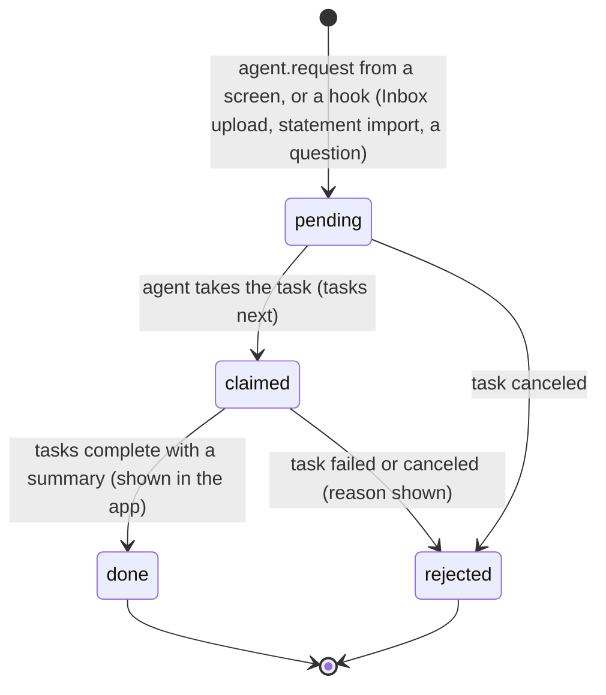
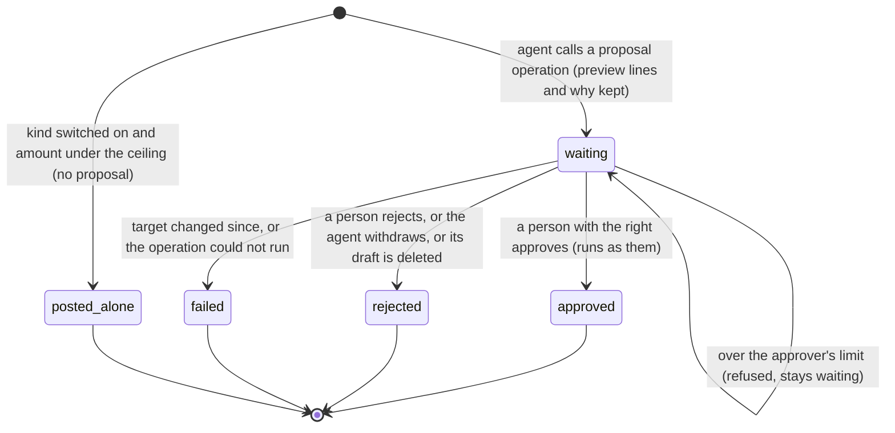
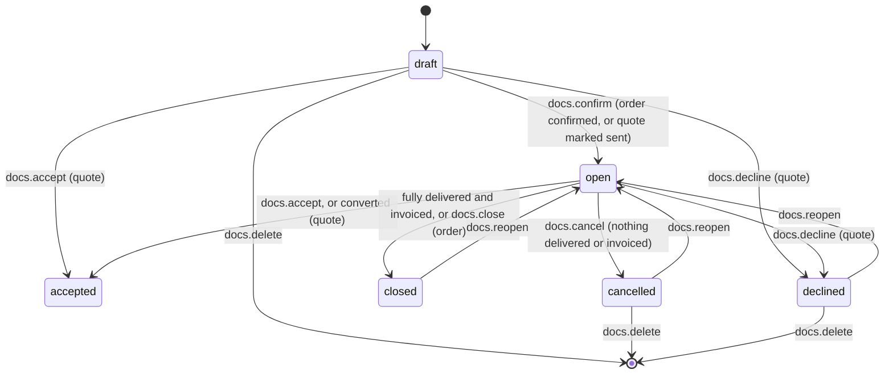
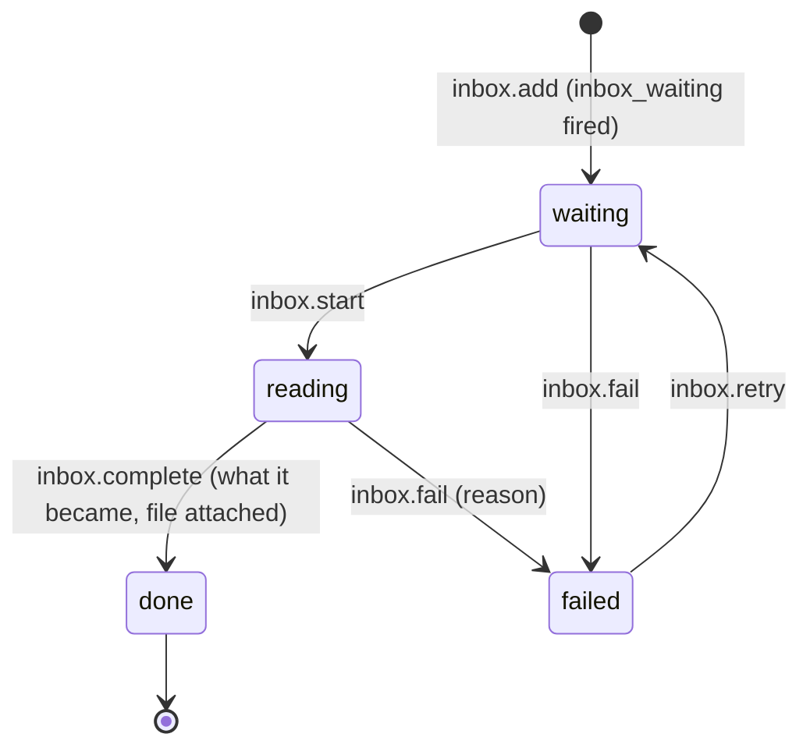
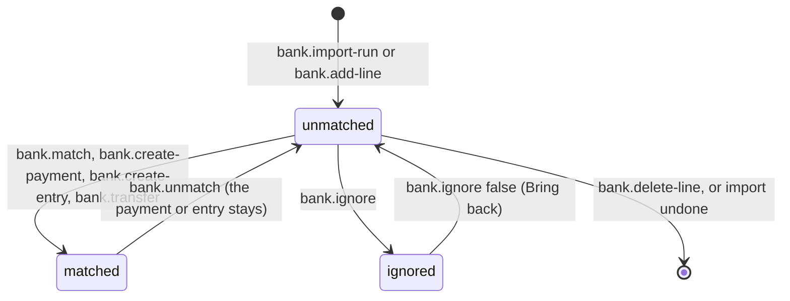
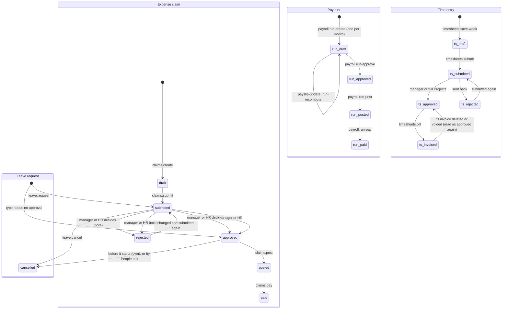

# Requirements: ERP

PART A — REQUIREMENTS (SRS). User-approved before build; frozen after; changes via ## Changes.

## Introduction

### Purpose
ERP is a general-purpose ERP for one company of 1 to 5,000 people. It holds sales, purchasing, inventory, manufacturing, accounting, banking, people, payroll and projects in one app with one database. Its one job is to run the company's operations and books in one place while staying easy on the surface. Each person signs in with their own team account and sees only what their role and the switched-on modules allow. The next step is always one obvious button, and the advanced depth sits one click away. Every posted business event writes one balanced double-entry journal entry. An AI agent works on the same data through A2App, using 256 declared operations under the same rights checks as the screens. It reads and drafts anything, but posting, voiding and moving money become proposals that a person with the right approves. The app hands work to the agent as seven kinds of task: read Inbox files, reconcile a bank account, answer a question, draft reorders, chase overdue invoices, send a document, and prepare the month-end close.

### Scope
**Goals**
1. Every posted business event writes exactly one balanced journal entry (debits equal credits in the base currency), in the same transaction as its stock moves. Events include documents, payments, stock changes, builds, claims, pay runs, depreciation, bank entries and manual entries. A posted record is never edited or deleted: it is voided or reversed.
2. The moving-average stock valuation equals the inventory account. Stock on hand compares the two and reads "Matches the books to the cent" when they agree.
3. A person reaches only the switched-on modules, at the levels their role grants. The same checks hold for every operation, whether it comes from the screens or from the agent.
4. Nothing the agent starts posts, voids or moves money until a person approves the exact journal lines shown. The one exception: kinds an administrator lets post on their own, under the amount ceiling. Money never moves on its own.
5. Every write is recorded in the append-only audit trail, with who made it: a person by name, your AI agent, or the app.

**Core functionalities:** first-run setup with country presets · team accounts, invites and per-module roles · role-shaped Home and Needs you · search palette and the New screen · one document engine for nine sales and purchasing types · customers and suppliers · items, warehouses, stock changes and reorder · bills of materials and builds · payments with allocation and credits · bank accounts with statement import and reconciliation · chart of accounts, journal entries and opening balances · taxes, payment terms and currencies with live rates · month-end close and lock dates · fixed assets and budgets · the report gallery with CSV and print · employees, departments and org chart · leave · expense claims · payroll · projects, task boards, timesheets and billing time · proposals, Inbox, questions and agent activity · CSV import and export · audit trail

### Approval
Approved by the user: 2026-11-04 — carried over from the published marketplace app `erp` 1.0.0, whose requirements were approved when it was built; this document restates them in the framework's form without changing any feature.

## Product Description

### Product Perspective
`authMode: none` at the framework level, because the app keeps its own team accounts. People sign in with email and password to the app's `members` auth collection (passwords hashed by PocketBase), and an administrator invites each one. The agent presents the app's agent token (`X-A2App-Token`). Every collection's API rules are closed, and record hooks refuse direct writes, even a superuser's. All reads and writes therefore go through `/api/ops/*`, which checks the caller's rights (AGENT_APP.md § Entities). manifest.json declares no integrations (`capabilities.integrations: []`). The backend calls two keyless exchange-rate services, and only when someone asks for today's rates: Frankfurter (`api.frankfurter.dev`), then currency-api on jsDelivr (`cdn.jsdelivr.net`). The app deliberately has no OCR, email sending, bank feed or statutory payroll of its own:
- Files dropped in the Inbox are read by the person's AI agent.
- Documents and payment reminders are emailed by the agent through the user's connected email account. A document can also be opened in the person's own mail app ("Open in email").
- Bank statements arrive as CSV files.
- Payroll is data (pay components and pay runs), with no statutory calculations built in.

The UI names no particular agent ("your AI agent").

### User Characteristics
One company of 1 to 5,000 people. Each member holds one role: a built-in role (Owner, Administrator, Accountant, Sales, Purchasing, Warehouse, HR, Manager, Employee for self-service only, Viewer) or a custom role.
- Finance, sales, purchasing and warehouse staff work in it through the day on desktops, with the labelled sidebar, often beside a host side panel.
- Managers approve their team's leave, claims and time.
- Every employee with an app account uses self-service (their own leave, expense claims, timesheets, payslips and profile), often from a phone, with the floating bottom bar and its raised "+".

Phone, tablet and desktop widths down to 320 px are in scope, with touch and pointer input.

### Constraints
- C-1: There is one company with one base currency (a three-letter ISO code), set at setup from the country preset. Documents and payments may be in other currencies, each with its own exchange rate (`fx_e8`, in units of 1/10^8). Every ledger amount is also kept in the base currency.
- C-2: Money is an integer count of the currency's minor unit. The exponent is 0 for BIF, CLP, DJF, GNF, ISK, JPY, KMF, KRW, PYG, RWF, UGX, UYI, VND, VUV, XAF, XOF, XPF; 3 for BHD, IQD, JOD, KWD, LYD, OMR, TND; 2 for every other currency. Unit prices and costs are integers of 1/10,000. Tax rates are basis points (900 is 9%). Quantities have at most 3 decimals. Money text is parsed exactly, never through floats, with never more decimals than the currency has, and a currency code written in front must match. Days are `YYYY-MM-DD` text.
- C-3: Numbers on screen always read "1,234.50": "," separates thousands and "." is the decimal point, whatever the browser language. Typed amounts follow the same rule.
- C-4: Double entry: every posted business event writes one balanced journal entry (debits equal credits in the base currency). Journal entries are append-only and never edited or deleted; a correction is a reversal entry (`reverses`/`reversed_by`). Posted documents are voided, which reverses them, and never deleted. Drafts may be deleted, and so may cancelled or declined quotes and orders.
- C-5: Lock dates:
  - The soft lock ("Closed through"): only people with full Accounting rights may post on or before it, and the agent never does.
  - The hard lock ("Locked through"): nobody posts on or before it, and only an owner moves it back.
  - Closing a month sets the soft lock, and an administrator can reopen it.
  - A document dated in a locked period is posted on the first open day, and its own date stays on the document.
- C-6: Stock is a ledger of moves. The balance per item and warehouse is written in the same transaction as each move. Valuation is moving average per item across all warehouses (`valuation` keeps the running quantity and value), so the inventory account equals the stock valuation. Stock cannot go below zero unless the company setting "Allow stock below zero" is on.
- C-7: Numbering:
  - Numbered when posted, from gapless series: invoices, credit notes, bills, supplier credits, payments and journal entries.
  - Numbered when created: quotes, sales orders, deliveries, purchase orders, goods receipts and the other series.
  - Default prefixes: QT-, SO-, DN-, INV-, CN-, PO-, GR-, BILL-, SC-, RCV- (money in), PAY- (money out), JE-, ADJ- (stock changes), MO- (builds), EXP- (claims), PR- (pay runs), FA- (assets), EMP-, P (parties), PRJ-, SKU-.
  - Prefixes and next numbers are settings.
- C-8: Every write records who did it, in an append-only audit trail with the record, a summary and the data. The actor is a person (by name), your AI agent, or the app (`system`).
- C-9: Rights:
  - A role grants a level per module (none < view < edit < full) over sales, purchasing, inventory, manufacturing, accounting, banking, people, payroll, projects and reports. It also carries an administration right and an approval limit (0 approves any amount). Full means posting, voiding, approving and money.
  - Ten roles are built in: Owner, Administrator, Accountant, Sales, Purchasing, Warehouse, HR, Manager, Employee, Viewer. Custom roles can be added.
  - The Owner role cannot be changed, and one active owner always remains. Only an owner gives someone the Owner role or changes the Administrator role.
- C-10: Accounts:
  - Passwords are 8 to 200 characters. Ten wrong passwords lock the account for 15 minutes.
  - An invite code is 10 characters without look-alike letters, written XXXXX-XXXXX. It is valid 7 days and shown once.
  - Sessions last 30 days and renew every 12 hours of use. "Sign out everywhere" rotates the member's token key.
- C-11: Your AI agent:
  - It may read everything and draft anything.
  - 19 operations become proposals when the agent calls them: docs.post, docs.void, stock.change, stock.void-change, builds.complete, builds.void, payments.post, payments.record, payments.void, bank.create-payment, bank.create-entry, bank.transfer, journals.post, journals.reverse, assets.depreciate, claims.post, claims.pay, payroll.run-post, payroll.run-pay.
  - Kinds that may post on their own when an administrator switches them on, each under the amount ceiling: invoices, credit notes, bills, supplier credits, deliveries, goods receipts, journal entries, stock changes, builds. Money never posts on its own.
  - 44 person-only operations are not offered to the agent: sign-in, members, roles, settings, lock dates, approvals and decisions, opening balances, closing and reopening a month, and the others listed in AGENT_APP.md § The person's own actions.
  - A deletion the agent runs itself needs `--confirm true`.
- C-12: Modules that can be switched on and off: Sales, Purchasing, Inventory, Manufacturing, Accounting, Banking, People, Payroll, Projects. Reports is always on. Business-type presets at setup:
  - services: everything except Inventory, Manufacturing and Payroll.
  - trading: everything except Manufacturing, Payroll and Projects.
  - manufacturing: everything except Payroll and Projects.
  - other: everything except Manufacturing and Payroll.
- C-13: Fixed vocabularies:
  - Document types: quote, sales_order, delivery, invoice, credit_note, purchase_order, goods_receipt, bill, supplier_credit. Document states: draft, open, posted, void, closed, cancelled, accepted, declined.
  - Payment methods: bank_transfer, cash, card, cheque, online, other.
  - Stock change kinds: adjust, count, transfer. Reasons: count, damage, loss, found, expiry, sample, correction, opening, other.
  - Item kinds: stock, service, non_stock. Account types: asset, liability, equity, income, expense.
  - Inbox file kinds: bill, receipt, statement, other. Inbox statuses: waiting, reading, done, failed.
  - Proposal statuses: waiting, approved, rejected, failed. Question statuses: waiting, working, answered, failed.
  - Leave requests: submitted, approved, rejected, cancelled. Expense claims: draft, submitted, approved, rejected, posted, paid. Pay runs: draft, approved, posted, paid. Time entries: draft, submitted, approved, rejected, invoiced.
  - Projects: active, on_hold, done, cancelled, billed fixed, time_materials or non_billable. Tasks: todo, doing, done.
  - Employees: active, on_leave, left; full_time, part_time, contractor, intern, temporary; paid monthly, semi_monthly, biweekly or weekly.
  - Pay components: earning, deduction, employer; fixed or percent; for all or selected people.
- C-14: Icons:
  - Item categories wear one of 50 line icons: package, box, boxes, briefcase, shirt, coffee, utensils, apple, wrench, hammer, cpu, monitor, smartphone, cable, plug, lightbulb, paintbrush, scissors, book, pencil, printer, sofa, car, truck, bike, pill, heart-pulse, flask-conical, leaf, flower, gem, watch, camera, headphones, gamepad, gift, shopping-bag, tag, tags, layers, cog, droplet, flame, snowflake, sparkles, shield, graduation-cap, music, baby, dog.
  - Leave types wear one of 10: sun, thermometer, calendar-off, baby, heart, plane, graduation-cap, briefcase, home, umbrella.
  - No emoji appears anywhere, and the app names no particular AI agent.
- C-15: File limits:
  - Item photos up to 10 MB (JPEG, PNG, WebP or GIF).
  - Employee photos and the company logo up to 5 MB.
  - Claim receipts up to 15 MB.
  - Attachments and Inbox files up to 25 MB each, as the screens say.
  - CSV import files up to 20 MB.
- C-16: The first open seeds the settings row, the ten built-in roles and six payment terms: Due on receipt, Net 7, Net 14, Net 30, Net 60, End of next month. There is no sample data. Setup then creates:
  - the chart of accounts template and the base currency;
  - the banks "Bank account" and "Cash on hand";
  - the preset's taxes;
  - "Main warehouse" (WH1);
  - the item categories General and Services;
  - the leave types Annual leave (the preset's days), Sick leave (14) and Unpaid leave;
  - the owner's account with the Owner role, and with "I work here too" their employee record.
- C-17: Country presets: Malaysia, Singapore, United Kingdom, United States, Canada, Australia, New Zealand, Japan, India, Indonesia, Thailand, Philippines, Vietnam, China, Hong Kong, United Arab Emirates, Saudi Arabia, Germany, France, Netherlands and Ireland, plus "Another country" with no taxes and no preset currency (the user chooses the base currency). Each preset carries a currency, the fiscal year's first month, the yearly days of annual leave and the starting taxes.
- C-18: Time and leave:
  - A person logs at most 24 hours a day, on active projects.
  - Leave counts the company's working days (Monday to Friday by default) minus public holidays; a half day counts 0.5.
  - There is one pay run per month.

### Assumptions
- A-1: Volume ceiling: one company of 5,000 people. A load test used 5,000 employees, 2,300 parties, 400 items, 4,000 invoices with payments and 1,000 bills. Every list and report answered in 15 to 160 ms, and Home in about 250 ms (AGENT_APP.md § Gotchas). Lists page at 50 rows by default, and a call returns at most 500.
- A-2: One PocketBase process on one SQLite file serves the company. Month totals are kept in `ledger_months`, and no separate cache server is used.
- A-3: "Today" is the server's local date. Days are plain `YYYY-MM-DD` in the local calendar.
- A-4: Exchange rates come from Frankfurter or currency-api. A currency that neither returns keeps its stored rate, which a person or the agent sets by hand.
- A-5: Work handed to the agent is done while the agent is running, and until then it waits. The screens say so.
- A-6: Tax presets are starting points to check with an accountant. They are plain records that can be changed or archived (lib_setup.js).

## Features

### Module: Sign-in and setup (setup, auth)
- F-ACC-1: WHEN the app has no members THE SYSTEM SHALL show the first-run setup in three numbered steps: Company, You, Ready.
- F-ACC-2: In the Company step, the user enters the company name and chooses a country from the presets ("<name> (<currency>)"). With "Another country" they also choose the base currency (USD to start), which the company keeps.
- F-ACC-3: The user picks what the business does, which sets the modules that start switched on:
  - Services ("Projects, time and invoices")
  - Trading ("Buy, stock and sell goods")
  - Manufacturing ("Make goods from parts")
  - Something else ("Sales, stock and projects")
- F-ACC-4: In the You step, the user creates the owner's account (name, email, a password of at least 8 characters). With "I work here too" (on by default), they are also added to the team directory.
- F-ACC-5: The Ready step shows the currency, the month the financial year starts, the taxes and the modules switched on. "Set up the company" creates the company's starting records (C-16) and signs the owner in.
- F-ACC-6: The user can sign in with email and password on the "Welcome back" screen ("Sign in to <company>.").
- F-ACC-7: WHEN the email is unknown, the invite is not used yet or the password is wrong THE SYSTEM SHALL give the same answer: "That email and password do not match. New to the team? Use "I have an invite code"." A disabled account is named only after the right password.
- F-ACC-8: WHEN a member enters a wrong password ten times THE SYSTEM SHALL lock the account for 15 minutes ("Too many wrong passwords. Try again in <n> minutes.").
- F-ACC-9: The user can join with "I have an invite code" ("Join the team"). They enter their email, the code (XXXXX-XXXXX), an optional name and a new password of at least 8 characters.
- F-ACC-10: The sign-in screen says "Forgot your password? An administrator can send you a new code from Settings, Team."
- F-ACC-11: WHEN a session expires, or is signed out elsewhere THE SYSTEM SHALL return the page to the sign-in screen.

### Module: Frame (app, search)
- F-FRM-1: On wide screens the user can navigate from a labelled sidebar. From the top: the app mark with the company name, a Search box ("Ctrl K"), Home, and "Needs you" with a count. Then come the switched-on modules as groups that expand like a tree to their pages, and at the bottom Settings and the user's profile button.
- F-FRM-2: The user sees these groups, each showing only the pages the role may open:
  - Sales: Customers, Quotes, Sales orders, Deliveries, Invoices, Credit notes
  - Purchasing: Suppliers, Purchase orders, Goods receipts, Bills, Supplier credits
  - Inventory: Items, Stock on hand, Stock changes, Reorder, Warehouses
  - Manufacturing: Builds, Bills of materials
  - Banking: Payments, one entry per bank account by name, All accounts
  - Accounting: Chart of accounts, Journal entries, Month-end close, Fixed assets, Budgets
  - Reports: Profit and loss, Balance sheet, Cash flow, Who owes what, All reports
  - People: Directory, Org chart, Leave, Expense claims, and Payroll (Payslips for people without Payroll rights)
  - Projects: Projects, Timesheets
  - Your AI agent: Proposals, Inbox, Questions, What it did
  - Deliveries and Goods receipts appear only while Inventory is on.
- F-FRM-3: The user can press a group's inline "+" to start its main record: New invoice, New bill, New item, New build, Record a payment, New journal entry, Request leave or New project. A group the role cannot create in has no "+".
- F-FRM-4: The user sees counts on entries with work waiting and the current page marked. Counts cover overdue invoices, bills due, unmatched lines per bank account, leave, claims, timesheets, proposals, and Inbox files that could not be read.
- F-FRM-5: The user can fold the sidebar into an icon rail, where each group opens a flyout of its pages and its "+". The folded state and the open groups are remembered in this browser.
- F-FRM-6: On phones the user can navigate with a floating bottom bar: Home, Needs you (with its count), a raised "+", Search and Menu. Menu opens the whole tree as a sheet.
- F-FRM-7: The user can open the search palette with Ctrl K, with "/" outside a text field, or from the Search box. It finds pages and the records the user may see:
  - documents by number, customer or reference
  - customers and suppliers
  - items by name, SKU or barcode
  - people, projects, accounts, journal entries and payments
  - Arrow keys move through the results and Enter opens one.
- F-FRM-8: WHEN the user presses "+" or "New" THE SYSTEM SHALL open the full-screen "New" sheet with a circular reveal from the button. Its tiles are grouped as Sell, Buy, Money, Stock, People and projects, and Your AI agent, and it shows only what the role may create.
- F-FRM-9: WHEN an administrator switches a module off THE SYSTEM SHALL remove it from the frame, Home and the palette for everyone. Its records stay, and they come back when the module is switched on again.
- F-FRM-10: WHEN a member opens a list page their sidebar does not offer (an old or shared link) THE SYSTEM SHALL show "This page is not part of your role" with "Go to Home" instead of loading the page.
- F-FRM-11: WHEN the host switches the theme pack, light or dark mode, or custom colors THE SYSTEM SHALL recolor the app from the host's theme tokens, with nothing light on light or dark on dark. Only the state colors stay fixed (green good, amber attention, red bad), and each always comes with a label.
- F-FRM-12: The user sees every number written "1,234.50", line icons only (never an emoji), and the agent always called "your AI agent".
- F-FRM-13: WHEN a teammate, your AI agent or a background job changes data THE SYSTEM SHALL update every open screen that shows it without a refresh. A draft with unsaved edits is not reloaded under the person.
- F-FRM-14: WHEN a newer build has been deployed THE SYSTEM SHALL reload an open page onto it, after the server comes back or when the tab is shown again. It waits while a dialog or a full screen is open.

### Module: Home (home)
- F-HOME-1: The user sees a greeting for the time of day with their first name, the date and "Here is <company>.", a "Search anything" box and a "New" pill.
- F-HOME-2: The user sees the "Needs you" strip with "See all": tiles with counts for proposals from your AI agent, overdue invoices, bills due this week, bank lines to match, leave requests, expense claims, timesheets, drafts by your AI agent, and Inbox files to check. When nothing waits it reads "Nothing needs you right now".
- F-HOME-3: WHEN the company is not fully set up THE SYSTEM SHALL show administrators the "Set up your company" checklist with a progress ring. The steps are company details, bank accounts, customers and suppliers, items, opening balances, and members, and each links to its page.
- F-HOME-4: The user sees only the cards their rights cover.
- F-HOME-5: With Banking rights, the user sees the dark "Cash" card: the total in bank and cash accounts, the change over 30 days, a 30-day balance line, up to four accounts with their lines to match, and "<n> lines to match".
- F-HOME-6: With Sales or Purchasing rights, the user sees "Owed to you" or "You owe" as an aging ring (Not due, 1 to 30 days, 31 to 60 days, Over 60 days) with the count of open invoices or bills. When nothing is open the card reads "All settled".
- F-HOME-7: With Sales rights, the user sees "Sales this month" (invoiced, before tax): the total so far against "Last month by today", up or down in percent, with daily bars. They also see "Best customers" over the last 3 months.
- F-HOME-8: With Accounting or Reports rights, the user sees "Profit": this month so far and last month, with income against expenses by month.
- F-HOME-9: The user sees "Overdue invoices", with days late and "Ask your AI agent to chase" for Sales editors, and "Bills due this week".
- F-HOME-10: The user sees "In the pipeline": open quotes, orders to deliver, orders to receive, and builds planned.
- F-HOME-11: With Inventory rights, the user sees "Stock": the value at average cost and the items to reorder, with "Reorder" and the "Draft orders" request to your AI agent. With Projects rights, they see "Projects": active projects and hours this month.
- F-HOME-12: A person with an employee record sees the "You" card:
  - leave rings per type ("<x> of <y> days left")
  - hours this week and open claims
  - their latest pay, or the next holiday, or their team
  - upcoming leave marked Approved or Waiting
  - "Request leave"
- F-HOME-13: The user sees "Your AI agent": what it did today, the proposals waiting, the files in the Inbox, and its three latest actions. The "Ask about the business" box sends a question ("Asked. The answer comes back under Questions.").
- F-HOME-14: WHEN the role sees no business card and the person has no employee record THE SYSTEM SHALL show "Welcome" ("Your role shows what is shared with you here.").

### Module: Needs you (home)
- F-NEED-1: The user sees everything waiting on them on one page, with the chips Everything, Decisions, Money and Your AI agent. It covers:
  - Decisions: proposals from your AI agent, leave requests, expense claims to approve, timesheets to approve
  - Money: overdue invoices, bills due this week, bank lines to match, expense claims to post and pay
  - Your AI agent: drafts it prepared, Inbox files it could not read
- F-NEED-2: The user can decide in place: approve or reject proposals, leave requests and expense claims. Rejecting asks "Why not (they see this)".
- F-NEED-3: From Needs you, the user can ask your AI agent to chase overdue invoices or to reconcile a bank account.
- F-NEED-4: WHEN nothing waits THE SYSTEM SHALL show "Nothing needs you" with the subtitle "All caught up".

### Module: Sales and purchasing documents (docs)
- F-DOC-1: The user can work with nine document types from one engine:
  - Sales: quotes, sales orders, deliveries, invoices, credit notes
  - Purchasing: purchase orders, goods receipts, bills, supplier credits
  - Each has a party, dates, currency and rate, and prices with or without tax.
  - Each has lines (an item or free text, quantity, unit price, discount %, tax, account), totals, notes, attachments and activity.
- F-DOC-2: The user can list each type, filtered and sorted, 50 to a page:
  - the plural title, with the count and the total
  - chips per status with counts
  - a search ("Number, reference or customer" or "… supplier")
  - a party filter and a date range: Any date, This month, Last month, This quarter, Last 90 days, This year, or custom From and To
- F-DOC-3: The user sees a summary strip on lists that have one:
  - Invoices and bills: what is owed with an aging bar, what is overdue, and what was paid this month.
  - Orders: "To deliver" or "To receive", and "To invoice" or "To bill".
  - Quotes: "Waiting on customers", "Expired" and "Win rate".
- F-DOC-4: The user can select invoices to "Ask your AI agent to send reminders" (when any selected one is overdue; the reminders cover exactly the selected invoices that still have something to pay) or to "Record payment" (when they share one party). Bills offer "Record payment". When invoices are overdue, the list header also offers "Chase them".
- F-DOC-5: The user can create a document on a full screen of three numbered steps. Each step unlocks once the one before it is filled.
  1. "Who is it for" / "Who is it from": a party search, six recent tiles, and quick create ('New customer "<name>"').
  2. "What": the line editor.
  3. "When and save": the date, due date or validity, payment terms, reference, notes for the party and an internal note.
  - The totals card holds "Save draft" and the main action: "Post <type>", "Save as sent" for quotes, or "Confirm order" for orders.
- F-DOC-6: The user can fill lines quickly:
  - Search an item by SKU, barcode or name, or type a description.
  - Live totals update as lines change.
  - Enter in the last line adds a line and opens its item search.
  - "More options" holds the currency and rate, "Prices include tax", whether stock moves, the warehouse, project, department, and each line's description and account.
- F-DOC-7: WHEN posting a document would take a customer over their credit limit THE SYSTEM SHALL warn and keep Post disabled until "Post over the credit limit" is switched on.
- F-DOC-8: The user can open a document as its paper (Preview), or edit a draft in place (Edit).
- F-DOC-9: The document page shows the next step as its one primary button: Post, Mark as sent, Confirm order, the next conversion, Record payment, or Apply to invoices or bills. Everything else is in its menu: accept, decline, edit, mark as sent, send by your AI agent, document as text, print, duplicate, close, reopen, cancel, void, and delete the draft.
- F-DOC-10: The user can turn a document into the next one as a draft:
  - quote to sales order or invoice
  - sales order to delivery or invoice; delivery to invoice
  - purchase order to goods receipt or bill; goods receipt to bill
  - invoice to credit note; bill to supplier credit
  - Every converted document links to where it came from, and the Flow card shows the chain.
- F-DOC-11: The user sees statuses that follow from the data:
  - Orders: from what was delivered and invoiced (or received and billed). An order that is fully done closes itself.
  - Invoices and bills: from payments and the due date (Draft, Unpaid, Partly paid, Paid, Overdue, Void).
  - Quotes: Draft, Sent, Accepted, Declined, Expired.
  - Credits: Open, Partly used, Used.
- F-DOC-12: WHEN the user posts a document THE SYSTEM SHALL first show the exact journal lines, with "Date in the books". It then writes the journal entry and the stock moves in one transaction:
  - Invoices: receivable, income per line, tax payable, and cost of goods when the invoice delivers.
  - Credit notes: the reverse of an invoice.
  - Deliveries: cost of goods against inventory, at average cost.
  - Goods receipts: inventory against goods received not invoiced, at the order price.
  - Bills: payable, tax receivable, and expense or inventory per line. Against goods receipts, a bill clears goods received not invoiced and puts any price difference to purchase price variance.
  - Supplier credits: the reverse of a bill.
- F-DOC-13: The user can void a posted document after previewing the reversing lines, with an optional reason. Its journal entry and stock moves are reversed and it stays, marked void. Payments must be taken off it first.
- F-DOC-14: The user can delete a draft ("Delete this <type>?"), or a cancelled or declined quote or order.
- F-DOC-15: The user can cancel a quote or order with nothing delivered or invoiced, close an order ("Close: the rest is not expected"), and reopen one.
- F-DOC-16: The user can record a payment from an invoice or bill. The amount is prefilled with the balance; they add the account, date, method and reference and see the journal preview. A credit note or supplier credit applies to the oldest open invoices or bills of its party.
- F-DOC-17: The user can show the document as text (recipient, subject, body), with "Open in email" and "Copy". "Print" prints only the paper.
- F-DOC-18: The user can choose "Send by your AI agent" for a confirmed or posted document. The request then shows "Sent to your AI agent", "Your AI agent is sending it", "Your AI agent sent it", or why it could not.
- F-DOC-19: The user can tell what the agent prepared:
  - the "Your AI agent" pill and "Why your AI agent made it" with its note
  - "Your AI agent filled <fields>. Check them before you post."
  - its waiting proposals, with Approve and Reject
- F-DOC-20: WHEN a document the user is editing changes elsewhere THE SYSTEM SHALL say so and offer "Load the new version". Saving keeps the person's version.
- F-DOC-21: WHEN the user lacks full rights for a type THE SYSTEM SHALL let them save drafts and show "Someone with full Sales|Purchasing rights posts this <type>."

### Module: Customers and suppliers (parties, contacts)
- F-PTY-1: The user can keep customers and suppliers in one directory, where a party can be both. Each list has a summary of what is owed and overdue, the chips All, Owing (or To pay), Overdue and Archived, and a search by name, code, email, contact or phone.
- F-PTY-2: The user can add or change a party:
  - name, email, phone, contact person, payment terms
  - whether it is a customer, a supplier or both
  - billing and shipping addresses, their tax number, website, currency
  - credit limit, default sales and purchase taxes
  - code (automatic when empty), notes, and Archived
- F-PTY-3: The party page shows:
  - what is owed both ways, with an aging donut, the credit limit used, and payments not yet applied
  - sales or purchases by month
  - open documents, recent documents, payments and credits, and activity
- F-PTY-4: The user can produce a statement of account for a date range: the opening balance, every entry and the closing balance, receivable or payable. It can be printed or saved as CSV.
- F-PTY-5: The user can add, change and remove a party's contacts, and mark the main contact.
- F-PTY-6: The user can delete a party with no history. Any other party is archived instead.

### Module: Inventory (items, categories, warehouses, stock, reorder)
- F-INV-1: The user can keep items of three kinds: stock items, services and non-stock goods. Each item has:
  - an automatic SKU, a barcode, and a category with a line icon
  - a unit, optionally counted in part units
  - sale and purchase prices and taxes, and income and expense accounts
  - a reorder point and a target level, a usual supplier and a lead time
  - a photo and a description
  - A new stock item can be added with its opening stock.
- F-INV-2: The user can browse items as cards or a list:
  - figures for stock items, stock value, low and out of stock
  - search by name, SKU or barcode; Enter on a single match opens it
  - filters by category and kind, and the chips All, Low, Out, To reorder, Services, Archived
  - sorting by name, on hand, value, price or SKU
- F-INV-3: The user sees each item's status: In stock, Low, Out of stock, Overstocked or Not counted. They can archive or restore items in bulk, and ask your AI agent to "Draft reorders".
- F-INV-4: The item page shows:
  - on hand per warehouse, the value and the average cost
  - available, incoming, committed, and how long the stock lasts
  - the stock level over 90 days and the open orders
  - movements, prices and activity
  - In, Out, Count and Transfer buttons
- F-INV-5: The user can record a stock change on a full screen: Stock in, Stock out, Count or Transfer.
  - Each change has a reason and lines found by name, SKU or barcode (Enter takes the first match, so a scanner works).
  - The screen shows the value change and previews the journal lines.
  - The change gets one number and its own journal entry.
- F-INV-6: WHEN a stock change or a posting would take an item's stock below zero THE SYSTEM SHALL refuse it, unless "Allow stock below zero" is on in the company settings.
- F-INV-7: The user can list stock changes by kind (Adjustments, Counts, Transfers) and void one after a preview. Its moves and entry are reversed.
- F-INV-8: The user can view stock on hand per warehouse:
  - the value, and side-by-side columns when there are two to four warehouses
  - a books check against the inventory account
  - "Count stock" and "Export CSV"
- F-INV-9: The user can review reorder suggestions grouped by supplier. Each line shows on hand, coming, promised, the reorder point, the suggested quantity and why.
  - Quantities can be changed before ordering.
  - "Create purchase orders" drafts one order per supplier and never sends it.
  - "Ask your AI agent" hands the review to the agent.
  - Items without a supplier are listed apart.
- F-INV-10: The user can add, change, archive and delete warehouses. A warehouse can be deleted only when it is empty and has no history. Each warehouse shows its items, units, value and value by category.
- F-INV-11: The user can add an item category with a name and a line icon from the item editor. Deleting a category leaves its items without one.
- F-INV-12: The user can delete an item that has no history. Any other item is archived instead ("Archived. It no longer shows in lists or reorders.").

### Module: Manufacturing (boms, builds)
- F-MFG-1: The user can keep bills of materials. Each has a finished stock item, what one batch makes, components with their quantity per batch, labor and overhead per unit, and notes.
  - The list and the page show the component costs and the unit cost.
  - "In use" decides whether new builds may use it, and "Can build now" shows what each warehouse can make.
  - A bill of materials can be deleted only if no build used it.
- F-MFG-2: The user can plan a build:
  - what to make, and how many in multiples of the batch
  - where, defaulting to the warehouse that can build the most
  - when, and a note
  - It shows the components needed against what is there, any shortfall, and the estimated cost.
- F-MFG-3: WHEN the user completes a build after its preview THE SYSTEM SHALL take the components out at average cost and add the finished item at their cost plus labor and overhead.
- F-MFG-4: The user can void a completed build, which reverses its moves and entry at the values they moved with. They can delete a planned build.

### Module: Payments (payments)
- F-PAY-1: The user can list money in and money out:
  - this month's net, received and paid out
  - payments not applied yet, with "Chase what is owed"
  - the chips All, Not applied, Drafts and Void, and a search by number, reference or name
- F-PAY-2: The user can record a payment on the full-screen "Record a payment" in three steps, then confirm with "Record and post" after the journal preview.
  1. Who paid, or who was paid.
  2. What it settles: the party's open invoices or bills, oldest first, with amounts that can be edited.
  3. The money: amount, date, account, method, reference, and an exchange rate and memo under More options.
- F-PAY-3: WHEN a payment is more than what it settles THE SYSTEM SHALL keep the rest as credit on the party. The credit can be applied later, and an allocation can be taken back ("Take back").
- F-PAY-4: WHEN a payment settles a document at a different exchange rate THE SYSTEM SHALL post the difference to the exchange gain or loss account on allocation.
- F-PAY-5: The user can post a draft payment, delete a draft, or void a posted payment. Voiding opens again what the payment settled and reverses its entry.
- F-PAY-6: The payment page shows what it settles, whether it is matched to a statement line, and its entry in the books.

### Module: Banking (banks, bank)
- F-BNK-1: The user can keep bank, cash and card accounts, each with its own account in the books. Accounts can be added, changed and archived.
  - The overview shows what the books say is in each account, the last statement balance, and the lines left to reconcile.
  - Each account shows its 90-day balance.
- F-BNK-2: The user can import a bank statement CSV on a full screen in three steps, then import it. A past import can be undone, which removes the unmatched lines it added.
  1. The file.
  2. How to read it: the detected date, amount, debit and credit, description and reference columns, the date layout, the number format, the sign and the header. Each can be changed.
  3. A check before importing: new lines, lines already here (skipped), and lines that cannot be read.
- F-BNK-3: The user can reconcile each statement line, helped by suggestions: payments and entries of the same amount near its date, open invoices or bills of that amount, and exact references. A line can be:
  - matched to a payment or entry
  - recorded as a payment from a customer or to a supplier
  - booked as income or as an expense, or recorded as a transfer
  - ignored and brought back, or unmatched
  - deleted while unmatched
  - Lines can also be added by hand.
- F-BNK-4: The user can move money between two of their accounts. When the currencies differ, they give the amount sent and the amount that arrived.
- F-BNK-5: The user can "Ask your AI agent to reconcile". WHEN a statement import adds lines THE SYSTEM SHALL ask your AI agent to reconcile that account. The agent's proposals show on their lines, with Approve and "Not this".

### Module: Accounting (accounts, journals, close, assets, budgets, taxes, terms, currencies)
- F-ACT-1: The user can keep the chart of accounts that setup created from its template. It has the types asset, liability, equity, income and expense, with subtypes, grouped with their totals and balances on a chosen date.
  - Accounts can be added and changed.
  - An account with a zero balance can be archived, and an unused one deleted.
  - Control accounts (receivable, payable, inventory, goods received not invoiced, taxes) take postings only from their documents.
- F-ACT-2: The account page shows the balance, 12 months of movement, and the ledger for a period with a running balance that drills to the source. It exports to CSV.
- F-ACT-3: The user can list journal entries by kind, search, date and "By your AI agent". They can post a balanced manual entry, with an optional party, department and project on each line ("Put the difference here", "Review and post"). They can reverse a manual entry, bank entry or transfer.
- F-ACT-4: The user can enter opening balances as at a cut-over date, against opening balance equity: account balances, open invoices and bills, and stock.
- F-ACT-5: The user can keep taxes as data: name, code, rate, charged on sales, purchases or both, claimed back, and accounts. Taxes and payment terms can be added, changed and archived.
- F-ACT-6: The user can keep currencies with their rates, and "Get today's rates" for every currency in use.
- F-ACT-7: The user can close a month from a checklist computed from the data. Nothing is ticked by hand.
  - The checks: drafts posted or deleted, bank statements reconciled, goods received billed, approved expense claims posted, payroll posted, depreciation posted, the books balance, and your AI agent's proposals decided.
  - Closing sets the soft lock, and an administrator can reopen the month.
  - "Ask your AI agent to review" hands the checklist to the agent.
- F-ACT-8: The user can register fixed assets with straight-line depreciation. Depreciation posts for every active asset through a month, once per month and never twice. Finished months also post on their own early in the next month (the hourly job, as "The app").
  - An asset can be disposed of, with a gain or loss.
  - An asset with no depreciation posted can be deleted.
- F-ACT-9: The user can set budgets per income and expense account and month for a fiscal year, or spread one yearly amount evenly over 12 months. They see spending and income against the plan.
- F-ACT-10: The user can set the lock dates in Settings (C-5).

### Module: Reports (reports, export)
- F-RPT-1: The user can open the report gallery:
  - Profit and loss, Cash flow, Budget against actual
  - Balance sheet, Trial balance, General ledger
  - Who owes you (receivables aging), What you owe (payables aging)
  - Sales, Purchases, Stock value, Tax summary
  - Payroll summary, Project profitability
  - Each report shows only to roles with the rights for it.
- F-RPT-2: Each report has period presets (This month, Last month, This quarter, This year, Last year, Custom) and a comparison where the report offers one. It has a chart, drill-down to accounts, parties, documents, items, journal entries, projects and pay runs, "Export CSV" and "Print".
- F-RPT-3: The user sees the balance sheet with current-year earnings computed and no closing entry, the trial balance's "Do the books balance?" check, and aging in the buckets current, 1 to 30, 31 to 60, 61 to 90 and over 90 days.
- F-RPT-4: The user can group sales by customer, item, category or month, and purchases by supplier, item or month.

### Module: People (employees, departments)
- F-PPL-1: The user can browse the directory: cards with photos or initials, a search by name, job, email or number, a status filter, and department chips.
- F-PPL-2: The user can add and edit people: job, department, manager, contract type, start and end dates, contact and personal details, and notes. Pay fields (basic pay, frequency, cost per hour, salary account, national id, tax number) show only with Payroll or full People rights. The employee number is automatic.
- F-PPL-3: The employee page has the tabs Overview, Leave, Claims, Pay, Time and Activity. Each person sees the parts their rights allow, and everyone sees names, titles, departments, managers, photos and contacts.
- F-PPL-4: The user can manage departments: name, code, parent and head. A department with nobody in it can be deleted, and its sub-departments move up a level.
- F-PPL-5: The user can view the org chart as a tree under each manager. It can be searched, folded and shown in full.
- F-PPL-6: An administrator can invite an employee to the app from their page. The code is shown once and works for 7 days.
- F-PPL-7: The user can delete an employee with no leave, claims, time, payslips or entries, and that person's reports move to their manager. Anyone else is marked as left.

### Module: Leave (leave)
- F-LV-1: The user can keep leave types: days a year (0 means no limit), paid or unpaid, whether it needs approval, carry over at most, and an icon. A type can be archived.
- F-LV-2: The user can keep public holidays per year. Holidays are not counted as leave days.
- F-LV-3: The user can request leave:
  - type tiles with the days left
  - first and last day, and a half day for single days
  - a count of working days without holidays, and the days left after
  - A type that needs no approval is recorded at once.
- F-LV-4: The user sees their balances per type for a year: entitled, carried, taken, pending and remaining.
- F-LV-5: A manager (for everyone below them) or someone with full People rights can approve or reject a request, with a note. Nobody decides their own request.
- F-LV-6: The user can cancel their own waiting request, or their approved leave before it starts. Someone with edit access to People can cancel anyone's.
- F-LV-7: The user can see a month's leave calendar with holidays.
- F-LV-8: Someone with full People rights can adjust a person's balance for a year.

### Module: Expense claims (claims)
- F-CLM-1: The user can file an expense claim on a full screen: a title, a date, an optional project, and expenses. Each expense has a receipt photo or PDF, an amount with tax included, a kind of expense, what it was, and an optional date, tax and project.
- F-CLM-2: The user can save a claim as a draft or submit it. A rejected claim can be changed and submitted again.
- F-CLM-3: The employee's manager, or someone with full People rights, approves or rejects a submitted claim. Nobody decides their own.
- F-CLM-4: Someone with full Accounting or People rights posts an approved claim to the books: expenses and recoverable tax against what is owed to the employee.
- F-CLM-5: Someone with full Banking rights pays back posted claims from a bank account, one person or many in one entry.
- F-CLM-6: The user sees claims as "My claims", the team's claims to approve, "To post and pay", and "All claims" (People or Accounting view).

### Module: Payroll (payroll)
- F-PRL-1: The user can keep pay components as data: earnings, deductions and employer contributions. Each is fixed or a percent of basic pay, for everyone or only the people given it, with the account it posts to (and what it is owed to, for employer components). A component can be switched off.
- F-PRL-2: The user can give an employee a component, optionally with their own amount or percent.
- F-PRL-3: The user can draft a month's pay run: a payslip per employee from their basic pay and components (by default everyone with pay), and only one run per month.
- F-PRL-4: The user can adjust a draft run's payslips with one-off lines, or recompute the run from current pay, which drops hand adjustments. The run is then approved, posted as one entry on its pay date, and paid from a bank account.
- F-PRL-5: Each person sees their own payslips once a run is posted, and can print one.
- F-PRL-6: No statutory calculation is built in.

### Module: Projects (projects, todos, timesheets)
- F-PRJ-1: The user can keep projects: customer (or internal), manager, status, start and end, budget, billing ("By the hour", "Fixed price", "Internal") with a rate per hour, description and color.
- F-PRJ-2: The projects list shows cards with budget used, hours, margin and task progress. It has a search, status chips and "Mine", and figures for active projects, this month's hours, time waiting for approval, time ready to bill, and projects over budget.
- F-PRJ-3: The user can run a task board per project with the columns To do, Doing and Done. Cards drag between and within columns. Each task has an assignee, a due date, an estimate and notes.
- F-PRJ-4: The project page shows time by person and by week, money (revenue, costs in the books, time cost, books margin and margin after time, month by month), and the budget used.
- F-PRJ-5: The user can bill a time-and-materials project's approved billable time up to a date. This makes ONE draft invoice for its customer, with a line per person (hours times the project rate), and marks the time invoiced. Deleting or voiding that invoice frees the time again.
- F-PRJ-6: The user can delete a project with no time, documents, journal lines or expense claims. Any other project is set to done or cancelled.
- F-TS-1: The user can log a week of time as a grid of project and task rows by day, with daily and row totals. On phones it shows one day at a time. "Same rows as last week" copies the rows.
- F-TS-2: The user can save the week as drafts and "Submit week" for approval. Time sent back can be changed and submitted again.
- F-TS-3: The employee's manager, or someone with full Projects rights, approves submitted time or sends it back with a note. Nobody decides their own time. Past weeks show for six months.

### Module: Your AI agent (proposals, inbox, asks, agent, marks)
- F-AIS-1: The user can review proposals from your AI agent:
  - what each would post (the exact journal lines), why, and the record it touches
  - the operation it runs, with every parameter in plain words
  - its decision history
  - Waiting proposals are approved or rejected in place, and approving runs the operation as that person, exactly as shown.
- F-AIS-2: WHEN the record a proposal acts on was changed or deleted after it was proposed THE SYSTEM SHALL post nothing and mark the proposal failed ("Nothing was posted. Your AI agent can propose it again."). WHEN the amount is over the approver's limit THE SYSTEM SHALL refuse the approval and leave the proposal waiting. The limit is checked against the larger of the proposed and the current amount.
- F-AIS-3: The user can drop files in the Inbox for your AI agent to read: bills, receipts, statements or other files, with a note. Each file shows Waiting, Reading, Done (with what it became) or "Could not read" (with why). A file can be retried or removed.
- F-AIS-4: The user can ask your AI agent a question about the business and read the answer when it comes back under Questions. Questions show "Waiting for your AI agent", "Working on it", the answer, or "Could not answer", and a question can be deleted.
- F-AIS-5: The user can see what your AI agent did: a timeline by day of everything it created, proposed, posted, matched and read, each linked to its record. It shows actions per day and what waits on people now.
- F-AIS-6: The user sees the fields your AI agent filled marked on the record ("Read by your AI agent", with "please check" when it was unsure).
- F-AIS-7: WHEN a person asks your AI agent for work from a screen THE SYSTEM SHALL show the request honestly: "Sent to your AI agent", then "Your AI agent is on it", then the result, or why it could not. WHEN a request is still not picked up after 20 s THE SYSTEM SHALL add "It picks this up while your AI agent is running."

### Module: Settings and data (settings, members, roles, import, export, audit, activity, notes, attachments)
- F-SET-1: Settings has these sections, each shown to the roles it is for:
  - Company: Company, Modules, Your AI agent
  - People and access: Team, Roles
  - Books: Numbering, Taxes, Payment terms, Currencies, Default accounts, Lock dates, Opening balances
  - Data: Import and export, Audit trail
- F-SET-2: An administrator can change the company details: name, logo, address, fiscal year, working days, "Prices include tax", "Allow stock below zero", and the words printed on documents.
- F-SET-3: An administrator can switch modules on and off.
- F-SET-4: An administrator can invite members (name, email, role, job title, employee record) and manage them:
  - The code is shown once with "Copy code", valid for 7 days.
  - Members can be edited, given a new sign-in code, signed out everywhere, disabled and enabled again.
  - An unused invite can be removed.
- F-SET-5: An administrator can add and change roles, setting a level per module, the administration right and "Approves up to". Roles are compared in "All roles side by side". A role nobody has can be deleted.
- F-SET-6: An administrator can set each series' prefix and next number. They also set the default accounts, and what new documents start with: the warehouse, bank account, sales tax, purchase tax and payment terms.
- F-SET-7: An administrator can set your AI agent's autonomy:
  - "May post on its own": the kinds in C-11, with "Only up to this amount each".
  - "Routine work it may start": "Chase overdue invoices" and "Reorder low stock". When on, the hourly job asks your AI agent to draft reminders (sending nothing) for invoices that fell overdue since its last ask, and to draft purchase orders when items run low that no draft order holds yet.
- F-SET-8: The user can import CSV data with every row previewed before anything is written. Kinds: customers and suppliers, items, chart of accounts, employees, opening account balances, open invoices and bills, and opening stock. An import of customers, suppliers, items, accounts or employees can be undone while nothing uses its records.
- F-SET-9: The user can export CSV of what their role may see: customers and suppliers, items, stock on hand and value, documents, document lines, payments, chart of accounts, journal lines, and the trial balance. Timesheets and employees export through the operation.
- F-SET-10: Administrators and accountants can read the audit trail: who did what and when, filtered by kind of record, actor (people, your AI agent, the app), person, dates and search.
- F-SET-11: The user can keep their own profile: name and title, a password change (which signs out other devices), "Sign out everywhere else", what their role lets them do per module, and their employee record.
- F-SET-12: Every record page has Activity: the history, notes for the team (Ctrl/⌘+Enter adds one), and attached files.

### Agent (via A2App)
- F-AGT-1: The agent can perform every screen action offered to agents as one of the 256 operations in ## Operations Design, across the 49 manifest modules that declare operations. The `records` module holds collections only. They run under the same rights checks, posting rules and lock dates as the screens.
- F-AGT-2: The agent can read, from `app.guide`, the conventions (names, money, dates, statuses), today's date, the base currency, banks, taxes, modules, and ready-to-run recipes.
- F-AGT-3: WHEN the agent calls one of the 19 proposal operations (C-11) THE SYSTEM SHALL store a proposal and post nothing. The proposal keeps the exact preview journal lines, the agent's `why`, and the target's version. The exception is a kind an administrator lets post on its own, under the ceiling.
- F-AGT-4: WHEN the agent repeats a proposal that is still waiting THE SYSTEM SHALL return the waiting one (`already_waiting`). The agent can take a waiting proposal back with `proposals.withdraw`.
- F-AGT-5: WHEN the agent calls a destructive operation without `--confirm true` THE SYSTEM SHALL delete nothing and say what would go. The adapter also asks for the person's approval of every destructive call.
- F-AGT-6: The agent can take an `inbox_waiting` task and read each waiting Inbox file into drafts and proposals:
  - `inbox.start`, then a bill (`docs.convert` from a matching purchase order, or `docs.create`), a statement import, or added statement lines
  - `marks.set` on what it read, and `docs.post` with a `why`
  - `inbox.complete`, or `inbox.fail` with a reason
- F-AGT-7: The agent can take a `bank_lines_waiting` task and reconcile one account's unmatched lines. It matches certain lines with `bank.match` and proposes the rest (`bank.create-payment`, `bank.create-entry`, `bank.transfer`).
- F-AGT-8: The agent can take a `question_asked` task and answer one question with read operations only, within the asker's rights (`asks.working`, `asks.answer` or `asks.fail`).
- F-AGT-9: The agent can take a `reorder_review` task and draft purchase orders with `reorder.create-orders`: one draft per supplier, safe to repeat, never confirmed or sent.
- F-AGT-10: The agent can take a `collections_requested` task and send each customer with overdue invoices one polite reminder through the user's connected email account, noting it on each invoice. With no email account connected, it writes the reminders as notes instead. The task's `invoices` limits it to those invoices, and `drafts_only` (the hourly routine asked) means notes only, nothing sent.
- F-AGT-11: The agent can take a `doc_send_requested` task and email one document's text (`docs.text`) to the party. It then calls `docs.mark-sent` and adds a note, and it never guesses an address.
- F-AGT-12: The agent can take a `close_review_requested` task and work through a month's checklist (`close.status`). It proposes what is missing and never closes the month.
- F-AGT-13: The agent can mark the fields it filled (`marks.set`) and drop files into the Inbox (`inbox.add --path`). It reads local files only from the app's uploads.
- F-AGT-14: WHEN the agent calls with an unknown parameter, or a JSON list item with an unknown key THE SYSTEM SHALL refuse it and name the closest allowed one. A record that is not found names up to three close matches.

## Non-Functional Requirements
- N-1: A change made anywhere appears on every open screen that shows it without a manual refresh. This covers a teammate, your AI agent through the CLI, or a background job. After each operation the server sends one realtime message on the topic `erp` naming the changed collections. The page gathers messages for 120 ms, and each view reloads 150 ms after the last change to a collection it reads. Reloads pause while the tab is hidden, and a hidden tab catches up once when it is shown.
- N-2: At A-1 volumes, every list and report answers in 15 to 160 ms and Home in about 250 ms (AGENT_APP.md § Gotchas). Every operation response carries `Server-Timing: op;dur=<ms>`.
- N-3: An exchange-rate request waits at most 8 s per service, Frankfurter first and then currency-api. When both fail, the stored rates stay.
- N-4: An agent request from a screen that is still waiting after 20 s says "It picks this up while your AI agent is running." Each task kind has its own cooldown between fires:

  | Task | Cooldown |
  | --- | --- |
  | `inbox_waiting` | 20 s |
  | `bank_lines_waiting` | 30 s |
  | `question_asked` | 10 s |
  | `reorder_review` | 300 s |
  | `collections_requested` | 600 s |
  | `doc_send_requested` | 10 s |
  | `close_review_requested` | 60 s |

  The app fires at most 30 tasks an hour. Waiting Inbox files are asked about again by the `erp_inbox` job every minute while an ask is outstanding. The `erp_hourly` job asks for `collections_requested` and `reorder_review` when the routine switches are on (F-SET-7).
- N-5: Rate limits per client address, per minute:

  | Path | Limit |
  | --- | --- |
  | `/api/ops/` | 1,800 requests |
  | `/api/ops/auth/` | 30 requests |
  | `/api/collections/` | 1,200 requests |
  | auth calls | 240 requests |

- N-6: Every page works from 320 px wide. The app shell is at most 1,560 px wide.
- N-7: Each page loads on first visit as its own chunk. Built assets are cached for a year (`immutable`), and they and every operation answer are gzip-compressed (the main script goes from 463 KB to 143 KB).
- N-8: Request logs keep warnings and errors (level 4) for 14 days. The app keeps its own audit trail.

## Data Requirements
- **settings** (module: settings): company_name (string, max 120), legal_name (string, max 160), tax_id (string, max 60), registration_no (string, max 60), address (string, max 600), email (string, max 160), phone (string, max 40), website (string, max 160), logo (binary), country (string, max 2), base_currency (string, max 3), fiscal_start_month (number), business_type (enum), modules (json), setup_done (boolean), prices_include_tax (boolean), allow_negative_stock (boolean), soft_lock_date (string, max 10), hard_lock_date (string, max 10), numbering (json), defaults (json), agent (json), jobs (json), invoice_footer (string, max 2000), quote_terms (string, max 2000), quote_validity_days (number), working_days (json), created (datetime, server-set), updated (datetime, server-set).
- **counters** (module: records): key (string, required, max 40), num (number), created (datetime, server-set), updated (datetime, server-set).
- **roles** (module: roles): name (string, required, max 60), key (string, max 30), levels (json), admin (boolean), approval_limit (number), description (string, max 300), system (boolean), sort (number), created (datetime, server-set), updated (datetime, server-set).
- **members** (module: members): name (string, required, max 120), role (ref → roles), status (enum, required), title (string, max 120), invite_hash (string, max 100), invite_expires (string, max 40), failed_logins (number), locked_until (string, max 40), last_seen (string, max 40), prefs (json), created (datetime, server-set), updated (datetime, server-set), password (string, required), tokenKey (string, required, max 60), email (string, required), emailVisibility (boolean), verified (boolean), employee (ref → employees).
- **audit** (module: audit): actor (enum, required), member (ref → members), kind (string, max 40), entity (string, max 40), ref (string, max 30), label (string, max 80), summary (string, max 600), data (json), created (datetime, server-set).
- **notes** (module: notes): entity (string, max 40), ref (string, max 30), member (ref → members), actor (enum, required), body (string, required, max 4000), created (datetime, server-set).
- **attachments** (module: attachments): entity (string, max 40), ref (string, max 30), file (binary), name (string, max 200), size (number), mime (string, max 120), member (ref → members), actor (enum, required), created (datetime, server-set).
- **field_marks** (module: records): entity (string, max 40), ref (string, max 30), field (string, max 60), confidence (enum), reason (string, max 500), created (datetime, server-set).
- **departments** (module: departments): name (string, required, max 80), code (string, max 20), archived (boolean), sort (number), created (datetime, server-set), updated (datetime, server-set), parent (ref → departments), manager (ref → employees).
- **accounts** (module: accounts): code (string, required, max 20), name (string, required, max 120), type (enum, required), subtype (enum, required), system_key (string, max 40), control (boolean), description (string, max 500), archived (boolean), created (datetime, server-set), updated (datetime, server-set), parent (ref → accounts).
- **ledger_months** (module: records): account (ref → accounts), month (string, max 7), debit (number), credit (number).
- **payment_terms** (module: records): name (string, required, max 60), days (number), end_of_month (boolean), archived (boolean), sort (number), created (datetime, server-set), updated (datetime, server-set).
- **currencies** (module: currencies): code (string, required, max 3), name (string, max 60), rate_e8 (number), rate_date (string, max 10), archived (boolean), created (datetime, server-set), updated (datetime, server-set).
- **taxes** (module: taxes): name (string, required, max 60), code (string, required, max 20), rate_bp (number), scope (enum, required), recoverable (boolean), sales_account (ref → accounts), purchase_account (ref → accounts), description (string, max 300), archived (boolean), sort (number), created (datetime, server-set), updated (datetime, server-set).
- **parties** (module: parties): code (string, max 20), name (string, required, max 160), is_customer (boolean), is_supplier (boolean), email (string, max 160), phone (string, max 40), website (string, max 160), tax_id (string, max 60), billing_address (string, max 600), shipping_address (string, max 600), contact_name (string, max 120), terms (ref → payment_terms), currency (string, max 3), credit_limit (number), sale_tax (ref → taxes), purchase_tax (ref → taxes), notes (string, max 2000), archived (boolean), created (datetime, server-set), updated (datetime, server-set).
- **contacts** (module: contacts): party (ref → parties), name (string, required, max 120), email (string, max 160), phone (string, max 40), title (string, max 80), primary (boolean), created (datetime, server-set), updated (datetime, server-set).
- **employees** (module: employees): number (string, max 20), name (string, required, max 120), email (string, max 160), phone (string, max 40), job_title (string, max 120), department (ref → departments), member (ref → members), start_date (string, max 10), end_date (string, max 10), status (enum, required), employment (enum), pay_basic (number), pay_frequency (enum), hourly_cost (number), bank_details (string, max 300), national_id (string, max 60), tax_number (string, max 60), address (string, max 600), birthday (string, max 10), emergency_contact (string, max 300), notes (string, max 2000), photo (binary), created (datetime, server-set), updated (datetime, server-set), manager (ref → employees).
- **projects** (module: projects): code (string, required, max 20), name (string, required, max 160), customer (ref → parties), manager (ref → employees), status (enum, required), start (string, max 10), end (string, max 10), budget (number), billing (enum, required), rate (number), description (string, max 2000), color (number), created (datetime, server-set), updated (datetime, server-set).
- **project_tasks** (module: records): project (ref → projects), title (string, required, max 200), status (enum, required), assignee (ref → employees), due (string, max 10), estimate_hours (number), sort (number), notes (string, max 2000), created (datetime, server-set), updated (datetime, server-set).
- **item_categories** (module: records): name (string, required, max 60), icon (string, max 40), income_account (ref → accounts), expense_account (ref → accounts), sort (number), created (datetime, server-set), updated (datetime, server-set).
- **warehouses** (module: warehouses): code (string, required, max 20), name (string, required, max 80), address (string, max 600), archived (boolean), sort (number), created (datetime, server-set), updated (datetime, server-set).
- **items** (module: items): sku (string, required, max 40), name (string, required, max 200), kind (enum, required), category (ref → item_categories), unit (string, max 20), fractional (boolean), barcode (string, max 60), description (string, max 2000), sale_price (number), purchase_price (number), sale_tax (ref → taxes), purchase_tax (ref → taxes), income_account (ref → accounts), expense_account (ref → accounts), min_qty (number), max_qty (number), lead_time_days (number), supplier (ref → parties), photo (binary), archived (boolean), created (datetime, server-set), updated (datetime, server-set).
- **valuation** (module: reports): item (ref → items), qty (number), value (number), last_cost (number), created (datetime, server-set), updated (datetime, server-set).
- **stock** (module: stock): item (ref → items), warehouse (ref → warehouses), qty (number), created (datetime, server-set), updated (datetime, server-set).
- **journals** (module: journals): number (string, max 30), date (string, max 10), month (string, max 7), kind (enum, required), memo (string, max 500), source_entity (string, max 40), source_id (string, max 30), source_label (string, max 80), state (enum, required), total (number), actor (enum, required), member (ref → members), approved_by (ref → members), created (datetime, server-set), reverses (ref → journals), reversed_by (ref → journals).
- **journal_lines** (module: records): journal (ref → journals), account (ref → accounts), date (string, max 10), month (string, max 7), debit (number), credit (number), party (ref → parties), employee (ref → employees), department (ref → departments), project (ref → projects), memo (string, max 300), currency (string, max 3), amount_cur (number), sort (number), doc (ref → documents).
- **document_lines** (module: records): doc (ref → documents), sort (number), item (ref → items), description (string, max 1000), qty (number), unit (string, max 20), unit_price (number), discount_bp (number), tax (ref → taxes), tax_rate_bp (number), account (ref → accounts), net (number), tax_amount (number), total (number), net_base (number), tax_base (number), qty_fulfilled (number), qty_invoiced (number), recv_value (number), cleared_value (number), unit_cost (number), cost_value (number), project (ref → projects), department (ref → departments), created (datetime, server-set), updated (datetime, server-set), source_line (ref → document_lines).
- **stock_changes** (module: stock): number (string, max 30), date (string, max 10), kind (enum, required), warehouse (ref → warehouses), to_warehouse (ref → warehouses), reason (enum), account (ref → accounts), note (string, max 1000), state (enum, required), journal (ref → journals), void_journal (ref → journals), value (number), lines_count (number), actor (enum, required), member (ref → members), created (datetime, server-set), updated (datetime, server-set).
- **stock_moves** (module: stock): item (ref → items), warehouse (ref → warehouses), date (string, max 10), qty (number), value (number), unit_cost (number), kind (enum, required), source_entity (string, max 40), source_id (string, max 30), source_label (string, max 80), source_line (string, max 30), batch (string, max 30), balance (number), actor (enum, required), member (ref → members), reverses (string, max 30), journal (ref → journals), note (string, max 300), created (datetime, server-set).
- **banks** (module: banks): name (string, required, max 80), account (ref → accounts), kind (enum, required), currency (string, max 3), bank_name (string, max 80), account_number (string, max 40), color (number), archived (boolean), sort (number), created (datetime, server-set), updated (datetime, server-set).
- **payments** (module: payments): direction (enum, required), number (string, max 30), state (enum, required), party (ref → parties), bank (ref → banks), date (string, max 10), currency (string, max 3), fx_e8 (number), amount (number), amount_base (number), method (enum), reference (string, max 120), memo (string, max 500), allocated (number), unallocated (number), planned (json), journal (ref → journals), void_journal (ref → journals), prepared_by (ref → members), prepared_actor (enum), posted_by (ref → members), posted_at (string, max 40), voided_by (ref → members), voided_at (string, max 40), void_reason (string, max 500), agent_note (string, max 2000), created (datetime, server-set), updated (datetime, server-set).
- **allocations** (module: payments): payment (ref → payments), credit (ref → documents), document (ref → documents), party (ref → parties), amount (number), currency (string, max 3), fx_diff (number), journal (ref → journals), date (string, max 10), state (enum, required), actor (enum, required), member (ref → members), created (datetime, server-set).
- **imports** (module: import): kind (enum, required), file (binary), filename (string, max 200), status (enum, required), rows (number), added (number), skipped (number), mapping (json), result (json), target (string, max 30), actor (enum, required), member (ref → members), created (datetime, server-set), updated (datetime, server-set).
- **bank_lines** (module: bank): bank (ref → banks), date (string, max 10), description (string, max 500), reference (string, max 200), amount (number), balance (number), import (ref → imports), status (enum, required), payment (ref → payments), journal (ref → journals), dedupe (string, max 200), suggestion (json), matched_by (ref → members), matched_actor (enum), matched_at (string, max 40), created (datetime, server-set).
- **inbox** (module: inbox): file (binary), filename (string, max 200), kind (enum, required), status (enum, required), summary (string, max 1000), error (string, max 500), result_entity (string, max 40), result_id (string, max 30), result_label (string, max 80), note (string, max 500), added_by (ref → members), actor (enum, required), created (datetime, server-set), updated (datetime, server-set).
- **proposals** (module: proposals): op (string, required, max 64), params (json), kind (enum, required), title (string, max 200), summary (string, max 1000), preview (json), reason (string, max 2000), sources (json), status (enum, required), target_entity (string, max 40), target_id (string, max 30), target_label (string, max 80), amount (number), decided_by (ref → members), decided_at (string, max 40), decision_note (string, max 500), result (json), error (string, max 1000), created (datetime, server-set), updated (datetime, server-set).
- **asks** (module: asks): question (string, required, max 2000), member (ref → members), status (enum, required), answer (string, max 20000), answered_at (string, max 40), created (datetime, server-set), updated (datetime, server-set).
- **leave_types** (module: leave): name (string, required, max 60), days_per_year (number), paid (boolean), needs_approval (boolean), carry_over_max (number), icon (string, max 40), archived (boolean), sort (number), created (datetime, server-set), updated (datetime, server-set).
- **holidays** (module: leave): date (string, max 10), name (string, required, max 120), created (datetime, server-set), updated (datetime, server-set).
- **leave_requests** (module: leave): employee (ref → employees), type (ref → leave_types), from (string, max 10), to (string, max 10), half_day (boolean), days (number), reason (string, max 1000), status (enum, required), decided_by (ref → members), decided_at (string, max 40), decision_note (string, max 500), member (ref → members), actor (enum, required), created (datetime, server-set), updated (datetime, server-set).
- **leave_adjustments** (module: leave): employee (ref → employees), type (ref → leave_types), year (number), days (number), reason (string, max 300), member (ref → members), created (datetime, server-set).
- **expense_claims** (module: records): number (string, max 30), employee (ref → employees), title (string, required, max 160), date (string, max 10), status (enum, required), total (number), tax (number), project (ref → projects), decided_by (ref → members), decided_at (string, max 40), decision_note (string, max 500), journal (ref → journals), pay_journal (ref → journals), bank (ref → banks), paid_on (string, max 10), member (ref → members), actor (enum, required), created (datetime, server-set), updated (datetime, server-set).
- **claim_lines** (module: records): claim (ref → expense_claims), date (string, max 10), account (ref → accounts), description (string, max 300), amount (number), tax (ref → taxes), tax_amount (number), receipt (binary), project (ref → projects), sort (number), created (datetime, server-set), updated (datetime, server-set).
- **pay_components** (module: records): name (string, required, max 80), kind (enum, required), calc (enum, required), amount (number), percent_bp (number), account (ref → accounts), liability_account (ref → accounts), applies (enum, required), active (boolean), sort (number), created (datetime, server-set), updated (datetime, server-set).
- **employee_components** (module: records): employee (ref → employees), component (ref → pay_components), amount (number), percent_bp (number), override (boolean), created (datetime, server-set), updated (datetime, server-set).
- **payroll_runs** (module: payroll): number (string, max 30), month (string, max 7), pay_date (string, max 10), status (enum, required), gross (number), deductions (number), employer (number), net (number), count (number), journal (ref → journals), pay_journal (ref → journals), bank (ref → banks), approved_by (ref → members), posted_by (ref → members), paid_on (string, max 10), note (string, max 1000), created (datetime, server-set), updated (datetime, server-set).
- **payslips** (module: payroll): run (ref → payroll_runs), employee (ref → employees), basic (number), gross (number), deductions (number), employer (number), net (number), lines (json), note (string, max 500), created (datetime, server-set), updated (datetime, server-set).
- **timesheets** (module: timesheets): employee (ref → employees), project (ref → projects), task (ref → project_tasks), date (string, max 10), hours (number), description (string, max 500), billable (boolean), status (enum, required), rate (number), cost (number), invoice (ref → documents), approved_by (ref → members), actor (enum, required), created (datetime, server-set), updated (datetime, server-set).
- **boms** (module: boms): item (ref → items), name (string, required, max 120), output_qty (number), extra_cost (number), notes (string, max 1000), active (boolean), created (datetime, server-set), updated (datetime, server-set).
- **bom_lines** (module: records): bom (ref → boms), item (ref → items), qty (number), sort (number), created (datetime, server-set), updated (datetime, server-set).
- **builds** (module: builds): number (string, max 30), bom (ref → boms), item (ref → items), qty (number), warehouse (ref → warehouses), date (string, max 10), status (enum, required), cost (number), extra (number), journal (ref → journals), void_journal (ref → journals), note (string, max 1000), actor (enum, required), member (ref → members), created (datetime, server-set), updated (datetime, server-set).
- **assets** (module: assets): number (string, max 30), name (string, required, max 160), asset_account (ref → accounts), accumulated_account (ref → accounts), expense_account (ref → accounts), cost (number), salvage (number), start (string, max 10), life_months (number), status (enum, required), depreciated (number), last_month (string, max 7), disposed_on (string, max 10), department (ref → departments), notes (string, max 1000), created (datetime, server-set), updated (datetime, server-set).
- **budgets** (module: budgets): account (ref → accounts), month (string, max 7), amount (number), created (datetime, server-set), updated (datetime, server-set).

## External Interfaces
- **Human (browser):** one team View served by PocketBase at the app's own origin.
  - Before sign-in it shows the first-run setup, or sign-in and joining with an invite code.
  - After sign-in, the frame (sidebar or phone bar, the search palette, the "New" sheet) holds hash routes:
    - Home and Needs you: `#/`, `#/needs`.
    - Customers and suppliers: `#/customers`, `#/suppliers`, `#/party`.
    - Documents: `#/quotes`, `#/sales-orders`, `#/deliveries`, `#/invoices`, `#/credit-notes`, `#/purchase-orders`, `#/receipts`, `#/bills`, `#/supplier-credits`, `#/doc`, `#/doc-new`.
    - Inventory and manufacturing: `#/items`, `#/item`, `#/stock`, `#/stock-changes`, `#/stock-change`, `#/reorder`, `#/warehouses`, `#/builds`, `#/build`, `#/boms`, `#/bom`.
    - Money and books: `#/payments`, `#/payment`, `#/banks`, `#/bank`, `#/accounts`, `#/account`, `#/journals`, `#/journal`, `#/close`, `#/assets`, `#/asset`, `#/budgets`, `#/reports`, `#/report`.
    - People and projects: `#/employees`, `#/employee`, `#/org`, `#/leave`, `#/claims`, `#/claim`, `#/payroll`, `#/payrun`, `#/payslip`, `#/projects`, `#/project`, `#/timesheets`.
    - Your AI agent: `#/proposals`, `#/proposal`, `#/inbox`, `#/asks`, `#/agent-activity`.
    - Settings and profile: `#/settings`, `#/profile`.
  - Full screens and dialogs open from these pages.
  - File input: CSV imports and bank statements, Inbox files (images, PDF, CSV, TXT, OFX, QIF, XLS, XLSX), attachments, receipt photos, item and employee photos, and the company logo.
  - File output: CSV exports, and printing of documents, statements, reports and payslips.
  - "Open in email" opens the person's own mail app.
- **Agent (A2App):** the modules and collections in AGENT_APP.md § Modules; operations exactly as declared in ## Operations Design; tasks with the capabilities `inbox_waiting`, `bank_lines_waiting`, `question_asked`, `reorder_review`, `collections_requested`, `doc_send_requested`, `close_review_requested` (events.json). No other machine interface is offered to agents; the app's own screens call their own routes.
- **Third-party services (backend only):** `api.frankfurter.dev`, `cdn.jsdelivr.net`.

## Out of Scope
- More than one company, or more than one base currency, in one app.
- Statutory payroll calculations (income tax, social contributions by law). Payroll is components and runs as data (Original requirements 40).
- Reading files inside the app (OCR or an app-owned model). Inbox files are read by the person's AI agent.
- Sending email from the app itself. Documents and reminders are emailed by the agent through the user's connected email account, and a document can be opened in the person's own mail app.
- Live bank feeds or bank connections. Statements arrive as CSV, or as lines added by hand.
- Valuation methods other than moving average (no FIFO, no standard cost). Depreciation methods other than straight line.
- Editing or deleting posted documents or journal entries. They are voided or reversed.
- A closing entry for the year: current-year earnings are computed in the balance sheet.
- Signing in without an account. There is no public sign-up: members join by an administrator's invite code, and the first-run setup creates the owner.
- Password reset by email. An administrator issues a new code.
- The agent managing members, roles, settings or lock dates, deciding approvals, closing or reopening a month, or entering opening balances (C-11).
- Money moving on its own, even under the agent's autonomy settings.
- Emoji, and naming a particular AI agent.

## Quality of Life
- The greeting follows the time of day ("Good morning", "Good afternoon", "Good evening").
- The sidebar remembers which groups are open and whether it is folded. Items remember cards or list view. A new claim line starts with the kind of expense used last.
- In the new-document screen, recent customers or suppliers show as tiles with what they owe and when they were last active.
- Scanning a barcode into the item search, or the stock-change search, takes the match at once.
- Filters and searches live in the address, so a link opens the same view and Back walks the app's own trail.
- A statement import names each column with a sample from the file, and an Inbox file that is still waiting says when it will be read.

PART B — TECHNICAL SPECIFICATION.

## System Overview
PocketBase 0.39 (JS hooks, migrations) + React 19 / Vite / Tailwind 4 View in `frontend/` built into `pb/pb_public/`, on the `blueprint-pocketbase-kit` toolkit.
- **Catalog.** Every operation is declared once in the catalog `pb/pb_hooks/cat_*.js`: 300 operations, of which 256 are offered to agents and 44 are the person's own. Each entry names its handler, method, rights, agent rule (allow, propose with a preview handler, or deny) and typed params. `tools/gen.mjs` writes `routes.pb.js`, `operations.json` and `frontend/src/app/lib/ops.gen.ts` from it.
- **Routes.** The View calls `/api/ops/<group>/<verb>` through `lib/api.ts`. The generated `a2app_routes.pb.js` serves the same handlers to agents.
- **Dispatch.** `lib_ops.js` dispatches every call: it authenticates (`lib_auth.context`), validates params, runs the handler or turns an agent call into a proposal (`lib_agent.proposeOrRun`), and flushes the live-update bus.
- **Code layout.** Domain logic lives in `pb/pb_hooks/lib_*.js`. Write guards, transfer headers and jobs live in `hooks.pb.js`.

Modules → navigation map:

| Module (manifest) | Where a person meets it | Route |
| --- | --- | --- |
| `home`, `search` | Home; Needs you; the search palette | `#/`, `#/needs` |
| `setup`, `auth` | First-run setup, sign-in, joining with an invite code; signing out from the profile button | before the frame; `#/profile` |
| `parties`, `contacts` | Customers, Suppliers, the party page | `#/customers`, `#/suppliers`, `#/party` |
| `docs` | The nine document lists, the document page, the new-document screen | `#/quotes`, `#/sales-orders`, `#/deliveries`, `#/invoices`, `#/credit-notes`, `#/purchase-orders`, `#/receipts`, `#/bills`, `#/supplier-credits`, `#/doc`, `#/doc-new` |
| `items`, `categories` | Items, the item page, the item editor | `#/items`, `#/item` |
| `stock`, `reorder`, `warehouses` | Stock on hand, Stock changes and the stock change screen, Reorder, Warehouses | `#/stock`, `#/stock-changes`, `#/stock-change`, `#/reorder`, `#/warehouses` |
| `boms`, `builds` | Bills of materials, Builds and the build planner | `#/boms`, `#/bom`, `#/builds`, `#/build` |
| `payments` | Payments, the payment page, "Record a payment" | `#/payments`, `#/payment` |
| `banks`, `bank` | Banks and cash, the bank account page, statement import | `#/banks`, `#/bank` |
| `accounts`, `journals` | Chart of accounts, the account ledger, Journal entries | `#/accounts`, `#/account`, `#/journals`, `#/journal` |
| `close`, `assets`, `budgets` | Month-end close, Fixed assets, Budgets | `#/close`, `#/assets`, `#/asset`, `#/budgets` |
| `reports` | The report gallery and the report page | `#/reports`, `#/report` |
| `taxes`, `terms`, `currencies` | Settings sections Taxes, Payment terms, Currencies | `#/settings` |
| `employees`, `departments` | Directory, the employee page, Org chart, the Departments dialog | `#/employees`, `#/employee`, `#/org` |
| `leave` | Leave | `#/leave` |
| `claims` | Expense claims, the claim page, the claim editor | `#/claims`, `#/claim` |
| `payroll` | Payroll (or Payslips), the pay run, the payslip | `#/payroll`, `#/payrun`, `#/payslip` |
| `projects`, `todos` | Projects, the project page and its task board | `#/projects`, `#/project` |
| `timesheets` | Timesheets; Bill time on a project | `#/timesheets` |
| `proposals` | Proposals and the proposal page; proposal cards on records and in Needs you | `#/proposals`, `#/proposal` |
| `inbox`, `asks`, `agent` | Inbox; Questions and the ask box on Home; What it did | `#/inbox`, `#/asks`, `#/agent-activity` |
| `activity`, `notes`, `attachments`, `marks` | The Activity card on every record page | — |
| `settings`, `members`, `roles`, `audit`, `import`, `export` | Settings sections Company, Modules, Your AI agent, Team, Roles, Numbering, Default accounts, Lock dates, Opening balances, Import and export, Audit trail | `#/settings` |
| `app` | No screen: `app.guide` is the agent's starting point | — |

Sidebar order: Home, Needs you · Sales, Purchasing, Inventory, Manufacturing, Banking, Accounting, Reports, People, Projects, Your AI agent · Settings and the profile button. Phone bar: Home, Needs you, the raised "+", Search, Menu (the whole tree as a sheet).

## UI Design
- **Design system:** the agent-app UI kit 0.6.0, vendored in `frontend/src/kit` (system-managed).
  - **From the kit:** the `--agent-app-*` tokens (`theme/tokens.css`), the theme bridge, the shell with its error boundary and toasts, and the PocketBase client.
  - **App extensions:** `frontend/src/app/theme.css` and `lib/themeColors.ts`.
    - Font and radius: Manrope Variable (`@fontsource-variable/manrope`) and `--agent-app-radius: 14px`.
    - Colors: every `--erp-*` color is derived from what the kit tokens resolve to, with contrast checks, and re-derived whenever the host changes the theme. They are canvas, shell, card, row, row-hover, line, sand, sand-2, ink, ink-2, muted, accent, accent-soft, dark, dark-2, on-dark, solid, five chart segments plus "other", and five dark-card segments.
    - Surface scopes: `.erp-on-sand`, `.erp-on-dark`, `.erp-on-ink` and `.erp-on-card` re-point the accent and muted text for their background.
    - Fixed colors: only the state colors (`--erp-red` #de4b33, `--erp-green` #4f9a6c, `--erp-amber` #e2a43a) and the printed paper (white, #111111 ink).
  - **Shared widgets:**
    - `components/ui.tsx`: Card, CardHeader, PageHeader, Figure, Tile, PillButton, CircleButton, CountBadge, TextLink, StatusPill, ActorPill, Avatar, Empty, Skeleton, PageSkeleton, LoadError, Notice, PillSelect, Field, Toggle, ToggleRow, Modal, useConfirm, Popover, MenuRow, DayPicker.
    - `components/controls.tsx`: Chips, Segmented, Tabs, SearchBox, Stepper, Menu, ProgressRing, ProgressBar.
    - `components/table.tsx`: DataTable, TotalsRow, Pager, SelectionBar.
    - `components/pickers.tsx` and `components/FullScreen.tsx`.
  - **Charts:** app-drawn SVG (`charts.tsx`: Bars, PairBars, AreaLine, Sparkline, RankBars, SplitBar; `Donut.tsx`).
  - **Icons:** lucide-react. Category icons come from `components/stock/icons.tsx`.
- **Layout:**
  - **Frame:** a warm canvas holds one app shell, at most 1,560 px wide, with 36 px corners from 768 px up. The labelled sidebar is 264 px wide, 84 px when folded.
  - **Size containers:** `<main>`, every card, dialog and full screen are size containers. Pages lay out by the width they get, not by the window, with the container breakpoints 480, 640, 900, 1,100 and 1,300 px.
  - **Cards and type:** cards are borderless with 24 px corners (dialogs 28 px), and pills are fully rounded. White and sand cards appear, with at most one dark card per page. The type scale is 12, 13, 14, 15 and 26 px on a 4 px grid, and hierarchy comes from weight and color.
  - **Lists:** business lists are `DataTable` rows in a white card: right-aligned tabular numbers, status pills, no grid lines. Optional columns drop out by priority, and below 520 px each row becomes a two-line card.
  - **Detail pages:** an 8 + 4 column split from 900 px of page width.
  - **Full screens:** focused work grows into full screens with a circular reveal: the New sheet, a new document, "Record a payment", a stock change, a statement import, a journal entry, the item editor, the claim editor and the build planner.
  - **Phones:** a floating bottom bar replaces the sidebar, and pages keep 128 px of bottom padding to clear it.
- **Screen — Setup:**
  - Object and action: the company and its owner. "Continue", then "Set up the company".
  - Loading: skeletons while the presets load.
  - Error: a red notice with the server's message. In flight, the pill shows a spinner.
  - Narrow: one column. The dark picture panel shows from 1,024 px only.
- **Screen — Sign in:**
  - Object and action: the member's account. "Sign in", or "Join" in invite mode; both stay disabled until the fields are filled.
  - The mode switch reads "I have an invite code" or "I already have a password".
  - Errors show as a red notice.
  - Narrow: one column.
- **Screen — Home:**
  - Object and action: the business at a glance for this role. "New", or the raised "+" on phones.
  - Loading: four tile skeletons and two card skeletons. Error: "This did not load" with "Try again".
  - Empty: the Welcome card (F-HOME-14), "Nothing needs you right now", "All settled", "Everyone has paid on time", "Nothing due this week", "Nothing done yet today", "No leave types yet.".
  - Success: "Asked. The answer comes back under Questions.".
  - Narrow: one column ordered cash, owed, your AI agent, sales, profit, overdue invoices, bills due, pipeline, you, stock, projects, best customers. From 900 px it is 8 + 4 columns. The search box shows from 900 px and "New" from 640 px.
- **Screen — Needs you:**
  - Object and action: what waits on the user. Approve, Reject, or open the record.
  - Empty: "Nothing needs you".
  - Success: "Leave approved", "Leave rejected", "Claim approved", "Claim rejected", "Approved", "Rejected".
  - Narrow: one column.
- **Screen — Document list (nine types):**
  - Object and action: one type's documents. "New <type>".
  - Loading: skeleton rows, with summary skeletons.
  - Empty: "No <plural> yet" ("<Plural> you make show here.") or "No <plural> match" with "Show all".
  - Without rights: "Your role cannot see <plural>".
  - Bulk: the selection bar reads "<n> selected".
  - Narrow: summary cards stack, the search row stacks below 480 px, and rows become cards.
- **Screen — Document page:**
  - Object and action: one document. The next step as one primary button, the rest under "More actions".
  - Loading: page skeleton.
  - Confirms:
    - "Delete this <type>?" ("… and its lines are deleted. This cannot be undone.")
    - "Cancel this <type>?" (button "Cancel it")
    - "Apply the credit?"
  - Post and void: dialogs with the journal preview and "Date in the books". Void's body reads "Voiding reverses everything it posted…".
  - Success: "<Type> posted", "Voided", "Marked as sent", "Order confirmed", "Draft <type> made from <number>", "Copied into a new draft", "Closed", "Reopened", "Cancelled", "Payment recorded", "Credit applied", "Deleted".
  - Edit conflicts: the "changed elsewhere" banner. Unsaved edits show "Unsaved changes" with "Discard" and "Save" on phones.
  - Narrow: one column; 8 + 4 from 900 px.
- **Screen — New document:**
  - Object and action: a new document in three numbered steps. "Save draft", plus "Post <type>", "Save as sent" or "Confirm order".
  - Without rights: "Your role cannot create <plural>".
  - Errors show as a red notice in the card.
  - Success: "Draft saved", "Quote saved as sent", "Order confirmed", "<Type> posted".
  - Narrow: recent tiles are 2 columns (3 from 480 px). A phone bar shows the total with "Draft" and the main action, and the totals card is sticky from 900 px.
- **Screen — Customers / Suppliers:**
  - Object and action: the parties of one role. "New customer" or "New supplier".
  - Empty: "No customers yet" ("The people and companies you sell to."), "No suppliers yet" ("The companies you buy from."), or "Nobody matches".
  - Success: "Added <name>", "Saved".
  - Narrow: rows become cards.
- **Screen — Party page:**
  - Object and action: one customer or supplier. "New invoice" or "New bill", with the rest in the menu.
  - Empty: "All settled", "Nothing happened in these dates.", "No documents yet", "No payments yet.".
  - Confirms: "Delete <name>?" and "Remove this contact?".
  - Success: "Restored", "Deleted", "Contact removed".
  - Narrow: one column; 8 + 4 from 900 px. The statement table scrolls sideways.
- **Screen — Items:**
  - Object and action: the item catalog. "New item", plus "Select" for bulk actions.
  - Loading: eight skeleton cards.
  - Empty: "No items yet" ("Add items one by one, import a spreadsheet, or ask your AI agent to set them up.") or "Nothing matches" with "Clear the filters".
  - Success: "<n> items archived" or "<n> items restored".
  - Narrow: cards are 2 columns, 3 from 640 px, 4 from 1,100 px.
- **Screen — Item editor (full screen):**
  - Object and action: one item. "Add item" or "Save changes", disabled while the name is empty.
  - Errors: "Give the item a name", "Quantities must be numbers", "The target level must be at least the reorder point", "Photos can be at most 10 MB".
  - Success: "Added <name>", "Saved".
  - Narrow: one column, 3 columns from 900 px. The save bar stays fixed at the bottom.
- **Screen — Item page:**
  - Object and action: one item's stock. "Stock change", plus Edit and the menu.
  - Empty: "No movements yet", "No stock yet. Record what comes in with a stock change or a goods receipt.".
  - Confirm: "Delete this item?" ("<name> is deleted for good. It has no history, so nothing else changes.").
  - Success: "Archived. It no longer shows in lists or reorders.", "Restored", "Deleted".
  - Narrow: the cards interleave in one column; 12 columns from 900 px.
- **Screen — Stock change (full screen):**
  - Object and action: one change in Stock in, Stock out, Count or Transfer mode. The save button names the change ("Add <q> <unit>", "Save count", …).
  - Checks: "Only <n> <unit> here", "Everything matches the books. Nothing to save.".
  - Preview: the live journal preview for people with Accounting view.
  - Success: "<number> saved".
  - Narrow: 12 columns from 900 px with a sticky summary; the save bar stays fixed.
- **Screen — Stock on hand:**
  - Object and action: on hand and value by warehouse. "Count stock", "Export CSV".
  - Empty: "Nothing in stock here" or "Nothing matches".
  - Cap: past 1,000 lines it reads "Showing the first 1,000 lines. Search or pick a warehouse to narrow it.".
  - Narrow: the warehouse switch becomes a select past four warehouses, and rows become cards.
- **Screen — Stock changes:**
  - Object and action: numbered changes. "New stock change", "Count stock".
  - Empty: "No stock changes yet" ("Adjustments, counts and transfers each get a number and an entry in the books.").
  - Narrow: rows become cards.
- **Screen — Stock change page:**
  - Object and action: one change. "Void", after the preview "Void <number>?" (button "Void change").
  - Voided: "Voided. Its stock moves and its entry in the books were reversed.".
  - Narrow: one column.
- **Screen — Reorder:**
  - Object and action: suggestions by supplier. "Create purchase orders", "Ask your AI agent".
  - Empty: "Nothing to reorder".
  - Without rights: "Your role can see what to reorder; someone in purchasing turns it into orders.".
  - Success: "Drafted <no> for <supplier>", "<n> draft orders ready to check and send".
  - Narrow: lines stack until 640 px.
- **Screen — Warehouses:**
  - Object and action: warehouse cards. "New warehouse".
  - Empty: "No warehouses yet".
  - Delete: refused with "<name> cannot be deleted" (Transfer stock, or Archive instead); otherwise "Delete <name>?".
  - Success: "<name> added", "Saved", "<name> archived", "<name> restored", "<name> deleted".
  - Narrow: 1, 2 or 3 columns.
- **Screen — Bills of materials:**
  - Object and action: the list and one bill of materials. "New bill of materials"; on the page, "New build", "Edit components" and "Save components".
  - Empty: "No bills of materials yet".
  - Confirm: "Delete this bill of materials?".
  - Success: "<name> added", "Components saved", "In use again".
  - Narrow: one column; 12 columns from 900 px.
- **Screen — Builds and the build planner:**
  - Object and action: builds; one plan. "New build", then "Plan build of <n> <unit>".
  - Shortfall: "<n> short", "A planned build can wait for stock: it is completed only when the components are there.".
  - Empty: "No builds yet".
  - Success: "<number> planned".
  - Narrow: one column; the planner's save bar stays fixed.
- **Screen — Build page:**
  - Object and action: one build. "Complete build" after the preview "Complete <no>?", or "Void".
  - Status: "Ready to complete" or "Waiting for <n> components".
  - Confirm: "Delete <no>?".
  - Success: "<no> done: <q> <unit> added to stock", "Plan saved", "<no> deleted".
  - Narrow: one column.
- **Screen — Payments:**
  - Object and action: money in and out. "Record money in", "Pay a supplier".
  - Empty: "No payments yet" ("Money customers pay you and money you pay suppliers shows up here.") or "No payments match".
  - Narrow: the 8 + 4 cards start at 900 px, and rows become cards.
- **Screen — Record a payment (full screen):**
  - Object and action: one payment in three steps. "Record <amount>", then "Record and post".
  - Checks: "The amounts to settle add up to <x>, more than the <y> received." and the red ring on a bad amount.
  - Success: "<number> recorded".
  - Narrow: three columns from 1,100 px; the direction switch moves under the bar below 480 px.
- **Screen — Payment page:**
  - Object and action: one payment. "Post payment", "Apply to invoices/bills", "Void".
  - Confirms: "Take back <doc>?", "Delete this draft?".
  - Success: "Payment voided", "Posted", "Applied <x>", "Taken back", "Draft deleted".
  - Narrow: one column.
- **Screen — Banks and cash:**
  - Object and action: every account. "Add account", "Move money".
  - Empty: "No accounts yet".
  - Success: "<name> added", "Transfer recorded".
  - Narrow: cards are 1, 2 or 3 columns.
- **Screen — Bank account page:**
  - Object and action: one account's statement lines in the tabs To reconcile, Matched, Ignored and Imports. "Import statement", "Ask your AI agent to reconcile".
  - Empty: "No statement lines yet", "All reconciled", "Nothing matched yet", "Nothing ignored", "No statements imported yet".
  - Confirms: "Undo this import?" (button "Undo import") and "Delete this line?".
  - Success: "Matched", "Payment recorded and matched", "Booked and matched", "Ignored. It is under Ignored if you need it back.", "Unmatched. The payment or entry stays in the books.", "Back in To reconcile", "Line added", "Line deleted".
  - Narrow: each line card is one column, 2 from 900 px.
- **Screen — Statement import (full screen):**
  - Object and action: one CSV in three steps. "Import <n> lines", or "Nothing new to import".
  - States: "Reading", then counters for New lines, Already here and Cannot read.
  - Success: "<n> lines imported, <k> skipped".
  - Narrow: two columns from 1,100 px.
- **Screen — Chart of accounts:**
  - Object and action: accounts by type. "Add account".
  - Empty: "No accounts match".
  - Success: "<code> <name> added", "Saved".
  - Narrow: the "By documents" and gear marks hide below 480 and 640 px.
- **Screen — Account page:**
  - Object and action: one account's ledger. "Export CSV".
  - Empty: "Nothing posted in this period".
  - Narrow: the Balance column drops; rows become cards.
- **Screen — Journal entries and the journal editor:**
  - Object and action: entries; one manual entry. "New journal entry", then "Review and post" and "Post entry".
  - Balance pill: "Balanced", "Enter amounts" or "Off by <x>".
  - Empty: "No entries match".
  - Success: "<no> posted".
  - Narrow: each line is a two-column card below 640 px, and the extra-field grid scrolls sideways.
- **Screen — Journal entry page:**
  - Object and action: one entry. "Reverse" ("Post the reversal").
  - Notices: "Reversed by <no> …", "This entry reverses <no>.".
  - Narrow: one column.
- **Screen — Month-end close:**
  - Object and action: one month's checklist. "Close <Mon>", "Reopen <Mon>", "Ask your AI agent to review".
  - Headline: "Closed", "Still running", "Ready to close" or "<n> to do".
  - Confirms: "Close <label>?" and "Reopen <label>?".
  - Success: "<label> is closed", "<label> is open again".
  - Narrow: link buttons move to an indented row below 480 px.
- **Screen — Fixed assets and asset page:**
  - Object and action: the register; one asset. "Register asset", "Post depreciation", "Dispose of it".
  - Empty: "No assets yet".
  - Confirm: "Delete <name>?".
  - Success: "<no> registered", "Posted <n> months", "Already posted", "<name> disposed of", "Asset deleted".
  - Narrow: the schedule scrolls sideways; pills become dots below 480 px.
- **Screen — Budgets:**
  - Object and action: one fiscal year's grid. "Save <n> changes", "Undo changes", "Spread it".
  - Empty: "No income or expense accounts".
  - Success: "Budget saved", "<name>: spread over 12 months".
  - Narrow: the grid is at least 920 px wide, scrolls sideways and keeps the account column fixed.
- **Screen — Reports:**
  - Object and action: the gallery. Open a report.
  - Empty: "No reports for your role".
  - Narrow: 1, 2 or 3 columns.
- **Screen — Report page:**
  - Object and action: one report for a period. "Print", "Export CSV".
  - Loading: skeletons.
  - Empty: "Nothing posted in this period", "Nobody owes you anything", "No budget for this year".
  - Error toast: "The report is still loading".
  - Narrow: wide statements scroll sideways with a fixed 220 px label column; codes hide below 480 px.
- **Screen — Directory and Departments:**
  - Object and action: people cards. "Add person", "Departments", "Org chart".
  - Loading: eight skeletons.
  - Empty: "Nobody here yet" ("People you add show here with their job, department and manager.") or "Nobody matches".
  - Confirm: "Delete this department?".
  - Success: "<name> added", "Saved", "Deleted".
  - Narrow: 1, 2, 3 or 4 columns.
- **Screen — Employee page:**
  - Object and action: one person, in tabs. Edit, "Request leave" (own record), or the menu.
  - Delete: "Delete <name>?", or the refusal "This person cannot be deleted" with "Mark as left".
  - Success: "Photo updated", "Deleted", "Removed".
  - Narrow: one column; 8 + 4 from 900 px.
- **Screen — Org chart:**
  - Object and action: the reporting tree. "Fold all", "Show everyone".
  - Empty: "No one on the chart yet".
  - Narrow: a top-down tree from 768 px window width, indented rows below.
- **Screen — Leave:**
  - Object and action: the tabs My leave, Team (or Requests), Calendar and Settings. "Request leave", then "Send request" or "Record leave".
  - Empty: "No leave requested yet", "Nothing waiting", "Everyone is in all month.", "No holidays in <year>".
  - Success: "Sent for approval", "Leave recorded", "Approved", "Rejected", "Cancelled", "Balance adjusted".
  - Confirm: "Delete this holiday?".
  - Narrow: the calendar shows dots instead of names below 640 px.
- **Screen — Expense claims and the claim editor:**
  - Object and action: the tabs My claims, Team approvals, To post and pay, and All claims; one claim. "New claim", then "Submit" or "Save draft".
  - Errors: "Say what the claim is for", "Type the amount".
  - Success: "Sent for approval", "Saved as a draft", "Posted. It is now waiting to be paid back.", "Paid".
  - Empty: "No claims yet".
  - Narrow: search and chips stack below 900 px.
- **Screen — Claim page:**
  - Object and action: one claim. One primary at most: "Submit for approval", "Approve", "Post to the books" or "Pay back".
  - Confirm: "Delete this draft?".
  - Success: "Receipt added", "Posted", "Paid back".
  - Narrow: one column.
- **Screen — Payroll:**
  - Object and action: the tabs Pay runs, Pay components and My payslips. "New pay run", then "Draft the payslips".
  - Error: "There is already a pay run for <Month>.".
  - Empty: "No pay runs yet", "No payslips yet".
  - Confirm: "Delete this component?".
  - Success: "Drafted <n> payslips", "Saved", "Deleted".
  - Narrow: rows become cards.
- **Screen — Pay run and payslip:**
  - Object and action: one month's run; one payslip. "Recompute", "Approve", "Post to the books", "Pay salaries"; "Print" on the payslip.
  - Confirms: "Recompute this pay run?", "Delete this draft?".
  - Success: "Approved. It can now be posted.", "Posted. Payslips are now visible to each person.", "Salaries paid", "Payslip adjusted".
  - Narrow: rows become cards.
- **Screen — Projects:**
  - Object and action: project cards. "New project", "Timesheets".
  - Empty: "No projects here" ("Projects track tasks, time, costs and what they earn.").
  - Success: "<code> added", "Saved".
  - Narrow: 1, 2 or 3 columns.
- **Screen — Project page:**
  - Object and action: one project, in the tabs Board, Time, Money, Bill time, Settings and Activity. "Log time", "Create the draft invoice".
  - Empty: "Nothing to bill", "Nothing here".
  - Delete: "Delete this project?", or the refusal "This project cannot be deleted" with "Mark it done".
  - Success: "Draft invoice <n> created", "Put on hold", "Marked done", "Active again".
  - Narrow: below 640 px the board is a snapping strip of columns, 82vw each.
- **Screen — Timesheets:**
  - Object and action: the tabs My week, Team and History. "Save", "Submit week", "Approve", "Send back".
  - Empty: "No time this week yet.", "Nothing waiting".
  - Success: "Saved", "Week sent to <manager>", "Approved <h>", "Sent back".
  - Narrow: one day at a time below 640 px; the grid is at least 760 px and scrolls sideways.
- **Screen — Proposals and proposal page:**
  - Object and action: proposals from your AI agent; one in full. "Approve", "Reject".
  - Empty: "Nothing is waiting for you" ("Before your AI agent posts, voids or moves money, it asks here first.").
  - Without rights: "Waiting for someone with the rights to do this themselves. Your role cannot approve it.".
  - Success: "Approved: it ran as you", "Rejected: nothing was posted".
  - Narrow: one column.
- **Screen — Inbox:**
  - Object and action: files for your AI agent. The drop zone "Drop files here, or choose them".
  - Per row: Waiting, Reading, Done, "Could not read".
  - Empty: "The Inbox is empty".
  - Confirm: "Remove this file?".
  - Success: "Sent to your AI agent", "<n> files sent to your AI agent", "Sent to your AI agent again", "Removed".
  - Narrow: one column.
- **Screen — Questions:**
  - Object and action: the user's questions. The ask box ("What would you like to know, <name>?") with suggestions.
  - Empty: "No questions yet".
  - Per row: "Waiting for your AI agent", "Working on it", "Could not answer".
  - Confirm: "Delete this question?".
  - Success: "Sent to your AI agent", "Saved. Your AI agent answers it when it next runs.".
  - Narrow: one column.
- **Screen — What your AI agent did:**
  - Object and action: a timeline by day. Range 7, 30 or 90 days.
  - Empty: "Nothing in this period".
  - Narrow: one column.
- **Screen — Settings:**
  - Object and action: the sections in F-SET-1. Each section saves on its own.
  - Without rights: one line, e.g. "Only an administrator manages the team.".
  - Confirms: "Give a new sign-in code?", "Remove this invite?", "Disable <name>?", "Delete this role?".
  - Success: "Company details saved", "<Module> switched on/off", "<label>: the next one is <example>", "Lock dates saved", "Ceiling saved".
  - Invite: "<name> is invited" with the code and "This code is shown once. Copy it now…".
  - Narrow: below 900 px the section list is its own page and a section opens with a back button.
- **Screen — Your profile:**
  - Object and action: the signed-in member. Save the profile, change the password, "Sign out everywhere else".
  - Success: "Profile saved", "Password changed. Other devices are signed out.", "Signed out everywhere else".
  - Narrow: one column.
- **Screen — New (full screen) and Search palette:**
  - Object and action: what the user may create; everything they may open. A tile; a result with Enter.
  - Palette keys: "Enter open", "Up/Down move", "Esc close".
  - Narrow: tiles are 2, 3 or 6 columns. The palette is at most 40 rem wide.
- **Formatting:**
  - **Money:** `Intl.NumberFormat('en-US')` with the currency's narrow symbol and decimals ("$1,234.50"). Compact views drop the decimals, short views shorten big sums ("$12.4K"), and negatives use a true minus "−".
  - **Other numbers:** prices show up to 4 decimals, tax rates "9%", quantities up to 3 decimals, and hours "7.5 h" or "45 min". Numbers use tabular figures (`.num`).
  - **Days and times:** days read "Today", "Yesterday" or "Mon, Oct 5", with the year outside the current year. Months read "October 2026". Timestamps read "just now", "<n> min ago" or "<n> h ago", then the day. Ranges read "<day> to <day>".
  - **Identifiers:** screens show document numbers ("INV-00012"), codes and names, never record ids. A draft without a number reads "Draft" or "Draft <type>".
  - **Empty values** are words or a dash: "None", "Not set", "No contact", "None yet", "No limit", "No description", and "-" in value columns that do not apply.

## Quality Conformance

- **Q1 Completeness & IA:**
  - **Orientation:** the sidebar marks the current page (`aria-current="page"`, a solid icon or an accent dot) and opens the group that holds it. Detail pages have a Back button that follows the app's own trail, and every page has a title header. On phones the bottom bar and the Menu sheet play the same role.
  - **Reach:** every screen is reachable from the sidebar, the search palette or the New sheet. Hash routes make each page linkable.
  - **Modules:** they map to screens as in ## System Overview. `app` (the agent's guide) has no screen, and `activity`, `notes`, `attachments` and `marks` show as the Activity card on every record.
  - **Names** hold app-wide: document, customer, supplier (a party), item, stock change, payment, statement line, journal entry, proposal, "your AI agent".
  - **Large sets:** working sets that outgrow a screen have search, chips with counts, filters and a pager (documents, payments, journals, parties, the audit trail and bank lines) or infinite scroll (items). The palette searches across them all.
- **Q2 Design system:**
  - **Tokens:** the kit's `--agent-app-*` set, extended by the derived `--erp-*` set (see ## UI Design). Components never hardcode a color; the exceptions are the fixed state fills, the printed paper and the shadows in `theme.css`.
  - **Semantic roles:**
    - ink pills (with an accent dot) for the one primary action
    - the accent for the current thing and counts
    - green for good, amber for waiting or attention, red for overdue, wrong and destructive
    - sand and one dark card for emphasis
  - **Type and icons:** Manrope Variable on the 12/13/14/15/26 px scale. Icons are lucide-react only, with no emoji.
  - **Light and dark** come from the host through the kit's theme bridge. Each change re-derives every token with contrast checks.
- **Q3 Layout & composition:**
  - **Grid:** spacing follows a 4 px grid. Pages lay out by the container breakpoints 480, 640, 900, 1,100 and 1,300 px, and detail pages split 8 + 4 from 900 px.
  - **One primary action** per page header: the next step is one button and the rest sits in "More actions".
  - **Density:** Home is visual. Lists and grids (documents, ledgers, timesheets, budgets) are denser rows.
  - **Numbers** use tabular figures, right-aligned. Long names truncate with an ellipsis, and badges stay on one line ("Your AI ag…").
  - **Page sizes:** lists show 50 rows by default; bank lines 30, items 60 with infinite scroll, ledgers 100, report detail and the stock list up to 1,000 lines.
- **Q4 Interaction:**
  - **Affordances:** a `theme.css` base rule gives a pointer cursor to everything clickable. Hover fills, buttons scale when pressed, and disabled controls show at 50 % opacity with a not-allowed cursor.
  - **Confirms:** each destructive action uses the app's own confirm dialog (`useConfirm`, a Radix dialog; `window.confirm` is never used). Its copy names the target and the consequence: "Delete this <type>?", "Delete <name>?", "Disable <name>?", "Undo this import?", "Remove this file?", "Recompute this pay run?", "Close <month>?".
  - **Previews:** posting, voiding, paying and depreciating go through a confirm that previews the exact journal lines first (`ConfirmPosting`).
  - **Actions without a confirm:** approving leave, claims, time and a pay run; matching, ignoring and unmatching a statement line; archiving. Most of these can be put back (Bring back, Restore, Unmatch, Reopen).
  - **Keyboard:**
    - Ctrl K or "/" opens search; arrow keys and Enter pick a result, and Escape closes it.
    - Escape closes full screens, dialogs and popovers.
    - Enter opens a focused list row.
    - In the line editor, Enter on the last line adds a line. Pickers take arrows, Enter and Escape.
    - Ctrl/⌘+Enter adds a note. Steppers take the arrow keys.
  - **Constrained inputs:** money inputs normalize "1,234.50", pickers replace free text, and date fields refuse the future where it makes no sense.
- **Q5 State & feedback:**
  - Each screen's states are listed in ## UI Design.
  - **Loading:** skeletons, never a jumping spinner (`PageSkeleton`, skeleton rows and cards).
  - **Errors:** a failed load shows "This did not load" with the message and "Try again". A failed write shows the server's message as a toast.
  - **In flight:** async pills show a spinner and are disabled, which guards against double submission.
  - **Success** reads back where the user is looking: a toast, and the live reload of every view.
  - **Agent requests** show sent, working, done with the result, or refused. A request nobody has taken after 20 s says so.
  - **Conflicts:** a draft changed elsewhere shows "Load the new version" instead of losing the person's edits.
- **Q6 Motion:**
  - Card and header entrances (`erp-rise`, a 10 px rise with no opacity fade) take 420 ms on `cubic-bezier(0.22, 1, 0.36, 1)`, staggered in 40 ms steps.
  - Popovers, dialogs and sheets pop in over 180 ms (`erp-pop`).
  - Charts grow (`erp-grow` 520 ms, `erp-grow-x` 620 ms) and the donut draws in (`erp-draw`, 640 ms).
  - Skeletons shimmer (1.3 s) and status dots pulse (1.6 s). The error notice of the item editor and the new bill of materials shakes once (360 ms).
  - Full screens open with a circular reveal of 520 ms (`cubic-bezier(0.65, 0, 0.35, 1)`) and close over 380 ms.
  - Under `prefers-reduced-motion: reduce` every keyframe animation is removed and the reveal is skipped.
- **Q7 Content:**
  - The voice is plain, second person and in sentence case ("Here is <company>.", "your AI agent"), with no emoji.
  - Error copy says what to do: "Give the item a name", "Enter an email address like hello@example.com", "Too many wrong passwords. Try again in <n> minutes.", "The books are closed through <day>. Post on a later date, or ask someone with full Accounting rights.".
  - Refusals of the agent say what to do instead, and a "not found" names close records.
  - Terminology is fixed: post, void, reverse, draft, proposal, statement line, stock change.
- **Q8 Accessibility:**
  - **Contrast** is computed at runtime by `themeColors.ts` with the WCAG ratio:
    - muted and secondary text reaches 4.6:1 on the shell, card, row and sand surfaces, and the state text variants reach 4.6:1
    - text on the accent reaches 3:1, and chart labels 4.5:1
    - `tools/contrast-audit.mjs` checks every theme pack in both modes (1,184 pairings, 0 below the minimum, AGENT_APP.md § Gotchas)
  - **Focus:** inputs draw a 2 px ring on `:focus-visible`. Dialogs (Radix) and full screens (`role="dialog"`, `aria-modal`) are modal, and Escape closes them.
  - **ARIA:** `aria-current`, `aria-expanded`, `role="switch"`, `radiogroup`/`radio`, `option` in the palette, and `aria-label` with `title` on every icon-only button. The journal editor's balance is `aria-live="polite"`.
  - **Targets:**
    - sidebar rows 44 px and page entries 36 px
    - pills 44 px (small ones 36 px) and circle buttons 32 to 40 px
    - phone-bar buttons 44 px and the raised "+" 56 px
  - **Never color alone:** status pills carry words, and state colors always come with a label.
- **Q9 Responsiveness:**
  - **Range:** 320 px up to the shell's 1,560 px.
  - **Window breakpoint (768 px)** is used only in the frame: sidebar or phone bar, the shell's margin and corners, and toasts lifting above the phone bar. A few full screens (1,100 px) and the org chart (768 px) also go by the window.
  - **Everywhere else** container queries apply. Lists turn into cards below 520 px.
  - **Wide grids** scroll sideways inside their own box: budgets 920 px, the timesheet 760 px, the journal editor with its extra fields 1,060 px, and wide statements.
  - **Phones:** the timesheet shows one day at a time and the task board becomes a snapping strip.
- **Q10 Performance:**
  - **Load test:** at A-1, lists and reports answer in 15 to 160 ms and Home in about 250 ms.
  - **Database:** month totals per account are kept in `ledger_months`. SQLite planner statistics are gathered at boot (sampled `ANALYZE`) and refreshed hourly (`PRAGMA optimize`), and libraries call `require()` once, never in per-row loops.
  - **Server caps:** lists default to 50 and allow at most 500; search returns 6 per kind in the palette; an agent request carries ids, not records.
  - **Transfer:** pages load as separate chunks, and assets and operation answers are gzip-compressed. Images have thumbnails declared (items 96×96 and 480×480, employees 96×96 and 400×400, the logo 200×200, files and receipts 100×100, Inbox 200×200), and there is one variable font.
- **Q11 Caching & freshness:**
  - **Static:** built files under `/assets/` have content-hashed names and are sent `public, max-age=31536000, immutable`. The page itself is `no-store` (platform `_system.pb.js`).
  - **Data:** operation responses carry no cache headers, and the View holds them as in-memory view state.
  - **Freshness:** one realtime hub subscribes once at startup to the custom topic `erp` and to `agent_requests/*`. Views reload what they read (N-1), and a sequence guard keeps only the latest response. The session refreshes when `settings` or `roles` change.
  - **New builds:** an open page compares its script with the served one on every reconnect after the first and when the tab becomes visible, then reloads, waiting while a dialog or full screen is open.
- **Q12 Data integrity:**
  - **Types:** money is integers and days are pattern-checked text. Relations are real relation fields.
  - **Unique indexes** cover counters, role names and keys, account codes and system keys, `ledger_months` (account, month), tax codes, party codes, employee numbers, project codes, category, warehouse and leave-type names, SKUs and barcodes, document numbers per type, payment numbers per direction, journal and stock-change numbers, bank names and accounts, statement-line `dedupe` per bank, and holiday dates. Handlers check them first, so people read "There is already…".
  - **Write guards:** every collection refuses direct record writes through hooks, so every change goes through an operation that keeps the ledgers in step and writes the audit trail.
  - **Transactions:** posting, voiding, payments with their allocations, stock changes, builds, imports and setup each run in one transaction. Numbers come from gapless counters inside it. Deleting a draft closes its waiting proposals in the same transaction.
  - **Migrations:** three, which replay on a fresh database. The blueprint's starter `items` collection is removed by the schema migration before the ERP's own `items` is made.
- **Q13 API:**
  - **Routes:** beyond the adapter, the app's own routes `/api/ops/<group>/<verb>` (GET reads, POST writes) are what the View calls; agents reach the same handlers through the adapter.
  - **Params:** they are validated against the catalog spec. An unknown parameter is refused with the list of accepted ones, `''` clears a string field, and every JSON list item is checked for unknown keys.
  - **Errors** share one shape, `{ status, code, message, data }`, using 400, 401, 403, 404, 409, 423 and 500 for their meaning. Server faults return a fixed message, and stack traces are never returned.
  - **Agent extras:** agent answers carry a `units` note on reading money integers. `why` and `confirm` are reserved parameters, and retries of proposals are idempotent (`already_waiting`). Every response carries `Server-Timing`.
- **Q14 Architecture:**
  - UI lives in `frontend/src/app` (pages, components, lib), the domain in `pb/pb_hooks/lib_*.js`, and the catalog in `cat_*.js`. Routes are generated (`routes.pb.js`, `a2app_routes.pb.js`), and guards and jobs live in `hooks.pb.js`.
  - The UI calls the same operations the agent calls (`lib/api.ts`), so each rule has one server implementation.
  - Shared widgets exist once (`ui.tsx`, `controls.tsx`, `table.tsx`, `pickers.tsx`, `charts.tsx`). Money and number formatting live in `lib/format.ts` and dates in `lib/dates.ts`. Rights and the frame come from `lib/me.ts` and `lib/nav.ts`.
- **Q15 Resilience:**
  - **Exchange rates:** each request times out after 8 s, Frankfurter first and then currency-api; a failure keeps the stored rates.
  - **Agent tasks:** a task refused by its cooldown or the hourly cap is reported to the person ("Your AI agent was asked a moment ago. Try again shortly."). Inbox asks are retried by the `erp_inbox` job every minute, and re-checked once after a restart. Jobs skip a round while `$app` is in a transaction.
  - **Stale proposals:** an approval of a record that changed since it was proposed fails without posting.
  - **Unreachable backend:** a call toasts "Cannot reach the app right now. Check the connection and try again.", and the page reloads onto the current build when the server returns.
  - **Crashes:** a render crash shows the kit's "Something went wrong" panel with "Reload app". Hook errors are caught and logged, never shown raw.
- **Q16 Security & privacy:**
  - **Auth:** `authMode: none` for the framework, with the app's own accounts enforced on every operation (`lib_auth.context`). Collection API rules are closed, and direct writes are refused even for a superuser.
  - **Rights:** levels per module, the administration right, approval limits and owner protections are checked on the server. The agent is its own actor and never administers members, roles, settings or lock dates. Destructive agent calls need the person's approval through the adapter, and `--confirm true`.
  - **Sign-in:** it gives one answer for an unknown email, a pending invite and a wrong password, and locks the account after ten failures. Invite codes are stored as hashes and shown once.
  - **Rate limits:** see N-5, by the client address forwarded by the share relay.
  - **Data:** CSV exports prefix cells starting with `= + - @` with an apostrophe. A local `--path` is agent-only and limited to the app's uploads. Exchange-rate calls send only currency codes.
  - **Credentials:** runtime credentials (`.agent-token`, `.principal`, `.superuser`) are git-ignored and never shipped.
- **Q17 Observability:**
  - **App logs:** hook errors log prefixed lines: `[erp] <op> failed:` for 5xx operation errors, and `[erp] inbox ask failed:`, `[erp] hourly jobs failed:`, `[erp] hourly job <job> failed:`, `[erp] live update failed:`, `[erp] asking about new statement lines failed:` for jobs and triggers.
  - **Toolkit logs:** the toolkit adds `[handler-error] …`. The kit's console relay writes browser errors to `logs/frontend_console.log`, capped at 2 MB.
  - **Structured record:** the `audit` collection holds actor, member, kind, record, summary and data for every write.
  - **Health:** `/api/_a2app`, the adapter's identity document. Request logs keep warnings and errors for 14 days.
- **Q18 Version control:**
  - **Commits:** per change ("Added ERP agent app, CAD workshop agent app, and research OS agent app").
  - **`.gitignore`** excludes credentials, `pb/pb_data/`, the PocketBase binary, the built View `pb/pb_public/`, `frontend/node_modules/`, framework runtime state under `.a2app/`, and `logs/`.
  - **Clean build:** the app builds from a clean checkout with the manifest pipeline alone (`install`, `build`, `start`).

### Conventions and overrides
The published app is restated here unchanged, so these are standing decisions of the approved build, not new work. Revisit them when the app is next modified.
- Q4.2 (confirm destructive actions): approving leave, claims, time and a pay run, and matching or ignoring a statement line, apply at once without a confirm. Posting, voiding and paying always go through the journal preview.
- Q11.2 (declared data policy): operation responses carry no Cache-Control. They are held as in-memory view state and refreshed by realtime changes.
- Q15.1 (timeouts): exchange-rate calls time out after 8 s. The View's calls to its own backend use the PocketBase SDK without a client-side timeout.
- Q17.1 (structured logs): app log lines are prefixed text (`[erp] …`). The `audit` collection is the structured record.
- Q14.4 (one implementation per rule): the item category icons are listed twice, in `pb_hooks/lib_items.js` (ICONS) for validation and in `frontend/src/app/components/stock/icons.tsx` for drawing. The leave-type icons are likewise listed in `pb_hooks/lib_leave.js` and `frontend/src/app/components/people/common.tsx`. Each pair is kept in step by hand.
- Q9 (one breakpoint system): the frame, the sign-in screens, the org chart and a few full screens go by the window. Everything else goes by the container (AGENT_APP.md § Gotchas, layout).
- Mirrored global rules: none recorded for this app.

## Process Flows

Work the app asks an agent for (`inbox_waiting`, `bank_lines_waiting`, `question_asked`, `reorder_review`, `collections_requested`, `doc_send_requested`, `close_review_requested`): the request row follows the A2App task.

A proposal from your AI agent:

A posting document (delivery, invoice, credit note, goods receipt, bill, supplier credit):

```mermaid
stateDiagram-v2
  [*] --> draft: docs.create, docs.convert or docs.duplicate
  draft --> draft: edit lines and header
  draft --> posted: docs.post (number, journal entry and stock moves in one transaction)
  draft --> [*]: docs.delete
  posted --> void: docs.void (entry and stock moves reversed; payments removed first)
  void --> [*]
```

Quotes and orders:

Inbox file:

Statement line:

People flows:

Month-end close: `close.status` computes the checklist from the data. `close.month` sets the soft lock to the month's last day, and `close.reopen` (an administrator) moves it back, but never past the hard lock.

## Operations Design
| Operation | Module | Entity | appliesWhen | Params | Flags |
| --- | --- | --- | --- | --- | --- |
| app.guide | app | — | — | — | — |
| setup.status | setup | — | — | — | readOnly |
| setup.presets | setup | — | — | — | readOnly |
| auth.logout | auth | — | — | — | — |
| auth.me | auth | — | — | — | readOnly |
| members.list | members | — | — | q: string, status: enum, role: string, limit: number, offset: number | readOnly |
| members.get | members | — | — | member: string! | readOnly |
| roles.list | roles | — | — | — | readOnly |
| settings.get | settings | — | — | — | readOnly |
| activity.list | activity | — | — | entity: enum, ref: string!, limit: number | readOnly |
| notes.add | notes | — | — | entity: enum, ref: string!, body: string! | — |
| notes.delete | notes | — | — | note: string!, preview: boolean, confirm: boolean | destructive |
| attachments.list | attachments | — | — | entity: enum, ref: string! | readOnly |
| attachments.add | attachments | — | — | entity: enum, ref: string!, path: string | — |
| attachments.get | attachments | — | — | attachment: string!, download: boolean | readOnly |
| attachments.delete | attachments | — | — | attachment: string!, preview: boolean, confirm: boolean | destructive |
| audit.list | audit | — | — | entity: string, ref: string, actor: enum, kind: string, member: string, from: string, to: string, q: string, limit: number, offset: number | readOnly |
| parties.list | parties | — | — | q: string, role: enum, archived: enum, owing: enum, sort: enum, desc: boolean, limit: number, offset: number | readOnly |
| parties.get | parties | — | — | party: string! | readOnly |
| parties.add | parties | — | — | name: string!, code: string, is_customer: boolean, is_supplier: boolean, email: string, phone: string, website: string, tax_id: string, billing_address: string, shipping_address: string, contact_name: string, terms: string, currency: string, credit_limit: string, sale_tax: string, purchase_tax: string, notes: string, archived: boolean, same_name: boolean | — |
| parties.update | parties | — | — | party: string!, name: string, code: string, is_customer: boolean, is_supplier: boolean, email: string, phone: string, website: string, tax_id: string, billing_address: string, shipping_address: string, contact_name: string, terms: string, currency: string, credit_limit: string, sale_tax: string, purchase_tax: string, notes: string, archived: boolean | — |
| parties.delete | parties | — | — | party: string!, preview: boolean, confirm: boolean | destructive |
| parties.statement | parties | — | — | party: string!, side: enum, from: string, to: string | readOnly |
| contacts.add | contacts | — | — | party: string!, name: string!, email: string, phone: string, title: string, primary: boolean | — |
| contacts.update | contacts | — | — | contact: string!, name: string, email: string, phone: string, title: string, primary: boolean | — |
| contacts.delete | contacts | — | — | contact: string!, confirm: boolean | destructive |
| docs.list | docs | — | — | type: enum!, status: enum, party: string, project: string, q: string, from: string, to: string, agent: boolean, sort: enum, desc: boolean, limit: number, offset: number | readOnly |
| docs.get | docs | — | — | doc: string! | readOnly |
| docs.create | docs-edit | — | — | type: enum!, lines: string, source: string, party: string, date: string, due_date: string, valid_until: string, expected_date: string, terms: string, currency: string, fx_rate: string, prices_include_tax: boolean, reference: string, attention: string, billing_address: string, shipping_address: string, warehouse: string, project: string, department: string, moves_stock: boolean, notes: string, internal_note: string, agent_note: string | — |
| docs.update | docs-edit | — | — | doc: string!, lines: string, party: string, date: string, due_date: string, valid_until: string, expected_date: string, terms: string, currency: string, fx_rate: string, prices_include_tax: boolean, reference: string, attention: string, billing_address: string, shipping_address: string, warehouse: string, project: string, department: string, moves_stock: boolean, notes: string, internal_note: string, agent_note: string | — |
| docs.set-lines | docs-edit | — | — | doc: string!, lines: string! | — |
| docs.add-line | docs-edit | — | — | doc: string!, item: string, description: string, qty: string!, unit: string, unit_price: string, discount: string, tax: string, account: string, project: string, department: string | — |
| docs.update-line | docs-edit | — | — | line: string!, item: string, description: string, qty: string, unit: string, unit_price: string, discount: string, tax: string, account: string, project: string, department: string | — |
| docs.remove-line | docs-edit | — | — | line: string! | — |
| docs.post | docs-edit | — | — | doc: string!, date: string, due_date: string, override_credit: boolean, why: string | — |
| docs.preview | docs | — | — | doc: string!, date: string | readOnly |
| docs.confirm | docs-edit | — | — | doc: string! | — |
| docs.mark-sent | docs-edit | — | — | doc: string! | — |
| docs.accept | docs-edit | — | — | doc: string! | — |
| docs.decline | docs-edit | — | — | doc: string! | — |
| docs.cancel | docs-edit | — | — | doc: string! | — |
| docs.close | docs-edit | — | — | doc: string! | — |
| docs.reopen | docs-edit | — | — | doc: string! | — |
| docs.void | docs-edit | — | — | doc: string!, reason: string, date: string, why: string | — |
| docs.preview-void | docs | — | — | doc: string!, reason: string, date: string | readOnly |
| docs.convert | docs-edit | — | — | doc: string!, to: enum!, lines: string, date: string | — |
| docs.duplicate | docs-edit | — | — | doc: string! | — |
| docs.delete | docs-edit | — | — | doc: string!, preview: boolean, confirm: boolean | destructive |
| docs.text | docs | — | — | doc: string! | readOnly |
| items.list | items | — | — | q: string, kind: enum, category: string, supplier: string, warehouse: string, status: enum, archived: enum, sort: enum, desc: boolean, limit: number, offset: number | readOnly |
| items.get | items | — | — | item: string! | readOnly |
| items.add | items | — | — | name: string!, sku: string, kind: enum, category: string, unit: string, fractional: boolean, barcode: string, description: string, sale_price: string, purchase_price: string, sale_tax: string, purchase_tax: string, income_account: string, expense_account: string, min_qty: string, max_qty: string, lead_time_days: number, supplier: string, archived: boolean, remove_photo: boolean, opening_qty: string, opening_cost: string, opening_date: string, warehouse: string | — |
| items.update | items | — | — | item: string!, name: string, sku: string, kind: enum, category: string, unit: string, fractional: boolean, barcode: string, description: string, sale_price: string, purchase_price: string, sale_tax: string, purchase_tax: string, income_account: string, expense_account: string, min_qty: string, max_qty: string, lead_time_days: number, supplier: string, archived: boolean, remove_photo: boolean | — |
| items.archive | items | — | — | items: string!, archived: boolean | — |
| items.delete | items | — | — | item: string!, preview: boolean, confirm: boolean | destructive |
| items.photo | items | — | — | item: string! | readOnly |
| categories.list | categories | — | — | — | readOnly |
| categories.add | categories | — | — | name: string!, icon: string, income_account: string, expense_account: string, sort: number | — |
| categories.update | categories | — | — | category: string!, name: string, icon: string, income_account: string, expense_account: string, sort: number | — |
| categories.delete | categories | — | — | category: string!, preview: boolean, confirm: boolean | destructive |
| warehouses.list | warehouses | — | — | — | readOnly |
| warehouses.add | warehouses | — | — | name: string!, code: string, address: string | — |
| warehouses.update | warehouses | — | — | warehouse: string!, name: string, code: string, address: string, archived: boolean | — |
| warehouses.delete | warehouses | — | — | warehouse: string!, preview: boolean, confirm: boolean | destructive |
| stock.levels | stock | — | — | warehouse: string, q: string, limit: number, offset: number | readOnly |
| stock.moves | stock | — | — | item: string, warehouse: string, kind: string, from: string, to: string, limit: number, offset: number | readOnly |
| stock.change | stock | — | — | kind: enum, warehouse: string, to_warehouse: string, reason: enum, account: string, date: string, note: string, lines: string!, why: string | — |
| stock.preview-change | stock | — | — | kind: enum, warehouse: string, to_warehouse: string, reason: string, account: string, date: string, note: string, lines: string! | — |
| stock.changes | stock | — | — | kind: enum, limit: number, offset: number | readOnly |
| stock.change-get | stock | — | — | change: string! | readOnly |
| stock.void-change | stock | — | — | change: string!, why: string | — |
| stock.preview-void | stock | — | — | change: string! | readOnly |
| reorder.list | reorder | — | — | — | readOnly |
| reorder.create-orders | reorder | — | — | items: string, note: string | — |
| boms.list | boms | — | — | q: string, item: string | readOnly |
| boms.get | boms | — | — | bom: string! | readOnly |
| boms.add | boms | — | — | item: string!, name: string, output_qty: string, extra_cost: string, notes: string, lines: string! | — |
| boms.update | boms | — | — | bom: string!, name: string, output_qty: string, extra_cost: string, notes: string, active: boolean, lines: string | — |
| boms.delete | boms | — | — | bom: string!, preview: boolean, confirm: boolean | destructive |
| builds.list | builds | — | — | status: enum, limit: number, offset: number | readOnly |
| builds.get | builds | — | — | build: string! | readOnly |
| builds.create | builds | — | — | bom: string!, qty: string!, warehouse: string, date: string, note: string | — |
| builds.update | builds | — | — | build: string!, qty: string, warehouse: string, date: string, note: string | — |
| builds.complete | builds | — | — | build: string!, date: string, why: string | — |
| builds.preview-complete | builds | — | — | build: string!, date: string | readOnly |
| builds.void | builds | — | — | build: string!, reason: string, why: string | — |
| builds.preview-void | builds | — | — | build: string!, reason: string | readOnly |
| builds.delete | builds | — | — | build: string!, preview: boolean, confirm: boolean | destructive |
| payments.list | payments | — | — | direction: enum!, status: enum, party: string, bank: string, q: string, from: string, to: string, limit: number, offset: number | readOnly |
| payments.get | payments | — | — | payment: string! | readOnly |
| payments.create | payments | — | — | direction: enum!, allocations: string, party: string!, bank: string, date: string, amount: string!, fx_rate: string, method: enum, reference: string, memo: string, agent_note: string | — |
| payments.update | payments | — | — | payment: string!, party: string, bank: string, date: string, amount: string, fx_rate: string, method: enum, reference: string, memo: string, agent_note: string | — |
| payments.post | payments | — | — | payment: string!, auto_allocate: boolean, why: string | — |
| payments.record | payments | — | — | direction: enum!, allocations: string, auto_allocate: boolean, party: string!, bank: string, date: string, amount: string!, fx_rate: string, method: enum, reference: string, memo: string, agent_note: string, why: string | — |
| payments.void | payments | — | — | payment: string!, reason: string, date: string, why: string | — |
| payments.preview-record | payments | — | — | direction: enum!, allocations: string, auto_allocate: boolean, party: string!, bank: string, date: string, amount: string!, fx_rate: string, method: enum, reference: string, memo: string, agent_note: string | — |
| payments.preview-post | payments | — | — | payment: string!, auto_allocate: boolean | readOnly |
| payments.preview-void | payments | — | — | payment: string!, reason: string, date: string | readOnly |
| payments.delete | payments | — | — | payment: string!, preview: boolean, confirm: boolean | destructive |
| payments.apply | payments | — | — | payment: string, credit: string, allocations: string | — |
| payments.unallocate | payments | — | — | allocation: string! | — |
| banks.list | banks | — | — | archived: boolean | readOnly |
| banks.get | banks | — | — | bank: string! | readOnly |
| bank.lines | bank | — | — | bank: string!, status: enum, q: string, from: string, to: string, limit: number, offset: number | readOnly |
| bank.add-line | bank-edit | — | — | bank: string!, date: string!, amount: string!, description: string!, reference: string | — |
| bank.delete-line | bank-edit | — | — | line: string!, preview: boolean, confirm: boolean | destructive |
| bank.import-preview | bank-edit | — | — | bank: string!, path: string, import_id: string, date_col: number, amount_col: number, debit_col: number, credit_col: number, description_col: number, reference_col: number, date_format: string, decimal: enum, flip: boolean, has_header: boolean | — |
| bank.import-run | bank-edit | — | — | import_id: string!, date_col: number, amount_col: number, debit_col: number, credit_col: number, description_col: number, reference_col: number, date_format: string, decimal: enum, flip: boolean, has_header: boolean | — |
| bank.import-undo | bank-edit | — | — | import_id: string!, confirm: boolean | destructive |
| bank.imports | bank | — | — | bank: string | readOnly |
| bank.suggest | bank | — | — | line: string! | readOnly |
| bank.match | bank-edit | — | — | line: string!, payment: string, journal: string | — |
| bank.unmatch | bank-edit | — | — | line: string! | — |
| bank.create-payment | bank-edit | — | — | line: string!, party: string!, allocations: string, memo: string, why: string | — |
| bank.create-entry | bank-edit | — | — | line: string!, account: string!, tax: string, memo: string, project: string, department: string, why: string | — |
| bank.transfer | bank-edit | — | — | from_bank: string!, to_bank: string!, amount: string!, date: string, to_amount: string, line: string, memo: string, why: string | — |
| bank.preview-create-payment | bank | — | — | line: string!, party: string!, allocations: string, memo: string | readOnly |
| bank.preview-create-entry | bank | — | — | line: string!, account: string!, tax: string, memo: string, project: string, department: string | readOnly |
| bank.preview-transfer | bank | — | — | from_bank: string!, to_bank: string!, amount: string!, date: string, to_amount: string, line: string, memo: string | readOnly |
| bank.ignore | bank-edit | — | — | line: string!, ignore: boolean | — |
| bank.reconcile-summary | bank | — | — | bank: string!, date: string | readOnly |
| accounts.list | accounts | — | — | type: enum, q: string, archived: boolean, balances: boolean, date: string | readOnly |
| accounts.get | accounts | — | — | account: string!, from: string, to: string, limit: number, offset: number | readOnly |
| accounts.add | accounts | — | — | code: string!, name: string!, type: enum!, subtype: string, parent: string, description: string | — |
| accounts.update | accounts | — | — | account: string!, code: string, name: string, type: enum, subtype: string, parent: string, description: string, archived: boolean | — |
| accounts.delete | accounts | — | — | account: string!, preview: boolean, confirm: boolean | destructive |
| journals.list | journals | — | — | kind: string, account: string, q: string, agent: boolean, from: string, to: string, limit: number, offset: number | readOnly |
| journals.get | journals | — | — | journal: string! | readOnly |
| journals.preview | journals | — | — | date: string, memo: string, lines: string! | — |
| journals.post | journals | — | — | date: string, memo: string, lines: string!, why: string | — |
| journals.reverse | journals | — | — | journal: string!, date: string, memo: string, why: string | — |
| journals.preview-reverse | journals | — | — | journal: string!, date: string, memo: string | readOnly |
| taxes.list | taxes | — | — | archived: boolean | readOnly |
| terms.list | terms | — | — | — | readOnly |
| currencies.list | currencies | — | — | — | readOnly |
| currencies.set | currencies | — | — | code: string!, name: string, rate: string, rate_date: string, archived: boolean | — |
| currencies.refresh | currencies | — | — | — | — |
| reports.pnl | reports | — | — | compare: enum, by: enum, from: string, to: string, department: string, project: string | readOnly |
| reports.balance-sheet | reports | — | — | date: string, compare: enum | readOnly |
| reports.cash-flow | reports | — | — | from: string, to: string | readOnly |
| reports.trial-balance | reports | — | — | from: string, to: string | readOnly |
| reports.ledger | reports | — | — | account: string, from: string, to: string, limit: number, offset: number | readOnly |
| reports.aging | reports | — | — | side: enum!, date: string | readOnly |
| reports.sales | reports | — | — | by: enum, from: string, to: string | readOnly |
| reports.purchases | reports | — | — | by: enum, from: string, to: string | readOnly |
| reports.stock | reports | — | — | warehouse: string | readOnly |
| reports.tax | reports | — | — | from: string, to: string | readOnly |
| reports.budget | reports | — | — | year: number | readOnly |
| reports.export | reports | — | — | report: enum!, side: enum, by: string, account: string, date: string, compare: string, from: string, to: string, department: string, project: string | readOnly |
| close.status | close | — | — | month: string | readOnly |
| budgets.get | budgets | — | — | year: number | readOnly |
| budgets.set | budgets | — | — | lines: string, account: string, year: number, annual: string | — |
| assets.list | assets | — | — | status: enum | readOnly |
| assets.get | assets | — | — | asset: string! | readOnly |
| assets.add | assets | — | — | name: string!, cost: string!, salvage: string, start: string!, life_months: string!, asset_account: string, accumulated_account: string, expense_account: string, department: string, notes: string | — |
| assets.update | assets | — | — | asset: string!, name: string, cost: string, salvage: string, start: string, life_months: string, department: string, notes: string | — |
| assets.depreciate | assets | — | — | month: string!, why: string | — |
| assets.preview-depreciate | assets | — | — | month: string! | readOnly |
| assets.delete | assets | — | — | asset: string!, preview: boolean, confirm: boolean | destructive |
| departments.list | departments | — | — | archived: boolean | readOnly |
| departments.add | departments | — | — | name: string!, code: string, parent: string, manager: string, sort: number | — |
| departments.update | departments | — | — | department: string!, name: string, code: string, parent: string, manager: string, sort: number, archived: boolean | — |
| departments.delete | departments | — | — | department: string!, preview: boolean, confirm: boolean | destructive |
| employees.list | employees | — | — | q: string, department: string, manager: string, status: enum, limit: number, offset: number | readOnly |
| employees.get | employees | — | — | employee: string! | readOnly |
| employees.add | employees | — | — | name: string!, number: string, email: string, phone: string, job_title: string, department: string, manager: string, start_date: string, end_date: string, status: enum, employment: enum, pay_basic: string, pay_frequency: enum, hourly_cost: string, bank_details: string, national_id: string, tax_number: string, address: string, birthday: string, emergency_contact: string, notes: string, remove_photo: boolean | — |
| employees.update | employees | — | — | employee: string!, name: string, number: string, email: string, phone: string, job_title: string, department: string, manager: string, start_date: string, end_date: string, status: enum, employment: enum, pay_basic: string, pay_frequency: enum, hourly_cost: string, bank_details: string, national_id: string, tax_number: string, address: string, birthday: string, emergency_contact: string, notes: string, remove_photo: boolean | — |
| employees.delete | employees | — | — | employee: string!, preview: boolean | destructive |
| employees.org | employees | — | — | include_left: boolean | readOnly |
| leave.types | leave | — | — | archived: boolean | readOnly |
| leave.type-add | leave | — | — | name: string!, days_per_year: string, paid: boolean, needs_approval: boolean, carry_over_max: string, icon: enum, sort: number | — |
| leave.type-update | leave | — | — | type: string!, name: string, days_per_year: string, paid: boolean, needs_approval: boolean, carry_over_max: string, icon: enum, sort: number | — |
| leave.type-archive | leave | — | — | type: string!, archived: boolean | — |
| leave.holidays | leave | — | — | year: number | readOnly |
| leave.holiday-add | leave | — | — | date: string!, name: string! | — |
| leave.holiday-delete | leave | — | — | holiday: string!, preview: boolean, confirm: boolean | destructive |
| leave.list | leave | — | — | scope: enum, status: enum, employee: string, type: string, from: string, to: string, limit: number, offset: number | readOnly |
| leave.get | leave | — | — | request: string! | readOnly |
| leave.calendar | leave | — | — | month: string, scope: enum | readOnly |
| leave.balances | leave | — | — | employee: string, year: number | readOnly |
| leave.adjust | leave | — | — | employee: string!, type: string!, year: number, days: string!, reason: string | — |
| claims.list | claims | — | — | scope: enum, status: enum, employee: string, q: string, from: string, to: string, limit: number, offset: number | readOnly |
| claims.expense-types | claims | — | — | q: string | readOnly |
| claims.get | claims | — | — | claim: string! | readOnly |
| claims.receipt | claims | — | — | line: string!, download: boolean | readOnly |
| claims.create | claims | — | — | title: string!, date: string, project: string, employee: string, lines: string | — |
| claims.update | claims | — | — | claim: string!, title: string, date: string, project: string, lines: string | — |
| claims.add-receipt | claims | — | — | claim: string!, line: string!, path: string | — |
| claims.post | claims | — | — | claim: string!, why: string | — |
| claims.pay | claims | — | — | claims: string, claim: string, bank: string, date: string, why: string | — |
| claims.preview-post | claims | — | — | claim: string! | readOnly |
| claims.preview-pay | claims | — | — | claims: string, claim: string, bank: string, date: string | readOnly |
| claims.delete | claims | — | — | claim: string!, preview: boolean, confirm: boolean | destructive |
| payroll.components | payroll | — | — | active: boolean | readOnly |
| payroll.component-add | payroll-edit | — | — | name: string!, kind: enum!, calc: enum, amount: string, percent: string, account: string, liability_account: string, applies: enum, active: boolean, sort: number | — |
| payroll.component-update | payroll-edit | — | — | component: string!, name: string, kind: enum, calc: enum, amount: string, percent: string, account: string, liability_account: string, applies: enum, active: boolean, sort: number | — |
| payroll.component-delete | payroll-edit | — | — | component: string!, preview: boolean | destructive |
| payroll.assign | payroll-edit | — | — | employee: string!, component: string!, amount: string, percent: string, active: boolean | — |
| payroll.run-create | payroll-edit | — | — | month: string!, pay_date: string, employees: string, note: string | — |
| payroll.runs | payroll | — | — | status: enum, year: number, limit: number, offset: number | readOnly |
| payroll.run-get | payroll | — | — | run: string!, q: string, limit: number, offset: number | readOnly |
| payroll.payslip-update | payroll-edit | — | — | payslip: string!, lines: string, note: string | — |
| payroll.run-recompute | payroll-edit | — | — | run: string!, employees: string | — |
| payroll.run-approve | payroll-edit | — | — | run: string! | — |
| payroll.run-post | payroll-edit | — | — | run: string!, why: string | — |
| payroll.run-pay | payroll-edit | — | — | run: string!, bank: string, date: string, why: string | — |
| payroll.preview-post | payroll | — | — | run: string! | readOnly |
| payroll.preview-pay | payroll | — | — | run: string!, bank: string, date: string | readOnly |
| payroll.run-delete | payroll-edit | — | — | run: string!, preview: boolean, confirm: boolean | destructive |
| payroll.my-payslips | payroll | — | — | limit: number, offset: number | readOnly |
| payroll.payslip-get | payroll | — | — | payslip: string! | readOnly |
| projects.list | projects | — | — | q: string, status: enum, customer: string, manager: string, billing: enum, mine: boolean, sort: enum, desc: boolean, limit: number, offset: number | readOnly |
| projects.get | projects | — | — | project: string! | readOnly |
| projects.add | projects | — | — | name: string!, code: string, customer: string, manager: string, status: enum, start: string, end: string, budget: string, billing: enum, rate: string, description: string, color: number | — |
| projects.update | projects | — | — | project: string!, name: string, code: string, customer: string, manager: string, status: enum, start: string, end: string, budget: string, billing: enum, rate: string, description: string, color: number | — |
| projects.delete | projects | — | — | project: string!, preview: boolean | destructive |
| projects.profit | projects | — | — | project: string!, from: string, to: string | readOnly |
| projects.summary | projects | — | — | — | readOnly |
| tasks.list | todos | — | — | project: string!, status: enum, assignee: string | readOnly |
| tasks.add | todos | — | — | project: string!, title: string!, status: enum, assignee: string, due: string, estimate_hours: string, notes: string | — |
| tasks.update | todos | — | — | task: string!, project: string, title: string, status: enum, assignee: string, due: string, estimate_hours: string, notes: string | — |
| tasks.move | todos | — | — | task: string!, project: string, status: enum!, sort: number | — |
| tasks.delete | todos | — | — | task: string!, project: string, preview: boolean, confirm: boolean | destructive |
| timesheets.week | timesheets | — | — | employee: string, week: string | readOnly |
| timesheets.save-week | timesheets | — | — | employee: string, week: string, entries: string! | — |
| timesheets.submit | timesheets | — | — | week: string | — |
| timesheets.list | timesheets | — | — | scope: enum, project: string, employee: string, status: enum, from: string, to: string, limit: number, offset: number | readOnly |
| timesheets.bill | timesheets | — | — | project: string!, through: string, preview: boolean | — |
| home.summary | home | — | — | — | readOnly |
| home.needs | home | — | — | — | readOnly |
| search.global | search | — | — | q: string!, limit: number | readOnly |
| proposals.list | proposals | — | — | status: enum, limit: number, offset: number | readOnly |
| proposals.get | proposals | — | — | proposal: string! | readOnly |
| proposals.withdraw | proposals | — | — | proposal: string!, note: string | — |
| inbox.list | inbox | — | — | status: enum, limit: number, offset: number | readOnly |
| inbox.add | inbox | — | — | kind: enum, note: string, path: string | — |
| inbox.get | inbox | — | — | file: string!, download: boolean | readOnly |
| inbox.start | inbox | — | — | file: string! | — |
| inbox.complete | inbox | — | — | file: string!, summary: string!, entity: enum, ref: string | — |
| inbox.fail | inbox | — | — | file: string!, reason: string! | — |
| inbox.retry | inbox | — | — | file: string! | — |
| inbox.delete | inbox | — | — | file: string!, preview: boolean, confirm: boolean | destructive |
| asks.list | asks | — | — | status: enum, limit: number | readOnly |
| asks.working | asks | — | — | ask: string! | — |
| asks.answer | asks | — | — | ask: string!, answer: string! | — |
| asks.fail | asks | — | — | ask: string!, reason: string! | — |
| asks.delete | asks | — | — | ask: string!, confirm: boolean | destructive |
| marks.set | marks | — | — | entity: enum!, ref: string!, field: string!, confidence: enum, reason: string | — |
| marks.clear | marks | — | — | entity: enum!, ref: string!, field: string | — |
| agent.activity | agent | — | — | from: string, limit: number | readOnly |
| import.preview | import | — | — | kind: enum!, path: string, import_id: string, mapping: string, date: string, warehouse: string | — |
| import.run | import | — | — | import_id: string!, mapping: string, date: string, warehouse: string | — |
| import.list | import | — | — | kind: enum | readOnly |
| import.undo | import | — | — | import_id: string!, confirm: boolean | destructive |
| import.template | import | — | — | kind: enum! | readOnly |
| export.csv | export | — | — | kind: enum!, from: string, to: string, type: string | readOnly |

## Original requirements

The requirements as published for CraftBot, kept verbatim as the source the sections above restate.

A general-purpose ERP for one company of 1 to 5,000 people: sales,
purchasing, stock, manufacturing, accounting, banking, people, payroll and
projects in one app with one database. Easy on the surface (each person sees
only what their role and the switched-on modules need; the next step is
always one obvious button), with the advanced depth one click away. Your AI
agent operates it through the same operations the screens use and hands work
back for approval. No emoji anywhere: line icons only.

Visual language: the Expenses tracker family. A warm canvas holding one app
shell with large rounded corners; white, sand and one dark card per page;
dark primary pills with an accent dot; generous radii, no card borders;
Manrope; one type scale of 12, 13, 14, 15 and 26 px on a 4 px grid; pointer
cursor on everything clickable. Every color comes from the host's theme
tokens with contrast checks in every pack, light and dark; only the state
colors (green good, amber attention, red bad) are fixed and always come with
a label. Business screens get an in-family data list: rows in a white card,
right-aligned tabular numbers, status pills, no grid lines. The app names no
particular AI agent: it says "your AI agent". Numbers read "1,234.50"
whatever the browser language. Every page works down to 320 px wide. No
on-screen instruction text stands in for an affordance. No opacity fades on
rows or cards.

##### Foundations

1. One company, one base currency chosen at setup. Documents and payments may
   be in other currencies with their own exchange rate; every ledger amount
   is also kept in the base currency.
2. Money is an integer of the currency's minor unit (cents); unit prices and
   costs are integers of ten-thousandths; tax rates are basis points (600 is
   6%); quantities have at most 3 decimals. Money text is parsed exactly,
   never through floats. Days are `YYYY-MM-DD`.
3. Double-entry ledger: every posted business event writes one balanced
   journal entry (debits equal credits in base currency). Journal entries are
   never edited or deleted; a correction is a reversal entry. Posted
   documents are voided (which reverses them), never deleted. Drafts may be
   deleted.
4. Lock dates: a soft lock (only people with full Accounting rights may post
   on or before it) and a hard lock (nobody may). Closing a month sets the
   soft lock.
5. Stock is a ledger of moves; balances per item and warehouse are written in
   the same transaction. Valuation is moving average per item across all
   warehouses: the item's quantity and value are running totals, so the
   ledger's inventory balance always equals the stock valuation. Stock cannot
   go below zero unless a setting allows it.
6. Numbers: invoices, credit notes, bills, supplier credits, payments and
   journal entries are numbered when posted from gapless series; quotes,
   orders, deliveries, goods receipts and the rest are numbered when created.
   Prefixes are settings.
7. Every write records who did it: a person (by name) or your AI agent, in
   an append-only audit trail with the record, a summary and the data.
8. Every action in the app is an operation the AI agent can call with the
   `agent-app` CLI (string parameters, names or numbers instead of ids);
   `app.guide` explains the conventions and recipes.

##### People, sign-in and rights

9. App accounts: email and password (passwords hashed by the platform's
   auth collection). The first open runs setup: company, country preset,
   currency, fiscal year, business type and the owner's account.
10. Members are invited by an administrator: an invite code (shown once,
    valid 7 days) lets the person set their password. Administrators can
    disable members, change their role, issue a new code (password reset)
    and sign a member out everywhere. Ten wrong passwords lock the account
    for 15 minutes.
11. Roles grant a level per module (none, view, edit, full) and an
    administration right. Full means posting, voiding, approving and money.
    Built-in roles: Owner, Administrator, Accountant, Sales, Purchasing,
    Warehouse, HR, Manager, Employee (self-service only), Viewer; custom
    roles may be added. The Owner role cannot be changed and one active
    owner always remains.
12. Everyone has self-service: their own leave, expense claims, timesheets,
    payslips and profile. Managers see and approve their team's requests.
13. Your AI agent is its own actor: it may read everything and draft
    anything, but posting, voiding and money become proposals a person with
    the right approves (optionally, named low-risk kinds post on their own
    under an amount ceiling; money never does). It can never manage members,
    roles or lock dates.

##### Frame

14. A sidebar in the family style: the app mark, a search box that opens the
    command palette (Ctrl+K: pages, records, actions), "Needs you" with a
    count, then the switched-on modules as rows that expand like a tree to
    their pages, each module row with an inline "+" for its main new
    document. It collapses to an icon rail; on phones a floating bottom bar
    with Home, Needs you, a raised "+", Search and a menu.
15. The "+" opens a full-screen "Create" sheet (circular reveal) with tiles
    for what this person may create, most used first.
16. Modules can be switched on and off in Settings (business type presets
    pick them at setup): Sales, Purchasing, Inventory, Manufacturing,
    Accounting, Banking, People, Payroll, Projects. Hidden modules vanish
    from the frame, Home and the palette.

##### Home

17. Greeting, date, search and the "+ New" pill. A "Needs you" strip with
    approvals, proposals from your AI agent and exceptions.
18. Role-shaped cards: cash (dark card with bank balances and a 30-day cash
    line), money owed to you and by you (aging rings), sales this month
    against last (bars), profit this month, overdue invoices and bills due
    soon, orders to deliver and receive, low stock, projects at risk; for
    everyone: my leave balance ring, my claims, my week of time, holidays.
19. Your AI agent card: what it did today, proposals waiting, and an "Ask
    your AI agent" box whose answers come back into the app.
20. Until the company is set up: a setup checklist (company details, bank
    accounts, customers and suppliers, items, opening balances, members).

##### Documents (sales and purchasing)

21. Sales: quotes, sales orders, deliveries, invoices, credit notes and
    customer payments. Purchasing: purchase orders, goods receipts, bills,
    supplier credits and supplier payments. One document engine for all of
    them: party, dates, currency and rate, prices with or without tax,
    lines (item or free text, quantity, unit price, discount %, tax, account),
    totals, notes, attachments, activity.
22. Flows: quote to order or invoice; order to delivery and invoice (or one
    invoice that also delivers); purchase order to goods receipt and bill (or
    one bill that also receives); invoice to credit note; any invoice or bill
    to a payment. Every converted document links to where it came from, and a
    document shows its flow as a chain. Order status follows from what was
    delivered and invoiced (or received and billed); invoice status follows
    from payments and the due date (draft, unpaid, partly paid, paid,
    overdue, void).
23. A new document opens as a full screen of three numbered steps: who (party
    search with recent tiles and quick create), what (a line editor with item
    search, keyboard flow, live totals), when and save (dates, terms, notes;
    Save draft or Post). The document page shows the next step as its one
    primary button and the rest in a menu.
24. Posting writes the journal entry and stock moves in one transaction:
    invoices (receivable, income per line, tax payable, and cost of goods
    when it delivers), credit notes (the reverse), deliveries (cost of goods
    against inventory at average cost), goods receipts (inventory against
    goods received not invoiced at the order price), bills (payable, tax
    receivable, expense or inventory per line; against receipts it clears
    goods received not invoiced and puts any price difference to purchase
    price variance), supplier credits (the reverse). Voiding reverses both.
25. Payments in and out: bank account, amount, currency, method, reference;
    allocated to open invoices or bills of the same party and currency
    (oldest first by default, editable); what is not allocated stays as
    credit on the party. Credit notes and supplier credits allocate to
    invoices and bills the same way. Exchange differences between the
    document's and the payment's rate post to the exchange gain or loss
    account on allocation.
26. Customers and suppliers are one directory of parties (a party can be
    both): contacts, addresses, tax id, payment terms, currency, credit
    limit; a party page with what is owed both ways, aging, documents,
    statement, and activity.

##### Inventory and manufacturing

27. Items: stock items, services and non-stock goods; SKU, barcode,
    category with line icon, unit, sale and purchase prices and taxes,
    income and expense accounts, reorder point, target level, preferred
    supplier, lead time, photo. Item page: on hand per warehouse, value,
    incoming and committed, history, documents.
28. Warehouses; stock levels and valuation per warehouse; the moves history;
    stock changes (adjust in, adjust out, set counted quantity, transfer
    between warehouses) as one numbered action with its journal entry.
29. Reorder suggestions from the reorder point, target, on hand, incoming and
    committed quantities, grouped by supplier, turning into draft purchase
    orders in one step (or by your AI agent).
30. Bills of materials and builds: building consumes components at average
    cost and adds the finished item at their cost plus labor and overhead.

##### Accounting and banking

31. Chart of accounts (types: asset, liability, equity, income, expense, with
    subtypes) from a template at setup; control accounts (receivable,
    payable, inventory, goods received not invoiced, taxes) only take
    postings from their documents. Account page: balance and the ledger with
    running balance, drilling to the source.
32. Manual journal entries (balanced, with optional party, department and
    project on each line); reversal.
33. Opening balances: accounts, open invoices and bills, and stock as at a
    cut-over date, against opening balance equity.
34. Taxes as data (name, rate, sales or purchase, account), country presets;
    payment terms; currencies with rates.
35. Banks: each bank or cash account with its statement lines (CSV import
    with column detection and preview, duplicate skipping, undo); reconcile
    by matching a line to a payment or entry (suggested by amount, date and
    exact references), creating a payment, a transfer or an expense from a
    line, or ignoring it; your AI agent can propose matches.
36. Close the books: per month, a checklist computed from the data (drafts
    left, unreconciled lines, goods received not invoiced, unposted claims,
    the trial balance check) and closing sets the soft lock.
37. Fixed assets with straight-line depreciation posted monthly; budgets per
    account and month.

##### Reports

38. Profit and loss, balance sheet (with current year earnings computed, no
    closing entry), cash flow, trial balance, general ledger, receivables and
    payables aging, sales by customer and by item, purchases by supplier,
    stock valuation, tax summary, budget against actual, project
    profitability, payroll summary. Each with period presets, comparison,
    a chart, drill-down to entries and documents, CSV export and print.

##### People and payroll

39. Employees (directory with avatars, org chart, departments, job, manager,
    contract type, start and end, pay), leave types with yearly days,
    holidays, leave requests with working-day counting and balances,
    approval by the manager or HR; expense claims with lines and receipts,
    approval, posting and reimbursement.
40. Payroll as data: pay components (earnings, deductions, employer
    contributions; fixed or a percent of basic pay, each with its account);
    a pay run computes payslips for a month, people may adjust lines, then it
    is approved, posted and paid. No statutory calculations are built in.

##### Projects

41. Projects with customer, manager, budget, billing type (fixed, time and
    materials, non-billable) and status; tasks on a board; weekly timesheets
    (a grid of projects by days); approval; billing approved billable time
    to an invoice; profitability from invoices, costs and time.

##### Your AI agent

42. Every screen action has an operation. The app hands work back through
    triggers: read files dropped in the Inbox (bills, receipts, statements)
    into drafts, propose bank matches, draft reorders, chase overdue
    invoices (drafts emails, never sends without approval), review the month
    close, answer a question asked in the app. Requests show honestly in the
    app (sent, working, done or refused) and say that they are picked up
    while your AI agent is running.
43. Proposals page: each proposal shows what it would post (the exact
    journal lines), why, and its sources; approve, reject, or open the
    draft. Fields your AI agent set are marked.

##### Settings and data

44. Company, modules, members and roles (a level per module), numbering,
    taxes, payment terms, currencies, default accounts, lock dates, your AI
    agent's autonomy, import (customers, suppliers, items, accounts, opening
    balances, employees) and export, and the audit trail.

##### Changes

- 2026-10-20: First version.
