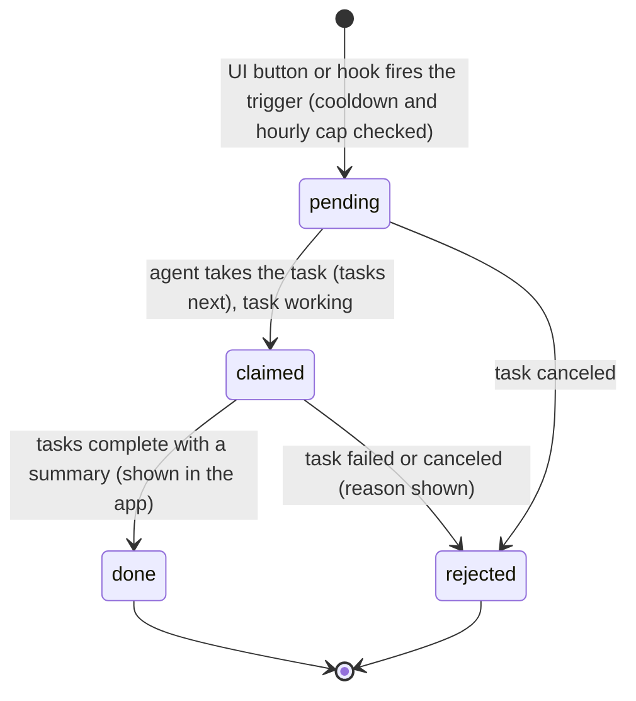
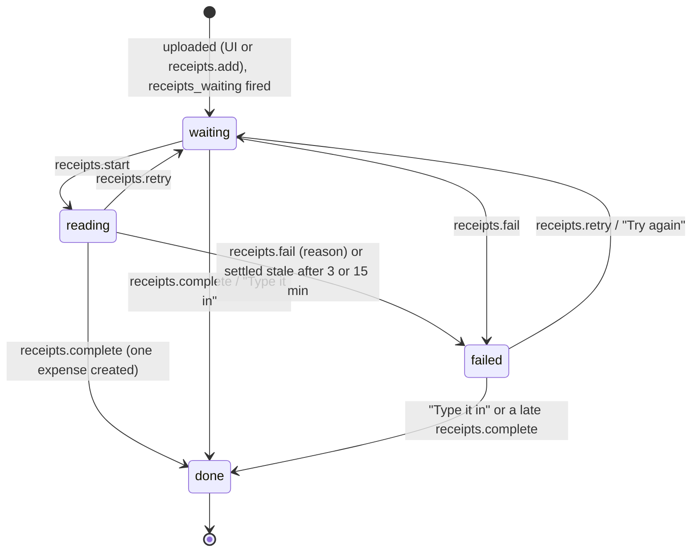
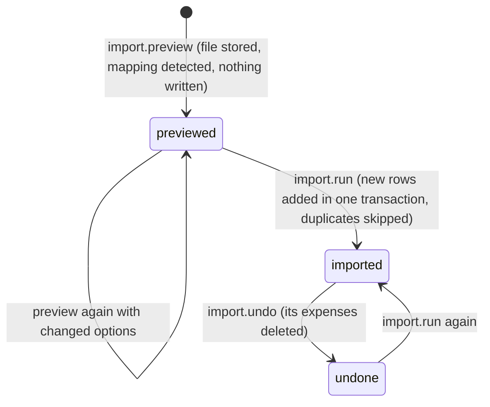

# Requirements: Expenses Tracker

PART A — REQUIREMENTS (SRS). User-approved before build; frozen after; changes via ## Changes.

## Introduction

### Purpose
Expenses Tracker is a personal expense tracker for one person with one home currency, used in the browser with no accounts or sign-in. Its one job is to show where the money goes. Expenses are recorded by hand on a full-screen keypad entry. They also arrive from receipt photos or PDFs that the person's AI agent reads, from bank or card CSV files, and from recurring payments that record themselves. All of it lands on a dashboard of the month: spending ring, daily bars, spending calendar, budget gauge, and the comparison with last month. An AI agent works on the same data through A2App. Every UI action is a declared operation, and the app hands work to the agent as tasks: read the waiting receipts, sort the uncategorized expenses.

### Scope
**Goals**
1. An expense can be recorded with only an amount, in three numbered steps, and it shows on Home and Expenses without a manual refresh.
2. Every uploaded receipt ends either recorded as exactly one expense or marked "could not be read" with a reason. None stays "reading" for more than 15 minutes.
3. A bank or card CSV is previewed with counts before anything is written. Re-importing an overlapping statement adds only what is new, and a finished import can be undone.
4. Home answers "where is my money going this month" at a glance: total, per category, per day, against the monthly budget, and against last month by the same day.
5. Every UI action is available to an agent as an operation, and data written by any route obeys the same record rules.

**Core functionalities:** month dashboard · keypad expense entry · expense list with search, filter and bulk actions · insights · monthly and per-category budgets · recurring expenses · receipt reading by the agent · CSV import with preview, duplicate skipping and undo · CSV export · categories with line icons · home currency and foreign-currency conversion · agent tasks

### Approval
Approved by the user: 2026-11-04 — carried over from the published marketplace app `expenses-tracker` 1.0.0, whose requirements were approved when it was built; this document restates them in the framework's form without changing any feature.

## Product Description

### Product Perspective
`authMode: none`. The app is for personal use: one person, one home currency, no accounts or sign-in (Original requirements). It serves on loopback only, and its own operation routes still require a caller (the View or the agent's credential). manifest.json declares no integrations (`capabilities.integrations: []`). The backend alone calls two keyless exchange-rate services: Frankfurter (`api.frankfurter.dev`, European Central Bank reference rates) and currency-api on jsDelivr (`cdn.jsdelivr.net/npm/@fawazahmed0/currency-api`). The app deliberately has no OCR, no bank connection and no language model of its own. Receipts are read by the person's AI agent through a task, statements arrive as CSV files, and the UI names no particular agent ("your AI agent").

### User Characteristics
One person tracking their own spending several times a week. They add expenses quickly on a phone (floating bottom bar with a raised "+") and review, budget and import on a desktop (icon rail). Phone, tablet and desktop widths down to 320 px are in scope, with touch and pointer input.

### Constraints
- C-1: Money is stored as an integer count of the home currency's minor unit (ISO 4217 exponent: 0 for BIF, CLP, DJF, GNF, ISK, JPY, KMF, KRW, PYG, RWF, UGX, UYI, VND, VUV, XAF, XOF, XPF; 3 for BHD, IQD, JOD, KWD, LYD, OMR, TND; 2 for every other currency). It is never a float.
- C-2: Numbers on screen always read "1,234.50": "," separates thousands and "." is the decimal point, whatever the browser language. Typing "," in an amount adds nothing. A comma that is not between thousands is refused, never misread. Operations accept amounts written plainly ("1234.50", "." as the decimal point, no grouping).
- C-3: Days are `YYYY-MM-DD` text and must be real calendar days (2026-02-30 is refused). A day is never an instant, so no timezone can shift it. "Today" is the machine's local date.
- C-4: There is one home currency, a three-letter upper-case ISO code. Changing it keeps every amount's number and converts nothing. When the new currency has different decimals, stored minor units are rescaled and rounded to fit.
- C-5: An expense amount is a whole number of minor units greater than zero.
- C-6: Category names are at most 40 characters and unique ignoring case. A category's icon is one of the 40 fixed line icons (utensils, coffee, pizza, wine, shopping-cart, shopping-bag, shirt, bus, car, fuel, train-front, plane, home, sofa, wrench, zap, lightbulb, droplet, wifi, smartphone, heart-pulse, pill, dumbbell, scissors, film, music, gamepad-2, book-open, graduation-cap, gift, hand-heart, repeat, baby, paw-print, briefcase, landmark, piggy-bank, receipt, package, tag). An empty icon becomes `tag`.
- C-7: Fixed vocabularies. Expense source: app, agent, receipt, csv, recurring. Receipt status: waiting, reading, done, failed. Receipt added_by: app, agent. Import status: previewed, imported, undone. Recurring cadence: weekly, monthly, yearly.
- C-8: Two expenses are duplicates when they have the same day, the same amount and the same note, ignoring case and spacing (`dedupe_key`).
- C-9: A receipt only ever gets one expense. `receipts.complete` is safe to repeat, and a receipt that is done cannot be started, failed or retried.
- C-10: Receipt files are JPEG, PNG, WebP, GIF, HEIC, HEIF or PDF, up to 15 MB each. CSV files are up to 20 MB.
- C-11: An expense note is at most 200 characters, with runs of whitespace collapsed.
- C-12: Occurrence n of a recurring expense is computed from its start date, never from the previous occurrence. A start on the 31st clamps to the month's last day and returns to the 31st in longer months.
- C-13: The first open seeds one settings row (USD, not yet confirmed, no budget) and twelve starter categories: Food and drink, Groceries, Transport, Shopping, Bills, Home, Health, Fun, Travel, Subscriptions, Gifts, Other. No expenses are seeded.
- C-14: An expense paid in another currency is converted at that day's rate (today's rate for a future day). The original amount, original currency and rate are kept beside it.
- C-15: No emoji appears anywhere: categories wear line icons. The app names no particular AI agent, and what the agent adds is marked `agent`.

### Assumptions
- A-1: Volume ceiling: 2,000 expenses in one month. That is the most the Expenses page and `expenses.list` load at once. A 1,000-row CSV statement previews in about 1 s (AGENT_APP.md § Gotchas).
- A-2: The machine running the app is the user's own, and the app's local date is the user's date.
- A-3: Exchange rates come from Frankfurter (about 30 currencies, history back to 1999) or currency-api (200+ currencies, dated history from 2024-03-02). A rate neither service has cannot be looked up, and the agent may pass an explicit `rate`.

## Features

### Module: Frame
- F-FRM-1: On wide screens the user can reach every page from a slim icon rail on the left. The rail holds Home, Expenses, Insights and Budgets; then Recurring, Receipts, and Import and export; with Categories and Settings at the bottom.
- F-FRM-2: The user sees the current page in the rail as a solid circle with an accent icon. Hovering an icon shows the page's name.
- F-FRM-3: On phones the user can navigate with a floating bottom bar: Home, Expenses, a raised "+" in the middle, Insights, and a menu for the remaining pages.
- F-FRM-4: The user can use every page down to 320 px wide without horizontal page scrolling.
- F-FRM-5: The user sees every number written "1,234.50" ("," for thousands, "." for decimals), whatever the browser language.
- F-FRM-6: WHEN the user types "," in an amount THE SYSTEM SHALL add nothing. WHEN a comma is not between thousands THE SYSTEM SHALL refuse the amount.
- F-FRM-7: WHEN the host switches the theme pack, light or dark mode, or custom colors THE SYSTEM SHALL recolor the app from the host's theme tokens, with nothing light on light or dark on dark. Only the red "over" and green "good" state colors stay fixed.
- F-FRM-8: The user sees categories with line icons and no emoji anywhere in the app.
- F-FRM-9: The user sees the agent called "your AI agent" everywhere. The app names no particular agent.
- F-FRM-10: WHEN a newer version of the app has been deployed THE SYSTEM SHALL reload an open page onto it, after the server comes back or when the tab is shown again. It waits while the entry screen or a dialog is open.

### Module: Home (summary)
- F-HOME-1: The user sees a greeting with today's date, a search box that opens Expenses with that search, and an "Add expense" pill with an accent "+".
- F-HOME-2: WHEN the app is opened for the first time THE SYSTEM SHALL ask which currency the user spends in. Nothing besides the categories is seeded.
- F-HOME-3: The user sees "Spending in <month>": a sand card with a legend and a spending ring. The legend lists the five biggest categories and everything else, with amounts. The ring is thick and segmented, with labels written along the band and the total in the middle. Its open gap holds three icon shortcuts: scan a receipt, import a CSV, insights.
- F-HOME-4: WHEN the user hovers a ring segment THE SYSTEM SHALL show that segment's numbers in the middle. The user can click a segment or a legend row to open those expenses.
- F-HOME-5: The user sees "Daily spending": one bar per day of the month, with dashed gridlines and the axis on the right. Today is in the accent, and days over the daily allowance are in coral. When a budget is set, a pale bar behind each day shows the daily allowance. The user can click a bar to open that day's expenses.
- F-HOME-6: The user sees "Spending days", a dark calendar of the month. Days with spending are filled, the three biggest days are in the accent and today is ringed. The user can click a day to open its expenses.
- F-HOME-7: The user can switch the whole dashboard to another month from the calendar's month menu.
- F-HOME-8: The user sees "Monthly budget": a gauge of what is left (or over), with the amount spent in a bubble at the end of the arc. Its "Change" button sets the monthly limit.
- F-HOME-9: The user sees "Compared with <last month>": the percentage of last month spent by the same day, with a bar.
- F-HOME-10: The user sees "Recent expenses": the five latest as soft rows (icon, what, category and day, where it came from, amount). The card has "Add new +" and a link to all expenses.
- F-HOME-11: WHEN receipts are waiting for the AI agent THE SYSTEM SHALL show a status line saying so, linking to Receipts. Unreadable receipts are counted there too.

### Module: Adding an expense (expenses, fx)
- F-ENT-1: WHEN the user presses "+" THE SYSTEM SHALL grow a full entry screen with a circular reveal from where it was pressed. Back or Escape shrinks it back.
- F-ENT-2: The user sees three numbered steps side by side (stacked on narrow screens): 1 Amount (required), 2 Category, 3 Details with Save at its end. The next step to do has a solid number, and finished steps show a check.
- F-ENT-3: The user can enter the amount on a dark display with a blinking caret. Input comes from a keypad (digits, decimal point, delete) or the physical keyboard, and Enter saves.
- F-ENT-4: WHEN the amount is not more than zero THE SYSTEM SHALL keep Save disabled. The amount accepts no more decimals than the currency has.
- F-ENT-5: The user can pick a category from icon tiles, most used first. The chosen tile turns dark, with its icon on the accent.
- F-ENT-6: The user can add optional details: what it was for; when (Today, Yesterday, or Other day, which opens a month calendar to pick any day); and a receipt file.
- F-ENT-7: The user can turn on "Paid in another currency" and see a preview converted at that day's rate. The rate is the European Central Bank's through Frankfurter, or currency-api's when Frankfurter does not answer or lacks the currency.
- F-ENT-8: The user can hand receipt photos or PDFs to the agent from "Have a receipt? Let your AI agent read it" in the header. The screen then closes.
- F-ENT-9: WHEN an expense is saved THE SYSTEM SHALL show a dark pill confirming what was added, with Undo.
- F-ENT-10: The user can tap any expense to open the same screen to edit it, with Delete.

### Module: Expenses (expenses)
- F-EXP-1: The user can view expenses one month at a time with a month switcher pill. They are grouped by day in rounded cards with day totals.
- F-EXP-2: The user can search across all months and filter by category.
- F-EXP-3: The user can enter select mode and, from a floating dark bar, move many expenses to a category or delete them.
- F-EXP-4: WHEN the month has uncategorized expenses THE SYSTEM SHALL show a sand card offering "Ask your AI agent to sort them".
- F-EXP-5: WHEN the user asks the agent to sort THE SYSTEM SHALL land a pending request. The button then shows the request's state: sent, working, done with the result, or refused.

### Module: Insights (summary)
- F-INS-1: The user can choose a month and see what was spent, the amount per day, the number of expenses, and the comparison with last month.
- F-INS-2: The user sees the month's spending ring with its legend.
- F-INS-3: The user sees every category as a row whose segmented bars fill against its budget, or against the month when it has none.
- F-INS-4: The user sees the last 12 months as bars, and can click a bar to select that month.
- F-INS-5: The user sees the month's biggest expenses.

### Module: Budgets (settings, categories)
- F-BUD-1: The user can set a whole-month limit, shown with its gauge.
- F-BUD-2: The user can set a limit per category, shown with segmented bars. An empty field means no limit.
- F-BUD-3: WHEN the user presses Enter or leaves a limit field THE SYSTEM SHALL save it.
- F-BUD-4: The user sees each limit as a clearly outlined field with its own fill, never the color of the row it sits in. An empty field reads "Set limit", and a saved amount reads like "1,250.00".

### Module: Recurring (recurring)
- F-REC-1: The user can add weekly, monthly or yearly recurring expenses that record themselves on each date.
- F-REC-2: WHEN a recurring expense has dates already past THE SYSTEM SHALL record them at once, and the dialog says how many.
- F-REC-3: The user can pause a recurring expense with a switch, edit it, and delete it. Deleting it keeps what it already recorded.

### Module: Categories (categories)
- F-CAT-1: The user sees category cards with icon, name, expense count and this month's spend.
- F-CAT-2: The user can create a category and, from a card's editor, change its name and pick a line icon.
- F-CAT-3: The user can delete a category and choose where its expenses go.
- F-CAT-4: WHEN a category name equals an existing one ignoring case THE SYSTEM SHALL refuse it, and the editor checks names as the user types.

### Module: Receipts (receipts)
- F-RCP-1: The user can drop several receipts, photos or PDFs, at once.
- F-RCP-2: The user sees each receipt's state: waiting for the AI agent, reading, recorded (with the expense), or could not be read (with the reason).
- F-RCP-3: WHEN a receipt could not be read THE SYSTEM SHALL offer "Type it in" and "Try again".
- F-RCP-4: The user can delete any receipt.

### Module: Import and export (import, export)
- F-IMP-1: The user can import a bank or card CSV. The delimiter, header, date, amount and description columns, date layout, decimal mark, and which amounts are spending are detected from the data, and each can be changed.
- F-IMP-2: The user sees a preview counting new rows, rows already here, money in, rows without an amount, and unreadable rows, with the first rows shown. Nothing is written until Import.
- F-IMP-3: WHEN an overlapping statement is imported again THE SYSTEM SHALL add only what is new.
- F-IMP-4: The user can undo a past import.
- F-IMP-5: The user can export any date range as a CSV file.

### Module: Settings (settings)
- F-SET-1: The user can change the home currency. Amounts keep their numbers and nothing is converted.
- F-SET-2: The user sees a dark card listing what to ask the AI agent.

### Agent (via A2App)
- F-AGT-1: The agent can perform every UI action as an operation: the 38 operations in ## Operations Design, across the modules app, settings, summary, expenses, categories, receipts, import, export, recurring and fx.
- F-AGT-2: The agent can read the conventions, today's date, the home currency, the category names, the icon set, and ready-to-run recipes for receipts and CSV files from `app.guide`.
- F-AGT-3: WHEN data is written by any route (the UI, an operation, or a raw record write) THE SYSTEM SHALL apply the same record rules: amount, day, note, duplicate key, and category icon.
- F-AGT-4: The agent can take a `receipts_waiting` task and record every waiting receipt as one expense (`receipts.start`, then `receipts.complete`), or mark it unreadable with a reason (`receipts.fail`).
- F-AGT-5: The agent can take a `categorize_requested` task and put uncategorized expenses into existing categories with `expenses.set-category`.
- F-AGT-6: WHEN the agent leaves a receipt in the reading state THE SYSTEM SHALL mark it failed with "Your AI agent stopped without recording this receipt. Try again, or type it in." This happens once the agent has made no call for 3 minutes, or 15 minutes after it was taken in any case. A later `receipts.complete` still records it.
- F-AGT-7: WHEN the agent calls a destructive operation THE SYSTEM SHALL answer `approval_required` until the person has approved that call.

## Non-Functional Requirements
- N-1: A change made by the agent (or another tab) appears on every open screen without a manual refresh. Views reload 150 ms after the last realtime change to a collection they watch.
- N-2: A 1,000-row CSV statement previews in about 1 s (AGENT_APP.md § Gotchas).
- N-3: An exchange-rate lookup waits at most 6 s per request and asks at most three times: Frankfurter, then currency-api, then Frankfurter again. A rate once found is kept in memory per currency pair and day.
- N-4: A receipt left in the reading state is settled within a minute after 3 minutes without an agent call, or after 15 minutes in any case (the `et_receipts` job runs every minute).
- N-5: Due recurring expenses are recorded within the hour (job `et_recurring` at minute 7 of every hour, plus `et_recurring_boot` once in the first minute after a start).
- N-6: Every page is usable from 320 px wide up to 1440 px, the app shell's maximum width.

## Data Requirements
- **settings** (module: settings): currency (string, required, max 3), currency_confirmed (boolean), monthly_budget (number), created (datetime, server-set), updated (datetime, server-set). Deletion/retention: exactly one row, seeded on first open. Its delete rule is closed, so it is never deleted.
- **categories** (module: categories): name (string, required, max 40), budget (number), sort (number), created (datetime, server-set), updated (datetime, server-set), icon (string, max 40). Deletion/retention: twelve are seeded. Deleting one moves its expenses and recurring expenses to the chosen category, or leaves them uncategorized, in the same transaction.
- **imports** (module: import): file (binary), filename (string, max 255), status (enum, required), rows (number), added (number), skipped (number), mapping (json), created (datetime, server-set), updated (datetime, server-set). Deletion/retention: kept as history, and the delete rule is closed. Undo deletes the expenses the import added and marks it `undone`.
- **receipts** (module: receipts): file (binary, required), status (enum, required), error (string, max 500), added_by (enum), created (datetime, server-set), updated (datetime, server-set). Deletion/retention: kept until deleted. Deleting an expense deletes its receipt, and so does removing the receipt from it. Deleting a receipt keeps its expense, without the file.
- **recurring** (module: recurring): note (string, required, max 200), amount (number), category (ref → categories), cadence (enum, required), start_date (string, required), next_date (string), count_added (number), active (boolean), created (datetime, server-set), updated (datetime, server-set). Deletion/retention: kept until deleted. Deleting one keeps the expenses it already recorded, with their link to it cleared.
- **expenses** (module: expenses): amount (number), date (string, required), note (string, max 200), category (ref → categories), source (enum), receipt (ref → receipts), import (ref → imports), recurring (ref → recurring), original_amount (number), original_currency (string, max 3), fx_rate (number), dedupe_key (string, max 300), created (datetime, server-set), updated (datetime, server-set). Deletion/retention: kept until the user deletes them (one, a selection, or every expense of an undone import). There is no automatic expiry.

## External Interfaces
- **Human (browser):** one single-user View served by PocketBase at the app's own origin, with hash routes `#/` (Home), `#/expenses`, `#/insights`, `#/budgets`, `#/recurring`, `#/receipts`, `#/import`, `#/categories` and `#/settings`. It also has the full-screen entry screen and the dialogs opened from these pages. File input is receipt photos and PDFs, plus CSV statements. File output is the CSV export download.
- **Agent (A2App):** the modules and collections in AGENT_APP.md § Modules; operations exactly as declared in ## Operations Design; tasks with the capabilities `receipts_waiting`, `categorize_requested` (events.json). No other machine interface is offered to agents; the app's own screens call their own routes.
- **Third-party services (backend only):** `api.frankfurter.dev`, `cdn.jsdelivr.net`.

## Out of Scope
- More than one person: accounts, sign-in, sharing, roles or shared budgets.
- More than one home currency at a time, or converting stored amounts when the home currency changes.
- Reading receipts inside the app (OCR or an app-owned model). Receipts are read by the person's AI agent.
- Live bank or card connections, and statement formats other than CSV.
- Recording income or balances. Money-in rows of a statement are counted and skipped, and an expense amount is always more than zero.
- Splitting one expense across several categories, or tags. An expense has at most one category.
- Budgets for periods other than a month, and recurring cadences other than weekly, monthly and yearly.
- Export formats other than CSV.
- Emoji, and naming a particular AI agent.
- Reminders or notifications outside the app.

## Quality of Life
- Category tiles in the entry screen are ordered by recent use (last 90 days), then by count.
- The greeting follows the time of day ("Good morning", "Good afternoon", "Good evening").
- A request to the agent that has not been picked up after 20 s adds "It picks this up while your AI agent is running." instead of spinning without explanation.
- The search box has a clear button, and the ring's hover readout shows a segment's numbers without leaving Home.
- Receipts and past imports show how long ago they were added.

PART B — TECHNICAL SPECIFICATION.

## System Overview
PocketBase 0.39 (JS hooks, migrations) + React 19 / Vite / Tailwind 4 View in `frontend/` built into `pb/pb_public/`, on the `blueprint-pocketbase-kit` toolkit. The View calls the app's own routes `/api/ops/<group>/<verb>` (`ops.pb.js`, `ops_more.pb.js`); the generated `a2app_routes.pb.js` serves the same handlers to agents as `POST /api/ops/<name>`. Domain logic lives in `pb/pb_hooks/lib_*.js`, record rules and jobs in `hooks.pb.js`.

Modules → navigation map:

| Module (manifest) | Where a person meets it | Route |
| --- | --- | --- |
| `summary` | Home dashboard; Insights | `#/`, `#/insights` |
| `expenses` | Expenses page; entry screen ("+", any expense row); Recent on Home | `#/expenses` |
| `categories` | Categories page; category tiles in the entry screen; per-category limits on Budgets | `#/categories`, `#/budgets` |
| `settings` | Settings page (currency); monthly limit on Budgets and Home | `#/settings`, `#/budgets` |
| `recurring` | Recurring page | `#/recurring` |
| `receipts` | Receipts page; receipt status line on Home; "Let your AI agent read it" in the entry screen | `#/receipts` |
| `import`, `export` | Import and export page | `#/import` |
| `fx` | "Paid in another currency" preview in the entry screen | — |
| `app` | No screen: `app.guide` is the agent's starting point | — |

Rail order: Home, Expenses, Insights, Budgets · Recurring, Receipts, Import and export · Categories, Settings. Phone bar: Home, Expenses, "+", Insights, and a menu holding the rest.

## UI Design
- **Design system:** the agent-app UI kit 0.6.0 vendored in `frontend/src/kit` (system-managed). It supplies the `--agent-app-*` tokens in `theme/tokens.css`, the theme bridge, the shell with its error boundary and toasts, and the PocketBase client and agent-request hooks. The app extends the kit in `frontend/src/app/theme.css` and `lib/themeColors.ts`. It sets its own font (Manrope Variable via `@fontsource-variable/manrope`) and base radius (`--agent-app-radius: 14px`) on `html:root[data-theme=…]`. It derives every `--et-*` color (canvas, shell, card, row, sand, sand-2, ink, ink-2, muted, line, solid, accent and their on-colors) from what the kit tokens resolve to, and re-derives them on each theme change. Surface scopes `.et-on-dark`, `.et-on-ink`, `.et-on-sand` and `.et-on-card` re-point accent and muted text for their background. Only `--et-red` (#de4b33, "over") and `--et-green` (#4f9a6c, "good") are fixed. The app's widgets are written once in `components/ui.tsx`: Card, PageHeader, CardHeader, PillButton, CircleButton, PillSelect, Modal, useConfirm, Popover, DayPicker, Empty, StatusPill, Toggle, MonthSwitcher, Segments. Charts are app-drawn SVG (`Donut.tsx`, `charts.tsx`). Icons come from lucide-react, and categories use the 40-icon line set (`pb_hooks/lib_icons.js`, mirrored in `lib/icons.tsx`).
- **Layout:** a warm canvas holds one cream app shell, 1440 px wide at most, with 36 px corners from 768 px up. On wide screens the 96 px icon rail sits on the left, with the page in the main column. Pages are composed of borderless cards (24 px radius; dialogs 28 px; pills fully rounded). From 1024 px the cards sit on a 12-column grid (Home: 8 + 4 columns); below that they take one column. The type scale is 12, 13, 14, 15 and 26 px, with hierarchy from weight and color, and spacing follows a 4 px grid. On phones a floating bottom bar replaces the rail, and pages keep 128 px of bottom padding to clear it.
- **Screen — Home:** primary object: the chosen month's spending · primary action: "Add expense" (the raised "+" on phones) · loading: the frame shows a spinner until settings and categories arrive, then each card appears with its first load · empty: the ring card says "Nothing recorded yet" and "Add an expense and this ring shows where your money goes, category by category."; Recent shows "No expenses yet" with an add action; the comparison says "Nothing to compare yet. Next month this shows whether you are spending more or less."; the first open shows "Which currency do you spend in?" · error: the kit's error toast with the operation's message, or "Network error — is the backend running?"; a bad limit toasts "Enter an amount like 1,500 or 1500.50" · in-flight: pill buttons show a spinner and are disabled · success: toasts ("Budget saved", "Amounts are in <code>"), and cards update live · narrow: one column ordered ring, daily bars, calendar, budget, comparison, recent. The search box shows from 1024 px and the "Add expense" pill from 768 px.
- **Screen — Entry (add or edit an expense):** a full-screen dialog over the page · primary object: one expense · primary action: Save · states: Save stays disabled until the amount is more than zero and shows a spinner while saving. A failed conversion preview shows its reason in place. Adding ends with the "Added <amount> to <category>" pill with Undo; editing ends with "Saved". Delete asks "Delete this expense?" ("This expense is deleted, with its receipt if it has one."). Sending a receipt to the agent toasts "Receipt sent to your AI agent. Added once read." · narrow: the three steps sit side by side from 1100 px and stack in a 560 px column below.
- **Screen — Expenses:** primary object: one month's expenses grouped by day · primary action: open an expense, or "Add expense" · empty: "No expenses in <month>" with "Add expense"; a search with no hits shows "Nothing matches "<q>"" and "Search looks at what each expense was for."; an empty category filter adds "Try another category." · error: kit toast · in-flight and success: the select bar's move and delete toast "<n> moved" or "<n> deleted"; the sort request shows "Sent to your AI agent", then "Your AI agent is on it", then the result, or the refusal in red · narrow: search and category filter take the full width, and the select bar floats above the phone bar.
- **Screen — Insights:** primary object: one month's statistics · primary action: switch the month (switcher, or a bar of the 12-month chart) · empty: "Nothing spent in <month>" in the category card · error: kit toast · narrow: one column.
- **Screen — Budgets:** primary object: the monthly limit and each category's limit · primary action: type a limit, which saves on Enter or when the field loses focus · states: an empty field reads "Set limit"; an invalid entry is marked, with the hint "Use a number like 1,500 or 1500.50"; success toasts "Monthly budget saved", "Monthly budget removed" or "Budget saved"; a category with nothing spent reads "Nothing this month" · narrow: one column.
- **Screen — Recurring:** primary object: the recurring expenses, with their approximate monthly total · primary action: new recurring expense (dialog) · empty: "No recurring expenses" with an add action · success: "Saved. <n> payments recorded.", "Paused"/"Resumed", "Deleted"; delete asks "Delete this recurring expense?" ("<note> stops recording itself. What it already recorded stays.") · narrow: one column, and the dialog takes up to 94 % of the width.
- **Screen — Receipts:** primary object: uploaded receipts and their state · primary action: the "Add receipts" drop zone ("Photos or PDFs, several at once") · empty: only the drop zone under the subtitle "Drop photos or PDFs. Your AI agent reads each one and records the expense for you." · per-row states: waiting ("Read while your AI agent is running."), reading, recorded (with the expense), could not be read (the reason, Type it in, Try again) · success: "<n> receipts sent to your AI agent", "Sent to your AI agent again", "Deleted"; delete asks "Delete this receipt?" · narrow: one column.
- **Screen — Import and export:** primary objects: the CSV preview, past imports, and the export range · primary action: "Import <n> expenses" ("Nothing new to import" when there is nothing new) · states: the drop zone is busy while reading; preview counts show as status pills; undo asks "Undo this import?" ("The <n> expenses it added are deleted, including any you edited since."); an empty export range toasts "No expenses in that range" · narrow: the preview table scrolls inside its own container.
- **Screen — Categories:** primary object: the category cards · primary action: "New category", or open a card's editor (dialog) · states: a name clash shows under the name field as the user types (`role="alert"`); success toasts "Saved" or "<name> deleted"; delete asks "Delete <name>?" and names where its expenses move · narrow: 2 columns, 3 from 640 px, 4 from 1280 px.
- **Screen — Settings:** primary object: the home currency · primary action: "Use <code>", which asks "Switch to <code>?" ("Your amounts keep their numbers and show in <code> from now on; nothing is converted.", plus a rounding note when the decimals differ) · success: "Currency is now <code>" · a dark card, "Let your AI agent do it", lists what to ask · narrow: one column.
- **Formatting:** money is formatted with `Intl.NumberFormat('en-US', { style: 'currency' })` using the home currency's symbol and decimals ("$1,234.50"). Compact amounts drop the decimals, and negatives use a true minus sign "−". Numbers use tabular figures (`.num`). Days read "Today", "Yesterday" or "Mon, Oct 5", with the year added outside the current year. Months read "October" or "October 2026" in the browser's locale. Receipts and imports show relative times ("ago"). Screens show names, not record ids. Empty values are words: "No limit", "Set limit", "Nothing this month", "Uncategorized".

## Quality Conformance

- **Q1 Completeness & IA:** orientation comes from the icon rail on wide screens: the current page is a solid circle, and hovering an icon shows its name. On phones the bottom bar does the same, with the menu button marked when the page lives in it. Every page has a title header. Every screen is reachable from the rail or bar, and each chart element opens the expenses behind it. The modules map to screens as in ## System Overview. Only `app` (the agent's guide) has no screen. Names hold app-wide: expense, category, receipt, recurring, budget/limit, import, "your AI agent". The Expenses list, the one working set that outgrows a screen, has a month switcher, search across every month, and a category filter. Receipts and categories show as one list or grid each.
- **Q2 Design system:** tokens are the kit's `--agent-app-*` set, extended by the derived `--et-*` colors (see ## UI Design). Components never hardcode a hex color; the exceptions are the two fixed state fills and the shadows in `theme.css`. Semantic roles: ink/solid for primary pills, accent for highlights and today, red `--et-red` for "over" and for destructive pills and error toasts, green `--et-green` for "good", muted for secondary text, sand and dark cards for emphasis. Type is Manrope Variable on the 12/13/14/15/26 px scale. Icons are lucide-react only, with no emoji anywhere. Light and dark come from the host (the kit theme bridge), or from `prefers-color-scheme` when the app runs standalone, and each scheme re-derives every `--et-*` token with contrast checks (`themeColors.ts`).
- **Q3 Layout & composition:** spacing follows a 4 px grid, and cards align to a 12-column grid from 1024 px. Each page has one primary pill (dark, with an accent dot) in its header. Home is calm and visual; Expenses and Import are denser rows. Amounts use tabular figures and sit right-aligned in rows and day headers. Long notes and file names truncate in their row with an ellipsis, and the full note is in the entry screen. The Expenses list shows one month (or one search) at a time instead of paginating; the import preview shows its first rows (50 by default).
- **Q4 Interaction:** affordance states come from the app's pill and circle buttons: pointer cursor on everything clickable (a `theme.css` base rule), hover fill, active scale, `disabled:opacity-50` with a not-allowed cursor. Each destructive action uses the app's own confirm dialog (`useConfirm`, a Radix dialog; never `window.confirm`), and its copy names the target and the consequence: "Delete this expense?", "Delete selected?" (<n> expenses, with their receipts), "Delete <category>?" (where its <n> expenses move), "Delete this receipt?", "Delete this recurring expense?", "Undo this import?", "Switch to <code>?". Undo instead of confirm applies after adding an expense (the Undo pill), and an import stays undoable. Keyboard: on the entry screen, digits and "." type the amount, Backspace deletes, Delete clears, Enter saves and Escape closes. Enter saves a limit, the category editor and the monthly-budget dialog, and Enter in the Home search opens Expenses. Escape closes popovers and dialogs. Inputs are constrained rather than validated: keypad digits only, Save disabled until the amount is above zero, decimals capped to the currency, and "," typing nothing.
- **Q5 State & feedback:** each screen's states are listed in ## UI Design. Every async pill shows a spinner and is disabled while it runs, which guards against double submission. The entry screen's Save does the same. Success reads back where the user is looking: a toast or the Undo pill, plus the realtime reload of every view. Agent requests show sent, working, done (with the result) or refused, and a request nobody has taken after 20 s says so. The frame shows a spinner on first load, and cards appear once their data arrives (see ### Conventions and overrides). Load and write errors surface as the kit toast with the operation's message.
- **Q6 Motion:** card entrances (`et-rise`) take 420 ms on `cubic-bezier(0.22, 1, 0.36, 1)`, staggered by 60 ms. Dialogs, popovers and pills pop in over 200 ms (`et-pop`). Charts grow (`et-grow`, 520 ms) and draw (`et-draw`, 640 ms). The entry screen's circular reveal takes 560 ms to open and 420 ms to close, eased. The status-pill pulse (1.6 s) and the amount caret (1 s) loop. Under `prefers-reduced-motion: reduce`, every keyframe animation is removed, and the entry screen opens and closes with a 160 ms opacity fade.
- **Q7 Content:** the voice is plain, second person and friendly ("Here is where your money is going.", "your AI agent"), in sentence case. Error copy says what to do: "Enter an amount like 1,500 or 1500.50", "Use a number like 1,500 or 1500.50". Operation errors name the parameter and give a valid example ("amount must be a plain positive number with "." as the decimal point and no thousands separators, e.g. 1234.50"). When the exchange-rate services fail the message is "Could not get the <from> to <to> exchange rate right now: the rate services did not answer. Try again in a moment." Terminology is fixed: expense, category, receipt, recurring expense, limit/budget, import, export.
- **Q8 Accessibility:** contrast is computed at runtime for each theme by `themeColors.ts` using the WCAG ratio. Muted and secondary text is chosen to reach 4.6:1 against the shell, card, row and sand surfaces, and text on the accent reaches 3:1 or falls back to the theme's ink or card color. The fixed red and green are paired with white or with their derived text variants. Focus: dialogs and the entry screen are modal (Radix dialog, `role="dialog"`, `aria-modal`) and trap focus; Escape closes them. Inputs show a 2 px ring on `:focus-visible`, and buttons keep the browser's focus outline. Icon-only buttons carry `aria-label` and `title`. The rail marks the current page with `aria-current="page"`, and the day picker marks the chosen day with `aria-pressed`. Targets: rail and phone-bar buttons are 44 px, the raised "+" is 56 px, pills are 44 px tall, and circle buttons are 32–40 px. Announcements: the entry screen's amount readout is `aria-live="polite"`, and the category name error is `role="alert"`. Meaning is never color alone: over-budget states also read "Over by", and statuses are written words.
- **Q9 Responsiveness:** the range is 320 px to 1440 px (the shell's maximum width). Below 768 px the floating bottom bar with the raised "+" replaces the rail, toasts lift above the bar, and the shell loses its outer margin and corners. From 1024 px, pages use the 12-column grid and Home shows its search box. From 1100 px the entry screen's three steps sit side by side. The category grid goes from 2 columns to 3 at 640 px and 4 at 1280 px. Elements of fixed width fit 320 px, and the ring measures its container. Touch targets in the phone bar are 44 px or more.
- **Q10 Performance:** at A-1, the Expenses page loads one month (up to 2,000 rows) or one search (up to 500 rows), and Home loads one month summary plus the five latest expenses. Server-side caps: `expenses.list` 1–2,000 (default 200), `receipts.list` 1–1,000, `import.list` 1–500, the preview's `show` 1–500, `summary.trend` 1–60 months. Duplicate checks run as chunked lookups of 40 keys on the `dedupe_key` index. Per-row CSV helpers stay free of `require()`, which keeps a 1,000-row preview near 1 s. The font is one variable font. Receipt images have a 240×320 thumbnail size declared, and there are no other image assets.
- **Q11 Caching & freshness:** static: the built bundle has content-hashed asset names, and the document shell is served `no-store, no-cache, must-revalidate` (`cache_control.pb.js`, plus the toolkit's SPA header). Data: operation responses carry no cache headers, and the View keeps them only as in-memory view state. Freshness comes from one realtime hub that subscribes to settings, categories, expenses, receipts, recurring and imports once at startup; each view reloads 150 ms after the last change to a collection it watches. A sequence guard drops stale responses, so the latest load wins. Writes invalidate by that same realtime path. An open page compares its script with the served one on every reconnect after the first and whenever the tab becomes visible, then reloads, waiting while a dialog is open.
- **Q12 Data integrity:** money is stored as integers, and days as pattern-checked text. Categories have a unique index on `name COLLATE NOCASE`. Relations are real relation fields: expense → category, receipt, import, recurring; recurring → category. Every expense save, by any writer, passes the record hook `checkRecord`: whole positive amount, real day, collapsed note, default source, and derived `dedupe_key`. Category icons are checked by record hooks. Multi-step writes run in one transaction: `expenses.add-many` (all or nothing), `expenses.delete-many` (all ids must exist), `set-category`, category delete with move, receipt complete, delete and remove, import run and undo, recurring run (`count_added` advanced together with the expenses it adds), and the currency change with its rescale. Indexes: `expenses.date`, `expenses.category`, `expenses.dedupe_key`, `receipts.status`. Migrations are additive and replay on a fresh database. The starter `items` collection was removed by a later migration, and the earlier one stays as applied history.
- **Q13 API:** beyond the adapter, the app's own routes `/api/ops/<group>/<verb>` (GET reads, POST writes) are what the View calls; agents reach the same handlers through the adapter. Every parameter is read by the typed readers in `lib_util.js`, which answer 400 naming the parameter and showing a valid example. Errors share PocketBase's shape `{ status, message }`, with 400, 404, 409, 422, 502 and 500 used for their meaning. A hint meant for agents (for example, pass `rate=`) is appended only to agent calls. Lists are bounded as in Q10. `receipts.complete` is safe to repeat. Stack traces are never returned.
- **Q14 Architecture:** UI is in `frontend/src/app` (pages, components, lib), the application logic in `pb/pb_hooks/lib_*.js`, routes in `ops.pb.js` and `ops_more.pb.js`, and record rules and jobs in `hooks.pb.js`. The UI calls the same operations the agent calls (`lib/api.ts`), so every rule has one server implementation. Shared widgets exist once in `components/ui.tsx`, with `ExpenseRow`, `Donut` and `charts` beside it. App-wide data (settings and categories) has one source, `lib/context.tsx`. Money and date formatting each live in one module (`lib/money.ts`, `lib/dates.ts`). Configuration lives in manifest.json and the toolkit's launcher.
- **Q15 Resilience:** each exchange-rate request has a 6 s timeout. The order is Frankfurter, then currency-api, then Frankfurter again. Then comes a designed error: 502 "the rate services did not answer", or 422 "No exchange rate…". The entry-screen preview shows the failure in place without a toast. A `receipts_waiting` request refused by the trigger cooldown or the hourly cap is retried by the minute job. Receipts are re-checked once after a restart. Receipts the agent abandons are settled as failed (N-4). When the backend is unreachable, every failed call toasts "Network error — is the backend running?", and the page reloads onto the current build when the server comes back. A render crash shows the kit's "Something went wrong" panel with "Reload app". Hook errors are caught and logged, and never shown raw.
- **Q16 Security & privacy:** with `authMode: none`, collection rules are open (`""`) because the app is single-user and binds loopback. The framework adapter runs its host check, framing policy and credential checks before any app hook. The app's own operation routes require a caller: the View, or the agent's `.agent-token` sent as `X-A2App-Token`. Destructive operations need the person's approval through the adapter. Settings and imports cannot be deleted through the records API (delete rule closed). The toolkit sets rate limits (300 requests per minute on `/api/ops/`). Exchange-rate calls send only currency codes and a date. Receipts and notes stay in `pb/pb_data` and are not logged. Runtime credentials (`.agent-token`, `.principal`, `.superuser`) are git-ignored and never shipped.
- **Q17 Observability:** hook errors log prefixed lines: `[expenses] op failed:` for 5xx operation errors, `[expenses] fx request failed:` with the URL, and `[expenses] … failed:` for each job. The toolkit adds `[handler-error] <METHOD> <path>: <message>` for uncaught handler errors. The UI kit's console relay ships browser `console.error`/`console.warn` and uncaught errors to `logs/frontend_console.log` (capped at 2 MB). Health is `/api/_a2app`, the adapter's identity document (protocol, schema version, data version, server time). It answers once PocketBase, the migrations and the hooks are up.
- **Q18 Version control:** commits are per app and per change ("added expenses tracker agent app", "expenses tracker agent app update"). `.gitignore` excludes credentials, `pb/pb_data/`, the PocketBase binary, the built View `pb/pb_public/`, `frontend/node_modules/`, framework runtime state under `.a2app/`, and `logs/`. The app builds from a clean checkout with the manifest pipeline alone (`install`, `build`, `start`).

### Conventions and overrides
The published app is restated here unchanged, so these are standing decisions of the approved build, not new work. Revisit any of them when the app is next modified.
- Q5.2 (designed loading): there are no skeletons. The frame shows one spinner until settings and categories have loaded, and each card appears when its first load arrives.
- Q5.4 (designed error states): a failed load or write is reported by the kit's error toast with the operation's message. No page renders an error state of its own.
- Q11.2 (declared data policy): operation responses carry no Cache-Control. They are never cached beyond in-memory view state, and they are refreshed by realtime changes.
- Q15.1 (timeouts): exchange-rate calls time out after 6 s. The View's calls to its own backend use the PocketBase SDK without a client-side timeout.
- Q17.1 (structured logs): app log lines are prefixed text (`[expenses] …`, `[handler-error] …`), not a structured schema.
- Q14.4 (one implementation per rule): the line-icon set is listed twice, in `pb_hooks/lib_icons.js` for validation and in `frontend/src/app/lib/icons.tsx` for drawing, and the two are kept in step by hand (AGENT_APP.md § Plan).
- Mirrored global rules: none recorded for this app.

## Process Flows

Work the app asks an agent for (`receipts_waiting`, `categorize_requested`): the request row follows the A2App task.

Receipt lifecycle:

CSV import:

Recurring expense: each hour (and once after a start) every active item records occurrences from `count_added` up to today, computed from `start_date`, and advances `count_added` and `next_date` in the same transaction. A paused item records nothing, and a new cadence or start date restarts its schedule from that date.

## Operations Design
| Operation | Module | Entity | appliesWhen | Params | Flags |
| --- | --- | --- | --- | --- | --- |
| app.guide | app | — | — | — | — |
| settings.get | settings | — | — | — | readOnly |
| settings.update | settings | — | — | currency: string, monthly_budget: string, currency_confirmed: boolean | — |
| summary.month | summary | — | — | month: string | readOnly |
| summary.trend | summary | — | — | months: number, end: string | readOnly |
| expenses.list | expenses | — | — | month: string, from: string, to: string, category: string, uncategorized: boolean, q: string, source: enum, has_receipt: boolean, limit: number, offset: number | readOnly |
| expenses.get | expenses | — | — | expense_id: string! | readOnly |
| expenses.add | expenses | — | — | amount: string!, date: string, note: string, category: string, currency: string, rate: string, receipt_path: string, skip_if_duplicate: boolean | — |
| expenses.add-many | expenses | — | — | items: string!, skip_duplicates: boolean | — |
| expenses.update | expenses | — | — | expense_id: string!, amount: string, currency: string, rate: string, date: string, note: string, category: string | — |
| expenses.delete | expenses | — | — | expense_id: string! | destructive |
| expenses.delete-many | expenses | — | — | ids: string! | destructive |
| expenses.set-category | expenses | — | — | ids: string!, category: string | — |
| expenses.attach-receipt | expenses | — | — | expense_id: string!, path: string! | — |
| expenses.remove-receipt | expenses | — | — | expense_id: string! | destructive |
| categories.list | categories | — | — | month: string | readOnly |
| categories.add | categories | — | — | name: string!, icon: enum, budget: string | — |
| categories.update | categories | — | — | category_id: string!, name: string, icon: enum, budget: string | — |
| categories.delete | categories | — | — | category_id: string!, move_to: string | destructive |
| receipts.list | receipts | — | — | status: enum, limit: number | readOnly |
| receipts.get | receipts | — | — | receipt_id: string! | readOnly |
| receipts.add | receipts | — | — | path: string! | — |
| receipts.start | receipts | — | — | receipt_id: string! | — |
| receipts.complete | receipts | — | — | receipt_id: string!, amount: string!, date: string, note: string, category: string, currency: string, rate: string | — |
| receipts.fail | receipts | — | — | receipt_id: string!, reason: string! | — |
| receipts.retry | receipts | — | — | receipt_id: string! | — |
| receipts.delete | receipts | — | — | receipt_id: string! | destructive |
| import.preview | import | — | — | path: string, import_id: string, has_header: boolean, date_column: string, amount_column: string, note_column: string, category_column: string, date_format: enum, decimal: enum, expenses_are: enum, currency: string, rate: string, create_categories: boolean, skip_duplicates: boolean, show: number | — |
| import.run | import | — | — | import_id: string, path: string, has_header: boolean, date_column: string, amount_column: string, note_column: string, category_column: string, date_format: enum, decimal: enum, expenses_are: enum, currency: string, rate: string, create_categories: boolean, skip_duplicates: boolean | — |
| import.list | import | — | — | limit: number | readOnly |
| import.undo | import | — | — | import_id: string! | destructive |
| export.csv | export | — | — | from: string, to: string | readOnly |
| recurring.list | recurring | — | — | — | readOnly |
| recurring.add | recurring | — | — | note: string!, amount: string!, cadence: enum!, start_date: string, category: string | — |
| recurring.update | recurring | — | — | recurring_id: string!, note: string, amount: string, category: string, cadence: enum, start_date: string, active: boolean | — |
| recurring.delete | recurring | — | — | recurring_id: string! | destructive |
| recurring.run-due | recurring | — | — | — | — |
| fx.rate | fx | — | — | from: string!, to: string, date: string, amount: string | readOnly |

## Original requirements

The requirements as published for CraftBot, kept verbatim as the source the sections above restate.

Personal use only: one person, one home currency, no accounts or sign-in.
The front shows only what is essential; advanced features are reachable
with a click but never crowd Home. No emoji anywhere: categories wear line
icons.

Visual language (redesign of 2026-10-07): a warm soft dashboard. A warm
gray canvas holding one cream app shell with large rounded corners; white,
sand and one dark card; dark primary pills with an accent dot;
generous radii, no card borders; Manrope; one type scale of 12, 13, 14, 15
and 26 px; pointer cursor on everything clickable. Every color comes from
the host's theme tokens: switching the theme pack, light or dark mode, or
custom colors recolors the app (highlights use the theme's accent; the sand
and dark cards are mixed from the theme). Nothing light sits on light or dark
on dark in any pack: where a pack's accent is its text color or its surface
is its background, the app picks other theme colors that contrast. Only the
red "over" and green "good" state colors are fixed. The app names no
particular AI agent: it says "your AI agent". Numbers always read
"1,234.50": "," separates thousands and "." is the decimal point, whatever
the browser language; typing "," in an amount adds nothing, and a comma that
is not between thousands is refused, never misread.

##### Frame

1. A slim icon rail on the left (wide screens): Home, Expenses, Insights,
   Budgets; Recurring, Receipts, Import and export; Categories and Settings
   at the bottom. The current page is a solid circle with an accent icon;
   hovering an icon shows its name. On phones a floating bottom bar with
   Home, Expenses, a raised "+" in the middle, Insights and a menu for the
   rest. Every page works down to 320 px wide.

##### Home dashboard

2. A greeting with today's date, a search box (opens Expenses with the
   search) and an "Add expense" pill with an accent "+".
3. The first open asks which currency the user spends in; nothing else is
   seeded besides the categories.
4. "Spending in <month>": a sand card with a legend (the five biggest
   categories and everything else, with amounts) and a spending ring: a
   thick segmented ring, labels written along the band, an open gap holding
   three icon shortcuts (scan a receipt, import a CSV, insights) and the
   total in the middle. Hovering a segment shows its numbers in the middle;
   clicking a segment or a legend row opens those expenses.
5. Under the ring, "Daily spending": one bar per day of the month with
   dashed gridlines and the axis on the right; today in the accent, days over
   the daily allowance in coral, a pale bar behind each day for the daily
   allowance when a budget is set; a bar opens that day's expenses.
6. "Spending days": a dark calendar of the month; days with spending are
   filled, the three biggest days are in the accent, today is ringed; a day opens
   its expenses. Its month menu switches the whole dashboard to another
   month.
7. "Monthly budget": a gauge of what is left (or over), the amount spent in
   a bubble at the end of the arc, and a "Change" button that sets the
   monthly limit.
8. "Compared with <last month>": the percentage of last month spent by the
   same day, with a bar.
9. "Recent expenses": the five latest as soft rows (icon, what, category and
   day, where it came from, amount), "Add new +" and a link to all.
10. While receipts wait for the AI agent a status line says so and links to
    Receipts; unreadable receipts are counted there too.

##### Adding an expense

11. The "+" grows into a full entry screen with a circular reveal from where
    it was pressed; Back or Escape shrinks it back.
12. Three numbered steps side by side (stacked on narrow screens), read in
    order: 1 Amount (required), 2 Category, 3 Details with Save at its end.
    The next step to do has a solid number, finished ones a check. Step 1 is
    a dark amount display with a blinking caret and a keypad (digits,
    decimal point, delete). The physical keyboard types into the amount too; Enter
    saves. Only the amount is required: Save stays disabled until it is
    more than zero, and the currency's decimals are respected.
13. Category tiles with icons (most used first); the chosen one turns dark
    with its icon on the accent. Details, all optional: what it was for;
    when (Today, Yesterday, or Other day, which opens a month calendar to
    pick any day); a receipt file; "Paid in another currency" (converted at
    that day's rate, with a preview; the European Central Bank rate through
    Frankfurter, or currency-api when Frankfurter does not answer or lacks
    the currency).
14. "Have a receipt? Let your AI agent read it" in the header: photos or
    PDFs are handed to the agent and the screen closes.
15. After saving, a dark pill confirms what was added with Undo.
16. Tapping any expense opens the same screen to edit it, with Delete.

##### Expenses

17. A month at a time (month switcher pill), search across all months, a
    category filter; grouped by day in rounded cards with day totals.
18. Select mode moves many expenses to a category or deletes them from a
    floating dark bar.
19. When the month has uncategorized expenses, a sand card offers "Ask
    your AI agent to sort them": firing lands a pending request and the button
    shows its state (sent, working, done with the result, or refused).

##### Insights

20. For a chosen month: spent, per day, number of expenses, against last
    month; the ring with its legend; every category as a row with segmented
    bars against its budget (or the month); the last 12 months as bars (a
    bar selects that month); the biggest expenses.

##### Budgets

21. A whole-month limit with its gauge, and a limit per category with
    segmented bars; empty means no limit; saving on Enter or leaving the box.
    Each limit is a clearly outlined field with its own fill (never the same
    color as the row it sits in), "Set limit" while empty, and the saved
    amount written "1,250.00".

##### Recurring

22. Recurring expenses (weekly, monthly, yearly) record themselves on each
    date; past dates are recorded at once (the dialog says how many). Pause
    with a switch, edit and delete; deleting keeps what was recorded.

##### Categories

23. Category cards (icon, name, count, this month); a card opens an editor
    with the name, an icon picker of line icons, and Delete with a choice of
    where its expenses go. Names are unique ignoring case.

##### Receipts

24. Drop several receipts at once. Each row shows its state: waiting for
    the AI agent, reading, recorded (with the expense), or could not be read
    (with the reason, Type it in, Try again); any can be deleted.

##### Import and export

25. Import a bank or card CSV: delimiter, header, date, amount and
    description columns, date layout, decimal mark and which amounts are
    spending are detected from the data and can each be changed; the preview
    counts new, already here, money in, without an amount and unreadable,
    and shows the first rows. Nothing is written until Import. Re-importing
    an overlapping statement adds only what is new. Past imports can be
    undone. Export any range as CSV.

##### Settings

26. Change the home currency (amounts keep their numbers; nothing is
    converted); a dark card lists what to ask the AI agent.

##### The AI agent

27. Every action in the UI exists as a CLI operation; `app.guide` gives the
    conventions, the category names and icon set, and recipes for receipts
    and CSV files. Data written by any route obeys the same record rules.

##### Changes

- 2026-10-07: First version.
- 2026-10-07: Complete redesign of the interface (dashboard with spending
  ring, daily bars, dark calendar, budget gauge; "+" opens a full-screen
  entry with a circular reveal and keypad; icon rail). Categories use line
  icons instead of emoji (`icon` field, migration 1700000300).
- 2026-10-07: Colors follow the host theme tokens (theme packs, light
  and dark, custom colors) instead of a fixed yellow palette; the entry
  screen is rebalanced into two even columns with Save underneath.
- 2026-10-07: Colors are derived with contrast checks for every theme pack
  (nothing light on light or dark on dark; distinct ring colors where a pack
  is monochrome). The entry screen is three numbered steps; "Other day" opens
  an in-app day picker. "CraftBot" is now "your AI agent" everywhere, and the
  `craftbot` source and added_by values are `agent` (migration 1700000400).
- 2026-10-07: Exchange rates no longer fail when Frankfurter is briefly
  unreachable (currency-api answers instead, also for currencies the ECB
  does not publish); the preview no longer toasts on every keystroke.
  Numbers use "," for thousands and "." for decimals everywhere; "," typed
  in the entry screen is no longer a decimal point.
- 2026-10-07: Budget limits are outlined fields ("Set limit" when empty) and
  amount fields show "1,250.00". An open page reloads itself onto a newly
  deployed version (after the server comes back, or when the tab is shown
  again), waiting while the entry screen or a dialog is open.
