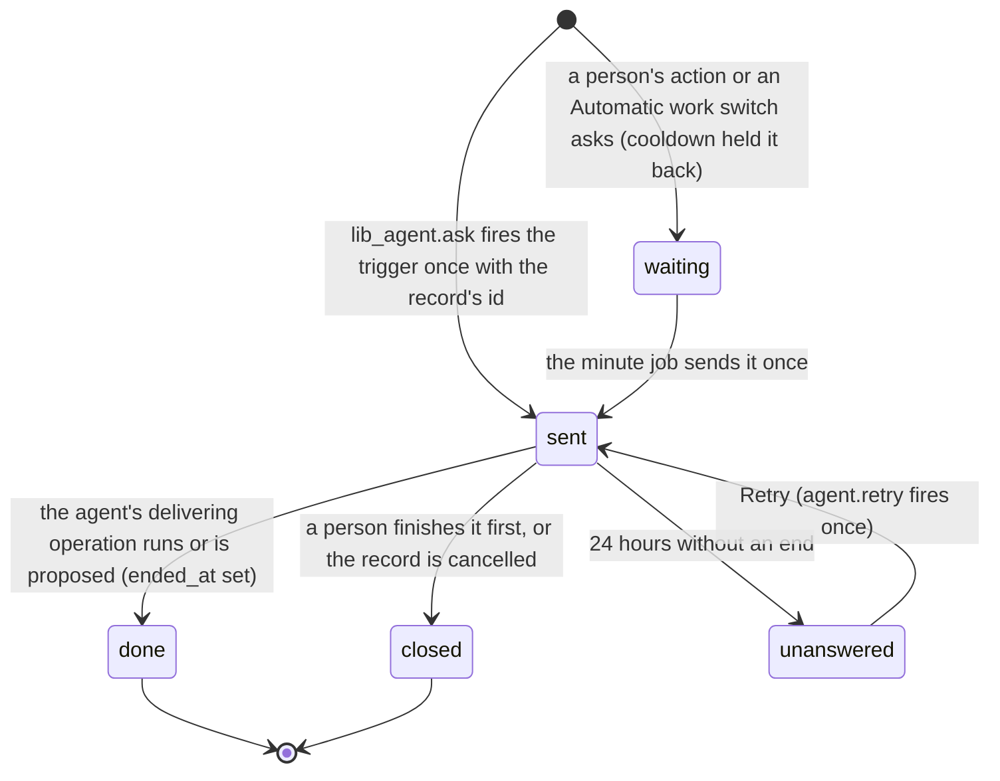
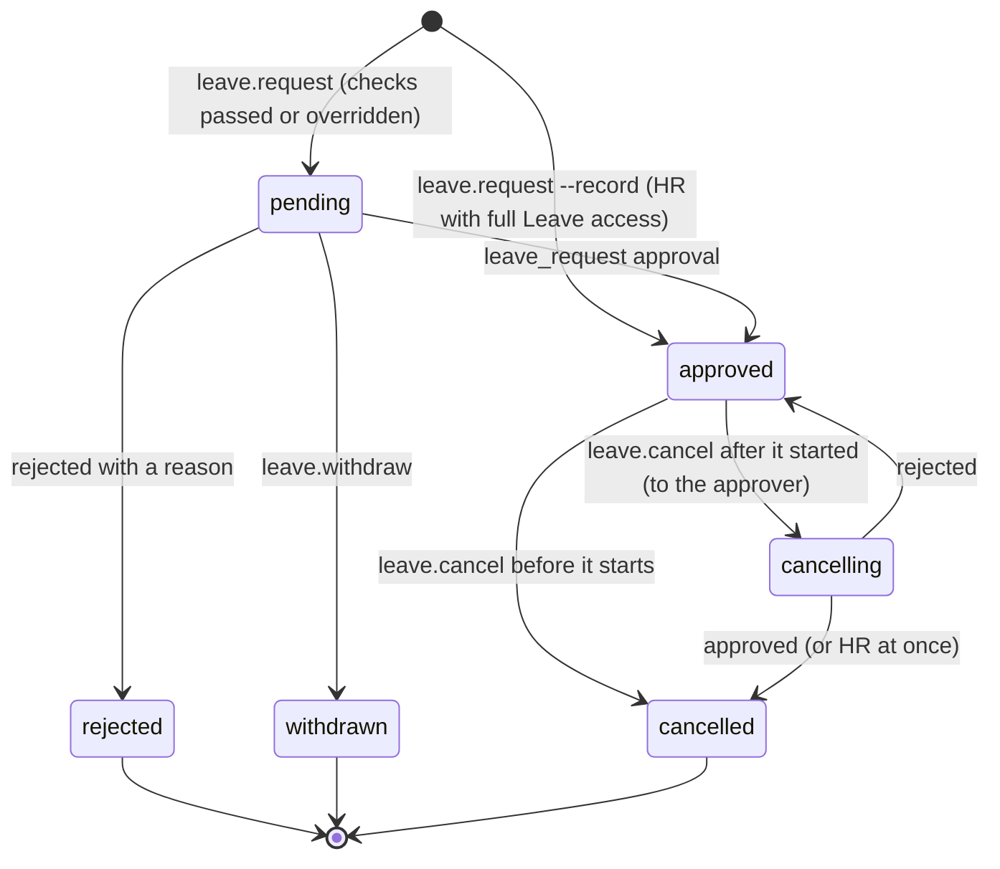
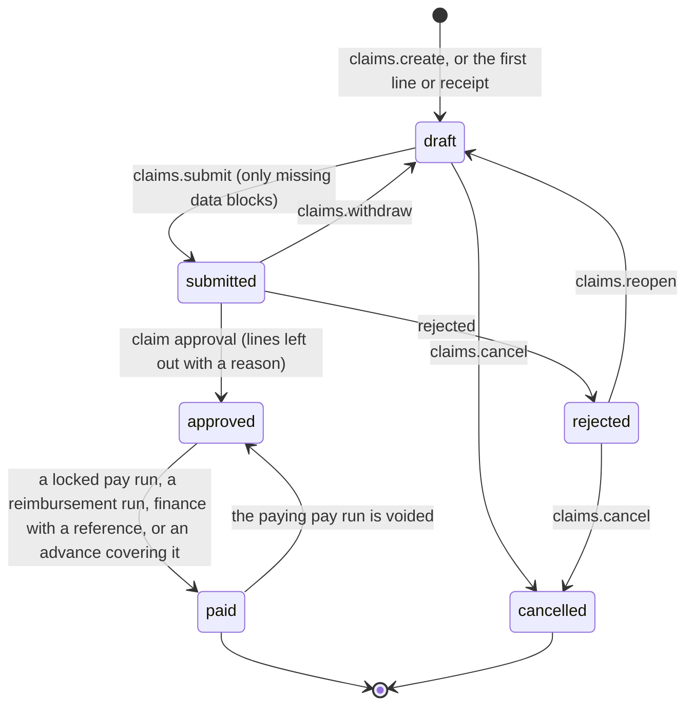
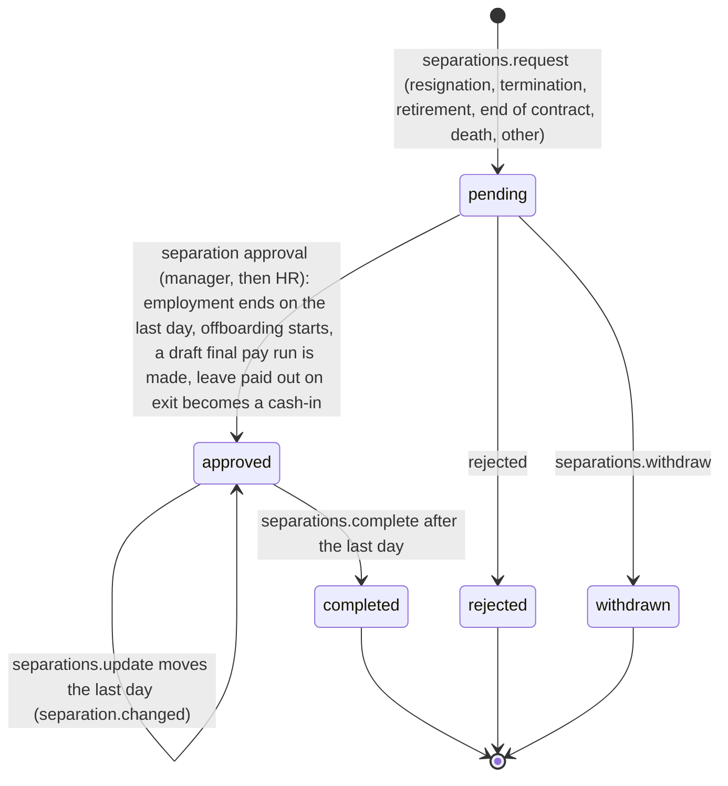
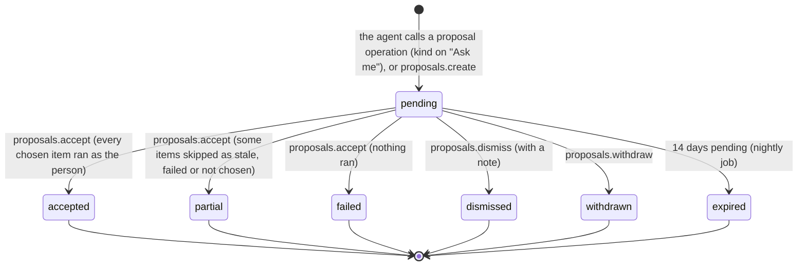
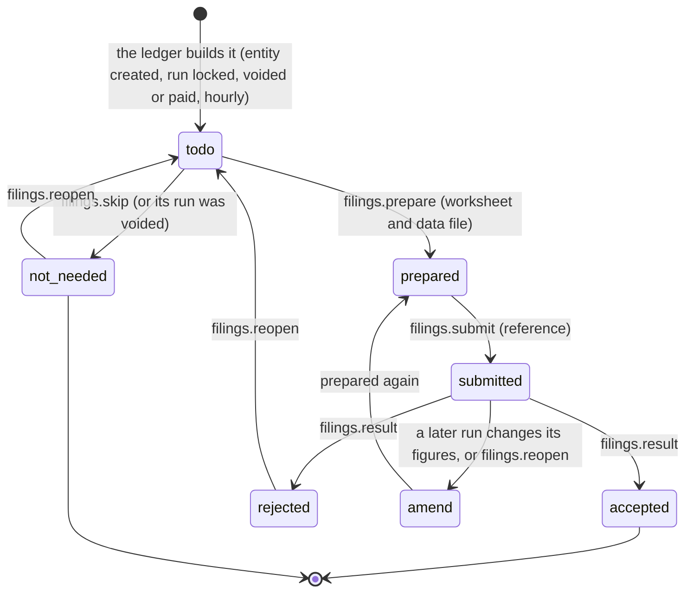

# Requirements: HR OS

PART A — REQUIREMENTS (SRS). User-approved before build; frozen after; changes via ## Changes.

## Introduction

### Purpose
HR OS is an HR and payroll back office for one company that employs people through one or several legal entities, in several countries and currencies, used in the browser by everyone in the company with their own sign-in: the owner, HR, payroll, finance, recruiters, managers and every employee. Its one job is to keep each person's employment on record and pay them correctly and on time. That covers the people records with their dated job, pay and tax history, time, leave, expenses, payroll with country rule packs, the money and filings that follow a locked pay run, hiring, onboarding and offboarding, and performance. Each person sees what their role allows, and every request is decided in one Inbox. The company's AI agent works on the same data through A2App, through the same operations the screens call. It reads receipts, reviews pay runs, explains pay changes, drafts letters, job posts and summaries, checks timesheets and rule packs, and answers people's questions. What it changes waits in the Inbox unless the owner set that kind of change to automatic. It never approves, locks, exports, reveals a sealed number, changes bank details, activates payroll rules, changes members or roles, decides on a candidate or sets a rating.

### Scope
**Goals**
1. A company is created in four setup steps (company, country, owner account with a six-digit approval PIN, recovery code shown once). A legal entity in any of the 30 installed countries starts with that country's currency, time zone, public holidays, work week, employment types, leave types, expense categories, overtime rules (an empty set with a note where the country has none), checklist templates, pay components and the payroll rule packs its country data enables.
2. A pay run moves draft, calculated, approved, locked, paid. It cannot be sent for approval with a blocker or (by default) an unacknowledged warning, its preparer cannot approve it, and once locked it never changes: it is voided and replaced with the PIN before payment, or corrected by a correction run after. Every payslip line names the rule, the values it read and the rule pack version.
3. Every request of the 22 approval kinds lands in the Inbox of the approver its flow names, and nobody approves their own request or one about themself, except the only administrator of a company.
4. A change the AI agent makes through one of the 129 proposal operations waits in the Inbox unless the owner set its kind to "On its own". The 265 people-only operations are refused to the agent with a hand-off, and none of them is declared to A2App.
5. With "Hide pay" on, no amount is in the page. Bank and identity numbers are stored sealed and shown masked, and revealing one needs the approval PIN and lasts five minutes.

**Core functionalities:** legal entities in 30 countries · team sign-in with roles, levels and an approval PIN · people records with dated job, pay and tax history · org chart and directory · one Inbox for approvals, proposals and requests · shifts, clocking, kiosk, attendance and timesheets · leave policies and a balance ledger · expense claims, advances and trips · payroll with 42 built-in rule pack versions · bank files, GL journals, filings and year-end documents · hiring pipeline with scorecards and offers · onboarding and offboarding checklists · letters, separations, assets, handbook and grievances · goals, reviews, calibration, feedback, skills and training · people and payroll reports · Home and employee self-service · search · audit trail · AI agent proposals, triggers and questions

### Approval
Approved by the user: 2026-11-16 — carried over from the published marketplace app `hr-os` 1.0.0, whose requirements were approved when it was built; this document restates them in the framework's form without changing any feature.

## Product Description

### Product Perspective
`authMode: none`: the framework does no sign-in for HR OS, because the app has its own team sign-in inside it. People sign in with a work email and a password (at least 8 characters) on the `members` auth collection; the page sends the member's token as the Authorization header and the dispatcher (`lib_ops.js`, `lib_auth.js`) reads it. A member has one role (seven are seeded: Owner, HR administrator, Payroll administrator, Finance, Manager, Recruiter, Employee; more can be added), a level per module (none, view, edit, full for people, time, leave, expenses, payroll, hiring, performance, reports and admin), an optional list of legal entities (empty means all), and an optional link to an employee record. A role with team scope (Manager) sees and acts on the member's direct and indirect reports through the job records' manager. The serious steps need the member's six-digit approval PIN, kept as a bcrypt password of a hidden auth record in `pin_vault`. The owner gets a recovery code at setup (shown once, stored hashed) that resets the owner's password or PIN. New members join with an invite code valid for 7 days. Ten wrong passwords lock a sign-in for 15 minutes and five wrong PINs lock the PIN for 15 minutes (`settings.rate_limits`). Every operation route needs a caller: a member token, or the AI agent's `.agent-token` sent as `X-A2App-Token` and compared in constant time (`$security.equal`). Only ten operations are public: `auth.login`, `auth.accept-invite`, `auth.recover`, `setup.status`, `setup.countries`, `setup.complete`, `settings.logo`, and the kiosk's `kiosk.roster`, `kiosk.punch` and `kiosk.photo`, which need the tablet's token in the `X-Kiosk-Device` header. manifest.json declares no integrations (`capabilities.integrations: []`). The backend calls two keyless exchange-rate services: Frankfurter (`api.frankfurter.dev`, the European Central Bank's rates) first, then currency-api on jsDelivr (`cdn.jsdelivr.net/npm/@fawazahmed0/currency-api`). `www.w3.org` in the gate's egress list is the SEPA XML namespace written into bank files, not a request. When CraftBot launched the app, the CraftBot bridge (`CRAFTBOT_BRIDGE_URL`) also carries `send_gmail` (notification emails when the company turns them on; candidate messages when "Email candidates" is on) and `create_google_calendar_event` (interview invitations, offered only while Google Calendar is connected, read from the bridge's `/api/integrations/available` and kept five minutes). HR OS deliberately has no connection to any bank, tax authority, social security body, job board or e-signature service: bank files are uploaded by a person, filings are prepared as worksheets and data files that a person submits, and documents are print pages. Every collection is closed to the raw records API, and screens and the agent change data only through the operations.

### User Characteristics
The people of one company: the owner; HR administrators (people, time, leave, expenses, hiring and performance); payroll administrators; finance (expenses, payroll approval); recruiters; managers, who approve for their team and interview candidates; any member placed on an interview panel; and every employee, who uses self-service for their own clock, leave, expenses, payslips, tasks, goals and documents. People without a sign-in can still clock in at a kiosk tablet with a personal PIN. They work on a desktop with the full sidebar (from 768 px) and on phones, where a bottom bar holds the five jobs done away from a desk. The work follows the company's clocks: pay runs per pay schedule (monthly, semi-monthly, biweekly or weekly), daily clocking and leave, weekly timesheets, monthly filings and a yearly tax year end per country.

### Constraints
- C-1: Money is stored as integers in minor units of its currency: two decimals by default, none for JPY, KRW, VND and other zero-decimal currencies, three for BHD, JOD, KWD, OMR and others, and IDR kept with two but shown with none (`lib_money.js`). Operation parameters take major-unit text ("1250.50"); answers carry `_minor` integers. Days are `YYYY-MM-DD` text, times of day `HH:MM`, and timestamps PocketBase dates in UTC; "today" is worked out in each entity's own time zone.
- C-2: Each legal entity has one pay currency, and payslips are in the employment's pay currency. Reports and Home convert to the company's reporting currency with the stored `fx_rates` (refreshed every six hours, or set by hand with `fx.set`). An amount without a rate is left out of a total and named, never counted as zero.
- C-3: Access is by role level per module (none, view, edit, full) within the member's entities. A manager's team is the direct and indirect reports of the job records in effect. Pay figures need payroll view, the person's own record, or (when the company switches on "managers see team pay") being their manager. The AI agent sees pay only while "Your AI agent sees pay" is on (the default) and never sees a sealed value.
- C-4: The approval PIN is six digits. It is checked before 24 operations run: locking and voiding pay runs, releasing held pay, writing a bank file, confirming an upload, marking a run paid, issuing and withdrawing year-end documents, activating and retiring rule packs, inviting, changing, disabling, enabling, resetting and deleting members, adding, changing and deleting roles, resetting another member's PIN, a new recovery code, writing off a loan, deleting a person and revealing a sealed value. Approving an approval with `needs_pin` (bank accounts, pay runs) asks the approver's PIN too.
- C-5: Bank account numbers, IBANs and identity document numbers are stored sealed with the key in `.seal-key` (made at boot, never in the database or the audit trail) and shown masked. `seal.reveal` shows one value for five minutes, audited without the value.
- C-6: Job, pay and tax records and leave policy assignments are effective-dated: the row in effect on a day is the one with the latest start on or before it. "Update" adds a row with a reason and keeps history; "Edit" corrects a row in place, refused once a locked pay run used it; only scheduled (future) rows can be deleted.
- C-7: A locked, paid or void pay run refuses every write. Before payment it is voided and replaced (PIN); after payment a correction run pays only the differences. Locking or voiding a run sends the same people's other calculated or approved runs back to draft. Time days used by a locked run are locked to it, and later changes on those days are paid as adjustments in the next run.
- C-8: Approval flows are rows per kind (optionally per entity and department) with steps (manager, manager of manager, department approver, a role, a member) and automatic approval within an amount or a number of days. A kind without a flow goes to the manager, and a step nobody can take goes to the administrators. Seeded defaults: `bank_account` payroll administrator; `leave_request`, `comp_off`, `attendance_request`, `shift_request`, `timesheet`, `overtime`, `claim`, `travel` the manager; `leave_encash` manager then HR administrator; `advance` manager then finance; `claim` also finance at or above the entity's finance amount; `payrun` finance; `pay_change` and `tax_declaration` payroll administrator; `loan` manager then payroll administrator; `requisition`, `offer` and `review_signoff` HR administrator; `separation` manager then HR administrator.
- C-9: Nobody approves their own request or a request about themself, except the only administrator of a company (written to the audit trail). The preparer of a pay run never approves it.
- C-10: Leave balances are the sum of `leave_ledger` rows and are never stored as an editable number. Reads always run the leave engine, so a balance is right before the daily run and can be projected to any future day.
- C-11: Punches are events: a correction adds a punch or takes one out with a reason, and nothing edits a punch. A punch is never refused, and one outside a place's area is flagged. Only published shifts are the plan.
- C-12: A rule pack version is activated only with the PIN and only when every test vector passes; activating retires an overlapping active version of the same code. A built-in pack is seeded active only when it ships active and passes its checks, else as a draft.
- C-13: The AI agent's autonomy is set per proposal kind (people, time, leave, expenses, payroll, hiring, performance, packs), each "Ask me" (the default) or "On its own". A pending proposal expires after 14 days, and on acceptance each item is checked again and skipped as stale if what it changes moved.
- C-14: Hiring decisions are people's: the AI agent never moves, rejects, scores, ranks or hires a candidate, never writes a scorecard or an offer, and the board sorts by waiting time, applied day or name only. Performance decisions are people's: the agent never rates, ranks or calibrates, and its review summary has no rating field.
- C-15: Raw record writes are refused for every collection, even a superuser's; only the platform's trigger queue (`agent_requests`) is written directly. `pin_vault` is never readable.
- C-16: Copy has no emoji and no em or en dashes, calls the agent "your AI agent", and never names a particular agent. Icons are lucide-react line icons.

### Assumptions
- A-1: Volume ceiling: 1,000 people per entity. The leave lists and daily run are measured at 1,000 people in one entity (`leave.balances --limit 500` about 2 s); payroll calculates 300 payslips in 12 to 15 s; Home, the reports and the time board are measured at 300 people. A list operation answers 1 to 500 rows per call (50 by default), and an import takes at most 5,000 rows.
- A-2: Each entity's time zone is one of the kernel's own zone table (`lib_util.ZONES`), because PocketBase has no time zone database on Windows; local hours (the daily leave run at 00:30, reminders at 09:00, payslip publication) are worked out from it.
- A-3: Rule packs carry the statutory rates and tables known when they were built (tax years 2025-26 to 2027 by country). A rate change reaches HR OS as a new pack version a person activates, drafted by the AI agent on request or by the monthly check the company switched on.
- A-4: Bank files, filings and year-end documents follow the published layouts where one exists; the bank layouts without a public specification (Bacs CSV, Singapore GIRO, India NEFT, Maybank, CIMB) are labelled "check with your bank".

## Features

### Module: Frame (app, search, notifications)
- F-FRM-1: A signed-in person sees a sidebar headed "HR OS" with a lucide Users icon (or the company's logo and name once a logo is set), then the places in this order: Home, Inbox, People, Time, Leave, Expenses, Payroll, Hiring, Lifecycle, Performance, Reports and Me, with Settings at the foot. A place shows only to the roles that may open it: People and Lifecycle to people viewers and managers, Hiring to hiring viewers and managers, Reports to reports viewers, Me to a sign-in linked to an employee.
- F-FRM-2: The person sees one black action at the top of the sidebar, chosen by role. People editors see "Add people" while the company has nobody. Payroll editors see "Run payroll", whose tooltip "Start <period> payroll" or "Continue <period> payroll" opens the next due run. Managers and people editors see "Approvals", and employees see the clock ("Clock in", then the next punch).
- F-FRM-3: The place the person is in shows its child pages, and other places keep the open or folded state the person gave them. People lists its departments as a tree with head counts and a "+" to hire into one. Payroll lists its pay schedules with head counts, a "+" to add a schedule and a second "+" for an off-cycle run.
- F-FRM-4: With more than one legal entity, the person can switch under the title between "All entities (n)" and one entity. Pages that work per entity follow the choice, and this browser remembers it.
- F-FRM-5: The person can collapse the 232 px sidebar to a 60 px rail with tooltips, and this browser remembers it; no page folds it on its own.
- F-FRM-6: Below 768 px the person sees a bottom bar: Home, Clock, Leave, Pay and Me for employees; Home, Inbox, People, Payroll and More for people viewers, payroll viewers, managers and administrators. More opens the full menu as a drawer.
- F-FRM-7: Every page header carries Search (Ctrl K), "Hide pay" or "Show pay" (blanks every amount on screen for screen sharing; remembered), and the notifications bell with its unread count, "Mark all read" and "Notification settings".
- F-FRM-8: The foot of the sidebar shows "Your AI agent" with its state ("Ready", "Working on n", "n waiting") and the count of new answers. It opens the ask box and "Your questions".
- F-FRM-9: WHEN a person opens a page outside their role THE SYSTEM SHALL show "This page is not part of your role" ("An administrator can change your role in Settings, Members."), and an unknown address shows "This page does not exist" with "Go to Home".
- F-FRM-10: WHEN another person, the AI agent or a job changes data THE SYSTEM SHALL reload every open view that reads it without a refresh. An open page reloads onto a newer build once no dialog is open and nothing is being typed.
- F-FRM-11: WHEN the server does not answer at start THE SYSTEM SHALL show "HR OS cannot reach its data" with "Try again". A call the busy server refused is tried three times before "The app is busy for a moment. Try again in a few seconds."
- F-FRM-12: WHEN the host switches between light and dark mode or theme packs THE SYSTEM SHALL follow it, deriving the app's colours from the host theme with contrast checks.
- F-FRM-13: The person can open print pages that render alone on an A4 sheet: a person's record, a payslip, an offer letter, a letter, a full and final statement, a year-end document, a filing worksheet and a cash and cheque list.
- F-FRM-14: The person receives in-app notifications (approvals to decide, decisions, tasks, reminders, hand-offs from the AI agent). With "Email me as well" on, and email on for the company, a short email goes out through the CraftBot Gmail bridge, never with amounts.
- F-SRC-1: The person can search from the header or Ctrl K, from two characters, across what they may see: people (name, number, email, title), departments, legal entities, pay runs, leave requests, expense claims and candidates (up to 6 per group), plus the app's pages. Arrow keys and Enter open a result, and "Ask your AI agent: <text>" sends the text as a question.

### Module: Setup and sign-in (setup, auth, pin)
- F-SET-1: WHEN no company exists THE SYSTEM SHALL show setup in four steps: Company (company name, legal name of the first entity), Country (find a country; state or region; "What <country> brings": currency, work week, public holidays, date format, payroll rules, time zone), You (name in the country's name order, email, password of at least 8 characters, a six-digit approval PIN typed twice), and Recovery code.
- F-SET-2: WHEN the owner creates the company THE SYSTEM SHALL create the first legal entity with its country defaults and the owner's sign-in and PIN, and show the recovery code once with "Download" and "I saved the code" before "Open HR OS".
- F-SET-3: The person can sign in with work email and password. Ten wrong passwords lock the sign-in for 15 minutes ("Too many wrong passwords. Try again in n minutes.").
- F-SET-4: An invited person can join with "I have an invite code": the code from their invite (valid 7 days), their name and a new password.
- F-SET-5: The owner can use "Forgot your password?" with the recovery code to set a new password, and gets a new recovery code; anyone else is told an administrator sends a new code from Settings, Members.
- F-SET-6: The person can change their password, set or change their approval PIN, and (the owner) make a new recovery code with the PIN in Settings, Security. Five wrong PINs lock the PIN for 15 minutes, and each wrong try says how many are left.
- F-SET-7: WHEN a person without a PIN runs a step that needs one THE SYSTEM SHALL offer to set it now. A step that needs the PIN asks for it in the same dialog as its question, and a wrong PIN asks again with the tries left.

### Module: Settings (settings, entities, org lists, calendars, flows, members, roles, audit)
- F-STG-1: The person sees Settings as a list of sections grouped Company, Organisation, Access and You, showing only the sections their role allows: Company, Legal entities, Locations, Departments and titles, Holiday calendars, Work schedules, Approval flows, Members, Roles, Your AI agent, Import and export, Audit log, Security and Notifications.
- F-STG-2: An administrator can set the company name, the reporting currency, the date style (by entity's country, ISO, day first, month first or year first), the hour payslips are published (default 09:00), whether managers see their team's pay, and the company logo for light and dark (removable).
- F-STG-3: An administrator can add and edit legal entities: name, legal name, country and region, currency, time zone, fiscal year start, week start, tax and registration numbers, address, the employer bank details, the default calendar, work schedule, pay schedule, leave policy and onboarding template, and the rule packs enabled. A new entity copies its country's holidays into a calendar and seeds the defaults of every module.
- F-STG-4: People administrators can keep the organisation lists: locations (address, time zone, geofence with latitude, longitude and radius, holiday calendar, kiosk code), departments (code, parent, head, approver, cost centre), job titles (family, grade), grades (pay range in a currency), cost centres and employment types. Used rows are archived, not deleted.
- F-STG-5: People and time administrators can keep holiday calendars as a year grid of public, company, optional and observed days (half days allowed), add the country's days for more years, and keep work schedules with a week editor (days, start, end, break, hours a week, flexible, grace minutes, night hours).
- F-STG-6: An administrator can set an approval flow per kind, optionally per entity and department: ordered steps (manager, manager of manager, department approver, a role, a member) and automatic approval within an amount or a number of days. A kind without a flow goes to the manager ("Every request goes to the manager").
- F-STG-7: An administrator can invite members with the PIN (name, email, role, entities, linked person) and is shown the invite code; change a member's role, entities or person; disable, enable, reset (a new invite code), sign out or delete a member; and reset another member's PIN.
- F-STG-8: An administrator can add, edit and delete roles with the PIN on a level grid (none, view, edit, full for each of the nine modules) and a team scope switch. The seven seeded roles are marked as built in.
- F-STG-9: An administrator can set, per kind of change (people, time, leave, expenses, payroll, hiring, performance, packs), whether the AI agent asks first ("Ask me") or acts "On its own", and whether "Your AI agent sees pay". The section lists what it never does on its own and "What asks your AI agent", with the "Automatic work" switches (all off).
- F-STG-10: People administrators can import people from a CSV file (check first, then import, at most 5,000 rows) and export the directory as CSV, and see past imports.
- F-STG-11: An administrator can read the audit log: who (a person, the AI agent or the system), which operation, what changed with before and after, and when, searchable and by date range. Sealed values, kiosk codes and secret parameters never reach it.
- F-STG-12: The person can choose "Email me as well" for their own notifications, and an administrator can switch company email on ("Send emails", without amounts in the body).
- F-STG-13: WHEN the reporting currency is set and more than one currency is in use THE SYSTEM SHALL fetch today's exchange rates every six hours (Frankfurter, then currency-api), and administration and payroll editors can fetch them at once from a report that is missing a rate.

### Module: People (people, employments, job, pay, tax, documents, bank, ids, employee-skills)
- F-PPL-1: The person sees the directory with readouts (headcount, joining, departments, locations), filters (Current, Joining, Former, All; department; location; entity) and search by name, number, email or title. It loads more rows as the list scrolls, and people viewers can export it as CSV.
- F-PPL-2: WHEN the company has nobody THE SYSTEM SHALL show "Add your first people" with "Hire someone" and "Import a spreadsheet".
- F-PPL-3: The person sees the org chart on a grid canvas: drag to pan, Ctrl and wheel to zoom, fold a team, with photos or initials.
- F-PPL-4: A people administrator can hire on one page with defaults from the entity's country: names in the country's order (and kana for Japan), contacts, entity, start day, job title, department, location, manager, employment type, schedule, pay (basis salary, hourly or daily, amount, period) and the tax details the entity's packs ask for. The person gets a number (E0001 onwards) and an employment.
- F-PPL-5: The person sees a profile with tabs Overview, Job and pay, Personal, Bank and IDs, Documents and Skills, plus the module tabs their role allows (Time, Leave, Pay, Expenses, Lifecycle, Performance). The person themself and their managers also see their own module tabs.
- F-PPL-6: People editors change the job, payroll editors the pay, and HR, payroll or the person the tax profile, on a timeline of past, current and scheduled rows: "Update" adds a dated row with a reason (job: hire, promotion, transfer, change, correction; pay: hire, raise, promotion, adjustment, correction, change), "Edit" corrects a row in place, and a scheduled row can be removed.
- F-PPL-7: WHEN an Edit would change a record a locked pay run used THE SYSTEM SHALL refuse it and say to add an Update instead.
- F-PPL-8: HR can change any of a person's details; the person can change their own preferred name, phone, personal email, address, emergency contacts and dependants, and their photo (JPEG, PNG or WebP up to 5 MB, or removed).
- F-PPL-9: The person can add a bank account (bank, codes, holder, number or IBAN, SWIFT, and a split of pay: rest, percent or fixed). It waits for a payroll administrator's approval with the PIN before payroll uses it, and a retired account stays in history.
- F-PPL-10: People administrators can add identity documents (type from the country's list, number, issued, expires, file); numbers are sealed and shown masked, and "Reveal the number" needs the PIN and lasts five minutes.
- F-PPL-11: The person can upload documents with a category, visibility to the employee, an expiry day and "needs acknowledgement", and the employee acknowledges them in one tap.
- F-PPL-12: The person can record skills with a level from 1 to 5, and a manager verifies them.
- F-PPL-13: A people administrator can end an employment ("Set the last day"), archive a person, and delete with the PIN only a person who was never paid.
- F-PPL-14: A people administrator can print a person's record on A4.

### Module: Inbox (approvals, proposals, questions, notifications)
- F-INB-1: The person sees the Inbox in four parts: "For you" (approvals waiting for their decision and the modules' sections), "From your AI agent" (proposals), "Your requests" and "Your AI agent" (their questions and the answers).
- F-INB-2: The person sees each approval as a card titled by its kind, with the person's chip, the step ("Step n of m"), its facts (days, amounts, states) and the decision context its module supplies (leave balance before and after and who else is away, claim lines with receipt thumbnails, a pay run's totals and held pay, a pay change before and after).
- F-INB-3: The approver can approve in one tap, approve all of a kind ("Approve all n"), or reject with a reason for the person who asked. An approval that needs the PIN asks for it.
- F-INB-4: An owner or a module administrator with full level also sees the pending approvals they oversee, each saying whether they may decide it.
- F-INB-5: The person sees each proposal of the AI agent with its label, before and after per field, notes and risk ("Low risk", "Check it", "High impact"), and can accept it (the change runs as that person, with their rights), accept chosen items, or dismiss it with a note.
- F-INB-6: The person sees their own requests across every module with status ("Waiting", "Approved", "Rejected", "Withdrawn") and can withdraw one still waiting.
- F-INB-7: The person can ask the AI agent a question in the ask box (from the Inbox, Me, the sidebar card or search); the answer appears under "Your AI agent", and a question still open can be cancelled.
- F-INB-8: The modules add Inbox sections of the viewer's own open items: checklist tasks due within 14 days, handbook pages to read, scorecards to write, candidates ready to hire, filings due, shift swaps to answer, reviews and feedback owed, and the person's own expense drafts. Their counts add to the sidebar's Inbox badge.

### Module: Home (home)
- F-HOM-1: An admin (HR, payroll, finance) sees on Home the setup guide while steps remain ("Set up HR OS", "n of m done": company and entity, approval PIN, departments, people, your team), led by its next step; while nobody is in it leads with "Add your first people".
- F-HOM-2: The admin sees "Company now": the offices on a globe or as an isometric office per entity ("Globe" or "Office", remembered), with headcount, in now, remote, on leave today, open roles, the next pay run and payroll this month. Hovering shows an office's figures and local time, and a click opens its people.
- F-HOM-3: The admin sees "Needs you" grouped by type, each group opening in place and gone when empty: approvals (approve in one tap), the AI agent's proposals, pay runs with blockers, documents expiring within 60 days, starters without onboarding and leavers without offboarding ("Start onboarding" or "Start offboarding" in one tap), probations ending within 14 days, and every module's Inbox section.
- F-HOM-4: The admin sees the pay runs of every schedule (days to pay day and to the input cutoff, state, blockers), and "People and cost": a 12-month chart of gross pay and employer cost in the reporting currency with the headcount line (joiners and leavers only without pay access).
- F-HOM-5: The admin sees even panels: Your AI agent (state, latest work, the ask box), Team today, "Who is out" (today and later this week), "Starting and leaving" (30 days, with checklist progress), "Open roles" (candidates by stage), "Expenses" (waiting, flagged, to pay) and Reports.
- F-HOM-6: A manager sees Needs you, their own clock, Team today from the time board (in, not in, away, off, "Shift over"), team readouts (team and direct, out today, leave days this month, probations in 30 days) and the manager widgets of the modules.
- F-HOM-7: An employee sees the clock and their leave balance first, then Needs you (documents to acknowledge in one tap and every module's items), the employee widgets of the modules (first days, latest payslip, my expenses, goals, hiring, praise), their requests with status and their questions with the answers.
- F-HOM-8: WHEN a sign-in has no employee record THE SYSTEM SHALL let an administrator link it to their person in place or add themselves as an employee, and tell anyone else who links it.
- F-HOM-9: WHEN no exchange rate to the reporting currency is known THE SYSTEM SHALL keep Home's cost in its own currency, or show each currency's own total, and never count it as zero.

### Module: Me (home.me, home.directory)
- F-ME-1: An employee sees the Me hub: who they are here, the facts every module keeps on them, and their places with counts: My details, My documents, My pay, My requests, My tasks, Goals and reviews, Handbook, Directory, Ask your AI agent, My time, My leave and My expenses.
- F-ME-2: The employee can keep their own details (personal, emergency contacts, address, dependants), ask for a bank account change (it waits for payroll), send their tax details on the form their packs ask for, and set their kiosk PIN (4 to 6 digits).
- F-ME-3: The employee can open their documents and acknowledge them, and their requests across every module with status ("No requests yet" when none).
- F-ME-4: Everyone can search the company directory by name and by department: work details only (name, title, department, location, entity, work email, manager), within their entities.
- F-ME-5: The employee can ask the AI agent about HR in their company on "Ask your AI agent" and read the answers.

### Module: Time (clock, kiosk, shifts, attendance, timesheets, overtime)
- F-TIM-1: An employee sees the Clock page: one big button (Clock in, Start break, End break, Clock out), today's plan (shift, holiday, leave or day off), today's punches, the week and the hours worked against the plan. The new state shows at once, and "Undo" takes back their own latest punch within five minutes.
- F-TIM-2: WHEN a place checks an area THE SYSTEM SHALL read the location once at the punch and never in between, and a punch outside the area is flagged for a look, never refused.
- F-TIM-3: HR can start a kiosk tablet once at a location (`#/time/kiosk/<kiosk code>`). People pick their face or name and type a personal 4 to 6 digit PIN, which locks for 15 minutes after five wrong tries; this works for people without a sign-in.
- F-TIM-4: Time editors can keep shift types per entity (start, end, break, grace in and out, half-day and absence thresholds, colour, code, default location) and repeating shift patterns.
- F-TIM-5: Time editors can plan the week by person: drag a shift type onto a day or pick a type and tap days, "Copy last week" (fill or replace), lay a pattern over many people for a date range, "Discard changes", and "Publish". Only people whose shifts changed are told, and drafts are invisible to employees.
- F-TIM-6: The schedule shows approved leave and public holidays, and a shift on a leave day is a conflict.
- F-TIM-7: An employee can ask for a different shift on some days, or a swap the colleague agrees to first; the manager decides (kind `shift_request`).
- F-TIM-8: WHEN 30 minutes pass, or someone asks, THE SYSTEM SHALL work out attendance from the punches: status, first in, last out, worked, break (the scheduled break taken off a day over 6 hours when none was punched), late, early, overtime and night minutes. Approved leave and holidays are respected, and a day set by hand, by a request or used by a locked pay run is never recomputed.
- F-TIM-9: Time editors can choose per entity how time is counted: people clock in (a working day without punches is an absence) or exceptions only (the default: a working day counts as worked unless marked).
- F-TIM-10: Time viewers and managers see "Attendance today" by location and team (in, late, absent, on leave, remote, done, expected later, "Shift over"), and a month grid per person with codes, totals, late, missing punches and hand-set days.
- F-TIM-11: Time editors can correct a day in place: add a punch, take one out (kept with the reason), set the day by hand, or put it back to following the punches. They can mark many people and days at once, and export attendance as CSV.
- F-TIM-12: An employee can ask to fix a missed punch, a whole day's hours, work from home or on duty (kind `attendance_request`), and ask for overtime in advance where the entity requires it (kind `overtime`).
- F-TIM-13: An employee sees their weekly timesheet from attendance (regular, overtime, leave and holiday rows) and can add project and task rows, submit, withdraw and reopen it. The manager approves it in the Inbox with the week's numbers and exceptions (kind `timesheet`).
- F-TIM-14: Time editors and managers can "Ask your AI agent to check" a week of timesheets; the agent proposes fixes for missed punches and never approves.
- F-TIM-15: Time administrators can keep overtime rules per entity (daily, weekly, monthly, seventh consecutive day, rest day, public holiday, night premium, with multipliers and pay component codes, caps, and a rule set per employment type), try them on a sample week, and reset to the country defaults (US with California, Japan with the 36 agreement limits, Singapore, India, Malaysia, United Kingdom with none, Australia placeholders).
- F-TIM-16: WHEN payroll reads a period THE SYSTEM SHALL give the worked, regular, overtime, night and holiday minutes, absent days, late minutes and adjustments for days a locked run already paid, with issues: missing punches, unapproved or missing timesheets, overtime limits, pending requests, locked days.
- F-TIM-17: WHEN a punch or request lands on a day a locked pay run used THE SYSTEM SHALL record it, keep what was paid, and pay the difference in the next run; only a hand edit of a locked day is refused.

### Module: Leave (leave)
- F-LV-1: Leave administrators can keep leave types per entity: paid or unpaid, days or hours, an icon and a meaning colour, half days, hours, negative balance with a limit, certificate from n days, notice, longest stretch, calendar days, holidays and weekends counted or not, cash-in, paid out on termination, compensatory, who sees the type, pay code, archive.
- F-LV-2: Leave administrators can keep policies with one rule per type: fixed days a year, monthly accrual (at the start or end of the month, or by day), accrual per hours worked, tenure tables, the Japanese statutory grant schedule, adjustments only, or no balance; with joining and leaving proration, rounding, waiting months, caps, carry-over limit and expiry, grant expiry, scaling by FTE or days a week, bank holidays from the allowance and one type counting another's days.
- F-LV-3: A policy change applies from a day (earlier leave years keep their numbers), and policies are assigned to people from a day; new hires follow the entity default from their first day.
- F-LV-4: Leave administrators can assign a policy to many people and give or take days from many people, each with a preview, and leave editors adjust one balance with a reason ("Adjust the balance").
- F-LV-5: The person sees each balance explained: how today's number was reached with the running balance, its lots and expiry, and a projection to a future day.
- F-LV-6: An employee can "Request time off" in three taps: the page opens on the calendar with their usual type, then the days, then "Send request". Full days, half days (morning or afternoon) and hours are allowed.
- F-LV-7: WHEN a request is checked THE SYSTEM SHALL count the working days of the person's schedule and holiday calendar and refuse locked days (with their allow list), short notice, a stretch over the longest, overlaps and a balance that would go below its limit on any day. It shows who else in the team is away, and a manager or HR may go past a check with a reason.
- F-LV-8: A request goes to the approval flow (kind `leave_request`), and HR with full Leave access can record leave as approved ("Record leave").
- F-LV-9: The person can withdraw a request still waiting, cancel approved leave before it starts at once, and cancel from a day after it started (back to the approver, or at once for HR), and add a certificate.
- F-LV-10: An employee can ask to cash in days of a type that allows it ("Ask to cash in", kind `leave_encash`, manager then HR), paid in the run covering the pay day; and ask for compensatory leave for a rest day or holiday worked ("Ask for the time back", kind `comp_off`), which expires as the policy says.
- F-LV-11: WHEN a separation is approved or its last day moves THE SYSTEM SHALL turn the unused balance of types paid out on termination into an approved cash-in on the last day, kept equal to the balance until the final pay run pays it.
- F-LV-12: The person sees the "Wallchart" for up to two months: people as rows, leave bars by type (hatched while waiting), days off, holidays and locked days; tapping a day starts a request. Colleagues see each other only as away, without the type.
- F-LV-13: HR sees Leave home: out today and this week, requests waiting, and balances needing attention (days lapsing within 60 days, balances below zero, the Japanese five-day rule at risk or missed).
- F-LV-14: Leave viewers and managers see the balance table: one row per person, a column per type with the balance and what is available.
- F-LV-15: For Japan, leave viewers see the five-day rule tracker (missed, at risk, on track, done; Monday notices to the person and HR) and the "Paid leave register" (年次有給休暇管理簿) per person and grant year, with CSV export by a person.
- F-LV-16: WHEN an entity is created THE SYSTEM SHALL seed its country's leave types and policy (JP, SG, MY, IN, US with California sick leave, GB, AU, and a generic set elsewhere), and `leave.seed-defaults` sets up an entity later ("Set up from the country defaults").
- F-LV-17: WHEN 00:30 passes in an entity's time zone THE SYSTEM SHALL write the day's grants, accruals, carry-over and expiries once by key, with a correcting row when a later change moves a number.

### Module: Expenses (expenses, claims, claim-lines, advances, travel)
- F-EXP-1: Expenses administrators can keep categories per entity (seeded: meals, travel, lodging, mileage, phone and internet, training, office supplies, client entertainment, other): limit per expense and per day, receipt rule (always, from an amount, never), mileage rate per km or mile, taxable, pay component, GL account; a used category is archived.
- F-EXP-2: Expenses administrators can set the policy per entity: the amount from which finance also approves, age and weekend flags, how claims and advances are paid, how advances are settled and when recovery from pay starts.
- F-EXP-3: An employee can "Add expense" in one line (amount, category, day) or with a receipt photo or PDF ("Take a photo of the receipt", "Drop receipts here; your AI agent reads them"). A receipt makes a draft line and asks the AI agent to read it.
- F-EXP-4: The employee sees the AI agent's reading of a receipt ("Your AI agent read this receipt") and uses it ("Use these") or dismisses it. With expenses set to "On its own" the reading fills only the fields the person has not typed, and a reading still waiting blocks submission.
- F-EXP-5: The employee can add lines in any currency at the day's rate to the claim currency (or a rate they type), and mileage as distance times the category's rate.
- F-EXP-6: WHEN a line is saved THE SYSTEM SHALL flag it without blocking: over the limit, over the day limit, missing receipt, weekend, duplicate (same merchant, amount and day), older than the policy allows, and the AI agent's flags (possible duplicate, generated or edited image, not a receipt, unclear, restricted item, amount differs) until a person clears them. Only missing data blocks a submission.
- F-EXP-7: Submitting opens an approval (kind `claim`, plus finance at or above the entity's amount). Approvers can leave single expenses out with a reason and approve the rest.
- F-EXP-8: An approved claim is paid with the next pay run, by a separate reimbursement run, or marked paid by finance with a reference; it shows how it was paid.
- F-EXP-9: An employee can ask for an advance (kind `advance`, manager then finance). Finance pays it (or the pay run does), and it is settled by later claims, a repayment or recovery from pay; a leaver's whole balance is recovered from the final pay.
- F-EXP-10: An employee can "Plan a trip" (purpose, days, destinations, itinerary, estimate by category) for approval (kind `travel`); claims link to the trip, and the trip shows what was claimed against the estimate.
- F-EXP-11: Expenses viewers and managers see Expenses home (waiting, flagged, approved not paid, advances to act on, trips, the month's spend by category and department), the claims list (filters, CSV of claims or lines by a person) and the claim page with lines beside their receipts, flags, approvals and history.
- F-EXP-12: WHEN a Monday comes THE SYSTEM SHALL remind people of drafts left for a week and finance of approved bank claims still unpaid.

### Module: Payroll runs and payslips (payroll, payruns, payslips, holds)
- F-PAY-1: A payroll editor can start the next due regular run of a schedule ("Start pay run", "Run payroll") and off-cycle, bonus, final pay, correction and reimbursement runs for chosen people or everyone.
- F-PAY-2: The payroll editor can "Calculate" a run: one payslip per employment from pay records (with proration by calendar days, working days or a fixed 30), hours and overtime from Time, unpaid leave and cash-ins from Leave, claims and advances from Expenses, recurring items, benefits, pay inputs, loans and back pay, then the entity's rule packs. Large runs calculate in chunks of 20 and finish by themselves if left.
- F-PAY-3: The person sees the run page with its steps (Draft, Calculated, Approved, Locked, Paid) and tabs Employees, Issues, Changes, Components and Notes, with a payslip drawer per person.
- F-PAY-4: WHEN a run is calculated THE SYSTEM SHALL list its issues: blockers stop approval, warnings need a person's acknowledgement with a reason (entity setting, on by default), and every issue has a plain message and a fix. A person who may change the value fixes it in place and the payslip recalculates; otherwise "Ask" sends it to who can.
- F-PAY-5: WHEN an entity runs its first pay in HR OS THE SYSTEM SHALL block the run until the earlier pay of the tax year is entered as opening balances ("Opening balances": a sheet, single saves or a CSV import) or the entity confirms nothing was paid earlier.
- F-PAY-6: The person sees the changes against the last regular run: totals, people and components by size of change, with reasons from the data (raise, new joiner, first run, overtime, unpaid leave, bonus, reimbursement, tax profile, pack version).
- F-PAY-7: The payroll editor can "Send for approval" (kind `payrun`, finance by default, never the preparer). The approval carries the net to pay without held pay, held pay apart and the pay day, and a hold added or taken off afterwards asks for approval again.
- F-PAY-8: An approved run is locked with the PIN ("Lock with my PIN"). Locking stores a fingerprint of every input, marks claims, advances, cash-ins and time days as paid by it, and offers "Write the bank file"; "Check fingerprints" recomputes every payslip.
- F-PAY-9: A locked run can be voided and replaced with the PIN before it is paid, and a paid run is corrected by a correction run that pays only the differences.
- F-PAY-10: A payroll editor can hold a person's pay in a run, and release it with the PIN into a later run.
- F-PAY-11: WHEN the entity's publication hour passes after a run is locked THE SYSTEM SHALL publish its payslips (or a person does with "Publish payslips"), and the employees are told.
- F-PAY-12: The person sees a payslip with its lines by group, year to date, the bank split and how each figure was reached: every line opens its rule, condition, rounding, the values it read, table rows, pack version and sources. It prints on A4.
- F-PAY-13: An employee sees "My pay": their payslips and year-end documents.
- F-PAY-14: The payroll editor can ask the AI agent to review a run ("Ask your AI agent to review this run") and to explain one person's change ("Ask why"); the agent writes notes on the run and never approves.
- F-PAY-15: People and the AI agent can write notes on a run (note, review, flag) and mark them resolved.
- F-PAY-16: WHEN a separation is approved THE SYSTEM SHALL make a draft final pay run for the leaver, and move it with the last day until it is locked.

### Module: Pay setup and pay items (pay-schedules, components, recurring, pay-inputs, ytd, comp, backpay, loans, benefits, taxprofile, declarations)
- F-PIT-1: Payroll administrators can keep pay schedules per entity (monthly, semi-monthly, biweekly, weekly; period anchor, pay day rule, input cutoff days, currency) and see the pay calendar, with pay days moved off weekends and holidays.
- F-PIT-2: Payroll administrators can keep pay components per entity (earning, deduction, employer, reimbursement, info; stage; calculation fixed, percent, hours, days or input; tags the packs read; taxable; GL and liability accounts; payslip group), seeded from the entity's packs plus a basic set ("Add the default components").
- F-PIT-3: Payroll editors can add one-off pay inputs to a period or a run, import them from CSV (check, then import, at most 5,000 rows), and void unused ones; and keep recurring items with from and to days.
- F-PIT-4: A pay change is requested with a reason and a day (kind `pay_change`, payroll administrator); a change back-dated into a locked period opens "Back pay", paid as arrears in the next or an off-cycle run.
- F-PIT-5: An employee can ask for a loan ("Ask for a loan", kind `loan`, manager then payroll administrator); it is repaid through payroll at lock, can be rescheduled or repaid by hand, and written off with the PIN.
- F-PIT-6: Payroll administrators can keep benefit plans (health, dental, vision, life, retirement, transport, meal, wellness, other), and payroll editors enrol people from a day and end an enrolment.
- F-PIT-7: The person can open a tax profile with the fields their packs ask for (labels and help from the packs); an employee's own change follows the entity's approval rule (kind `tax_declaration`).
- F-PIT-8: An employee can file tax declarations with proofs (India sections mapped to the pack's fields) for approval ("New declaration").
- F-PIT-9: Payroll editors can set the personal fields packs read (birth date, nationality, gender), and payroll administrators the payroll settings per entity (proration, warnings needing acknowledgement, first pay day in HR OS).

### Module: Rule packs and the engine (packs)
- F-PCK-1: The engine calculates every payslip from the rule packs in force (`lib_engine.js`): steps in order across packs, a safe expression language with tables (brackets, bands, maps), year-to-date reads, rounding rules, and a blocker on the payslip instead of an error for one person.
- F-PCK-2: HR OS ships 42 rule pack versions of 39 pack codes: US federal, 13 state income tax packs and one for the states without income tax, United Kingdom, Australia (2025-26 and 2026), Canada federal, Ontario, British Columbia and Alberta, Japan (2026, 2027 and the year-end adjustment), Singapore (2026 and 2027), India (income tax, EPF, ESI and professional tax for seven states), Malaysia (PCB, EPF, SOCSO, HRD Corp) and a flat-rate `generic` pack. Three Indian professional tax packs (Karnataka, Tamil Nadu, West Bengal) ship as drafts.
- F-PCK-3: Payroll viewers see "Rule packs" by country with each pack's steps, tables, fields, sources and vectors, run the vectors live, and see a draft as a diff against the active version.
- F-PCK-4: A payroll administrator can activate a draft with the PIN only when every vector passes and retire a version with the PIN; a payroll editor can discard a draft.
- F-PCK-5: A payroll editor can ask the AI agent to check a pack's official sources and draft an update ("Check for updates", "Ask for an update").

### Module: Pay out, filings, year end and payroll reports (payout, bankfiles, journal, filings, yearend, payreports)
- F-OUT-1: Payroll viewers see "Pay out" of locked runs: to the bank, held, cash and cheque, and net pay of the run, balanced.
- F-OUT-2: A payroll administrator can write a bank file with the PIN ("Write with my PIN") in the entity's format: generic CSV, NACHA PPD, ABA, SEPA pain.001, Bacs CSV, Zengin, Singapore GIRO CSV, India NEFT CSV, Maybank CSV or CIMB text. Pay is split across a person's approved accounts.
- F-OUT-3: WHEN a bank file is asked for THE SYSTEM SHALL check every payment first (routing check digit, BSB, IBAN length and mod 97, BIC, IFSC, sort code, account lengths, kana with no bank form, zero pay) and write nothing while any problem names a person and a field (numbers masked).
- F-OUT-4: The file is stored with its SHA-256 and downloads are audited. The run becomes paid only when a person confirms the upload with the bank's reference, or marks a cash, cheque or outside payment paid, with the PIN.
- F-OUT-5: The payroll administrator can print cash and cheque lists with cheque numbers, notes and coins to draw and a signature column, and tick who received their pay.
- F-OUT-6: Payroll and reports viewers can preview, and payroll editors export, a GL journal per run (by GL and liability accounts, line code and payee, cost centre and department, balanced per group) as generic, Xero or QuickBooks CSV, and keep the GL accounts in Pay-out settings.
- F-OUT-7: Payroll viewers see the filings ledger per entity and period from the packs and country data (for example US 941 and its deposits, 940, W-2; UK FPS, EPS, P60, P11D; AU STP, BAS, payday super; Japan 源泉, 社会保険, 住民税, 年末調整; Singapore CPF, IR8A; India TDS, 24Q, Form 16, ECR, ESI; Malaysia PCB, EPF, SOCSO, HRDF, EA), with due days moved by weekend and holiday rules.
- F-OUT-8: A payroll editor can prepare a filing (worksheet and data file from locked lines, printable), record the submission with its reference, record accepted or rejected, mark it not needed, reopen it, and set a due day by hand. A filing becomes "amend" when a later run changes its figures.
- F-OUT-9: WHEN an entity is created, or a run is locked, voided or paid, and every hour THE SYSTEM SHALL build the ledger again, and once a day remind payroll people of filings due within 7 days or late.
- F-OUT-10: Payroll viewers see year-end documents from locked runs (W-2 and W-3 data, P60, P45, P11D, 源泉徴収票 and 給与支払報告書, IR8A, Form 16 Part B, 24Q, EA and CP8D, Australian income statement) as print pages and CSV data. A payroll administrator issues or withdraws them with the PIN, and employees open their issued ones in "My tax documents".
- F-OUT-11: Payroll and reports viewers see "Payroll reports": register, cost by entity, department or cost centre in the reporting currency, owed to each authority by payee and month, year to date per person, and headcount with average pay.

### Module: Hiring (hiring, staffing-plans, requisitions, openings, candidates, applications, interviews, scorecards, offers, referrals)
- F-HIR-1: Hiring administrators can keep staffing plans per entity with lines per department and job title: planned headcount and budget against the people there today, requested and hired.
- F-HIR-2: A hiring editor can "Request a role" (new role, growth, replacement) with a pay range, budget, hiring manager and justification for approval (kind `requisition`); a declined one goes back to draft with the note, and it is filled when the hires are in.
- F-HIR-3: A hiring editor can create an opening ("New opening") from an approved requisition, like an earlier opening, or directly: a markdown job post that saves itself 1.2 s after typing stops, place, remote mode, employment type, positions, hiring manager and team, and "Publish" it.
- F-HIR-4: WHEN an opening's work place requires pay in the posting (12 US states and DC, remote US roles, Canada's BC, PE and ON, EU countries before the first interview) THE SYSTEM SHALL warn, never block.
- F-HIR-5: A hiring editor can keep pipeline stages per opening (default Applied, Screen, Interview, Offer, Hired; rename, add, reorder, remove with a step that says where the people go); the hired stage is reached only by hiring.
- F-HIR-6: A hiring editor can add a candidate ("Add candidate"): one per email (checked as it is typed), resume (PDF, Word, text or image), source, links, tags, consent for future roles. Candidates can also be imported from CSV after a dry run (new, already here, rows to fix), and exported as CSV by a person.
- F-HIR-7: The person sees a board per opening and drags a card between stages (on a phone, "Move to"); cards are in waiting order, never by merit. Bulk move, reject with a reason (and its message), message, withdraw and reopen are offered, and an open offer blocks a rejection.
- F-HIR-8: The person sees a candidate profile: details, the resume viewer, applications with the stage chain, interviews and scorecards as they may see them, offers, and a timeline with notes.
- F-HIR-9: A hiring editor can schedule an interview (panel of members, day, time and time zone, place or link, kind, interview kit). The panel is told. While Google Calendar is connected, the person can add the interview to it, with the panel and (by default) the candidate as guests.
- F-HIR-10: Each panel member writes a scorecard: recommendation (strong no to strong yes), a score of 1 to 4 per kit criterion and notes; nobody sees the others' scorecards for that interview until theirs is submitted.
- F-HIR-11: A hiring editor can ask the AI agent for a neutral summary of the submitted scorecards of an interview; it comes back as a proposal.
- F-HIR-12: A hiring editor can make an offer (pay, start day, bonuses and allowances, terms, a letter from a template) for approval (kind `offer`), send it (optionally by email), record the answer, and "Hire <name>", which opens the hire page filled from the offer and links the new employment to the application.
- F-HIR-13: Anyone can "Refer someone" for an open role with a resume, and sees only submitted, in process, hired or not moving forward; they are told when their referral is hired.
- F-HIR-14: The person sees Hiring home: open roles with candidates per stage, what needs them (scorecards owed, ready to hire, offers to move, approved requisitions without an opening, retention review), and interviews today and this week.
- F-HIR-15: Hiring administrators can set default stages, rejection reasons with messages, offer terms, offer letter templates with a sample preview, interview kits, retention days by country (suggested with their basis), and "Email candidates" on or off.
- F-HIR-16: WHEN a candidate passes their retention day with nothing in process THE SYSTEM SHALL flag them and tell the people who run hiring; a person deletes them, never the system.
- F-HIR-17: Managers see only openings they manage, own or are on the team of, and any member on a panel sees that interview, the candidate's basics and resume.

### Module: Lifecycle (lifecycle, checklists, letters, separations, assets, handbook, grievances)
- F-LIF-1: People editors can keep checklist templates per entity (onboarding, offboarding, custom; one default per kind; country defaults for US, JP, SG, IN, MY, GB, AU and a generic set) with tasks in lanes (HR, manager, IT, the person, a named member, your AI agent), a due offset from the first or last day and a kind (task, document upload, signature), reordered by drag with an inline "+".
- F-LIF-2: WHEN a person is hired with a first day today, ahead, or at most 30 days ago THE SYSTEM SHALL start their onboarding checklist. Offboarding starts on an approved separation, or when an employment ends without one, and "Start a checklist" starts one by hand.
- F-LIF-3: The person sees a checklist as a board by lane with due days; tasks are done, reopened, skipped, added or edited. Manager tasks follow the manager, and HR takes IT tasks while nobody has the IT role.
- F-LIF-4: A new hire with a sign-in sees "Welcome, <name>" before and in their first weeks: days to go, arrival time, place, contact, what to bring, a note, their tasks, documents and letters to acknowledge, and handbook pages to read.
- F-LIF-5: WHEN 09:00 passes in an entity's time zone THE SYSTEM SHALL send each member one digest of their open checklist tasks.
- F-LIF-6: An employee can resign or retire, and a manager or HR can "Record a separation" of any kind (resignation, termination, retirement, end of contract, death, other) with notice and last day, reason, reason code and rehire eligibility, for approval (kind `separation`, manager then HR). On approval the employment ends on the last day and offboarding starts; a moved last day ends it again.
- F-LIF-7: HR can keep exit interview forms (text, rating, choice, yes or no questions) and record the answers, which only HR sees.
- F-LIF-8: People editors see the full and final statement: claims to reimburse, advances and loans to recover, leave to pay out, assets not returned, the final pay run, and totals per currency (the final payslip once calculated, an estimate before); it prints on A4.
- F-LIF-9: People editors can keep letter templates by kind (offer, appointment, confirmation, experience, salary certificate, warning, relieving, custom) in markdown with placeholders, with country defaults (Japanese 在職証明書 and 退職証明書).
- F-LIF-10: A people editor can write a letter ("New letter") with a live preview, or ask the AI agent to write it, then issue it (frozen and stored as the person's document), void it, and the person acknowledges it. Pay placeholders show only to people who may see that pay, and a missing value blocks issuing.
- F-LIF-11: People editors can keep assets (tag, category, serial, value, condition): issue, return (condition, lost), retire, with history, on the profile and in offboarding; import from CSV (check, then import) and export.
- F-LIF-12: People editors can write handbook pages in markdown by category ("Write the first page"), publish versions, and see who acknowledged each version; people read and acknowledge them ("I have read this").
- F-LIF-13: Anyone can report a concern (optionally anonymous) of a grievance type to HR; HR assigns an investigator, shares it with members or the AI agent, writes internal notes or notes for the reporter, and sets the status and resolution the reporter reads. Managers never see it unless HR assigns or shares it.

### Module: Performance (perf, goals, cycles, reviews, calibration, feedback, skills, trainings)
- F-PRF-1: The person can add goals ("Add goal") for themself, and with the right for a team (department) or the company: goal, KRA or OKR, key results (start, target, current, unit), weight, status (on track, at risk, off track, done, dropped), due day, and alignment to a parent goal.
- F-PRF-2: WHEN key results, aligned goals below or check-ins change THE SYSTEM SHALL fill a goal's progress and roll it up the alignment tree (no cycles allowed).
- F-PRF-3: The person can "Check in" on a goal with a note, new key result values, progress and status; the history keeps before and after, and the manager hears when a report's goal goes off track.
- F-PRF-4: The person sees Goals opening on what needs an update (at risk, off track, overdue, due soon, no check-in for n days), as a list or an alignment tree, with CSV import (check, then commit) and export.
- F-PRF-5: Performance administrators can keep review templates: a rating scale of 3 to 7 points with labels, sections (goals with weight, competencies, open questions with required flags), who answers each section and who gives an overall rating; three are built in (annual, probation, quarterly check-in).
- F-PRF-6: A performance administrator can create a review cycle in a short wizard (kind, name, entity, period; everyone, departments, chosen people or probations ending; a joined-before filter; template; phases with days), then launch and close it.
- F-PRF-7: Reviewers write self, manager, upward and peer reviews with autosaved drafts and submit them with the list of what is missing; peer and upward reviews can be declined, and HR can reopen and reassign them.
- F-PRF-8: The person sees each cycle's progress and who has not submitted. Reminders go out daily at 09:00 local during a phase that ends soon or is late, and on demand.
- F-PRF-9: The manager shares a review (HR any time, or all at once), the person acknowledges it with a comment, and HR signs it off where the entity requires it (kind `review_signoff`; rejected goes back to the manager with the note).
- F-PRF-10: Performance viewers and managers see "Calibration": the distribution of ratings per department and overall, and the people with manager rating, score and final rating. A change needs a reason and keeps a history; there is no automatic curve.
- F-PRF-11: A reviewer can ask the AI agent for a neutral summary of the person's period, from only what the reviewer may see, with sources; the reviewer uses it as a start or dismisses it.
- F-PRF-12: The person can "Give praise" (on the wall or private, tagged with company values), give private feedback to a person or their manager, ask for feedback about themself (or a report), decline a request, and remove what they wrote.
- F-PRF-13: The person sees the skill library (category, level descriptions, the level each job title expects) and the team skills matrix with gaps, with CSV export.
- F-PRF-14: Performance editors can keep training programs (course, workshop, certification, validity) and sessions (days, times, place or link, seats, cost, status) ("Schedule training"); people enrol (self, managers, HR) within capacity, attendance and results are recorded, attendees give feedback, and certificates are kept as protected files.
- F-PRF-15: Performance editors can set required trainings by entity, department or job title with a due day or days after joining, and see compliance (done, expiring, due, overdue) with renewals; reminders go out weekly.
- F-PRF-16: The person sees Performance home: what they owe, the current cycle and its phase, goals needing an update with a one-tap check-in, praise this week, and team counts.

### Module: Reports (reports)
- F-REP-1: The person sees the Reports hub listing every report they may open: the eleven people reports and the modules' own report pages.
- F-REP-2: Reports viewers can open headcount over time (by entity, department or location), joiners, leavers and turnover (voluntary and involuntary from the separation kind, else "not recorded"), tenure, span of control, and diversity (aggregate counts only).
- F-REP-3: WHEN a diversity group has fewer than 5 people THE SYSTEM SHALL hide its count, hide the next smallest when one hidden group could be worked out, and hide everything when the total is under 5.
- F-REP-4: Payroll viewers can open pay against grade ranges (yearly pay scaled to full time) and payroll cost in the reporting currency.
- F-REP-5: The person can open leave liability (days; money only with pay access), absence and overtime (whole months, default 3, at most 12, "Count again"), the hiring funnel with time to hire, and training completion.
- F-REP-6: Each report keeps its filters in the address (entity, department with sub-departments, location, period or day, reporting currency) and shows a chart first, the figures, the table, and a CSV export by a person (audited).

### Agent (via A2App)
- F-AGT-1: The agent can perform every declared operation: the 465 operations in ## Operations Design (336 run directly and 129 proposals), across the 123 modules of manifest.json.
- F-AGT-2: The agent can read the rules, how to read answers (money in minor units, days as text), the modules with their operation groups and triggers, and one recipe per trigger from `app.guide` (`--module`, `--recipe`), where the company stands from `app.status`, and each trigger with the Automatic work switches from `agent.triggers`.
- F-AGT-3: WHEN the agent calls one of the 129 proposal operations (kinds people 44, payroll 29, performance 18, hiring 12, time 12, leave 10, expenses 3, packs 1) and the owner set that kind to "Ask me" THE SYSTEM SHALL check it in a rolled-back run first ("Not proposed: ..." when it cannot work), store it as a proposal in the Inbox with before and after, and change nothing. With the kind set to "On its own" it runs at once. `proposals.create` puts several such calls in one set, and `proposals.withdraw` takes a pending one back.
- F-AGT-4: The 265 people-only operations (`agent: 'deny'`, including all 24 that need the PIN) are not declared to A2App. WHEN the agent's token reaches one THE SYSTEM SHALL refuse it before reading parameters and say a person does it, never to ask for a PIN or password, and to hand it over with `inbox.route`.
- F-AGT-5: The agent can hand a request it may not do to the person or role who can with `inbox.route` (`--member`, `--role` or the role of `--op`; the owner when none is active): an Inbox notification "Your AI agent passed on a request" with the request quoted, an in-app link only, sent once per person and record while unread.
- F-AGT-6: WHEN the agent calls a destructive declared operation (`claims.delete`, `claim-lines.delete`, `employee-skills.remove`) THE SYSTEM SHALL answer `approval_required` until the person approved that call, and nothing is deleted without `--confirm true`.
- F-AGT-7: The app asks the agent for work through 13 triggers in events.json, each naming one record by its id: `receipt_review` (claim), `payrun_review` (pay run), `variance_explain` (payslip), `pack_update_draft` and `rule_update_check` (rule pack), `letter_draft` (letter), `job_post_draft` (opening), `interview_summary` (interview), `timesheet_review` and `timesheet_check` (timesheet check), `review_summary_draft` (summary request), `onboarding_help` (checklist) and `question_asked` (question). Cooldowns are 30 s, 15 s for questions and 20 hours for the two scheduled ones.
- F-AGT-8: WHEN a person clicks the action that needs the work (adds a receipt or "Read again", asks for a pay run review or "Ask why", asks for a pack update, asks for a letter, a job post, an interview summary, a timesheet check or a review summary, asks on a checklist or gives the agent a task, asks a question) THE SYSTEM SHALL fire that trigger once with the record's id and keep the ask on the record (`agent_asks`).
- F-AGT-9: WHEN an Automatic work switch the company turned on applies THE SYSTEM SHALL fire its trigger once for that record: "Start your AI agent's checklist tasks" (a checklist opens with the agent's tasks), "Weekly timesheet check" (each entity's first workday at 07:00 for last week's missed punches) and "Monthly payroll rule checks" (one pack in use a day, each at most every 28 days). All three start off, and only an administrator changes them.
- F-AGT-10: WHEN an ask of a trigger on a record is still open (not ended and younger than 24 hours) THE SYSTEM SHALL fire nothing again; an ask the cooldown held back is sent once by the minute job. After 24 hours without an answer the record shows "Not picked up in a day" with "Retry", which fires once; nothing asks again on its own.
- F-AGT-11: The agent delivers the work with the operation that closes the ask: `claim-lines.read-result` or `read-failed` (receipts), `payruns.note` (reviews and explanations), `packs.draft` or `packs.checked` (rule packs), `letters.update` (letters), `openings.update` with a description (job posts), `interviews.summary` (interview summaries), `timesheet-reviews.done` (timesheet checks), `review-summaries.submit` (review summaries), `tasks.complete` on its own checklist tasks (the ask closes when none of them is left open) and `questions.answer` (questions). Screens follow the ask as "Sent to your AI agent", "Your AI agent is on it", "Done" or "Not done".
- F-AGT-12: The agent reads everything the operations return, except sealed values, and pay figures only while "Your AI agent sees pay" is on. Every write it makes is in the audit trail as the AI agent.

## Non-Functional Requirements
- N-1: A change made by another person, the AI agent or a background job appears on every open screen without a manual refresh. After each operation or job the server sends one message `{ c: [collections] }` on the realtime topic `hr`; the tab gathers these for 100 ms and reloads the views that read those collections. The tab's own writes reload at once, a hidden tab catches up when it is shown again, and a reconnect reloads everything.
- N-2: Background work runs on PocketBase cron from the app handle kept at boot: a minute job (`hr_minute`: asks the cooldown held back, queued notification emails, and every module job whose schedule matches), employment statuses hourly at :07 (`hr_hourly`), proposal expiry nightly at 03:23 (`hr_nightly`) and exchange rates every six hours at :17 (`hr_rates`). The module jobs are: auto attendance every 30 minutes; the weekly timesheet check hourly at :05; the leave run every 15 minutes, once per entity after 00:30 local; expenses reminders Mondays at 01:00 UTC; payslip publication, pay run reminders every 15 minutes and calculation continue every minute; filings every hour at :20; one rule check a day at 02:00 UTC; hiring retention daily at 02:20 UTC and candidate emails every minute; lifecycle and performance hourly at :05, acting after 09:00 local; and the report figures every 10 minutes.
- N-3: No job and no boot step asks the AI agent on its own except the three Automatic work switches the company turned on (all off by default). The minute job only sends, once, an ask the cooldown held back. Whether an ask went unanswered (24 hours) is worked out when it is read.
- N-4: Lists stay bounded: a list operation answers 1 to 500 rows (50 by default) and screens load more as they scroll; an import takes at most 5,000 rows; a tab keeps at most six calls on the wire at once, reads first.
- N-5: Pay runs calculate in chunks of 20 payslips, each in its own transaction, with a lease so the minute job finishes a calculation left behind; 300 payslips take 12 to 15 s.
- N-6: Every payslip stores the exact engine input and an engine fingerprint, and locking stores a SHA-256 of all inputs and fingerprints. "Check fingerprints" (`payruns.verify`) recomputes every payslip from its stored input with the pack versions it used and reports any mismatch.
- N-7: Company figures that need the time and leave engines for everyone (absence per person and month, leave balances per person on a day) are kept in `report_cache` while the fingerprint of their inputs matches (the running month also for 20 minutes), counted again every 10 minutes when their inputs changed, and never used as a source of truth.
- N-8: Request limits per client address per minute: `/api/ops/` 1,800; `POST /api/ops/auth/login` and `accept-invite` 30; `auth/recover` 10; `/api/ops/setup/` 300; `/api/ops/kiosk/` 600 and `kiosk/punch` 60; `*:auth` 240; `/api/collections/` 1,200. A 429 is tried again by the page up to three times.
- N-9: Every page has a narrow layout: below 768 px the sidebar becomes a bottom bar and a drawer, tables become stacked rows, every page action moves into the header's "More", and on touch screens every control is at least 40 by 40 px and inputs use 16 px text.

## Data Requirements
- **settings** (module: settings): company_name (string, max 160), reporting_currency (string, max 3), date_style (enum), autonomy (json), agent_sees_pay (boolean), managers_see_pay (boolean), email_notifications (boolean), setup (json), setup_done (boolean), payslip_publish_hour (number), rate_limits (json), extra (json), created (datetime, server-set), updated (datetime, server-set), logo (binary), logo_dark (binary), automatic (json).
- **counters** (module: records): key (string, required, max 60), num (number), created (datetime, server-set), updated (datetime, server-set).
- **roles** (module: roles): code (string, required, max 40), name (string, required, max 80), levels (json), team_scope (boolean), system (boolean), description (string, max 400), sort (number), created (datetime, server-set), updated (datetime, server-set).
- **members** (module: members): name (string, required, max 120), role (ref → roles), entities (json), status (enum, required), title (string, max 120), invite_hash (string, max 100), invite_expires (string, max 40), fails (number), locked_until (string, max 40), last_seen (string, max 40), pin_set_at (string, max 40), pin_fails (number), pin_locked_until (string, max 40), recovery_hash (string, max 100), recovery_set_at (string, max 40), prefs (json), created (datetime, server-set), updated (datetime, server-set), password (string, required), tokenKey (string, required, max 60), email (string, required), emailVisibility (boolean), verified (boolean), employee (ref → employees).
- **pin_vault** (module: records): member (ref, required → members), created (datetime, server-set), updated (datetime, server-set), password (string, required), tokenKey (string, required, max 60), email (string, required), emailVisibility (boolean), verified (boolean).
- **entities** (module: entities): name (string, required, max 160), code (string, max 20), legal_name (string, max 200), country (string, max 2), region (string, max 10), currency (string, max 3), timezone (string, max 60), fiscal_year_start (string, max 5), week_start (number), tax_ids (json), address (json), registration (json), default_pay_schedule (string, max 30), default_leave_policy (string, max 30), default_onboarding_template (string, max 30), packs (json), bank (json), active (boolean), created (datetime, server-set), updated (datetime, server-set), default_calendar (ref → holiday_calendars), default_schedule (ref → work_schedules).
- **holiday_calendars** (module: records): code (string, required, max 40), name (string, required, max 120), country (string, max 2), region (string, max 10), entity (ref → entities), seeded_years (json), builtin (boolean), archived (boolean), created (datetime, server-set), updated (datetime, server-set).
- **holidays** (module: holidays): calendar (ref, required → holiday_calendars), day (string, max 10), name (string, required, max 160), kind (enum, required), half (boolean), source (enum), created (datetime, server-set), updated (datetime, server-set).
- **work_schedules** (module: records): name (string, required, max 120), entity (ref → entities), week (json), hours_per_week (number), flexible (boolean), grace_min (number), night_from (string, max 5), night_to (string, max 5), archived (boolean), created (datetime, server-set), updated (datetime, server-set).
- **cost_centers** (module: records): code (string, required, max 40), name (string, required, max 120), entity (ref → entities), archived (boolean), created (datetime, server-set), updated (datetime, server-set).
- **locations** (module: locations): entity (ref, required → entities), name (string, required, max 120), address (json), country (string, max 2), region (string, max 10), timezone (string, max 60), lat (number), lng (number), radius_m (number), calendar (ref → holiday_calendars), kiosk_code (string, max 20), archived (boolean), created (datetime, server-set), updated (datetime, server-set).
- **departments** (module: departments): name (string, required, max 120), code (string, max 40), entity (ref → entities), cost_center (ref → cost_centers), archived (boolean), created (datetime, server-set), updated (datetime, server-set), parent (ref → departments), head (ref → employees), approver (ref → employees).
- **grades** (module: grades): code (string, required, max 40), name (string, required, max 120), entity (ref → entities), currency (string, max 3), pay_min_minor (number), pay_max_minor (number), sort (number), archived (boolean), created (datetime, server-set), updated (datetime, server-set).
- **job_titles** (module: job): name (string, required, max 160), family (string, max 120), grade (ref → grades), description (string, max 4000), archived (boolean), created (datetime, server-set), updated (datetime, server-set).
- **employment_types** (module: records): code (string, required, max 40), name (string, required, max 120), statutory (json), archived (boolean), sort (number), created (datetime, server-set), updated (datetime, server-set).
- **audit** (module: audit): actor (enum, required), member (ref → members), op (string, max 80), collection (string, max 60), record (string, max 30), summary (string, max 600), before (json), after (json), data (json), created (datetime, server-set).
- **approval_flows** (module: records): kind (string, required, max 40), entity (ref → entities), department (ref → departments), steps (json), auto (json), active (boolean), note (string, max 400), created (datetime, server-set), updated (datetime, server-set).
- **approvals** (module: approvals): kind (string, required, max 40), ref_collection (string, max 60), ref_id (string, max 30), entity (ref → entities), requester (ref → members), requester_actor (enum), steps (json), step (number), approvers (json), approver_member (ref → members), approver_role (string, max 40), status (enum, required), decided_by (ref → members), decided_at (string, max 40), note (string, max 2000), summary (string, max 600), amount_minor (number), currency (string, max 3), payload (json), history (json), due (string, max 40), needs_pin (boolean), created (datetime, server-set), updated (datetime, server-set), employment (ref → employments), facts (json).
- **proposals** (module: proposals): kind (enum, required), title (string, required, max 300), why (string, max 4000), origin (enum, required), status (enum, required), risk (enum), items (json), target (string, max 80), note (string, max 2000), decided_by (ref → members), decided_at (string, max 40), entity (ref → entities), created (datetime, server-set), updated (datetime, server-set).
- **notifications** (module: notifications): member (ref, required → members), kind (string, max 40), title (string, required, max 200), body (string, max 2000), link (string, max 300), read (boolean), email (enum), created (datetime, server-set), updated (datetime, server-set), facts (json), ref (string, max 200).
- **fx_rates** (module: fx): day (string, max 10), base (string, max 3), quote (string, max 3), rate (number), source (string, max 40), created (datetime, server-set), updated (datetime, server-set).
- **imports** (module: imports): kind (string, required, max 40), file (binary), status (enum, required), report (json), rows (number), member (ref → members), actor (enum), created (datetime, server-set), updated (datetime, server-set).
- **employees** (module: employee-skills): number (string, required, max 20), legal_name (string, required, max 200), preferred_name (string, max 120), family_name (string, max 120), given_name (string, max 120), name_order (enum), kana (json), photo (binary), birth_date (string, max 10), gender (string, max 60), nationality (string, max 2), personal_email (string, max 160), work_email (string, max 160), phone (string, max 40), address (json), emergency (json), dependants (json), member (ref → members), status (enum, required), archived (boolean), notes (string, max 4000), created (datetime, server-set), updated (datetime, server-set).
- **employments** (module: employments): employee (ref, required → employees), entity (ref, required → entities), number (string, required, max 30), start_day (string, required, max 10), end_day (string, max 10), notice_day (string, max 10), probation_end (string, max 10), status (enum, required), primary (boolean), end_reason (string, max 400), created (datetime, server-set), updated (datetime, server-set).
- **job_records** (module: job): employment (ref, required → employments), effective_from (string, required, max 10), title (string, max 160), job_title (ref → job_titles), department (ref → departments), location (ref → locations), manager (ref → employees), grade (ref → grades), employment_type (ref → employment_types), fte (number), schedule (ref → work_schedules), calendar (ref → holiday_calendars), cost_center (ref → cost_centers), reason (enum, required), note (string, max 2000), approved_by (ref → members), created (datetime, server-set), updated (datetime, server-set).
- **pay_records** (module: pay): employment (ref, required → employments), effective_from (string, required, max 10), basis (enum, required), amount_minor (number), currency (string, max 3), per (enum, required), pay_schedule (string, max 30), reason (enum, required), note (string, max 2000), approved_by (ref → members), created (datetime, server-set), updated (datetime, server-set).
- **tax_profiles** (module: tax): employment (ref, required → employments), effective_from (string, required, max 10), country (string, max 2), packs (json), fields (json), note (string, max 2000), created (datetime, server-set), updated (datetime, server-set).
- **bank_accounts** (module: bank): employee (ref, required → employees), label (string, max 80), country (string, max 2), currency (string, max 3), bank_name (string, max 160), bank_code (string, max 40), branch_code (string, max 40), account_type (string, max 40), holder (string, max 200), number_sealed (string, max 1000), number_masked (string, max 40), iban_sealed (string, max 1000), iban_masked (string, max 60), swift (string, max 20), split (json), status (enum, required), requested_by (ref → members), approved_by (ref → members), approved_at (string, max 40), approval (string, max 30), sort (number), created (datetime, server-set), updated (datetime, server-set).
- **identity_docs** (module: records): employee (ref, required → employees), type (string, required, max 40), country (string, max 2), number_sealed (string, max 1000), number_masked (string, max 40), issued (string, max 10), expires (string, max 10), file (binary), note (string, max 1000), created (datetime, server-set), updated (datetime, server-set).
- **documents** (module: documents): employee (ref, required → employees), employment (ref → employments), category (string, max 60), title (string, required, max 200), file (binary), visible_to_employee (boolean), needs_ack (boolean), acked_at (string, max 40), expires (string, max 10), source (enum, required), note (string, max 2000), added_by (ref → members), created (datetime, server-set), updated (datetime, server-set).
- **employee_skills** (module: records): employee (ref, required → employees), skill (string, required, max 120), level (number), verified_by (ref → members), note (string, max 1000), created (datetime, server-set), updated (datetime, server-set).
- **shift_types** (module: shifts): entity (ref, required → entities), name (string, required, max 80), code (string, max 12), start (string, required, max 5), end (string, required, max 5), break_min (number), color (enum), overnight (boolean), grace_in_min (number), grace_out_min (number), half_day_below_min (number), absent_below_min (number), auto_attendance (boolean), location (ref → locations), sort (number), archived (boolean), created (datetime, server-set), updated (datetime, server-set).
- **shift_patterns** (module: records): entity (ref, required → entities), name (string, required, max 80), cycle (number), days (json), note (string, max 400), archived (boolean), created (datetime, server-set), updated (datetime, server-set).
- **shift_assignments** (module: records): employment (ref, required → employments), day (string, required, max 10), shift_type (ref, required → shift_types), location (ref → locations), status (enum, required), published (json), source (enum), note (string, max 400), changed_by (ref → members), published_at (datetime), created (datetime, server-set), updated (datetime, server-set).
- **shift_requests** (module: records): employment (ref, required → employments), kind (enum, required), from_day (string, required, max 10), to_day (string, max 10), shift_type (ref → shift_types), swap_with (ref → employments), swap_day (string, max 10), reason (string, max 2000), status (enum, required), approval (ref → approvals), requester (ref → members), peer_note (string, max 1000), decided_note (string, max 2000), created (datetime, server-set), updated (datetime, server-set).
- **kiosk_devices** (module: kiosk): location (ref, required → locations), name (string, required, max 80), token_hash (string, required, max 64), created_by (ref → members), last_seen (datetime), revoked (boolean), created (datetime, server-set), updated (datetime, server-set).
- **kiosk_pins** (module: kiosk): employee (ref, required → employees), set_by (ref → members), set_at (datetime), fails (number), locked_until (datetime), created (datetime, server-set), updated (datetime, server-set), password (string, required), tokenKey (string, required, max 60), email (string, required), emailVisibility (boolean), verified (boolean).
- **checkins** (module: checkins): employment (ref, required → employments), at (datetime), day (string, required, max 10), kind (enum, required), source (enum, required), location (ref → locations), lat (number), lng (number), accuracy_m (number), distance_m (number), flagged (boolean), flags (json), note (string, max 500), device (string, max 120), by_member (ref → members), voided (boolean), void_reason (string, max 500), voided_by (ref → members), voided_at (datetime), created (datetime, server-set), updated (datetime, server-set), replaces (ref → checkins).
- **attendance** (module: attendance): employment (ref, required → employments), day (string, required, max 10), status (enum, required), day_kind (enum), shift_type (ref → shift_types), first_in (datetime), last_out (datetime), worked_min (number), break_min (number), expected_min (number), late_min (number), early_min (number), overtime_min (number), night_min (number), leave_type (string, max 40), leave_half (string, max 2), leave_min (number), source (enum, required), locked (boolean), payrun (string, max 30), flags (json), note (string, max 1000), computed_at (datetime), by_member (ref → members), created (datetime, server-set), updated (datetime, server-set), after_lock (json), adjusted_after_lock (boolean), adjust_log (json).
- **attendance_requests** (module: attendance): employment (ref, required → employments), kind (enum, required), from_day (string, required, max 10), to_day (string, max 10), half_day (boolean), in_time (string, max 5), out_time (string, max 5), break_min (number), reason (string, max 2000), status (enum, required), approval (ref → approvals), requester (ref → members), decided_note (string, max 2000), created (datetime, server-set), updated (datetime, server-set).
- **timesheets** (module: timesheets): employment (ref, required → employments), period_start (string, required, max 10), period_end (string, required, max 10), status (enum, required), basis (enum), regular_min (number), overtime_min (number), leave_min (number), holiday_min (number), total_min (number), exceptions (json), note (string, max 2000), approval (ref → approvals), submitted_at (datetime), decided_at (datetime), decided_note (string, max 2000), locked (boolean), payrun (string, max 30), created (datetime, server-set), updated (datetime, server-set).
- **timesheet_entries** (module: records): timesheet (ref, required → timesheets), day (string, required, max 10), kind (enum, required), minutes (number), project (string, max 120), task (string, max 120), note (string, max 500), source (enum, required), sort (number), created (datetime, server-set), updated (datetime, server-set).
- **overtime_rules** (module: records): entity (ref, required → entities), name (string, required, max 120), country (string, max 2), rules (json), settings (json), caps (json), applies (json), active (boolean), source (enum), notes (string, max 4000), created (datetime, server-set), updated (datetime, server-set).
- **overtime_requests** (module: records): employment (ref, required → employments), day (string, required, max 10), minutes (number), approved_min (number), reason (string, max 2000), status (enum, required), approval (ref → approvals), requester (ref → members), decided_note (string, max 2000), created (datetime, server-set), updated (datetime, server-set).
- **leave_types** (module: leave): code (string, required, max 40), name (string, required, max 120), entity (ref → entities), country (string, max 2), paid (boolean), unit (enum, required), color (enum, required), icon (string, max 40), allow_half (boolean), allow_hours (boolean), allow_negative (boolean), max_negative (number), attachment_after_days (number), min_notice_days (number), max_consecutive_days (number), counts_holidays (boolean), counts_weekends (boolean), statutory (boolean), gender_specific (string, max 20), encashable (boolean), comp_off (boolean), visibility (enum), pay_code (string, max 40), note (string, max 2000), sort (number), source (enum), archived (boolean), created (datetime, server-set), updated (datetime, server-set), payout_on_exit (boolean).
- **leave_policies** (module: leave): name (string, required, max 120), entity (ref → entities), country (string, max 2), period_start (string, max 5), rules (json), history (json), note (string, max 2000), builtin (boolean), archived (boolean), created (datetime, server-set), updated (datetime, server-set).
- **leave_policy_assignments** (module: leave): employment (ref, required → employments), policy (ref, required → leave_policies), effective_from (string, required, max 10), note (string, max 600), by (ref → members), created (datetime, server-set), updated (datetime, server-set).
- **leave_requests** (module: leave): employment (ref, required → employments), type (ref, required → leave_types), start (string, required, max 10), end (string, required, max 10), start_half (enum), end_half (enum), hours (number), days (number), amount (number), unit (enum), day_list (json), reason (string, max 2000), attachment (binary), status (enum, required), approval (ref → approvals), cancel_approval (ref → approvals), cancel_from (string, max 10), cancel_reason (string, max 2000), decided_note (string, max 2000), decided_at (string, max 40), requested_by (ref → members), actor (enum), warnings (json), recorded (boolean), created (datetime, server-set), updated (datetime, server-set).
- **leave_ledger** (module: leave): employment (ref, required → employments), type (ref, required → leave_types), day (string, required, max 10), amount (number), kind (enum, required), key (string, max 120), expires (string, max 10), ref (string, max 60), note (string, max 600), actor (enum), member (ref → members), created (datetime, server-set), updated (datetime, server-set).
- **leave_blocks** (module: leave): entity (ref → entities), department (ref → departments), from (string, required, max 10), to (string, required, max 10), reason (string, required, max 300), allow (json), types (json), created_by (ref → members), created (datetime, server-set), updated (datetime, server-set).
- **leave_encash_requests** (module: leave): employment (ref, required → employments), type (ref, required → leave_types), days (number), reason (string, max 2000), status (enum, required), approval (ref → approvals), pay_on (string, max 10), payrun (string, max 30), paid_at (string, max 40), decided_note (string, max 2000), requested_by (ref → members), actor (enum), created (datetime, server-set), updated (datetime, server-set), reserved_for (string, max 30), pay_history (json), kind (enum), separation (string, max 30).
- **leave_comp_offs** (module: leave): employment (ref, required → employments), type (ref, required → leave_types), worked_day (string, required, max 10), hours (number), days (number), reason (string, max 2000), status (enum, required), approval (ref → approvals), expires (string, max 10), decided_note (string, max 2000), requested_by (ref → members), actor (enum), created (datetime, server-set), updated (datetime, server-set).
- **leave_sync** (module: leave): entity (ref → entities), day (string, required, max 10), employments (number), rows (number), errors (number), ms (number), note (string, max 2000), created (datetime, server-set), updated (datetime, server-set).
- **leave_attention** (module: leave): employment (ref, required → employments), entity (ref → entities), type (ref, required → leave_types), kind (enum, required), day (string, max 10), amount (number), detail (json), computed (string, max 10), created (datetime, server-set), updated (datetime, server-set).
- **leave_balances** (module: leave): employment (ref, required → employments), type (ref, required → leave_types), computed (string, max 10), balance (number), taken (number), booked (number), granted (number), carried (number), expiring (json), created (datetime, server-set), updated (datetime, server-set).
- **expense_categories** (module: records): entity (ref, required → entities), code (string, required, max 40), name (string, required, max 120), description (string, max 400), icon (string, max 40), kind (enum, required), limit_minor (number), per_day_limit_minor (number), receipt_rule (enum, required), receipt_over_minor (number), mileage_rate_minor (number), unit (enum), taxable (boolean), component (string, max 30), gl_account (string, max 60), sort (number), archived (boolean), created (datetime, server-set), updated (datetime, server-set).
- **expense_policies** (module: records): entity (ref, required → entities), finance_over_minor (number), max_age_days (number), flag_weekends (boolean), pay_via (enum, required), advance_pay_via (enum, required), advance_recover_via (enum, required), recover_after_days (number), note (string, max 2000), created (datetime, server-set), updated (datetime, server-set).
- **travel_requests** (module: travel): number (string, required, max 20), employment (ref, required → employments), employee (ref, required → employees), entity (ref, required → entities), purpose (enum, required), details (string, max 2000), from_day (string, required, max 10), to_day (string, required, max 10), destinations (json), itinerary (json), costs (json), estimate_minor (number), currency (string, required, max 3), status (enum, required), approval (ref → approvals), submitted_at (string, max 40), decided_at (string, max 40), decided_note (string, max 2000), created_by (ref → members), actor (enum), created (datetime, server-set), updated (datetime, server-set).
- **advances** (module: advances): number (string, required, max 20), employment (ref, required → employments), employee (ref, required → employees), entity (ref, required → entities), travel (ref → travel_requests), purpose (string, required, max 600), currency (string, required, max 3), amount_minor (number), balance_minor (number), status (enum, required), approval (ref → approvals), pay_via (enum, required), recover_via (enum, required), recover_from (string, max 10), needed_by (string, max 10), approved_day (string, max 10), decided_at (string, max 40), decided_note (string, max 2000), paid_at (string, max 40), paid_day (string, max 10), paid_reference (string, max 120), paid_by (ref → members), payrun (string, max 30), requested_by (ref → members), actor (enum), note (string, max 2000), created (datetime, server-set), updated (datetime, server-set).
- **claims** (module: claims): number (string, required, max 20), employment (ref, required → employments), employee (ref, required → employees), entity (ref, required → entities), title (string, max 160), currency (string, required, max 3), total_minor (number), approved_minor (number), advance_applied_minor (number), status (enum, required), pay_via (enum, required), payrun (string, max 30), paid_via (enum), paid_reference (string, max 120), paid_by (ref → members), paid_at (string, max 40), paid_day (string, max 10), advance (ref → advances), travel (ref → travel_requests), approval (ref → approvals), submitted_at (string, max 40), decided_at (string, max 40), approved_day (string, max 10), decided_note (string, max 2000), flags (json), flag_count (number), line_count (number), note (string, max 2000), created_by (ref → members), actor (enum), created (datetime, server-set), updated (datetime, server-set), agent_asks (json).
- **claim_lines** (module: records): claim (ref, required → claims), employee (ref, required → employees), entity (ref, required → entities), day (string, required, max 10), category (ref → expense_categories), merchant (string, max 160), description (string, max 1000), attendees (string, max 600), amount_minor (number), currency (string, required, max 3), fx_rate (number), fx_day (string, max 10), fx_source (string, max 80), base_minor (number), tax_minor (number), receipt (binary), receipt_status (enum, required), distance (number), unit (enum), rate_minor (number), flags (json), flag_count (number), reason (string, max 1000), agent_read (json), agent_flags (json), edited (json), status (enum, required), reject_reason (string, max 1000), rejected_by (ref → members), sort (number), created (datetime, server-set), updated (datetime, server-set).
- **advance_settlements** (module: records): advance (ref, required → advances), claim (ref → claims), kind (enum, required), amount_minor (number), day (string, required, max 10), payrun (string, max 30), reference (string, max 120), note (string, max 1000), by (ref → members), actor (enum), created (datetime, server-set), updated (datetime, server-set).
- **payroll_settings** (module: payroll): entity (ref, required → entities), proration (enum, required), net_rounding (enum, required), pay_method (enum, required), approver_steps (json), entity_fields (json), variance_pct (number), require_approved_time (boolean), require_approved_leave (boolean), bank_lead_days (number), bank_changed_days (number), go_live_day (string, max 10), tax_approval_fields (json), publish (enum, required), publish_hour (number), payslip_show_ytd (boolean), payslip_show_leave (boolean), email_payslips (boolean), warnings_need_ack (boolean), note (string, max 2000), created (datetime, server-set), updated (datetime, server-set), no_earlier_pay (boolean), no_earlier_pay_by (ref → members), no_earlier_pay_at (string, max 40).
- **pay_schedules** (module: pay): entity (ref, required → entities), name (string, required, max 120), frequency (enum, required), period_anchor (string, required, max 10), pay_day_rule (json), cutoff_days (number), currency (string, max 3), active (boolean), reminder_days (json), reminders (json), note (string, max 1000), created (datetime, server-set), updated (datetime, server-set).
- **pay_components** (module: pay): code (string, required, max 40), name (string, required, max 120), entity (ref → entities), country (string, max 2), kind (enum, required), stage (enum), calc (enum, required), amount_minor (number), percent (number), base (string, max 80), formula (string, max 2000), multiplier (number), tags (json), taxable (boolean), recurring (boolean), prorate (boolean), gl_account (string, max 60), liability_account (string, max 60), payslip_group (string, max 60), sort (number), role (enum), pack (string, max 40), source (enum, required), archived (boolean), note (string, max 1000), created (datetime, server-set), updated (datetime, server-set).
- **recurring_items** (module: recurring): employment (ref, required → employments), component (ref, required → pay_components), amount_minor (number), percent (number), currency (string, max 3), from_day (string, required, max 10), to_day (string, max 10), note (string, max 1000), created_by (ref → members), created (datetime, server-set), updated (datetime, server-set).
- **pay_inputs** (module: pay): employment (ref, required → employments), component (ref, required → pay_components), period_start (string, required, max 10), period_end (string, required, max 10), amount_minor (number), qty (number), rate_minor (number), currency (string, max 3), source (enum, required), ref (string, max 60), note (string, max 1000), payrun (string, max 30), status (enum, required), detail (json), batch (string, max 30), created_by (ref → members), created (datetime, server-set), updated (datetime, server-set).
- **ytd_openings** (module: ytd): employment (ref, required → employments), day (string, required, max 10), currency (string, max 3), by_tag (json), by_code (json), source (enum, required), note (string, max 1000), created_by (ref → members), created (datetime, server-set), updated (datetime, server-set).
- **comp_changes** (module: comp): employment (ref, required → employments), effective_from (string, required, max 10), basis (enum, required), amount_minor (number), currency (string, max 3), per (enum, required), pay_schedule (string, max 30), reason (enum, required), note (string, max 2000), status (enum, required), approval (string, max 30), pay_record (string, max 30), retro (boolean), backpay (enum), requested_by (ref → members), requested_actor (string, max 10), created (datetime, server-set), updated (datetime, server-set).
- **loans** (module: loans): employment (ref, required → employments), kind (enum, required), principal_minor (number), currency (string, max 3), interest_pct (number), installments (number), start_period (string, max 7), installment_minor (number), balance_minor (number), total_minor (number), status (enum, required), approval (string, max 30), reason (string, max 1000), note (string, max 2000), disbursed_day (string, max 10), paused (boolean), requested_by (ref → members), requested_actor (string, max 10), created (datetime, server-set), updated (datetime, server-set).
- **benefit_plans** (module: records): entity (ref, required → entities), name (string, required, max 120), kind (enum, required), employee_component (ref → pay_components), employer_component (ref → pay_components), amount_minor (number), employer_amount_minor (number), percent (number), employer_percent (number), currency (string, max 3), active (boolean), note (string, max 1000), created (datetime, server-set), updated (datetime, server-set).
- **benefit_enrollments** (module: records): employment (ref, required → employments), plan (ref, required → benefit_plans), from_day (string, required, max 10), to_day (string, max 10), amount_minor (number), employer_amount_minor (number), override (boolean), coverage (string, max 60), note (string, max 1000), created (datetime, server-set), updated (datetime, server-set).
- **tax_declarations** (module: tax): employment (ref, required → employments), kind (enum, required), fiscal_year (string, max 9), country (string, max 2), regime (string, max 20), items (json), proofs (json), files (binary), effective_from (string, max 10), fields (json), packs (json), status (enum, required), approval (string, max 30), note (string, max 2000), decided_note (string, max 2000), submitted_at (string, max 40), decided_at (string, max 40), tax_profile (string, max 30), created_by (ref → members), created (datetime, server-set), updated (datetime, server-set).
- **rule_packs** (module: records): code (string, required, max 40), country (string, max 2), region (string, max 10), name (string, required, max 200), version (string, required, max 40), effective_from (string, max 10), effective_to (string, max 10), status (enum, required), body (json), vectors_passed (number), vectors_total (number), tested_at (string, max 40), activated_by (ref → members), activated_at (string, max 40), source (enum, required), notes (string, max 4000), created (datetime, server-set), updated (datetime, server-set), agent_asks (json).
- **payslips** (module: payslips): payrun (ref, required → payruns), employment (ref, required → employments), employee (ref, required → employees), entity (ref, required → entities), kind (enum, required), period_start (string, required, max 10), period_end (string, required, max 10), pay_date (string, required, max 10), currency (string, max 3), gross_minor (number), pre_minor (number), statutory_minor (number), post_minor (number), deductions_minor (number), employer_minor (number), reimbursement_minor (number), net_minor (number), ytd (json), status (enum, required), hash (string, max 40), input_hash (string, max 80), issues (json), explain (json), input (json), packs (json), proration (json), variance (json), pay_method (enum, required), bank_split (json), held (boolean), published_at (string, max 40), viewed_at (string, max 40), notified_at (string, max 40), calc_ms (number), created (datetime, server-set), updated (datetime, server-set), agent_asks (json).
- **payslip_lines** (module: records): payslip (ref, required → payslips), payrun (ref, required → payruns), employment (ref, required → employments), code (string, required, max 40), name (string, max 200), kind (enum, required), stage (enum), amount_minor (number), qty (number), rate (number), base_minor (number), pack (string, max 40), pack_version (string, max 40), step (number), phase (string, max 20), source (enum, required), explain (json), tags (json), component (string, max 30), ref (string, max 60), ref_kind (string, max 30), payee (string, max 80), filing (string, max 60), payslip_group (string, max 60), sort (number), created (datetime, server-set), updated (datetime, server-set).
- **loan_repayments** (module: records): loan (ref, required → loans), employment (ref, required → employments), payrun (ref → payruns), payslip (ref → payslips), day (string, required, max 10), amount_minor (number), kind (enum, required), note (string, max 1000), recorded_by (ref → members), created (datetime, server-set), updated (datetime, server-set).
- **salary_holds** (module: records): employment (ref, required → employments), payrun (ref, required → payruns), payslip (ref → payslips), amount_minor (number), currency (string, max 3), reason (string, max 1000), status (enum, required), released_payrun (ref → payruns), released_at (string, max 40), released_by (ref → members), release_via (enum), note (string, max 1000), held_by (ref → members), created (datetime, server-set), updated (datetime, server-set).
- **payrun_notes** (module: records): payrun (ref, required → payruns), employment (ref → employments), actor (enum, required), member (ref → members), kind (enum, required), severity (enum), code (string, max 60), body (string, max 20000), resolved (boolean), resolved_by (ref → members), job (string, max 30), created (datetime, server-set), updated (datetime, server-set).
- **payout_settings** (module: payout): entity (ref, required → entities), bank_format (enum), payer (json), bank_options (json), gl (json), journal_format (enum), filing_prefs (json), updated_by (ref → members), created (datetime, server-set), updated (datetime, server-set).
- **bank_files** (module: bank): payrun (ref, required → payruns), entity (ref, required → entities), format (enum, required), file (binary), filename (string, max 120), total_minor (number), currency (string, max 3), count (number), hash (string, max 80), status (enum, required), items (json), warnings (json), control (json), reference (string, max 120), paid_on (string, max 10), exported_by (ref → members), exported_at (string, max 40), uploaded_by (ref → members), uploaded_at (string, max 40), void_reason (string, max 500), downloads (number), created (datetime, server-set), updated (datetime, server-set).
- **payout_lists** (module: payout): payrun (ref, required → payruns), entity (ref, required → entities), method (enum, required), items (json), total_minor (number), currency (string, max 3), count (number), status (enum, required), updated_by (ref → members), done_at (string, max 40), created (datetime, server-set), updated (datetime, server-set).
- **journal_exports** (module: journal): payrun (ref, required → payruns), entity (ref, required → entities), format (enum, required), file (binary), filename (string, max 120), lines (json), debit_minor (number), credit_minor (number), currency (string, max 3), hash (string, max 80), exported_by (ref → members), exported_at (string, max 40), created (datetime, server-set), updated (datetime, server-set).
- **filings** (module: filings): entity (ref, required → entities), country (string, max 2), kind (string, required, max 60), name (string, max 200), form (string, max 200), pack (string, max 40), frequency (enum, required), period (string, required, max 40), period_start (string, required, max 10), period_end (string, required, max 10), due_day (string, max 10), due_manual (boolean), due_rule (string, max 300), status (enum, required), amount_minor (number), currency (string, max 3), payee (string, max 120), payruns (json), payrun (ref → payruns), worksheet (json), worksheet_hash (string, max 80), file (binary), reference (string, max 200), note (string, max 2000), prepared_by (ref → members), prepared_at (string, max 40), submitted_by (ref → members), submitted_at (string, max 40), submitted_on (string, max 10), result_at (string, max 40), reminded_on (string, max 10), source (enum, required), created (datetime, server-set), updated (datetime, server-set).
- **yearend_docs** (module: yearend): entity (ref, required → entities), employment (ref, required → employments), employee (ref, required → employees), doc (string, required, max 60), year (string, required, max 10), period_start (string, required, max 10), period_end (string, required, max 10), data (json), currency (string, max 3), hash (string, max 80), status (enum, required), issued_by (ref → members), issued_at (string, max 40), viewed_at (string, max 40), created (datetime, server-set), updated (datetime, server-set).
- **hiring_config** (module: hiring): default_stages (json), retention (json), retention_default (number), consent_days (number), email_candidates (boolean), extra (json), created (datetime, server-set), updated (datetime, server-set).
- **rejection_reasons** (module: records): name (string, required, max 120), kind (enum, required), subject (string, max 200), message (string, max 8000), sort (number), archived (boolean), created (datetime, server-set), updated (datetime, server-set).
- **offer_terms** (module: records): title (string, required, max 160), text (string, max 8000), category (string, max 60), sort (number), archived (boolean), created (datetime, server-set), updated (datetime, server-set).
- **offer_templates** (module: records): name (string, required, max 120), entity (ref → entities), body (string, max 40000), is_default (boolean), archived (boolean), created (datetime, server-set), updated (datetime, server-set).
- **staffing_plans** (module: records): entity (ref, required → entities), name (string, required, max 160), from_day (string, max 10), to_day (string, max 10), currency (string, max 3), status (enum, required), note (string, max 2000), created (datetime, server-set), updated (datetime, server-set).
- **staffing_plan_lines** (module: records): plan (ref, required → staffing_plans), department (ref → departments), job_title (ref → job_titles), title (string, max 160), planned (number), budget_minor (number), note (string, max 1000), sort (number), created (datetime, server-set), updated (datetime, server-set).
- **requisitions** (module: requisitions): number (string, max 20), entity (ref, required → entities), department (ref → departments), plan_line (ref → staffing_plan_lines), title (string, required, max 160), job_title (ref → job_titles), headcount (number), reason (enum, required), replaces (ref → employees), employment_type (ref → employment_types), location (ref → locations), remote (enum), currency (string, max 3), budget_minor (number), pay_min_minor (number), pay_max_minor (number), pay_per (enum), hiring_manager (ref → members), target_start_day (string, max 10), justification (string, max 4000), status (enum, required), approval (string, max 30), requested_by (ref → members), requested_actor (enum), decided_note (string, max 2000), closed_reason (string, max 400), closed_at (string, max 40), created (datetime, server-set), updated (datetime, server-set).
- **openings** (module: openings): number (string, max 20), requisition (ref → requisitions), entity (ref, required → entities), department (ref → departments), title (string, required, max 160), job_title (ref → job_titles), description (string, max 60000), location (ref → locations), location_text (string, max 160), country (string, max 2), region (string, max 10), remote (enum, required), employment_type (ref → employment_types), currency (string, max 3), salary_min_minor (number), salary_max_minor (number), pay_per (enum), show_pay (boolean), stages (json), status (enum, required), positions (number), opened_at (string, max 40), closed_at (string, max 40), close_reason (enum), hiring_manager (ref → members), team (json), owner (ref → members), created (datetime, server-set), updated (datetime, server-set), agent_asks (json).
- **interview_kits** (module: records): name (string, required, max 120), opening (ref → openings), kind (enum), duration_min (number), criteria (json), questions (json), archived (boolean), created (datetime, server-set), updated (datetime, server-set).
- **candidates** (module: candidates): name (string, required, max 160), email (string, max 160), phone (string, max 60), location (string, max 160), current_title (string, max 160), current_company (string, max 160), source (enum, required), source_detail (string, max 160), resume (binary), resume_name (string, max 200), links (json), tags (json), consent (boolean), consent_at (string, max 40), country (string, max 2), retain_until (string, max 10), retention_flagged (string, max 10), notes (string, max 8000), owner (ref → members), employee (ref → employees), created_actor (enum), created (datetime, server-set), updated (datetime, server-set).
- **applications** (module: applications): opening (ref, required → openings), candidate (ref, required → candidates), stage (string, max 40), stage_since (string, max 40), status (enum, required), rejected_reason (ref → rejection_reasons), closed_note (string, max 2000), closed_at (string, max 40), closed_by (ref → members), owner (ref → members), applied_at (string, max 10), source (string, max 40), hired_employment (ref → employments), hired_at (string, max 40), created (datetime, server-set), updated (datetime, server-set), referral (ref → referrals).
- **hiring_events** (module: hiring): candidate (ref, required → candidates), application (ref → applications), kind (enum, required), from_stage (string, max 40), to_stage (string, max 40), subject (string, max 200), text (string, max 20000), actor (enum, required), member (ref → members), delivery (enum), to_email (string, max 160), ref (string, max 30), day (string, max 10), start (string, max 5), zone (string, max 64), created (datetime, server-set), updated (datetime, server-set).
- **interviews** (module: interviews): application (ref, required → applications), opening (ref → openings), candidate (ref → candidates), stage (string, max 40), kind (enum, required), title (string, max 160), kit (ref → interview_kits), day (string, max 10), start (string, max 5), timezone (string, max 60), at (string, max 40), end_at (string, max 40), duration_min (number), interviewers (json), location (string, max 300), link (string, max 500), status (enum, required), note (string, max 4000), calendar_event (string, max 300), calendar_link (string, max 500), summary (string, max 20000), summary_at (string, max 40), summary_actor (enum), scheduled_by (ref → members), created (datetime, server-set), updated (datetime, server-set), agent_asks (json).
- **interview_feedback** (module: records): interview (ref, required → interviews), application (ref → applications), interviewer (ref, required → members), recommendation (enum), scores (json), notes (string, max 20000), status (enum, required), submitted_at (string, max 40), created (datetime, server-set), updated (datetime, server-set).
- **offers** (module: offers): number (string, max 20), application (ref, required → applications), opening (ref → openings), candidate (ref → candidates), entity (ref → entities), title (string, required, max 160), department (ref → departments), location (ref → locations), employment_type (ref → employment_types), start_day (string, max 10), pay_basis (enum, required), amount_minor (number), pay_per (enum, required), currency (string, max 3), components (json), terms (json), template (ref → offer_templates), letter (string, max 60000), status (enum, required), approval (string, max 30), expires_day (string, max 10), sent_at (string, max 40), responded_at (string, max 40), decline_reason (string, max 2000), note (string, max 4000), employment (ref → employments), created_by (ref → members), created (datetime, server-set), updated (datetime, server-set).
- **referrals** (module: referrals): opening (ref, required → openings), candidate (ref → candidates), application (ref → applications), referrer (ref → employees), referrer_member (ref → members), name (string, required, max 160), email (string, max 160), phone (string, max 60), relationship (string, max 200), note (string, max 4000), status (enum, required), created (datetime, server-set), updated (datetime, server-set).
- **checklist_templates** (module: records): kind (enum, required), name (string, required, max 120), entity (ref → entities), country (string, max 2), description (string, max 1000), tasks (json), is_default (boolean), builtin (boolean), archived (boolean), created_by (ref → members), created (datetime, server-set), updated (datetime, server-set).
- **separations** (module: separations): number (string, required, max 20), employment (ref, required → employments), employee (ref, required → employees), entity (ref → entities), kind (enum, required), notice_day (string, max 10), last_day (string, required, max 10), reason (string, max 4000), reason_code (enum), rehire_eligible (enum), exit_interview (json), settlement_payrun (string, max 30), status (enum, required), approval (string, max 30), requested_by (ref → members), requested_actor (enum), decided_at (string, max 40), completed_at (string, max 40), hr_note (string, max 4000), events (json), created (datetime, server-set), updated (datetime, server-set).
- **checklists** (module: checklists): employment (ref, required → employments), employee (ref, required → employees), entity (ref → entities), kind (enum, required), template (ref → checklist_templates), name (string, required, max 120), status (enum, required), anchor_day (string, required, max 10), separation (ref → separations), first_day (json), started_by (ref → members), started_actor (enum), done_at (string, max 40), note (string, max 2000), created (datetime, server-set), updated (datetime, server-set), agent_asks (json).
- **tasks** (module: todos): checklist (ref, required → checklists), employment (ref, required → employments), employee (ref, required → employees), entity (ref → entities), title (string, required, max 200), description (string, max 2000), assignee_kind (enum, required), assignee_member (ref → members), due (string, max 10), status (enum, required), kind (enum, required), document_category (string, max 60), document (ref → documents), link (string, max 300), sort (number), template_key (string, max 40), done_at (string, max 40), done_by (ref → members), done_actor (enum), note (string, max 2000), reminded_on (string, max 10), created (datetime, server-set), updated (datetime, server-set).
- **letter_templates** (module: records): kind (enum, required), name (string, required, max 120), country (string, max 2), entity (ref → entities), language (enum), description (string, max 400), body (string, required, max 30000), needs_ack (boolean), builtin (boolean), archived (boolean), created (datetime, server-set), updated (datetime, server-set).
- **letters** (module: letters): number (string, required, max 20), employee (ref, required → employees), employment (ref → employments), entity (ref → entities), template (ref → letter_templates), kind (enum, required), title (string, required, max 200), body (string, max 30000), issued_body (string, max 40000), letter_day (string, max 10), status (enum, required), document (ref → documents), needs_ack (boolean), issued_at (string, max 40), issued_by (ref → members), drafted_by (ref → members), drafted_actor (enum), fields (json), void_reason (string, max 400), note (string, max 2000), created (datetime, server-set), updated (datetime, server-set), agent_asks (json).
- **exit_forms** (module: records): name (string, required, max 120), entity (ref → entities), questions (json), is_default (boolean), builtin (boolean), archived (boolean), created (datetime, server-set), updated (datetime, server-set).
- **assets** (module: assets): tag (string, required, max 40), name (string, required, max 160), category (enum, required), serial (string, max 120), entity (ref → entities), employee (ref → employees), status (enum, required), condition (enum), issued_day (string, max 10), returned_day (string, max 10), purchased_day (string, max 10), value_minor (number), currency (string, max 3), note (string, max 2000), history (json), created (datetime, server-set), updated (datetime, server-set).
- **handbook** (module: handbook): title (string, required, max 200), category (string, max 60), entity (ref → entities), body (string, max 100000), needs_ack (boolean), published_version (number), published_at (string, max 40), published_title (string, max 200), published_body (string, max 100000), sort (number), archived (boolean), updated_by (ref → members), created (datetime, server-set), updated (datetime, server-set).
- **handbook_versions** (module: handbook): page (ref, required → handbook), version (number), title (string, required, max 200), body (string, max 100000), needs_ack (boolean), published_by (ref → members), note (string, max 400), created (datetime, server-set), updated (datetime, server-set).
- **handbook_acks** (module: handbook): page (ref, required → handbook), version (number), employee (ref, required → employees), member (ref → members), acked_at (string, max 40), created (datetime, server-set), updated (datetime, server-set).
- **grievance_types** (module: records): code (string, required, max 40), name (string, required, max 120), description (string, max 400), confidential (boolean), archived (boolean), sort (number), created (datetime, server-set), updated (datetime, server-set).
- **grievances** (module: grievances): number (string, required, max 20), employee (ref, required → employees), employment (ref → employments), entity (ref → entities), type (ref → grievance_types), subject (string, required, max 200), description (string, max 10000), against_employee (ref → employees), occurred_on (string, max 10), confidential (boolean), anonymous (boolean), status (enum, required), resolution (string, max 4000), assignee (ref → members), shared_with (json), agent_shared (boolean), notes (json), reported_by (ref → members), closed_at (string, max 40), created (datetime, server-set), updated (datetime, server-set).
- **perf_settings** (module: perf): entity (ref → entities), values (json), signoff (boolean), praise_wall (boolean), checkin_days (number), reminder_days (number), extra (json), created (datetime, server-set), updated (datetime, server-set).
- **review_templates** (module: records): name (string, required, max 120), description (string, max 1000), entity (ref → entities), scale (json), sections (json), overall_kinds (json), builtin (boolean), archived (boolean), sort (number), created (datetime, server-set), updated (datetime, server-set).
- **review_cycles** (module: records): name (string, required, max 160), entity (ref → entities), kind (enum, required), period_start (string, required, max 10), period_end (string, required, max 10), status (enum, required), template (ref → review_templates), template_snapshot (json), participants (json), phases (json), launched_at (string, max 40), launched_by (ref → members), closed_at (string, max 40), closed_by (ref → members), created_by (ref → members), note (string, max 2000), created (datetime, server-set), updated (datetime, server-set).
- **goals** (module: goals): employee (ref → employees), department (ref → departments), entity (ref → entities), cycle (ref → review_cycles), title (string, required, max 200), description (string, max 4000), kind (enum, required), key_results (json), weight (number), progress (number), status (enum, required), start_day (string, max 10), due (string, max 10), last_checkin (string, max 40), created_by (ref → members), origin (enum), sort (number), created (datetime, server-set), updated (datetime, server-set), parent (ref → goals).
- **goal_checkins** (module: records): goal (ref, required → goals), member (ref → members), employee (ref → employees), actor (enum, required), note (string, max 2000), progress_before (number), progress_after (number), status_before (string, max 20), status_after (string, max 20), key_results (json), created (datetime, server-set), updated (datetime, server-set).
- **review_participants** (module: records): cycle (ref, required → review_cycles), employee (ref, required → employees), employment (ref, required → employments), entity (ref → entities), department (ref → departments), manager (ref → employees), title (string, max 160), stage (enum, required), score (number), overall (number), final (number), final_reason (string, max 2000), calibration (json), calibrated_by (ref → members), calibrated_at (string, max 40), shared_at (string, max 40), shared_by (ref → members), acknowledged_at (string, max 40), ack_comment (string, max 2000), signoff (string, max 30), signed_at (string, max 40), returned_note (string, max 2000), note (string, max 2000), created (datetime, server-set), updated (datetime, server-set).
- **reviews** (module: reviews): cycle (ref, required → review_cycles), participant (ref, required → review_participants), employee (ref, required → employees), reviewer (ref → employees), kind (enum, required), status (enum, required), answers (json), ratings (json), overall (number), score (number), started_at (string, max 40), saved_at (string, max 40), submitted_at (string, max 40), declined_reason (string, max 1000), added_by (ref → members), reminded_on (string, max 10), created (datetime, server-set), updated (datetime, server-set).
- **review_summaries** (module: review-summaries): review (ref, required → reviews), participant (ref → review_participants), employee (ref → employees), requested_by (ref → members), status (enum, required), text (string, max 8000), sources (json), error (string, max 2000), created (datetime, server-set), updated (datetime, server-set), agent_asks (json).
- **feedback** (module: feedback): from_employee (ref → employees), from_member (ref → members), from_actor (enum), to_employee (ref, required → employees), about_employee (ref → employees), kind (enum, required), text (string, max 4000), values (json), visibility (enum, required), status (enum), due (string, max 10), cycle (ref → review_cycles), entity (ref → entities), declined_reason (string, max 1000), created (datetime, server-set), updated (datetime, server-set), request (ref → feedback).
- **skills** (module: skills): name (string, required, max 120), category (string, max 80), description (string, max 1000), levels (json), expected (json), archived (boolean), created (datetime, server-set), updated (datetime, server-set).
- **training_programs** (module: records): name (string, required, max 160), kind (enum, required), provider (string, max 160), description (string, max 4000), duration_hours (number), valid_months (number), link (string, max 500), entity (ref → entities), archived (boolean), created (datetime, server-set), updated (datetime, server-set).
- **trainings** (module: trainings): program (ref, required → training_programs), title (string, required, max 200), kind (enum, required), provider (string, max 160), entity (ref → entities), start (string, required, max 10), end (string, max 10), start_time (string, max 5), end_time (string, max 5), location (string, max 200), link (string, max 500), capacity (number), status (enum, required), cost_minor (number), currency (string, max 3), trainer (string, max 160), description (string, max 4000), created_by (ref → members), created (datetime, server-set), updated (datetime, server-set).
- **training_attendees** (module: records): program (ref, required → training_programs), training (ref → trainings), employee (ref, required → employees), status (enum, required), score (number), result (enum), completed_on (string, max 10), expires_on (string, max 10), feedback (string, max 4000), rating (number), certificate (binary), verified_by (ref → members), source (enum, required), note (string, max 2000), enrolled_by (ref → members), created (datetime, server-set), updated (datetime, server-set).
- **training_requirements** (module: records): program (ref, required → training_programs), entity (ref → entities), department (ref → departments), job_title (ref → job_titles), due_days (number), due_day (string, max 10), active (boolean), note (string, max 1000), created (datetime, server-set), updated (datetime, server-set).
- **perf_nudges** (module: perf): key (string, required, max 200), day (string, max 10), created (datetime, server-set), updated (datetime, server-set).
- **report_cache** (module: records): key (string, required, max 120), kind (enum, required), period (string, max 40), fingerprint (string, max 4000), data (json), rows (number), computed_at (string, max 40), ms (number), created (datetime, server-set), updated (datetime, server-set).
- **agent_questions** (module: agent): question (string, required, max 4000), context (string, max 300), status (enum, required), answer (string, max 20000), answered_at (string, max 40), asked_by (ref → members), asked_by_name (string, max 160), asked_by_employee (string, max 30), agent_asks (json), created (datetime, server-set), updated (datetime, server-set).
- **timesheet_reviews** (module: timesheet-reviews): entity (string, max 30), entity_name (string, max 200), week_start (string, max 10), week_end (string, max 10), team (boolean), people (json), missing_punch_days (number), note (string, max 1000), source (enum, required), status (enum, required), result (json), done_at (string, max 40), asked_by (ref → members), asked_by_name (string, max 160), agent_asks (json), created (datetime, server-set), updated (datetime, server-set).

## External Interfaces
- **Human (browser):** one team View served by PocketBase at the app's own origin: first-run setup, sign in, invite and recovery before the app; then hash routes `#/home`, `#/inbox`, `#/people` (`/org`, `/new`, `/<number>`), `#/time/...` (clock, schedule, attendance, timesheets, requests, settings), `#/leave/...` (me, calendar, requests, balances, register, settings), `#/expenses/...` (mine, claims, advances, travel, settings), `#/payroll/...` (run, runs, payslip, schedules, components, items, loans, declarations, tax, back pay, openings, settings, pay-out, filings, year-end, reports, packs), `#/hiring/...`, `#/lifecycle/...`, `#/performance/...`, `#/reports/...`, `#/me/...` and `#/settings/<section>`, plus A4 print pages under `#/print/...`. The kiosk page `#/time/kiosk/<code>` opens without a sign-in on a tablet HR started. The frame adds the sidebar, the phone bottom bar, the search palette, the notifications and the AI agent card. File input: people, candidates, pay inputs, opening balances, goals, assets and holidays as CSV; receipts, resumes, photos, certificates and documents as files. File output: CSV exports, bank files, GL journals, filing data files, year-end CSV and print pages.
- **Agent (A2App):** the modules and collections in AGENT_APP.md § Modules; operations exactly as declared in ## Operations Design; tasks with the capabilities `receipt_review`, `payrun_review`, `variance_explain`, `pack_update_draft`, `rule_update_check`, `letter_draft`, `job_post_draft`, `interview_summary`, `timesheet_review`, `timesheet_check`, `review_summary_draft`, `onboarding_help`, `question_asked` (events.json). No other machine interface is offered to agents; the app's own screens call their own routes.
- **Third-party services (backend only):** `api.frankfurter.dev`, `cdn.jsdelivr.net`, `www.w3.org`.

## Out of Scope
- Sending money: HR OS writes bank files and records payments; a person uploads the file to the bank, and the app has no bank connection.
- Filing with tax authorities and social security bodies: HR OS prepares worksheets and data files and records the submission a person made.
- Bank master validation (Zengin bank and branch codes, UK modulus checking) beyond the shape and check-digit checks of each format, and the Japan Post account number conversion (a warning only).
- Japanese 日額表 withholding for non-monthly pay, formula pay components (stored and checked for syntax, not evaluated), and a stored PDF of any document (print pages only).
- A public careers page, job board posting, AI screening, ranking or rejection of candidates, and automatic deletion of candidates past their retention day.
- Ratings, rankings or calibration decided by the AI agent, and an automatic rating curve.
- Per diem rate tables, corporate card feeds, splitting one receipt across categories, and writing off an advance.
- A separate overtime slip document, automatic approval of clean timesheets, an offline punch queue on the kiosk, and face matching at the kiosk.
- A rule that limits how many people of a department may be away (the clash list is a warning only).
- Updating or deleting Google Calendar events once created.
- Withdrawing an approved separation (HR moves the last day instead) and unlocking a locked pay run.
- Single sign-on and sign-in other than email and password.
- Changing data through the raw records API, even as a superuser.
- The AI agent typing passwords or PINs, approving, locking, voiding, exporting files, revealing sealed values, changing bank details, activating rule packs, changing members or roles, or deleting people.
- Emoji, em and en dashes in copy, and naming a particular AI agent.

## Quality of Life
- The selected legal entity, the folded sidebar, "Hide pay" and the Home view (Globe or Office) are remembered in the browser.
- Returning to a view paints its last data at once while it reloads, and filters, searches and paging keep the old rows until the new ones arrive.
- Tapping the clock shows the new state at once, with "Undo" for five minutes.
- The job post saves itself 1.2 s after typing stops, and review drafts save as they are typed.
- Numbers on panels (01, 02, 03) follow the reading order of each page, so a person can say which panel they mean.
- A typed day in a date field is read in the company's date style, and names follow the order stored with the person, which the country sets by default (family first for Japan, China, Hong Kong, Korea, Taiwan and Vietnam).
- Every empty list offers its first action ("Hire someone", "New opening", "Add goal", "Start a checklist").

PART B — TECHNICAL SPECIFICATION.

## System Overview
PocketBase 0.39 (JS hooks, migrations) + React 19 / Vite / Tailwind 4 View in `frontend/` built into `pb/pb_public/`, on the `blueprint-pocketbase-kit` toolkit. The operation catalog lives in 41 files `pb/pb_hooks/cat_*.js` (730 operations), found by `lib_catalog.js` with `$os.readDir`. `node tools/gen.mjs` generates from it the app's own routes `/api/ops/<group>/<verb>` (`routes.pb.js`, each with gzip) and the View's `lib/ops.gen.ts`. The framework declarations `operations.json` (the 465 operations an agent may call, with typed params and their module) and `events.json` (the 13 triggers) were written from the catalog and `lib_agent.js` by the marketplace's migration tool. Every route runs through `lib_ops.js`: catalog, caller, permission, parameters, PIN, propose or run, handler, audit, JSON errors, live-update flush. The generated `a2app_routes.pb.js` serves the 465 declared operations to agents as `POST /api/ops/<name>` through the framework adapter. Domain logic is in `lib_*.js`. Each module joins the kernel by plain-data files the kernel discovers: `events_*.js` (event subscriptions, approval kinds, profile facts), `guide_*.js` (the agent guide and trigger recipes), `cron_*.js` (jobs). The payroll engine is `lib_engine.js` with `lib_expr.js` (the expression language) and `lib_packcheck.js`, over the packs in `pb/pb_hooks/packs/` and the country data in `pb/pb_hooks/data/countries/`. Boot, write guards and the kernel jobs are in `hooks.pb.js`.

Modules → navigation map:

| Modules (manifest) | Where a person meets them | Route |
| --- | --- | --- |
| `app`, `setup`, `auth`, `countries` | Setup, sign in, invite, recovery; the frame's counts | `#/` |
| `home` | Home per role; the Me hub and directory | `#/home`, `#/me`, `#/me/directory` |
| `search` | Search palette (Ctrl K) | — |
| `inbox`, `approvals`, `proposals`, `questions`, `agent`, `notifications` | Inbox; the notifications bell; the AI agent card; Me › Ask your AI agent | `#/inbox`, `#/me/ask` |
| `settings`, `entities`, `locations`, `departments`, `titles`, `grades`, `cost-centers`, `employment-types`, `calendars`, `holidays`, `schedules`, `approval-flows`, `members`, `roles`, `audit`, `imports`, `fx` | Settings sections; the entity switch; a report's missing-rate notice | `#/settings/<section>`, `#/settings/entities/<id>` |
| `people`, `employments`, `job`, `pay`, `tax`, `documents`, `bank`, `ids`, `employee-skills` | People directory, org chart, hire, profile tabs; Me › My details and My documents; print of a person | `#/people`, `#/people/org`, `#/people/new`, `#/people/<number>`, `#/print/people/<number>` |
| `clock`, `kiosk`, `checkins`, `shift-types`, `shift-patterns`, `shifts`, `shift-requests`, `attendance`, `attendance-requests`, `timesheets`, `timesheet-reviews`, `time`, `overtime-rules`, `overtime-requests` | Clock, Attendance today, Schedule, Attendance, Timesheets, Requests, Time settings; the kiosk tablet; profile Time tab | `#/time/...`, `#/time/kiosk/<code>` |
| `leave`, `leave-edit` | Leave home, My leave, Wallchart, Requests, one request, Balances, Register (Japan), Leave settings; profile Leave tab | `#/leave/...` |
| `expenses`, `expense-categories`, `claims`, `claim-lines`, `advances`, `travel` | Expenses home, My expenses, Claims, claim page, Advances, Trips, Expenses settings; profile Expenses tab | `#/expenses/...` |
| `payroll`, `pay-schedules`, `components`, `payruns`, `payslips`, `holds`, `recurring`, `pay-inputs`, `ytd`, `comp`, `backpay`, `loans`, `benefits`, `taxprofile`, `declarations` | Payroll home, Run payroll, Pay runs, run page, payslip, Schedules, Components, Pay items, Loans, Declarations, Tax profile, Back pay, Opening balances, Payroll settings; profile Pay tab; payslip print | `#/payroll/...`, `#/print/payroll/payslip/<id>` |
| `packs` | Rule packs and one pack | `#/payroll/packs`, `#/payroll/packs/<pack>` |
| `payout`, `bankfiles`, `journal`, `filings`, `yearend`, `payreports` | Pay out, a run's pay-out, Pay-out settings, Filings, Year end, My tax documents, Payroll reports; year-end, filing and cash prints | `#/payroll/pay-out...`, `#/payroll/filings`, `#/payroll/year-end`, `#/payroll/reports`, `#/print/payroll/...` |
| `hiring`, `staffing-plans`, `requisitions`, `openings`, `interview-kits`, `candidates`, `applications`, `interviews`, `scorecards`, `offers`, `offer-terms`, `offer-templates`, `rejection-reasons`, `referrals` | Hiring home, Openings, an opening's board, Candidates, Interviews, Offers, Requisitions, Staffing plans, Referrals, Hiring settings; offer print | `#/hiring/...`, `#/print/hiring/offer/<id>` |
| `lifecycle`, `checklist-templates`, `checklists`, `todos`, `letter-templates`, `letters`, `separations`, `exit-forms`, `assets`, `handbook`, `grievance-types`, `grievances` | Lifecycle home, Welcome, Tasks, Checklists, a checklist board, Templates, Letters, Separations, settlement, Assets, Handbook, Grievances; profile Lifecycle tab; letter and settlement prints | `#/lifecycle/...`, `#/print/lifecycle/...` |
| `perf`, `goals`, `review-templates`, `cycles`, `participants`, `reviews`, `review-summaries`, `calibration`, `feedback`, `skills`, `training-programs`, `trainings`, `training-attendees`, `training-requirements` | Performance home, Goals, a goal, Review cycles and the cycle wizard, a review, Calibration, Feedback, Skills, Training, Performance settings; profile Performance tab | `#/performance/...` |
| `reports` | Reports hub and the eleven report pages | `#/reports/...` |
| `records` | No screen of its own: counters, calendars, schedules, flows and the other stored records show inside the pages that use them | — |

Sidebar order: Home, Inbox, People, Time, Leave, Expenses, Payroll, Hiring, Lifecycle, Performance, Reports, Me · Your AI agent · Settings. Below 768 px a bottom bar holds five places and More opens the same sidebar as a drawer.

## UI Design
- **Design system:** the agent-app UI kit 0.6.0 is vendored in `frontend/src/kit` (system-managed): the shell with its error boundary, the theme bridge that sets light or dark from the host, and the PocketBase client. The app's look is "a quiet instrument" after the marketplace's Piano Coach: `--hr-*` tokens in `frontend/src/app/theme.css` derived from the host's `--agent-app-*` tokens with `color-mix` (page, side, panel, raised, sunk, line, line-2, hair, ink, ink-2, muted, faint, hover, active, on-ink, agent, agent-ink), plus five meaning colours: blue `--hr-rh` (primary series, pay, present), teal `--hr-lh` (secondary series, employer cost, remote), red `--hr-bad`, amber `--hr-warn`, green `--hr-good`, each with a soft tint, in a light and a dark set. `lib/themeColors.ts` re-derives them from the host pack at runtime with contrast checks and rewrites them on a theme change. Type is Inter Variable 13 px body and JetBrains Mono Variable for the small uppercase labels (`.hr-label`, 10.5 px, 0.08em tracking) and every figure (`.hr-mono`, `.hr-num`), on one scale of 10.5, 12, 13, 14, 15 and 26 px and a 4 px grid; radius at most 8 px. The widgets are written once in `components/ui.tsx`: Button (primary, default, ghost, danger, agent), IconButton, LinkButton, Input, Textarea, SearchInput, Select (forms only), Picker, Toggle, Checkbox, Segmented, Tabs, Field, Row, Fact, Panel (hairline, numbered label "01"), StatTile (the one 26 px readout), Empty, LoadError, Skeleton, Spinner, Count, Tag, StatusDot, Notice, Hint, Popover, Menu, Dialog, Sheet, the confirm dialog (`useConfirm`, `confirmAsk`), `confirmPin`, PinDialog, ItemFacts, EntityPicker, Money, MoneyInput, DayPicker, DateRange, Avatar, PersonChip, DataTable, Timeline, Stepper, FileDrop, AgentMark (a black and white lucide `Sparkle`), PageHeader, PageBody and `toast`. Icons are lucide-react only. Charts are app-drawn; the Home globe and office are three.js scenes (with `world-atlas` and `topojson-client`) loaded in their own chunk after Home paints.
- **Layout:** a 232 px sidebar (`--hr-side`, a 60 px rail when folded) beside the page; the page body is at most 1440 px wide with 16 px gutters (24 px from 768 px). Every page opens with PageHeader: a 26 px title with a mono meta line on its baseline and the actions on the right, then Search, "Hide pay" and the bell; on phones the first row holds menu, back, "More" (every page action) and the tools, and the title takes its own line below. Content sits in hairline panels numbered 01, 02, 03 in reading order. Record details open as a Sheet docked on the right (480 px by default), confirmations and short forms as a centred Dialog (480 px by default). Dense tables have 36 px rows, mono numerals right-aligned and a sticky header. Canvas surfaces (org chart, schedule grid, wallchart) use the sunk grey with fine grid lines. Below 768 px a bottom bar holds five places and tables become stacked rows.
- **Screen — Setup:** primary object: the company · primary action: "Continue", then "Create the company", then "Open HR OS" · steps: Company, Country, You, Recovery code · states: "No countries are installed yet."; "Enter a valid email address"; "The two PINs differ"; "Use different digits"; the code with "Download" and "I saved the code" · narrow: one column.
- **Screen — Sign in:** primary object: the person's sign-in · primary action: "Sign in" ("Sign in to <company>."), "Join" with an invite code, "Set the password" with the recovery code · states: wrong password, locked for n minutes, "Your new recovery code" once · narrow: one column.
- **Screen — Home (admin):** primary object: what needs the company today · primary action: the setup guide's next step while it shows · panels: "Set up HR OS", "Company now" (Globe or Office), "Needs you" beside the pay runs, "People and cost", then the even panels (Your AI agent, Team today, "Who is out", "Starting and leaving", "Open roles", "Expenses", Reports) · empty: "Add your first people" while nobody is in; "Everyone is in this week"; "No open roles"; "No claims waiting or to pay" · narrow: one column; even panels two to a row from lg, one on phones; without WebGL only the globe's readouts show.
- **Screen — Home (manager):** primary object: the team today · primary action: the person's clock · panels: Needs you, the clock, Team today ("Nobody reports to you yet" when empty), team readouts, the manager widgets · narrow: one column.
- **Screen — Home (employee) and Me:** primary object: the person's own day · primary action: the clock · panels: the clock, my leave, Needs you, the employee widgets, my requests ("No requests yet"), my questions; the Me hub lists the person's places with counts ("n to acknowledge", "n waiting for a decision", "n open") · not linked: "Your sign-in is not linked to an employee record" with the way to link it · narrow: the clock and the leave balance are the first two things.
- **Screen — Inbox:** primary object: what waits for the person · primary actions: "Approve", "Approve all n", "Reject", "Accept", "Dismiss" · parts: "For you", "From your AI agent", "Your requests", "Your AI agent" · empty: "Nothing waits for you" ("Requests for your decision appear here."), "No proposals" ("When your AI agent wants to change something, it waits here for you."), "You have not asked for anything", "Nothing asked yet" · states: "Approved: <what>", "Rejected: <what>", the PIN boxes for PIN approvals · narrow: one column, cards full width.
- **Screen — Search palette:** primary object: results across people, departments, entities, pay runs, leave, expenses and candidates, and the pages · primary action: Enter opens the highlighted result · states: "Nothing found for "<q>""; "Ask your AI agent: <q>" ("It answers in the Inbox") · Escape closes.
- **Screen — People:** primary object: the directory · primary action: "Hire" · readouts: Headcount, Joining, Departments, Locations · empty: "No one here yet" ("Hire people one by one, or bring them all in from a spreadsheet.") with "Import a spreadsheet"; "No one matches" · narrow: rows stack under 768 px.
- **Screen — Org chart:** primary object: reporting lines · primary action: "Hire" · empty: "No reporting lines yet" with "Hire your first person" · states: fold a team, drag to pan, Ctrl and wheel to zoom · narrow: the canvas pans with a finger.
- **Screen — Hire:** primary object: one new person · primary action: hire (one column form with the country's defaults, prefilled from an accepted offer; "New employment for <name>" for someone already here) · states: "Add a legal entity before you hire."; refusals as plain sentences ("Pick a day on or after the first day, <day>.") · narrow: one column.
- **Screen — Profile:** primary object: one person · tabs: Overview, Job and pay, Personal, Bank and IDs, Documents, Skills and the module tabs · primary actions per tab: "Set pay", "Send for approval" (bank), "Add ID", "Upload", "Acknowledge" · empty: "No employment yet", "No pay set", "No bank account", "No ID on file", "No documents", "No skills yet" · states: the Timeline of past, current and scheduled rows; masked numbers with "Reveal the number" · narrow: tabs scroll sideways, panels stack.
- **Screen — Settings:** primary object: the company's setup · sections in groups Company, Organisation, Access, You · primary actions: "Add legal entity", "Add <what>", "Add flow", "Invite", "Save" · empty: "No legal entities", "No calendars", "No work schedules", "Every request goes to the manager", "No members", "Nothing recorded" · not allowed: "This page is not part of your role" · narrow: the section list becomes a strip above the section.
- **Screen — Clock:** primary object: the person's day · primary action: the one big button (Clock in, Start break, End break, Clock out) · states: "Not clocked in", "Clocked in since <time>", "On a break", "Clocked out at <time>"; "Location at the punch only"; "You were outside the office area, so it is marked for a look."; "Undo" for five minutes; "Something off?" with "Fix a day", "Work from home", "Ask for overtime" · empty: "No employee record yet" · narrow: the button full width.
- **Screen — Kiosk:** primary object: a location's time clock · primary action: "Start the kiosk here" (HR, once), then a person's face or name and their PIN · states: wrong PIN with tries left, locked · narrow: made for a tablet; runs without the shell.
- **Screen — Attendance today:** primary object: who is in now · readouts: in, late, absent, remote, expected later · empty: "Nobody to show yet" with "Hire someone"; "Nobody right now" · a row opens the day.
- **Screen — Schedule:** primary object: the week by person · primary actions: "Publish n", "Copy last week", "Pattern" ("Give it to n"), "Discard changes" · states: drafts, conflicts on leave days, "Published n changes; n people were told." · empty: "No people to schedule"; for the employee, "My schedule" with "Ask for a change" · narrow: day cells 40 px tall.
- **Screen — Attendance:** primary object: the month grid per person · primary actions: "Mark many", "Mark n" · day sheet: "Add a punch", "Save the day" · empty: "Nobody to show this month"; for the employee, "My attendance".
- **Screen — Timesheets:** primary object: the week's timesheets · primary actions: "Submit" (employee), "Decide in the Inbox" and "Ask your AI agent to check" (managers, time editors) · statuses: Draft, Waiting, Approved, Sent back · empty: "No timesheets this week".
- **Screen — Time requests:** primary object: attendance, overtime, shift change and swap requests · primary action: "Send" · states: waiting, approved, rejected, the colleague's "Agree".
- **Screen — Time settings:** primary object: shift types, locations and overtime rules per entity · primary actions: "Use the country defaults", "Save the rules", "Add a shift type" · empty: "No overtime rules for this entity", "No shift types yet", "No locations yet".
- **Screen — Leave home:** primary object: who is out and what waits · primary action: "Record leave" · panels: Out today, Out this week, Waiting for a decision, Needs attention ("No balances need attention.") · empty: "No leave to show yet" with "Set up from the country defaults".
- **Screen — My leave and the request:** primary object: the person's balances · primary action: "Request time off" (the calendar with the usual type, then "Send request" or "Send anyway" past a warning) · also "Ask to cash in", "Ask for the time back" · empty: "Nothing planned yet"; "No leave types to request yet".
- **Screen — Wallchart:** primary object: the team's leave for one or two months · primary action: tap a day to request · empty: "Nobody to show".
- **Screen — Leave requests and one request:** primary object: requests by status · primary action: "Approve" (or withdraw, cancel, attach) · narrow: rows stack.
- **Screen — Balances:** primary object: balances per person and type · primary action: "Adjust the balance" · empty: "No leave types here yet"; "No balance kept".
- **Screen — Paid leave register:** primary object: the Japanese register per grant year · primary action: "Export CSV" · empty: "No entity in Japan", "Nobody has 10 days granted yet", "No grants in this period yet".
- **Screen — Leave settings:** primary object: types, policies, locked days and bulk tools · primary actions: "Save", "Lock these days" · empty: "No leave types yet", "No policies yet", "No locked days", "Add an entity first".
- **Screen — Expenses home:** primary object: claims waiting, flagged and to pay · primary action: "Add your own expense" · panels: waiting for approval, flagged, approved not paid, advances to act on, trips, spend by category and department ("Not counted, no exchange rate yet: <list>") · empty: "No expenses yet" ("Claims, advances and trips show here as people add them.").
- **Screen — My expenses:** primary object: the person's claims · primary action: "Add expense" (photo, drop or type) · states: "Your AI agent is reading the receipt", "Use these" or "Dismiss", flags · empty: "No expenses yet"; "Your account is not linked to an employee".
- **Screen — Claims and a claim:** primary object: claims, then one claim's lines beside their receipts · primary actions: "Submit", "Mark paid" · empty: "No claims yet", "No claims match"; "This claim is not there, or you cannot see it".
- **Screen — Advances and Trips:** primary object: advances and travel requests · primary actions: "Mark paid", "Plan a trip", "Send for approval", "Add expenses" · empty: "No advances" ("Money before a trip comes as an advance."), "No trips".
- **Screen — Expenses settings:** primary object: categories and policy per entity · primary actions: "Save", "Add the standard ones" · empty: "No categories yet".
- **Screen — Payroll home and Run payroll:** primary object: the pay runs of every schedule and the payroll pages · primary action: "Start pay run" or "Continue <period> payroll" · empty: "Nobody to pay yet" with "Hire a person"; "Add a pay schedule to start paying people" with "Add schedule"; set-up notices (first pay day, employer fields).
- **Screen — Pay runs:** primary object: runs by status · primary action: "New run" · empty: "No pay runs yet".
- **Screen — Pay run:** primary object: one run · primary action by step: "Calculate", "Send for approval", "Lock" ("Lock with my PIN"), "Publish payslips" · tabs: Employees, Issues, Changes, Components, Notes · states: "Fix n blocker", "Review n warning", "Acknowledge all as reviewed", "Back to draft", "Void and replace", "Correction run", "Hold pay", "Ask your AI agent to review this run", "Check fingerprints" · empty: "No blockers or warnings", "This is the first run of the schedule: nothing to compare yet", "Calculate the run to see the payslips", "No notes yet" · narrow: tabs scroll; the payslip opens as a full-width sheet.
- **Screen — Payslip:** primary object: one payslip · lines by group, year to date, the explanation of each line · empty: "This payslip is not available to you" · prints on A4.
- **Screen — Schedules, Components, Pay items, Payroll settings:** primary actions: "Add schedule", "Add component", "Add pay input", "Import", "Release", "Save" · empty: "No components yet", "No pay inputs waiting", "No recurring items", "No pay is held", "No benefit plans yet".
- **Screen — Opening balances:** primary object: earlier pay per person by tax year · primary actions: "Import", "Calculate <run> again" · empty: "No opening balances needed".
- **Screen — My pay, Tax profile, Declarations, Loans, Back pay:** primary actions: "Submit", "New declaration", "Ask for a loan", "Send request", "Add back pay" · empty: "No payslips yet", "You are not set up for pay yet", "Your packs ask for nothing here", "No declarations yet", "No loans", "Hidden (Hide pay is on)", "Open back pay from a pay change that reaches into a locked period".
- **Screen — Rule packs:** primary object: packs by country, then one pack · primary action: "Activate" (PIN) · empty: "No rule packs", "No tables", "No changes against the active version".
- **Screen — Pay out:** primary object: locked runs to pay · primary actions: "Write with my PIN", "Confirm upload", "Mark paid", "Mark paid without a bank file" · states: the problems per person before the PIN; the reconciliation tiles · empty: "Nothing to pay out" ("A pay run shows here once it is locked. Write its bank file, upload it to the bank, and confirm the upload.").
- **Screen — Filings:** primary object: the filings ledger by entity · primary actions: "Prepare", "Record the submission", "Accepted", "Build the ledger now" · empty: "No filings yet" ("The ledger fills from your entities’ rule packs every day and when a pay run locks.").
- **Screen — Year end and My tax documents:** primary object: the year's documents per entity · primary action: issue the first document ready (PIN) · empty: "Nobody was paid in this tax year yet", "No year-end documents for this entity", "No documents yet".
- **Screen — Payroll reports:** primary object: register, cost, remittance, year to date, headcount · empty: "No locked pay in these dates" ("Reports read locked and paid runs only.").
- **Screen — Hiring home:** primary object: open roles and what needs the person · primary action: "New opening" · empty: "No open roles yet"; "No interviews this week."
- **Screen — Openings and an opening:** primary object: openings, then one opening's board, post and stages · primary actions: "New opening", "Save", "Save stages", "Move them and save" · empty: "No openings yet", "No candidates yet" ("Add a candidate, import a list, or share the role for referrals."), "No closed applications" · narrow: the board's "Move to" replaces dragging.
- **Screen — Candidates and a candidate:** primary object: candidates, then one candidate · primary actions: "Add candidate", "Add to an opening" · empty: "No candidates yet", "Nothing matches", "No one is past the retention day", "Not on an opening".
- **Screen — Interviews:** primary object: interviews coming up and one interview with its scorecards · empty: "No interviews coming up" ("Schedule one from a candidate's profile.").
- **Screen — Offers:** primary object: offers, then one offer · primary actions: "Send for approval", "Send the offer", "Record the answer", "Hire <name>", "Link the hire" · empty: "No offers out" ("Make an offer from a candidate's profile.").
- **Screen — Requisitions and Staffing plans:** primary actions: "Request a role", "Send for approval", "Create the opening", "New plan", "Add a line" · empty: "No staffing plans yet", "No lines yet".
- **Screen — Referrals:** primary action: "Refer someone" · empty: "No referrals yet", "No open roles yet".
- **Screen — Hiring settings:** primary actions: "Save stages", "Save" · sections: stages, rejection reasons, offer terms, letter templates, interview kits, retention, candidate email, Google Calendar status.
- **Screen — Lifecycle home:** primary object: starters, leavers and the person's tasks · primary action: "Start a checklist" · empty: "No one starts in the next n days", "No one leaves in the next n days", "Nothing for you right now".
- **Screen — Welcome:** primary object: the new hire's first days · primary action: "Acknowledge" · empty: "Your welcome page was for your first weeks", "Nothing to read or acknowledge".
- **Screen — Tasks, Checklists and a checklist:** primary object: checklists and one board by lane · primary actions: "Start a checklist", "Add a task", "Save" · empty: "No checklists here", "No tasks on this checklist".
- **Screen — Templates:** primary action: "Add the country defaults" · empty: "No checklist templates yet", "Choose a template".
- **Screen — Letters:** primary object: letters and letter templates · primary actions: "New letter", "Issue", "Acknowledge", "Save" · empty: "No letter templates"; "The letter has no text yet."
- **Screen — Separations, a separation and the settlement:** primary actions: "Record a separation", "Save", "Complete" · empty: "No separations", "Nothing to collect" · the statement prints on A4.
- **Screen — Assets:** primary actions: "Add an asset", "Issue", "Returned", "Check" (CSV) · empty: "No assets yet" with "Add the first asset"; "No assets match".
- **Screen — Handbook:** primary actions: "Write the first page", "Publish", "I have read this" · empty: "The handbook is empty".
- **Screen — Grievances:** primary object: concerns and one concern · primary actions: "Send to HR", "Change the status", "Save".
- **Screen — Performance home:** primary object: what the person owes · primary actions: "Write review", "New cycle", "Give praise" · empty: "Nothing waiting for you", "No review cycle running", "Your goals are up to date", "No praise yet this week".
- **Screen — Goals and a goal:** primary actions: "Add goal", "Check in" · empty: "Nothing to align yet", "No check-ins yet".
- **Screen — Review cycles, the wizard and a review:** primary actions: "New cycle", "Continue", "Launch", "Share with them", "Submit", "Acknowledge", "Decline" · empty: "No review cycles yet", "No answer".
- **Screen — Calibration:** primary action: "Save rating" (with a reason) · empty: "No cycle to calibrate", "No ratings yet."
- **Screen — Feedback:** primary action: "Give praise" · empty: "No praise on the wall yet", "Nothing received yet", "You have not given feedback yet", "No requests for you".
- **Screen — Skills and Training:** primary actions: "Add a skill", "Schedule training", "Enrol", "Send feedback", "Record" · empty: "The skill library is empty", "No skills recorded here yet", "No trainings yet", "No programs yet".
- **Screen — Performance settings:** primary action: "Save" · empty: "No templates".
- **Screen — Reports:** primary object: the reports the person may open, then one report · states: filters in the address, a chart first, the table, CSV, "Count again" for absence, the missing-rate notice with a fetch for editors · empty: "Nobody in these filters", "No graded people yet", "No leave owed in these filters", "No applications in this period", "No training sessions ended in this period".
- **Screen — Me pages:** My details (with "Save PIN" for the kiosk), My documents, My requests, Directory ("Nobody matches"), Ask your AI agent.
- **Screen — Print pages:** a person, a payslip, an offer, a letter, a settlement, a year-end document, a filing worksheet, a cash list: A4, the entity's name as plain text, print CSS, no shell.
- **Formatting:** money is `<Money>` from integer minor units with the currency's own decimals (JPY 0, KWD 3, IDR shown 0). It shows the ISO code ("SGD 1,250.00", "JPY 250,000") unless the amount is in the reporting currency and every amount on screen is in that one currency, then the narrow symbol ("$98,000.00"); prints and exports always use the code. With "Hide pay" on, every amount is a fixed mask and the digits are not in the page. Figures use mono tabular numerals. Dates follow the company's date style or, by default, the legal entity's country: "16 Nov 2026" (SG), "Nov 16, 2026" (US), "2026/11/16" (JP), ISO; times are 24-hour, 12-hour for month-first styles; a timestamp shows the day in the entity's time zone. Identifiers: employees E0001, pay runs PR-0001, claims EXP-0001, advances ADV-0001, trips TRV-0001, requisitions R0001, openings J0001, offers OF0001, letters L0001, separations S0001, assets A0001, grievances G0001; screens never show record ids. Names follow the person's stored order. Empty values are words ("Not set", "None", "No pay set").

## Quality Conformance

- **Q1 Completeness & IA:** orientation comes from the sidebar: the current place and child page carry the active fill with a 2 px ink bar, and the place you are in shows its children. Every page opens with a 26 px title and a mono meta line, and a record page has a back link. Every module is reachable from the sidebar, the header, Home, the Inbox or a profile tab, as mapped in ## System Overview; only `records` has no screen of its own, and each role sees only the places and sections it may open ("This page is not part of your role" otherwise). Names hold app-wide: legal entity, person, employment, pay run, payslip, request, approval, proposal, opening, candidate, checklist, review, "your AI agent". Working sets that outgrow a screen have filters and search: the directory (status, department, location, entity), leave requests (view, status, person, type, entity, days), claims, candidates, openings, filings, pay runs (status), the audit log (search, dates), and the whole company through Ctrl K.
- **Q2 Design system:** the tokens are the app's `--hr-*` set derived from the kit's `--agent-app-*` host tokens (see ## UI Design), so the host's theme packs and light and dark carry through; components use only these tokens. Colour carries meaning only: blue for the primary series, pay and present; teal for the secondary series, employer cost and remote; red for blockers, rejected and wrong; amber for warnings; green for done and good. Everything else is ink and grey, and the AI agent is black and white with a star, never an accent colour. Type is Inter Variable with JetBrains Mono for labels and figures on the 10.5/12/13/14/15/26 px scale. Icons are lucide-react only, with no emoji and no drawn marks; the app title is plain text beside the lucide Users icon.
- **Q3 Layout & composition:** spacing follows a 4 px grid, and panels are hairline-bordered with a radius of at most 8 px, numbered 01, 02, 03 in reading order (tiles as 01.1). Each screen has at most one black primary button, and card and row actions are default buttons. Figures are mono and right-aligned in tables; free text wraps (`.hr-wrap`, `overflow-wrap: anywhere`) and grid children take `min-w-0`. Home places its panels and the module widgets on a 12-column grid from lg, stretching the last place of each row so the order on screen is the page order. Long lists load more as they scroll; no list has a "Show more" button.
- **Q4 Interaction:** every clickable element has a pointer cursor (a `theme.css` base rule over buttons, links, roles and labels) and a hover fill from `--hr-hover`, never the colour of what it sits on; disabled controls drop to 40 to 45 % opacity. Destructive actions ask first through the app's own confirm dialog (`useConfirm`, `confirmAsk`) naming the target and the consequence, and an operation that needs the PIN asks for it in the same dialog (`confirmPin`). Locked pay runs are voided and replaced, never edited; proposals are dismissed with a note; an applied change stays in the audit trail. Keyboard: Ctrl K opens search and Escape closes dialogs, sheets, menus and the palette. Inputs are constrained: money through `MoneyInput` (locale grouping, the currency's decimals, never floats), days through `DayPicker` (typed in the company's date style, never a native date input), and choices through pickers.
- **Q5 State & feedback:** each screen's states are listed in ## UI Design. Loading shows skeletons shaped like what they replace, and a view kept by name paints its last data at once. Busy buttons show a spinner and are disabled while they run. Success reads back as a toast that says what happened and offers the next step ("Undo" on a punch), and every open view reloads through the realtime topic. Work handed to the AI agent shows its ask on the record ("Sent to your AI agent", "Your AI agent is on it", "Done", "Not picked up in a day" with "Retry", "Not done"). Errors show the operation's plain message; an empty state always offers the first action.
- **Q6 Motion:** quiet transitions only: colour and opacity on hover over 150 ms; panels settle 6 px once when a page opens (`hr-in`, 260 ms); dialogs rise 8 px over 200 ms, sheets slide 24 px over 220 ms, the phone drawer over 200 ms, toasts rise over 220 ms; the tab bar slides. Only the AI agent's working mark pulses (1.6 s) and skeletons shimmer (1.3 s). Entrance keyframes fill backwards only. Under `prefers-reduced-motion: reduce` every entrance, pulse and shimmer is removed, and the globe stops turning and drops its particles and rings.
- **Q7 Content:** the voice is plain and second person ("Request time off", "Run payroll", "Your AI agent is on it"), sentence case, with no em or en dashes and no emoji. All copy goes through `t('key')` from the `i18n/*.en.ts` files (English is the only catalog). Error copy says what to do: "Pick a day on or after the first day, <day>.", "Too many wrong passwords. Try again in n minutes.", "That PIN is not right. n tries left." Operation errors name the parameter and its accepted values ("Unknown parameter "x" for leave.request (did you mean y?). It takes: …"), and people-only refusals say who does it. Server answers carry days and minor units, never formatted dates or amounts, so the screen writes them in the viewer's style.
- **Q8 Accessibility:** contrast is checked at runtime: `lib/themeColors.ts` derives the tokens from the host pack and keeps all text (faint included) at 4.5:1 on every surface, light and dark. Focus shows a 2 px blue outline on `:focus-visible` (`.hr-focus`). Dialogs and sheets are `role="dialog"` with `aria-modal` and close on Escape; toasts are `role="status"` with `aria-live="polite"`; loading is `role="status"`. `Field` is a labelled group and every input carries its own `aria-label`; icon buttons carry a label and tooltip. Targets on touch screens are at least 40 by 40 px (`.hr-tap`, `.hr-tap-sq`, `.hit`), hover-only controls always show on touch, and inputs use 16 px text on phones. Meaning is never colour alone: statuses are written words and status dots carry a label.
- **Q9 Responsiveness:** the page body is at most 1440 px wide. Below 768 px the sidebar becomes a bottom bar of five places plus a drawer, tables become stacked rows (each column sets its phone role), page actions move into the header's "More", and sheets take the full width. Settings' section list becomes a strip. Home's grid runs 12 columns from lg and one column below; the even panels sit two to a row, one on phones. Tab rows and wide tables scroll sideways inside their panel, and a long word never widens the page.
- **Q10 Performance:** at A-1, lists load bounded pages (1 to 500 rows, 50 by default), and a tab keeps at most six calls on the wire. Each Home sends one combined read for what it draws (`home.admin`, `home.manager`, `home.me`), running the modules' reads server-side as the caller, and module widgets mount after it. Boot warms the catalog, events, guide, country and pack indexes in the app store and loads the kernel libraries once. Time pay inputs are read in bulk (`payInputsMany`), leave lists read the derived `leave_balances` and `leave_attention` rows, and report figures come from `report_cache`. The three.js scenes load in their own chunk after Home paints, render only while on screen and visible, at a device pixel ratio of at most 2. Operation answers are gzip-compressed and carry `Server-Timing`.
- **Q11 Caching & freshness:** static: the built files under `/assets/` carry a content hash from the Vite build, and the document shell is sent `Cache-Control: no-store` (`_compat_system.js`), so a new build is picked up. Data: operation answers carry no cache headers and are kept only as in-memory view state (`useOp`, by name). Freshness comes from one realtime topic, `hr`, which names the collections each operation or job changed; the View subscribes once at startup, gathers changes for 100 ms and reloads the views that read them, reloads everything after a reconnect, and catches a hidden tab up when it is shown. An open page reloads onto a newer build when it finds one, waiting while a dialog is open or a field has focus.
- **Q12 Data integrity:** money is integer minor units, and leave balances are sums of ledger rows. Unique indexes cover, among others: employee and employment numbers; one job, pay and tax record per employment and start day; one attendance row and one shift per employment and day; one payslip per run and employment; leave types per entity and code; pay components per entity and code; rule packs per code and version; filings per entity, kind and period; candidates by email ignoring case; one application per opening and candidate; one scorecard per interview and interviewer; numbered records (pay runs, claims, advances, trips, requisitions, openings, offers, letters, separations, assets, grievances). Relations are real relation fields, and 127 further indexes serve the reads. Every collection is closed to the raw records API (rules null) and request hooks refuse direct creates, updates and deletes even by a superuser. Writes that span records run in one transaction (`runInTransaction`), a locked pay run refuses every write, and imports check every row first (people, pay inputs, opening balances: all rows or none). The schema is 26 migrations (`1700000000_init_items.js` to `1730009000_agent_triggers.js`); the kernel migration seeds the seven roles, the settings row and the `bank_account` flow, and each module migration seeds its approval flows.
- **Q13 API:** beyond the adapter, the app's own routes `/api/ops/<group>/<verb>` (GET reads, POST writes) are what the View calls, and agents reach the same handlers through the adapter's `POST /api/ops/<name>`. Every call runs through `lib_ops.js`: catalog lookup, caller, permission (with `agent: 'deny'` checked before the parameters and the PIN), parameter check against the declaration (unknown names with a suggestion, required ones, enums, numbers, booleans), PIN, propose or run, audit, JSON answer. Errors share one shape `{ status, message, code, data }` with 400, 401, 403, 404, 409, 422 and 423 used for their meaning; a 5xx answers only "Something went wrong on the server; it has been logged. Try again, and tell an administrator if it keeps happening." (or "That would duplicate an existing record."), and stack traces are never returned. Lists are bounded as in Q10; check-then-import operations (`*.import-check`) write nothing.
- **Q14 Architecture:** the UI is in `frontend/src/app`: the kernel's `App.tsx`, `routes.tsx`, `lib/` (api, live, auth, format, money, i18n, router, store, contract) and `components/ui.tsx` and `components/shell/`, and one folder per module under `pages/<module>/` exporting routes, nav, profile tabs, Inbox sections, Home widgets, approval views and the sidebar's primary action (`lib/contract.ts`). The backend kernel (`lib_util`, `lib_money`, `lib_auth`, `lib_ops`, `lib_catalog`, `lib_bus`, `lib_audit`, `lib_settings`, `lib_org`, `lib_calendar`, `lib_people`, `lib_seal`, `lib_approvals`, `lib_proposals`, `lib_agent`, `lib_notify`, `lib_search`, `lib_files`, `lib_guide`, `lib_events`, `lib_countries`, `lib_fx`) serves the modules, which never call each other's hooks through a hard-coded map: they subscribe to events and approval kinds in their own `events_*.js`, and cross-module reads go through named contracts (`lib_time.payInputs`, `lib_leave.payInputs` and `balance`, `lib_expenses.payInputs`, `markPaid`, `advanceRecovery`, `outstanding`). The UI calls the same operations the agent calls (`lib/api.ts` `op()`), so every rule has one server implementation, and formatting has one module each (`lib/format.ts`, `lib/money.ts`).
- **Q15 Resilience:** exchange rates time out (15 s for the report rates, 4 s for an expense line's rate) and fall back from Frankfurter to currency-api; with neither, the stored rates stay and totals leave out what has no rate and say so. A cron job runs only when the app is not inside a transaction, and each module job and event subscriber runs in its own try, logged and never swallowed. A pay run calculation left behind is finished by the minute job, and the calculation itself never throws for one person (a blocker on that payslip). Asks the cooldown held back are sent once by the minute job; an unanswered ask offers Retry. The page tries a refused (429) or dropped call up to three times with jitter, then says "The app is busy for a moment. Try again in a few seconds."; an unreachable server at start shows "HR OS cannot reach its data" with "Try again". A render crash shows the kit's error panel.
- **Q16 Security & privacy:** with `authMode: none` the framework adapter still runs its host check, framing policy and credential checks before any app hook; the app adds its own team sign-in, role levels, entity scope and the approval PIN (see ### Product Perspective). The agent's token is compared in constant time and the agent is its own principal (never a member, never a PIN). Bank and identity numbers are sealed with `.seal-key` and masked; revealing needs the PIN, lasts five minutes and is audited without the value. Pay hides from the agent when the company switches it off and from managers unless switched on; "Hide pay" removes amounts from the page. Kiosk device tokens and kiosk PINs are stored hashed, and kiosk codes show only to time editors, administrators and the agent. Grievances, separation texts and exit interview answers travel as secret parameters that never reach the audit trail, and notifications never carry amounts. Request limits are set per address (N-8). Runtime credentials (`.agent-token`, `.principal`, `.superuser`, `.seal-key`) are git-ignored and never shipped.
- **Q17 Observability:** server log lines are prefixed `[hr]`: the boot timings (`[hr] boot: caches n ms, seeding n ms`), seeding, `[hr] <operation> failed:` for 5xx operation errors, `[hr] dry run of <op> failed:`, `[hr] could not ask your AI agent (<trigger>)`, and each job's failure (`[hr] asking your AI agent failed:`, `[hr] notification emails failed:`, `[hr] module cron failed:`, `[hr] employment statuses failed:`, `[hr] proposal expiry failed:`, `[hr] exchange rates failed:`). The kit's console relay ships browser errors to `logs/frontend_console.log` (capped at 2 MB). The `audit` collection records every write with who (a person, the AI agent or the system), the operation, the record and before and after, read in Settings, Audit log. Each operation answers with `Server-Timing: op;dur=<ms>`. Health is `/api/_a2app`, the adapter's identity document.
- **Q18 Version control:** commits are per app and per change; in this repository the `hr-os/` folder is not committed yet. `.gitignore` excludes the credentials and the seal key, `pb/pb_data/`, the PocketBase binary, the built View `pb/pb_public/`, `frontend/node_modules/`, framework runtime state under `.a2app/`, `logs/` and test screenshots. The app builds from a clean checkout with the manifest pipeline alone (`install`, `build`, `start`).

### Conventions and overrides
The published app is restated here unchanged, so these are standing decisions of the approved build, not new work. Revisit any of them when the app is next modified.
- Q4.2 (confirm irreversible actions): the confirm dialog falls back to the browser's `window.confirm` only if its host is not mounted; the host is mounted once in `App.tsx`, so screens always get the app's own dialog.
- Q11.2 (declared data policy): operation answers carry no Cache-Control. They are kept only as in-memory view state and refreshed by the realtime topic.
- Q15.1 (timeouts): exchange-rate calls time out (15 s and 4 s) and bridge actions after 120 s; the View's calls to its own backend have no client-side timeout (they retry a 429 or a dropped read instead).
- Q17.1 (structured logs): server log lines are `[hr]`-prefixed text, not a structured schema. The `audit` collection is the structured trail.
- Schema: the toolkit's starter `items` collection (`1700000000_init_items.js`) is deleted by the kernel migration; it is not part of the app.
- Q8 (contrast): contrast is derived and checked at runtime from the host pack (`lib/themeColors.ts`) rather than fixed palettes; the builders' audit covered 16 theme packs in light and dark.
- Mirrored global rules: none recorded for this app.

## Process Flows

Work the app asks the AI agent for (one trigger per kind of work, the record's id in the params; the ask is kept on the record in `agent_asks`):

An approval (`approvals` row, any of the 22 kinds):

```mermaid
stateDiagram-v2
  [*] --> pending: a module opens it (flow steps resolved; auto rule may approve at once)
  pending --> pending: an approver approves a step (the next step's approver is told)
  pending --> approved: the last step is approved (the module's subscriber runs in the same transaction)
  pending --> rejected: an approver rejects with a reason
  pending --> cancelled: the requester withdraws (or an administrator cancels)
  approved --> [*]
  rejected --> [*]
  cancelled --> [*]
```

A pay run (`payruns.status`):

```mermaid
stateDiagram-v2
  [*] --> draft: payruns.create (next due period, or off-cycle, bonus, final pay, correction, reimbursement)
  draft --> calculating: payruns.calculate (chunks of 20)
  calculating --> calculated: every payslip done
  calculated --> draft: payruns.reopen, or another run of the same people locked or voided
  calculated --> approved: payruns.submit (no blocker, warnings acknowledged), then the payrun approval
  approved --> draft: payruns.reopen, or another run of the same people locked or voided
  approved --> calculated: a hold added or taken off (asks for approval again)
  approved --> locked: payruns.lock (PIN; fingerprints stored, items marked paid)
  locked --> paid: payout.confirm-upload or payout.mark-paid (PIN)
  locked --> void: payruns.void (PIN; a draft replacement is made)
  draft --> [*]: payruns.delete
  paid --> [*]: later changes only by a correction run
  void --> [*]
```

A leave request (`leave_requests.status`):

An expense claim (`claims.status`):

A separation (`separations.status`):

An offer (`offers.status`):

```mermaid
stateDiagram-v2
  [*] --> draft: offers.create (the candidate moves to the offer stage)
  draft --> pending: offers.submit (offer approval)
  pending --> approved: approved
  pending --> draft: declined with a note
  approved --> sent: offers.send (the letter is frozen)
  sent --> accepted: offers.respond (offer.accepted; Hire opens the prefilled hire)
  sent --> declined: offers.respond
  draft --> withdrawn: offers.withdraw
  pending --> withdrawn: offers.withdraw
  approved --> withdrawn: offers.withdraw
  sent --> withdrawn: offers.withdraw
  accepted --> [*]
  declined --> [*]
  withdrawn --> [*]
```

A proposal of the AI agent (`proposals.status`):

A filing (`filings.status`):

## Operations Design
| Operation | Module | Entity | appliesWhen | Params | Flags |
| --- | --- | --- | --- | --- | --- |
| advances.get | advances | — | — | advance: string! | readOnly |
| advances.list | advances | — | — | status: enum, view: enum, entity: string, employee: string, limit: number, offset: number | readOnly |
| agent.triggers | agent | — | — | — | readOnly |
| app.guide | app | — | — | module: string, recipe: string | readOnly |
| app.home | app | — | — | — | readOnly |
| app.status | app | — | — | — | readOnly |
| applications.add | applications | — | — | candidate: string!, opening: string!, stage: string, source: string, owner: string | — |
| applications.get | applications | — | — | application: string! | readOnly |
| applications.list | applications | — | — | opening: string, candidate: string, status: enum, stage: string, q: string, limit: number, offset: number | readOnly |
| approval-flows.list | approval-flows | — | — | — | readOnly |
| approvals.get | approvals | — | — | approval: string! | readOnly |
| approvals.list | approvals | — | — | view: enum, status: enum, kind: string, limit: number, offset: number | readOnly |
| assets.add | assets | — | — | name: string!, tag: string, category: enum, serial: string, entity: string, value: string, currency: string, purchased_day: string, condition: enum, note: string, employee: string, issued_day: string, why: string | — |
| assets.get | assets | — | — | asset: string! | readOnly |
| assets.import | assets | — | — | csv: string, path: string, why: string | — |
| assets.import-check | assets | — | — | csv: string, path: string | — |
| assets.issue | assets | — | — | asset: string!, employee: string!, day: string, condition: enum, note: string, why: string | — |
| assets.list | assets | — | — | status: enum, category: enum, employee: string, entity: string, q: string, retired: boolean, limit: number, offset: number | readOnly |
| assets.return | assets | — | — | asset: string!, day: string, condition: enum, retire: boolean, note: string, why: string | — |
| assets.update | assets | — | — | asset: string!, name: string, tag: string, category: enum, serial: string, entity: string, value: string, currency: string, purchased_day: string, condition: enum, note: string, why: string | — |
| attendance-requests.list | attendance-requests | — | — | view: enum, status: enum, entity: string | readOnly |
| attendance.board | attendance | — | — | day: string, entity: string, location: string, department: string, team: boolean | readOnly |
| attendance.get | attendance | — | — | employment: string, day: string | readOnly |
| attendance.list | attendance | — | — | employment: string, from: string, to: string, status: string, late: boolean, issues: boolean, limit: number, offset: number, entity: string, location: string, department: string, team: boolean | readOnly |
| attendance.mark | attendance | — | — | employment: string!, day: string!, status: enum!, in_time: string, out_time: string, break_min: number, note: string!, why: string | — |
| attendance.mark-bulk | attendance | — | — | employments: string!, day: string, from: string, to: string, status: enum!, note: string!, why: string | — |
| attendance.month | attendance | — | — | month: string, employment: string, limit: number, offset: number, entity: string, location: string, department: string, team: boolean | readOnly |
| attendance.process | attendance | — | — | employment: string, entity: string, from: string, to: string | — |
| attendance.reset | attendance | — | — | employment: string!, day: string!, why: string | — |
| audit.list | audit | — | — | collection: string, record: string, member: string, actor: enum, op: string, q: string, from: string, to: string, limit: number, offset: number | readOnly |
| auth.me | auth | — | — | — | readOnly |
| backpay.apply | backpay | — | — | employment: string!, from_day: string!, target: enum, pay_date: string, amounts: string, why: string | — |
| backpay.preview | backpay | — | — | employment: string!, from_day: string! | readOnly |
| bank.list | bank | — | — | employee: string! | readOnly |
| bankfiles.list | bankfiles | — | — | payrun: string, entity: string | readOnly |
| benefits.end | benefits | — | — | enrollment: string!, to_day: string, why: string | — |
| benefits.enroll | benefits | — | — | employment: string!, plan: string!, from_day: string, to_day: string, amount: string, employer_amount: string, coverage: string, note: string, why: string | — |
| benefits.list | benefits | — | — | employment: string! | readOnly |
| benefits.plan-save | benefits | — | — | plan: string, entity: string, name: string, kind: string, employee_component: string, employer_component: string, amount: string, employer_amount: string, percent: number, employer_percent: number, active: boolean, note: string, why: string | — |
| benefits.plans | benefits | — | — | entity: string | readOnly |
| calendars.add | calendars | — | — | code: string!, name: string!, country: string, region: string, entity: string, copy_from: string, why: string | — |
| calendars.get | calendars | — | — | calendar: string!, year: number | readOnly |
| calendars.list | calendars | — | — | year: number, archived: boolean | readOnly |
| calendars.seed | calendars | — | — | calendar: string!, years: string | — |
| calendars.update | calendars | — | — | calendar: string!, name: string, archived: boolean, why: string | — |
| calendars.working-days | calendars | — | — | employment: string!, from: string, to: string | readOnly |
| calibration.view | calibration | — | — | cycle: string!, department: string | readOnly |
| candidates.add | candidates | — | — | name: string, email: string, phone: string, location: string, current_title: string, current_company: string, source: enum, source_detail: string, links: string, tags: string, consent: boolean, consent_at: string, notes: string, owner: string, country: string, opening: string, stage: string | — |
| candidates.check | candidates | — | — | email: string! | readOnly |
| candidates.get | candidates | — | — | candidate: string! | readOnly |
| candidates.import | candidates | — | — | csv: string, path: string, opening: string, source: enum, dry_run: boolean | — |
| candidates.list | candidates | — | — | view: enum, opening: string, source: string, tag: string, q: string, email: string, sort: enum, limit: number, offset: number | readOnly |
| candidates.note | candidates | — | — | candidate: string!, text: string!, application: string | — |
| candidates.resume | candidates | — | — | candidate: string!, download: boolean | readOnly |
| candidates.resume-set | candidates | — | — | candidate: string!, clear: boolean, path: string | — |
| candidates.update | candidates | — | — | candidate: string!, name: string, email: string, phone: string, location: string, current_title: string, current_company: string, source: enum, source_detail: string, links: string, tags: string, consent: boolean, consent_at: string, notes: string, owner: string, country: string | — |
| checkins.add | checkins | — | — | employment: string!, day: string!, time: string!, kind: enum!, note: string!, why: string | — |
| checkins.flagged | checkins | — | — | entity: string, from: string, to: string, team: boolean | readOnly |
| checkins.list | checkins | — | — | employment: string, from: string, to: string, voided: boolean | readOnly |
| checkins.void | checkins | — | — | checkin: string!, reason: string!, why: string | — |
| checklist-templates.copy | checklist-templates | — | — | template: string!, name: string, entity: string, why: string | — |
| checklist-templates.get | checklist-templates | — | — | template: string! | readOnly |
| checklist-templates.list | checklist-templates | — | — | kind: enum, entity: string, archived: boolean | readOnly |
| checklist-templates.save | checklist-templates | — | — | template: string, kind: enum, name: string, entity: string, description: string, tasks: string, is_default: boolean, archived: boolean, why: string | — |
| checklist-templates.seed | checklist-templates | — | — | entity: string!, why: string | — |
| checklists.first-day | checklists | — | — | checklist: string!, time: string, place: string, contact: string, bring: string, note: string, why: string | — |
| checklists.get | checklists | — | — | checklist: string! | readOnly |
| checklists.list | checklists | — | — | status: enum, kind: enum, employee: string, entity: string, limit: number, offset: number | readOnly |
| checklists.start | checklists | — | — | employment: string!, kind: enum, template: string, anchor_day: string, name: string, why: string | — |
| claim-lines.add | claim-lines | — | — | claim: string, employment: string, path: string, read: boolean, day: string, category: string, amount: string, currency: string, tax: string, fx_rate: number, merchant: string, description: string, attendees: string, distance: number, reason: string | — |
| claim-lines.delete | claim-lines | — | — | line: string!, confirm: boolean | destructive |
| claim-lines.flag | claim-lines | — | — | line: string!, code: enum!, note: string | — |
| claim-lines.read-failed | claim-lines | — | — | line: string!, code: enum, reason: string! | — |
| claim-lines.read-result | claim-lines | — | — | line: string!, amount: string, currency: string, day: string, merchant: string, tax: string, category: string, description: string, confidence: enum, flags: string, note: string | — |
| claim-lines.receipt | claim-lines | — | — | line: string!, download: boolean | readOnly |
| claim-lines.update | claim-lines | — | — | line: string!, path: string, clear_receipt: boolean, read: boolean, day: string, category: string, amount: string, currency: string, tax: string, fx_rate: number, merchant: string, description: string, attendees: string, distance: number, reason: string | — |
| claim-lines.waiting | claim-lines | — | — | claim: string, limit: number | readOnly |
| claims.create | claims | — | — | employment: string, title: string, travel: string, advance: string, pay_via: enum, note: string | — |
| claims.delete | claims | — | — | claim: string!, confirm: boolean | destructive |
| claims.get | claims | — | — | claim: string! | readOnly |
| claims.list | claims | — | — | view: enum, status: enum, entity: string, employee: string, department: string, travel: string, flagged: boolean, pay_via: enum, from: string, to: string, q: string, sort: enum, limit: number, offset: number | readOnly |
| claims.reopen | claims | — | — | claim: string! | — |
| claims.update | claims | — | — | claim: string!, title: string, note: string, travel: string, advance: string, pay_via: enum | — |
| clock.status | clock | — | — | employment: string | readOnly |
| comp.list | comp | — | — | employment: string! | readOnly |
| comp.request | comp | — | — | employment: string!, effective_from: string, amount: string!, basis: enum, per: enum, pay_schedule: string, reason: enum!, note: string, why: string | — |
| components.list | components | — | — | entity: string, kind: string, archived: boolean | readOnly |
| components.save | components | — | — | component: string, entity: string, code: string, name: string, kind: enum, stage: enum, calc: enum, amount: string, percent: number, base: string, formula: string, multiplier: number, tags: string, taxable: boolean, recurring: boolean, prorate: boolean, role: string, gl_account: string, liability_account: string, payslip_group: string, sort: number, archived: boolean, note: string, why: string | — |
| components.seed | components | — | — | entity: string | — |
| cost-centers.add | cost-centers | — | — | code: string!, name: string!, entity: string, why: string | — |
| cost-centers.list | cost-centers | — | — | entity: string, archived: boolean | readOnly |
| cost-centers.update | cost-centers | — | — | cost_center: string!, code: string, name: string, entity: string, archived: boolean, why: string | — |
| countries.get | countries | — | — | country: string! | readOnly |
| countries.list | countries | — | — | — | readOnly |
| cycles.create | cycles | — | — | name: string, kind: enum, entity: string, period_start: string, period_end: string, template: string, participants: string, phases: string, note: string, why: string | — |
| cycles.defaults | cycles | — | — | kind: enum, entity: string, start: string | readOnly |
| cycles.get | cycles | — | — | cycle: string! | readOnly |
| cycles.list | cycles | — | — | status: enum | readOnly |
| cycles.preview | cycles | — | — | cycle: string! | readOnly |
| cycles.update | cycles | — | — | cycle: string!, name: string, kind: enum, entity: string, period_start: string, period_end: string, template: string, participants: string, phases: string, note: string, why: string | — |
| declarations.file | declarations | — | — | declaration: string!, file: string!, download: boolean | readOnly |
| declarations.get | declarations | — | — | declaration: string! | readOnly |
| declarations.list | declarations | — | — | employment: string, status: string, kind: enum | readOnly |
| declarations.proof | declarations | — | — | declaration: string!, section: string, name: string, path: string | — |
| declarations.save | declarations | — | — | declaration: string, employment: string, fiscal_year: string, regime: string, items: string, note: string | — |
| declarations.types | declarations | — | — | country: string, employment: string | readOnly |
| departments.add | departments | — | — | name: string!, code: string, entity: string, parent: string, head: string, approver: string, cost_center: string, why: string | — |
| departments.list | departments | — | — | entity: string, archived: boolean | readOnly |
| departments.update | departments | — | — | department: string!, name: string, code: string, entity: string, parent: string, head: string, approver: string, cost_center: string, archived: boolean, why: string | — |
| documents.add | documents | — | — | employee: string!, title: string!, category: string, employment: string, visible_to_employee: boolean, needs_ack: boolean, expires: string, note: string, path: string | — |
| documents.file | documents | — | — | document: string!, download: boolean | readOnly |
| documents.list | documents | — | — | employee: string!, category: string | readOnly |
| documents.update | documents | — | — | document: string!, title: string, category: string, visible_to_employee: boolean, needs_ack: boolean, expires: string, note: string | — |
| employee-skills.list | employee-skills | — | — | employee: string! | readOnly |
| employee-skills.remove | employee-skills | — | — | skill: string!, confirm: boolean | destructive |
| employee-skills.set | employee-skills | — | — | employee: string!, skill: string!, level: number, verified: boolean, note: string | — |
| employment-types.add | employment-types | — | — | code: string!, name: string!, statutory: string, sort: number, why: string | — |
| employment-types.list | employment-types | — | — | archived: boolean | readOnly |
| employment-types.update | employment-types | — | — | employment_type: string!, code: string, name: string, statutory: string, sort: number, archived: boolean, why: string | — |
| employments.update | employments | — | — | employment: string!, probation_end: string, notice_day: string, start_day: string, on_leave: boolean, primary: boolean, why: string | — |
| entities.add | entities | — | — | name: string!, code: string, legal_name: string, region: string, currency: string, timezone: string, fiscal_year_start: string, week_start: number, tax_ids: string, address: string, registration: string, packs: string, bank: string, default_calendar: string, default_schedule: string, default_pay_schedule: string, default_leave_policy: string, default_onboarding_template: string, active: boolean, country: string!, why: string | — |
| entities.get | entities | — | — | entity: string! | readOnly |
| entities.list | entities | — | — | all: boolean | readOnly |
| entities.update | entities | — | — | entity: string!, name: string, code: string, legal_name: string, region: string, currency: string, timezone: string, fiscal_year_start: string, week_start: number, tax_ids: string, address: string, registration: string, packs: string, bank: string, default_calendar: string, default_schedule: string, default_pay_schedule: string, default_leave_policy: string, default_onboarding_template: string, active: boolean, why: string | — |
| exit-forms.list | exit-forms | — | — | — | readOnly |
| exit-forms.save | exit-forms | — | — | form: string, name: string, questions: string, is_default: boolean, archived: boolean, why: string | — |
| expense-categories.list | expense-categories | — | — | entity: string, archived: boolean | readOnly |
| expense-categories.save | expense-categories | — | — | category: string, entity: string, name: string, code: string, description: string, icon: string, kind: enum, limit: string, per_day_limit: string, receipt_rule: enum, receipt_over: string, mileage_rate: string, unit: enum, taxable: boolean, component: string, gl_account: string, sort: number, archived: boolean, why: string | — |
| expense-categories.seed | expense-categories | — | — | entity: string!, why: string | — |
| expenses.home | expenses | — | — | entity: string, month: string | readOnly |
| expenses.me | expenses | — | — | — | readOnly |
| expenses.policy | expenses | — | — | entity: string | readOnly |
| expenses.policy-save | expenses | — | — | entity: string!, finance_over: string, max_age_days: number, flag_weekends: boolean, pay_via: enum, advance_pay_via: enum, advance_recover_via: enum, recover_after_days: number, note: string, why: string | — |
| expenses.spend | expenses | — | — | entity: string, month: string, from: string, to: string, group_by: enum | readOnly |
| feedback.list | feedback | — | — | view: enum, employee: string, kind: enum, since: string, value: string, limit: number, offset: number | readOnly |
| filings.calendar | filings | — | — | entity: string! | readOnly |
| filings.generate | filings | — | — | entity: string, year: number | — |
| filings.get | filings | — | — | filing: string! | readOnly |
| filings.list | filings | — | — | entity: string, show: enum, days: number, year: string, kind: string, limit: number, offset: number | readOnly |
| filings.prepare | filings | — | — | filing: string! | — |
| filings.set-due | filings | — | — | filing: string!, due_day: string, why: string | — |
| fx.list | fx | — | — | limit: number | readOnly |
| fx.refresh | fx | — | — | — | — |
| goals.checkin | goals | — | — | goal: string!, note: string, key_results: string, progress: number, status: enum, why: string | — |
| goals.create | goals | — | — | title: string!, employee: string, department: string, company: boolean, entity: string, status: enum, progress: number, description: string, kind: enum, key_results: string, weight: number, start_day: string, due: string, cycle: string, parent: string, why: string | — |
| goals.get | goals | — | — | goal: string! | readOnly |
| goals.import | goals | — | — | csv: string, path: string, why: string | — |
| goals.import-check | goals | — | — | csv: string, path: string | — |
| goals.list | goals | — | — | view: enum, employee: string, department: string, cycle: string, scope: enum, status: enum, parent: string, needs_update: boolean, q: string, limit: number, offset: number | readOnly |
| goals.tree | goals | — | — | cycle: string, entity: string, include_closed: boolean | readOnly |
| goals.update | goals | — | — | goal: string!, title: string, status: enum, description: string, kind: enum, key_results: string, weight: number, start_day: string, due: string, cycle: string, parent: string, why: string | — |
| grades.add | grades | — | — | code: string!, name: string!, entity: string, currency: string, pay_min: string, pay_max: string, sort: number, why: string | — |
| grades.list | grades | — | — | entity: string, archived: boolean | readOnly |
| grades.update | grades | — | — | grade: string!, code: string, name: string, entity: string, currency: string, pay_min: string, pay_max: string, sort: number, archived: boolean, why: string | — |
| grievance-types.list | grievance-types | — | — | archived: boolean | readOnly |
| grievance-types.save | grievance-types | — | — | type: string, code: string, name: string, description: string, confidential: boolean, archived: boolean, why: string | — |
| grievances.get | grievances | — | — | grievance: string! | readOnly |
| grievances.list | grievances | — | — | status: enum, view: enum, limit: number, offset: number | readOnly |
| grievances.note | grievances | — | — | grievance: string!, text: string!, visible_to_reporter: boolean | — |
| handbook.acks | handbook | — | — | page: string! | readOnly |
| handbook.get | handbook | — | — | page: string!, version: string | readOnly |
| handbook.list | handbook | — | — | view: enum, archived: boolean | readOnly |
| handbook.save | handbook | — | — | page: string, title: string, body: string, category: string, entity: string, needs_ack: boolean, sort: number, archived: boolean, why: string | — |
| handbook.text | handbook | — | — | employee: string, q: string | readOnly |
| hiring.calendar | hiring | — | — | — | readOnly |
| hiring.home | hiring | — | — | — | readOnly |
| hiring.people | hiring | — | — | q: string | readOnly |
| hiring.retention | hiring | — | — | limit: number | readOnly |
| hiring.settings | hiring | — | — | — | readOnly |
| holds.hold | holds | — | — | payrun: string!, employment: string!, reason: string!, why: string | — |
| holds.list | holds | — | — | status: enum | readOnly |
| holidays.add | holidays | — | — | calendar: string!, day: string!, name: string!, kind: enum, half: boolean, why: string | — |
| holidays.update | holidays | — | — | holiday: string!, day: string, name: string, kind: enum, half: boolean, why: string | — |
| home.admin | home | — | — | — | readOnly |
| home.directory | home | — | — | q: string, entity: string, department: string, location: string, limit: number, offset: number | readOnly |
| home.manager | home | — | — | — | readOnly |
| home.me | home | — | — | places: boolean | readOnly |
| ids.list | ids | — | — | employee: string! | readOnly |
| imports.list | imports | — | — | kind: string, limit: number | readOnly |
| inbox.route | inbox | — | — | request: string!, op: string, role: string, member: string, employee: string, record: string, asked_by: string, link: string | — |
| interview-kits.list | interview-kits | — | — | opening: string, archived: boolean | readOnly |
| interview-kits.save | interview-kits | — | — | kit: string, opening: string, name: string, kind: enum, duration_min: number, criteria: string, questions: string, archived: boolean, why: string | — |
| interviews.get | interviews | — | — | interview: string! | readOnly |
| interviews.list | interviews | — | — | from: string, to: string, status: enum, mine: boolean, opening: string, application: string, limit: number | readOnly |
| interviews.schedule | interviews | — | — | application: string!, stage: string, calendar: boolean, invite_candidate: boolean, day: string!, start: string!, timezone: string, duration_min: number, interviewers: string, kind: enum, title: string, kit: string, location: string, link: string, note: string, why: string | — |
| interviews.summary | interviews | — | — | interview: string!, summary: string!, why: string | — |
| interviews.update | interviews | — | — | interview: string!, day: string, start: string, timezone: string, duration_min: number, interviewers: string, kind: enum, title: string, kit: string, location: string, link: string, note: string, why: string | — |
| job.edit | job | — | — | record: string!, reason: enum, note: string, title: string, job_title: string, department: string, location: string, manager: string, grade: string, employment_type: string, fte: number, schedule: string, calendar: string, cost_center: string, why: string | — |
| job.history | job | — | — | employment: string! | readOnly |
| job.update | job | — | — | employment: string!, effective_from: string, reason: enum!, note: string, title: string, job_title: string, department: string, location: string, manager: string, grade: string, employment_type: string, fte: number, schedule: string, calendar: string, cost_center: string, why: string | — |
| journal.accounts | journal | — | — | entity: string! | readOnly |
| journal.accounts-set | journal | — | — | entity: string!, gl: string!, journal_format: enum, why: string | — |
| journal.preview | journal | — | — | payrun: string!, format: enum | readOnly |
| kiosk.devices | kiosk | — | — | location: string | readOnly |
| kiosk.pin-status | kiosk | — | — | employee: string | readOnly |
| leave.adjust | leave-edit | — | — | employment: string!, type: string!, amount: number!, reason: string!, day: string, expires: string, why: string | — |
| leave.approval-context | leave | — | — | approval: string! | readOnly |
| leave.assign | leave-edit | — | — | employment: string!, policy: string!, effective_from: string, note: string, why: string | — |
| leave.assign-bulk | leave-edit | — | — | policy: string!, effective_from: string, only_unassigned: boolean, dry_run: boolean, note: string, entity: string, department: string, location: string, employment_type: string, employments: string, why: string | — |
| leave.assignments | leave | — | — | employment: string, policy: string, limit: number | readOnly |
| leave.attachment | leave | — | — | request: string!, download: boolean | readOnly |
| leave.attention | leave | — | — | entity: string, department: string, day: string | readOnly |
| leave.balance | leave | — | — | employment: string, type: string!, day: string, project_to: string | readOnly |
| leave.balances | leave | — | — | entity: string, department: string, type: string, q: string, day: string, limit: number, offset: number | readOnly |
| leave.block-save | leave-edit | — | — | block: string, entity: string, department: string, from: string, to: string, reason: string, allow: string, types: string, why: string | — |
| leave.blocks | leave | — | — | from: string, to: string | readOnly |
| leave.calendar | leave | — | — | from: string, to: string, entity: string, department: string, q: string | readOnly |
| leave.check | leave | — | — | employment: string, type: string!, start: string!, end: string, start_half: enum, end_half: enum, hours: number, request: string | readOnly |
| leave.comp-off-request | leave-edit | — | — | employment: string, worked_day: string!, days: number, hours: number, reason: string, type: string, why: string | — |
| leave.comp-offs | leave | — | — | employment: string | readOnly |
| leave.encashments | leave | — | — | employment: string, status: string | readOnly |
| leave.get | leave | — | — | request: string! | readOnly |
| leave.grant-bulk | leave-edit | — | — | type: string!, amount: number!, reason: string!, day: string, expires: string, dry_run: boolean, entity: string, department: string, location: string, employment_type: string, employments: string, why: string | — |
| leave.home | leave | — | — | entity: string, department: string, day: string | readOnly |
| leave.ledger | leave | — | — | employment: string, type: string, from: string, to: string, limit: number | readOnly |
| leave.mine | leave | — | — | employment: string | readOnly |
| leave.obligation | leave | — | — | entity: string, department: string, employment: string, day: string | readOnly |
| leave.out | leave | — | — | from: string, to: string, entity: string, department: string, include_pending: boolean | readOnly |
| leave.policies | leave | — | — | entity: string, archived: boolean | readOnly |
| leave.policy | leave | — | — | policy: string! | readOnly |
| leave.policy-save | leave-edit | — | — | policy: string, name: string, entity: string, period_start: string, rules: string, effective_from: string, note: string, archived: boolean, make_default: boolean, why: string | — |
| leave.register | leave | — | — | entity: string, department: string, employment: string, from: string, to: string | readOnly |
| leave.request | leave-edit | — | — | employment: string, type: string!, start: string!, end: string, start_half: enum, end_half: enum, hours: number, reason: string, override: boolean, record: boolean, why: string | — |
| leave.requests | leave | — | — | view: enum, status: string, employment: string, type: string, entity: string, from: string, to: string, sort: enum, limit: number, offset: number | readOnly |
| leave.seed-defaults | leave-edit | — | — | entity: string!, why: string | — |
| leave.sync | leave-edit | — | — | employment: string, entity: string | — |
| leave.sync-log | leave | — | — | limit: number | readOnly |
| leave.types | leave | — | — | entity: string, archived: boolean | readOnly |
| leave.types-save | leave-edit | — | — | type: string, entity: string, code: string, name: string, paid: boolean, unit: enum, color: enum, icon: string, allow_half: boolean, allow_hours: boolean, allow_negative: boolean, max_negative: number, attachment_after_days: number, min_notice_days: number, max_consecutive_days: number, counts_holidays: boolean, counts_weekends: boolean, statutory: boolean, gender_specific: string, encashable: boolean, payout_on_exit: boolean, comp_off: boolean, visibility: enum, pay_code: string, note: string, sort: number, archived: boolean, why: string | — |
| letter-templates.get | letter-templates | — | — | template: string! | readOnly |
| letter-templates.list | letter-templates | — | — | kind: enum, country: string, archived: boolean | readOnly |
| letter-templates.save | letter-templates | — | — | template: string, kind: enum, name: string, country: string, entity: string, language: enum, description: string, body: string, needs_ack: boolean, archived: boolean, why: string | — |
| letters.draft | letters | — | — | template: string, kind: enum, title: string, body: string, letter_day: string, values: string, needs_ack: boolean, note: string, employee: string, employment: string, why: string | — |
| letters.get | letters | — | — | letter: string! | readOnly |
| letters.list | letters | — | — | status: enum, kind: enum, employee: string, q: string, limit: number, offset: number | readOnly |
| letters.preview | letters | — | — | template: string, body: string, letter_day: string, values: string, employee: string, employment: string | readOnly |
| letters.update | letters | — | — | letter: string!, title: string, body: string, kind: enum, letter_day: string, values: string, needs_ack: boolean, note: string, why: string | — |
| lifecycle.home | lifecycle | — | — | days: number | readOnly |
| lifecycle.profile | lifecycle | — | — | employee: string! | readOnly |
| lifecycle.welcome | lifecycle | — | — | — | readOnly |
| loans.get | loans | — | — | loan: string! | readOnly |
| loans.list | loans | — | — | employment: string, status: string | readOnly |
| loans.request | loans | — | — | employment: string!, amount: string!, installments: number, start_period: string, kind: enum, interest_pct: number, reason: string, why: string | — |
| loans.reschedule | loans | — | — | loan: string!, installment: string, installments: number, paused: boolean, start_period: string, why: string | — |
| locations.add | locations | — | — | entity: string!, name: string!, address: string, country: string, region: string, timezone: string, lat: number, lng: number, radius_m: number, calendar: string, why: string | — |
| locations.list | locations | — | — | entity: string, archived: boolean | readOnly |
| locations.update | locations | — | — | location: string!, name: string, address: string, country: string, region: string, timezone: string, lat: number, lng: number, radius_m: number, calendar: string, archived: boolean, why: string | — |
| members.get | members | — | — | member: string! | readOnly |
| members.list | members | — | — | q: string, status: enum, role: string, limit: number, offset: number | readOnly |
| notifications.list | notifications | — | — | unread: boolean, limit: number, offset: number | readOnly |
| offer-templates.list | offer-templates | — | — | archived: boolean | readOnly |
| offer-templates.save | offer-templates | — | — | template: string, name: string, body: string, entity: string, is_default: boolean, archived: boolean, why: string | — |
| offer-terms.list | offer-terms | — | — | archived: boolean | readOnly |
| offer-terms.save | offer-terms | — | — | term: string, title: string, text: string, category: string, sort: number, archived: boolean, why: string | — |
| offers.get | offers | — | — | offer: string! | readOnly |
| offers.hire-draft | offers | — | — | offer: string, application: string | readOnly |
| offers.letter | offers | — | — | offer: string! | readOnly |
| offers.list | offers | — | — | status: string, opening: string, q: string, limit: number, offset: number | readOnly |
| openings.add | openings | — | — | requisition: string, copy_from: string, entity: string, stages: string, title: string, description: string, department: string, job_title: string, location: string, location_text: string, country: string, region: string, remote: enum, employment_type: string, salary_min: string, salary_max: string, pay_per: enum, show_pay: boolean, positions: number, hiring_manager: string, team: string, why: string | — |
| openings.board | openings | — | — | opening: string!, sort: enum, status: enum | readOnly |
| openings.get | openings | — | — | opening: string! | readOnly |
| openings.list | openings | — | — | status: string, entity: string, department: string, mine: boolean, q: string, limit: number, offset: number | readOnly |
| openings.open-roles | openings | — | — | q: string | readOnly |
| openings.stages | openings | — | — | opening: string!, stages: string!, moves: string, why: string | — |
| openings.update | openings | — | — | opening: string!, currency: string, title: string, description: string, department: string, job_title: string, location: string, location_text: string, country: string, region: string, remote: enum, employment_type: string, salary_min: string, salary_max: string, pay_per: enum, show_pay: boolean, positions: number, hiring_manager: string, team: string, why: string | — |
| overtime-requests.list | overtime-requests | — | — | view: enum, status: enum, entity: string | readOnly |
| overtime-rules.defaults | overtime-rules | — | — | country: string!, region: string | readOnly |
| overtime-rules.list | overtime-rules | — | — | entity: string | readOnly |
| overtime-rules.reset | overtime-rules | — | — | entity: string!, why: string | — |
| overtime-rules.save | overtime-rules | — | — | rule_set: string, entity: string, name: string, rules: string, settings: string, caps: string, applies: string, active: boolean, notes: string, why: string | — |
| overtime-rules.try | overtime-rules | — | — | rule_set: string, rules: string, settings: string, days: string! | readOnly |
| packs.ask-update | packs | — | — | pack: string!, note: string | — |
| packs.check-updates | packs | — | — | pack: string! | — |
| packs.checked | packs | — | — | pack: string!, changed: enum, note: string! | — |
| packs.draft | packs | — | — | body: string!, notes: string, why: string | — |
| packs.get | packs | — | — | pack: string! | readOnly |
| packs.list | packs | — | — | country: string, status: enum, in_use: boolean | readOnly |
| packs.test | packs | — | — | pack: string! | — |
| participants.get | participants | — | — | participant: string! | readOnly |
| participants.list | participants | — | — | cycle: string!, stage: string, department: string, missing: enum, q: string, limit: number, offset: number | readOnly |
| pay-inputs.add | pay-inputs | — | — | employment: string!, component: string!, amount: string, qty: number, rate: string, period_start: string, period_end: string, payrun: string, note: string, why: string | — |
| pay-inputs.import | pay-inputs | — | — | csv: string, path: string, why: string | — |
| pay-inputs.import-check | pay-inputs | — | — | csv: string, path: string | — |
| pay-inputs.list | pay-inputs | — | — | employment: string, payrun: string, status: enum, limit: number, offset: number | readOnly |
| pay-inputs.update | pay-inputs | — | — | input: string!, component: string, amount: string, qty: number, rate: string, period_start: string, period_end: string, payrun: string, note: string, why: string | — |
| pay-inputs.void | pay-inputs | — | — | input: string!, reason: string, why: string | — |
| pay-schedules.calendar | pay-schedules | — | — | schedule: string!, year: string | readOnly |
| pay-schedules.list | pay-schedules | — | — | entity: string, all: boolean | readOnly |
| pay-schedules.save | pay-schedules | — | — | schedule: string, entity: string, name: string, frequency: enum, period_anchor: string, pay_day_rule: string, cutoff_days: number, reminder_days: string, active: boolean, default: boolean, note: string, why: string | — |
| pay.edit | pay | — | — | record: string!, reason: enum, amount: string, basis: enum, per: enum, pay_schedule: string, note: string, why: string | — |
| pay.history | pay | — | — | employment: string! | readOnly |
| pay.update | pay | — | — | employment: string!, effective_from: string, reason: enum!, amount: string, basis: enum, per: enum, pay_schedule: string, note: string, why: string | — |
| payout.formats | payout | — | — | — | readOnly |
| payout.list | payout | — | — | payrun: string!, method: enum | readOnly |
| payout.overview | payout | — | — | entity: string, status: enum, limit: number, offset: number | readOnly |
| payout.run | payout | — | — | payrun: string!, format: enum | readOnly |
| payout.settings | payout | — | — | entity: string! | readOnly |
| payreports.cost | payreports | — | — | entity: string, group: enum, from: string, to: string | readOnly |
| payreports.headcount | payreports | — | — | entity: string, from: string, to: string | readOnly |
| payreports.register | payreports | — | — | payrun: string, entity: string, limit: number, offset: number, from: string, to: string | readOnly |
| payreports.remittance | payreports | — | — | entity: string, from: string, to: string | readOnly |
| payreports.ytd | payreports | — | — | entity: string!, year: number | readOnly |
| payroll.fields | payroll | — | — | employment: string, entity: string, scope: enum, as_of: string | readOnly |
| payroll.home | payroll | — | — | entity: string | readOnly |
| payroll.person-set | payroll | — | — | employee: string!, birth_date: string, nationality: string, gender: string, why: string | — |
| payroll.settings | payroll | — | — | entity: string | readOnly |
| payroll.settings-save | payroll | — | — | entity: string, proration: enum, net_rounding: enum, pay_method: enum, approver_steps: string, entity_fields: string, variance_pct: number, require_approved_time: boolean, require_approved_leave: boolean, bank_lead_days: number, bank_changed_days: number, go_live_day: string, tax_approval_fields: string, publish: enum, publish_hour: number, payslip_show_ytd: boolean, payslip_show_leave: boolean, email_payslips: boolean, warnings_need_ack: boolean, note: string, why: string | — |
| payruns.calculate | payruns | — | — | payrun: string!, employments: string, continue: boolean | — |
| payruns.create | payruns | — | — | kind: enum, schedule: string, entity: string, period_start: string, period_end: string, pay_date: string, employments: string, employment: string, last_day: string, all: boolean, corrects: string, label: string, note: string, year_end: boolean, options: string | — |
| payruns.explain | payruns | — | — | payrun: string!, employment: string! | — |
| payruns.get | payruns | — | — | payrun: string!, q: string, only: string, sort: string, limit: number, offset: number | readOnly |
| payruns.issues | payruns | — | — | payrun: string!, severity: string, employment: string | readOnly |
| payruns.list | payruns | — | — | entity: string, status: enum, kind: string, schedule: string, year: string, limit: number, offset: number | readOnly |
| payruns.next | payruns | — | — | entity: string | readOnly |
| payruns.note | payruns | — | — | payrun: string!, body: string!, kind: enum, severity: enum, code: string, employment: string | — |
| payruns.note-resolve | payruns | — | — | note: string!, resolved: boolean | — |
| payruns.notes | payruns | — | — | payrun: string! | readOnly |
| payruns.people | payruns | — | — | payrun: string!, add: string, remove: string, reason: string | — |
| payruns.review | payruns | — | — | payrun: string!, focus: string | — |
| payruns.submit | payruns | — | — | payrun: string!, why: string | — |
| payruns.variance | payruns | — | — | payrun: string! | readOnly |
| payruns.verify | payruns | — | — | payrun: string! | readOnly |
| payslips.get | payslips | — | — | payslip: string! | readOnly |
| payslips.line | payslips | — | — | line: string! | readOnly |
| payslips.list | payslips | — | — | payrun: string, employment: string, limit: number, offset: number | readOnly |
| payslips.mine | payslips | — | — | limit: number, offset: number | readOnly |
| payslips.recent | payslips | — | — | employment: string!, limit: number | readOnly |
| people.directory | people | — | — | q: string, entity: string, department: string, location: string, manager: string, employment_type: string, status: enum, archived: boolean, sort: enum, as_of: string, limit: number, offset: number | readOnly |
| people.get | people | — | — | employee: string!, as_of: string | readOnly |
| people.hire | people | — | — | legal_name: string, preferred_name: string, family_name: string, given_name: string, name_order: enum, kana: string, birth_date: string, gender: string, nationality: string, personal_email: string, work_email: string, phone: string, address: string, emergency: string, dependants: string, title: string, job_title: string, department: string, location: string, manager: string, grade: string, employment_type: string, fte: number, schedule: string, calendar: string, cost_center: string, entity: string!, start_day: string!, employee: string, probation_end: string, primary: boolean, pay_basis: enum, pay_amount: string, pay_per: enum, pay_schedule: string, tax_fields: string, tax_packs: string, note: string, from_application: string, why: string | — |
| people.import | people | — | — | csv: string, path: string, why: string | — |
| people.import-check | people | — | — | csv: string, path: string | — |
| people.org-chart | people | — | — | entity: string, department: string, as_of: string | readOnly |
| people.photo | people | — | — | employee: string! | readOnly |
| people.photo-set | people | — | — | employee: string!, clear: boolean, path: string | — |
| people.timeline | people | — | — | employment: string! | readOnly |
| people.update | people | — | — | employee: string!, notes: string, legal_name: string, preferred_name: string, family_name: string, given_name: string, name_order: enum, kana: string, birth_date: string, gender: string, nationality: string, personal_email: string, work_email: string, phone: string, address: string, emergency: string, dependants: string, why: string | — |
| perf.home | perf | — | — | — | readOnly |
| perf.inbox | perf | — | — | — | readOnly |
| perf.profile | perf | — | — | employee: string! | readOnly |
| perf.settings | perf | — | — | — | readOnly |
| proposals.create | proposals | — | — | title: string, why: string, items: string! | — |
| proposals.get | proposals | — | — | proposal: string! | readOnly |
| proposals.list | proposals | — | — | status: enum, kind: string, limit: number, offset: number | readOnly |
| proposals.withdraw | proposals | — | — | proposal: string! | — |
| questions.answer | questions | — | — | question: string!, answer: string! | — |
| questions.get | questions | — | — | question: string! | readOnly |
| questions.list | questions | — | — | status: enum, everyone: boolean, limit: number, offset: number | readOnly |
| recurring.end | recurring | — | — | item: string!, to_day: string, why: string | — |
| recurring.list | recurring | — | — | employment: string, state: string | readOnly |
| recurring.save | recurring | — | — | item: string, employment: string, component: string, amount: string, percent: number, from_day: string, to_day: string, note: string, why: string | — |
| referrals.list | referrals | — | — | opening: string, limit: number | readOnly |
| referrals.mine | referrals | — | — | limit: number | readOnly |
| rejection-reasons.list | rejection-reasons | — | — | archived: boolean | readOnly |
| rejection-reasons.save | rejection-reasons | — | — | reason: string, name: string, kind: enum, subject: string, message: string, sort: number, archived: boolean, why: string | — |
| reports.absence | reports | — | — | fresh: boolean, entity: string, department: string, location: string, from: string, to: string | readOnly |
| reports.comp-bands | reports | — | — | entity: string, department: string, location: string, to: string | readOnly |
| reports.cost | reports | — | — | entity: string, department: string, location: string, from: string, to: string, currency: string | readOnly |
| reports.diversity | reports | — | — | dimension: enum, entity: string, department: string, location: string, to: string | readOnly |
| reports.headcount | reports | — | — | entity: string, department: string, location: string, from: string, to: string, group_by: enum | readOnly |
| reports.hiring | reports | — | — | entity: string, department: string, location: string, from: string, to: string | readOnly |
| reports.leave-liability | reports | — | — | basis: enum, fresh: boolean, entity: string, department: string, location: string, to: string, currency: string | readOnly |
| reports.list | reports | — | — | — | readOnly |
| reports.movement | reports | — | — | entity: string, department: string, location: string, from: string, to: string | readOnly |
| reports.span | reports | — | — | entity: string, department: string, location: string, to: string | readOnly |
| reports.tenure | reports | — | — | entity: string, department: string, location: string, to: string, group_by: enum | readOnly |
| reports.training | reports | — | — | entity: string, department: string, location: string, from: string, to: string | readOnly |
| requisitions.get | requisitions | — | — | requisition: string! | readOnly |
| requisitions.list | requisitions | — | — | status: string, entity: string, q: string, limit: number, offset: number | readOnly |
| requisitions.save | requisitions | — | — | requisition: string, entity: string, title: string, job_title: string, department: string, plan_line: string, headcount: number, reason: enum, replaces: string, employment_type: string, location: string, remote: enum, budget: string, pay_min: string, pay_max: string, pay_per: enum, hiring_manager: string, target_start_day: string, justification: string | — |
| review-summaries.submit | review-summaries | — | — | summary: string!, text: string!, sources: string | — |
| review-templates.create | review-templates | — | — | name: string!, copy_of: string, description: string, entity: string, scale: string, sections: string, overall_kinds: string, why: string | — |
| review-templates.get | review-templates | — | — | template: string! | readOnly |
| review-templates.list | review-templates | — | — | archived: boolean | readOnly |
| review-templates.update | review-templates | — | — | template: string!, name: string, archived: boolean, description: string, entity: string, scale: string, sections: string, overall_kinds: string, why: string | — |
| reviews.context | reviews | — | — | review: string!, summary: string | readOnly |
| reviews.get | reviews | — | — | review: string! | readOnly |
| reviews.list | reviews | — | — | view: enum | readOnly |
| roles.list | roles | — | — | — | readOnly |
| schedules.add | schedules | — | — | name: string!, entity: string, week: string!, flexible: boolean, grace_min: number, night_from: string, night_to: string, why: string | — |
| schedules.list | schedules | — | — | archived: boolean | readOnly |
| schedules.update | schedules | — | — | schedule: string!, name: string, entity: string, week: string, flexible: boolean, grace_min: number, night_from: string, night_to: string, archived: boolean, why: string | — |
| scorecards.get | scorecards | — | — | interview: string! | readOnly |
| scorecards.mine | scorecards | — | — | status: enum, limit: number | readOnly |
| search.query | search | — | — | q: string!, limit: number | readOnly |
| separations.get | separations | — | — | separation: string! | readOnly |
| separations.list | separations | — | — | status: enum, kind: enum, employee: string, limit: number, offset: number | readOnly |
| separations.settlement | separations | — | — | separation: string! | readOnly |
| settings.get | settings | — | — | — | readOnly |
| setup.countries | setup | — | — | — | readOnly |
| setup.status | setup | — | — | — | readOnly |
| shift-patterns.list | shift-patterns | — | — | entity: string, archived: boolean | readOnly |
| shift-patterns.save | shift-patterns | — | — | pattern: string, entity: string, name: string, days: string, note: string, archived: boolean, why: string | — |
| shift-requests.list | shift-requests | — | — | view: enum, status: enum, entity: string | readOnly |
| shift-types.add | shift-types | — | — | name: string!, code: string, start: string!, end: string!, break_min: number, color: enum, grace_in_min: number, grace_out_min: number, half_day_below_min: number, absent_below_min: number, auto_attendance: boolean, location: string, sort: number, entity: string!, why: string | — |
| shift-types.list | shift-types | — | — | entity: string, archived: boolean | readOnly |
| shift-types.update | shift-types | — | — | shift_type: string!, archived: boolean, name: string, code: string, start: string, end: string, break_min: number, color: enum, grace_in_min: number, grace_out_min: number, half_day_below_min: number, absent_below_min: number, auto_attendance: boolean, location: string, sort: number, why: string | — |
| shifts.assign-pattern | shifts | — | — | pattern: string!, employments: string!, from: string!, to: string!, offset: number, mode: enum | — |
| shifts.colleagues | shifts | — | — | day: string, employment: string | readOnly |
| shifts.copy-week | shifts | — | — | from_week: string!, to_week: string, mode: enum, employments: string, entity: string, location: string, department: string | — |
| shifts.discard | shifts | — | — | week: string, from: string, to: string, entity: string, location: string, department: string, team: boolean | — |
| shifts.mine | shifts | — | — | from: string, to: string, employment: string | readOnly |
| shifts.of | shifts | — | — | employment: string!, from: string, to: string | readOnly |
| shifts.publish | shifts | — | — | week: string, from: string, to: string, entity: string, location: string, department: string, team: boolean, why: string | — |
| shifts.set | shifts | — | — | cells: string, employment: string, day: string, shift_type: string, location: string | — |
| shifts.week | shifts | — | — | week: string, entity: string, location: string, department: string, team: boolean | readOnly |
| skills.add | skills | — | — | name: string, names: string, category: string, description: string, levels: string, expected: string, why: string | — |
| skills.list | skills | — | — | q: string, category: string, archived: boolean | readOnly |
| skills.matrix | skills | — | — | scope: enum, department: string, entity: string, category: string, all_skills: boolean, limit: number, offset: number | readOnly |
| skills.update | skills | — | — | skill: string!, name: string, archived: boolean, category: string, description: string, levels: string, expected: string, why: string | — |
| staffing-plans.get | staffing-plans | — | — | plan: string! | readOnly |
| staffing-plans.line-save | staffing-plans | — | — | line: string, plan: string, department: string, job_title: string, title: string, planned: number, budget: string, note: string, sort: number, why: string | — |
| staffing-plans.list | staffing-plans | — | — | entity: string, status: enum | readOnly |
| staffing-plans.save | staffing-plans | — | — | plan: string, entity: string, name: string, from_day: string, to_day: string, currency: string, status: enum, note: string, why: string | — |
| tasks.add | todos | — | — | checklist: string!, title: string!, assignee: string, due: string, due_offset_days: number, kind: enum, description: string, document_category: string, why: string | — |
| tasks.complete | todos | — | — | task: string!, note: string, document: string, path: string | — |
| tasks.list | todos | — | — | view: enum, status: enum, employee: string, checklist: string, checklist_kind: enum, overdue: boolean, due_before: string, limit: number, offset: number | readOnly |
| tasks.reopen | todos | — | — | task: string!, note: string | — |
| tasks.update | todos | — | — | task: string!, title: string, description: string, assignee: string, due: string, kind: enum, document_category: string, sort: number, why: string | — |
| tax.edit | tax | — | — | record: string!, fields: string, packs: string, replace_fields: boolean, note: string, why: string | — |
| tax.history | tax | — | — | employment: string! | readOnly |
| tax.update | tax | — | — | employment: string!, effective_from: string, fields: string, packs: string, replace_fields: boolean, note: string, why: string | — |
| taxprofile.get | taxprofile | — | — | employment: string!, as_of: string | readOnly |
| taxprofile.submit | taxprofile | — | — | employment: string!, fields: string, effective_from: string, packs: string, note: string, why: string | — |
| time.pay-inputs | time | — | — | employment: string!, from: string, to: string | readOnly |
| time.payroll-check | time | — | — | entity: string!, from: string, to: string | readOnly |
| time.review | time | — | — | from: string, to: string, entity: string, team: boolean, people: string | readOnly |
| timesheet-reviews.done | timesheet-reviews | — | — | review: string!, note: string!, people: number, proposals: string, anomalies: string | — |
| timesheet-reviews.get | timesheet-reviews | — | — | review: string! | readOnly |
| timesheet-reviews.list | timesheet-reviews | — | — | limit: number | readOnly |
| timesheets.get | timesheets | — | — | timesheet: string, employment: string, week: string | readOnly |
| timesheets.list | timesheets | — | — | week: string, status: enum, entity: string, location: string, department: string, team: boolean | readOnly |
| timesheets.mine | timesheets | — | — | week: string, employment: string | readOnly |
| timesheets.save-entries | timesheets | — | — | timesheet: string, employment: string, week: string, entries: string!, days: string, note: string, why: string | — |
| titles.add | titles | — | — | name: string!, family: string, grade: string, description: string, why: string | — |
| titles.list | titles | — | — | archived: boolean | readOnly |
| titles.update | titles | — | — | title: string!, name: string, family: string, grade: string, description: string, archived: boolean, why: string | — |
| training-attendees.file | training-attendees | — | — | attendee: string!, download: boolean | readOnly |
| training-programs.add | training-programs | — | — | name: string!, kind: enum, provider: string, description: string, duration_hours: number, valid_months: number, link: string, entity: string, why: string | — |
| training-programs.list | training-programs | — | — | q: string, kind: enum, archived: boolean | readOnly |
| training-programs.update | training-programs | — | — | program: string!, name: string, archived: boolean, kind: enum, provider: string, description: string, duration_hours: number, valid_months: number, link: string, entity: string, why: string | — |
| training-requirements.add | training-requirements | — | — | program: string!, entity: string, department: string, job_title: string, due_days: number, due_day: string, active: boolean, note: string, why: string | — |
| training-requirements.list | training-requirements | — | — | inactive: boolean | readOnly |
| training-requirements.update | training-requirements | — | — | requirement: string!, program: string, entity: string, department: string, job_title: string, due_days: number, due_day: string, active: boolean, note: string, why: string | — |
| trainings.add | trainings | — | — | program: string, program_name: string, title: string, kind: enum, provider: string, entity: string, start: string, end: string, start_time: string, end_time: string, location: string, link: string, capacity: number, cost: string, currency: string, trainer: string, description: string, status: enum, why: string | — |
| trainings.attendance | trainings | — | — | training: string!, rows: string!, why: string | — |
| trainings.compliance | trainings | — | — | employee: string, requirement: string, department: string, state: enum, limit: number, offset: number | readOnly |
| trainings.enrol | trainings | — | — | training: string!, employees: string, why: string | — |
| trainings.get | trainings | — | — | training: string! | readOnly |
| trainings.list | trainings | — | — | view: enum, program: string, status: enum, limit: number, offset: number | readOnly |
| trainings.update | trainings | — | — | training: string!, program: string, program_name: string, title: string, kind: enum, provider: string, entity: string, start: string, end: string, start_time: string, end_time: string, location: string, link: string, capacity: number, cost: string, currency: string, trainer: string, description: string, status: enum, why: string | — |
| travel.get | travel | — | — | travel: string! | readOnly |
| travel.list | travel | — | — | status: enum, view: enum, entity: string, employee: string, limit: number, offset: number | readOnly |
| travel.save | travel | — | — | travel: string, employment: string, purpose: enum, details: string, from_day: string, to_day: string, destinations: string, itinerary: string, costs: string | — |
| yearend.document | yearend | — | — | entity: string!, doc: string!, year: number, employment: string | readOnly |
| yearend.issued | yearend | — | — | entity: string!, doc: string!, year: number | readOnly |
| yearend.mine | yearend | — | — | — | readOnly |
| yearend.overview | yearend | — | — | entity: string, year: number | readOnly |
| yearend.view | yearend | — | — | id: string! | readOnly |
| ytd.import | ytd | — | — | entity: string, payrun: string, csv: string, path: string, why: string | — |
| ytd.import-check | ytd | — | — | entity: string, payrun: string, csv: string, path: string | — |
| ytd.list | ytd | — | — | employment: string! | readOnly |
| ytd.set | ytd | — | — | opening: string, employment: string!, day: string!, by_tag: string, by_code: string, source: enum, note: string, why: string | — |
| ytd.sheet | ytd | — | — | entity: string, payrun: string | readOnly |
| ytd.sheet-save | ytd | — | — | employment: string!, values: string!, payrun: string, note: string, why: string | — |
