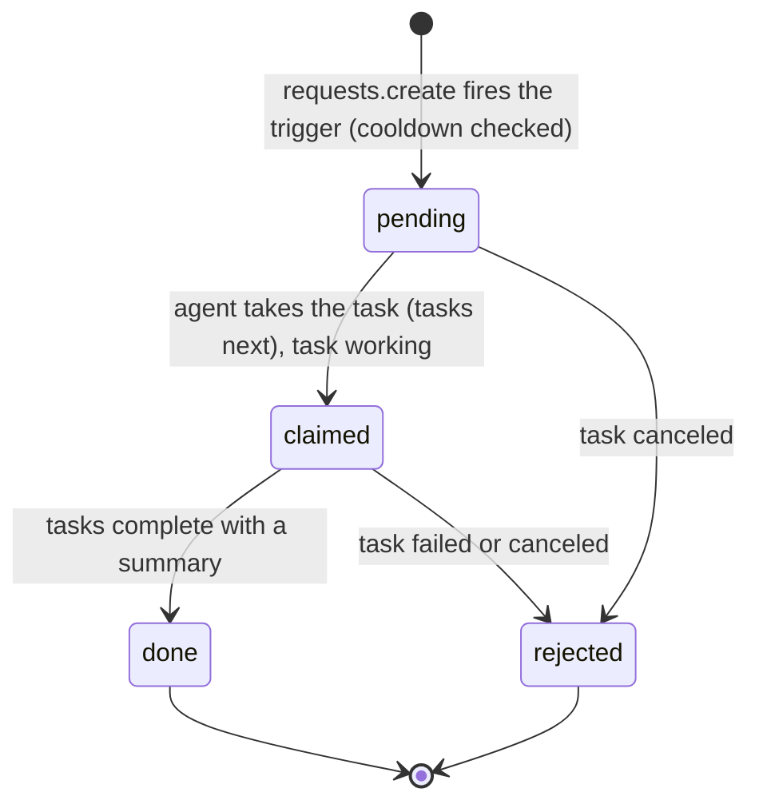
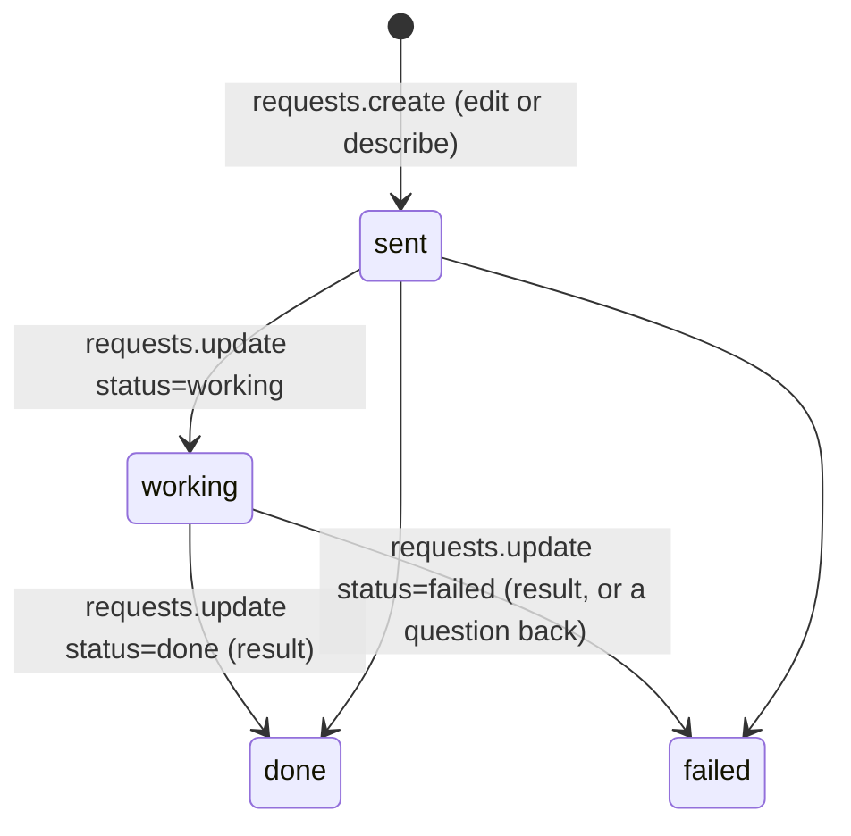

# Requirements: Image Utility

PART A — REQUIREMENTS (SRS). User-approved before build; frozen after; changes via ## Changes.

## Introduction

### Purpose
Image Utility is a desktop-style image editor for one person (and their AI agent) doing everyday image work on their own computer, with no accounts or sign-in and nothing uploaded: screenshots for docs and tickets, product and blog photos, social posts, favicons, a folder of pictures for the web or an email. Its one job is to turn an image into the small, correct file it needs to be: crop and straighten, resize, frame on a canvas, adjust light and colour, apply a look, cut out the background, and mark it up with layers (text, arrows, lines, boxes, ellipses, highlights, numbered steps, drawings, redactions, logos and watermarks), then export WebP, AVIF, JPEG, PNG, GIF, ICO or TIFF with real file sizes before saving. Edits are a non-destructive stack over the untouched original, rendered by an image engine on this computer, and batches run one recipe over many images. An AI agent works on the same data through A2App: every UI action is a declared operation, by default its edits are proposals the person accepts or rejects, and the app hands it work as tasks (edit images from a request, describe images).

### Scope
**Goals**
1. The original file of an imported image is never written: everything shown and exported is the engine's render of the original plus its stack of edits, and every edit can be changed, turned off, reordered, removed, undone and redone.
2. File sizes shown before an export are real encodes, and a size target finds the highest quality that fits, shrinking the image only when it must.
3. Exports carry the metadata the person chose (basic, everything or none), never the location unless the person keeps it, and the alt text as the file's description.
4. Under the default policy, nothing the AI agent does changes an image or runs a batch until the person accepts it, and it never changes or removes the person's edits.
5. Every UI action is available to an agent as an operation, and every refusal says what to do instead.

**Core functionalities:** library · import from files, folders, drop and paste · non-destructive edit stack with undo, redo and revert · crop and straighten · resize · canvas and frame · adjust and Auto · 12 looks · background removal · layers (text, arrows, lines, boxes, ellipses, highlights, steps, pen, redactions, logos, watermarks) · stage with zoom, pan and the original on hold · export with real sizes, size targets, comparison and metadata control · presets and recipes · batches with rename patterns and preview · exports, requests and activity pages · AI agent proposals, requests and policy · local image engine with one-off setup

### Approval
Approved by the user: 2026-11-04 — carried over from the published marketplace app `image-utility` 2.0.0, whose requirements were approved when it was built; this document restates them in the framework's form without changing any feature.

## Product Description

### Product Perspective
`authMode: none`. The app is for one person on their own computer: no accounts or sign-in, and nothing is uploaded anywhere (Original requirements). It serves on loopback only, and its own operation routes still require a caller (the View or the agent's credential). manifest.json declares no integrations (`capabilities.integrations: []`). All image work runs in a local engine: an embedded CPython 3.11.9 with Pillow 13.0.0 (AVIF, WebP, Little CMS, FreeType), NumPy, MozJPEG optimization and oxipng, and, only when the person installs it, onnxruntime with the u2netp or isnet-general-use background models. The engine is downloaded once from official sources (`www.python.org`, `files.pythonhosted.org`, GitHub release assets), pinned by URL, size and SHA-256, using only the tools Windows 10 and 11 ship (curl.exe, tar.exe, certutil.exe). Only permissively licensed components are downloaded; HEIC and JPEG XL are deliberately not supported because their Python builds are GPL. The app has no language model of its own: edits from a request and descriptions are done by the person's AI agent, and the UI names no particular agent ("your AI agent").

### User Characteristics
One person preparing images for docs, tickets, products, blogs, social posts, favicons and emails, in short sessions as the work comes up, on a Windows desktop or laptop with a mouse or trackpad and keyboard shortcuts. Every page also works at tablet and phone width (the workspace shows one area at a time below 1024 px).

### Constraints
- C-1: An image is its original file, kept as imported and never written, plus an ordered stack of edits. Edit kinds: crop, resize, canvas, adjust, filter, remove_bg and layer. Only crop, resize and canvas change the size.
- C-2: Coordinates are full-resolution pixels of the image as it enters an edit, and sizes through the stack are computed the same way in the engine, the hooks and the workspace. A layer is pinned to the photo (its numbers are pixels of the original photo; it follows crops, turns, straightening, resizes and padding) or to the frame (positions are fractions of the result's width and height, sizes fractions of its short side; it stays put).
- C-3: Layers are drawn after every photo edit, whatever their place in the stack, in stack order among themselves. Layer types: text, rect (box), ellipse, arrow, line, highlight, step, pen, redact (solid, pixelate or blur) and logo. A step's number is up to 3 characters.
- C-4: Colour is converted to sRGB for editing and tagged sRGB on export; EXIF orientation is applied to the pixels and written as 1; 16-bit and CMYK images are read correctly; animated GIF and WebP keep their frames where the output can hold them.
- C-5: Imports read PNG, JPEG, WebP, AVIF, GIF, TIFF, BMP, ICO and more (APNG, JPEG 2000, TGA, PPM, PCX, PSD, DDS, ICNS, QOI); HEIC and camera RAW are refused with that reason. One import request takes up to 2 GB, an image up to 400 megapixels.
- C-6: Export formats: WebP, AVIF, JPEG, PNG, GIF, ICO and TIFF. Quality: best, balanced, small, custom (1 to 100), a maximum size in KB, or lossless (not JPEG). A size target tries the floor quality first (JPEG and WebP 40, AVIF 30), shrinks the image when even that does not fit, then searches up. Metadata: basic (camera, date, author, copyright and the alt text as the description), everything, or none. The location (GPS) is removed unless the person keeps it. Transparency goes to JPEG over the matte colour.
- C-7: Fixed vocabularies. Looks: vivid, warm, cool, mono, noir, sepia, fade, vintage, chrome, matte, dramatic, soft. Adjust sliders: exposure, contrast, highlights, shadows, whites, blacks, saturation, vibrance, temperature, tint, clarity, sharpen, vignette (plus levels and Auto). Resampling: Lanczos, sharper (MKS2021), bicubic, bilinear, nearest. Fonts: sans, sans bold, serif, serif bold, mono, handwriting, impact. Image status: pending, ready, failed. Proposal status: pending, accepted, rejected, superseded. Batch status: draft, proposed, queued, running, done, failed, cancelled. Request status: sent, working, done, failed (it only moves forward). Change actor: you, agent, system.
- C-8: The AI agent policy is the person's: its edits are proposals (default) or applied directly; its batches wait for the person (default) or may run. Under the propose policy the agent can never change or remove the person's edits, and its edits join one open proposal per image. The agent cannot change the policy or the export folder, install background models, or decide proposals; it writes files only inside the export folder the person names (empty: nowhere). Everything it makes is marked as its own.
- C-9: Every collection changes only through the app's operations: direct record writes are refused with the operation to use.
- C-10: Deleting an image deletes its edits and history; its exports stay in Exports. Deleting a batch deletes the exports it kept in the app. Copies already written to a folder always stay. A logo in use by a layer cannot be deleted. Built-in presets cannot be deleted.
- C-11: Recipes and batches take only frame-pinned layers (a photo position means nothing on another photo); copying edits to another image scales photo-pinned layers; edits that do not fit are skipped and reported.
- C-12: Batch file names come from a rename pattern with tokens {name} {n} {n:3} {date} {taken} {width} {height} {format} {batch}, and must contain {name} or a number; a name already in the folder is renamed (a number added), skipped or replaced, as chosen.
- C-13: The first run seeds the settings (WebP, balanced quality, basic metadata, location removed, white matte, normal PNG effort, Lanczos; agent edits and batches propose; no house rules; no export folder) and the built-in presets: 13 sizes, 7 export presets and 4 recipes.
- C-14: Until the engine is ready, imports are kept (pending) and read as soon as it is; other engine work answers that the engine is unavailable, with the progress.
- C-15: Text fields: an image name or title is at most 300 characters, alt text 2,000, a caption or notes 4,000; a request is at most 8,000 characters; a preset name 120; a logo name 200. Alt text is guided to 125 characters.
- C-16: No emoji appears anywhere: icons are line icons. The app names no particular AI agent.

### Assumptions
- A-1: Volume ceiling: 2,000 images in the library, the most Home and `images.list` load at once; each image up to 400 megapixels.
- A-2: The computer runs Windows 10 or 11 (the engine's setup uses the tools those ship) and has an internet connection the first time, for the one-off engine download.
- A-3: Paths the person or the agent gives are absolute paths on this computer.

## Features

### Module: Frame
- F-FRM-1: On wide screens the user can reach every page from a slim icon rail: the app mark (Library), Import images, then Library, Batches and Requests to your AI agent; Activity and Exports; and Settings at the bottom. The current page is marked, and hovering an icon shows its name.
- F-FRM-2: The user sees counts on the rail's icons when something waits: proposals on Library, the requests that need them on Requests (failed or not sent: the ones the Requests page lists under "Needs you"), running batches on Batches.
- F-FRM-3: On phones the user can navigate with a bottom bar: Library, Batches, the import button in the middle, Requests, and a menu for the remaining pages.
- F-FRM-4: The user sees the CAD Workshop look: flat panels with hairline borders and small corners (4 px chips and badges, 6 px controls, 8 px panels, 10 px dialogs), 28 px buttons and fields, dense rows split by hairlines, round shapes only where round by nature, Manrope at 12 to 15 px on a 4 px grid, and a pointer cursor on everything clickable.
- F-FRM-5: WHEN the host switches the theme pack, light or dark mode, or custom colors THE SYSTEM SHALL recolor the app from the host's theme tokens with contrast checks, including the checkerboard that shows transparency.
- F-FRM-6: The user sees line icons only and no emoji anywhere, and the agent is called "your AI agent" everywhere.
- F-FRM-7: The user can use every page from phone to desktop width.
- F-FRM-8: WHEN a newer version of the app has been deployed THE SYSTEM SHALL reload an open page onto it after the server comes back or when the tab is shown again, waiting while a dialog is open.
- F-FRM-9: The user can go back from a page along the app's own trail of pages, never out of the app.

### Module: Library (images)
- F-LIB-1: The user sees Home as the library and nothing else: a top bar (search over names, alt text and keywords; All, Edited, Untouched or Proposals; sort by recently edited, recently added, name or largest files; large or small cards; Add images), an "Add images" tile first, then every image as a card.
- F-LIB-2: The user sees on each card the result, the name, format, size and file size, where the original lives (the path it was imported from, or the app's kept copy for uploads), the number of edits, "Animated" for animations, and "Proposal" when the AI agent proposed edits. Pinned images come first.
- F-LIB-3: WHEN a search or filter matches nothing THE SYSTEM SHALL say "Nothing matches. Try another search or filter."

### Module: Import (images)
- F-IMP-1: The user can import from the rail's Import (drop zone, choose files, or a file or folder path on this computer), the Add images tile, by dropping files on any page, or by pasting an image (Ctrl V). A folder brings in every image in it, not its subfolders.
- F-IMP-2: WHEN one image is imported THE SYSTEM SHALL open it; WHEN several are THE SYSTEM SHALL show the library.
- F-IMP-3: WHEN a file is not an image the app reads THE SYSTEM SHALL refuse it with the reason (HEIC and camera RAW are not supported), and say which files could not be read.
- F-IMP-4: WHEN images are imported before the engine is ready THE SYSTEM SHALL keep them as "Waiting" and read them as soon as it is: "The image is saved; it shows as soon as the engine is ready."

### Module: Workspace (images, edits, history)
- F-WSP-1: The user sees the image workspace docked edge to edge like a desktop editor: a header bar (back, name, status, proposals, size in and out, undo, redo, Export, a menu), a toolbar of labelled tools with shortcuts, the layers, photo edits and library on the left, the stage in the middle, and the inspector (Image, Export, History, Agent) on the right.
- F-WSP-2: The user can pin the image, duplicate it to try another version, download the original, or delete it from the header's menu. Delete asks "Delete "<name>"?" ("The image, its edits and its history are deleted. Files you exported stay in Exports.").
- F-WSP-3: The user can undo and redo the image's last change at any time (Ctrl Z, Ctrl Y, the header, the tool's bar).
- F-WSP-4: The user can open the photo tools from the toolbar or their keys: Crop (C), rotate left ([), rotate right (]), flip (H), Resize (R), Canvas (B), Adjust (A), Auto (Shift A), Filter (F), Cut out (K); rotations and flips fold into one crop edit.
- F-WSP-5: WHEN a photo tool is open THE SYSTEM SHALL show it as a small dialog over the stage that saves as the user changes it, with no Apply or Cancel: the first real change adds the edit, later ones update it (sliders and typing a moment after they stop, drags when they end, choices at once), and a tool brought back to doing nothing removes its edit. The dialog shows "Result W × H", warnings and plain-language refusals; the cross or Esc closes it.
- F-WSP-6: The user sees tone and size tools preview the whole result live, and crop draw its box on the image as it enters the edit, with layers hidden while cropping.
- F-WSP-7: WHEN the image is on a phone or tablet width THE SYSTEM SHALL show one area at a time with the tabs Image, Layers and Details (or the open inspector tab).

### Module: Photo tools (edits)
- F-CROP-1: The user can crop with a ratio (free, original, 1:1, 4:5, 4:3, 3:2, 16:9, 9:16, 2:3, 21:9, and swap), drag the box (8 handles, ratio-locked, or draw a new one outside it) over a rule of thirds, type the width and height, find the subject (smart crop), straighten from −45° to 45° (the box stays inside), turn by quarter turns and flip.
- F-RSZ-1: The user can resize by the longest edge, an exact size (proportional or not), a percent, fit in a box, or fill a box keeping the subject in frame; pick a social or web size; enlarge only when asked; choose the resampling; and lightly sharpen after a shrink.
- F-CNV-1: The user can frame the image on a canvas: padding on all or each side, pad out to a ratio, a colour, gradient, blurred or transparent background, rounded corners and a drop shadow.
- F-ADJ-1: The user can adjust exposure, contrast, highlights, shadows, whites, blacks, temperature, tint, vibrance, saturation, clarity, sharpen and vignette, or press Auto (levels, midtones and white balance from this image); a double-click resets a slider.
- F-FLT-1: The user can apply one of the 12 looks, shown as previews of this image, with a strength.
- F-RBG-1: The user can remove the background with the fast or detailed model on this computer, onto transparency or a colour, with a soft or hard edge, growing or shrinking the edge. Cut out runs on opening.
- F-RBG-2: WHEN the background model is not installed THE SYSTEM SHALL offer to install it in place, with progress, and cut out as soon as it is in.

### Module: Layers (layers)
- F-LAY-1: The user can pick a layer tool from the toolbar or its key: Select (V), Text (T), Arrow (L), Line (Shift L), Box (U), Ellipse (E), Highlight (M), Step (N), Pen (P), Redact (X), Logo (G); then drag on the image (or click, for text and steps).
- F-LAY-2: The user can type text in place (Enter or a double-click types into a text layer again); steps number themselves; pens and steps keep drawing, the other tools hand back to Select.
- F-LAY-3: The user can select a layer by clicking, move it (Shift locks the axis), resize it with 8 handles (corners only and in proportion for text, steps and logos; Shift keeps proportions), turn it with the round handle (Shift snaps to 15°), and drag either end of an arrow or line (Shift snaps to 45°). Locked layers cannot be dragged.
- F-LAY-4: The user can nudge the selected layer with the arrow keys (Shift for 10 px), delete it (Delete), duplicate it (Ctrl D), bring it forward or send it backward (Ctrl ] and Ctrl [, with Shift to the front and back), and let go (Esc).
- F-LAY-5: The user sees every layer drawn live over the photo (redactions pixelate or blur the photo on screen too), and the engine draws the same layers for exports, thumbnails and the agent.
- F-LAY-6: The user can manage layers in the Layers list (top layer first): click to select, drag to restack, the eye to hide or show, lock, double-click to rename, the bin to delete; the agent's layers are marked, and the photo and its own edits are listed under the layers.
- F-LAY-7: The user can set the selected layer's properties in a floating panel on the side away from it: text (words, font, size, alignment, colour, a label box behind, outline), stroke colour and width, fill and its strength, corner radius, highlighter colour, step number and colour, arrow heads on both ends, redaction solid, pixelate or blur, logo (pick or upload in place), tiling across the image with a gap (text and logos: watermarks), opacity, rotation, pinned to the photo or the frame, order, lock, hide, duplicate and delete.
- F-LAY-8: The user sees solid redaction recommended for secrets, with the reason ("Solid replaces the pixels for good: the safe choice for secrets."), and a redaction replaces pixels in exports.
- F-LAY-9: WHEN the user sets a colour, font or redaction style THE SYSTEM SHALL use it for the next layers.

### Module: Edit stack (edits, presets)
- F-STK-1: The user sees the photo's edits under the layers, from the original down: click one to edit it (its tool opens on that edit), drag to reorder, the eye to turn it off, the bin to remove it; the agent's edits are marked.
- F-STK-2: The user can, from the stack's menu, apply a recipe, save the edits as a recipe, copy the edits to other images (scaled to each, with what did not fit reported), or go back to the original after "Back to the original?" (one undoable step).
- F-STK-3: The user sees the agent's proposals on top of the stack and can preview one on the image, reject it with an optional reason the agent reads, or accept it ("Accepted: the edits are yours now").
- F-STK-4: The user can jump to another image from the library strip under the stack, or import from it.

### Module: Stage (images)
- F-STG-1: The user can zoom around the pointer with the wheel or a pinch, pan by dragging, with Space or the middle button, fit (0), see 100 % (1) or 200 % (2), zoom with + and − or the zoom menu, and see full-resolution tiles past the preview.
- F-STG-2: The user can switch the backdrop (checkerboard, light, dark), go full screen (Esc leaves), see the pixel under the pointer, and hold \ or the Original button to see the original.

### Module: Inspector — Image (images, analyze)
- F-INF-1: The user sees the result's size, megapixels, edit and export counts, and a histogram with clipping.
- F-INF-2: The user sees the original file's format, frames, size, file size, colour, profile (with a note when wide-gamut colour is converted to sRGB), duration, resolution and source path, its camera data, and its location with what export does to it.
- F-INF-3: The user can edit the name (used for export file names), title, alt text (with a 125-character guide and "Ask your AI agent to describe it"), keywords and notes, and pin the image.

### Module: Inspector — Export (export, presets)
- F-EXP-1: The user can export with a preset (Web: WebP; Web: AVIF + JPEG; Email: JPEG under 500 KB; Print: high-quality JPEG; Lossless PNG; Retina 1x and 2x; Favicon set) or custom settings, with several outputs at once.
- F-EXP-2: The user can set, per output, the format, quality (best, balanced, small, custom, a maximum size in KB, lossless), longest edge, file name suffix, PNG effort and ICO sizes.
- F-EXP-3: The user sees real encoded sizes for every output, the saving against the original, and the quality a size target chose.
- F-EXP-4: The user can compare before and after at 100 % on the most detailed part of the image with a split slider.
- F-EXP-5: The user can choose the metadata (basic, everything, none), remove the location, set the JPEG background for transparency, name the file, also copy to a folder, download the files, save the settings as a preset, and see what was exported before.

### Module: Inspector — History (history)
- F-HIS-1: The user sees the image's history, newest first: who (you, your AI agent, the app), when, and what each change did, with undo, redo and "Undo just this change" for any one change. A revert is itself a change that can be undone.

### Module: Inspector — Agent (requests)
- F-AGP-1: The user can ask the AI agent for an edit, optionally pointing at a region drawn on the image, or for a description (alt text, title and keywords), with quick asks (remove the background, hide faces and plates, straighten and crop, web-ready, annotate for a guide, alt text and keywords).
- F-AGP-2: The user sees whether the agent proposes or edits directly, and this image's requests with their status and answers.

### Module: Batches (batches)
- F-BAT-1: The user can plan a batch from chosen images: start from each image's own edits or not, then a recipe or a size; an export preset or a format, quality and longest edge; metadata; a rename pattern with tokens; and also a folder, with what to do when a name exists.
- F-BAT-2: The user sees a plan before anything runs: every file name with its size, duplicate names, files already in the folder, a few test encodes and the estimated total.
- F-BAT-3: The user can run a batch in the background with progress, stop it, resume it, retry the failed images, download everything as a zip, show its files in Exports, and delete it (after "Delete "<name>"?").
- F-BAT-4: The user sees the agent's batches wait for Run or Reject ("Your AI agent planned this batch; it runs when you say so."), unless the policy lets it run them.

### Module: Exports page (exports)
- F-EXS-1: The user sees every exported file with its format, size, file size, saving, where it was copied and who made it, with the totals, filtered by format or batch.
- F-EXS-2: The user can download an export, or delete it after "Delete "<name>"?" (a copy already in a folder stays).

### Module: Requests and Activity (requests, history)
- F-REQ-1: The user sees every request to the AI agent (edits and descriptions) with its status (sent, working, done, failed) and its answer, filtered by status. Each request is in one of three places: waiting on the AI agent (it has it: sent or working; the Agent tab's pulse, `open_requests` in `app.status`), needing the person (failed, where the agent asks back, or not sent; "Needs you", the rail's count, `requests_need_you`), or done.
- F-REQ-2: WHEN a request's trigger is refused (cooldown, hourly cap) or its task fails or is canceled before the AI agent takes it THE SYSTEM SHALL show the request as "Not sent" on the Requests page and the image's Agent tab, with Retry, which fires it again (`requests.create` with `request`). The Requests page lists it under "Needs you" as well as All.
- F-ACT-1: The user sees every change to every image, newest first by day, by them or the AI agent, and can open the image or revert a change on its own.

### Module: Settings (settings, engine, presets, assets)
- F-SET-1: The user sees the image engine's state and folder, can install it or retry its setup, and can install the two background models (fast and detailed) with progress.
- F-SET-2: The user can set the export defaults: format, quality, metadata, removing the location, the JPEG background and PNG optimization.
- F-SET-3: The user can set the AI agent's policy: its edits proposed or applied, its batches planned or run, house rules it reads before every job, and the folder it may write to.
- F-SET-4: The user can see the presets (recipes, export presets, sizes), add a size, and delete their own.
- F-SET-5: The user can add and delete logos for watermarks (a logo in use cannot be deleted).
- F-SET-6: The user sees the keyboard shortcuts listed in Settings.

### Module: Engine (engine)
- F-ENG-1: WHEN the app first runs on a computer THE SYSTEM SHALL download the image engine (about 32 MB) once, check every file against its size and SHA-256, and resume a partial download; after a failure it waits for the person's Retry.
- F-ENG-2: The user sees the setup's progress and what the app is waiting for while the engine is on its way.
- F-ENG-3: WHEN the person asks for background removal THE SYSTEM SHALL download its model (fast about 20 MB; detailed 179 MB) only then.

### Agent (via A2App)
- F-AGT-1: The agent can perform every UI action as an operation: the 62 operations in ## Operations Design, across the modules app, settings, engine, images, analyze, filters, edits, layers, history, proposals, export, exports, presets, batches, requests and assets.
- F-AGT-2: The agent can read the conventions, every edit kind's params, error codes, the policy, presets, logos, recent images and recipes from `app.guide`, the schema from `app.schema`, and the engine and queues from `app.status`.
- F-AGT-3: The agent sees what the person sees: the open image, the selected tool, layer and images, and a region they drew (`app.context`); a picture of the result, a proposal, the original or a full-resolution region (`images.render`); and numbers to edit with (`analyze.image`: auto, trim, smart crop, colours, histogram, alpha).
- F-AGT-4: The agent can import images from paths and folders on this computer, try edits with `dry_run` before saving, and estimate, compare and create exports.
- F-AGT-5: WHEN the agent edits under the propose policy THE SYSTEM SHALL keep its edits as one open proposal per image, previewed for the person, and answer `agent_propose_only` if it tries to change or remove the person's edits.
- F-AGT-6: WHEN the agent asks for something only the person may do (change the policy or the export folder, install a model, decide a proposal, write outside the export folder) THE SYSTEM SHALL refuse it and say so.
- F-AGT-7: The agent can take an `edit_requested` task: read the request (words, images, region), mark it working, look before editing, ask back instead of guessing when it is ambiguous (failed, with the question), make the edits and layers, check them, export when asked, and mark it done with a one-paragraph result.
- F-AGT-8: The agent can take a `describe_requested` task and write alt text (under 125 characters), a title and 3 to 8 keywords for each image without editing its pixels.
- F-AGT-9: WHEN the agent calls a destructive operation THE SYSTEM SHALL answer `approval_required` until the person has approved that call.

## Non-Functional Requirements
- N-1: A change made by the agent (or another tab) appears on every open page without a manual refresh. Views reload 120 to 800 ms after the last realtime change to a collection they watch (150 ms by default).
- N-2: A photo tool saves 320 ms after sliders and typing stop, and at once when a drag ends or a choice is made; one save runs at a time, newest change last.
- N-3: The engine renders the photo's edits with a prefix cache, so editing edit k re-renders from k; the workspace shows the photo without its layers and re-renders it only when the photo's own edits change, while layers are drawn live in the browser.
- N-4: An engine job waits at most 120 s by default; past that the engine is restarted and the call says to try a smaller image or fewer outputs.
- N-5: Images waiting for the engine and queued batches are worked by the `img_worker` lane every minute; between jobs it waits on a wake flag until second 56, so a batch the person runs starts at once. A batch that was running when the app stopped is queued again on boot.
- N-6: The first-run engine setup starts within a minute of the first boot (`img_engine_setup`, every minute).
- N-7: Rendered previews older than a week and work files older than two days are deleted nightly (`img_prune`, 03:41); they are made again on demand.
- N-8: Every page is usable from phone width up; below 1024 px the workspace shows one area at a time, and below 768 px the rail becomes a bottom bar.

## Data Requirements
- **settings** (module: settings): defaults (json), policy (json), export_folder (string, max 1000), last_prune_at (string, max 40), created (datetime, server-set), updated (datetime, server-set).
- **images** (module: images): name (string, required, max 300), original (binary), format (string, max 20), width (number), height (number), bytes (number), frames (number), duration_ms (number), alpha (boolean), mode (string, max 20), icc (string, max 200), wide_gamut (boolean), exif (json), gps (json), transform (json), dpi (json), hash (string, max 64), out_width (number), out_height (number), edits_count (number), stack_hash (string, max 64), preview (string, max 120), thumb (binary), status (enum), error (string, max 2000), origin (enum), source_path (string, max 1000), pinned (boolean), title (string, max 300), alt_text (string, max 2000), caption (string, max 4000), keywords (json), notes (string, max 4000), last_exported (string, max 40), exports_count (number), created (datetime, server-set), updated (datetime, server-set).
- **proposals** (module: proposals): image (ref → images), kind (enum), title (string, max 300), reason (string, max 4000), status (enum), preview (binary), summary (json), batch (string, max 20), decided_at (string, max 40), response (string, max 2000), author (enum), created (datetime, server-set), updated (datetime, server-set).
- **edits** (module: edits): image (ref → images), seq (number), kind (enum), params (json), enabled (boolean), author (enum), state (enum), proposal (ref → proposals), note (string, max 2000), mask (binary), mask_key (string, max 64), mask_info (json), created (datetime, server-set), updated (datetime, server-set).
- **changes** (module: history): image (ref → images), batch (string, max 20), actor (enum), action (enum), edit (string, max 20), before (json), after (json), ord (number), note (string, max 2000), reverted_by (string, max 20), reverts (string, max 20), created (datetime, server-set), updated (datetime, server-set).
- **batches** (module: batches): name (string, max 200), images (json), recipe (json), outputs (json), rename (string, max 300), collision (enum), folder (string, max 1000), status (enum), total (number), done_count (number), failed_count (number), bytes_in (number), bytes_out (number), results (json), zip (binary), started (string, max 40), finished (string, max 40), requested_by (enum), error (string, max 2000), cancel (boolean), created (datetime, server-set), updated (datetime, server-set).
- **exports** (module: export): image (ref → images), batch (ref → batches), file (binary), name (string, max 300), format (string, max 20), width (number), height (number), bytes (number), source_bytes (number), settings (json), folder_path (string, max 1000), requested_by (enum), created (datetime, server-set), updated (datetime, server-set).
- **presets** (module: presets): name (string, required, max 120), kind (enum), description (string, max 500), data (json), builtin (boolean), sort (number), created (datetime, server-set), updated (datetime, server-set).
- **assets** (module: assets): name (string, required, max 200), file (binary), kind (enum), width (number), height (number), bytes (number), created (datetime, server-set), updated (datetime, server-set).
- **requests** (module: requests): image (ref → images), images (json), kind (enum), title (string, max 300), body (string, max 8000), region (json), status (enum), result (string, max 8000), request_id (string, max 40), created (datetime, server-set), updated (datetime, server-set).

## External Interfaces
- **Human (browser):** one single-user View served by PocketBase at the app's own origin, with hash routes `#/` (Library), `#/image?id=<image>` (the workspace), `#/batches`, `#/exports`, `#/requests`, `#/activity` and `#/settings`. It also has the Import dialog, the tool and layer dialogs, the before-and-after comparison, the batch planner and confirmations. File input is images uploaded, dropped or pasted, or absolute paths of files and folders on this computer, and logos. File output is exported files (downloads, or copies into a folder), batch zips and the original's download. Rendered previews are served at `GET /api/img/cache/{path}` by content hash.
- **Agent (A2App):** the modules and collections in AGENT_APP.md § Modules; operations exactly as declared in ## Operations Design; tasks with the capabilities `edit_requested`, `describe_requested` (events.json). No other machine interface is offered to agents; the app's own screens call their own routes.
- **Third-party services (backend only):** `www.python.org`, `files.pythonhosted.org`, `github.com`, `release-assets.githubusercontent.com`, `objects.githubusercontent.com`.

## Out of Scope
- More than one person: accounts, sign-in, sharing or roles.
- Uploading images anywhere, cloud processing, or any network call at run time other than the engine's first-run setup and the optional background models.
- HEIC, JPEG XL and camera RAW files (their Python builds are GPL, or the engine does not read them).
- Writing the original file, or destructive editing of any kind.
- A language model inside the app: descriptions and requested edits are done by the person's AI agent.
- The AI agent changing its own policy or the export folder, installing background models, deciding proposals, or writing files outside the export folder.
- Installing background models without the person asking.
- Export formats other than WebP, AVIF, JPEG, PNG, GIF, ICO and TIFF.
- Edit kinds beyond crop, resize, canvas, adjust, filter, remove_bg and layer, and layer types beyond the ten.
- Running on systems other than Windows 10 and 11 (the engine's setup uses the tools Windows ships).
- Emoji, and naming a particular AI agent.

## Quality of Life
- The library remembers large or small cards.
- A long path on a card keeps its end (the file name) in view.
- Hovering a rail icon shows its name, and counts sit on the icons that have something waiting.
- The colour, font and redaction style last set are used for the next layers.
- A double-click resets a slider to its default.
- Requests, history and exports show how long ago they happened ("5 min ago", "yesterday 14:05").

PART B — TECHNICAL SPECIFICATION.

## System Overview
PocketBase 0.39 (JS hooks, migrations) + React 19 / Vite / Tailwind 4 View in `frontend/` built into `pb/pb_public/`, on the `blueprint-pocketbase-kit` toolkit. The View calls the app's own routes `/api/ops/<group>/<verb>` (`ops.pb.js`, plus `GET /api/img/cache/{path}` for rendered previews, filter thumbnails and compare crops by content hash); the generated `a2app_routes.pb.js` serves the same handlers to agents as `POST /api/ops/<name>`. Domain logic lives in `pb/pb_hooks/lib_*.js` (`lib_stack.js` for the stack, journal, undo and proposals; `lib_kinds.js` for params and the schema; `lib_layers.js`; `lib_geom.js`; `lib_render.js`; `lib_images.js`; `lib_export.js`; `lib_batch.js`; `lib_presets.js`; `lib_app.js`; `lib_engine.js`; `lib_setup.js`), record guards and jobs in `hooks.pb.js`. The image engine is `engine/img_engine/` (Python: render, layers, geom, load, tone, draw, ai, encode, jobs, server), one long-lived process per data folder fed JSON job files.

Modules → navigation map:

| Module (manifest) | Where a person meets it | Route |
| --- | --- | --- |
| `images` | Library (Home); the workspace header, stage and Image tab; Import | `#/`, `#/image?id=` |
| `edits`, `filters`, `analyze` | The workspace toolbar, tool dialogs and edit stack | `#/image?id=` |
| `layers` | Layer tools, the stage overlay, the Layers list and layer properties | `#/image?id=` |
| `history` | Undo and redo, the History tab; the Activity page | `#/image?id=`, `#/activity` |
| `proposals` | Proposal cards on the edit stack; the library's Proposal marks | `#/image?id=`, `#/` |
| `export`, `exports` | The Export tab; the Exports page | `#/image?id=`, `#/exports` |
| `presets` | Export presets, recipes and sizes in the tools and Export tab; the Presets panel in Settings | `#/settings` |
| `batches` | Batches page | `#/batches` |
| `requests` | The Agent tab; the Requests page | `#/image?id=`, `#/requests` |
| `assets` | The logo picker; the Logos panel in Settings | `#/settings` |
| `settings`, `engine` | Settings (engine, background models, export defaults, the agent's policy); the setup note in the workspace | `#/settings` |
| `app` | No screen of its own: `app.guide`, `app.schema`, `app.status` and `app.context` are the agent's; the View reports the screen through `app.ui` | — |

Rail order: app mark, Import, then Library, Batches, Requests · Activity, Exports · Settings at the bottom. Phone bar: Library, Batches, Import, Requests, and a menu holding the rest.

## UI Design
- **Design system:** the agent-app UI kit 0.6.0 vendored in `frontend/src/kit` (system-managed). It supplies the `--agent-app-*` tokens in `theme/tokens.css`, the theme bridge, the shell with its error boundary and toasts, and the PocketBase client. The app extends it in `frontend/src/app/theme.css` and `lib/themeColors.ts` with CAD Workshop's visual system: Manrope Variable and a 6 px base radius on `html:root[data-theme=…]`, corners `--iu-r-sm` 4 px, `--iu-r` 6 px, `--iu-r-md` 8 px and `--iu-r-lg` 10 px, and every `--iu-*` color (shell, card, row, row-hover, line, hair, ink, ink-2, muted, accent and its text, sand, the dark surfaces, the stage, and the checkerboard tones) derived from what the kit tokens resolve to, re-derived on each theme change. `--iu-red` (#de4b33), `--iu-green` (#4f9a6c) and `--iu-amber` (#e2a43a) are fixed fills with derived text variants. The app's widgets are written once in `components/ui.tsx`: Panel, PropSection, PageHeader, Button, IconButton, ButtonGroup, TextLink, Badge, Empty, Select, Field, Toggle, Modal, useConfirm, Popover, Segmented, Tabs, Spinner, Kbd, Stat; dense tables use `.iu-table`; the workspace's own controls are in `components/workspace/controls.tsx`. Icons come from lucide-react.
- **Layout:** a full-height app: a 52 px icon rail on the left (from 768 px), then the page. Pages are flat panels with hairline borders under a page header. The workspace fills the whole page area: a 40 px header bar, a 48 px toolbar of labelled tools, then the left panel (Layers, Photo edits, Library), the stage, and the right inspector with the tabs Image, Export, History and Agent. Controls are 28 px tall; type is 12 px for captions, labels and dense data, 13 px for UI text, 14 and 15 px for titles and 26 px for headline numbers, on a 4 px grid. Dialogs are centred, 28 rem wide (38 rem wide, 54 rem extra wide), at most 94 % of the window.
- **Screen — Library (Home):** primary object: every image · primary action: "Add images" · loading: a spinner · empty: only the "Add images" tile ("or drop or paste them anywhere") · no match: "Nothing matches. Try another search or filter." · success: "Imported <n> images" · narrow: large cards in 1 column, 2 from 640 px, 3 from 1024 px and 4 from 1536 px; small cards in 2, 3, 5 and 7 columns.
- **Screen — Import:** the dialog "Import images" (drop zone "Drop images here, or choose files", and "Or a file or folder on this computer" with an absolute path), the page-wide drop overlay "Drop to import" ("Originals are kept; every edit is undoable."), paste anywhere · errors: "<file>: <reason>", "<n> files could not be read", "Those are not image files this app reads (PNG, JPEG, WebP, AVIF, GIF, TIFF, BMP, ICO and more)".
- **Screen — Workspace:** primary object: one image and its stack · primary action: a tool, then Export · states: status badge (Waiting, Problem, Original, or "<n> edits"), "A proposal" / "<n> proposals"; the stage's hints ("Original · W × H", "Drag over the part your AI agent should look at", "Layers are hidden while you crop", "Click to place" / "Drag to draw" / "Drag on the image" · Esc to stop); a tool with nothing yet says what to do ("Drag the box, pick a ratio, straighten or rotate.", "Set a new size.", "Add padding, a ratio, rounded corners or a shadow.", "Move a slider or press Auto.", "Pick a look.") · waiting: "Waiting for the image engine" with the setup progress · error: "This image is not here" with "Go to the library", "This image could not be shown" · success: toasts from the operations (export, accept, copy, save a recipe) · narrow: below 1024 px the tabs Image, Layers and Details show one area at a time; the header shows the sizes from 1024 px and the Export button and proposal badge from 640 px; the toolbar scrolls sideways.
- **Screen — Tool and layer dialogs:** a small dialog over the stage with its own bar (undo, redo, close or Done with Esc) · Crop, Resize, Canvas, Adjust, Filter and Cut out forms, each saving as it changes · layer properties on the side away from the layer · the logo picker ("Pick a logo or add one; it lands in the middle as a layer you can move, resize, turn, fade or tile.") · Cut out without the model shows the install row and "Install the model above; it cuts out as soon as it is in."
- **Screen — Inspector:** Image (Result, Histogram, Original file, Camera, Location, Details), Export (Preset, outputs, Size with real encodes, Metadata, file name, folder, downloads, exported before; the comparison dialog "Before and after: <output>" with a split slider), History (batches of changes with undo, redo and "Undo just this change"; empty: "Nothing changed yet"), Agent ("Ask your AI agent" with "It proposes, you decide" or "It edits directly", edit or description, region, Quick asks, "Requests": this image's requests with their status, each one not sent with Retry; empty: "No requests for this image"; the tab's name pulses while the AI agent has one of them, sent or working).
- **Screen — Batches:** primary object: the batches · primary action: "Plan a batch" · empty: "No batches yet" · planner: "New batch" ("The same edits and outputs over many images. Nothing runs until you have seen the plan."), Edits, Files, Names (tokens; "Add {name} or a number {n} so files get different names."), Where ("Files are always kept in Exports, and zipped when the batch is done."), then "Check the batch: <name>" with "Keep it planned" or "Run <n> images" · rows: progress, Preview, Run, Reject, Stop, Resume or "Retry the failed", "Download all (zip)", "Show the files", Delete after confirmation; "Running "<name>"".
- **Screen — Exports:** primary object: every kept file · primary action: download · empty: "No exports yet" with "Open the library" ("Open an image and use the Export tab: real file sizes before you save, several formats at once.") · header totals: files, bytes and the bytes saved · filters by format and batch ("From one batch") · delete asks "Delete "<name>"?" ("The kept file is deleted. A copy already written to a folder stays.") · narrow: the table scrolls in its panel.
- **Screen — Requests:** primary object: requests to the AI agent · filter by status (All, Working, Needs you: failed or not sent, Done) · empty: "No requests yet" (or "None here") · not sent: "Not sent" with "Your AI agent was not asked." (or "Your AI agent did not take it: <reason>") and Retry ("Sent to your AI agent." or "Still not sent: <reason>").
- **Screen — Activity:** primary object: every change, grouped by day ("Today", "Yesterday", dates) · primary action: open the image or revert one change · empty: "Nothing yet".
- **Screen — Settings:** panels Image engine (dark: state, folder, setup and Retry), Background removal (fast u2netp and detailed isnet-general-use models with Install and progress), Export defaults, Your AI agent (its edits, its batches, house rules, the folder it may write to; "Saved"), Presets (recipes, export presets, sizes with "New size"; built-in ones marked; delete asks "Delete "<name>"?"), Logos (add, delete; "No logos yet."), Keyboard shortcuts.
- **Formatting:** numbers use the browser's locale with at most one decimal by default and tabular figures. File sizes use binary units ("640 KB", "2.4 MB", "1.25 GB"). Sizes read "W × H" in pixels, megapixels "12.2 MP". Savings read "−62 %" for a smaller file, "+8 %" for a bigger one, or "same size". Times read "just now", "5 min ago", "today 14:05", "yesterday 14:05", then "3 Oct" (with the year outside the current year). Paths show in a monospace face. Screens show names, not record ids. A missing value is "–".

## Quality Conformance

- **Q1 Completeness & IA:** orientation comes from the icon rail on wide screens (the current page marked with `aria-current="page"` and an accent bar; the workspace lights up Library) and the bottom bar on phones, plus each page's header. Every page in the original requirements exists: Library, the image workspace, Batches, Exports, Requests, Activity and Settings. Every module is reached from a page or the workspace (## System Overview); only `app` has no screen (the agent's reads, and `app.ui`, which the View calls itself). Names hold app-wide: image, original, edit, layer, proposal, export, preset, recipe, batch, request, logo, "your AI agent". Working sets that outgrow a screen have search, filters and sorts (Library), filters (Exports, Requests) and grouping by day (Activity); the workspace's library strip jumps between images.
- **Q2 Design system:** tokens are the kit's `--agent-app-*` set, extended by the derived `--iu-*` colors and the corner tokens (## UI Design). Components never hardcode a color; the exceptions are the three fixed state fills, the stage's light and dark backdrops (by design), the annotation colours offered for marks, and shadows. Semantic roles: ink for primary buttons and selection, accent for the import button, counts and what the agent does, red for destructive actions and errors, amber for warnings (a kept location), green for installed and good, muted for secondary text. Type is Manrope Variable on the 12/13/14/15/26 px scale with a monospace face for paths. Icons are lucide-react only, with no emoji. Light and dark come from the host (the kit theme bridge), or from the system color scheme when the app runs standalone, and each scheme re-derives every `--iu-*` token with contrast checks (`themeColors.ts`).
- **Q3 Layout & composition:** spacing follows a 4 px grid. Pages are flat panels with hairline borders; the workspace is docked edge to edge with dense 28 px controls. Each page has one primary action in its header (Add images, Plan a batch, Export). Numbers use tabular figures; sizes and savings sit right-aligned in tables. Long names and paths truncate (paths keep their end in view), with the full text in a tooltip. Lists are bounded rather than paginated (Q10).
- **Q4 Interaction:** pointer cursor on everything clickable and not-allowed on disabled controls (a `theme.css` base rule), grab and grabbing on the stage, hover fills, handles on the selected layer. Confirm dialogs (`useConfirm`, a Radix dialog; never `window.confirm`) guard deleting an image, going back to the original, deleting an export, a batch or a preset, and their copy names the target and the consequence. Removing an edit or a layer acts at once and is undone with Ctrl Z (see ### Conventions and overrides). Keyboard: the photo tool keys C, [, ], H, R, B, A, Shift A, F, K; the layer tool keys V, T, L, Shift L, U, E, M, N, P, X, G; Delete, arrows (Shift for 10 px), Ctrl D, Ctrl ] and Ctrl [ (with Shift to the front and back), Enter to type into a text layer, Esc to let go or close a tool; 0, 1, 2, + and − for zoom; hold \ for the original; Ctrl Z and Ctrl Y; Ctrl E for Export; Ctrl V to paste an image. Inputs are constrained: number fields with ranges, sliders with defaults (a double-click resets), fixed choices for formats, ratios, looks and modes, and Plan and preview disabled until the rename pattern can make distinct names.
- **Q5 State & feedback:** each screen's states are listed in ## UI Design. Busy buttons show a spinner and are disabled. Tools save as you change them, one save at a time, and layer changes show at once and are dropped once the image reloads with the saved change. Success reads back as a toast or the changed result, plus the realtime reload of every view. Agent work shows sent, working (pulsing), done or failed, and proposals are previewed on the image. The engine's setup and its waiting states are always explained. Load and write errors surface as the kit toast with the operation's message, which says what to do instead.
- **Q6 Motion:** entrances (`iu-rise`) take 220 ms and dialogs and popovers pop in over 140 ms (`iu-pop`), both on `cubic-bezier(0.22, 1, 0.36, 1)`; pending work pulses (1.6 s), spinners turn (0.9 s) and the region's marching ants loop (0.6 s). Under `prefers-reduced-motion: reduce` these animations are removed.
- **Q7 Content:** the voice is plain and second person, in sentence case, careful where it matters ("Originals are kept; every edit is undoable.", "Solid replaces the pixels for good: the safe choice for secrets."). Copy says what to do: the tools' hints, "Add {name} or a number {n} so files get different names.", "Install the model above; it cuts out as soon as it is in." Operation errors name the parameter and give a valid example, and refusals say what to do instead (for example "records change only through the app's operations … Use edits.add, …", or the engine timeout's "Try a smaller image (Resize first) or fewer outputs."). Terminology is fixed: original, edit, layer, proposal, recipe, preset, export, batch, request, logo; the copy spells "colour" the British way.
- **Q8 Accessibility:** contrast is computed at runtime for each theme by `themeColors.ts` using the WCAG ratio: muted and secondary text reach 4.6:1 against shell, card, row and row-hover; the red, green and amber text variants 4.6:1; accent text 3.2:1; muted text on dark panels and on the stage 4.6:1. Focus: dialogs are Radix modals that trap focus and close on Escape; fields show an ink border on focus, and buttons keep the browser's focus outline. Icon-only buttons carry `aria-label` and `title`; toggles are `role="switch"`, choices `role="radiogroup"`, tabs `role="tablist"`/`tab`, progress bars `role="progressbar"` with values, the histogram `role="img"`. Meaning is never color alone: statuses are written words and marks carry labels ("Made by your AI agent", "Turned off"). Targets: controls are 28 px, rail and phone-bar buttons 36 to 40 px.
- **Q9 Responsiveness:** pages work from phone width up. Below 768 px the rail becomes a bottom bar with the import button in the middle, and toasts lift above it. Below 1024 px the workspace shows one area at a time (Image, Layers, Details tabs). The library grid goes from 1 to 4 columns (large cards) or 2 to 7 (small cards) across 640, 1024 and 1536 px. Dialogs take at most 94 % of the width, and tables scroll inside their panel.
- **Q10 Performance:** at A-1, the library loads at most 2,000 images in one call. Server-side caps: `images.list` 1–2,000 (default 200), `requests.list` 1–500, the View's exports list 500. Renders use a prefix cache in the engine, previews and thumbnails are cached on disk by content hash, JPEG previews load in draft mode, and the stage requests full-resolution tiles only past the preview. Layers are drawn in the browser so dragging needs no render. Background-removal masks are made once per image, upstream edits and model. The font is one variable font.
- **Q11 Caching & freshness:** static: the built bundle has content-hashed asset names, and the document shell is served `no-store, no-cache, must-revalidate` (`cache_control.pb.js`). Rendered images under `/api/img/cache/` are content-addressed and served `private, max-age=31536000, immutable`; previews and work files are pruned nightly and made again on demand. Data: operation responses carry no cache headers and are kept only as in-memory view state; one realtime hub subscribes to every collection once at startup, and each view reloads after a short debounce (N-1). An open page compares its script with the served one on every reconnect after the first and whenever the tab becomes visible, then reloads, waiting while a dialog is open.
- **Q12 Data integrity:** the original is a file field never written after import. Every collection is read-only through the records API (create, update and delete rules closed) and guarded by record hooks that name the operation to use, so the stack, its journal and its previews stay in step. Relations are real relation fields: edits, proposals, changes and requests → image (cascade), edits → proposal (cascade), exports → batch (cascade) and → image (kept when the image is deleted). Each stack change and its journal batch are written in one transaction (`lib_stack.persist`); a revert is a new batch. Indexes: `images.hash`, `edits (image, seq)`, `changes (image, batch, ord)`. Edit params are checked by `lib_kinds.js`, and sizes through the stack are computed identically in the engine, the hooks and the workspace (checked on 3,000 random stacks). The single schema migration is replayable on a fresh database and seeds the settings and built-in presets.
- **Q13 API:** beyond the adapter, the app's own routes `/api/ops/<group>/<verb>` (GET reads, POST writes) are what the View calls; agents reach the same handlers through the adapter. Every parameter goes through the typed readers in `lib_util.js`, which answer 400 naming the parameter with a valid example. Errors share PocketBase's shape `{ status, message }` with typed details in `data`, and the engine's codes map to statuses (`param_invalid` 400, `not_found` 404, `unreadable` and `not_for_animation` 422, `too_large` 413, `engine_unavailable`, `agent_propose_only`, `person_only`, `model_missing`, `out_of_memory`). Edit operations answer one envelope (`ok`, `applied`, `proposed`, `batch`, `image`, `stack`, `preview`, `warnings`, `summary`, `edit`, `proposal`, `message`) and accept `dry_run`. Lists are bounded (Q10). Stack traces are never returned.
- **Q14 Architecture:** UI in `frontend/src/app` (pages, components, components/workspace, lib), application logic in `pb/pb_hooks/lib_*.js`, routes in `ops.pb.js`, guards and jobs in `hooks.pb.js` with `lib_rules.js`, pixels in `engine/img_engine/`. The UI calls the same operations the agent calls (`lib/api.ts`), so every rule has one server implementation. Shared widgets exist once in `components/ui.tsx`; the tools once in `workspace/tools.ts`; app-wide data (settings, status) in `lib/context.tsx`; realtime in `lib/live.ts`; formatting in `lib/format.ts`; the route and back trail in `lib/router.ts`. Geometry is written three times by design (`lib_geom.js`, `lib/geom.ts`, `geom.py`) and layer placement twice (`lib_layers.js`, `lib/layers.ts`), kept identical (see ### Conventions and overrides). Configuration lives in manifest.json, the settings row and the toolkit's launcher.
- **Q15 Resilience:** engine jobs have a budget (120 s by default); a job past it restarts the engine with a message, and a crashed engine is reported with its log tail. The engine starts on the first job and stops with PocketBase. The setup downloads with retries, resumes a partial download, checks size and SHA-256 before anything is unpacked, and after a failure waits for Retry; imports made meanwhile are kept and read later. A batch that was running when the app stopped is queued again on boot, and its failed images can be retried. A request whose trigger is refused is saved and the toast says the agent was not asked, with the reason; the request then reads "Not sent" with Retry, as does one whose task failed or was canceled before the agent took it. When the backend is unreachable, failed calls toast "Network error — is the backend running?", and the page reloads onto the current build when the server comes back. A render crash shows the kit's "Something went wrong" panel with "Reload app". Job errors are caught and logged.
- **Q16 Security & privacy:** with `authMode: none`, collections can be listed and viewed (`""`) because the app is single-user and binds loopback, and every write goes through the operations. The framework adapter runs its host check, framing policy and credential checks before any app hook. The app's own operation routes require a caller on every write: the View, or the agent's `.agent-token` sent as `X-A2App-Token`. Destructive operations need the person's approval through the adapter, and person-only actions (policy, export folder, installing a model, deciding a proposal) refuse the agent. The agent writes files only inside the export folder. Nothing is uploaded; the location is stripped from exports by default; solid redaction replaces pixels. Engine downloads are pinned and checked before use. The toolkit sets rate limits (300 requests per minute on `/api/ops/`). Runtime credentials (`.agent-token`, `.principal`, `.superuser`) are git-ignored and never shipped.
- **Q17 Observability:** hook errors log prefixed lines: `[image-utility] op failed:` for 5xx operation errors, and `[image-utility] engine setup lane failed:`, `worker failed:`, `prune failed:`, `requeue on boot failed:`, `stopping the engine failed:`, `engine setup failed:`, `refreshing pending images failed:` and `batch worker failed:` for the jobs. The toolkit adds `[handler-error] <METHOD> <path>: <message>` for uncaught handler errors. The engine writes its own log, whose tail `engine.status` returns. The UI kit's console relay ships browser errors and warnings to `logs/frontend_console.log` (capped at 2 MB). Health is `/api/_a2app`, the adapter's identity document; `app.status` reports the engine, its setup and the queues.
- **Q18 Version control:** commits are per change ("Port image-utility Living UI to the V2 (PocketBase) platform", "revamp image utility agent app"). `.gitignore` excludes credentials, `pb/pb_data/`, the PocketBase binary, the built View `pb/pb_public/`, `frontend/node_modules/`, framework runtime state under `.a2app/` and `logs/`; only `engine/img_engine/` and `engine/licenses/` ship, and the rest of the engine is downloaded on first run. The app builds from a clean checkout with the manifest pipeline alone (`install`, `build`, `start`).

### Conventions and overrides
The published app is restated here unchanged, so these are standing decisions of the approved build, not new work. Revisit any of them when the app is next modified.
- Q4.2 (confirm destructive actions): removing an edit or a layer, deleting a logo, and rejecting a proposal act at once; edits and layers come back with undo. Deleting an image, going back to the original, and deleting an export, a batch or a preset ask first.
- Q5.4 (designed error states): the workspace has its own states ("This image is not here", "This image could not be shown", waiting for the engine); other failed loads and writes are reported by the kit's error toast with the operation's message.
- Q11.2 (declared data policy): operation responses carry no Cache-Control. They are kept only as in-memory view state and refreshed by realtime changes; rendered images are content-addressed and immutable.
- Q15.1 (timeouts): engine jobs have a budget (120 s by default). The View's calls to its own backend use the PocketBase SDK without a client-side timeout.
- Q17.1 (structured logs): app log lines are prefixed text (`[image-utility] …`, `[handler-error] …`), not a structured schema.
- Q14.4 (one implementation per rule): stack geometry is implemented in the engine (`geom.py`), the hooks (`lib_geom.js`) and the workspace (`lib/geom.ts`), and layer placement in `lib_layers.js` and `lib/layers.ts`, with layer drawing in `layers.py` and `LayersOverlay.tsx`; they are kept identical by hand and checked on random stacks (AGENT_APP.md § Entities).
- Mirrored global rules: none recorded for this app.

## Process Flows

Work the app asks an agent for (`edit_requested`, `describe_requested`): the request row follows the A2App task. The fire carries no params; the task's `request` is the queue row's id, which the request keeps as `request_id`, and `requests.get` and `requests.update` take either id.

A refused fire (no row) or a row rejected while its request is still sent means the AI agent never got the request: it reads "Not sent", and Retry (`requests.create` with `request`) fires a new row.

Request (`requests.status`, forward only):

Image:

```mermaid
stateDiagram-v2
  [*] --> pending: imported while the engine is not ready
  [*] --> ready: imported and read by the engine
  pending --> ready: the engine is ready and reads it
  pending --> failed: the file cannot be read
  ready --> [*]: images.delete (edits and history go; exports stay)
```

Proposal (the agent's edits under the propose policy): `pending` (one open proposal per image, previewed) → `accepted` (its edits become the image's, or the batch is ready to run) or `rejected` (its edits removed, with the person's reason) or `superseded`.

Batch:

```mermaid
stateDiagram-v2
  [*] --> draft: batches.create by the person
  [*] --> proposed: batches.create by the agent under the propose policy
  draft --> queued: batches.run
  proposed --> queued: Run by the person
  proposed --> cancelled: Reject
  queued --> running: img_worker
  running --> done: finished (zip made; failed images counted)
  running --> failed: no image could be written
  draft --> cancelled: batches.cancel
  queued --> cancelled: batches.cancel
  running --> cancelled: batches.cancel (finished files stay)
  cancelled --> queued: Resume (batches.retry)
  failed --> queued: Retry the failed (batches.retry)
  done --> queued: Retry the failed, when some failed
```

Stack change: each change is journaled as one batch of changes (add, update, remove, move); `history.undo` and `history.redo` walk the image's batches, and `history.revert` undoes one batch as a new batch that can itself be undone.

## Operations Design
| Operation | Module | Entity | appliesWhen | Params | Flags |
| --- | --- | --- | --- | --- | --- |
| app.guide | app | — | — | — | readOnly |
| app.schema | app | — | — | — | readOnly |
| app.status | app | — | — | — | readOnly |
| app.context | app | — | — | — | readOnly |
| app.ui | app | — | — | view: string, image: string, tool: string, edit: string, selection: string, images: string | — |
| settings.get | settings | — | — | — | readOnly |
| settings.update | settings | — | — | defaults: string, policy: string, export_folder: string | — |
| engine.status | engine | — | — | — | readOnly |
| engine.install | engine | — | — | what: enum | — |
| engine.test | engine | — | — | — | — |
| images.list | images | — | — | q: string, show: enum, format: string, sort: enum, limit: number | readOnly |
| images.get | images | — | — | image: string! | readOnly |
| images.info | images | — | — | image: string! | readOnly |
| images.render | images | — | — | image: string!, upto: string, proposal: string, original: boolean, layers: boolean, draft: string, region: string, max: number, histogram: boolean | readOnly |
| images.import | images | — | — | path: string, paths: string, folder: string | — |
| images.update | images | — | — | image: string!, name: string, title: string, alt_text: string, caption: string, notes: string, keywords: string, pinned: boolean | — |
| images.duplicate | images | — | — | image: string!, name: string, with_edits: boolean | — |
| images.delete | images | — | — | image: string, images: string | destructive |
| analyze.image | analyze | — | — | image: string!, what: string, ratio: string, upto: string, tolerance: number | readOnly |
| filters.previews | filters | — | — | image: string!, upto: string | readOnly |
| edits.add | edits | — | — | image: string!, kind: enum!, params: string, at: number, dry_run: boolean, max: number, title: string, reason: string, note: string | — |
| edits.update | edits | — | — | edit: string!, params: string, replace: boolean, enabled: boolean, dry_run: boolean, max: number, title: string, reason: string, note: string | — |
| edits.move | edits | — | — | edit: string!, to: number!, dry_run: boolean, title: string, reason: string, note: string | — |
| edits.remove | edits | — | — | edit: string, edits: string, dry_run: boolean, title: string, reason: string, note: string | — |
| edits.apply | edits | — | — | image: string!, preset: string, edits: string, replace: boolean, dry_run: boolean, max: number, title: string, reason: string, note: string | — |
| edits.copy | edits | — | — | from: string!, to: string!, kinds: string, replace: boolean, title: string, reason: string, note: string | — |
| edits.reset | edits | — | — | image: string!, dry_run: boolean | destructive |
| layers.list | layers | — | — | image: string! | readOnly |
| layers.add | layers | — | — | image: string!, type: enum!, props: string!, anchor: enum, name: string, space: enum, dry_run: boolean, max: number, title: string, reason: string, note: string | — |
| layers.update | layers | — | — | layer: string!, props: string, name: string, visible: boolean, locked: boolean, opacity: number, anchor: enum, space: enum, dry_run: boolean, max: number, title: string, reason: string, note: string | — |
| layers.arrange | layers | — | — | layer: string!, to: enum!, dry_run: boolean, title: string, reason: string, note: string | — |
| layers.remove | layers | — | — | layer: string, layers: string, dry_run: boolean, title: string, reason: string, note: string | destructive |
| history.list | history | — | — | image: string, actor: enum, limit: number, page: number | readOnly |
| history.undo | history | — | — | image: string! | — |
| history.redo | history | — | — | image: string! | — |
| history.revert | history | — | — | batch: string!, dry_run: boolean | — |
| proposals.list | proposals | — | — | image: string, status: enum, limit: number | readOnly |
| proposals.accept | proposals | — | — | proposal: string! | — |
| proposals.reject | proposals | — | — | proposal: string!, reason: string | — |
| export.estimate | export | — | — | image: string!, outputs: string, preset: string, format: enum, quality: string, mode: enum, target_kb: number, longest: number, scale: number, metadata: enum, strip_gps: boolean, matte: string | readOnly |
| export.compare | export | — | — | image: string!, cx: number, cy: number, w: number, h: number, outputs: string, preset: string, format: enum, quality: string, mode: enum, target_kb: number, longest: number, scale: number, metadata: enum, strip_gps: boolean, matte: string | readOnly |
| export.create | export | — | — | image: string!, name: string, folder: string, outputs: string, preset: string, format: enum, quality: string, mode: enum, target_kb: number, longest: number, scale: number, metadata: enum, strip_gps: boolean, matte: string | — |
| exports.list | exports | — | — | image: string, batch: string, format: enum, limit: number | readOnly |
| exports.delete | exports | — | — | export: string, exports: string | destructive |
| presets.list | presets | — | — | kind: enum | readOnly |
| presets.save | presets | — | — | preset: string, name: string, kind: enum, description: string, data: string, from_image: string | — |
| presets.delete | presets | — | — | preset: string! | destructive |
| batches.list | batches | — | — | status: enum, limit: number | readOnly |
| batches.get | batches | — | — | batch: string! | readOnly |
| batches.create | batches | — | — | images: string!, name: string, recipe_preset: string, edits: string, use_edits: boolean, rename: string, folder: string, collision: enum, outputs: string, preset: string, format: enum, quality: string, mode: enum, target_kb: number, longest: number, scale: number, metadata: enum, strip_gps: boolean, matte: string, title: string, reason: string | — |
| batches.preview | batches | — | — | batch: string!, samples: number | readOnly |
| batches.run | batches | — | — | batch: string! | — |
| batches.cancel | batches | — | — | batch: string! | — |
| batches.retry | batches | — | — | batch: string! | — |
| batches.delete | batches | — | — | batch: string! | destructive |
| requests.create | requests | — | — | kind: enum, image: string, images: string, title: string, body: string, region: string, request: string | — |
| requests.list | requests | — | — | image: string, status: enum, limit: number | readOnly |
| requests.get | requests | — | — | request: string! | readOnly |
| requests.update | requests | — | — | request: string!, status: enum, result: string | — |
| assets.list | assets | — | — | — | readOnly |
| assets.add | assets | — | — | path: string!, name: string | — |
| assets.delete | assets | — | — | asset: string! | destructive |

## Original requirements

The requirements as published for CraftBot, kept verbatim as the source the sections above restate.

For one person (and their AI agent) doing everyday image work on their own
computer: screenshots for docs and tickets, product and blog photos, social
posts, favicons, a folder of pictures for the web or an email. No accounts
or sign-in, nothing uploaded. Simple to start (drop an image, pick a tool),
careful where it matters (originals never touched, real file sizes before
saving, location stripped, secrets redacted for good).

Visual language: CAD Workshop's. A full-height app with a slim icon rail;
flat panels with hairline borders and small corners (4 px chips and
badges, 6 px controls, 8 px panels, 10 px dialogs); 28 px buttons and
fields; dense rows and tables split by hairlines; the image workspace
docked edge to edge (stack and library, stage, inspector) under a header
bar and a toolbar of labelled tools. Round shapes only where round by
nature: status dots, colour swatches, switches, slider knobs, count
badges, numbered steps. Manrope; 12 and 13 px for data and UI, 14 and 15 px
titles, on a 4 px grid; pointer cursor on everything clickable; no emoji
(line icons). Every colour comes from the host's theme tokens with contrast
checks, light and dark; transparency shows as a checkerboard solved from
the same tokens. The app names no particular AI agent: it says "your AI
agent". Every page works from phone to desktop.

##### Image truth

1. The original file is kept as imported and never written. An image is
   that original plus an ordered stack of edits; what you see and export
   is the engine's render of the stack.
2. Every edit stays changeable, can be turned off, reordered or removed,
   and every change is undoable: undo, redo, and revert any single change,
   for you and for your AI agent alike.
3. Coordinates are full-resolution pixels of the image as it enters an
   edit. Sizes through the stack are computed the same way in the engine,
   the hooks and the workspace.
4. Colour is converted to sRGB for editing and tagged sRGB on export; EXIF
   orientation is applied to the pixels; 16-bit and CMYK images are read
   correctly; animated GIF and WebP keep their frames where the output can
   hold them.
5. File sizes shown before export are real encodes, not guesses. A size
   target finds the highest quality that fits and shrinks the image only
   when it must, rather than dropping to a quality that looks broken.
6. Metadata on export is a choice (basic, everything, none); the location
   is removed unless the person keeps it; the alt text travels as the
   file's description.
7. Redaction replaces pixels; solid boxes are recommended for secrets and
   the app says why.
8. Marks over the photo (text, arrows, lines, boxes, ellipses, highlights,
   numbered steps, drawings, redactions, logos and watermarks) are layers:
   each one is selected, moved, resized, turned, restacked, hidden, locked,
   renamed, duplicated and deleted on its own, on the image and in a
   Layers list, as in a design tool, and stays editable later. A layer is
   pinned to the photo (it follows crops and turns) or to the frame (it
   stays put). The screen draws them live; the engine draws the same
   layers for exports.

##### The AI agent

9. The agent uses the same operations as the UI and sees what the person
   sees (`app.context`, `images.render`, `analyze.image`).
10. By default its edits are proposals: previewed on the image, accepted or
    rejected by the person (with a reason it reads). It can never change or
    remove the person's edits under that policy. Its batches wait for the
    person to run them. Settings can let it edit or run directly.
11. It writes files only inside the folder the person names; it cannot
    change its own policy or install background models.
12. Everything it makes is marked as its own.
13. Requests from the app (edit, describe) reach it through triggers; it
    asks back instead of guessing when a request is ambiguous.

##### Engine

14. Everything runs on this computer: an embedded Python with Pillow,
    MozJPEG, oxipng and AVIF, downloaded once from official sources,
    pinned and checked; background removal with ONNX models only when the
    person installs it. Only permissively licensed components are
    downloaded; HEIC and JPEG XL are not supported because their Python
    builds are GPL.
15. Until the engine is ready, imports are kept and read as soon as it is;
    nothing is lost and the app says what it is waiting for.

##### Pages

16. Home (which is the library, kept simple), the image workspace,
    Batches, Exports, Requests, Activity, Settings, as listed in
    `AGENT_APP.md`. Tools save as you change them: no Apply or Cancel,
    undo and redo always at hand.
17. Every action in the UI has an operation for the agent, and every
    operation's refusal says what to do instead.
