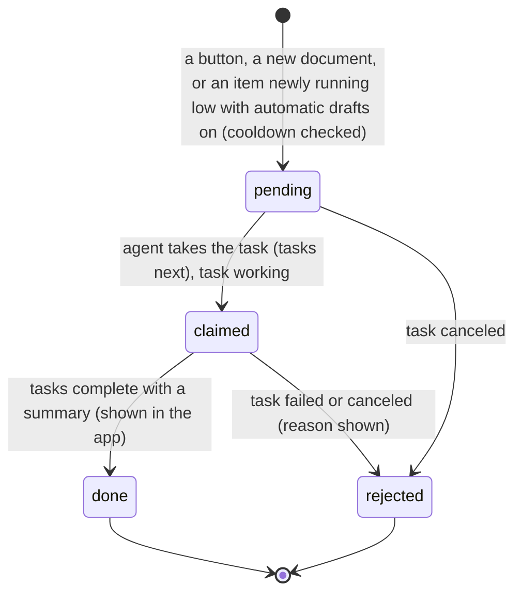
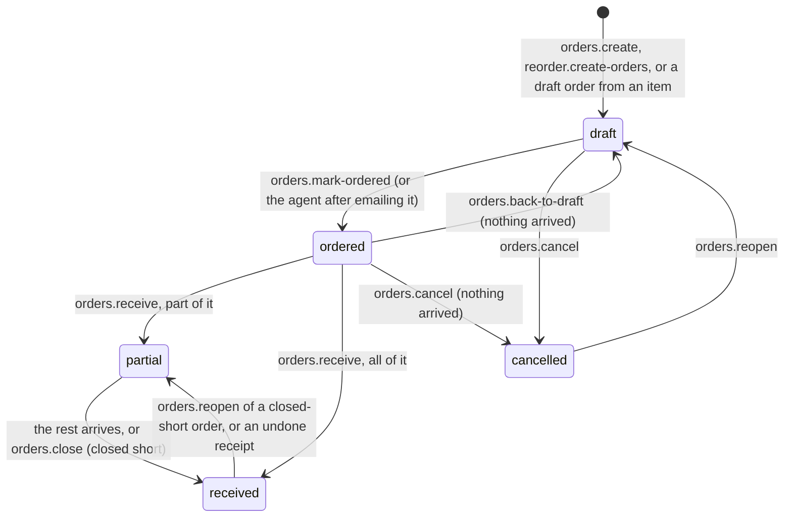
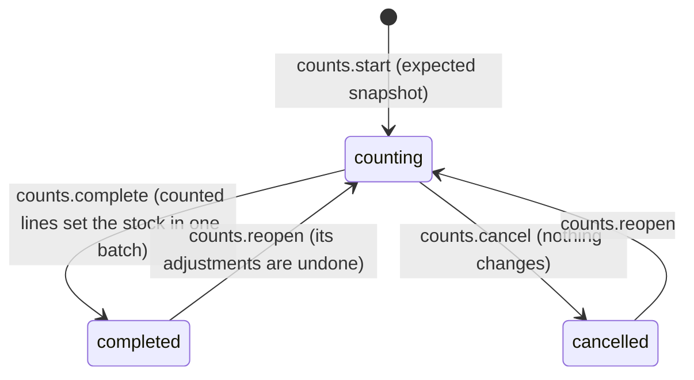

# Requirements: Inventory

PART A — REQUIREMENTS (SRS). User-approved before build; frozen after; changes via ## Changes.

## Introduction

### Purpose
Inventory is a stock app for a small team's stockroom: a shop's back room, a workshop, a small warehouse or a van. Its one job is to show what is in stock, where it is, and when to reorder. It has one currency and no accounts or sign-in. Home opens with the stockroom as a 3D isometric map to move around and work in, then a dashboard of stock health, value, what needs attention, stock in and out, incoming orders and recent activity. Every quantity comes from a ledger of changes with Undo. Stock is changed on a full-screen keypad, by scanning, by receiving purchase orders, and by stock counts. An AI agent works on the same data through A2App. Every UI action is a declared operation, and the app hands work to the agent as tasks: draft reorders, read packing slips and invoices, email a purchase order.

### Scope
**Goals**
1. Every quantity on screen is the sum of ledger entries. Each action (a stock change, a scanned list, a receipt, a count) is one batch with one Undo, and deleting a batch from the history takes the stock back as if it never happened.
2. One scan always means one thing: every SKU, extra barcode and place code is unique, and a scan anywhere outside a form opens its item or place.
3. An item needs reordering when on hand plus incoming is at or below its reorder point, and Reorder turns the suggestions into one draft purchase order per supplier.
4. A stock count sets the counted stock in one batch, and reopening it undoes those changes.
5. Every UI action is available to an agent as an operation, and data written by any route obeys the same record rules.

**Core functionalities:** stockroom map · dashboard · full-screen stock change · items with photos, codes and reorder levels · locations as a tree of nesting places · scanning · reorder suggestions · purchase orders and receiving · packing slips and invoices read by the agent · stock counts · activity with Undo · suppliers · labels · CSV import and export · settings and categories with line icons · agent tasks

### Approval
Approved by the user: 2026-11-04 — carried over from the published marketplace app `inventory` 1.0.0, whose requirements were approved when it was built; this document restates them in the framework's form without changing any feature.

## Product Description

### Product Perspective
`authMode: none`. The app is for a small team's stockroom with one currency and no accounts or sign-in (Original requirements). It serves on loopback only, and its own operation routes still require a caller (the View or the agent's credential). manifest.json declares no integrations (`capabilities.integrations: []`) and the app calls no outside service (AGENT_APP.md § External data). Barcode scanners that type like a keyboard work everywhere; no camera or other browser permission is used. Packing slips and invoices are read by the person's AI agent through a task, and purchase orders are emailed by the agent from the user's account; the app has no OCR or email of its own. Labels print through the browser. The UI names no particular agent ("your AI agent").

### User Characteristics
A small team keeping a stockroom: receiving deliveries, taking stock out, moving it between places, counting, and reordering, several times a day. They work at a desktop (the icon rail, the map) and on a phone or tablet in the stockroom (the floating bar with a raised "+"), often with a keyboard-wedge barcode scanner and a label printer. Widths down to 320 px are in scope, with touch and pointer input.

### Constraints
- C-1: Quantities are never typed into a record. `movements` is the ledger, and `stock` keeps the balance per item and place, written in the same transaction. Each action is one batch. Undo posts the opposite of a batch (both stay in the history); deleting a batch (and its undo) takes the stock back as if it never happened.
- C-2: Stock cannot go below zero at a place unless the setting allows it.
- C-3: Every scannable code is unique: an item's SKU, its extra barcodes and a place's code. No code may equal another item's SKU or barcode or a place's code. SKUs (SKU-0001…) and place codes (LOC-001…) are numbered automatically when left empty; purchase orders are numbered PO-0001… and counts C-0001….
- C-4: Statuses: out (nothing on hand), low (at or below the reorder point), over (above the target level, when the target is above the reorder point), and in stock. An item needs reordering when on hand plus incoming is at or below its reorder point; the suggestion fills it to the target level, or to twice the reorder point without a target above it. Usage and days left come from what went out over the last 30 days.
- C-5: Unit costs are integers of 1/10000 of the currency unit (up to 4 decimals), and receipts with a cost move the item's average cost. Quantities are rounded to 3 decimals and are whole units unless the item is counted in part units.
- C-6: Places come in 14 kinds (site, room, area, container, vehicle, rack, shelf, cabinet, fridge, drawer, pallet, bin, box, other) and nest by size: a site holds anything but a site; a room holds areas, vehicles and furniture; an area holds containers, vehicles and furniture; a container holds racks and furniture; a vehicle holds shelves, cabinets, fridges, drawers, pallets, bins and boxes; a rack holds pallets, bins and boxes; a cabinet or fridge holds shelves, drawers, bins and boxes; a shelf, drawer or pallet holds bins and boxes; bins and boxes hold nothing; "other" holds shelves, drawers, pallets, bins, boxes and other places. Any kind may stand at the top level. Places nest at most 8 levels deep, with no cycles.
- C-7: A place is refused when it does not fit its parent, and a kind change is refused when the place would no longer hold what is inside it. A place is deleted only when it holds no stock and every place inside it fits one level up; its places inside move up a level and its history entries are removed. A place whose parent changes loses its map layout.
- C-8: Fixed vocabularies. Movement kind: in, out, move, adjust, count. Reasons: received, returned, found, produced, opening (in); sold, used, damaged, lost, expired, sample, returned (out); correction, found, damaged, lost, expired (set). Actor: you, agent, system. Order status: draft, ordered, partial, received, cancelled; origin: you, agent, reorder. Count status: counting, completed, cancelled. Document status: waiting, reading, done, failed; added_by: you, agent. Import status: previewed, imported, undone.
- C-9: Category names and supplier names are unique ignoring case. A category's icon is one of the 68 fixed line icons (`package` by default).
- C-10: Item photos are JPEG, PNG, WebP or GIF, up to 10 MB. Documents are JPEG, PNG, WebP, GIF, HEIC, HEIF or PDF, up to 20 MB. CSV imports are up to 20 MB.
- C-11: Purchase order lines can change until the order is received. An order can be marked as ordered only from draft, put back to draft or cancelled only while nothing has arrived, closed short only when partly received, and reopened when cancelled or closed short. A line is removed only while nothing has arrived for it.
- C-12: Stock, movements, orders, order lines, counts, count lines, documents, imports and settings change only through the operations; direct API writes are refused with a pointer to the operation. Items, barcodes, categories, locations and suppliers may be written directly, and their record rules still apply.
- C-13: Days are `YYYY-MM-DD` text in the user's calendar.
- C-14: The first open seeds one settings row (USD, stock below zero not allowed, automatic drafts off), eight categories (General, Supplies, Tools, Electronics, Packaging, Cleaning, Office, Food and drink) and one place, "Main stockroom" (LOC-001, a room). No items, stock or sample data are seeded.
- C-15: No emoji appears anywhere: categories wear line icons. The app names no particular AI agent, and what the agent records is marked `agent`. Numbers on screen read "1,234.50" whatever the browser language; typed numbers accept commas only between thousands.

### Assumptions
- A-1: Volume ceiling: one small team's stockroom. Lists page their results: `items.list` up to 1,000 per call (100 by default, more load on scroll), `movements.list` 25 at a time (up to 500), `orders.list` up to 500, `counts.list` up to 500, `documents.list` up to 500, `import.list` up to 500, and an import preview shows up to 500 rows. The automatic-restock memory holds any realistic number of items (200,000 characters).
- A-2: The machine running the app is the team's own, and its local date is the team's date.
- A-3: Barcode scanners act as a keyboard (USB or Bluetooth "keyboard wedge"); label printers print through the browser.

## Features

### Module: Frame
- F-FRM-1: On wide screens the user can reach every page from a slim icon rail on the left: Home, Items, Locations, Activity; Scan, Reorder, Purchase orders, Stock counts; with Suppliers, Labels, Import and export, and Settings at the bottom.
- F-FRM-2: The user sees the current page in the rail as a solid circle. Hovering an icon shows the page's name.
- F-FRM-3: The user sees counts on Reorder (items to reorder), Purchase orders (late orders and documents that could not be read) and Stock counts (counts in progress).
- F-FRM-4: On phones the user can navigate with a floating bottom bar: Home, Items, a raised "+" (stock change), Scan, and a menu for the rest.
- F-FRM-5: WHEN a barcode scanner reads a code anywhere outside a form THE SYSTEM SHALL open its item or place. WHEN nothing has the code yet THE SYSTEM SHALL offer "Create a new item with this code" or "Add it to an existing item".
- F-FRM-6: The user's back buttons follow the app's own trail of pages and never leave the app.
- F-FRM-7: WHEN a newer version of the app has been deployed THE SYSTEM SHALL reload an open page onto it, after the server comes back or when the tab is shown again. It waits while a dialog is open.
- F-FRM-8: The user can use every page down to 320 px wide.
- F-FRM-9: WHEN the host switches the theme pack, light or dark mode, or custom colors THE SYSTEM SHALL recolor the app from the host's theme tokens with contrast checks. Only the stock state colors (green in stock, amber low, red out) stay fixed, always shown with a label too.
- F-FRM-10: The user sees every number written "1,234.50", categories with line icons and no emoji, and the agent called "your AI agent".

### Module: Home (dashboard)
- F-HOME-1: The user sees a greeting with the date, a search box (a typed or scanned code opens its item or place; other text opens Items with that search), "New item" and "Stock change".
- F-HOME-2: The user sees status pills for documents with your AI agent, documents that could not be read, late orders and counts in progress, each linking to its page.
- F-HOME-3: WHEN places, items or reorder points do not exist yet THE SYSTEM SHALL show the "Set up your stockroom" checklist: add your places, add your items (or import), set reorder points, add suppliers.
- F-HOME-4: The user sees "Stock health": a ring of items in stock, low, out and over with a legend, the number of items in the middle and shortcuts (scan, reorder, count) in its gap. A slice or legend row opens those items.
- F-HOME-5: The user sees "Stock value" at average cost, with units, items and places, items to reorder, and stock idle for 90 days.
- F-HOME-6: The user sees "Needs attention": out and low items with level bars, a link to Reorder, and "Ask your AI agent" to draft the orders.
- F-HOME-7: The user sees "Stock in and out" over 30 days (in above the line, out below), and a day opens its history.
- F-HOME-8: The user sees "Coming in" (open orders with expected dates and progress, late ones marked), "Most used" (out over 30 days), "Where it is" (value, or units, by top-level place) and "Recent activity" with Undo.

### Module: Stockroom map (map, locations)
- F-MAP-1: The user sees a card across the full width of Home, above Stock health and Stock value, with the stockroom as a 3D isometric model: each top-level place is a base drawn by its kind (a warehouse floor for a site, a floor with two walls for a room, a marked floor for an area, a shipping container, a van, or a low plinth for furniture standing on its own), and the places inside stand on it as models of their kind. Places deeper down count toward the one that holds them.
- F-MAP-2: The user sees each item stored in a place as a spot with one to three boxes of its shape (how full it is against its target level) in its status color. The shape follows the item's unit, or for plain pieces its category; anything else is a crate. An out-of-stock item shows as a dashed red empty spot at its home place.
- F-MAP-3: The user can drag to move around, scroll or pinch to zoom, use buttons to zoom and fit everything, and use the keyboard (arrows move, plus and minus zoom, 0 fits, Escape closes). The view keeps the same isometric angle and eases between positions. On first view the bases rise and the items drop in, unless reduced motion is set.
- F-MAP-4: WHEN the user hovers a place or an item THE SYSTEM SHALL lift it a little and show its name and figures. Clicking a place flies to it and opens its panel (items, units and value, what is stored there with quick In and Out, the places inside, Stock change here, Count here, Open place). Clicking a box opens the item (how much is here and in total, its level, where else it is, In, Out, Move, Open item).
- F-MAP-5: The user can drag a box onto another place to move it, which opens the stock change with the item and both places filled in for the amount to be confirmed. On touch, press and hold a box to pick it up.
- F-MAP-6: The user can filter the boxes by All, Low, Out and Over (with counts; the others fade) and find an item (its boxes pulse and the view frames them).
- F-MAP-7: The user can arrange the map like the real space: pick a place, drag it within the space it stands in (what stands in it moves with it), and drag its corner handles to resize it, with its size shown. Everything snaps to a grid, places cannot overlap (a place dragged where it cannot go turns red and goes back), and each change is saved in one go for everyone. Reset layout returns to the automatic layout.
- F-MAP-8: WHEN stock changes (here, on another screen or by the agent) THE SYSTEM SHALL grow, shrink, add or remove the boxes and make them glow for a moment.
- F-MAP-9: The user can expand the map to full screen. The places are also a list for keyboards and screen readers. WHEN the browser cannot draw 3D THE SYSTEM SHALL say so and link to Locations.

### Module: Stock change (stock, movements)
- F-CHG-1: WHEN the user presses "+" or "Stock change" THE SYSTEM SHALL grow a full screen with a circular reveal, with three numbered steps: the item (search or scan), how many on a keypad (In, Out, Move, Set; the physical keyboard works too), and where and why (places that hold it, other places, reasons, cost on receipts, note), then Save.
- F-CHG-2: WHEN a stock change is saved THE SYSTEM SHALL show a pill offering Undo.
- F-CHG-3: WHEN the amount taken out is more than a place holds and stock may not go below zero THE SYSTEM SHALL refuse it, and the keypad says how many are there.

### Module: Items (items, stock)
- F-ITM-1: WHEN the user presses "New item" THE SYSTEM SHALL grow a full screen of three steps: what it is (photo, name, category, unit, part units), codes and place (SKU, barcodes by scanning, starting stock and its place, or the home place), reorder and buying (reorder point, target level, supplier, cost, lead time, description). Only the name is required.
- F-ITM-2: The user can edit an item on the same screen, which adds archive and delete.
- F-ITM-3: The user can search items by name, SKU, barcode or description, filter by status chips with counts, category, place and active or archived, and sort (status, fewest or most on hand, runs out soonest, highest value, recently changed).
- F-ITM-4: The user can view items as photo cards or a list, take stock in or out from each, and load more by scrolling.
- F-ITM-5: The user can enter select mode and set the category, print labels, archive or delete the selected items.
- F-ITM-6: The user can open an item's page: on hand and its worth, In, Out, Move and Set, incoming, reorder point, target and how long it lasts; the stock level since it was added (up to 90 days) with the reorder line; where it is with a move from each place; reordering with a one-step draft order and the open order lines; codes and its label; details; and history with Undo.

### Module: Locations and scanning (locations, lookup)
- F-LOC-1: The user can see the locations as a tree, expand a place, and add a place inside it from its row.
- F-LOC-2: The user can open a place: its items (and those inside it), units and value, the places inside it, what is stored there with take out and move per row, Count here, its label, edit and delete.
- F-LOC-3: The place form offers only the kinds and parents that fit (C-6), and a place that does not fit is refused with what its parent can hold.
- F-SCN-1: The user can use the Scan page to look up, receive, take out and move. Scanning a place's label sets the place; in move, first where it comes from, then where it goes.
- F-SCN-2: WHEN the user scans in receive, take out or move THE SYSTEM SHALL add to a list (scanning again adds to its line; each scan counts N) and record the list as one change with one Undo.
- F-SCN-3: WHEN a scanned code is unknown THE SYSTEM SHALL offer a new item or adding the code to one. The user can turn scan sounds off.

### Module: Buying (reorder, orders, documents, suppliers)
- F-BUY-1: The user sees reorder suggestions grouped by supplier, with editable quantities, a plain-words reason for each, and the drafts they are already on.
- F-BUY-2: The user can create a draft order per supplier, or all at once, and ask your AI agent to draft them.
- F-BUY-3: The user can let your AI agent draft orders on its own whenever an item newly runs low (a setting). It never sends them.
- F-BUY-4: The user can list purchase orders by open, drafts, ordered, partly received, received and cancelled, and create a new one.
- F-BUY-5: The user can open an order: its lines (quantity and cost editable until it is received), totals, details (supplier, deliver to, expected, note), your AI agent's note, receipts with Undo, and its documents.
- F-BUY-6: The user can mark a draft as ordered (the expected date comes from the supplier's lead time), or let your AI agent email it to the supplier.
- F-BUY-7: The user can receive an ordered order (all or part, to a place), put it back to draft, or cancel it; close a partly received order short; reopen a cancelled or closed order; and, on any order, get it as text or delete it.
- F-BUY-8: The user can drop packing slips or invoices (photos or PDFs) for your AI agent, which reads them and records what arrived with a summary. WHEN a document cannot be read THE SYSTEM SHALL say why and offer to retry or delete it.
- F-BUY-9: The user can keep suppliers with contact details, delivery days and notes, see the items they supply and their latest orders, and add, edit and delete them (their items and orders stay).

### Module: Stock counts (counts)
- F-CNT-1: The user can start a count for a place (and the places inside it) or for everything, optionally blind.
- F-CNT-2: The user can scan to count (each scan adds one), type counts, mark a line as matching, add something found elsewhere, and filter the lines.
- F-CNT-3: The user sees a review with the differences and their value, and chooses whether lines not counted are kept or set to zero.
- F-CNT-4: WHEN a count is completed THE SYSTEM SHALL set the counted stock in one batch. WHEN it is reopened THE SYSTEM SHALL undo its changes.
- F-CNT-5: The user can cancel a count in progress (nothing changes) and delete a count.

### Module: Activity (movements, export)
- F-ACT-1: The user sees every change grouped by day and by action, with who made it (you, your AI agent, the app) and its source (order, count, import).
- F-ACT-2: The user can filter the activity by kind, who, place, item and dates, undo a change, delete it from the history, and export it as CSV.

### Module: Labels (items, locations)
- F-LBL-1: The user can print labels for items (their SKU) and places (their code) as a Code 128 barcode or a QR code, on label rolls (50 x 25, 62 x 29, 100 x 50 mm) or sheets (A4 24 up, Letter 30 up), with the name on or off and a number of copies, after a preview of the first page.

### Module: Import and export (import, export)
- F-DAT-1: The user can import items from a CSV whose columns are matched by header and can be chosen, with quantities that set the stock or add to it, and missing categories, suppliers and places created on request.
- F-DAT-2: The user sees the rows with problems listed and skipped, and can undo an import.
- F-DAT-3: The user can export items, stock by place (importable back as a stock take), the history between two days, and an empty template.

### Module: Settings (settings, categories)
- F-SET-1: The user can change the currency. Costs keep their numbers and are relabelled; nothing is converted.
- F-SET-2: The user can allow stock below zero and turn on automatic drafts by your AI agent.
- F-SET-3: The user can rename, re-icon (line-icon picker), add and delete categories. A deleted category's items become uncategorized.
- F-SET-4: The user sees a card, "Let your AI agent do it", with examples of what to ask.

### Agent (via A2App)
- F-AGT-1: The agent can perform every UI action as an operation: the 84 operations in ## Operations Design, across the modules app, settings, dashboard, lookup, categories, map, locations, suppliers, items, stock, movements, reorder, orders, counts, documents, import and export.
- F-AGT-2: The agent can read the conventions, today's date, the currency, the locations with their codes, the categories, the reasons per kind of change, what each place kind can hold, and ready-to-run recipes from `app.guide`.
- F-AGT-3: WHEN data is written by any route (the UI, an operation, or a raw record write) THE SYSTEM SHALL apply the same record rules: unique codes, place nesting, category icons, and no deleting a place that holds stock.
- F-AGT-4: The agent can read the map (`map.get`) and set where places stand and how big they are (`locations.place`, or several at once, all or nothing, with `locations.arrange`).
- F-AGT-5: The agent can take a `restock_review` task and draft purchase orders for the items that need reordering with `reorder.create-orders` (one draft per supplier, safe to repeat). It never sends or places them.
- F-AGT-6: The agent can take a `documents_waiting` task and, for each waiting document, record what arrived (`documents.start`, then `orders.receive` or `stock.batch`, then `documents.complete` with a summary), or mark it unreadable with a reason (`documents.fail`).
- F-AGT-7: The agent can take an `order_send_requested` task, email the order text from `orders.text` to the supplier from the user's email account, and then mark the order as ordered.
- F-AGT-8: WHEN the app asks the agent THE SYSTEM SHALL show the request honestly: sent, working, done with its result, or refused, and a request nobody has taken after 20 s adds "It picks this up while your AI agent is running."
- F-AGT-9: WHEN the agent calls a destructive operation THE SYSTEM SHALL answer `approval_required` until the person has approved that call.

## Non-Functional Requirements
- N-1: A change made by the agent (or another tab) appears on every open screen, the map included, without a manual refresh. Views reload 150 ms after the last realtime change to a collection they watch.
- N-2: Home shows at once: the 3D engine (three.js) loads on its own, and it draws only when something changes, so an idle Home costs nothing.
- N-3: A scan is told from typing as a burst of at least 4 characters averaging under 40 ms per key, ended by Enter or Tab or a short pause.
- N-4: Waiting documents whose ask was refused are asked about again within a minute (job `inv_documents`). With automatic drafts on, an item that newly needs reordering is asked about within a minute of the change (job `inv_restock`, which runs only after stock, items, orders or settings changed, and once after a start).
- N-5: Every page is usable from 320 px wide up to 1440 px, the app shell's maximum width.

## Data Requirements
- **settings** (module: settings): currency (string, required, max 3), currency_confirmed (boolean), allow_negative (boolean), auto_restock (boolean), restock_sig (string, max 200000), restock_asked_on (string, max 10), created (datetime, server-set), updated (datetime, server-set).
- **categories** (module: categories): name (string, required, max 40), icon (string, max 40), sort (number), created (datetime, server-set), updated (datetime, server-set).
- **locations** (module: locations): name (string, required, max 60), code (string, max 32), kind (enum), notes (string, max 500), sort (number), created (datetime, server-set), updated (datetime, server-set), parent (ref → locations), map (json).
- **suppliers** (module: suppliers): name (string, required, max 80), contact (string, max 80), email (string, max 120), phone (string, max 40), website (string, max 200), lead_time_days (number), notes (string, max 1000), created (datetime, server-set), updated (datetime, server-set).
- **items** (module: items): name (string, required, max 120), sku (string, max 40), category (ref → categories), unit (string, max 16), fractional (boolean), photo (binary), description (string, max 2000), min_qty (number), max_qty (number), unit_cost (number), supplier (ref → suppliers), lead_time_days (number), default_location (ref → locations), archived (boolean), created (datetime, server-set), updated (datetime, server-set).
- **codes** (module: items): code (string, required, max 128), item (ref, required → items), created (datetime, server-set), updated (datetime, server-set).
- **stock** (module: stock): item (ref, required → items), location (ref, required → locations), qty (number), created (datetime, server-set), updated (datetime, server-set).
- **orders** (module: orders): number (string, required, max 20), supplier (ref → suppliers), location (ref → locations), status (enum, required), expected_on (string, max 10), ordered_on (string, max 10), received_on (string, max 10), closed_short (boolean), note (string, max 1000), origin (enum), agent_note (string, max 2000), created (datetime, server-set), updated (datetime, server-set).
- **order_lines** (module: records): po (ref, required → orders), item (ref, required → items), qty (number), received (number), unit_cost (number), sort (number), created (datetime, server-set), updated (datetime, server-set).
- **counts** (module: counts): number (string, required, max 20), location (ref → locations), include_sub (boolean), status (enum, required), blind (boolean), note (string, max 500), completed_on (string, max 10), batch (string, max 24), summary (json), created (datetime, server-set), updated (datetime, server-set).
- **count_lines** (module: records): session (ref, required → counts), item (ref, required → items), location (ref, required → locations), expected (number), counted (number), counted_set (boolean), created (datetime, server-set), updated (datetime, server-set).
- **documents** (module: documents): file (binary, required), status (enum, required), summary (string, max 2000), error (string, max 500), po (ref → orders), batch (string, max 24), added_by (enum), created (datetime, server-set), updated (datetime, server-set).
- **imports** (module: import): file (binary), filename (string, max 255), status (enum, required), rows (number), added (number), changed (number), skipped (number), mapping (json), result (json), created (datetime, server-set), updated (datetime, server-set).
- **movements** (module: movements): item (ref, required → items), location (ref, required → locations), qty (number), kind (enum, required), reason (enum, required), batch (string, required, max 24), ref_type (enum), ref (string, max 24), po_line (string, max 24), unit_cost (number), balance (number), actor (enum, required), note (string, max 300), reverses (string, max 24), created (datetime, server-set).

## External Interfaces
- **Human (browser):** one View served by PocketBase at the app's own origin, with hash routes `#/` (Home), `#/items` and `#/item?id=…`, `#/locations?id=…`, `#/scan`, `#/reorder`, `#/orders` and `#/order?id=…`, `#/counts` and `#/count?id=…`, `#/activity`, `#/suppliers`, `#/labels`, `#/data` (Import and export) and `#/settings`. It also has the full-screen stock change and item editor, the full-screen map, and the dialogs opened from these pages. Input is touch, mouse and keyboard, keyboard-wedge barcode scanners, item photos, documents (photos or PDFs) and CSV files. Output is labels printed through the browser and CSV downloads (items, stock by place, history, the import template).
- **Agent (A2App):** the modules and collections in AGENT_APP.md § Modules; operations exactly as declared in ## Operations Design; tasks with the capabilities `restock_review`, `documents_waiting`, `order_send_requested` (events.json). No other machine interface is offered to agents; the app's own screens call their own routes.

## Out of Scope
- More than one team or person: accounts, sign-in, roles or permissions.
- More than one currency at a time, or converting costs when the currency changes.
- Typing a quantity into a record: every quantity comes from the ledger.
- Reading documents inside the app (OCR or an app-owned model). Packing slips and invoices are read by the person's AI agent.
- Sending email from the app itself, or the agent sending a purchase order on its own. Orders are emailed by your AI agent only when the person asks, and automatic drafts are never sent.
- Using a camera or any other browser permission to scan: scanners type like a keyboard.
- Places nested more than 8 levels deep, or places that do not fit their parent by size.
- Import and export formats other than CSV.
- Printing other than through the browser.
- Emoji, and naming a particular AI agent.

## Quality of Life
- The greeting follows the time of day ("Good morning", "Good afternoon", "Good evening").
- Scans beep, and the beeps can be turned off on the Scan page (remembered in this browser).
- The stock change keypad takes back digits a scan typed into it.
- A request to the agent that has not been picked up after 20 s adds "It picks this up while your AI agent is running." instead of spinning without explanation.
- The map shows a hint on how to move around until it is first used.
- Activity rows, documents, past imports, draft orders and counts show how long ago they happened ("just now", "4 min ago").

PART B — TECHNICAL SPECIFICATION.

## System Overview
PocketBase 0.39 (JS hooks, migrations) + React 19 / Vite / Tailwind 4 View in `frontend/` built into `pb/pb_public/`, on the `blueprint-pocketbase-kit` toolkit, with three.js for the stockroom map. The View calls the app's own routes `/api/ops/<group>/<verb>` (`ops.pb.js`, `ops_stock.pb.js`, `ops_buy.pb.js`, `ops_counts.pb.js`). The generated `a2app_routes.pb.js` serves the same handlers to agents as `POST /api/ops/<name>`. Domain logic lives in `pb/pb_hooks/lib_*.js`, and `lib_ledger.js` is the only place quantities change. Record rules and jobs live in `hooks.pb.js` with `lib_rules.js`.

Modules → navigation map:

| Module (manifest) | Where a person meets it | Route |
| --- | --- | --- |
| `dashboard` | Home dashboard; the rail counts | `#/` |
| `map` | The stockroom map on Home | `#/` |
| `items` | Items list, an item's page, the item editor ("New item", Edit) | `#/items`, `#/item` |
| `stock` | The stock change screen ("+", In, Out, Move, Set), the Scan page | everywhere, `#/scan` |
| `movements` | Activity; history on an item and an order; Undo pills | `#/activity` |
| `locations` | Locations tree and a place's panel; arrange mode on the map | `#/locations` |
| `lookup` | Scans anywhere outside a form; the Home search | everywhere |
| `reorder` | Reorder | `#/reorder` |
| `orders` | Purchase orders and an order's page | `#/orders`, `#/order` |
| `documents` | Packing slips and invoices on Purchase orders and on an order | `#/orders`, `#/order` |
| `counts` | Stock counts and a count's page | `#/counts`, `#/count` |
| `suppliers` | Suppliers | `#/suppliers` |
| `import`, `export` | Import and export; Activity's CSV export | `#/data`, `#/activity` |
| `settings`, `categories` | Settings (currency, stock rules, categories) | `#/settings` |
| `app` | No screen: `app.guide` is the agent's starting point | — |
| `records` | No screen of its own: order lines and count lines are shown on their order and count | — |

Labels (`#/labels`) print from items and places. Rail order: Home, Items, Locations, Activity · Scan, Reorder, Purchase orders, Stock counts · Suppliers, Labels, Import and export, Settings. Phone bar: Home, Items, the raised "+", Scan, and a menu holding the rest.

## UI Design
- **Design system:** the agent-app UI kit 0.6.0 vendored in `frontend/src/kit` (system-managed). It supplies the `--agent-app-*` tokens in `theme/tokens.css`, the theme bridge, the shell with its error boundary and toasts, and the PocketBase client and agent-request hooks. The app extends the kit in `frontend/src/app/theme.css` and `lib/themeColors.ts`, in the Expenses tracker family. It sets its own font (Manrope Variable via `@fontsource-variable/manrope`) and base radius (`--agent-app-radius: 14px`). It derives every `--iv-*` color (canvas, shell, card, row, sand, ink, ink-2, muted, line, solid, accent, the map floor, and their on-colors) from what the kit tokens resolve to, and re-derives them on each theme change. Surface scopes `.iv-on-dark`, `.iv-on-sand`, `.iv-on-ink` and `.iv-on-card` re-point accent and muted text. Only the stock state colors are fixed (`--iv-green` #4f9a6c in stock, `--iv-amber` #e2a43a low, `--iv-red` #de4b33 out), with derived text variants, and labels preview black on white (`--iv-paper`, `--iv-paper-ink`). The widgets are written once in `components/ui.tsx` (Card, CardHeader, PageHeader, PillButton, CircleButton, TextLink, StatusPill, Empty, the field classes, PillSelect, Field, Toggle, Modal, useConfirm, Popover, DayPicker, Chips, Segmented, SearchBox, Stepper, LevelBar), `controls.tsx`, `rows.tsx` (ItemRow, ItemCard, MovementLine, BatchCard), `pickers.tsx` (ItemSearch, LocationList, LocationSelect) and `AskAgent.tsx`. Charts are app-drawn SVG (`Donut.tsx`, `charts.tsx`: FlowBars, LevelChart, RankBars, SplitBar), the map is drawn with three.js (`components/map/`), and labels use an app-drawn Code 128 barcode (`Barcode.tsx`). Icons come from lucide-react, and categories use the 68-icon line set (`pb_hooks/lib_icons.js`, mirrored in `lib/icons.tsx`).
- **Layout:** a warm canvas holds one cream app shell, 1440 px wide at most, with 36 px corners from 768 px up. On wide screens the 96 px icon rail sits on the left in three white pill groups, with the page in the main column. Pages are composed of borderless cards (24 px radius; dialogs 28 px; pills fully rounded). From 1024 px the cards sit on a 12-column grid (Home: the map across the width, then 8 + 4 columns); below that they take one column. The stock change and the item editor are full screens that grow out of the button pressed, with three numbered steps side by side from 1100 px and stacked in a 560 px column below. The type scale is 12, 13, 14, 15 and 26 px, with hierarchy from weight and color, and spacing follows a 4 px grid. On phones a floating bottom bar replaces the rail, and pages keep 128 px of bottom padding to clear it.
- **Screen — Home:** primary object: the stockroom · primary action: "Stock change" (the raised "+" on phones), and "New item" · loading: the frame shows a spinner until settings, categories, locations and suppliers arrive, then each card appears with its first load; the map shows "Loading your places" · empty: the setup checklist "Set up your stockroom"; the ring card reads "No items yet" ("Add items and this ring shows how many are in stock, running low, out, or over their target level."); "Nothing recorded yet"; "All stocked up" when nothing is low; "Nothing on order" ("Orders you place show here until they arrive.") · error: the kit's error toast with the operation's message · success: Undo pills and live updates · narrow: one column; the search box shows from 1024 px, "Stock change" from 768 px and "New item" from 640 px.
- **Screen — Stockroom map:** a card on Home, or full screen · primary object: places and their boxes · primary action: click a place or a box for its panel · states: filters All, Low, Out, Over with counts; "Find an item on the map"; zoom and "Fit everything" buttons; the hint "Drag to move around · scroll to zoom · drag an item onto a place to move it" (on touch: "pinch to zoom · hold an item to move it"); while carrying, "Move <item> to <place>" or "Drop it on a place"; arrange mode with "Drag any place to where it is in your space", "Saving the layout" and "Reset layout"; "Stock you add shows up here as boxes on its shelves." when nothing is stored; "This browser cannot draw the 3D map" with a link to Locations · narrow: the panel is a sheet over up to 58 % of the map.
- **Screen — Stock change:** a full screen · primary object: one stock change · primary action: Save · states: the steps "Item", "How many" (In, Out, Move, Set; "Coming in", "Going out", "Moving", "Counted"; "Only <n> <unit> here"; "Whole units" for whole-unit items) and "Where and why" ("From and to" for a move); missing input reads "Choose an item first", "Enter how many", "Choose where it goes", "Enter the cost like 2.35"; an unknown scan reads "Nothing has the code "<code>""; success shows the Undo pill ("Undone" after Undo) · narrow: the steps stack in a 560 px column.
- **Screen — Item editor:** a full screen · primary object: one item · primary action: "Add item" or "Save changes" · states: "Start with the name. Everything else is optional and can change later."; the steps "What it is", "Codes and place", "Reorder and buying"; checks read "Give the item a name", "Quantities must be whole numbers for this item", "The target level must be at least the reorder point", "Photos can be at most 10 MB", "That barcode is already on this item"; edit adds Archive (or Restore) and Delete ("Delete this item?") · narrow: the steps stack.
- **Screen — Items:** primary object: the items · primary action: "New item" · states: status chips with counts, category and place filters, sort, active or archived, Cards or List; "Loading more" while scrolling; select mode with a bar to set the category, print labels, archive or delete ("Delete selected items?") · empty: "No items yet" ("Add items one by one, import a spreadsheet, or ask your AI agent to set them up."), "Nothing matches" ("Try another search or filter.") · narrow: cards take two columns, three from 768 px and four from 1280 px, and the filters wrap.
- **Screen — Item page:** primary object: one item · primary action: In, Out, Move, Set · states: the reorder card ("No reorder point set", "Stock is above the reorder point.", "Enough is on its way …", a draft order in one step and "On draft <PO>"); "Stock level" over the last days with the reorder line; "Where it is" ("Not stocked anywhere. Record stock coming in with In.") with "Move from <place>"; "Codes and label"; "History" ("No changes yet") with "See all"; the menu with Print a label, Count this item, Full history, Archive or Restore, Delete; a missing item reads "This item is gone" with Back to items · narrow: one column; from 1024 px 8 + 4 columns.
- **Screen — Locations:** primary object: the tree of places · primary action: "Add a place", and "Add a place inside" on a row · states: expand and collapse; the place panel with Items, Units and Value, the places inside, "Stored here" ("Including the places inside it"; "Nothing here yet") with take out and move per row, Count here, its label, Edit and Delete ("Delete this place?", with how many history entries are removed); the place form explains "Bigger places hold smaller ones: a van can hold a cabinet, never the other way round." · empty: "No places yet" · narrow: the panel moves under the tree.
- **Screen — Scan:** primary object: the scanned list · primary action: record the list ("Receive", "Take out" or move) · states: modes Look up, Receive, Take out, Move; the prompt "Scan anything to look it up", "Scan where it comes from", "Now scan where it goes", "Scan items to …"; place feedback ("Place set to …", "Moving from … Now scan where it goes."); "Nothing scanned yet" ("Scanned items land here. Scanning the same item again adds to its line."); "Recorded together, with one Undo"; an unknown code offers "Add the code to an item" or "Add an item"; the sound toggle · narrow: one column.
- **Screen — Reorder:** primary object: suggestions grouped by supplier · primary action: "Create draft order" per supplier, or "Draft all orders" · states: editable quantities with "Why this quantity"; "Give these items a supplier to order them together"; "Draft order ready" / "Draft <PO> is ready to check and send"; the automatic-drafts switch ("Let your AI agent draft orders when something runs low"); "Ask your AI agent to draft them" with its request state · empty: "Nothing to reorder" with Open items.
- **Screen — Purchase orders:** primary object: the orders · primary action: "New purchase order" · states: status chips (open, drafts, ordered, partly received, received, cancelled); the "Packing slips and invoices" card ("Drop photos or PDFs"; rows "With your AI agent", "Being read", "Recorded", "Could not read" with retry and delete) · empty: "No open orders" with "See what to reorder", "No orders here", "Nothing matches" · narrow: one column.
- **Screen — Order page:** primary object: one purchase order · primary action: by status: "Mark <PO> as ordered" (draft), "Receive <PO>" (ordered or partly received) · states: "Lines" with "Add item" and "Total" ("No lines yet"); "Received" ("Each delivery, with Undo"; "Nothing has arrived yet"); "Details" saved per field; "Your AI agent's note"; "Documents"; "Email it with your AI agent" when the supplier has an email; the menu with Order as text (copy), Back to draft, "Close: the rest is not coming", Reopen, Cancel the order, Delete ("Delete this order?"); a missing order reads "This order is gone" · narrow: the side column moves under the lines.
- **Screen — Stock counts and a count:** primary object: counts, then one count's lines · primary action: "Start a count", then "Review <count>" · states: In progress and Finished lists ("No counts yet"); the start dialog with the place, "Include the places inside it" and blind ("Hide the expected numbers until the review, so they do not sway the count."); on a count, "Each scan adds one. Or type the number on each line.", "Counted one more <item>", "Scans count at", Matches, "Not counted", filters (Not counted, Counted, Different), "Nothing expected here" with "Add what you find"; the review shows Counted, Different and Value change with "Leave them as they are" or "Set them to zero"; success reads "Count complete: <n> items adjusted" or "everything matched"; Reopen reads "Reopened: its adjustments were undone" · narrow: one column.
- **Screen — Activity:** primary object: the history · primary action: Undo a change · states: filters (kind, who: Anyone, You, Your AI agent, The app; place, item, dates); batches grouped by day; delete from history; Export ("Exported <n> entries"); "Loading more" · empty: "Nothing recorded yet" ("Stock coming in, going out and moving between places shows up here."), "Nothing matches" ("Try fewer filters or other dates.").
- **Screen — Suppliers:** primary object: supplier cards · primary action: "Add supplier" · states: cards with contact, delivery time, items, open orders and last order ("Never"); the editor with name, contact person, days to deliver, email for orders, phone, website and notes, the items supplied and latest orders, and Delete ("Delete this supplier?") · empty: "No suppliers yet" with "Add a supplier".
- **Screen — Labels:** primary object: the labels to print · primary action: print · states: "What to print" (Items or Places, by category or one by one); the label format (rolls 50 x 25, 62 x 29, 100 x 50 mm; A4 24 up, Letter 30 up), Barcode or QR, "Show the name", copies; "Preview" ("Nothing chosen yet", "Choose items or places to see their labels").
- **Screen — Import and export:** primary object: a CSV import, and the exports · primary action: "Import <n> items" ("Nothing to import yet") · states: "Drop a CSV file" and "Download an empty template"; "Which column is which"; quantities "What is on the shelf" (set) or add; "Create missing categories, suppliers and places"; counts and the first rows with their problems ("Rows with problems are skipped; fix them in the file and import it again."); past imports with Undo ("Undo this import?") and removal; exports of Items, Stock by place and History between two days.
- **Screen — Settings:** primary object: currency, stock rules, categories · states: "Switch to <code>?" ("Costs and values keep their numbers and show in <code> from now on; nothing is converted."); the switches "Allow stock below zero" and "Your AI agent drafts reorders"; the dark card "Let your AI agent do it" with examples; categories with an icon picker, rename on Enter, add and "Delete "<name>"?".
- **Formatting:** money is formatted with `Intl.NumberFormat('en-US', { style: 'currency' })` with the currency's decimals ("$1,234.50"), compact views drop the decimals, unit costs show up to 4 decimals ("$0.034"), and negatives use a true minus sign "−". Quantities show up to 3 decimals with tabular figures. Days read "Today", "Yesterday" or "Thu, Oct 15" (with the year outside the current year) in the browser's locale; months read "October 2026"; ages read "just now", "4 min ago", "2 h ago". Codes read SKU-0001, LOC-001, PO-0001 and C-0001. Screens show names and codes, not record ids. Empty values are words: "Not set", "No supplier", "No category", "No date", "Never", "No recent use".

## Quality Conformance

- **Q1 Completeness & IA:** orientation comes from the icon rail on wide screens: the current page is a solid circle, hovering an icon shows its name, and counts sit on Reorder, Purchase orders and Stock counts. On phones the bottom bar does the same, with the menu button marked when the page lives in it. Every page has a title header, and detail pages (an item, an order, a count) have a back button that follows the app's own trail. Every screen is reachable from the rail or bar; dashboard cards, map panels and status pills open the items, places and orders behind them, and a scan opens what it belongs to. The modules map to screens as in ## System Overview; only `app` (the agent's guide) has no screen. Names hold app-wide: item, place (location), stock, stock change, reorder point, target level, purchase order, count, document, supplier, label, "your AI agent". Working sets that outgrow a screen have search, filters and loading on scroll (items, activity) or status chips (orders, counts).
- **Q2 Design system:** tokens are the kit's `--agent-app-*` set, extended by the derived `--iv-*` colors (see ## UI Design). Components never hardcode a hex color; the exceptions are the three fixed stock state colors, the label paper colors and the shadows. Semantic roles: ink/solid for primary pills (with the accent dot for a page's main action), accent for highlights and counts, green, amber and red only for in stock, low and out (always with a word), red also for destructive actions and error toasts, sand and dark cards for emphasis. Type is Manrope Variable on the 12/13/14/15/26 px scale. Icons are lucide-react only, with no emoji anywhere. Light and dark come from the host (the kit theme bridge), and each scheme re-derives every `--iv-*` token with contrast checks (`themeColors.ts`); the map takes its colors from the same tokens.
- **Q3 Layout & composition:** spacing follows a 4 px grid, and cards align to a 12-column grid from 1024 px. Each page has one primary pill (dark, with an accent dot) in its header. Home leads with the map across the width, then a calm dashboard; Items, Activity and the order lines are denser rows. Quantities and money use tabular figures and sit right-aligned. Long names truncate with an ellipsis. Lists load more on scroll instead of paginating.
- **Q4 Interaction:** affordance states come from the app's pill and circle buttons: a pointer cursor on everything clickable (a `theme.css` base rule), a hover fill, an active scale, and `disabled:opacity-50`. Each destructive action uses the app's own confirm dialog (`useConfirm`, a Radix dialog; never `window.confirm`), and its copy names the target and the consequence: "Delete this item?" ("Archiving keeps the history instead."), "Delete selected items?", "Delete this place?" (its history entries removed), "Delete this order?" (stock it brought in stays), "Delete this count?", "Delete this supplier?", "Delete this document?", "Delete "<category>"?" (its items become uncategorized), "Delete from history?" (stock goes back as if it never happened), "Undo this import?", "Switch to <code>?". Undo instead of confirm applies to every stock change (the Undo pill, and Undo in the history). Keyboard: the stock change keypad takes digits, the decimal point, Backspace, Delete and Enter, and Escape closes it; the map takes arrows, plus, minus, 0 and Escape; a scanner works anywhere. Inputs are constrained rather than validated: whole units unless the item is counted in part units, "," only between thousands, a target level at least the reorder point, and only the place kinds and parents that fit.
- **Q5 State & feedback:** each screen's states are listed in ## UI Design. Every async pill shows a spinner and is disabled while it runs, which guards against double submission. Success reads back where the user is looking: a toast or the Undo pill, plus the realtime reload of every view and the glow of changed boxes on the map. Agent requests show sent, working, done (with the result) or refused, and a request nobody has taken after 20 s says so. The frame shows a spinner on first load, and cards appear once their data arrives (see ### Conventions and overrides). Load and write errors surface as the kit's error toast with the operation's message.
- **Q6 Motion:** card entrances (`iv-rise`) take 420 ms on `cubic-bezier(0.22, 1, 0.36, 1)`. Dialogs, popovers and pills pop in over 200 ms (`iv-pop`). Charts grow (`iv-grow`, 520 ms) and draw (`iv-draw`, 640 ms); a changed row flashes (700 ms) and a refused entry shakes (360 ms). The stock change and the item editor grow with a circular reveal (560 ms open, 420 ms close). On the map the view eases between positions, the bases rise and the items drop in on first view, and changed boxes glow. Under `prefers-reduced-motion: reduce`, every keyframe animation is removed, the full screens open and close with a 160 ms opacity fade, and the map's animations are off.
- **Q7 Content:** the voice is plain, second person and friendly ("Here is your stockroom.", "your AI agent"), in sentence case. Error copy says what to do: "Enter the cost like 2.35", "Give the item a name", "Choose where it goes", "Only <n> <unit> of "<item>" at <place>, so <n> cannot be taken out.". Operation errors name the parameter and give a valid example, and a hint meant for agents is added only to agent calls. Terminology is fixed: item, place, stock change, in, out, move, set, reorder point, target level, purchase order, receive, count, document, label.
- **Q8 Accessibility:** contrast is computed at runtime for each theme by `themeColors.ts` using the WCAG ratio. Muted and secondary text is chosen to reach 4.6:1 against the shell, card, row and sand surfaces, the state text variants reach 4.6:1, and text on the accent reaches 3:1 or falls back to the theme's ink or card color. Focus: dialogs and the full screens are modal (Radix dialog) and trap focus; Escape closes them. Inputs show a 2 px ring on `:focus-visible`. Icon-only buttons carry `aria-label` and `title`. The rail marks the current page with `aria-current="page"`; segments and choice tiles use `aria-checked` or `aria-pressed`, and switches `role="switch"`. Announcements: the stock change amount, the scan and count feedback and the map's readout are `aria-live="polite"`. The map has a screen-reader list of its places and keyboard controls. Targets: rail and bar buttons are 44 px (36 px on short screens), the raised "+" is 56 px, pills are 44 px tall. Meaning is never color alone: stock states always carry a label.
- **Q9 Responsiveness:** the range is 320 px to 1440 px (the shell's maximum width). Below 768 px the floating bottom bar with the raised "+" replaces the rail, toasts lift above the bar, the shell loses its outer margin and corners, and the map panel becomes a sheet. From 1024 px pages use the 12-column grid and Home shows its search box. From 1100 px the full screens show their three steps side by side. On screens under 840 px tall the rail tightens. Fixed-width elements fit 320 px, and the map measures its card.
- **Q10 Performance:** at A-1, Items loads 100 at a time on scroll and Activity 25 at a time. Server-side caps: `items.list` 1–1,000, `movements.list` 1–500, `orders.list`, `counts.list`, `documents.list` and `import.list` 1–500, the import preview's `show` 1–500. The three.js engine loads on its own, draws items as instanced parts, and draws only when something changes. Item photos are the only image assets, and the font is one variable font. Scheduled jobs touch the database only when needed (in-memory flags).
- **Q11 Caching & freshness:** static: the built bundle has content-hashed asset names, and the document shell is served `no-store, no-cache, must-revalidate` (`cache_control.pb.js`, plus the toolkit's SPA header). Data: operation responses carry no cache headers, and the View keeps them only as in-memory view state. Freshness comes from one realtime hub that subscribes to 14 collections once at startup; each view reloads 150 ms after the last change to a collection it watches, and a sequence guard drops stale responses. An open page compares its script with the served one on every reconnect after the first and whenever the tab becomes visible, then reloads, waiting while a dialog is open.
- **Q12 Data integrity:** quantities live only in the ledger: every change is a `movements` row, and `stock` is written in the same transaction (`lib_ledger.js`); undo posts a batch's lines in reverse order, so an in-then-out batch can be undone without going below zero. Costs are integers of 1/10000. Unique indexes: category and supplier names (ignoring case), item SKUs (ignoring case, when set), place codes (ignoring case, when set), barcodes, `stock (item, location)`, order and count numbers, `count_lines (session, item, location)`; the record rules also keep every scannable code unique across SKUs, barcodes and place codes. Record hooks check items, barcodes, categories, places (nesting, depth, no cycles, no deleting a place that holds stock) and suppliers for every writer. Multi-step writes run in one transaction: stock changes and batches, receipts, counts completed and reopened, imports run and undone, deletes. Migrations are additive and replay on a fresh database. The starter `items` collection was removed by the schema migration (and a new `items` created), and the earlier one stays as applied history.
- **Q13 API:** beyond the adapter, the app's own routes `/api/ops/<group>/<verb>` (24 GET reads, 60 POST writes) are what the View calls; agents reach the same handlers through the adapter. Every parameter is read by the typed readers in `lib_util.js`, which answer 400 naming the parameter and showing a valid example; a hint meant for agents is added only to agent calls. Errors share PocketBase's shape `{ status, message }`, with 400, 404 and 500 used for their meaning and record-hook refusals keeping their 4xx status. `lookup.code` answers `type: none` for an unknown code instead of a 404. Lists are bounded as in Q10. `reorder.create-orders` is safe to repeat (lines are set, never doubled). Stack traces are never returned.
- **Q14 Architecture:** UI is in `frontend/src/app` (pages, components, `components/map`, lib), the application logic in `pb/pb_hooks/lib_*.js`, routes in the four `ops*.pb.js` files, and record rules and jobs in `hooks.pb.js`. The UI calls the same operations the agent calls (`lib/api.ts`), so every rule has one server implementation, and `lib_ledger.js` is the only place quantities change. Shared widgets exist once in `components/ui.tsx`, `controls.tsx`, `rows.tsx` and `pickers.tsx`. App-wide data (settings, categories, locations, suppliers) has one source, `lib/context.tsx`. Number and date formatting live in `lib/format.ts` and `lib/dates.ts`. Configuration lives in manifest.json and the toolkit's launcher.
- **Q15 Resilience:** the app calls no outside service. A document or restock ask refused by the trigger cooldown or lost to a restart is retried by the minute jobs. Refused stock changes leave nothing half-written (one transaction). When the backend is unreachable, failed calls toast the kit's network error, and the page reloads onto the current build when the server comes back. Without WebGL the map card says so and links to Locations. A render crash shows the kit's "Something went wrong" panel with "Reload app". Hook errors are caught and logged, and never shown raw.
- **Q16 Security & privacy:** with `authMode: none`, read rules are open (`""`) because the app is single-team and binds loopback. Stock and movements have closed write rules, settings cannot be created or deleted, and request hooks refuse API writes to stock, movements, orders, order lines, counts, count lines, documents, imports and settings; items, barcodes, categories, places and suppliers may be written directly under their record rules. The framework adapter runs its host check, framing policy and credential checks before any app hook. The app's own operation routes require a caller: the View, or the agent's `.agent-token` sent as `X-A2App-Token`. Destructive operations need the person's approval through the adapter. The toolkit sets rate limits (300 requests per minute on `/api/ops/`). Documents and photos stay in `pb/pb_data`. Runtime credentials (`.agent-token`, `.principal`, `.superuser`) are git-ignored and never shipped.
- **Q17 Observability:** hook errors log prefixed lines: `[inventory] op failed:` for 5xx operation errors, `[inventory] document ask failed:` and `[inventory] asking the AI agent about a document failed:` for the document asks, and `[inventory] auto restock check failed:` for the restock check. The toolkit adds `[handler-error] <METHOD> <path>: <message>` for uncaught handler errors. The UI kit's console relay ships browser `console.error`/`console.warn` and uncaught errors to `logs/frontend_console.log`. Every stock change is in the history with who made it (Activity). Health is `/api/_a2app`, the adapter's identity document.
- **Q18 Version control:** the app was committed as one change ("Add inventory agent app"). `.gitignore` excludes credentials, `pb/pb_data/`, the PocketBase binary, the built View `pb/pb_public/`, `frontend/node_modules/`, framework runtime state under `.a2app/`, and `logs/`. The app builds from a clean checkout with the manifest pipeline alone (`install`, `build`, `start`).

### Conventions and overrides
The published app is restated here unchanged, so these are standing decisions of the approved build, not new work. Revisit any of them when the app is next modified.
- Q5.2 (designed loading): there are no skeletons. The frame shows one spinner until settings, categories, locations and suppliers have loaded, each card appears when its first load arrives, and the map reads "Loading your places".
- Q5.4 (designed error states): a failed load or write is reported by the kit's error toast with the operation's message. Detail pages render "This item is gone", "This order is gone" or "This count is gone" for a missing record; no page renders an error state of its own otherwise.
- Q11.2 (declared data policy): operation responses carry no Cache-Control. They are never cached beyond in-memory view state, and they are refreshed by realtime changes.
- Q15.1 (timeouts): the app makes no outside calls. The View's calls to its own backend use the PocketBase SDK without a client-side timeout.
- Q17.1 (structured logs): app log lines are prefixed text (`[inventory] …`, `[handler-error] …`), not a structured schema; the movements ledger is the structured record of every stock change.
- Q14.4 (one implementation per rule): two lists are kept twice and in step by hand: the line-icon set (`pb_hooks/lib_icons.js` and `frontend/src/app/lib/icons.tsx`) and the place nesting rules (`HOLDS` in `lib_locations.js` and `PLACE_HOLDS` in `lib/icons.tsx`, which the place form uses to offer only fitting kinds and parents).
- Mirrored global rules: none recorded for this app.

## Process Flows

Work the app asks an agent for (`restock_review`, `documents_waiting`, `order_send_requested`): the request row follows the A2App task.

Purchase order:

Stock count:

Document: added (waiting, `documents_waiting` fired) → reading (`documents.start`) → done with a summary (`documents.complete`) or failed with a reason (`documents.fail`); a failed one goes back to waiting with Try again (`documents.retry`).

Stock change: every action posts one batch of movements; Undo posts the opposite batch (both stay), and deleting a batch from the history removes it and its undo, as if it never happened.

## Operations Design
| Operation | Module | Entity | appliesWhen | Params | Flags |
| --- | --- | --- | --- | --- | --- |
| app.guide | app | — | — | — | — |
| settings.get | settings | — | — | — | readOnly |
| settings.update | settings | — | — | currency: string, currency_confirmed: boolean, allow_negative: boolean, auto_restock: boolean | — |
| dashboard.summary | dashboard | — | — | — | readOnly |
| lookup.code | lookup | — | — | code: string! | readOnly |
| categories.list | categories | — | — | — | readOnly |
| categories.add | categories | — | — | name: string!, icon: string | — |
| categories.update | categories | — | — | category: string!, name: string, icon: string, sort: number | — |
| categories.delete | categories | — | — | category: string!, preview: boolean | destructive |
| map.get | map | — | — | — | readOnly |
| locations.list | locations | — | — | — | readOnly |
| locations.get | locations | — | — | location: string! | readOnly |
| locations.add | locations | — | — | name: string!, parent: string, kind: enum, code: string, notes: string | — |
| locations.update | locations | — | — | location: string!, name: string, parent: string, kind: enum, code: string, notes: string | — |
| locations.place | locations | — | — | location: string, x: string, z: string, w: string, d: string, reset: boolean, all: boolean | — |
| locations.arrange | locations | — | — | positions: string! | — |
| locations.delete | locations | — | — | location: string!, preview: boolean | destructive |
| suppliers.list | suppliers | — | — | — | readOnly |
| suppliers.get | suppliers | — | — | supplier: string! | readOnly |
| suppliers.add | suppliers | — | — | name: string!, contact: string, email: string, phone: string, website: string, lead_time_days: string, notes: string | — |
| suppliers.update | suppliers | — | — | supplier: string!, name: string, contact: string, email: string, phone: string, website: string, lead_time_days: string, notes: string | — |
| suppliers.delete | suppliers | — | — | supplier: string!, preview: boolean | destructive |
| items.list | items | — | — | q: string, status: enum, category: string, location: string, include_sub: boolean, supplier: string, archived: enum, sort: enum, desc: boolean, limit: number, offset: number | readOnly |
| items.get | items | — | — | item: string! | readOnly |
| items.add | items | — | — | name: string!, qty: string, location: string, sku: string, category: string, unit: string, fractional: boolean, description: string, min_qty: string, max_qty: string, unit_cost: string, supplier: string, lead_time_days: string, default_location: string, barcode: string, barcodes: string, photo_path: string | — |
| items.update | items | — | — | item: string!, name: string, archived: boolean, remove_photo: boolean, sku: string, category: string, unit: string, fractional: boolean, description: string, min_qty: string, max_qty: string, unit_cost: string, supplier: string, lead_time_days: string, default_location: string, barcode: string, barcodes: string, photo_path: string | — |
| items.delete | items | — | — | item: string!, preview: boolean | destructive |
| items.delete-many | items | — | — | ids: string! | destructive |
| items.set-category | items | — | — | ids: string!, category: string! | — |
| items.set-archived | items | — | — | ids: string!, archived: boolean! | — |
| items.add-barcode | items | — | — | item: string!, code: string! | — |
| items.remove-barcode | items | — | — | item: string!, code: string! | — |
| stock.in | stock | — | — | item: string!, qty: string!, location: string, reason: enum, unit_cost: string, note: string | — |
| stock.out | stock | — | — | item: string!, qty: string!, location: string, reason: enum, note: string | — |
| stock.move | stock | — | — | item: string!, qty: string!, from: string, to: string!, note: string | — |
| stock.set | stock | — | — | item: string!, qty: string!, location: string, reason: enum, note: string | — |
| stock.batch | stock | — | — | lines: string!, note: string | — |
| movements.list | movements | — | — | item: string, location: string, include_sub: boolean, kind: enum, reason: enum, actor: enum, batch: string, ref_type: enum, ref: string, from: string, to: string, q: string, limit: number, offset: number | readOnly |
| movements.undo | movements | — | — | batch: string! | — |
| movements.delete | movements | — | — | batch: string!, preview: boolean | destructive |
| reorder.list | reorder | — | — | — | readOnly |
| reorder.create-orders | reorder | — | — | items: string, note: string | — |
| orders.list | orders | — | — | status: enum, supplier: string, item: string, q: string, limit: number, offset: number | readOnly |
| orders.get | orders | — | — | order: string! | readOnly |
| orders.text | orders | — | — | order: string! | readOnly |
| orders.create | orders | — | — | supplier: string, location: string, expected_on: string, note: string, agent_note: string, lines: string, origin: enum | — |
| orders.update | orders | — | — | order: string!, supplier: string, location: string, expected_on: string, note: string, agent_note: string | — |
| orders.add-line | orders | — | — | order: string!, item: string!, qty: string!, unit_cost: string, mode: enum | — |
| orders.update-line | orders | — | — | line: string!, qty: string, unit_cost: string | — |
| orders.remove-line | orders | — | — | line: string! | destructive |
| orders.mark-ordered | orders | — | — | order: string!, expected_on: string | — |
| orders.back-to-draft | orders | — | — | order: string! | — |
| orders.receive | orders | — | — | order: string!, lines: string, all: boolean, location: string, note: string | — |
| orders.close | orders | — | — | order: string! | — |
| orders.cancel | orders | — | — | order: string! | destructive |
| orders.reopen | orders | — | — | order: string! | — |
| orders.delete | orders | — | — | order: string!, preview: boolean | destructive |
| counts.list | counts | — | — | status: enum, limit: number, offset: number | readOnly |
| counts.get | counts | — | — | count: string!, reveal: boolean | readOnly |
| counts.start | counts | — | — | location: string, include_sub: boolean, blind: boolean, items: string, note: string | — |
| counts.set-line | counts | — | — | line: string!, counted: string, add: string, clear: boolean | — |
| counts.scan | counts | — | — | count: string!, code: string!, qty: string, location: string | — |
| counts.add-item | counts | — | — | count: string!, item: string!, location: string | — |
| counts.remove-line | counts | — | — | line: string! | — |
| counts.complete | counts | — | — | count: string!, uncounted: enum | — |
| counts.cancel | counts | — | — | count: string! | — |
| counts.reopen | counts | — | — | count: string! | — |
| counts.delete | counts | — | — | count: string!, preview: boolean | destructive |
| documents.list | documents | — | — | status: enum, limit: number | readOnly |
| documents.add | documents | — | — | path: string! | — |
| documents.start | documents | — | — | document: string! | — |
| documents.complete | documents | — | — | document: string!, summary: string!, order: string, batch: string | — |
| documents.fail | documents | — | — | document: string!, reason: string! | — |
| documents.retry | documents | — | — | document: string! | — |
| documents.delete | documents | — | — | document: string! | destructive |
| import.preview | import | — | — | path: string, import_id: string, map_name: string, map_sku: string, map_barcode: string, map_category: string, map_unit: string, map_quantity: string, map_location: string, map_min_qty: string, map_max_qty: string, map_unit_cost: string, map_supplier: string, map_description: string, quantities: enum, create_missing: boolean, show: number | — |
| import.run | import | — | — | import_id: string!, map_name: string, map_sku: string, map_barcode: string, map_category: string, map_unit: string, map_quantity: string, map_location: string, map_min_qty: string, map_max_qty: string, map_unit_cost: string, map_supplier: string, map_description: string, quantities: enum, create_missing: boolean | — |
| import.list | import | — | — | limit: number | readOnly |
| import.undo | import | — | — | import_id: string! | destructive |
| import.delete | import | — | — | import_id: string! | destructive |
| export.items | export | — | — | — | readOnly |
| export.stock | export | — | — | — | readOnly |
| export.movements | export | — | — | from: string, to: string | readOnly |
| export.template | export | — | — | — | readOnly |

## Original requirements

The requirements as published for CraftBot, kept verbatim as the source the sections above restate.

#### Inventory: requirements

For a small team's stockroom (a shop's back room, a workshop, a small
warehouse, a van): what is in stock, where it is, and when to reorder. One
currency, no accounts or sign-in. The front shows what matters; everything
else is one click away. No emoji anywhere: categories wear line icons.

Visual language: the same family as the Expenses tracker. A warm canvas
holding one app shell with large rounded corners; white, sand and one dark
card per page; dark primary pills with an accent dot; generous radii, no card
borders; Manrope; one type scale of 12, 13, 14, 15 and 26 px on a 4 px grid;
pointer cursor on everything clickable. Every color comes from the host's
theme tokens, with contrast checks in every pack, light and dark. The only
fixed colors are the stock states (green in stock, amber low, red out),
always shown with a label too. The app names no particular AI agent: it says
"your AI agent". Numbers read "1,234.50" whatever the browser language. Every
page works down to 320 px wide.

##### Stock truth

1. Every quantity comes from a ledger of changes; nothing types a quantity
   into a record. Each action (a receipt, a move, a scanned list, a count) is
   one batch with one Undo. Undo keeps both in the history; deleting a batch
   from the history takes the stock back as if it never happened.
2. Stock cannot go below zero unless the setting allows it.
3. Every scannable code (an item's SKU, its extra barcodes, a place's code)
   is unique, so one scan always means one thing. SKUs and place codes are
   numbered automatically when left empty.
4. Statuses: out (nothing on hand), low (at or below the reorder point),
   over (above the target level, when it is above the reorder point), in
   stock. An item needs reordering when on hand plus incoming is at or below
   its reorder point; the suggestion fills it to the target level (twice the
   reorder point without a target above it). Usage and
   days left come from what went out over the last 30 days.
5. Costs keep up to 4 decimals; receipts with a cost move the item's
   average cost.

##### Frame

6. A slim icon rail on the left (wide screens): Home, Items, Locations,
   Activity; Scan, Reorder, Purchase orders, Stock counts; Suppliers,
   Labels, Import and export, Settings at the bottom. Counts sit on Reorder
   (items to reorder), Purchase orders (late orders and unreadable
   documents) and Stock counts (in progress). On phones a floating bottom bar
   with Home, Items, a raised "+" (stock change), Scan and a menu for the
   rest.
7. A scanner scan anywhere outside a form opens its item or place; a code
   nothing has yet offers to create an item with it or add it to one.

##### Home

8. Greeting, date, a search box (a typed or scanned code opens its item or
   place), New item and Stock change.
9. Status pills for documents with the AI agent, documents that could not be
   read, late orders and counts in progress.
10. Until items and reorder points exist, a setup checklist: places, items
    (or import), reorder points, suppliers.
11. Stock health: a ring of items in stock, low, out and over, with a legend,
    the number of items in the middle and shortcuts (scan, reorder, count) in
    its gap; a slice or legend row opens those items.
12. Stock value at average cost, units, items and places, items to reorder,
    stock idle for 90 days.
13. Needs attention: out and low items with level bars; Reorder; ask the AI
    agent to draft the orders.
14. Stock in and out over 30 days (in above the line, out below); a day opens
    its history.
15. Coming in (open orders with expected dates and progress), most used
    (30 days), where it is (value by top-level place), recent activity with
    Undo.

##### Stock change and items

16. The "+" grows into a full screen (circular reveal) of three numbered
    steps: the item (search or scan), how many on a keypad (In, Out, Move,
    Set; the physical keyboard works too), where and why (places that hold
    it, other places, reasons, cost on receipts, note), Save. A pill offers
    Undo after saving.
17. New item grows into a full screen of three steps: what it is (photo,
    name, category, unit, part units), codes and place (SKU, barcodes by
    scanning, starting stock and its place, or the home place), reorder and
    buying (reorder point, target level, supplier, cost, lead time,
    description). Only the name is required. Edit uses the same screen and
    adds archive and delete.
18. Items: search (name, SKU, barcode, description), status chips with
    counts, category, place, sort, active or archived; photo cards or a list;
    quick In and Out on each; more load on scroll; select mode with category,
    labels, archive and delete.
19. Item page: on hand and its worth, In / Out / Move / Set, incoming,
    reorder point, target, how long it lasts; the stock level since it was
    added (up to 90 days) with the reorder line; where it is with a move from
    each place; reordering with a one-step draft order and the open order
    lines; codes and its label; history with Undo.

##### Places and scanning

20. Locations as a tree: expand a place, add a place inside it from its row.
    A place shows its items (and those inside it), units and value, the
    places inside it, Count here, its label, edit and delete (only when
    empty; places inside move up a level, and only where they fit).
20a. Places come in 14 kinds: site, room, area, container, vehicle, pallet
    rack, shelf, cabinet, fridge, drawer, pallet, bin, box and other. They
    nest by size: a site holds anything but a site; a room holds areas,
    vehicles and furniture; an area holds containers, vehicles and furniture;
    a container holds racks and furniture; a vehicle holds shelves, cabinets,
    fridges, drawers, pallets, bins and boxes; a rack holds pallets, bins and
    boxes; a cabinet or fridge holds shelves, drawers, bins and boxes; a
    shelf, drawer or pallet holds bins and boxes; bins and boxes hold
    nothing; "other" holds shelves, drawers, pallets, bins, boxes and other
    places. Any kind may stand at the top level. A place that does not fit
    is refused with what its parent can hold; the place form only offers
    kinds and parents that fit, and import picks fitting kinds for the
    levels it creates.
21. Scan page: look up, receive, take out, move. Scanning a place's label
    sets the place (in move: first where it comes from, then where it goes).
    Each scan adds to a list (scanning again adds to its line; each scan
    counts N); the list is recorded as one change. Unknown codes offer a new
    item or adding the code to one. Beeps can be turned off.

##### Buying

22. Reorder: suggestions grouped by supplier with editable quantities, a
    plain-words reason for each, the drafts they are already on; a draft order
    per supplier, or all at once; ask the AI agent; a setting lets the AI
    agent draft orders on its own whenever an item newly runs low (it never
    sends them).
23. Purchase orders: open, drafts, ordered, partly received, received,
    cancelled. An order shows its lines (quantity and cost editable until it
    is received), totals, details (supplier, deliver to, expected, note), the
    AI agent's note, receipts with Undo and its documents. Draft: mark as
    ordered (expected date from the supplier's lead time), or let the AI
    agent email it to the supplier. Ordered: receive (all or part, to a
    place), back to draft, cancel. Partly received: close short. Cancelled
    or closed: reopen. Any: order as text, delete.
24. Documents: drop packing slips or invoices (photos or PDFs); the AI agent
    reads them and records what arrived, with a summary; unreadable ones say
    why and can be retried or deleted.
25. Suppliers: contact, delivery days, notes, items supplied, latest orders;
    add, edit, delete (their items and orders stay).

##### Counts, history, labels, data

26. Stock counts for a place (and inside it) or everything, optionally
    blind. Scan to count (each scan adds one), type counts, mark a line as
    matching, add something found elsewhere; filter lines. Review shows the
    differences and their value; lines not counted are kept or set to zero;
    completing sets the counted stock. Reopening undoes the count's changes.
27. Activity: every change grouped by day and by action, with who made it
    (you, your AI agent, the app) and its source (order, count, import);
    filters by kind, who, place, item, dates; Undo; delete from history;
    export as CSV.
28. Labels for items (SKU) and places (code): barcode (Code 128) or QR, label
    rolls (50 x 25, 62 x 29, 100 x 50 mm) or sheets (A4 24 up, Letter 30 up),
    name on or off, copies; a preview of the first page; print.
29. Import items from CSV: columns matched by header and choosable;
    quantities set the stock or add to it; missing categories, suppliers and
    places created on request; rows with problems listed and skipped; undo.
    Export items, stock by place (importable back as a stock take) and the
    history.
30. Settings: currency (relabels costs), stock below zero, automatic agent
    drafts, categories (rename, line-icon picker, add, delete).

##### Stockroom map

33. A card across the full width of Home, above Stock health and Stock
    value: the stockroom as a 3D isometric model to move around, zoom and
    work in.
    A white card; places stand on sand platforms; every color comes from the
    theme, and the stock states keep their fixed colors with labels.
34. What it shows: each top-level place is a base drawn by its kind: a site
    is a warehouse floor with walls and a roll-up door, a room a floor with
    two walls and a door, an area a marked floor, a container a shipping
    container with its doors open, a vehicle a van; furniture standing on
    its own sits on a low plinth. The places inside stand on it as models of
    their kind: shelving, a pallet rack with beams and decking, a cabinet
    with its doors open, a fridge with a glass door, a drawer unit with the
    top drawer pulled out, a pallet, a bin, an open carton with its flaps
    out, a room, a container, a van. Places deeper down count toward the
    one that holds them. Each item stored in a place takes a spot with one
    to three of its shape (how full it is against its target level) in its
    status color. The shape follows the unit it is counted in (rolls, a
    cable reel for lengths, a sack for weights, a bottle for liquids, a
    taped carton for boxes, a pack, a pair, a kit case for sets, cans,
    reams of sheets) and, for plain pieces, its category (a tool case,
    electronics, a spray bottle for cleaning, cans for food); anything else
    is a crate. An item that is out of stock shows as a dashed red empty
    spot at its home place.
35. Moving around: the view is always the same isometric angle; drag to
    move around, scroll or pinch to zoom; buttons zoom and fit everything,
    and the arrow keys move. The view eases from one position to the next.
    On first view the bases rise and the items drop in; reduced motion turns
    the animation off.
36. Pointing: hovering a place or an item lifts it a little and shows its name
    and figures. Clicking a place flies to it and opens its panel: items,
    units and value, what is stored there with quick In and Out, the places
    inside it, Stock change here, Count here and Open place. Clicking a box
    opens the item: how much is here and in total, its level, where else it
    is (each place flies there), In, Out, Move and Open item.
37. Managing: drag a box onto another place to move it there. The stock
    change screen opens with the item and both places filled in, so the
    amount is confirmed on the keypad. On touch, press and hold a box to
    pick it up.
38. Filters: All, Low, Out and Over with counts; the other boxes fade. Find
    an item: its boxes pulse and the view frames them.
39. Arrange: lay the map out like the real space. Press any place (a site,
    a room in it, an area, a rack, a shelf) or its label to pick it; drag it
    to move it, drag its corner handles to resize it, with its size shown
    while resizing. A place moves within the space it stands in (it stays
    inside the walls), and what stands in it moves with it; furniture made
    wider or deeper holds more spots, and a space cannot shrink past what
    stands in it. Everything snaps to a grid and places cannot overlap (a
    place dragged where it cannot go turns red and goes back). Each change is
    saved in one go for everyone, keeping everything else where it stands;
    the AI agent can set it too, and Reset layout returns to the automatic
    one. While an item is carried it stays right under the pointer.
40. It is live: when stock changes (here, on another screen or by the AI
    agent) the boxes grow, shrink, arrive or leave, and glow for a moment.
41. Expand shows the map full screen. Keyboard: arrows move around, plus and minus
    zoom, 0 fits everything, Escape closes the panel; the places are also a
    list for keyboards and screen readers. Without 3D support the card says
    so and links to Locations.
42. Operations: map.get (places with their layout and figures, items with
    their status, stock by place), locations.place (set or reset where one
    place stands and how big it is) and locations.arrange (several places at
    once, all or nothing).

##### The AI agent

43. Every action in the app is an operation the AI agent can call; the app
    guide explains the conventions and recipes.
44. The app hands work to the AI agent: drafting reorders, reading documents,
    emailing a purchase order. Requests show honestly in the app (sent,
    working, done or refused) and say that it picks them up while the AI
    agent is running.
