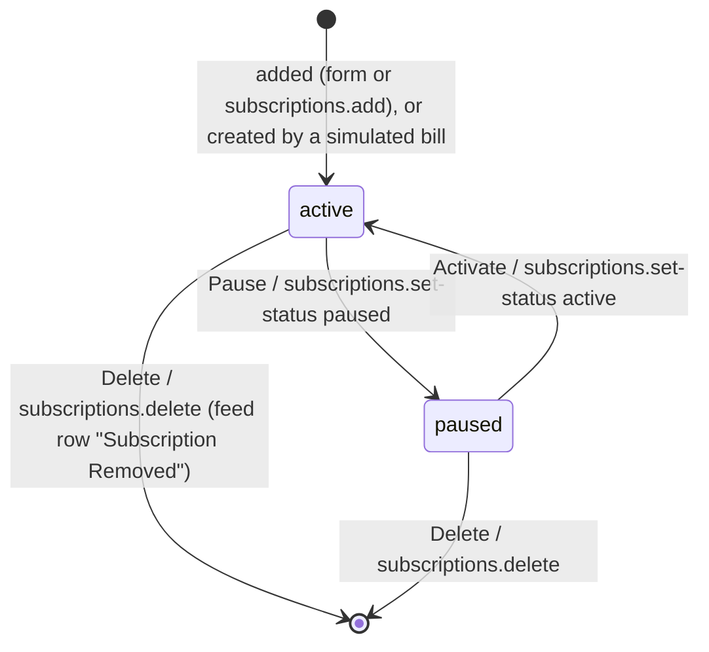

# Requirements: Invoice & Subscription Tracker

PART A — REQUIREMENTS (SRS). User-approved before build; frozen after; changes via ## Changes.

## Introduction

### Purpose
Invoice & Subscription Tracker shows what a small company spends on software and services. It covers recurring subscriptions, one-time receipts and invoices, sorted into workspaces such as "Engineering & Cloud Stack". It runs in the browser with no accounts or sign-in, for the founder or operations person who pays the bills.

Its one job is to answer "what do we pay for, and how much" at a glance:
- a dashboard of total spend, monthly subscription burn and spend by vendor;
- a subscription list with pause and delete;
- an invoice ledger with an inspector;
- an activity feed;
- a monthly cost explorer with a CSV report;
- a multi-year history.

An AI agent works on the same data through A2App. Everything a person can do or see is a declared operation, or a plain record read where that is the same thing.

### Scope
**Goals**
1. A receipt or a subscription can be recorded from one form, and it appears on every tab of its workspace within 10 seconds, with an entry in the feed.
2. The Overview Dashboard shows four figures from the workspace's records: total money spent, monthly subscription burn, the number of active subscriptions and the number of invoices. Under them sits spend by vendor.
3. The Monthly Costs screen gives any listed month's total, recurring and one-time split, category and vendor breakdowns and itemised rows. It downloads the same figures as a CSV file.
4. Every action a person can take, and every figure a person can see, is available to an agent with the same result, under the same workspace rules.

**Core functionalities:** workspaces · overview dashboard · subscriptions with pause and delete · invoice and receipt ledger with inspector · add invoice and add subscription forms · activity feed with simulated bill ingestion · monthly cost explorer with CSV report · multi-year history · agent operations

### Approval
Approved by the user: 2026-11-11 — carried over from the published marketplace app `invoice-tracker` 1.0.0, whose requirements were approved when it was built; this document restates them in the framework's form without changing any feature.

## Product Description

### Product Perspective
`authMode: none`. The app is single-user, with one machine and no sign-in. It serves on loopback only, and writes from programs outside the browser need the app's agent credential.

manifest.json declares no integrations (`capabilities.integrations: []`), and the app calls no outside service. It deliberately has:
- no mailbox or email connection: the feed's "Refresh Feed" button and `invoices.simulate-bill` simulate a sample bill;
- no reading of PDF contents: an attached PDF is stored on its invoice and downloaded as it is, with only its name and a preview text shown;
- no exchange rates: totals add only the amounts in the shown workspace's currency, and amounts in other currencies are named beside them, never converted;
- no budgets or reminders;
- no model of its own.

The UI is a fixed dark design (see ## UI Design) that does not follow a host theme.

### User Characteristics
One person, the founder or an operations or finance person at a small company, or a small team sharing one machine. They review software spend weekly or monthly in a desktop browser, and add receipts and subscriptions as bills arrive. The layout is built for desktop widths up to 1,280 px, with pointer input.

### Constraints
- C-1: An amount is a plain number in major units (25.5 is 25.50), shown with two decimals. Totals add only the amounts in the shown workspace's currency and convert nothing; amounts in other currencies are grouped per currency and named beside the totals ("Totals add USD amounts only. Not converted or added: €40.00 EUR").
- C-2: A record's currency is one of 18 codes: USD, EUR, GBP, PKR, KRW, JPY, INR, CAD, AUD, AED, BRL, CHF, CNY, NZD, SAR, SEK, SGD, TRY. A record's amount carries its own currency's symbol; a total carries the symbol of the shown workspace's currency. Under All Workspaces, the newest workspace's currency is used.
- C-3: The forms offer 11 categories: Cloud Infrastructure, Software & SaaS (the default), Developer Tools & DevOps, Productivity & AI, Design & Creative, Marketing & Growth, Security & Compliance, Communications & Collaboration, Finance & Operations, Customer Support, and Other Services. Stored records may hold others, for example "AI & Developer Tools" from the simulated OpenAI bill, and the category filters list those too.
- C-4: Fixed vocabularies:
  - subscription status is active or paused;
  - subscription billing frequency is monthly, yearly, weekly or quarterly;
  - invoice payment type is one_time or subscription;
  - a workspace color is one of six presets: Amber AWS #FF9900, Emerald AI #00A67E, Indigo Stripe #635BFF, Blue Horizon #3B82F6, Violet Cyber #8B5CF6, Rose Red #EF4444.
- C-5: Every screen shows one workspace or "All Workspaces".
  - A workspace shows only the records whose `group_id` is its id. All Workspaces shows every record, including those with no workspace.
  - The app opens on the newest workspace.
  - New records get the shown workspace's id, or none under All Workspaces.
- C-6: At least one workspace must always exist.
- C-7: Links between records are plain text ids (`group_id`, `subscription_id`), with no relation fields. Deleting a subscription leaves the invoices that point at it unchanged. Deleting a workspace deletes the invoices, subscriptions and feed rows filed under it (a server hook, so every path does it).
- C-8: Dates the app writes are ISO 8601 text with the time, for example `2026-11-11T09:30:00.000Z`. Months and years in the reports are taken from the invoice date (or the record's creation time) in local time.
- C-9: The app's calendar follows today's date:
  - the current month is today's month;
  - Monthly Costs lists the six months up to the current one, plus every month that has an invoice;
  - Multi-Year History covers this year and the three before it.
- C-10: Feed rows are written with fixed wording when an invoice or subscription is added or deleted and when a bill is simulated; the feed's Log Event form writes one as typed. Each records the currency of its record (or the one picked in the form).
- C-11: The first start seeds one workspace (Engineering & Cloud Stack, USD), two monthly subscriptions (sub 240.00 and sub1 598.00), five one-time invoices dated 2026-08-15 (test … test4) and three feed rows.

### Assumptions
- A-1: Volume ceiling: 1,000 invoices, 200 subscriptions and 2,000 feed rows in all. Every open screen reloads all records of its workspace every 10 seconds and pages them in the browser.
- A-2: The machine running the app is the user's own, so the server's local time is the user's.
- A-3: A workspace's records are normally in its own currency. Amounts in other currencies are left out of totals and named beside them (C-1).

## Features

### Module: Frame
- F-FRM-1: The user sees one dark page, centered and at most 1,280 px wide. Its header holds:
  - the title "Invoice & Subscription Tracker";
  - the workspace dropdown with the workspace's color dot;
  - the currency quick-switch;
  - the buttons Groups, + Subscription and Add Invoice.
- F-FRM-2: The user can switch between six tabs. The tabs are Overview Dashboard, Active Subscriptions (with the number of active subscriptions), Invoices & Receipts (with the number of invoices), Live Ingestion Feed, Monthly Costs and Multi-Year History. The current tab is the solid button.
- F-FRM-3: WHEN the app opens THE SYSTEM SHALL show a spinner with "Loading Invoice & Subscription Workspace...", then open on the newest workspace.
- F-FRM-4: The user sees each record's amount with its own currency's symbol, and every total in the shown workspace's currency (C-1, C-2). WHEN the shown records hold other currencies THE SYSTEM SHALL name them under the totals, per currency.
- F-FRM-5: WHEN records change, through another tab or through an agent, THE SYSTEM SHALL show the change on every open screen within 10 seconds.
- F-FRM-6: WHEN the user adds, changes or deletes a record THE SYSTEM SHALL confirm it with a toast, or show the error in a toast.

### Module: Workspaces (groups)
- F-GRP-1: The user can open Groups ("Manage & Edit Workspaces") and see every workspace with its color dot, name and description, with "ACTIVE" next to the shown one.
- F-GRP-2: The user can select a workspace in Groups. Every tab then shows only that workspace's records, and a toast says "Switched workspace to: <name>".
- F-GRP-3: WHEN the user picks a workspace in the header dropdown THE SYSTEM SHALL show that workspace, as Select in Groups does.
- F-GRP-4: The user can create a workspace with a name (required), an optional description, a theme color (one of the six presets, Amber #FF9900 by default) and a default currency (USD by default). The app then shows the new workspace.
- F-GRP-5: The user can edit a workspace's name (it cannot be empty), description, theme color and default currency.
- F-GRP-6: The user can change the shown workspace's currency from the header's quick-switch.
- F-GRP-7: The user can delete a workspace after a confirmation ("… and all its invoices, subscriptions and feed entries?").
  - WHEN it is the only workspace THE SYSTEM SHALL refuse with "You must have at least one workspace group."
  - THE SYSTEM SHALL delete the workspace's invoices (with their PDFs), subscriptions and feed rows with it.
  - WHEN the deleted workspace was the shown one THE SYSTEM SHALL show the newest remaining workspace.

### Module: Overview Dashboard (dashboard)
- F-DSH-1: The user sees four KPI cards:
  - Total Money Spent (marked YEARLY), which opens Multi-Year History;
  - Monthly Subscription Burn, per month, with the annual run rate, which opens Active Subscriptions;
  - Active Subscriptions, which also opens Active Subscriptions;
  - Invoices & Receipts, which opens the ledger.
- F-DSH-2: The user sees Total Money Spent as every invoice of the workspace, plus each active subscription that no invoice covers, counted once (in the workspace's currency, C-1).
  - Yearly and quarterly subscriptions count their full amount, and weekly ones count the amount × 4.33.
  - An invoice covers a subscription when it carries the subscription's id, or when its vendor equals the subscription's vendor (ignoring case) and it is a subscription payment.
- F-DSH-3: The user sees the Monthly Subscription Burn of active subscriptions: yearly ÷ 12, weekly × 4.33, quarterly ÷ 3, monthly as is. The annual run rate is the burn × 12.
- F-DSH-4: The user sees Spend Summary:
  - a "Month-to-date for <current month>" figure and one stacked bar per month for the six months up to the current one (C-9);
  - each bar is that month's Monthly Costs total, estimated subscription rows included, stacked by vendor;
  - a y-axis that scales with the largest bar;
  - hovering a bar segment shows its vendor, amount and share;
  - Grow / Shrink enlarges the chart, and Cost Explorer opens the ledger.
- F-DSH-5: The user sees Spend by Service & Vendor, a donut and a table of each vendor's amount and share for the hovered (or clicked) month, the current month by default.
  - A vendor's amount is its rows in that month of Monthly Costs: its invoices dated in the month plus the estimated rows of its uncovered active subscriptions. Bill Details opens the ledger.
  - With nothing to show it reads "No vendor items found for this period."
- F-DSH-6: The user sees the three latest feed items, each with a time and date, and "Open Full Feed (<n>)", which opens the feed.
  - With no feed rows it reads "No recent activity yet. New bills and scans will appear here."
  - For four seconds after the user adds something, the feed icon pulses.

### Module: Active Subscriptions (subscriptions)
- F-SUB-1: The user sees one card per subscription, twelve per page with Previous and Next. A card shows:
  - the name, with the vendor and category;
  - the status badge, ACTIVE or PAUSED;
  - the purpose;
  - the amount per period (/mo, /yr, /weekly or /quarterly), in its own currency;
  - "Renews <date>", followed by "Auto-renew off" when it does not renew automatically.
- F-SUB-2: The user sees the monthly burn ("<amount>/MO BURN") and the annual run rate, rounded to whole units, of the workspace's active subscriptions.
- F-SUB-3: The user can search subscriptions and filter them.
  - The search covers name, vendor, purpose, category, frequency and amount.
  - The status filter offers All Statuses, Active Only, Paused and Cancelled, and the category filter lists every category. The screen shows "Showing <n> subscriptions".
  - With no match it reads "No subscriptions found matching your filters." with "Add your first subscription →".
- F-SUB-4: The user can add a subscription from the header or the tab. The form has name (required), vendor (the name when empty), amount (0 or more), billing frequency, currency (the shown workspace's by default, as for invoices), category, next renewal date, purpose and auto-renew.
  - THE SYSTEM SHALL save it as active, last billed now, in the shown workspace, with the chosen billing frequency (monthly by default), next renewal date (30 days from now when none is picked) and auto-renew setting (on by default).
  - The feed records "New Subscription: <name>".
- F-SUB-5: The user can pause an active subscription and activate a paused one. Only the status changes, and no feed row is written.
- F-SUB-6: The user can delete a subscription with one click, without a confirmation. THE SYSTEM SHALL record "Subscription Removed: <name>" in the feed. The subscription's invoices stay.

### Module: Invoices & Receipts (invoices)
- F-INV-1: The user sees the ledger, twelve rows per page. Its columns are Vendor & Purpose, Date, Category, Attachment, Amount and Actions. The header reads "<n> STATEMENTS", and the filter bar reads "Showing <n> items • Total: <amount>".
- F-INV-2: The user can search vendor, purpose, invoice number, category, amount and currency, filter by category, and filter by payment type (All Payment Types, One-Time Bills, Subscription Payments). With no match the ledger reads "No receipts or invoices found matching criteria."
- F-INV-3: The user can add a receipt or invoice ("Add Receipt or Invoice") with vendor and amount (both required), currency (the shown workspace's by default, the one its totals use: C-2), category, invoice or reference number, purpose and an optional PDF.
  - THE SYSTEM SHALL save it as a one-time bill dated now, in the shown workspace.
  - The number defaults to INV- followed by six digits.
  - The feed records "Invoice Added: <vendor>".
- F-INV-4: The user can pick or drop a PDF in the form.
  - Only PDFs are accepted ("Please select a valid PDF document.").
  - The file name fills an empty vendor for known vendors (AWS or Amazon, OpenAI, Cursor, Figma, Vercel, Stripe, Google), and an empty number from INV-, REC- or BILL- in the name.
  - THE SYSTEM SHALL store the picked PDF on the invoice (up to 25 MB), with its file name and the text "PDF Invoice Statement extracted from <name> (<n> KB)".
- F-INV-5: The user can inspect an invoice ("Invoice #<number>"). The inspector shows:
  - vendor, "Verified (<n>%)", and the purpose, or "Classified commercial expense" when there is none;
  - amount with its currency code, date, category and reference id;
  - the attached PDF's name, and "View Text Preview" for the kept preview text.
- F-INV-6: The user sees whether an invoice has a stored PDF.
  - WHEN it has one, the ledger shows its name with a download button and the inspector shows "Download PDF". Both download the stored file from `/api/invoices/<id>/download-pdf`.
  - WHEN it has none, the ledger shows "Attach PDF" and the inspector reads "No PDF document attached to this invoice record yet." with "Attach PDF File". Attaching stores the picked PDF on the invoice and shows it at once. Estimated report rows offer no attach.
- F-INV-7: The user can delete an invoice from the ledger ("Delete receipt from <vendor>?") or from the inspector ("Are you sure you want to delete this invoice from <vendor>?"). THE SYSTEM SHALL record "Invoice Removed: <vendor>" in the feed.

### Module: Live Ingestion Feed (records)
- F-FED-1: The user sees every feed row of the workspace, newest first, ten per page. Each row shows an icon by type, the title, a vendor badge, the description, the amount (in the row's currency) and the time.
  - With no rows the feed reads "No activity recorded in this workspace yet. Invoices, receipts, and scans will appear here automatically."
  - "Log Event" opens "Log Live Ingestion / Audit Event": event type, vendor, title (required), amount and currency (the shown workspace's by default, as for invoices), and details, with quick presets. "Record Ingestion Event" writes one feed row in the shown workspace and toasts "Activity event logged."
- F-FED-2: WHEN the user presses "Refresh Feed" THE SYSTEM SHALL simulate an incoming AWS bill, and toast "⚡ Simulated email ingestion: AWS received!". The simulation writes:
  - an invoice: Amazon Web Services, 248.50 USD, monthly subscription payment, naming a sample PDF but storing no file;
  - a link to the first subscription of the workspace whose vendor contains "Amazon Web Services" (any workspace under All Workspaces), or a new active monthly subscription when there is none;
  - the feed row "Simulated Bill: Amazon Web Services".

  All three are filed in the shown workspace (none under All Workspaces), like a manual entry.

### Module: Monthly Costs (reports)
- F-MON-1: The user sees "Monthly Cost Explorer" with one pill per month, newest first, each with its total, and "<n> months available". Picking a pill shows that month.
  - The months are the six up to the current one, plus every month that has an invoice (C-9).
  - The newest month is selected.
- F-MON-2: The user sees, for the chosen month:
  - the total, with the change against the previous listed month in amount and percent;
  - recurring spend and one-time spend, each with its share of the month;
  - the number of transactions, with the average per bill (over the bills in the workspace's currency).
- F-MON-3: The user sees a month include an estimated row for each active subscription that is not covered by an invoice that month. Only subscriptions created in or before that month get one.
  - The estimated amount is the subscription's monthly equivalent, and its number is SUB-<id>-<YYYYMM>.
  - The check runs in order, so a second subscription from the same vendor is covered by the first one's row.
- F-MON-4: The user sees Category Spend and Top Vendors for the month, each with its total, share and bar.
  - With nothing to list, these read "No category expenses recorded for this month." and "No vendor expenses recorded for this month."
- F-MON-5: The user can search the month's itemised expenses (vendor, purpose, number, category, amount, currency) and filter them by category, and open any row in the inspector.
  - With no rows the list reads "No receipts or invoices recorded for <month>."
- F-MON-6: The user can download the chosen month as `Monthly_Costs_Report_<YYYY-MM>.csv`, a UTF-8 file with a byte-order mark. It holds:
  - a title line and a "Generated:" line;
  - one row per item: date, vendor, purpose, category, number, amount, currency, and payment type ("Recurring Subscription" or "One-Time Bill");
  - SUMMARY TOTALS;
  - CATEGORY BREAKDOWN.

### Module: Multi-Year History (reports)
- F-YR-1: The user sees "Annual Spending History" with four cards:
  - the total across the tracked years;
  - this year's Year-to-Date, with "0% YoY";
  - last year's Full-Year Spend, with its number of invoices;
  - the total number of invoices.
- F-YR-2: The user can choose "All Years Overview" or a year (this year and the three before it, C-9), each shown with a compact total. The user sees "Year-over-Year Spend Trajectory", one bar per year with its total, number of invoices and average per month.
- F-YR-3: The user sees year totals added up from that year's statements: its invoices plus the year-to-date subscription estimates, in the workspace's currency. The cards and the statements list use this one calculation. The invoice counts count real invoices only.
- F-YR-4: The user sees, for a chosen year, "Quarterly Distribution" and "Spend by Category", each with amounts and shares. Each statement counts in the quarter of its date.
- F-YR-5: The user can search and filter the statements list by category, ten per page, and open a row in the inspector.
  - The list holds the invoices plus a year-to-date estimate for each active subscription in each year from its start. The estimate counts the months up to the current one in the current year.
  - With nothing to list it reads "No invoices or receipts recorded for <year or any year>."

### Agent (via A2App)
- F-AGT-1: The agent can perform every action a person can take, as the 16 operations in ## Operations Design (modules invoices, dashboard, subscriptions, reports and groups). Listing workspaces and reading the feed are plain `data` reads of `groups` and `activities`, and the Log Event form is a plain `data activities create`. Attaching a PDF to an invoice that already exists has no operation yet (the agent attaches one when adding the invoice).
- F-AGT-2: The agent can read every figure a person sees with the screens' own formulas: the dashboard, subscriptions with burn, the ledger, the inspector, the monthly cost explorer and the multi-year history, with the amounts in other currencies listed apart.
- F-AGT-3: WHEN the agent adds or deletes an invoice or a subscription THE SYSTEM SHALL store the same record and write the same feed row as the screen, including an invoice's PDF (given as base64) and a subscription's billing frequency, renewal date and auto-renew. It SHALL refuse parameters that the screen's form never stores, such as an invoice date or a new subscription's status.
- F-AGT-4: WHEN the agent gives no workspace THE SYSTEM SHALL use the one the app opens on, the newest. `group` may name another workspace by id or exact name, or be `all` for All Workspaces.
- F-AGT-5: The agent can create, edit and delete workspaces with the screens' rules: preset colors, the currency list, a name that is not empty, and never deleting the last one.
- F-AGT-6: The agent can simulate a sample bill (aws, openai or figma) with `invoices.simulate-bill`, the operation behind "Refresh Feed", filed in a workspace like the screen's.
- F-AGT-7: The agent can get the "Download Report" CSV of a month as text, with dates written as ISO `YYYY-MM-DD`.
- F-AGT-8: WHEN the agent calls a destructive operation THE SYSTEM SHALL answer `approval_required` until the person has approved that call.

## Non-Functional Requirements
- N-1: A change made by the agent, or in another tab, appears on every open screen within 10 seconds, the screens' reload interval.
- N-2: Each agent operation reads each collection in scope at most once per call and computes in the server. At A-1 the answer is a single response with no paging.
- N-3: Rate limits are 300 operation calls and 1,200 record requests per minute.
- N-4: Pages are laid out for desktop widths up to 1,280 px. Narrower windows reflow: the header wraps, card grids fit their width, and wide tables scroll inside their card.

## Data Requirements
- **groups** (module: groups): name (string, required, max 200), description (string, max 1000), color (string, max 50), icon (string, max 50), currency (string, max 10), created (datetime, server-set), updated (datetime, server-set).
- **subscriptions** (module: subscriptions): name (string, required, max 200), vendor (string, required, max 200), amount (number, required), currency (string, max 10), billing_frequency (enum), category (string, max 100), purpose (string, max 1000), status (enum), group_id (string, max 50), last_billed_date (string, max 50), next_renewal_date (string, max 50), auto_renew (boolean), icon_name (string, max 50), created (datetime, server-set), updated (datetime, server-set).
- **invoices** (module: invoices): vendor (string, required, max 200), amount (number, required), currency (string, max 10), payment_type (enum), billing_frequency (string, max 50), category (string, max 100), purpose (string, max 1000), invoice_date (string, max 50), invoice_number (string, max 100), group_id (string, max 50), has_pdf_attachment (boolean), pdf_filename (string, max 255), pdf_text_preview (string, max 5000), pdf_data_base64 (string, max 500000), pdf_file (binary, one PDF, max 25 MB), line_items (json), notes (string, max 2000), subscription_id (string, max 50), confidence_score (number), is_verified (boolean), created (datetime, server-set), updated (datetime, server-set).
- **activities** (module: records): event_type (string, required, max 100), title (string, required, max 200), description (string, max 1000), amount (number), currency (string, max 10), vendor (string, max 200), group_id (string, max 50), created (datetime, server-set), updated (datetime, server-set).

## External Interfaces
- **Human (browser):** one single-user View served by PocketBase at the app's own origin.
  - It has no URL routes: the six tabs and the dialogs are in-page state.
  - The dialogs are Add Receipt or Invoice, Add Recurring Subscription, Manage & Edit Workspaces, Log Live Ingestion / Audit Event, and the invoice inspector.
  - File input is a PDF in the Add Invoice form or from Attach PDF; it is stored on the invoice.
  - File output is the stored PDF (Download PDF, `GET /api/invoices/<id>/download-pdf`) and the Monthly Costs CSV report.
- **Agent (A2App):** the modules and collections in AGENT_APP.md § Modules; operations exactly as declared in ## Operations Design. No other machine interface is offered to agents; the app's own screens call their own routes.

## Out of Scope
- Accounts, sign-in, sharing, roles or per-person data.
- Connecting a mailbox or reading real emailed bills. Bill ingestion is a simulation of three sample bills.
- Reading a PDF's contents (OCR, line-item extraction).
- Editing an invoice or a subscription after it is added (attaching a PDF to an invoice is the one change).
- Currency conversion or exchange rates.
- Budgets, spending limits, renewal reminders or notifications.
- Recording income, payments or account balances.
- Email account or sync settings: the email-sync dialog in the code needs a mailbox connection the app does not have, so it is not shown.
- Report formats other than the monthly CSV, and exporting all records.
- Multi-Year History years before the three that precede this one (C-9).
- Light mode, host theme packs or custom colors.
- Asking an AI agent for work from the app: there are no app→agent tasks.

## Quality of Life
- The KPI cards and dashboard buttons jump to the tab behind them.
- The feed icon on the dashboard pulses for four seconds after something is added.
- The Spend Summary chart can be enlarged with Grow and reduced with Shrink.
- Picking a PDF in the Add Invoice form fills an empty vendor and an empty invoice number from the file name.
- Search boxes reset the list to its first page as you type.

PART B — TECHNICAL SPECIFICATION.

## System Overview
PocketBase 0.39 (JS hooks, migrations) + React 19 / Vite / Tailwind 4 View in `frontend/` built into `pb/pb_public/`, on the `blueprint-pocketbase-kit` toolkit.

**What the View calls.** The View reads and writes the four collections directly with the PocketBase SDK (`frontend/src/app/services/ApiService.ts`), sending an attached PDF as a multipart upload. It computes every figure in the browser (`services/reports.ts` holds the shared calendar, month and year models and the currency rule), and it calls two routes of its own: `POST /api/ops/invoices/simulate-bill` (`pb/pb_hooks/ops.pb.js`) and `GET /api/invoices/<id>/download-pdf` (`pb/pb_hooks/records.pb.js`, which also deletes a workspace's records with it).

**What agents call.** The agent operations are routed in `pb/pb_hooks/agent_ops.pb.js` at `/api/ops/<group>/<verb>`, with GET for reads and POST for writes. Their logic is in `pb/pb_hooks/lib_agent.js`, a server-side copy of the screens' writes and formulas. The generated `a2app_routes.pb.js` serves all 16 operations to agents as `POST /api/ops/<name>`.

Modules → navigation map:

| Module (manifest) | Where a person meets it | Tab |
| --- | --- | --- |
| `dashboard` | Overview Dashboard: KPI cards, Spend Summary, Spend by Service & Vendor, latest feed items | Overview Dashboard |
| `subscriptions` | Subscription cards, + Subscription in the header, Add Recurring Subscription dialog | Active Subscriptions |
| `invoices` | Ledger, Add Invoice in the header, Add Receipt or Invoice dialog, invoice inspector, Refresh Feed (simulate-bill) | Invoices & Receipts (Refresh Feed on Live Ingestion Feed) |
| `reports` | Monthly Cost Explorer with Download Report; Annual Spending History | Monthly Costs; Multi-Year History |
| `groups` | Workspace dropdown and currency quick-switch in the header; Groups → Manage & Edit Workspaces | header |
| `records` (`activities`) | Live Ingestion Feed list; latest items on the dashboard | Live Ingestion Feed |

Tab order: Overview Dashboard, Active Subscriptions, Invoices & Receipts, Live Ingestion Feed, Monthly Costs, Multi-Year History.

## UI Design
- **Design system:**
  - **Kit:** the Living UI kit 0.5.0 is vendored in `frontend/src/kit` (system-managed). It supplies the shell, its error boundary, the toasts, the PocketBase client and the console relay.
  - **Tokens:** the app's own stylesheet `frontend/src/app/styles.css` defines a fixed dark palette:
    - backgrounds #0D0F12, #13171D and #1C2129;
    - text #F3F4F6, #9CA3AF and #6B7280;
    - primary #FF4F18;
    - success #22C55E, warning #EAB308, error #EF4444, info #3B82F6;
    - borders at 8 % and 4 % white.
  - **Type and spacing:** the font stack is 'Plus Jakarta Sans', Inter, then system sans-serif; no web font is loaded. Spacing tokens run from 4 px to 32 px, radii from 4 px to 12 px, plus three shadows.
  - **Components:** the app's own primitives are in `components/ui/index.tsx` (Button with primary, secondary, danger and ghost variants; Input, Select, Card, Badge, Modal, Alert, Tabs and others), styled inline from those tokens.
  - **Charts and icons:** charts are hand-drawn with divs and SVG. Icons are lucide-react.
  - Workspace colors come from the six presets (C-4).
- **Layout:**
  - One centered column, at most 1,280 px wide, with 16 px padding: the header, then the tab bar (scrolling sideways when it overflows), then the tab's content.
  - Content is built from bordered dark cards on auto-fit grids. The KPI cards are at least 220 px; the dashboard and breakdown cards are at least 320–340 px.
  - Dialogs are centered over a dimmed backdrop, 420 px or 560 px wide and at most 90 % of the window height.
- **Screen — Overview Dashboard:**
  - **Primary object and action:** the workspace's spend; jump to a tab from a card.
  - **Loading:** a first-load spinner ("Loading Invoice & Subscription Workspace...").
  - **Empty:** "No vendor items found for this period." and "No recent activity yet. New bills and scans will appear here."
  - **Error:** load failures are swallowed by the data layer, which shows empty lists, and are logged to the console.
  - **Success:** the cards update on the next 10 s refresh.
  - **Narrow:** the KPI and chart cards wrap to one column.
- **Screen — Active Subscriptions:**
  - **Primary object:** the workspace's subscription cards.
  - **Primary action:** Add Subscription.
  - **Empty:** "No subscriptions found matching your filters." with "Add your first subscription →".
  - **Success:** "Subscription updated successfully." after Pause or Activate, and "Subscription deleted."
  - **Error:** "Failed to update subscription: …" and "Failed to delete subscription: …".
  - **Narrow:** the cards fit one column at 340 px; the filters wrap.
- **Screen — Invoices & Receipts:**
  - **Primary object:** the ledger rows.
  - **Primary actions:** Add Receipt, and Inspect.
  - **Filters:** search, category and payment type, with the filtered total.
  - **Empty:** "No receipts or invoices found matching criteria."
  - **Delete:** asks "Delete receipt from <vendor>?" in a browser confirmation.
  - **Success:** "Invoice deleted."; on error, "Failed to delete invoice: …".
  - **Narrow:** the table scrolls sideways inside its card.
- **Screen — Invoice inspector (dialog, 560 px):**
  - **Primary object:** one invoice.
  - **Actions:** View Text Preview, Download PDF when a PDF is stored (otherwise Attach PDF File), Delete Record (browser confirmation "Are you sure you want to delete this invoice from <vendor>?"), and Close Inspector.
  - **Escape** or a backdrop click closes it.
- **Screen — Add Receipt or Invoice (dialog, 420 px):**
  - **Primary action:** Save Record.
  - **Validation:** with no vendor or no amount, Save does nothing. A non-PDF file shows the browser alert "Please select a valid PDF document." A picked PDF shows its name, size and "Ready to attach", with a remove button.
  - **Success:** "✨ Added Invoice: <vendor> (<symbol><amount>)!"; on error, "Failed to add invoice: …".
- **Screen — Add Recurring Subscription (dialog, 420 px):**
  - **Primary action:** Add Subscription ("Adding..." while saving, with the buttons disabled).
  - **Inline errors:** "Please enter a subscription name." and "Please enter a valid positive amount."
  - **Success:** "✨ Added Subscription: <name> (<symbol><amount>/<mo, yr, weekly or quarterly>)!".
- **Screen — Manage & Edit Workspaces (dialog, 420 px):**
  - **Tabs:** "All Workspaces (<n>)" with Edit, Select or Current, and Delete per workspace; and "+ Create New Workspace".
  - **Primary action:** Create Workspace ("Creating..." while saving), or Save Changes when editing.
  - **Inline errors:** "Please enter a group / workspace name." and "Workspace name cannot be empty."
  - **Delete:** asks "Are you sure you want to delete workspace "<name>" and all its invoices, subscriptions and feed entries?", and the last workspace gets an alert.
  - **Success:** "Created workspace: <name>", "Updated workspace: <name>" and "Workspace group deleted."
- **Screen — Live Ingestion Feed:**
  - **Primary object:** the feed rows, ten per page.
  - **Primary action:** Log Event (the Log Live Ingestion / Audit Event dialog, 420 px); Refresh Feed simulates an AWS bill.
  - **Empty:** "No activity recorded in this workspace yet. Invoices, receipts, and scans will appear here automatically."
  - **Success:** "⚡ Simulated email ingestion: AWS received!" and "Activity event logged."; on error, "Simulation failed: …" and "Failed to log event: …".
- **Screen — Monthly Costs:**
  - **Primary object:** the chosen month.
  - **Primary actions:** pick a month pill, and Download Report.
  - **Empty:** "No category expenses recorded for this month.", "No vendor expenses recorded for this month." and "No receipts or invoices recorded for <month>."
  - **Narrow:** the month pills scroll sideways, and the cards wrap.
- **Screen — Multi-Year History:**
  - **Primary object:** the tracked years.
  - **Primary actions:** pick a year, and open a statement.
  - **Empty:** "No invoices or receipts recorded for <year or any year>."
  - **Narrow:** the cards wrap, and the statements table scrolls sideways.
- **Formatting:**
  - Money is a currency symbol (the record's own for a record, the workspace's for a total) followed by the amount with two decimals, written with `toFixed(2)` or the browser's number grouping. The annual run rate on Active Subscriptions has no decimals.
  - Amounts that a total leaves out because of their currency are named under it: "Totals add <code> amounts only. Not converted or added: <symbol><amount> <code> · …".
  - Compact figures are used for the chart axis (1.2k, 1.5M) and for the year pills ($1.2k, or $950).
  - Dates use the browser's locale (for example "Aug 15, 2026"). Feed times are hours and minutes.
  - An invoice without a number shows INV-<id>, and one without a purpose shows "Classified commercial expense". A missing date shows N/A.
  - Statuses are upper-case badges (ACTIVE, PAUSED).

## Quality Conformance

- **Q1 Completeness & IA:**
  - Orientation comes from the header (workspace name and color dot) and the six-tab bar, with the current tab solid.
  - Every module has a tab or a header control, as in ## System Overview, and the KPI cards and chart buttons link to the tab behind them.
  - Names hold app-wide: workspace (also "group" in Groups), subscription, invoice/receipt, feed.
  - Lists that outgrow a screen have search, filters and pages: 12 subscriptions, 12 invoices, 10 feed rows and 10 statements per page.
  - One built component is not reachable: the email-sync dialog, which needs a mailbox connection the app does not have; see ### Conventions and overrides. The ingestion-event dialog opens from the feed's Log Event.
- **Q2 Design system:**
  - The tokens are the app's own fixed dark palette, spacing, radius and shadow variables in `styles.css`, and the primitives in `components/ui/index.tsx` use them.
  - Some components still set hex colors inline: status tints, chart palettes and vendor brand colors.
  - Semantic roles: primary orange for main actions and the current tab, green for active and success, amber for paused and warnings, red for delete and errors, blue for info.
  - Icons are lucide-react. Three emoji appear in copy: ✨ and ⚡ in toasts, and 📅 on the Total Money Spent card.
  - There is no light mode (see ### Conventions and overrides).
- **Q3 Layout & composition:**
  - Spacing comes from the 4 px-based tokens.
  - Each tab has one header row with its title, subtitle and one primary button.
  - Cards sit on auto-fit grids.
  - Amounts use tabular figures in the KPI cards and lists, and sit right-aligned in tables.
  - Long purposes and file names truncate with an ellipsis.
  - Lists page in the browser (Q1).
- **Q4 Interaction:**
  - Buttons show a hover fill and a pointer cursor; disabled buttons are dimmed with a not-allowed cursor.
  - Deleting an invoice or a workspace asks with the browser's confirm dialog, naming the vendor or the workspace.
  - Deleting a subscription has no confirmation.
  - Escape and a backdrop click close dialogs.
  - Inputs are constrained: number fields for amounts, selects for currency, category, frequency and color, a date field for the renewal date, and a PDF-only file picker.
- **Q5 State & feedback:**
  - A spinner shows until the first load.
  - The add dialogs disable their buttons while saving, which prevents double submission.
  - Every write ends in a success or error toast, and every open screen refreshes every 10 s.
  - A failed load shows an empty list, not an error state (see ### Conventions and overrides).
- **Q6 Motion:**
  - The loading spinner turns once a second.
  - The dashboard's feed indicator dot pulses (1.5 s loop) for 4 s after an add.
  - Buttons change color on hover.
  - Dialogs declare 150 ms fade and slide animations whose keyframes the app does not define, so they appear without motion.
  - There is no reduced-motion handling (see ### Conventions and overrides).
- **Q7 Content:**
  - The voice is short and businesslike ("Add Recurring Subscription", "Save Record", "Close Inspector").
  - Error toasts prefix the action ("Failed to add invoice: <message>"), and the inline form errors say what to fix.
  - Operation errors for agents name the parameter and the allowed values.
  - Terminology is fixed: workspace, subscription, invoice/receipt, feed, burn, run rate.
  - Month and year labels follow today's date ("Month-to-date for November 2026").
- **Q8 Accessibility:**
  - The dark palette pairs #F3F4F6 text with #0D0F12 and #13171D backgrounds; muted text is #6B7280.
  - Dialogs are `role="dialog"` with `aria-modal="true"` and a labelled title, close on Escape, and have an icon close button with `aria-label="Close modal"`. Focus is not trapped inside them.
  - Form fields have visible text labels, mostly not tied to their inputs in markup; native selects and inputs keep the browser's focus outline.
  - Statuses are written words, not color alone.
  - See ### Conventions and overrides for the gaps.
- **Q9 Responsiveness:**
  - The page is built for desktop widths up to 1,280 px.
  - Narrower windows reflow: the header and filter bars wrap, grids use `minmax(min(100%, …), 1fr)`, and the tab bar and wide tables scroll sideways inside their container.
  - There are no breakpoints and no phone layout.
- **Q10 Performance:**
  - At A-1, each refresh loads the workspace's invoices, subscriptions and feed rows plus the workspaces, once every 10 s. Lists page in the browser.
  - Agent operations read each collection in scope once per call and compute on the server.
  - No images are loaded besides icons, and no web font is loaded.
- **Q11 Caching & freshness:**
  - Static files: the built bundle has content-hashed asset names, and the document shell is served no-store (toolkit SPA header).
  - Data is not cached. The View re-reads everything every 10 s (polling; no realtime subscription) and keeps it in memory only.
  - Operation responses carry no cache headers.
- **Q12 Data integrity:**
  - The schema is four collections with required fields and select values (subscription billing frequency and status, invoice payment type), validated by PocketBase and the adapter's record guard.
  - Links are text ids without relations; a server hook deletes a workspace's invoices, subscriptions and feed rows in one transaction after the workspace is deleted (C-7).
  - Writes are single-record saves with no transactions: a feed row is written after its record and is skipped if it fails, as in the View.
  - Rules the forms enforce (categories, currencies, colors, non-empty names, the last workspace) hold for the View and the agent operations, but not for raw record writes.
  - The migrations are the initial schema, the seed, and the invoice PDF file field (`pdf_file`), which also clears `has_pdf_attachment` on rows that only named a PDF.
- **Q13 API:**
  - The View's own route is `POST /api/ops/invoices/simulate-bill`.
  - The agent operations have their own routes `/api/ops/<group>/<verb>` (GET reads, POST writes), and agents reach them through the adapter as `POST /api/ops/<name>`.
  - Parameters are checked by the operation, with 400 naming the parameter and its allowed values, 404 for an unknown record or workspace, and 500 for an unexpected failure.
  - Errors share PocketBase's `{ status, message }` shape.
  - Stack traces are never returned.
- **Q14 Architecture:**
  - The View is `frontend/src/app`: `AppController.ts` holds the state, `services/ApiService.ts` the data layer, `services/reports.ts` the shared figures (calendar, month and year models, currency rule), and `components/` the screens and the other formulas.
  - Server logic is in `pb/pb_hooks/lib_agent.js` (the agent operations and simulate-bill, routed by `agent_ops.pb.js` and `ops.pb.js`) and `records.pb.js` (the PDF download route and the workspace delete hook).
  - The figures and write defaults therefore exist twice, in the View and in `lib_agent.js` (see ### Conventions and overrides).
  - Configuration is manifest.json and the toolkit launcher.
- **Q15 Resilience:**
  - The data layer catches failed loads and shows empty lists. If loading the workspaces fails, it shows one built-in sample workspace.
  - A failed `simulate-bill` call falls back to recording a sample invoice from the browser.
  - A feed-row failure never undoes the record.
  - A render crash shows the kit's "Something went wrong" panel with "Reload app".
  - Server handler errors are logged and answered with a designed error.
- **Q16 Security & privacy:**
  - With `authMode: none`, collection rules are open because the app is single-user and binds loopback.
  - The framework adapter runs its host, origin and credential checks first.
  - Writes from programs outside the browser need the app's `.agent-token` (sent as `X-A2App-Token`), and destructive operations need the person's approval.
  - Rate limits apply (N-3).
  - Attached PDFs are stored in the app's own PocketBase file storage (PDF type only, up to 25 MB) and served on loopback only; the app sends no data to any outside service.
  - Runtime credentials (`.agent-token`, `.principal`, `.superuser`) are git-ignored.
- **Q17 Observability:**
  - The data layer logs failed loads and writes with `console.warn`, and the kit's console relay ships browser errors and warnings to `logs/frontend_console.log` (capped at 2 MB).
  - Uncaught handler errors log `[handler-error] <METHOD> <path>: <message>`.
  - Agent operation failures log `[invoice-tracker] agent operation failed: …`, and skipped feed rows log `[invoice-tracker] feed row not written …`.
  - Health is `/api/_a2app`.
- **Q18 Version control:**
  - Commits are per app and per change ("invoice tracker living UI", "Update invoice-tracker to V2", "Migrate agent apps to match agent app framework standard").
  - `.gitignore` excludes credentials, `pb/pb_data/`, the PocketBase binary, the built View `pb/pb_public/`, `frontend/node_modules/`, framework runtime state under `.a2app/`, and `logs/`.
  - The app builds from a clean checkout with the manifest pipeline (`install`, `build`, `start`).

### Conventions and overrides
The published app is restated here unchanged, so these are standing decisions of the approved build, not new work. Revisit any of them when the app is next modified.
- **Q1 (reachable features):** the email-sync dialog is never mounted. It manages mailbox accounts and inbox scans, which need a mail connection the app does not have (`capabilities.integrations` is empty), so it is not a feature.
- **Q2.1 (tokens only):** the app keeps its own fixed dark palette and some inline hex colors, instead of the kit's theme tokens. It has no light mode and does not follow a host theme.
- **Q4.2 (designed confirmations):** deletes use the browser's `window.confirm` and `alert`, not an in-app dialog. Deleting a subscription has no confirmation.
- **Q5.4 (designed error states):** failed loads are shown as empty lists (with a console warning), and failed writes as error toasts. No screen has an error state of its own.
- **Q6.3 (reduced motion):** nothing changes under `prefers-reduced-motion`.
- **Q8.2 (focus management):** dialogs do not trap or restore focus.
- **Q11.1 (live updates):** freshness is a 10-second poll, not realtime.
- **Q14.4 (one implementation per rule):** the screens' formulas and write defaults live in the View (`ApiService.ts`, `services/reports.ts` and the screen components) and are copied into `pb/pb_hooks/lib_agent.js` for agents. Both must change together, and the agent copies are checked against the View's code.
- Mirrored global rules: none recorded for this app.

## Process Flows

Subscription status:

Simulated bill (Refresh Feed or `invoices.simulate-bill`): write the preset's invoice in the workspace (none under All Workspaces). Then look for the first subscription of that workspace whose vendor contains the preset's vendor (any workspace under All Workspaces), and link the invoice to it, or create an active monthly subscription in the workspace and link that. Finally write the feed row "Simulated Bill: <vendor>" in the workspace.

Deleting a workspace (Groups → Delete, `groups.delete` or a plain record delete): refuse the last workspace (screen and operation), delete the workspace, then delete its invoices (and their PDFs), subscriptions and feed rows in one transaction.

## Operations Design
| Operation | Module | Entity | appliesWhen | Params | Flags |
| --- | --- | --- | --- | --- | --- |
| invoices.simulate-bill | invoices | — | — | preset: string, group: string | — |
| dashboard.overview | dashboard | — | — | group: string | readOnly |
| subscriptions.list | subscriptions | — | — | group: string, status: enum, category: string, q: string | readOnly |
| invoices.list | invoices | — | — | group: string, category: string, payment_type: enum, q: string | readOnly |
| invoices.get | invoices | — | — | invoice: string!, group: string | readOnly |
| reports.monthly | reports | — | — | group: string, month: string, category: string, q: string | readOnly |
| reports.monthly-csv | reports | — | — | group: string, month: string | readOnly |
| reports.yearly | reports | — | — | group: string, year: string, category: string, q: string | readOnly |
| invoices.add | invoices | — | — | vendor: string, amount: number!, currency: enum, category: enum, purpose: string, invoice_number: string, pdf_filename: string, pdf_base64: string, group: string | — |
| invoices.delete | invoices | — | — | invoice: string! | destructive |
| subscriptions.add | subscriptions | — | — | name: string!, vendor: string, amount: number!, billing_frequency: enum, currency: enum, category: enum, next_renewal_date: string, purpose: string, auto_renew: boolean, group: string | — |
| subscriptions.set-status | subscriptions | — | — | subscription: string!, status: enum! | — |
| subscriptions.delete | subscriptions | — | — | subscription: string! | destructive |
| groups.add | groups | — | — | name: string!, description: string, color: enum, currency: enum | — |
| groups.update | groups | — | — | group: string!, name: string, description: string, color: enum, currency: enum | — |
| groups.delete | groups | — | — | group: string! | destructive |

## Changes
- 2026-11-11 defect fixes: the user asked for the published app's known defects to be fixed. The subscription form stores its billing frequency, next renewal date and auto-renew (F-SUB-4, F-SUB-1); an attached PDF is stored on its invoice, and Download PDF and Attach PDF work (F-INV-4, F-INV-6); the header dropdown shows the picked workspace (F-GRP-3); deleting a workspace deletes its invoices, subscriptions and feed rows, as its confirmation says (F-GRP-7, C-7); simulated bills are filed in the shown workspace (F-FED-2); the calendar follows today's date on the dashboard, Monthly Costs and Multi-Year History (C-9, F-DSH-4, F-DSH-5, F-MON-1, F-YR-1, F-YR-2); feed rows record their record's currency, and totals add only the workspace's currency, naming the others (C-1, C-2, C-10, F-FRM-4); the year cards and the statements use one calculation (F-YR-3, F-YR-4); the Log Event form opens from the feed (F-FED-1); the ledger filters by payment type (F-INV-2); the Add Invoice, Add Subscription and Log Event forms open on the shown workspace's currency, not USD (F-INV-3, F-SUB-4, F-FED-1). The agent operations follow the same rules (F-AGT-1, F-AGT-2, F-AGT-3, F-AGT-6).
