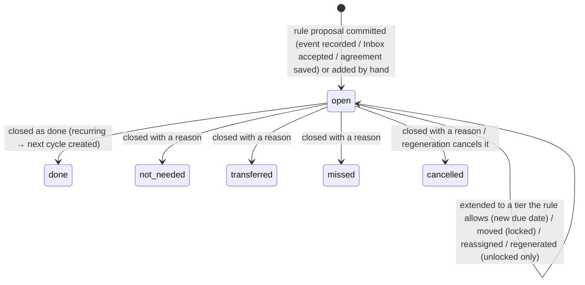

# Requirements: IP Manager

PART A — REQUIREMENTS (SRS). User-approved before build; frozen after; changes via ## Changes.

## Introduction

### Purpose
IP Manager is one register for everything an organization owns. It covers patents (and utility models), trademarks, designs, copyrights and the creative works behind them, invention disclosures, and the agreements that license rights in and out. It is built for in-house IP teams of any size and is general purpose, with an entertainment-friendly vocabulary available. Its core job is to keep every deadline right and explainable. A rules-based engine works out each date from recorded events and can show why it has that date. The register also holds renewals with costs in the home currency, rights availability with conflict checks, and the team's work around them. Everything automated arrives as a proposal in a review Inbox and changes nothing until a person accepts it: office data sync from USPTO, EPO, EUIPO and JPO, and CraftBot reading documents and contracts. The team signs in with accounts and six roles. CraftBot and other agents work on the same data through A2App, with 50 declared operations and five app→agent tasks.

### Scope
**Goals**
1. A deadline is never invented and never lost. Every rule-based date can be explained step by step (rule, base date, offset, end of month, office closure roll-forward, citation). A deadline is closed with a reason instead of deleted, and closing a recurring one creates the next cycle.
2. Automated data never changes the register by itself. Office changes and CraftBot proposals wait in the Inbox, show the exact deadlines they would create, and apply only when a person accepts them, in part or in whole. With the second-reviewer setting on, statutory deadlines from CraftBot need two different people.
3. Renewal decisions show the due and grace dates and the official fee converted to the home currency. Letting a right lapse needs a rationale.
4. "Can we license this, where and for how long?" is answered per asset and dimension value as available, partial, unavailable or no rights, with reasons that link to the agreements.
5. Every role sees and does only what it may, the server refuses the rest, and every change to a core record is in the audit log with who, when and what changed.

**Core functionalities:** first-run setup · roles and access · Today dashboard · review Inbox with four-eyes · deadlines (list, calendar, table, calendar feed) · rules-based deadline engine with office closure days · patents, trademarks, designs and copyrights · matter and family pages · properties and works with coverage and copyright terms · clearances and chain of title · agreements with scope grants and obligations · rights explorer · royalty reports and product approvals · renewals with fees, instructions, payments and forecast · invention disclosures and pipeline · watch hits and disputes · people and companies · reports and saved views · daily digest and reminders · office connections · audit log · CraftBot tasks

### Approval
Approved by the user: 2026-11-04 — carried over from the published marketplace app `ip-manager` 1.0.0, whose requirements were approved when it was built; this document restates them in the framework's form without changing any feature.

## Product Description

### Product Perspective
`authMode: multi-user`: an IP team shares one organization's register, and what each person sees and changes depends on their role (Original requirements 1, 4). People sign in with email and password through the kit's sign-in gate. Before the gate mounts, `GET /api/session/check` drops a session that this server no longer knows. manifest.json declares no integrations (`capabilities.integrations: []`). Office data is optional. An admin can store credentials for the USPTO Open Data Portal, USPTO TSDR, EPO OPS, EUIPO and JPO in Settings, write-only. Without them the app shows "Not connected" and everything works by hand. The backend alone calls the offices, the ECB (`www.ecb.europa.eu`, reference exchange rates) and the Japanese Cabinet Office (`www8.cao.go.jp`, official holidays). The daily digest goes out by email or Slack through CraftBot's connections when that channel is chosen. The app does not file with offices, pay official fees, or run watch searches. Instructions go to your provider, and watch reports come from your provider. Shipped rules are not legal advice. No sample or demo data is shipped (Original requirements, Out of scope).

### User Characteristics
In-house IP teams of any size: admins, IP managers, counsel, contributors, inventors and viewers. The IP team works in the register through the day, mostly on desktop screens with dense tables. Contributors upload documents and propose changes. Inventors only submit and follow their own inventions. Viewers only read. The app is responsive at 400 px, 768 px and 1280 px (Original requirements 38).

### Constraints
- C-1: Roles are admin, manager ("IP manager"), counsel, contributor, inventor and viewer. Admin can do everything, including settings, office credentials and roles. Manager can create and edit everything, decide renewals, set fees, calendars and dimensions, delete, and accept Inbox items. Counsel can edit records and deadlines and give second approvals. Contributor can read the portfolio, upload documents, create invention disclosures and propose changes. Inventor sees only the inventions they submitted or are named on (through a person record linked to their account), plus their own account. Viewer is read only (Original requirements 4).
- C-2: The first account ever created becomes admin. Every later account joins the same organization with the default sign-up role from settings (Contributor out of the box), never gets the onboarding screen, and never becomes admin. Only an admin changes roles. Nobody changes their own role. The last admin cannot be demoted or removed ("This is the only administrator. Make someone else an administrator first.").
- C-3: While onboarding is not finished, the admin sees the setup screen and everyone else sees "IP Manager is being set up".
- C-4: The vocabulary pack changes labels only, and switches rights dimensions on or off: general (Properties / Works), entertainment (Franchises / Titles), technology (Product lines / Assets), consumer (Brands / Creative assets).
- C-5: The Inbox is the only door for automated data. Accepting creates events and deadlines through the engine; rejecting changes nothing. With `second_reviewer` on, accepting a CraftBot proposal that would create a statutory deadline (statutory, extendable or set by office) moves it to "awaiting second approval". A different person must then give the second approval.
- C-6: Deadline kinds are hard ("Statutory"), extendable, designated ("Set by office"), internal and reminder. A deadline is never deleted by users (the delete rule is admin only). It is closed as done, not needed, transferred, missed or cancelled. Every status but done needs a reason, and closing a recurring deadline as done creates the next cycle.
- C-7: Extensions offer only the tiers the rule allows. A rule deadline moved by hand is locked, so regeneration never overwrites it.
- C-8: Date arithmetic uses calendar months with month-end clamping. Statutory dates roll forward past office closure days to the next open day: US federal holidays exact, JP official holidays refreshed monthly from the Cabinet Office, and EPO / EUIPO / WIPO computed.
- C-9: 59 rules ship, and rules are data: versioned, with code plus version unique. Admins can enable, disable, edit and add them.
- C-10: Fees and money: official fee schedules ship for USPTO, EPO (both the 2024 and the 1 April 2026 schedules), the Unitary Patent, EUIPO, JPO and WIPO Madrid, each with its grace-period surcharge and source. An estimate uses the schedule in force on the due date, class counts, claim counts and tiers. Amounts convert through ECB reference rates (per EUR) or manual rates. A change to a fee, a manual rate or the home currency re-prices open renewals at once.
- C-11: Letting a renewal lapse needs a rationale. When nobody decides, the organization's renewal default applies.
- C-12: Office secrets are write-only hidden fields, never returned to the browser. Office changes never write directly; they become Inbox items.
- C-13: CraftBot's results arrive as Inbox proposals, never as direct writes to deadlines. Its triggers carry ids only, and every value is data.
- C-14: Every change to a core record is written to the audit log (who, when, what changed, with before and after), and the audit log is append only.

### Assumptions
- A-1: Volume ceiling: none is declared. The Original requirements set no number. List views load every record the person may read at once (the kit's full-list load, no paging), so one organization's register must fit one browser view. Search returns 25 results by default, "upcoming" looks at most 730 days ahead, and forecasts span at most 10 years.
- A-2: The shipped rules and fee schedules are reviewed by the organization's counsel before they are relied on.
- A-3: Office APIs and CraftBot are optional. Without credentials or a running CraftBot, the app keeps working by hand and says so.

## Features

### Module: Access and first run (session, onboarding)
- F-ACC-1: WHEN a visitor is not signed in THE SYSTEM SHALL show the kit's sign-in gate, where the visitor can register and sign in.
- F-ACC-2: WHEN the first account is created THE SYSTEM SHALL make it admin. Every later account joins the same organization with the default sign-up role, and never gets the onboarding screen.
- F-ACC-3: While onboarding is not finished, the admin sees "Set up IP Manager": organization name, what kind of organization it is (the vocabulary pack), home currency, and where it files. Finishing it ("IP Manager is ready") lands the admin on Today.
- F-ACC-4: WHEN onboarding is not finished and a non-admin signs in THE SYSTEM SHALL show "IP Manager is being set up". The page opens by itself once setup is done.
- F-ACC-5: WHEN an inventor signs in THE SYSTEM SHALL show only "My inventions" and "My account", and open any other page as their inventions.
- F-ACC-6: The user sees controls their role cannot use hidden or disabled. WHEN a call goes beyond the role anyway THE SYSTEM SHALL refuse it ("Your role (<role>) cannot do this. Ask an admin to change your role.").

### Module: Frame (meta, portfolio)
- F-FRM-1: The user sees a sidebar in groups: Work (Today, Inbox with its count of items to review, Deadlines with its overdue count, Renewals), Portfolio (the properties label, Patents, Trademarks, Designs, Copyrights, the works label, Inventions), Deals (Agreements, Rights explorer, Product approvals), Protect (Watch and disputes), and Organization (People and companies, Reports, Settings).
- F-FRM-2: On narrow screens the user opens the sidebar as a menu ("Open navigation") from a top bar.
- F-FRM-3: The user can press Ctrl/Cmd+K, or the search box ("Search records or numbers"), to open a command palette. It searches titles, references and any application, publication or registration number in any format, and jumps to pages. Arrow keys, Enter and Escape work in it.
- F-FRM-4: The user can open a notifications drawer from the bell, which shows the unread count. Reminders, digests and Inbox alerts arrive there.
- F-FRM-5: The user can "Ask CraftBot" a question about the portfolio in plain words. CraftBot reads the portfolio and answers without changing anything.
- F-FRM-6: The user sees every view update by itself when anyone (a person, CraftBot or another agent) changes data, without polling.
- F-FRM-7: The user sees one look in light and dark, following the host's theme: sharp corners, Inter, calm dense tables, monospace for reference and application numbers, tabular figures for dates and money, and colour kept for status and severity.

### Module: Today (portfolio, digest)
- F-TOD-1: The user sees clickable tiles: Overdue, Due this week, Next 30 days, To review (office changes and proposals) and Renewal decisions (renew or let lapse).
- F-TOD-2: The user sees "My deadlines" or "Team deadlines" within 90 days plus overdue, with a Mine / Team switch.
- F-TOD-3: The user sees portfolio counts by IP type and status (In force, Pending, Not filed), active agreements and agreements ending in 90 days, renewal spend by month for the next 12 months in the home currency, and recent activity.
- F-TOD-4: WHEN the portfolio is empty THE SYSTEM SHALL show "Get started" with four actions: add a first record, import from a spreadsheet, connect office data, and invite the team.
- F-TOD-5: The user can record an office action from Today: choose the record, then enter the date on the document and see the deadlines it creates.

### Module: Inbox (inbox)
- F-INB-1: The user sees the Inbox with "To review", "Decided" (the last six months) and "All", a list of items on the left and the chosen item on the right.
- F-INB-2: The user sees each kind of item: office changes (field differences, office events, annuity date corrections), documents read by CraftBot (an event, dates, and citations quoting the source document), agreement drafts, and email proposals. Each shows its source and the proposer's confidence.
- F-INB-3: An editor can preview an item (the exact deadlines it would create), tick what to accept, accept in part or in whole, or reject it with a note. Accepting creates events and deadlines through the engine; rejecting changes nothing ("Rejected. Nothing changed on the record.").
- F-INB-4: WHEN the second-reviewer setting is on and a CraftBot proposal would create a statutory deadline THE SYSTEM SHALL move it to "awaiting second approval" on the first acceptance, and notify the other admins, managers and counsel. A different person must give the second approval; the first approver cannot give both.
- F-INB-5: The user can upload a document "for CraftBot" with an optional record. CraftBot reads it, finds the record and the date, and files a proposal in the Inbox.
- F-INB-6: An editor can accept an agreement draft into a new agreement ("Create agreement").

### Module: Deadlines (deadlines, calendar, rules)
- F-DL-1: The user sees Deadlines as List (grouped by overdue, this week, this month and later), Calendar or Table. Windows: Overdue, This week, 30 days, 60 days, 90 days, All open, Closed (the last six months), with counts.
- F-DL-2: The user can filter by Mine / Team / All, kind, category, jurisdiction, IP type, assignee and text.
- F-DL-3: The user sees for every deadline its target, due and final dates where they exist, its kind (Statutory, Extendable, Set by office, Internal, Reminder), its source, and a lock mark when a person locked the date.
- F-DL-4: The user can open "Why this date?", which explains the rule, base date, offset, end-of-month and office closure roll-forward steps, with the citation.
- F-DL-5: An editor can close deadlines (one or many) as done, not needed, transferred, missed or cancelled, giving a reason for all but done ("Deadlines are never deleted. The status and reason stay in the history."). Closing a recurring deadline as done creates the next cycle.
- F-DL-6: An editor can extend a deadline to one of the tiers its rule allows ("No further extensions are available for this deadline." otherwise).
- F-DL-7: An editor can move deadlines by days or to a date with a reason, which locks them against recalculation. Editors can also reassign deadlines in bulk.
- F-DL-8: An editor can add a manual deadline for a record or an agreement: what needs to happen, kind, category, due date, optional final date, assignee and notes.
- F-DL-9: The user can subscribe to a private calendar feed (ICS) of their deadlines, mine or all, and replace its link ("The current link stops working in every calendar that subscribed to it…").

### Module: Deadline engine (matters, rules, calendars)
- F-ENG-1: The user's matters get deadlines from 59 shipped rules. They cover US patents and trademarks (office actions, issue fee, maintenance fees, Sections 8, 71 and 15, renewals), EP (exam request, Rule 71(3), renewals, validation, opposition, unitary patent), and EUIPO trade marks and designs. They also cover JP patents, designs and trademarks (exam request, refusals, appeals, registration fees, annuities, renewals, split trademark fees), PCT (national phase at 30 / 31 months, demand), Paris priority, Madrid renewal and dependency, US copyright registration (17 U.S.C. 412) and US termination windows (Section 203).
- F-ENG-2: WHEN a date is computed THE SYSTEM SHALL use calendar-month arithmetic with month-end clamping, and roll statutory dates forward past office closure days to the next open day.
- F-ENG-3: An editor can record an event on a matter (filed, published, office action, granted, registered and more). The deadlines it will create are previewed before anything is committed, and past deadlines are skipped.
- F-ENG-4: WHEN base dates change THE SYSTEM SHALL offer a diff (add / update / cancel) before regenerating, and never move locked dates.
- F-ENG-5: The user sees the rules in Settings with plain-language summaries. Admins can enable, disable, edit and add rules, and anyone who reads can test a rule against a sample date.
- F-ENG-6: The user sees the office closure days per office and year. A manager can refresh them, including Japan's official list.

### Module: Portfolio and matters (matters, portfolio, import)
- F-PF-1: The user sees Patents (including utility models), Trademarks, Designs and Copyrights, each as a table and a grouped view (by family, by mark, by work). Each has search that tolerates number formats, status and office filters (dead rights hidden unless picked), a column picker, sorting and CSV export.
- F-PF-2: An editor can create a record by looking up its application or registration number at the office (when that office is connected), from a template (for example US non-provisional, EP application, EU trade mark, Madrid international registration, US design, US registration), or blank. Dates entered record the matching events, so the deadlines still ahead appear.
- F-PF-3: The user sees a matter page: INID-coded facts and key dates on Overview, the family strip, and the tabs Deadlines, Goods and services (trademarks, with use evidence), Documents, People, Agreements (that cover it), Renewals (and costs) and History (events and audit trail).
- F-PF-4: An editor can create national phase entries, validations, designations and continuations (also divisionals and CIPs) from a matter, with their deadlines.
- F-PF-5: A manager can delete a matter after a confirmation that names what goes with it (its deadlines, events, classes and renewals). Documents stay.
- F-PF-6: The user sees a family or mark page with its members, a timeline, the deadlines across members, and (for marks) class coverage.
- F-PF-7: WHEN office credentials exist THE SYSTEM SHALL check synced matters daily and on demand ("Sync now"), and send differences to the Inbox without overwriting anything. WHEN no credentials exist THE SYSTEM SHALL show "Not connected", and everything works by hand.

### Module: Properties, works and clearances (properties, works)
- F-PRP-1: The user sees properties as a tree with a rights basis (owned outright, acquired, mixed), named by the vocabulary pack.
- F-PRP-2: The user sees a property page: counts, what is coming up, a trademark coverage matrix (Nice classes by jurisdiction, with gaps), registrations, works, agreements and documents.
- F-WRK-1: The user sees works as a tree (for example series, season, episode; album, track).
- F-WRK-2: The user sees a work page: facts, copyright terms for the US, Japan and the EU with the basis for each, copyright registrations, the clearance and chain-of-title checklist with progress (a standard checklist per work type), rights granted in and out, deadlines, children and documents.
- F-WRK-3: WHEN a work is published in the US THE SYSTEM SHALL add the 3-month registration reminder automatically.

### Module: Agreements and rights (agreements, rights, approvals)
- F-AGR-1: The user sees agreements (filter Rights in / Rights out and status) with type, direction, counterparty, term, option, money terms in any currency, payment schedules and author grants.
- F-AGR-2: WHEN an agreement is saved or changed THE SYSTEM SHALL turn its dates into obligation deadlines (option end, term end, renewal notice, sell-off, reversion, payments, royalty reports, Section 203 windows) and update them.
- F-AGR-3: The user sees an agreement's tabs: Scope, Obligations, Money, Approvals, Documents and History (editors).
- F-AGR-4: An editor can define scope as grants (grant, holdback, restriction, reservation; exclusive or not) over works, properties or matters. Each grant has include and exclude selections on hierarchical dimensions (territory, media, language, channel, category, field of use) and a term.
- F-AGR-5: WHEN an outgoing grant is saved THE SYSTEM SHALL run a conflict check. A conflicting grant can be saved only with an override reason, which is audited.
- F-AGR-6: The user can have CraftBot read a contract and propose the agreement record, its scope and its obligations as an Inbox draft.
- F-RGT-1: The user can ask the Rights explorer "can we license this, where, and for how long". It shows assets against the columns of a dimension (with presets such as Major markets, Europe, Asia Pacific, Americas, Main categories), filters on other dimensions, a time window and an exclusive switch.
- F-RGT-2: The user sees each cell as Available, Partial (free for part of the window, or for part of the asked scope), Unavailable or No rights, and can open its reasons, which link to the agreements. A dimension left open means all of it, so a toys-only licence makes a territory partial, not unavailable.
- F-RGT-3: The user can save a search (Only me / Everyone) and export it as CSV.
- F-ROY-1: The user sees royalty reports expected per reporting period, can record them when received, and sees the minimum guarantee recoupment.
- F-APR-1: The user sees product approvals as a Board or a List, moving through Concept, Pre-production, Production sample, Packaging and Final product. Each has rounds, images, comments and decisions.
- F-APR-2: An editor can decide a round (Approved, Approved with changes, Resubmit, Rejected) and advance an approved product to the next stage.

### Module: Renewals (renewals, fx)
- F-REN-1: The user sees Renewals with the tabs Decisions, Instructions, Forecast and History.
- F-REN-2: The user sees the decision queue grouped by family or mark, with due and grace dates and official fees converted to the home currency.
- F-REN-3: A manager can decide renew, renew only some of the classes (trademarks), let lapse or decide later. Let lapse needs a rationale and states what will lapse. The organization default applies when nobody decides.
- F-REN-4: A manager can instruct a provider on renewals decided Renew. That produces a provider letter and a CSV, and CraftBot can draft the email.
- F-REN-5: A manager can record a payment (with the official receipt), which closes the deadline and creates the next cycle.
- F-REN-6: The user sees a 3, 5 or 10 year forecast of spend per year in the home currency, including projected future cycles.
- F-REN-7: WHEN exchange rates load from the ECB (at setup and daily), or a fee, a manual rate or the home currency changes, THE SYSTEM SHALL re-price open renewals.

### Module: Inventions (disclosures)
- F-INV-1: An inventor or contributor can submit an invention disclosure: problem, solution, novelty, uses, bar dates, inventors with shares, and attachments.
- F-INV-2: The user can ask CraftBot to structure their notes into a draft, and the submitter chooses what to use.
- F-INV-3: The IP team sees the pipeline as a Board or a List: submitted, patentability search, committee review, approved, drafting, filed. Rejected and on hold need a decision note for the inventor.
- F-INV-4: An editor can score a disclosure against the weighted criteria, with a recommendation, and convert an approved one to a filing.
- F-INV-5: WHEN a disclosure has a public disclosure or sale date THE SYSTEM SHALL show the 12-month grace period, and converting it adds that deadline.

### Module: Enforcement (import)
- F-ENF-1: The user sees watch hits from a provider (imported by CSV or added by hand), sorted by opposition deadline. Each hit is shown side by side with our mark, including the classes in common.
- F-ENF-2: An editor can triage a hit as dismissed, monitor, escalated or actioned, and open a dispute from it.
- F-ENF-3: The user sees disputes (opposition, cancellation, invalidation, non-use, appeal, litigation, UDRP, cease and desist, takedown, TTAB, other), each with its deadlines and documents.

### Module: Organization (reports, digest)
- F-ORG-1: The user sees People and companies, a directory of parties (inventors, authors, talent, licensees, licensors, counsel, agents). Each party shows everything it is involved in.
- F-ORG-2: The user can run the reports Deadlines, Portfolio register, Agreements ending, Chain of title by work, Renewal decisions, Renewal forecast, Inventions pipeline and Audit log (editors). Each can be exported as CSV and saved, private or shared, with a digest schedule (Not scheduled, Daily, Weekly, Monthly).
- F-ORG-3: WHEN the digest hour comes THE SYSTEM SHALL send the daily digest, in the app or by email or Slack through CraftBot. It sends reminders on the configured days before due dates and escalates overdue or unassigned statutory deadlines.
- F-ORG-4: The user can opt out of the digest and preview their own digest in My account.

### Module: Settings (offices, fx, calendars, rules, import, onboarding)
- F-SET-1: The user sees the Settings sections their role allows: Organization, People and access, Office connections (admin), Deadline rules, Office closure days, Fees and currency, Rights dimensions, Invention scoring, Import (editors), Audit log (editors), and My account (everyone).
- F-SET-2: An admin can set the organization: name, vocabulary, home currency, where it files, the target buffer (days), reminder days, the second reviewer, the renewal default, the default role for new sign-ups, the daily digest (time, channel, Slack channel), the office sync time, and reference prefixes.
- F-SET-3: An admin can see people who can sign in, change their roles, and read "What each role can do".
- F-SET-4: An admin can store office connection credentials (write-only: "Saved. Enter a new value to replace it."), turn each office on or off, use the EUIPO sandbox, test the connection, sync now, and read the sync history.
- F-SET-5: The user sees the fee schedule and exchange rates (ECB plus manual rates). A manager can edit them and refresh rates.
- F-SET-6: The user sees the rights dimensions and the invention scoring criteria. A manager can edit them.
- F-SET-7: An editor can import matters from CSV, with a trial run before anything is saved.
- F-SET-8: An editor can read the audit log: every change to a core record, with who, when and what changed.
- F-SET-9: The user can change their name and job title, get their calendar feed, choose their digest, and sign out in My account.

### Agent (via A2App)
- F-AGT-1: The agent can work the register through the 50 operations in ## Operations Design, under the same role checks as the routes (`u.deny`). `renewals.decide` is destructive.
- F-AGT-2: The agent can take a `document_docketing_requested` task. It reads the document, finds the matter by its printed number, and files exactly one `inbox.propose` (kind document, one event, citations for every value, confidence), never creating events or deadlines itself.
- F-AGT-3: The agent can take an `agreement_extraction_requested` task, map the contract to dimension codes and real works and properties, and file one `agreement_draft` proposal.
- F-AGT-4: The agent can take a `renewal_instructions_requested` task and draft, never send, the instruction email to the provider. Without a connected email account it returns the text.
- F-AGT-5: The agent can take a `portfolio_question_asked` task and answer in plain language from read-only operations, never changing a record.
- F-AGT-6: The agent can take an `invention_assist_requested` task and save a structured draft only under the disclosure's `answers.craftbot_draft`, leaving the inventor's fields untouched.
- F-AGT-7: WHEN the user fires one of these tasks THE SYSTEM SHALL show the request honestly: "Sent to CraftBot...", "CraftBot is working on it...", done, or refused. After 20 s without a pickup it says "Waiting for CraftBot. If nothing happens, check that CraftBot is running and connected to this app."
- F-AGT-8: WHEN the agent calls `renewals.decide` THE SYSTEM SHALL answer `approval_required` until a person has approved that call.

## Non-Functional Requirements
- N-1: A change written by anyone (a person, CraftBot or another agent, through the REST API or the operations) shows on every open page without a refresh or polling. Views follow realtime changes, and computed views re-run 200 ms after the last change to a collection they read (`lib/live.ts`).
- N-2: The app is responsive at 400 px, 768 px and 1280 px. Tables scroll inside their own container, never the page.
- N-3: No console errors on first paint with an empty database, or during normal navigation.
- N-4: Office calls time out after 30 s (40 s for one EPO call). A non-200 answer becomes a clean error recorded on the connection and in `sync_runs`.
- N-5: Background work runs on its schedule. Reminders, escalations, the digest, the lapse sweep and calendars run hourly (`ipm_hourly`, minute 5). Office sync runs once a day at the configured hour (`ipm_office_sync`, checked hourly). ECB rates are checked hourly, with one successful fetch a day (`ipm_fx`). The Japanese holiday list and the JPO keep-alive run monthly (`ipm_monthly`).
- N-6: Rate limits: 300 requests per minute on `/api/ops/`, 30 per minute on sign-in, and 1,200 per minute on `/api/collections/`.
- N-7: Pages load on first visit (lazy), so the first paint carries only the shell.

## Data Requirements
- **users** (module: deadlines): password (string, required), tokenKey (string, required, max 60), email (string, required), emailVisibility (boolean), verified (boolean), name (string, max 255), avatar (binary), created (datetime, server-set), updated (datetime, server-set), role (enum), job_title (string, max 120), digest_opt_out (boolean).
- **settings** (module: inbox): org_name (string, max 160), vocab_pack (enum), home_currency (string, max 3), target_buffer_days (number), reminder_days (json), digest_enabled (boolean), digest_hour (number), digest_channel (enum), slack_channel (string, max 120), second_reviewer (boolean), renewal_default (enum), default_signup_role (enum), jurisdictions (json), ref_prefix_patent (string, max 12), ref_prefix_trademark (string, max 12), ref_prefix_design (string, max 12), ref_prefix_copyright (string, max 12), ref_prefix_agreement (string, max 12), ref_prefix_invention (string, max 12), onboarding_done (boolean), fx_auto (boolean), fx_updated (datetime), sync_enabled (boolean), sync_hour (number), last_digest (datetime), last_sweep (datetime), created (datetime, server-set), updated (datetime, server-set).
- **office_connections** (module: records): office (enum, required), enabled (boolean), sandbox (boolean), api_key (string, max 400), client_id (string, max 400), client_secret (string, max 400), username (string, max 200), password (string, max 400), token (string, max 4000), token_expires (datetime), has_secret (boolean), status (enum), last_check (datetime), last_error (string, max 2000), calls_today (number), calls_date (string, max 10), remaining_calls (number), last_sync (datetime), notes (string, max 1000), created (datetime, server-set), updated (datetime, server-set).
- **properties** (module: properties): name (string, required, max 200), kind (enum), rights_basis (enum), description (string, max 4000), image (binary), business_unit (string, max 120), status (enum), tags (json), created (datetime, server-set), updated (datetime, server-set), parent (ref → properties).
- **parties** (module: inbox): name (string, required, max 200), kind (enum, required), roles (json), email (string, max 255), phone (string, max 60), organization (string, max 200), country (string, max 3), address (string, max 1000), external_ref (string, max 120), notes (string, max 4000), user (ref → users), created (datetime, server-set), updated (datetime, server-set).
- **works** (module: works): title (string, required, max 300), work_type (enum, required), property (ref → properties), rights_basis (enum), status (enum), description (string, max 4000), creation_date (datetime), publication_date (datetime), publication_country (string, max 3), eidr (string, max 60), isrc (string, max 20), iswc (string, max 20), isbn (string, max 20), other_ids (string, max 400), made_for_hire (boolean), authors (string, max 600), author_death_year (number), author_kind (enum), language (string, max 40), image (binary), tags (json), notes (string, max 4000), created (datetime, server-set), updated (datetime, server-set), parent (ref → works).
- **families** (module: matters): kind (enum, required), title (string, required, max 300), property (ref → properties), mark_type (enum), mark_image (binary), word_element (string, max 300), vienna_codes (string, max 300), disclaimer (string, max 1000), transliteration (string, max 300), translation (string, max 300), description (string, max 4000), technology_tags (json), products (string, max 1000), strategy (enum), strategy_note (string, max 2000), business_unit (string, max 120), owner_entity (string, max 200), tags (json), created (datetime, server-set), updated (datetime, server-set).
- **goods_services** (module: records): matter (ref → matters), nice_class (number), spec (string, max 20000), class_status (enum), first_use (datetime), first_use_commerce (datetime), in_use (boolean), use_evidence (binary), evidence_note (string, max 2000), last_reviewed (datetime), created (datetime, server-set), updated (datetime, server-set).
- **grants** (module: inbox): agreement (ref → agreements), direction (enum, required), kind (enum, required), exclusive (boolean), properties (list<ref> → properties), works (list<ref> → works), matters (list<ref> → matters), dims (json), term_start (datetime), term_end (datetime), rights_text (string, max 4000), override_reason (string, max 2000), created (datetime, server-set), updated (datetime, server-set).
- **dimensions** (module: rights): key (string, required, max 40), label (string, required, max 80), order (number), enabled (boolean), description (string, max 400), created (datetime, server-set), updated (datetime, server-set).
- **dimension_values** (module: records): dimension (string, required, max 40), code (string, required, max 40), label (string, required, max 120), parent_code (string, max 40), order (number), created (datetime, server-set), updated (datetime, server-set).
- **disclosures** (module: disclosures): ref (string, max 40), title (string, required, max 300), summary (string, max 4000), problem (string, max 8000), solution (string, max 20000), novelty (string, max 8000), advantages (string, max 8000), uses (string, max 4000), stage (enum, required), submitted_by (ref → users), submitted_at (datetime), property (ref → properties), products (string, max 600), tech_tags (json), public_disclosure_date (datetime), on_sale_date (datetime), nda_date (datetime), answers (json), score (number), review_count (number), decision (string, max 4000), decision_at (datetime), family (ref → families), matter (ref → matters), inventor_names (string, max 600), inventor_users (list<ref> → users), created (datetime, server-set), updated (datetime, server-set).
- **disclosure_reviews** (module: records): disclosure (ref → disclosures), reviewer (ref → users), scores (json), total (number), comment (string, max 4000), recommendation (enum), created (datetime, server-set), updated (datetime, server-set).
- **scoring_criteria** (module: records): key (string, required, max 40), label (string, required, max 120), description (string, max 600), weight (number), order (number), levels (json), enabled (boolean), created (datetime, server-set), updated (datetime, server-set).
- **disputes** (module: records): title (string, required, max 300), dispute_type (enum, required), role (enum, required), matter (ref → matters), family (ref → families), other_party (string, max 300), their_mark (string, max 300), forum (string, max 200), proceeding_no (string, max 80), status (enum, required), filed_date (datetime), outcome (string, max 4000), counsel (string, max 200), notes (string), created (datetime, server-set), updated (datetime, server-set).
- **documents** (module: inbox): title (string, required, max 300), file (binary), doc_type (enum), doc_date (datetime), matter (ref → matters), agreement (ref → agreements), work (ref → works), disclosure (ref → disclosures), family (ref → families), property (ref → properties), dispute (ref → disputes), source (enum), extracted (json), summary (string, max 8000), uploaded_by (ref → users), created (datetime, server-set), updated (datetime, server-set).
- **events** (module: matters): matter (ref → matters), agreement (ref → agreements), work (ref → works), code (string, required, max 60), label (string, max 300), date (datetime), st27 (string, max 10), source (enum), document (ref → documents), data (json), created_by (ref → users), created (datetime, server-set), updated (datetime, server-set).
- **rules** (module: rules): code (string, required, max 80), name (string, required, max 300), ip_type (string, required, max 20), jurisdiction (string, required, max 3), routes (json), trigger_event (string, required, max 60), conditions (json), base (enum, required), offset_years (number), offset_months (number), offset_days (number), due_end_of_month (boolean), kind (enum, required), category (enum), title (string, required, max 300), extensions (json), final_offset_months (number), window_months (number), grace_months (number), grace_note (string, max 300), recurring_years (number), recurring_until_years (number), recurring_first_cycle (number), cycle_label (string, max 60), roll_office (string, max 3), citation (string, max 600), notes (string, max 2000), effective_from (datetime), effective_to (datetime), version (number), enabled (boolean), system (boolean), creates_renewal (boolean), fee_kind (string, max 40), created (datetime, server-set), updated (datetime, server-set).
- **office_calendars** (module: records): office (string, required, max 3), date (datetime), name (string, required, max 200), source (enum), created (datetime, server-set), updated (datetime, server-set).
- **calendar_years** (module: calendar): office (string, required, max 3), year (number), created (datetime, server-set), updated (datetime, server-set).
- **renewals** (module: renewals): deadline (ref → deadlines), matter (ref → matters), cycle_label (string, max 80), cycle (number), due_date (datetime), grace_end (datetime), window_opens (datetime), official_fee (number), other_fee (number), currency (string, max 3), home_amount (number), home_currency (string, max 3), fee_known (boolean), fee_note (string, max 400), decision (enum, required), decided_by (ref → users), decided_at (datetime), rationale (string, max 2000), classes_keep (json), instruction_status (enum), instructed_at (datetime), provider (string, max 200), po_number (string, max 80), paid_date (datetime), paid_amount (number), receipt (binary), created (datetime, server-set), updated (datetime, server-set).
- **fee_schedule** (module: records): office (string, required, max 3), ip_type (string, required, max 20), fee_kind (string, required, max 40), cycle (number), cycle_to (number), entity (enum), per_class (boolean), amount (number), per_claim_amount (number), class_tiers (json), currency (string, required, max 3), grace_surcharge (number), surcharge_percent (boolean), effective_from (datetime), source (string, max 400), notes (string, max 600), created (datetime, server-set), updated (datetime, server-set).
- **fx_rates** (module: fx): code (string, required, max 3), per_eur (number), as_of (datetime), source (enum), created (datetime, server-set), updated (datetime, server-set).
- **inbox_items** (module: inbox): kind (enum, required), title (string, required, max 400), summary (string, max 4000), status (enum, required), matter (ref → matters), agreement (ref → agreements), document (ref → documents), office (string, max 20), proposal (json), diffs (json), confidence (enum), citations (json), source (enum), proposed_by (string, max 200), decided_by (ref → users), decided_at (datetime), first_approver (ref → users), first_approved_at (datetime), requires_second (boolean), note (string, max 2000), fingerprint (string, max 200), created (datetime, server-set), updated (datetime, server-set).
- **clearances** (module: records): work (ref → works), property (ref → properties), item_type (enum, required), title (string, required, max 300), status (enum, required), provider (string, max 200), due_date (datetime), cleared_date (datetime), expires (datetime), document (ref → documents), responsible (ref → users), notes (string, max 4000), created (datetime, server-set), updated (datetime, server-set).
- **approvals** (module: approvals): agreement (ref → agreements), property (ref → properties), licensee (ref → parties), product_name (string, required, max 300), sku (string, max 80), category (string, max 120), stage (enum, required), status (enum, required), due_date (datetime), images (binary), revision (number), decided_by (ref → users), decided_at (datetime), notes (string, max 4000), created (datetime, server-set), updated (datetime, server-set).
- **approval_rounds** (module: records): approval (ref → approvals), revision (number), stage (enum), status (enum), comment (string, max 4000), images (binary), decided_by (ref → users), created (datetime, server-set), updated (datetime, server-set).
- **royalty_reports** (module: records): agreement (ref → agreements), period_start (datetime), period_end (datetime), due_date (datetime), received_date (datetime), gross_sales (number), royalty_due (number), paid_amount (number), currency (string, max 3), status (enum, required), document (ref → documents), notes (string, max 2000), created (datetime, server-set), updated (datetime, server-set).
- **watch_hits** (module: records): family (ref → families), matter (ref → matters), their_mark (string, required, max 300), their_owner (string, max 300), jurisdiction (string, max 3), application_no (string, max 80), classes (string, max 200), goods (string, max 4000), publication_date (datetime), opposition_deadline (datetime), score (number), status (enum, required), action (string, max 300), source (string, max 120), reviewer (ref → users), decided_at (datetime), notes (string, max 4000), created (datetime, server-set), updated (datetime, server-set).
- **involvements** (module: records): party (ref → parties), role (enum, required), matter (ref → matters), agreement (ref → agreements), work (ref → works), disclosure (ref → disclosures), family (ref → families), share (number), note (string, max 600), created (datetime, server-set), updated (datetime, server-set).
- **saved_views** (module: records): name (string, required, max 200), page (string, required, max 40), filters (json), columns (json), scope (enum, required), owner (ref → users), schedule (enum), last_sent (datetime), created (datetime, server-set), updated (datetime, server-set).
- **audit_log** (module: records): actor (ref → users), actor_name (string, max 200), action (string, required, max 40), collection (string, max 60), record_id (string, max 40), record_label (string, max 400), changes (json), reason (string, max 2000), created (datetime, server-set), updated (datetime, server-set).
- **notifications** (module: records): user (ref → users), kind (enum, required), title (string, required, max 300), body (string, max 20000), link (string, max 400), read (boolean), data (json), created (datetime, server-set), updated (datetime, server-set).
- **sync_runs** (module: records): office (string, required, max 20), trigger (enum), status (enum, required), checked (number), changes (number), errors (number), message (string, max 4000), finished (datetime), created (datetime, server-set), updated (datetime, server-set).
- **ics_tokens** (module: records): user (ref → users), token (string, required, max 80), scope (enum), created (datetime, server-set), updated (datetime, server-set).

## External Interfaces
- **Human (browser):** one multi-user View behind the kit's sign-in gate, served by PocketBase at the app's own origin, with hash routes `#/<page>[/<id>][?key=value]`. The pages are `today`, `inbox`, `deadlines`, `renewals`, `properties` / `property`, `patents`, `trademarks`, `designs`, `copyrights`, `works` / `work`, `matter`, `family`, `inventions` / `invention`, `agreements` / `agreement`, `rights`, `approvals`, `enforcement`, `people`, `reports` and `settings` (with `?tab=`). On top of these come the command palette, the notifications drawer and the dialogs opened from the pages. Deep links from notifications and the calendar feed use the same shapes. File input: documents for any record (office letters, contracts, use evidence, receipts, images), CSV matter imports and watch reports. File output: CSV exports of every table and report, the provider letter and CSV for renewal instructions, and the private ICS calendar feed (`GET /api/ics/{token}`).
- **Agent (A2App):** the modules and collections in AGENT_APP.md § Modules; operations exactly as declared in ## Operations Design; tasks with the capabilities `document_docketing_requested`, `agreement_extraction_requested`, `renewal_instructions_requested`, `portfolio_question_asked`, `invention_assist_requested` (events.json). No other machine interface is offered to agents; the app's own screens call their own routes.
- **Third-party services (backend only):** `api-sandbox.euipo.europa.eu`, `api.euipo.europa.eu`, `api.uspto.gov`, `auth-sandbox.euipo.europa.eu`, `auth.euipo.europa.eu`, `ip-data.jpo.go.jp`, `ops.epo.org`, `tsdrapi.uspto.gov`, `www.ecb.europa.eu`, `www8.cao.go.jp`.

## Out of Scope
- Filing with offices, or paying official fees from the app. Instructions go to your provider (Original requirements, Out of scope).
- Running trademark watch searches. The app triages reports from your watch provider.
- Legal advice. The shipped rules need review by your counsel before you rely on them.
- Sample or demo data.
- Automated data written straight to the register. Office sync and CraftBot only file Inbox proposals.
- Deleting deadlines as a normal user action. They are closed with a reason (admins alone hold the delete rule).
- Sending the renewal instruction email. CraftBot drafts it and never sends it.
- Office connections other than USPTO (Open Data Portal, TSDR), EPO OPS, EUIPO and JPO.

## Quality of Life
- The command palette also jumps to pages ("Go to page").
- Tables remember their chosen columns per table, and every table exports what it shows as CSV.
- Today's empty-portfolio panel and the Inbox's "How items arrive here" explain where data comes from.
- "Ask CraftBot" offers example questions ("Which trademarks need a declaration of use this year?", "Which agreements end in the next 6 months?").
- Copying a calendar link falls back to selecting it ("The link is selected. Press Ctrl+C (Cmd+C on a Mac) to copy it.").

PART B — TECHNICAL SPECIFICATION.

## System Overview
PocketBase 0.39 (JS hooks, migrations) + React 19 / Vite / Tailwind 4 View in `frontend/` built into `pb/pb_public/`, on the `blueprint-pocketbase-kit` toolkit. The View reads collections through `lib/live.ts` (realtime lists and live computed views) and writes either through collection rules or through the app's own routes `POST /api/ops/<path>` (`ops.pb.js`; `meta` is GET). Two routes stand apart: `GET /api/session/check` and the calendar feed `GET /api/ics/{token}`. The generated `a2app_routes.pb.js` serves the same handlers to agents, and `GET /api/_ops` lists them. Domain logic lives in `pb/pb_hooks/lib_*.js`: engine, calendar, fx, rights, offices, digest, reports, util. Record hooks, audit hooks and jobs live in `ip_system.pb.js`, and `cache_control.pb.js` sets no-store on the document shell.

Modules → navigation map:

| Module (manifest) | Where a person meets it | Route |
| --- | --- | --- |
| `session`, `onboarding` | Sign-in gate; first-run setup and the waiting screen | — |
| `portfolio`, `digest` | Today; command palette search; Ask CraftBot; digest preview in My account | `#/today`, `#/settings?tab=account` |
| `inbox` | Inbox; "Upload for CraftBot" | `#/inbox` |
| `deadlines`, `calendar` | Deadlines (list, calendar, table); deadline dialogs everywhere; calendar feed | `#/deadlines` |
| `matters`, `import` | Patents, Trademarks, Designs, Copyrights; matter and family pages; CSV import; watch import | `#/patents` … `#/copyrights`, `#/matter/<id>`, `#/family/<id>` |
| `properties`, `works` | Properties / works pages (vocabulary labels), coverage, copyright terms | `#/properties`, `#/property/<id>`, `#/works`, `#/work/<id>` |
| `agreements`, `rights`, `approvals` | Agreements, Rights explorer, Product approvals | `#/agreements`, `#/agreement/<id>`, `#/rights`, `#/approvals` |
| `renewals`, `fx` | Renewals (decisions, instructions, forecast, history); fees and currency | `#/renewals` |
| `disclosures` | Inventions (board, list) and invention pages | `#/inventions`, `#/invention/<id>` |
| `reports` | Reports | `#/reports` |
| `offices`, `calendars`, `rules` | Settings: Office connections, Office closure days, Deadline rules | `#/settings?tab=…` |
| `meta` | No screen: the event-code catalogue and office state behind the forms | — |

Sidebar order: Work (Today, Inbox, Deadlines, Renewals) · Portfolio (properties, Patents, Trademarks, Designs, Copyrights, works, Inventions) · Deals (Agreements, Rights explorer, Product approvals) · Protect (Watch and disputes) · Organization (People and companies, Reports, Settings). People and companies (`#/people`) and disputes work on records directly, without an operation module of their own. Watch and disputes (`#/enforcement`) imports watch reports through `import.watch`. Inventors see only My inventions and My account.

## UI Design
- **Design system:** the agent-app UI kit 0.6.0 vendored in `frontend/src/kit` (system-managed). It supplies the `--agent-app-*` tokens, the theme bridge, the sign-in gate, Dialog, Drawer, Tabs, DropdownMenu, `useConfirm`, toasts and the PocketBase and agent-request hooks. IP Manager extends it in `frontend/src/app/theme.css`, the CraftOS Command Center / Company OS language. On `html:root` it sets a warm-neutral palette for light and dark, `--agent-app-radius: 0`, and Inter. It flattens the kit's rounded utilities to sharp corners, drops card shadows (1 px borders instead), sets a pointer cursor on everything interactive, uses sharp scrollbars, and adds `.ipm-mono` (JetBrains Mono stack) for references and numbers. The host's theme bridge still wins through inline custom properties. The app's widgets are written once: `components/ui.tsx` (PageHeader, EmptyState, Loading, ErrorBox, Pill, Kbd, Notice, …), `components/DataTable.tsx` (sortable columns, selection, a column picker remembered per table, CSV export of what is shown), `components/charts.tsx` and `components/CalendarMonth.tsx`. Icons come from lucide-react.
- **Layout:** a 240 px sidebar on the left from 768 px, in five groups, with counts on Inbox and Deadlines. Below 768 px a fixed top bar holds "Open navigation", and the sidebar opens as a drawer. The main column is up to `max-w-7xl`, under a top bar with search (Ctrl K), "Ask CraftBot" and notifications. Each page starts with a PageHeader (title and one-line subtitle). List pages are filter rows over dense DataTables; record pages are a header with status and actions over tabs. Settings uses a vertical section list from 1024 px, and a horizontal scrolling row below.
- **Screen — Sign-in and first run:** primary object: the account, then the organization · primary action: "Sign in" / "Register", then finish "Set up IP Manager" · states: "Loading IP Manager" while the session and settings load; "IP Manager is being set up" for non-admins until setup is done; "Enter the organization name." · narrow: one centred column.
- **Screen — Today:** primary object: what needs the team now · primary action: a KPI tile, or "Record an office action" · loading: "Loading today" / "Loading deadlines" · empty: "Get started" with four actions ("The register is empty"); "Nothing due in the next 90 days"; "No renewals in the next 12 months"; "No activity yet" · error: ErrorBox with "Try again" · narrow: tiles and panels stack.
- **Screen — Inbox:** primary object: one item to review · primary action: accept (or give the first or second approval), or reject with a note · states: "Nothing waiting for review" ("Office changes and CraftBot proposals arrive here. Nothing reaches the register until someone accepts it."); "Choose an item to review"; "Working out the deadlines..."; "Nothing is ticked. Tick what to accept, or reject the item."; "Waiting for a second reviewer"; "This item could not be loaded." with retry · narrow: the list and the item stack.
- **Screen — Deadlines:** primary object: the docket · primary action: close, extend, move or reassign (row menu or bulk), "Add a deadline" · states: "No deadlines yet" ("Deadlines appear when you record what happened on a record, when offices report changes, or when you add one by hand."); "No deadlines match these filters"; per-window empties ("Nothing is overdue", "Nothing due in the next 30 days"); "Nothing due on this day" in the calendar · confirms: closing asks for a reason, and replacing the calendar link warns that subscriptions stop · narrow: the table scrolls inside its container.
- **Screen — Patents / Trademarks / Designs / Copyrights:** primary object: the matters of one IP type · primary action: new record (look up by number, from a template, blank) · states: "Nothing matches these filters" ("Dead rights are hidden. Pick Dead to see them."); "No office is connected yet, so look-ups are not available. Use a template or enter the details by hand." · narrow: table or grouped view, scrolling inside its container.
- **Screen — Matter:** primary object: one right in one jurisdiction · primary action: record an event, add a deadline · tabs: Overview, Deadlines, Goods and services (trademarks), Documents, People, Agreements, Renewals, History · confirms: "Delete <ref>" naming what goes with it · narrow: tabs scroll sideways.
- **Screen — Family:** primary object: a patent / design family or a mark · primary action: add a member · states: "No family chosen", "This family is not available", "No filings yet", "No classes recorded".
- **Screen — Properties and Property:** primary object: the property tree, and one property · tabs: Overview, Trademark coverage, Registrations, the works label, Agreements, Documents · empty: "No registrations yet", "No agreements yet", "Nothing due in the next 120 days".
- **Screen — Works and Work:** primary object: the work tree, and one work · sections: Facts, Copyright term, Description, Notes, Copyright registrations, Rights grants, Deadlines, children, clearance and chain of title · empty: "Not registered anywhere yet" ("Copyright exists without registration, but a US registration is needed to sue …"), "No agreement grants rights in this yet", "No clearance items yet".
- **Screen — Agreements and Agreement:** primary object: the agreements, and one agreement · primary action: new agreement; "Read a contract" with CraftBot · filters: Rights in / Rights out, status · tabs: Scope, Obligations, Money, Approvals, Documents, History · states: a conflict check on save that needs an override reason.
- **Screen — Rights explorer:** primary object: an availability grid · primary action: run the check · states: "Choose at least one value to compare.", "Choose a window that ends after it starts."; each cell Available / Partial / Unavailable / No rights with its reasons · actions: Save search, Export CSV · narrow: the grid scrolls inside its container.
- **Screen — Product approvals:** primary object: licensed products by stage · views: Board, List; filter "Waiting on us" · primary action: decide a round.
- **Screen — Renewals:** primary object: the renewal decisions · tabs: Decisions, Instructions, Forecast (3 / 5 / 10 years), History · states: "No official fee is on file for this renewal."; "Give a reason for letting these rights lapse."; "Decide Renew on the selected renewals first"; "Name the renewal provider or agent." · narrow: tables scroll inside their container.
- **Screen — Inventions and Invention:** primary object: invention disclosures · views: Board, List (the IP team); the inventor's own list ("Describe ideas that could be protected, submit them to the IP team and follow each step here.") · tabs: Disclosure, Review (<n>), History · primary action: submit, score, move, convert.
- **Screen — Watch and disputes:** tabs Watch and Disputes · empty: "No watch hits yet" ("When your watch provider sends a report of similar marks, import it here to triage each hit."), "No disputes" · dialogs: "Import a watch report", "Add a watch hit".
- **Screen — People and companies:** primary object: parties · filter: All / People / Companies · primary action: add a person or company; a party shows everything it is involved in.
- **Screen — Reports:** primary object: one standard report · primary action: run, export CSV, save (Only me / Everyone; Not scheduled / Daily / Weekly / Monthly).
- **Screen — Settings:** primary object: one settings section · sections as in F-SET-1, shown by role · states: "No office connection is turned on.", "No syncs yet"; write-only secrets ("Saved. Enter a new value to replace it.") · narrow: the section list scrolls sideways.
- **Screen — Command palette and notifications:** the palette ("Search by title, reference, or any application, publication or registration number") lists results and page jumps · the notifications drawer: "No notifications yet. Reminders, digests and Inbox alerts arrive here."
- **Formatting:** dates read "22 Dec 2026" (`fmtDate`), or "22 Dec" within the current year. Relative dates read "today", "tomorrow", "in 4 days", "in 3 months", "3 days overdue". Past times read "just now", "5 min ago", "2 h ago", "3 days ago", then the date. Money uses `Intl.NumberFormat` with the currency's symbol (no decimals for JPY and KRW), falling back to "<CODE> 1,234". References (`P-0001-US` style) and office numbers are monospace, and figures are tabular. Jurisdictions show as code chips. Empty values are left blank or written in words ("Nobody assigned", "No reference").

## Quality Conformance

- **Q1 Completeness & IA:** the sidebar is the orientation model. It has five labelled groups, the current page is marked `aria-current="page"`, and the counts show what waits (Inbox) and what is overdue (Deadlines). Every page is reachable from the sidebar or the command palette (Ctrl/Cmd+K), and record pages are deep-linkable (`#/<page>/<id>`). Modules map to screens as in ## System Overview; `meta` has no screen. One name per concept: matter / record, family / mark, deadline, event, Inbox item, renewal, agreement, grant, disclosure. Property and work are named by the vocabulary pack. Working sets past a screenful have their tools: every list has search and filters, tables have sorting, a column picker and CSV export, the Inbox has To review / Decided / All, and Deadlines has windows with counts.
- **Q2 Design system:** tokens are the kit's `--agent-app-*` set, extended in `theme.css` (see ## UI Design) for light and dark. Semantic roles: the accent is for interaction only (links, the selected section, Inbox counts). Status colours come from Pill tones: good (in force, approved, filed), warn (on hold, monitor, resubmit), bad (overdue counts, escalated, rejected, destructive confirms), info and neutral. Type is Inter, with monospace (`.ipm-mono`) for references and numbers. Icons are lucide-react only. Light and dark come from the host through the kit's theme bridge, whose inline properties also carry style packs and custom colours.
- **Q3 Layout & composition:** spacing follows a 4 px rhythm, with hairline borders and no card shadows. Each page has one PageHeader with its primary action. Dense, calm tables (DataTable) carry the register. Dates and money use tabular figures, references are monospace, and long titles truncate in table cells with the full title on the record page. Lists are not paginated (A-1). Tables scroll inside their own container.
- **Q4 Interaction:** every interactive element shows a pointer (`theme.css`). Destructive and irreversible actions use the kit's `useConfirm`, and the copy names the target and the consequence ("Delete <ref> (<title>)? Its deadlines, events, classes and renewals are deleted with it and cannot be restored. …"). `window.confirm` is never used. Engine writes are previewed before they commit: recording an event, regenerating, an Inbox item, an extension, a move. Deadlines are closed with a reason, never deleted, and moved dates lock. Keyboard: Ctrl/Cmd+K opens the palette, where arrows, Enter and Escape work, and Escape closes dialogs and drawers. Inputs are constrained by pickers (records, people, offices, dimension trees, dates) and required fields with inline messages ("Say what needs to happen.", "Enter the due date.").
- **Q5 State & feedback:** every page has loading ("Loading", a spinner), empty (EmptyState with what to do next) and error states (ErrorBox with "Try again") (Original requirements 39). Writes toast their success, or the server's error message (`lib/api.ts`). CraftBot requests show their lifecycle honestly (F-AGT-7). The app root shows "Loading IP Manager" until settings and the session are known.
- **Q6 Motion:** every page fades in over 200 ms on navigation (`.ipm-page`, `ipm-page-in`, `cubic-bezier(0.16, 1, 0.3, 1)`). Spinners turn (`animate-spin`), and Settings sections transition their colours. `theme.css` also defines `ipm-pop` (260 ms) and `ipm-pulse` (3.2 s), which no screen uses. Under `prefers-reduced-motion: reduce`, these keyframe animations are removed.
- **Q7 Content:** plain, professional and short, in sentence case. Copy says what happens and what to do ("Nothing reaches the register until someone accepts it.", "Deadlines are never deleted. The status and reason stay in the history."). Refusals name the fix ("Your role (viewer) cannot do this. Ask an admin to change your role.", "A different person must give the second approval."). Terms are fixed per the vocabulary pack. Dates read "22 Dec 2026" everywhere, and the agent is named CraftBot.
- **Q8 Accessibility:** landmarks and names: `aria-label="Main navigation"`, "Open navigation", "Ask CraftBot", and "Notifications, <n> unread". The current page uses `aria-current="page"`. The Settings sections are a `tablist` of `tab`s with `aria-selected`. Decorative icons are `aria-hidden`, and icon buttons carry `aria-label` (163 in the app). Dialogs are the kit's Radix dialogs (focus trap, Escape). Status is never colour alone: pills and chips carry words.
- **Q9 Responsiveness:** checked at 400 px, 768 px and 1280 px. Below 768 px the sidebar becomes a drawer behind a fixed top bar, and the search shows "Search" instead of "Search records or numbers" below 640 px. From 1024 px Settings shows its sections as a vertical list. Tables, grids and tab rows scroll inside their own container, never the page.
- **Q10 Performance:** pages are lazy-loaded, so the first paint carries only the shell. Server bounds: search 25 results by default, upcoming at most 730 days, forecast at most 10 years. Computed views (Today summary, forecast, coverage, matter info, copyright terms) are server operations that re-run only when a source collection changes, after a 200 ms debounce. Lists load every readable record at once without paging (A-1).
- **Q11 Caching & freshness:** static: the built bundle has content-hashed asset names, and the document shell is served `Cache-Control: no-store, no-cache, must-revalidate` with `Pragma: no-cache` and `Expires: 0` (`cache_control.pb.js`). Data: operation responses carry no cache headers. Freshness comes from realtime subscriptions in `lib/live.ts`: `useCollection` subscribes to each collection and the ones its `expand` reads, and `useLiveAsync`, `useLiveReload` and `useLiveRecords` re-run computed views and previews (previews keep the person's ticks). A session from another database is dropped by `GET /api/session/check` before the sign-in gate mounts.
- **Q12 Data integrity:** collection rules carry the role model (read, contribute, edit, manage, admin), and inventors are limited to their own disclosures. Unique indexes: `matters.ref`, `agreements.ref`, `office_connections.office`, `dimensions.key`, `dimension_values(dimension, code)`, `rules(code, version)`, `calendar_years(office, year)`, `renewals.deadline`, `fx_rates.code`, `ics_tokens.user`, `ics_tokens.token`, plus 14 more indexes. Relations are real relation fields. Audit hooks record create, update (with changes and reason) and delete (with a snapshot) for core records. Deadlines are deleted only by admins, and the last admin is protected by hooks. Re-pricing follows fee, rate and home-currency edits. Three migrations: the starter `items`, the schema, and the seed (rules, fees, dimensions, scoring criteria).
- **Q13 API:** beyond the adapter, the app's own routes `POST /api/ops/<path>` (`meta` GET, `GET /api/session/check`, `GET /api/ics/{token}`) all check the role first (`u.deny`). They answer 401 `{ "error": "Sign in required." }` or 403 `{ "error": "Your role (<role>) cannot do this. Ask an admin to change your role." }`. Other errors answer `{ "error": "<message>" }` with 400 by default (`u.fail`). The verbs are listed at `GET /api/_ops`. Agents reach the same handlers through the adapter.
- **Q14 Architecture:** UI in `frontend/src/app` (pages, components grouped by area: work*, matter*, catalog*, deals*, renew*, invent*, enforce*, admin*). `lib/live.ts` is the only way views load data; `lib/format.ts`, `lib/labels.ts` and `lib/router.ts` exist once. App-wide state (settings, vocabulary, people, role and `can`) has one provider, `lib/context.tsx`. Domain logic sits in `pb/pb_hooks/lib_*.js`, routes in `ops.pb.js`, and record hooks, audit and jobs in `ip_system.pb.js`. Office clients, FX and calendars run in hooks only, never in the frontend.
- **Q15 Resilience:** every outbound call has a timeout (N-4), and a failed office call is recorded on the connection and in `sync_runs` without touching the register. Without credentials an office shows "Not connected" and the app works by hand. ECB rates are retried hourly until one fetch succeeds that day. The JPO keep-alive runs monthly so an unused ID is not cancelled. Each job is wrapped and logs its own failure. A CraftBot request that nobody takes says so after 20 s.
- **Q16 Security & privacy:** `authMode: multi-user`. Every collection rule requires a signed-in person, and the role decides what is visible: inventors cannot read the portfolio, and office connections are admin only. Every route checks the role on the server. Office secrets are hidden fields, write-only, never returned. Calendar feed tokens are private per person and can be rotated. Nobody changes their own role, and the last admin is protected. CraftBot task payloads are data, never instructions, and its results are Inbox proposals only. Rate limits are in N-6. Credentials (`.agent-token`, `.principal`, `.superuser`) are git-ignored.
- **Q17 Observability:** hooks log plain `console.error` lines per failure (`op failed: …`, `office sync failed: …`, `reminders failed: …`, `lapse sweep failed: …`, `renewal re-pricing failed: …`). The structured records are `audit_log` (actor, action, collection, record, changes, reason), `sync_runs` (office, trigger, status, counts, message) and `notifications`. The toolkit's console relay writes browser errors to `logs/`. Health is `/api/_a2app`, the adapter's identity document.
- **Q18 Version control:** the app came in one commit ("Added ip manager and entertainment ip manager agent app"). `.gitignore` excludes credentials, `pb/pb_data/`, the PocketBase binary, the built View `pb/pb_public/`, `frontend/node_modules/`, framework runtime state under `.a2app/`, and `logs/`. The app builds from a clean checkout with the manifest pipeline alone (`install`, `build`, `start`).

### Conventions and overrides
The published app is restated here unchanged, so these are standing decisions of the approved build, not new work. Revisit any of them when the app is next modified.
- Q2 (host theme): the app's palette and its sharp corners override the kit tokens at higher specificity. The host's inline theme properties still win, so style packs and custom colours apply.
- Q7 (agent naming): the app names its agent "CraftBot" throughout, as the Original requirements do.
- Q10 (paging): lists load every readable record at once, and no volume ceiling is declared (A-1).
- Q13 (error shape): app routes answer `{ error }` (not PocketBase's `{ status, message }`), and most failures use 400.
- Q17.1 (structured logs): log lines are plain text without an app prefix. The structured record is the audit log.
- Mirrored global rules: none recorded for this app.

## Process Flows

An Inbox item (`inbox_items`):

```mermaid
stateDiagram-v2
  [*] --> new: office sync difference, or inbox.propose (CraftBot / a person)
  new --> accepted: an editor accepts the whole item; events and deadlines created through the engine
  new --> partially_accepted: an editor accepts only what is ticked
  new --> awaiting_second: second_reviewer on, CraftBot proposal with statutory deadlines — first approval
  awaiting_second --> accepted: a different person gives the second approval
  new --> rejected: rejected with a note (nothing changes)
  awaiting_second --> rejected: rejected with a note
  accepted --> [*]
  partially_accepted --> [*]
  rejected --> [*]
```

A deadline (`deadlines`):

A renewal: `pending` (Decide) → `renew` / `renew_partial` / `lapse` (rationale required) / `defer`. Then instructed to a provider, then paid (the deadline closes and the next cycle is created). When nobody decides, the organization's renewal default applies, and a lapsed right lapses after its grace period.

An invention disclosure: `draft` → `submitted` → `search` → `review` → `approved` → `drafting` → `filed` (converted to a family and a first filing), with side states `rejected` and `on_hold` (both need a decision note), `merged` and `archived`.

A product approval: stages `concept` → `pre_production` → `production_sample` → `packaging` → `final`. Each round is `submitted` → `in_review` → `approved` / `approved_with_changes` / `resubmit` / `rejected`, and an approved round can advance to the next stage.

## Operations Design
| Operation | Module | Entity | appliesWhen | Params | Flags |
| --- | --- | --- | --- | --- | --- |
| session.check | session | — | — | — | readOnly |
| meta | meta | — | — | — | readOnly |
| onboarding.complete | onboarding | — | — | org_name: string!, vocab_pack: enum, home_currency: string, jurisdictions: string | — |
| portfolio.summary | portfolio | — | — | — | — |
| portfolio.search | portfolio | — | — | q: string!, limit: number | — |
| matters.preview-event | matters | — | — | matter_id: string!, subject_type: enum, code: string!, date: string!, data: string | — |
| matters.record-event | matters | — | — | matter_id: string!, subject_type: enum, code: string!, date: string!, label: string, data: string, select: string, skip: string, document_id: string | — |
| matters.regenerate | matters | — | — | matter_id: string!, subject_type: enum, apply: boolean | — |
| matters.info | matters | — | — | matter_id: string! | — |
| matters.lookup | matters | — | — | ip_type: enum!, jurisdiction: string!, number: string!, include_family: boolean | — |
| matters.import-office | matters | — | — | ip_type: string!, jurisdiction: string!, number: string!, property_id: string, family_id: string, family_title: string, family_members: string, responsible: string, generate: boolean | — |
| matters.sync | matters | — | — | matter_id: string! | — |
| matters.national-phase | matters | — | — | matter_id: string!, relation: enum, jurisdictions: string, entry_date: string, filing_date: string, title: string | — |
| import.matters | import | — | — | rows: string!, dry_run: boolean, generate: boolean | — |
| import.watch | import | — | — | rows: string! | — |
| deadlines.close | deadlines | — | — | ids: string!, status: enum!, reason: string, closed_on: string | — |
| deadlines.extend | deadlines | — | — | id: string!, level: number!, preview: boolean | — |
| deadlines.reassign | deadlines | — | — | ids: string!, assignee: string | — |
| deadlines.move | deadlines | — | — | ids: string!, days: number, date: string, reason: string, preview: boolean | — |
| deadlines.upcoming | deadlines | — | — | days: number, include_overdue: boolean, assignee_email: string, jurisdiction: string | — |
| deadlines.explain | deadlines | — | — | id: string! | — |
| inbox.propose | inbox | — | — | kind: enum!, title: string!, summary: string, matter_id: string, matter_ref: string, document_id: string, agreement_id: string, proposal: string!, citations: string, confidence: enum, proposed_by: string | — |
| inbox.preview | inbox | — | — | id: string!, matter_id: string, event_override: string | — |
| inbox.decide | inbox | — | — | id: string!, decision: enum!, matter_id: string, fields: string, events: string, deadlines: string, map_raw: string, note: string | — |
| renewals.decide | renewals | — | — | ids: string!, decision: enum!, rationale: string, classes_keep: string | destructive |
| renewals.instruct | renewals | — | — | ids: string!, provider: string!, po_number: string | — |
| renewals.record-payment | renewals | — | — | id: string!, paid_date: string, amount: number | — |
| renewals.forecast | renewals | — | — | years: number | — |
| renewals.refresh-costs | renewals | — | — | ids: string | — |
| rights.availability | rights | — | — | assets: string!, column: string, columns: string, filters: string, start: string, end: string, exclusive: boolean | — |
| agreements.check-conflicts | agreements | — | — | agreement_id: string, grants: string | — |
| agreements.sync | agreements | — | — | agreement_id: string! | — |
| works.copyright-term | works | — | — | work_id: string! | — |
| properties.coverage | properties | — | — | property_id: string! | — |
| disclosures.submit | disclosures | — | — | id: string! | — |
| disclosures.move | disclosures | — | — | id: string!, stage: enum!, decision: string | — |
| disclosures.review | disclosures | — | — | id: string!, scores: string!, comment: string, recommendation: enum | — |
| disclosures.convert | disclosures | — | — | id: string!, ip_type: enum, jurisdiction: string, route: enum, title: string, responsible: string | — |
| approvals.decide | approvals | — | — | id: string!, status: enum!, comment: string, advance: boolean | — |
| offices.save | offices | — | — | office: enum!, enabled: boolean, sandbox: boolean, api_key: string, client_id: string, client_secret: string, username: string, password: string | — |
| offices.test | offices | — | — | office: enum! | — |
| offices.sync-all | offices | — | — | — | — |
| fx.refresh | fx | — | — | — | — |
| calendars.refresh | calendars | — | — | office: enum, year: number | — |
| calendar.feed | calendar | — | — | scope: enum, rotate: boolean | — |
| calendar.ics | calendar | — | — | token: string! | readOnly |
| rules.test | rules | — | — | rule_id: string!, base_date: string!, jurisdiction: string, cycle: number | — |
| digest.preview | digest | — | — | days: number | — |
| digest.send | digest | — | — | — | — |
| reports.run | reports | — | — | report: enum!, params: string | — |

## Original requirements

The requirements as published for CraftBot, kept verbatim as the source the sections above restate.

#### IP Manager: Binding Requirements

One register for everything an organization owns: patents (and utility models), trademarks, designs, copyrights and the creative works behind them, invention disclosures, and the agreements that license rights in and out. Built for in-house IP teams of any size, general purpose, with an entertainment-friendly vocabulary available. The core is a rules-based deadline engine whose every date can be explained; everything automated (office data sync, CraftBot reading documents and contracts) arrives as a proposal in a review Inbox and changes nothing until a person accepts it.

Design identity: the CraftOS Command Center / Company OS visual language reproduced with kit components. Sharp corners, Inter typography, calm dense tables, monospace for reference and application numbers, tabular figures for dates and money, color reserved for status and severity.

##### Verification-observable features

###### Auth, roles and first run
1. authMode is multi-user. Unauthenticated visitors see the kit login gate; registering and logging in works.
2. The FIRST account ever created becomes the administrator (role admin). Every account created after that joins the SAME organization with the default sign-up role from settings (Contributor out of the box). A later sign-up never gets the onboarding screen and never becomes admin; that is designed behavior, not a defect.
3. While onboarding is not finished, the admin sees a setup screen (organization name, vocabulary pack, home currency, filing offices) and any other signed-in user sees a "being set up" waiting screen. Finishing setup (`onboarding.complete`) lands the admin on Today.
4. Roles: admin (everything, including settings, office credentials and roles), manager (edit everything plus renewal decisions, fees, calendars, dimensions, deletes), counsel (edit records and deadlines), contributor (read the portfolio, upload documents, create invention disclosures, propose changes), inventor (sees only the inventions they submitted or are named on through a person record linked to their account, plus their account), viewer (read only). Controls a role cannot use are hidden or disabled, and the server rejects the call anyway. Only an admin can change roles; users cannot change their own role; the last admin cannot be demoted.
5. The vocabulary pack changes labels only: general (Properties / Works), entertainment (Franchises / Titles), technology (Product lines / Assets), consumer (Brands / Creative assets).

###### Today, Inbox, Deadlines
6. Today shows clickable KPI tiles (overdue, due this week, next 30 days, items to review, renewal decisions), my deadlines (mine or team) within 90 days plus overdue, portfolio counts by IP type and status, renewal spend by month for the next 12 months in the home currency, and recent activity. With an empty portfolio it shows a Get started panel (add a first record, import a spreadsheet, connect office data, invite the team).
7. The Inbox is the only door for automated data. Items are office changes (field diffs, office events, annuity date corrections), CraftBot document proposals (event, dates, citations quoting the source document), agreement drafts, and email proposals. Each item can be previewed (the exact deadlines it would create), accepted in part or whole, or rejected with a note. Accepting creates events and deadlines through the engine; rejecting changes nothing.
8. Four-eyes: when settings.second_reviewer is on, accepting an item that would create a statutory deadline moves it to "awaiting second approval", and a different person must give the second approval. The first approver cannot give both.
9. Deadlines has List (grouped by overdue / this week / this month / later), Calendar and Table views, filters (scope, window, kind, category, jurisdiction, IP type, assignee, text), counts per window, bulk close / reassign / move, manual deadlines, and a private calendar feed URL (ICS) that can be rotated.
10. Every deadline shows target, due and final dates where they exist, its kind (hard, extendable, designated, internal, reminder) and source. "Why this date" explains the rule, base date, offset, end-of-month and office closure roll-forward steps with the citation. Deadlines are never deleted by users: they are closed with a reason (done, not needed, cancelled, transferred, missed), and closing a recurring deadline creates the next cycle.
11. Extensions offer only the tiers the rule allows. Moving a rule deadline by hand locks it so regeneration will not overwrite it.

###### Deadline engine
12. 59 shipped rules cover US patents and trademarks (office actions, issue fee, maintenance fees, Section 8/71/15, renewals), EP (exam request, Rule 71(3), renewals, validation, opposition, unitary patent), EUIPO trade marks and designs, JP patents, designs and trademarks (exam request, refusals, appeals, registration fees, annuities, renewals, split trademark fees), PCT (national phase 30/31 months, demand), Paris priority, Madrid renewal and dependency, US copyright registration (17 U.S.C. 412) and US termination windows (Section 203).
13. Dates use calendar-month arithmetic with month-end clamping, office closure days per office (US federal holidays exact, JP official holidays refreshed monthly from the Cabinet Office, EPO/EUIPO/WIPO computed), and roll statutory dates forward to the next open day.
14. Recording an event on a matter (filed, published, office action, granted, registered, and more) previews the deadlines it will create before committing; changing base dates offers a diff (add / update / cancel) before regeneration.
15. Rules are data: Settings lists them with plain-language summaries, lets admins enable, disable, edit and add rules, and tests a rule against a sample date.

###### Portfolio
16. Patents (including utility models), Trademarks, Designs and Copyrights pages each show a table and a grouped view (by family, by mark, by work), with search tolerant of number formats, status and jurisdiction filters, and CSV export.
17. New records can be created by looking up an application or registration number at the office (when that office is connected), from a template, or blank. Creating from dates records the matching events so rule deadlines appear.
18. A matter page shows INID-coded facts, the family strip, deadlines, goods and services with use evidence (trademarks), documents, people, agreements that cover it, renewals and costs, and history (events and audit trail). National phase entries, validations, designations and continuations are created from the matter.
19. Office sync (when credentials exist) checks matters daily and on demand; differences arrive in the Inbox. Without credentials the app shows "Not connected" and everything works by hand.

###### Properties, works, clearances
20. Properties form a tree with a rights basis (owned outright, acquired, mixed). A property page shows counts, upcoming deadlines, a trademark coverage matrix (classes by jurisdiction with gaps), registrations, works, agreements and documents.
21. Works form a tree (for example series, season, episode). A work page shows copyright terms for the US, Japan and the EU with the basis, registrations, a clearance and chain-of-title checklist with progress (and a standard checklist per work type), rights granted in and out, deadlines, children and documents. Publishing a work in the US adds the 3-month registration reminder automatically.

###### Agreements and rights
22. Agreements record type, direction (rights in / rights out), counterparty, term, option, money terms in any currency, payment schedules and author grants. Their dates become obligation deadlines automatically (option end, term end, renewal notice, sell-off, reversion, payments, royalty reports, Section 203 windows) and update when the agreement changes.
23. Scope is a list of grants (grant, holdback, restriction, reservation; exclusive or not) over works, properties or matters, with include/exclude selections on hierarchical dimensions (territory, media, language, channel, category, field of use) and a term. Saving an outgoing grant runs a conflict check; a conflicting grant can be saved only with an override reason, which is audited.
24. The Rights explorer answers "can we license this, where, and for how long": assets by columns of a dimension (with presets such as major markets), filters on other dimensions, a time window and an exclusive switch. Cells show available, partial (free for part of the window, or part of the asked scope such as some categories), unavailable or no rights, and each cell explains its reasons with links to the agreements. A dimension left open means all of it: a toys-only licence makes a territory partial, not unavailable. Searches can be saved and exported.
25. Royalty reports are expected per reporting period and recorded when received; the minimum guarantee recoupment is shown. Product approvals move through stages (concept to final product) with rounds, images, comments and decisions.

###### Renewals
26. Renewals shows the decision queue grouped by family or mark with due and grace dates, official fees converted to the home currency, and renew / let lapse / decide later (let lapse needs a rationale and states what will lapse). Trademark renewals can drop classes. The organization default applies when nobody decides.
26a. Official fees ship for USPTO (maintenance fees by entity size, trademark Sections 8, 71, 15 and renewal per class), EPO (renewal years 3 to 20, both the 2024 and the 1 April 2026 schedules), the Unitary Patent (years 2 to 20), EUIPO (EU trade mark renewal with class tiers, EU design renewals from 1 May 2025), JPO (patent annuities as base plus per claim, design annuities, trademark second half and renewal per class) and WIPO Madrid (basic fee plus fee per class beyond three), each with its grace-period surcharge and source. Estimates use the schedule in force on the due date, class counts, claims counts and tiers. Exchange rates load from the ECB at setup and daily; changing a fee, a manual rate or the home currency re-prices open renewals immediately.
27. Instructing produces a provider letter and a CSV; CraftBot can draft the email. Recording payment closes the deadline and creates the next cycle. A 3, 5 or 10 year forecast shows spend per year in the home currency.

###### Inventions
28. Inventors and contributors submit invention disclosures (problem, solution, novelty, uses, bar dates, inventors with shares, attachments). CraftBot can structure notes into a draft the submitter chooses to use.
29. The IP team sees a pipeline board (submitted, search, review, approved, drafting, filed), scores disclosures against weighted criteria, and converts one to a filing. A public disclosure or sale date shows the 12-month grace period, and converting adds that deadline.

###### Enforcement
30. Watch hits from a provider (imported by CSV or added by hand) are triaged side by side with our mark (dismiss, monitor, escalate, actioned), sorted by opposition deadline; a dispute can be opened from a hit. Disputes have deadlines and documents.

###### Organization
31. People and companies is a directory of parties (inventors, authors, talent, licensees, counsel) showing everything each is involved in.
32. Reports: deadlines, portfolio register, agreements ending, chain of title, renewal decisions, renewal forecast, inventions pipeline and audit log, each exportable as CSV and savable (private or shared, with a digest schedule).
33. A daily digest (in app, or by email or Slack through CraftBot) and reminders at configured days before due dates, with escalation of overdue or unassigned statutory deadlines. Users can opt out of the digest.
34. Settings: organization, people and access, office connections (write-only secrets, test, sync now, sync history), rules, office calendars, fees and currency (fee schedule, ECB rates plus manual rates), rights dimensions, invention scoring criteria, CSV import with dry run, audit log, my account (calendar feed, digest preview).
35. Every change to a core record is written to the audit log with who, when and what changed.

###### Agent plane (A2APP)
36. `GET /api/_a2app` and `/api/_a2app/describe` expose identity and schema; all custom verbs are in operations.json and listed at `GET /api/_ops`; `renewals.decide` is marked destructive.
37. Five app-to-agent triggers (document docketing, agreement extraction, renewal instruction email draft, portfolio question, invention assist). Firing one shows the request lifecycle honestly; with no agent attached it says no agent is connected, not an endless spinner. CraftBot results arrive as Inbox proposals, never as direct writes to deadlines.

###### Global UX
38. Responsive at 400px, 768px and 1280px; the sidebar becomes a mobile menu; tables scroll inside their own container, never the page.
39. Loading, empty and error states everywhere; toasts on changes; confirmation for destructive actions; realtime updates without polling; Ctrl+K opens the command palette.
40. No console errors on first paint with an empty database or during normal navigation.

##### Out of scope (deliberate)
- Filing with offices or paying official fees from the app (instructions go to your provider).
- Running trademark watch searches (the app triages reports from your watch provider).
- Legal advice: shipped rules need review by your counsel before you rely on them.
- Sample or demo data.
