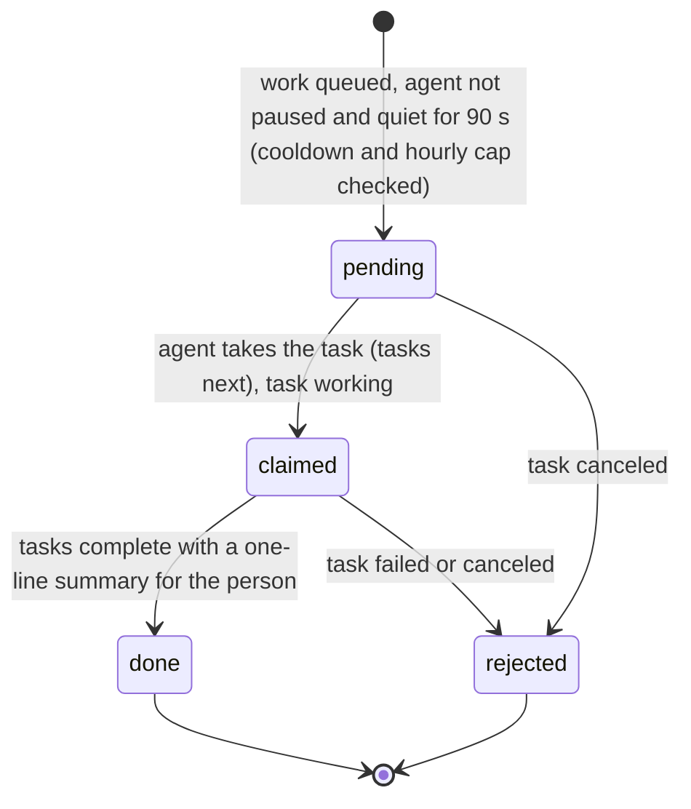
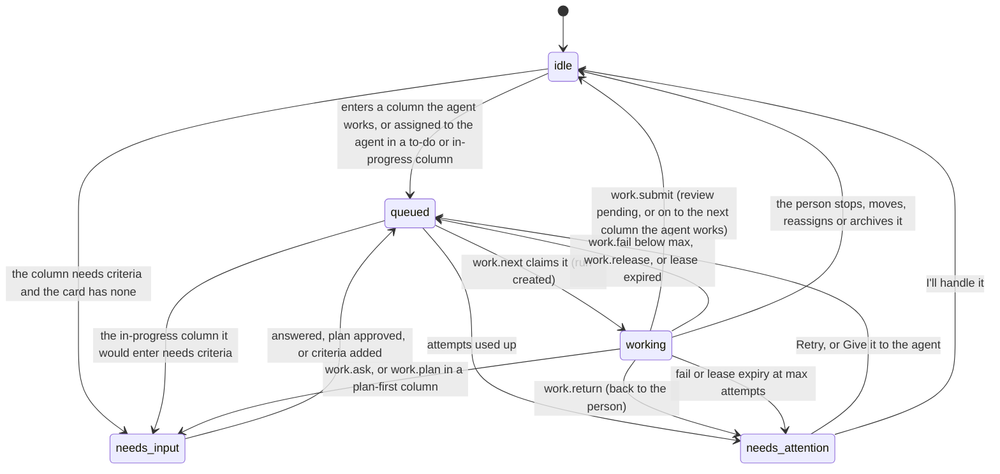
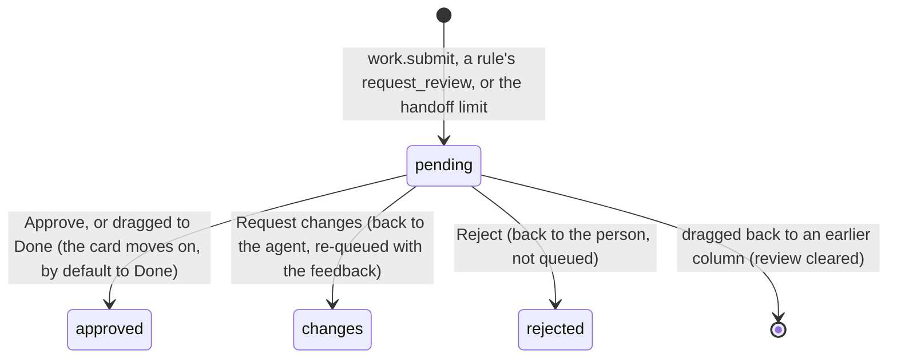

# Requirements: Kanban Board

PART A — REQUIREMENTS (SRS). User-approved before build; frozen after; changes via ## Changes.

## Introduction

### Purpose
Kanban Board is a set of Kanban boards that one person shares with the one AI agent working for them (CraftBot, through the agent-app CLI). There are no accounts, and nothing leaves the computer. Its one job is to get the person's work done on boards where the person stays accountable for every card. The agent does the work it is given and hands it back with evidence. The person keeps the decisions: reviews, Done, and the switch that pauses the agent. There are no agent profiles: a card belongs to the person or to the agent. Columns are small contracts: what the stage means, a WIP limit, whether the agent works it, the gates the agent passes, and where finished work goes. The agent works the same boards through A2App, with 38 declared operations. The app wakes it with one task (`work_waiting`) when work waits for it.

### Scope
**Goals**
1. A card that enters a column the agent works is queued at once, and so is a card assigned to the agent in a to-do or in-progress column. The agent claims it atomically, most urgent first. Its sessions never hold the same card twice, and together they hold at most the person's "cards at once" limit.
2. Every claimed card ends in a submit with evidence, a question, a hand-back, a failure or a release. A card whose lease runs out goes back to the queue, or to the person after the column's last attempt.
3. The agent never moves a card to Done or Canceled, never decides a review, never changes a board's structure, rules or settings, and never deletes or archives. It is refused by full WIP limits, frozen boards and the pause. The server enforces all of this.
4. Every change is attributed to the person, the agent, a rule or the board, with before and after, and every revertible change can be reverted. Ctrl+Z undoes the person's own last change from the last 30 minutes.

**Core functionalities:** boards from templates · columns as contracts · cards with assignee, acceptance criteria and checklist · animated drag and drop with live glide · search, filters and swimlanes · agent queue with leases, attempts, plans and questions · hand-backs and proposals · review queue · inbox and interruptions · activity with revert and undo · board rules · flow insights and the agent's report card · the agent's pause switch and cards-at-once limit · settings

### Approval
Approved by the user: 2026-11-04 — carried over from the published marketplace app `kanban-board` 2.0.0, whose requirements were approved when it was built; this document restates them in the framework's form without changing any feature.

## Product Description

### Product Perspective
`authMode: none`: one person on their own computer, with no accounts or sign-in (Original requirements: "No accounts, nothing leaves the computer"). Calls from the View carry no agent header and act as the person. Calls through the agent-app CLI send `X-A2App-Agent` and act as the agent. Identity is declared by the caller, so the server's rules catch agent mistakes, not malice (AGENT_APP.md § Identity). The app's own operation routes still require a caller: the View or the agent's credential. manifest.json declares no integrations (`capabilities.integrations: []`). The app makes no outbound calls: no language model, no email, no push, so notices are in-app only. One agent works the boards, and the app wakes it with the `work_waiting` task.

### User Characteristics
One person who runs their work on these boards through the day. On a desktop they see the sidebar and columns side by side, with swimlanes from 1280 px. On a phone they get a drawer for the sidebar, columns that snap one at a time, and press-and-hold drags. Pointer and touch input are both used. One AI agent (CraftBot) works alongside them through the agent-app CLI only, in one or more sessions at a time.

### Constraints
- C-1: Column categories: triage ("Proposed"), backlog, todo ("To do"), doing ("In progress"), review, done, canceled. The agent never works a review, Done or Canceled column: the server turns the column's agent switch off for those categories.
- C-2: A card is assigned to the person (`you`), the agent (`agent`) or nobody (`''`). Nobody holds the agent's own proposals until the person accepts them. Cards the person adds are theirs unless they choose the agent or the column is the agent's.
- C-3: Fixed vocabularies. Card agent state: none, queued, working, needs_input (a question, a plan or acceptance criteria), needs_attention. Review state: pending, approved, changes, rejected. Run outcome: working, submitted, asked, returned, failed, expired, stopped, released, planned. Run decision: approved, changes, rejected. Priority: No priority (0), Urgent (1), High (2), Medium (3), Low (4). Label color: gray, red, orange, yellow, green, teal, blue, purple, pink. Return reason: cant, scope, judgment, access, budget, other. Event actor: you, agent, rule, system. Swimlanes: none, assignee, priority.
- C-4: A card's key is `<BOARD KEY>-<number>`. The number is the board's sequence plus 1, assigned once inside a transaction. A board key matches `^[A-Z][A-Z0-9]{0,5}$` and is unique among boards. When the person leaves it empty, it is made from the board's name.
- C-5: A WIP limit of 0 means none (the range is 0–999). A limit binds the agent (409 `wip_full`) and only warns the person.
- C-6: The agent never moves a card to Done or Canceled (403 `human_only`). It never decides a review, and never changes structure (boards, columns, labels, rules), settings or assignment. It never deletes, archives, restores or reverts (403 `person_only`). It edits a card in a started column only while it holds it (409 `claim_required`). What the agent creates is a proposal in the first triage column (else the first backlog or to-do column), at most 20 in any 24 hours (429 `proposal_cap`).
- C-7: A frozen board or the pause refuses the agent's work (423 `board_frozen`, `agent_paused`).
- C-8: A column's lease is 15 minutes by default (2–240), and its attempts 3 by default (1–10). Heartbeats are due every max(1, ⌊lease ÷ 3⌋) minutes. A held card becomes resumable after 1.5 times that without one. Cards at once is 2 by default (1–10), and the Settings page offers 1, 2, 3 or 5. Plan and question rounds do not count as attempts.
- C-9: The agent asks at most 4 questions per card in any 24 hours (429 `question_cap`). A card handed on between columns the agent works more than 3 times goes to review in place.
- C-10: A card with acceptance criteria cannot be submitted without a report on each criterion (400 `criteria_required`). In a "checklist done to leave" column, every item must be ticked first (409 `checklist_open`). A write that carries an older `version` is refused (409 `version_conflict`).
- C-11: Undo reverts only the person's own revertible change from the last 30 minutes. These changes are revertible: field edits (title, description, acceptance, priority, labels, due, estimate, checklist), moves, assignments, creation, proposals, archive and restore, and block and unblock.
- C-12: Activity events are kept for 365 days.
- C-13: No emoji and no mascot: icons are lucide line icons. Colour beyond the greys carries state only: working, waiting on you, needs attention, in review, proposed, blocked. The person is a solid circle with initials, and the agent a soft rounded square with the bot glyph.
- C-14: Size limits: card title 300 characters, description 30,000, acceptance criteria 6,000, comment 20,000, checklist 200 items of 500 characters, plan 40 steps, question options 6, rule actions 10.
- C-15: Rule triggers: enters_column, created, checklist_done, approved, changes_requested, needs_attention, blocked, idle, due_soon. Rule actions: move, assign, priority, label, unlabel, request_review, block, comment, archive. A rule's own actions never set off other rules. A rule that runs 5 times on one card within 10 minutes is switched off, with the reason shown.
- C-16: Board templates: Simple, Agent pipeline, Content studio, Software, Three columns. A fresh install seeds one board, "My board" (key KB), with Backlog, To do, In progress (WIP 4), Review and Done. It also gets the labels Bug, Feature, Research and Docs. A V1 install is converted instead: boards, lists as columns with a guessed category, cards with their text, priority, due date, labels, checklist and order, and labels.

### Assumptions
- A-1: Volume ceiling: 2,000 cards, the most one `cards.list` call returns (its default page is 300). The board view loads every non-archived card of its board at once. Activity loads 80 events at a time, and a call can ask for up to 400.
- A-2: The agent's identity is declared by the caller (the CLI's header), so the rules catch agent mistakes, not malice.
- A-3: One agent works the boards, though several of its sessions may run at once (one per trigger fire).

## Features

### Module: Frame (app, settings)
- F-FRM-1: The user sees a sidebar laid out like CraftBot's. It holds the app name with a collapse button, a highlighted "New card", and Inbox, Review, Insights and Activity, with counts on Inbox and Review. Below them is a folding Boards section with a "New board" button. At the foot are the agent with its live status (working on N, N waiting, idle, paused) and its on switch, and Settings.
- F-FRM-2: The user can collapse the sidebar to a narrow rail, and it stays collapsed on the next visit.
- F-FRM-3: The user sees on each board row a pulsing dot while the agent works there, and how many of its cards need the user. A frozen board's icon is blue.
- F-FRM-4: On phones the user opens the sidebar as a drawer, from a menu button that carries a dot when something needs them. The drawer closes when the user goes somewhere.
- F-FRM-5: The user can press C for a new card, / to search the board, Esc to close the open card, and Ctrl/Cmd+Z to undo their own last change.
- F-FRM-6: WHEN something happens that the user chose to be interrupted by THE SYSTEM SHALL show a notice at the bottom of the screen that opens the card. That covers a question from the agent, a plan to approve, acceptance criteria to add, a card needing attention, or work ready for review. At most four notices show at once, and the oldest leaves after 9 s.
- F-FRM-7: The user sees CraftBot's own look, in light and dark from the host: the kit's warm-neutral tokens, Inter, 8 px corners, lucide line icons and no emoji. The board has three clear grey steps: the page, darker columns, and cards on the plain surface. In dark mode the columns sink below the page and the cards rise above it. Everything clickable shows the hand cursor.
- F-FRM-8: WHEN a newer version of the app has been deployed THE SYSTEM SHALL reload an open page onto it, after the server comes back or when the tab is shown again. It waits while a dialog is open.

### Module: Boards and columns (boards, cards, rules)
- F-BRD-1: The user can create a board from a template: Simple, Agent pipeline, Content studio, Software, or Three columns. Each template shows its columns and where the agent works. The board gets a name and a key ("Card ids: KEY-12"), and the key is automatic when left empty.
- F-BRD-2: The user sees a board's columns and cards. Each column shows its category icon, its name, and a count or count/WIP pill, amber when full and red when over. It also shows "Agent works here" when the agent works it, and its gates (plan first, needs criteria, checklist done).
- F-BRD-3: The user can drag cards between and within columns. The card lifts and tilts with the pointer, the destination column lights up and opens a slot, the other cards glide out of the way, and the card settles into place. The board scrolls at its edges. On phones a drag starts with a press-and-hold.
- F-BRD-4: WHEN the agent or a rule moves a card THE SYSTEM SHALL glide it to its new place on screen. New cards fade in.
- F-BRD-5: The user can add a card quickly at the bottom of a column ("Add card"), or open the New card dialog from the column's "+".
- F-BRD-6: The user can search a board's cards by title or key, and filter them by assignee (you, the agent, unassigned), agent state, priority and labels. The user can show swimlanes by assignee (you, the agent, unassigned) or by priority. Dropping a card into another lane reassigns it or changes its priority.
- F-BRD-7: The user sees the board's live status: the agent on N cards, N queued, and N that need the user.
- F-BRD-8: The user can add, rename, collapse, move left or right, and remove columns. Removing one asks "Remove the column "<name>"?" and moves its cards to the next column.
- F-BRD-9: The user can set a column's contract, and changes save as they are made. The contract covers: the name, what it means (its category), the WIP limit, and who works here (You or Agent). It covers the gates: plan first, needs acceptance criteria, checklist done to leave. It covers the lease minutes and attempts, where finished or approved work goes, and where requested changes send a card. It also covers when aging cards are flagged, the policy, and the instructions for the agent.
- F-BRD-10: The user can edit a board's name, key, description and "How we work" instructions. The user can freeze the board for the agent, choose its swimlanes, reorder and add columns, and manage its labels (add, rename, recolour, remove).
- F-BRD-11: The user can create and edit board rules in a When / If / Then sentence builder, which can assign a card to the user or the agent. The user can turn each rule on and off, see how often it ran and why it was switched off, and remove it.
- F-BRD-12: The user can delete a board after confirming "Delete this board?", which names its cards, columns, rules and activity. The user's only board cannot be deleted.
- F-BRD-13: WHEN a card enters a column the agent works THE SYSTEM SHALL assign it to the agent and queue it. WHEN a card assigned to the agent enters a to-do or in-progress column THE SYSTEM SHALL queue it. Only an entry queues a card; re-saving never does. WHEN the column needs acceptance criteria and the card has none THE SYSTEM SHALL ask the user for them first.
- F-BRD-14: WHEN the user turns the agent on for a column THE SYSTEM SHALL queue the cards already there that are not the user's.
- F-BRD-15: WHEN there is no board yet THE SYSTEM SHALL show "No board yet" with "New board".

### Module: Cards (cards)
- F-CRD-1: The user sees each card's face: key and priority, the title, and what the agent is doing now (a live line and a sweeping bottom edge while it works). It also shows labels, due date, checklist and plan progress, age dots, and the user or the agent. One state chip says where the agent is with it: Working, Queued, Waiting on you, Plan to approve, Needs criteria, Needs attention, In review, Proposed or Blocked.
- F-CRD-2: The user can write a new card in the New card dialog. It has a heading with the board and column, a Title (Enter creates; pasting several lines splits them into title and description) and a Description (markdown). It also has Board, Column, Assignee (a You / Agent switch, locked to the agent in a column the agent works) and Priority. Choosing the agent shows the Acceptance criteria field (marked required when the column needs it) and what happens next. Creating a card opens it.
- F-CRD-3: The user can open any card docked on the right while the board stays live behind it.
- F-CRD-4: The user can edit the title, the description (markdown), the acceptance criteria and the checklist (tick, add, remove). The user can set the status (column), the assignee (one switch: you or the agent), the priority, the labels and the due date. The user sees when the card was created, by whom, and when it was done.
- F-CRD-5: The user sees the agent's session on the card, with its actions. Working shows the progress, the plan, the lease, the attempt and Stop. Queued shows Stop. A plan offers "Approve plan" and "Ask to revise". A question offers its suggested answers, a reply box and "Take it over". Missing criteria offers "Add criteria". Needs attention offers "I'll handle it", plus Retry with an optional note, or "Give it to the agent" when the card is not the agent's. A proposal offers Accept and Dismiss.
- F-CRD-6: WHEN a card waits for review THE SYSTEM SHALL show its review packet: each acceptance criterion met or not, how it was checked, what could not be verified, and the summary. Approve, Request changes and Reject come with it.
- F-CRD-7: The user can comment, and Ctrl+Enter sends. A comment on a card the agent is working on or has queued reaches the agent with its next heartbeat or claim.
- F-CRD-8: The user can flag the card blocked with a reason and clear the flag, and archive and restore the card.
- F-CRD-9: The user can delete a card after confirming "Delete this card?" ("<KEY> and its activity are deleted for good. Archive it instead to keep the history.").
- F-CRD-10: The user sees the card's activity. Comments, questions, answers, submissions and decisions show as messages, and the agent's steps fold into "Agent · N steps". Other changes show as lines, and each revertible one has a revert button.

### Module: Review (review)
- F-REV-1: The user sees every card waiting for review, urgent and oldest first. Beside the list is the selected card's packet (evidence first), then its acceptance criteria and its description.
- F-REV-2: The user can approve, and the card moves on (to Done by default). The user can request changes with a reason the agent reads, and the card goes back to the agent in the column it was worked in. The user can reject with a reason, and the card comes back to the user. The next card is selected after a decision.
- F-REV-3: The user can move through reviews with J and K (or the arrow keys), approve with A, and request changes with R.
- F-REV-4: WHEN the user drags a card waiting for review into a Done column THE SYSTEM SHALL record the review as approved. Dragging it back to an earlier column clears the review.

### Module: Inbox (inbox)
- F-INB-1: The user sees "Needs you": questions and plans, cards needing attention, proposals from the agent, blocked cards and overdue cards. When cards wait for review, a link opens the review queue.
- F-INB-2: The user can act right in the inbox: answer (or pick a suggested answer), add criteria, approve a plan, retry, take over ("I'll handle it"), and accept or dismiss a proposal.
- F-INB-3: The user sees "Since you were away": what the agent and rules did since the user last looked, grouped by day. The user can mark it all as seen.
- F-INB-4: WHEN nothing needs the user THE SYSTEM SHALL say "Nothing needs you" and what lands there. WHEN nothing is new THE SYSTEM SHALL say "You are up to date".

### Module: Insights (insights)
- F-INS-1: The user can choose one board or all boards, and a 7, 30 or 90 day window.
- F-INS-2: The user sees four measures. Work in progress now, with how many cards wait for review. Cards finished in the window, with the share done by the agent. Median cycle time, with its 85th percentile. Median review wait, with first-pass approval. The agent (accent) and the user (ink) have separate colors.
- F-INS-3: The user sees the agent's report card: runs, approval rate, first pass, questions (with hand-backs), failed or timed out, and median run time.
- F-INS-4: The user sees four charts. Aging work in progress, against the 50th and 85th percentile lines, where a dot opens its card. Cycle time per finished card, with 50/85/95 lines. Weekly throughput. Cumulative flow, for one board.

### Module: Activity (activity)
- F-ACT-1: The user sees every change on every board, newest first and grouped by day. Each change is attributed to the user, the agent, a rule or the board. The list filters by everyone, you, the agent or rules, and by board, and has "Load older".
- F-ACT-2: The user can revert a revertible change.
- F-ACT-3: WHEN the user presses Ctrl/Cmd+Z THE SYSTEM SHALL undo only their own last revertible change from the last 30 minutes.

### Module: Settings (settings)
- F-SET-1: The user can set their name: what the agent calls them, and the initials on their cards.
- F-SET-2: The user can turn "Let the agent work" off and on (the same switch as the sidebar's), and set how many cards the agent works at once (1, 2, 3 or 5).
- F-SET-3: The user can choose what interrupts them, Interrupt or Inbox for each: the agent asks something, a card needs attention, work is ready for review.
- F-SET-4: The user sees how the agent works with the board, and the list of keyboard shortcuts.

### Agent (via A2App)
- F-AGT-1: The agent can work the boards through the 38 operations in ## Operations Design. Every refusal names what to do instead.
- F-AGT-2: The agent can read from `app.guide` the model, the work protocol, the rules it is held to, the error codes, and the boards with their columns. Its reads (`boards.get`, `cards.list`, `cards.get`) answer lean unless it asks for `--full true`.
- F-AGT-3: The agent can claim the most urgent queued card with `work.next`, atomically: no priority comes last, and ties go to the card that waited longest. It gets the card, the board's how-we-work, the column's policy and instructions, the user's feedback, the recent conversation, its run id and its lease. A card claimed in a to-do column moves into the next in-progress column, when that column's WIP limit and criteria gate allow it.
- F-AGT-4: The agent can run several sessions at once. Together they hold at most the "cards at once" limit, and `work.next` never hands out a card another session holds. At the limit, `work.next` lists the held cards, and the agent can take over one whose session went quiet with `work.resume`.
- F-AGT-5: The agent can post a plan; in a plan-first column the card then waits for the user's approval. It can log steps, send heartbeats (each answer carries anything the user said meanwhile), and ask one question. It finishes each claim with `work.submit` (summary, evidence, unverified items and each acceptance criterion), `work.return` (with a reason), `work.fail` or `work.release`.
- F-AGT-6: WHEN the agent submits THE SYSTEM SHALL put the work up for the user's review. The card moves into the next column when that is a review column, and otherwise stays where it is. WHEN the next column is one the agent works THE SYSTEM SHALL move the card on to it instead, until the card has been handed on more than 3 times; then it goes to review in place.
- F-AGT-7: WHEN a lease runs out without a heartbeat THE SYSTEM SHALL put the card back in the queue, with the attempt counted. After the column's last attempt, it marks the card as needing the user ("The agent stopped responding <n> times.").
- F-AGT-8: WHEN the agent tries to move a card to Done or Canceled, decide a review, change structure, settings or assignment, or delete, archive or revert THE SYSTEM SHALL refuse it with a code and a message saying what to do instead. The same holds when it edits a started card it does not hold, or works past a full WIP limit, a frozen board or the pause.
- F-AGT-9: The agent can create a card. It lands as a proposal in the Proposed (triage) column for the user to accept, at most 20 in any 24 hours.
- F-AGT-10: WHEN work is queued for the agent THE SYSTEM SHALL wake it with one `work_waiting` task, except while the agent has called in the last 90 s. The minute clock wakes it again if it goes quiet with work waiting. It reminds the agent after 10 minutes if the same work still waits.
- F-AGT-11: WHEN the user pauses the agent THE SYSTEM SHALL give it no card and refuse its heartbeats, steps, plans, questions, submits and card changes until the user turns it back on. Cards it was working on go back to the queue when their leases run out.

## Non-Functional Requirements
- N-1: A change made by the agent, a rule or another tab shows on every open screen without a refresh. Views reload after a short debounce: board 120 ms, card 100 ms, insights 800 ms. The app frame and the inbox wait 400 ms, with a 1.5 s minimum gap. Other views wait 150 ms, with a 1 s minimum gap. Moved cards glide into place.
- N-2: An expired lease is noticed within a minute (`kb_work`, every minute). The same job wakes the agent again when work still waits.
- N-3: Idle and due-soon rules run hourly (`kb_rules`, at minute 7), at most once a day per card and rule.
- N-4: The app's own operation routes accept 300 calls a minute per address, shared by the View and the local agent.
- N-5: Drag pick-up needs a 5 px mouse movement, or a 280 ms press-and-hold on touch, which an earlier 8 px move cancels. A drop settles in 260 ms. Cards the agent moves glide 340 ms across columns and 220 ms within one.
- N-6: The agent's lean read of a board is about 5,000 characters, down from about 18,000 for the full shape (AGENT_APP.md § Lean reads).

## Data Requirements
- **settings** (module: settings): name (string, max 80), paused (boolean), attention (json), defaults (json), last_seen (datetime), agent_seen (datetime), max_working (number), created (datetime, server-set), updated (datetime, server-set).
- **boards** (module: boards): name (string, required, max 80), key (string, required, max 6), description (string, max 400), instructions (string, max 12000), seq (number), frozen (boolean), archived (boolean), sort (number), swimlanes (enum), created (datetime, server-set), updated (datetime, server-set).
- **columns** (module: cards): board (ref, required → boards), name (string, required, max 60), category (enum, required), position (number), wip (number), policy (string, max 4000), instructions (string, max 8000), agent (boolean), plan_first (boolean), need_criteria (boolean), need_checklist (boolean), next (string, max 15), return_to (string, max 15), lease_minutes (number), max_attempts (number), aging_days (number), collapsed (boolean), created (datetime, server-set), updated (datetime, server-set).
- **labels** (module: boards): board (ref, required → boards), name (string, required, max 40), color (enum), created (datetime, server-set).
- **cards** (module: cards): board (ref, required → boards), column (ref, required → columns), number (number), title (string, required, max 300), description (string, max 30000), acceptance (string, max 6000), priority (number), labels (list<ref> → labels), due (datetime), estimate (number), checklist (json), position (number), assignee (string, max 15), created_by (string, max 40), proposed (boolean), agent_state (enum), lease_until (datetime), attempt (number), handoffs (number), run (string, max 15), progress (string, max 300), plan (json), plan_ok (boolean), question (json), attention (string, max 600), review (json), review_state (enum), feedback (string, max 4000), work_column (string, max 15), blocked (boolean), blocked_reason (string, max 600), column_at (datetime), started_at (datetime), done_at (datetime), done_kind (string, max 10), cost (number), version (number), archived (boolean), created (datetime, server-set), updated (datetime, server-set).
- **events** (module: records): board (ref → boards), card (ref → cards), actor (string, max 40), actor_kind (enum), kind (string, required, max 30), text (string, max 20000), field (string, max 30), before (json), after (json), run (string, max 15), meta (json), reverted (boolean), created (datetime, server-set).
- **runs** (module: work): card (ref → cards), board (ref → boards), column (string, max 15), attempt (number), started (datetime), ended (datetime), outcome (enum), note (string, max 2000), cost (number), decision (enum), decided (datetime), created (datetime, server-set).
- **rules** (module: rules): board (ref, required → boards), name (string, max 120), enabled (boolean), when (enum, required), column (string, max 15), days (number), conditions (json), actions (json), position (number), runs (number), last_run (datetime), paused_reason (string, max 300), created (datetime, server-set), updated (datetime, server-set).

## External Interfaces
- **Human (browser):** one single-user View served by PocketBase at the app's own origin, with hash routes `#/board?id=<board>` (the default), `#/inbox`, `#/review`, `#/insights`, `#/activity` and `#/settings`. The card panel docks on the right over any route. The New card and New board dialogs, the Board settings and Column settings sheets, the confirmations and the phone drawer open over the page. There is no file input or output.
- **Agent (A2App):** the modules and collections in AGENT_APP.md § Modules; operations exactly as declared in ## Operations Design; tasks with the capabilities `work_waiting` (events.json). No other machine interface is offered to agents; the app's own screens call their own routes.

## Out of Scope
- More than one person: accounts, sign-in, sharing, roles or presence.
- More than one agent, or agent profiles. A card belongs to the person or to the agent.
- Calls to anything outside the app: language models, email, push notifications, integrations. Notices are in-app only.
- File attachments on cards.
- The agent deciding reviews, moving cards to Done or Canceled, changing boards, columns, labels, rules, settings or assignment, or deleting, archiving, restoring or reverting.
- Verifying the agent's identity beyond the name its CLI declares.
- Deep links to a single card: the open card is not part of the URL.
- A screen listing archived cards, and archiving a board from the UI.
- Editing a card's estimate, or the settings' column defaults, from the UI.
- Reordering a card within a column from the keyboard. The Status picker moves it between columns.
- Undoing anything older than 30 minutes, or anything but the person's own change, with Ctrl+Z. "Revert this change" in the activity does that instead.
- Bringing back a removed label or rule.
- Languages other than English.

## Quality of Life
- The last board opened is remembered on this browser, and so is the collapsed sidebar.
- Pasting several lines into a new card's title splits them into a title and a description.
- A card picked up by touch gives a short vibration where the device supports it.
- Server warnings, such as a column over its WIP limit or open checklist items when the person moves a card, show as information, not errors.
- The phone's columns snap one at a time, except while a card is being dragged.
- When the agent will do a new card, the New card dialog says what happens next ("The agent picks this card up as soon as you create it.").

PART B — TECHNICAL SPECIFICATION.

## System Overview
PocketBase 0.39 (JS hooks, migrations) + React 19 / Vite / Tailwind 4 View in `frontend/` built into `pb/pb_public/`, on the `blueprint-pocketbase-kit` toolkit. The View calls the app's own 61 routes `/api/ops/<group>/<verb>` (`ops.pb.js`, all through `lib_util.handle`). The generated `a2app_routes.pb.js` serves the 38 agent operations as `POST /api/ops/<name>` through the same handlers. The other 23 routes are the person's own actions, not offered to agents (AGENT_APP.md § The person's own actions). Domain logic lives in `lib_*.js`. `lib_model` holds identity, shapes, positions and the activity log. `lib_cards` holds moves and their effects, edits, assignment and review. `lib_work` holds the agent queue, leases, cards at once, expiry and waking the agent. `lib_boards` holds boards, columns, labels and templates, and `lib_auto` the rules. `lib_app` holds settings, the agent's status and report card, the frame state, the inbox, insights, activity and revert. `lib_guide` writes `app.guide`. The record guards and the jobs are in `hooks.pb.js`.

Modules → navigation map:

| Module (manifest) | Where a person meets it | Route |
| --- | --- | --- |
| `app` | The sidebar, its counts, the agent's status and the notices (`app.state`) | every route |
| `boards`, `cards`, `rules` | The board (columns, cards, swimlanes), the New card and New board dialogs, Board settings, Column settings, and the card panel | `#/board?id=` |
| `review` | Review, and the review packet in the card panel | `#/review` |
| `inbox` | Inbox | `#/inbox` |
| `insights` | Insights | `#/insights` |
| `activity`, `records` (events) | Activity, and the card's activity | `#/activity` |
| `settings` | Settings, and the agent's switch in the sidebar | `#/settings` |
| `work` | No screen of its own: the agent calls it, and the person sees it as card sessions, state chips and the agent's status | — |

## UI Design
- **Design system:** the agent-app UI kit 0.6.0 is vendored in `frontend/src/kit` (system-managed). It supplies the theme bridge, the PocketBase client, toasts, and the shell with its error boundary. The app extends the kit's warm-neutral tokens in `frontend/src/app/theme.css`. Its `--kb-*` tokens are mixed with `color-mix` from `--agent-app-bg`, `-surface`, `-text`, `-muted`, `-border`, `-accent`, `-accent-contrast`, `-radius` and `-font`, and redefined for `[data-theme='dark']`. The surfaces are side, main, col, tile, card and sunken. Then come the lines (line, hair, col-line, tile-line), the ink, ink-2, muted and faint text, hover and active, and the accent set (accent, accent-ink, accent-soft, accent-text). The radii are `--kb-radius` (the kit radius, 8 px by default) with ×0.75 and ×1.5 steps. Fixed state colors come in green, amber, red, blue and violet, with separate light and dark values and a soft variant of each. Beside them sit the nine label-dot colors, the agent avatar's orange tone, the shadows, the overlay and the scrim. The font is Inter Variable (`@fontsource-variable/inter`) with a 13 px body, and `.kb-num` gives tabular figures. Icons are lucide-react, plus the app's own SVG marks in `marks.tsx`: category rings, priority bars, age dots and the state chip. The app's widgets are written once in `components/ui.tsx`: Button, IconButton, Input, Textarea, Select, Toggle, Segmented, Field, Row, Kbd, Spinner, AgentAvatar, YouAvatar, Chip, Count, Empty, Popover, MenuItem, Dialog, Sheet, Section, Tabs, EditableText, MenuButton and `useConfirm`. Charts are hand-made SVG (`pages/Insights.tsx`).
- **Layout:** the sidebar is 268 px, collapsible to a 60 px rail, and holds the views, the boards, the agent and Settings. Page headers are 52 px. On the board, columns are 284 px wide (at most the viewport less 56 px) and scroll sideways in their own container, and each column scrolls its own cards. With swimlanes, the column heads stick to the top and each lane is a row of cells. The card panel docks on the right (up to 600 px) over the live board. Sheets slide in from the right: 560 px for Board settings, 460 px for a column. Centered dialogs hold creation and confirmations: New card 680 px, New board 620 px, confirmations 420 px. The board has three grey steps: the page, darker columns, and cards on the plain surface. Density is compact on the board, the inbox and the activity, and calmer in settings.
- **Screen — Board:** primary object: one board's columns and cards · primary action: drag cards, "New card" · loading: a centered spinner · empty: "No board yet" ("Create a board, then let the agent work a column or assign it a card.") with "New board". A missing board shows "This board is not here" ("It may have been deleted.") with "Open another board" · in-flight: moves apply at once and revert with an error toast if refused · success: info toasts such as "<KEY> is queued for the agent", "<KEY> needs acceptance criteria before the agent can start", and the WIP and checklist warnings. Cards glide when the agent moves them · narrow: below 1280 px the swimlanes control hides. The live status shows in the header from 1024 px, and in a strip under it below 768 px. Below 768 px the search also hides, the sidebar becomes a drawer, and columns snap one at a time. Below 640 px the key chip and the Filter and New card labels hide.
- **Screen — Card panel:** primary object: one card · primary action: the session's action (answer, approve a plan, add criteria, retry, accept, review), or editing a field · loading: a spinner · error: "This card is not here any more." · archived: "This card is archived." · success: toasts such as "Stopped. The card is yours.", "Plan approved", "Answered; it goes back to the agent", "Queued again", "Accepted", "Dismissed (archived)", "Archived", "Restored" · narrow: the panel takes the full width.
- **Screen — New card dialog:** primary object: the new card · primary action: "Create card", disabled until there is a title ("Enter in the title or Ctrl+Enter to create · Esc to close", shown from 640 px) · the page behind dims and blurs · success: "<KEY> created", "<KEY> created and queued for the agent" or "<KEY> created: add acceptance criteria so the agent can start", and the card opens · narrow: the four properties sit in two columns, and in one row from 640 px.
- **Screen — New board dialog:** primary object: the new board · primary action: "Create board", disabled until there is a name · the templates, each with its columns and the agent's mark, sit in one column, or two from 640 px · success: the new board opens.
- **Screen — Board settings and Column settings (sheets):** Board settings has the tabs General (Board, How we work, Agent with the freeze switch, Layout with swimlanes, Danger zone with "Delete board"), Columns (open, reorder, add), Labels and Rules. Rules shows each rule as a sentence with its runs or the reason it was switched off, and the When / If / Then editor ends with "Create rule" or "Save rule". Column settings has Stage, Who works here (for columns that are not review, Done or Canceled), Flow and Policy, and "Changes save as you make them" · empty rules: "No rules yet" ("For example: when a card's checklist is complete, send it for your review.") · error: a bad number toasts "<label>: a whole number from <min> to <max>".
- **Screen — Inbox:** primary object: the cards that need the user · primary action: answer, approve, retry, take over, accept or dismiss, inline · tabs "Needs you" and "Since you were away", with counts, and "Mark all as seen" · empty: "Nothing needs you" ("Questions from the agent, plans to approve, cards handed back and proposals land here."), and "You are up to date" ("Nothing new from the agent since <when>.") · loading: blank until the first load · narrow: rows drop the board name below 640 px, and "Mark all as seen" becomes an icon.
- **Screen — Review:** primary object: the cards waiting for review · primary action: Approve / Request changes / Reject · the header shows "<n> waiting" and, from 768 px, the keys "J K move · A approve · R request changes" · empty: "Nothing waits for your review" ("When the agent submits work, it comes here with its evidence: each acceptance criterion, how it was checked and what it could not verify.") · loading: a spinner · success: "Approved", "Sent back for changes", "Rejected" · narrow: below 768 px it shows the list or the detail, with "All reviews" to go back.
- **Screen — Insights:** primary object: the flow measures for a board and a window · primary action: choose a board and a window · empty: "Not much to measure yet" ("The charts fill in as cards move from start to done."), "No card finished in this window", "Pick one board to see its flow." · loading: a spinner · narrow: the KPIs sit in 2 columns (4 from 768 px), and the report card in 2, 3 or 6 columns (at 640 and 1280 px). The charts stack in one column below 1024 px.
- **Screen — Activity:** primary object: every change · primary action: revert a change, "Load older" · empty: "No activity yet" ("Every change by you, the agent and your rules shows here, and can be reverted.") · loading: a spinner · error: toasts · narrow: the filters take the full width and scroll sideways.
- **Screen — Settings:** primary object: the person's settings and the agent's · sections You, Agent ("Let the agent work", "Cards at once"), What interrupts you, How the agent works with this board, and Keyboard · loading: a spinner · narrow: one column.
- **Formatting:** card ids read `KEY-12`. Times are relative ("just now", "5 min ago", "3 h ago", "yesterday", "<n> days ago", then "12 Oct" in the browser's locale, with the year outside the current one). Activity rows show the clock time. Leases count down ("Lease ends in 12 min"). Due dates read "Today" or "Tomorrow" in amber; past dates are red ("Yesterday" or the day); others show the day. Cycle times read in days ("3.5 d"), review wait in hours, and run time in minutes or hours. Shares are percentages. Counts use tabular figures and cap at "99+". Screens show names and keys, not record ids. Empty values are words or a dash: "–" for a missing median or rate, "No priority", "Add labels", "Unassigned".

## Quality Conformance

- **Q1 Completeness & IA:** the sidebar is the orientation model. The current view and board are marked (`aria-current="page"`), Inbox and Review carry counts, and the boards and the agent are always in view (in a drawer on phones). The board is the default route, and the last board opened is remembered. Modules map to screens as in ## System Overview. `work` shows as card sessions, state chips and the agent's status rather than a screen of its own. One name per concept: card, column, board, assignee, the agent, review, inbox, activity, rule. Working sets that outgrow a screen have their tools. The board has search, filters (assignee, agent state, priority, labels) and swimlanes. The inbox groups by kind. Activity has actor and board filters with "Load older".
- **Q2 Design system:** the tokens are the kit's warm-neutral `--agent-app-*` set, extended by the derived `--kb-*` set in `theme.css` (see ## UI Design) and redefined for dark. Components never hardcode a hex color: the fixed state, label and avatar colors, the shadows, the overlay and the scrim live in `theme.css`. Semantic roles: the accent is for primary actions, "New card", counts and the agent's share in Insights. Green means working, done and met. Amber means full, due soon, waiting on you and paused. Red means over the limit, overdue, needing attention, blocked and destructive. Blue means review and frozen, and violet means proposed. Type is Inter Variable with a 13 px body. Icons are lucide-react plus the app's own SVG marks, with no emoji. Light and dark come from the host, or from `prefers-color-scheme` when the app runs standalone, through the kit theme bridge.
- **Q3 Layout & composition:** the board is a horizontal row of fixed-width columns that scrolls inside its own container. Counts and figures use tabular numbers. Long titles wrap on cards (up to three lines) and truncate in rows. Each screen has one primary action in its header. Density is compact on the board, inbox and activity, and calm in settings. Activity pages at 80 events with "Load older". The board shows every non-archived card of one board (A-1).
- **Q4 Interaction:** every clickable element shows the hand cursor (a `theme.css` base rule). Cards lift on hover and press, and disabled controls dim. The confirm dialog (`useConfirm`, with a red primary and focus on the confirm button) names the target and the effect of each irreversible action: "Delete this card?", "Delete this board?", "Remove the column "<name>"?" (where its cards move). `window.confirm` is never used. Some actions apply at once without a confirmation: removing a label, a rule or a checklist item, archive, dismiss, stop, and the pause. Archive and dismiss are undone by Restore. Checklist edits can be reverted from the activity, and the pause by turning the agent back on. Removed labels and rules cannot be brought back (see ### Conventions and overrides). Ctrl/Cmd+Z undoes the person's own last revertible change. The keyboard map: C, /, Esc and Ctrl/Cmd+Z globally; J/K/↓/↑, A and R on Review; Enter or Space opens a focused card; Enter or Ctrl/Cmd+Enter submits the composers; Esc closes popovers, dialogs and sheets. The keyboard alternative to dragging is the card's Status, Assignee and Priority pickers, plus the column menu's Move left and Move right. Inputs are constrained by pickers and segmented choices. A column the agent works locks the New card dialog's assignee and says why.
- **Q5 State & feedback:** each screen's states are listed in ## UI Design. Moves and the pause switch apply optimistically and revert on refusal. Buttons show a spinner and disable while their call runs. Success shows where the user looks: the card glides into place, the session box changes, info toasts name what happened ("<KEY> is queued for the agent"), and every view reloads live. Agent work shows as Queued and Working chips with a progress line and a sweeping bar, and the card panel adds the lease and the attempt. Errors show the server's message as a toast. The board and card error screens appear only when nothing was ever loaded.
- **Q6 Motion:** utility transitions take 120–200 ms (fields 0.12 s, tiles 0.14–0.18 s, panel and sheet slide 0.18 s, drawer 0.2 s), on `cubic-bezier(0.2, 0.8, 0.2, 1)` for the slides. While dragging, the ghost follows the pointer and tilts with its speed (up to ±9°). A drop flies into its slot over 260 ms, and the other cards make room around an animated placeholder. Others' moves glide 340 ms across columns and 220 ms within one, and new cards fade in over 220 ms. Under `prefers-reduced-motion: reduce`, the lift, placeholder, panel, sheet, drawer and fade-in animations and the tile transforms are removed, and the glide and fly are skipped. See ### Conventions and overrides for what still moves.
- **Q7 Content:** the voice is plain and second person, in sentence case, with no emoji. Every refusal says what to do instead. For the agent that is an error code with a message, listed in `app.guide` ("Finish with work.submit: the person reviews and approves."). For the person it is the server's message ("This is your only board; create another one before deleting it", "Nothing of yours to undo from the last 30 minutes"). Hints say what a setting does ("WIP limit: The agent cannot put more cards here; you get a warning. 0 = no limit."). Card text is rendered as markdown, never injected as HTML.
- **Q8 Accessibility:** contrast comes from the kit's tokens and the app's state colors, with separate light and dark values. Focus: `.kb-focus:focus-visible` draws a 2 px accent outline, and fields get a 3 px soft accent ring. Cards on the board are `role="button"` with `tabIndex=0`. The ARIA used: `role="dialog"` with `aria-modal` for dialogs, sheets and the drawer; `menuitem`; `tablist` and `tab`; `switch`; `radiogroup` and `radio`; `checkbox`; `img` with a label for charts; `aria-current`, `aria-expanded`, `aria-pressed` and `aria-selected`. Icon buttons carry `aria-label` and `title`, and decorative icons and drag clones are `aria-hidden`. Targets: nav rows 36 px, buttons 32 px (small ones 28 px), icon buttons 24–32 px, toggles 18 × 32 px (see ### Conventions and overrides). Dragging has single-pointer and keyboard alternatives (the pickers). State never relies on color alone: chips and pills carry words, and tooltips explain the WIP pills.
- **Q9 Responsiveness:** from phone to wide desktop. Below 640 px the board header hides the key chip and the button labels. Below 768 px the sidebar becomes a drawer, the search hides, and the columns snap one at a time (not while dragging). Below 1024 px the Insights charts stack and the board's live status leaves the header. Below 1280 px the swimlanes control hides. Touch drags start with a 280 ms press-and-hold (cancelled by an earlier 8 px move), with a short vibration and edge auto-scroll.
- **Q10 Performance:** board stats come from one SQL aggregate, and the whole frame from one `app.state` call. Server caps: `cards.list` 300 by default (up to 2,000); `review.list` 200; the inbox 100 per group and 200 updates; `app.state` 60 per group; `cards.get` 400 events and 50 runs; activity 80 by default (up to 400), with a cursor. The agent's reads are lean (25 activity lines on a card, `--full true` for every field). The board renders all of a board's non-archived cards without virtualization (A-1). The font is self-hosted, and the charts are SVG with no library.
- **Q11 Caching & freshness:** the document shell is served `no-store, no-cache, must-revalidate` (`cache_control.pb.js`, plus the toolkit's SPA header). The built assets have content-hashed names and keep PocketBase's default static headers. Operation responses carry no cache headers, and the View holds them as in-memory state. Freshness comes from one realtime hub that subscribes once to settings, boards, columns, labels, cards, events, runs and rules. Each view reloads after its debounce (N-1), and a sequence guard keeps only the latest response. An open page reloads onto a new build after a reconnect or a tab show, waiting while a dialog is open.
- **Q12 Data integrity:** relations are real relation fields: card → board, column and labels; column, label and rule → board; events and runs → card and board. Deleting a board cascades to its columns, labels, events, runs and rules, after its cards are deleted first. Selects hold the fixed vocabularies. Every collection refuses direct writes through hooks (`lib_rules.refuse` names the operation to use), so every change goes through an operation that keeps versions, leases, the activity log and the queue in step. Card numbers are assigned inside a transaction, and a claim is atomic (a version check inside a transaction). A run's review decision is set once. `version` gives optimistic concurrency when sent (409 `version_conflict`). Indexes: cards (board, archived), (agent_state), (column); events (card, created), (created); runs (started). Board-key uniqueness and per-board label names are enforced in the operations, not by an index. The single migration builds the schema on a fresh database and converts a V1 install.
- **Q13 API:** beyond the adapter, the app's own 61 routes `/api/ops/<group>/<verb>` (GET reads, POST writes) all run through `lib_util.handle`. Typed readers answer 400 naming the parameter, with an example. There is one error shape, `{ status, message, data? }`, where `data.code` names the case (for example `wip_full`, `human_only`, `person_only`, `claim_required`, `proposal_cap`, `question_cap`, `board_frozen`, `agent_paused`, `version_conflict`, `stale_run`, `not_held`). Statuses: 400, 403, 404, 409, 423, 429, 500. Lists are bounded as in Q10, and errors carry no stack traces.
- **Q14 Architecture:** the UI lives in `frontend/src/app` (pages, components, lib), the domain in `lib_*.js`, the routes in `ops.pb.js`, and the guards and jobs in `hooks.pb.js`. The UI calls the same handlers the agent calls (`lib/api.ts`), so every rule has one server implementation. Identity and the person-only and agent-only checks are written once (`lib_model.who`, `personOnly`, `agentMayWrite`; `lib_work.mustAgent`). A move is the one place where column-entry effects happen (`lib_cards.place`). Shared widgets exist once (`ui.tsx`, `marks.tsx`, `lib/markdown.tsx`), and formatting has one module (`lib/format.ts`). App-wide state has one provider (`lib/context.tsx`): the frame, the boards, the agent, the open card, the composer, the notices and the optimistic pause.
- **Q15 Resilience:** leases make abandoned work recover by itself. `kb_work` expires leases every minute, re-queues the card or flags it for the person, and logs an `expired` event. `work.resume` lets a new session take over a card a quiet session left behind, and a stale session is refused (`stale_run`). The agent is re-woken only for newer work, or after 10 minutes if the same work still waits. A failed live load keeps the last data on screen, and a refused move reverts and toasts the server's message. When the backend is unreachable, calls toast "Network error — is the backend running?". A render crash shows the kit's "Something went wrong" panel with "Reload app". Rules that loop are switched off, and a rule that fails logs `rule_failed` without breaking the change that set it off. The app makes no outbound calls.
- **Q16 Security & privacy:** with `authMode: none`, collection rules are open (`""`) because the app is single-user and binds loopback, but every collection refuses direct record writes through hooks. The framework adapter runs its host check, framing policy and credential checks before any app hook. The app's own operation routes require a caller: the View, or the agent's `.agent-token` sent as `X-A2App-Token`. Person-only and agent-only operations are enforced on the server. No declared operation is destructive. Agent output is never injected as HTML, and links open http(s) only, with `rel=noreferrer`. The toolkit sets rate limits (300 requests per minute on `/api/ops/`). Card text stays in `pb/pb_data`, and logs carry no request bodies. Runtime credentials (`.agent-token`, `.principal`, `.superuser`) are git-ignored and never shipped.
- **Q17 Observability:** hook errors log `[kanban-board] …` lines through `console.error`: operation failures at 500 and above, the work clock, the rule sweep, the prune, rule failures, and activity-log failures. The toolkit adds `[handler-error] <METHOD> <path>: <message>`, and the UI kit's console relay writes browser errors to `logs/frontend_console.log` (capped at 2 MB). The structured record is the `events` collection: actor, kind, before and after, run and meta for every change, including rule runs, rule switch-offs and failures. Health is `/api/_a2app`, the adapter's identity document.
- **Q18 Version control:** commits are per change ("Port kanban-board Living UI to the V2 (PocketBase) platform", "kanban-board: pass strict tsc for V2 import (build gate)", "Kanban agent app improvement"). `.gitignore` excludes credentials, `pb/pb_data/`, the PocketBase binary, the built View `pb/pb_public/`, `frontend/node_modules/`, framework runtime state under `.a2app/`, `logs/` and Python caches. The app builds from a clean checkout with the manifest pipeline alone (`install`, `build`, `start`).

### Conventions and overrides
The published app is restated here unchanged, so these are standing decisions of the approved build, not new work. Revisit any of them when the app is next modified.
- Q6.3 and Q6.4 (reduced motion, pausable loops): under `prefers-reduced-motion` some things still move: the working chip's and agent dot's pulse, the working bar's sweep, the loading spinners, the dragged card's tilt, and the sidebar's width transition. The pulse and sweep loop for as long as the agent works.
- Q5.2 (designed loading): there are no skeletons. Screens show one spinner until their first load arrives, and the inbox stays blank until then.
- Q8.3 (announcements): toasts and notices are not in a live region.
- Q8.4 (24 × 24 px targets): toggles are 18 × 32 px, and the column header's icon buttons are 24 px.
- Q11.2 (declared data policy): operation responses carry no Cache-Control. They are held as in-memory view state and refreshed by realtime changes.
- Q15.1 (timeouts and retries): the View's calls to its own backend use the PocketBase SDK without a client-side timeout, and a failed live load is not retried until the next realtime change.
- Q17.1 (structured logs): hook log lines are prefixed text. The `events` collection is the structured record.
- Q4.2 and Q4.3 (confirm what cannot be undone): removing a label or a rule from a board applies at once, with no confirmation and no undo.
- Mirrored global rules: none recorded for this app.

## Process Flows

Work the app asks the agent for (`work_waiting`): the request row follows the A2App task.

Card agent state:

Review:

A proposal (a card the agent created) sits in the triage column until the person accepts it, which moves it to the first backlog or to-do column, or dismisses it, which archives it.

## Operations Design
| Operation | Module | Entity | appliesWhen | Params | Flags |
| --- | --- | --- | --- | --- | --- |
| app.guide | app | — | — | — | readOnly |
| app.status | app | — | — | — | readOnly |
| app.state | app | — | — | — | readOnly |
| app.context | app | — | — | — | readOnly |
| app.ui | app | — | — | view: string, board: string, card: string | — |
| settings.get | settings | — | — | — | readOnly |
| boards.list | boards | — | — | archived: boolean | readOnly |
| boards.get | boards | — | — | board: string!, full: boolean | readOnly |
| boards.templates | boards | — | — | — | readOnly |
| rules.list | rules | — | — | board: string! | readOnly |
| cards.list | cards | — | — | board: string, column: string, assignee: enum, state: enum, review: boolean, q: string, label: string, archived: boolean, full: boolean, limit: number | readOnly |
| cards.get | cards | — | — | card: string! | readOnly |
| cards.add | cards | — | — | board: string!, title: string!, column: string, description: string, acceptance: string, priority: string, labels: string, due: string, estimate: number, checklist: string, assignee: enum, position: enum, reason: string | — |
| cards.update | cards | — | — | card: string!, version: number, title: string, description: string, acceptance: string, priority: string, labels: string, due: string, estimate: number, checklist: string | — |
| cards.move | cards | — | — | card: string!, version: number, column: string!, position: enum, index: number, before: string, after: string, reason: string | — |
| cards.comment | cards | — | — | card: string!, text: string! | — |
| cards.check | cards | — | — | card: string!, item: string, done: boolean, text: string, add: string, remove: boolean | — |
| cards.block | cards | — | — | card: string!, reason: string! | — |
| cards.unblock | cards | — | — | card: string! | — |
| review.list | review | — | — | board: string | readOnly |
| review.approve | review | — | — | card: string!, note: string, column: string | — |
| review.changes | review | — | — | card: string!, reason: string! | — |
| review.reject | review | — | — | card: string!, reason: string! | — |
| work.queue | work | — | — | — | readOnly |
| work.next | work | — | — | board: string | — |
| work.heartbeat | work | — | — | card: string!, run: string, progress: string, cost: number | — |
| work.log | work | — | — | card: string!, run: string, kind: enum, text: string! | — |
| work.plan | work | — | — | card: string!, run: string, steps: string! | — |
| work.ask | work | — | — | card: string!, run: string, question: string!, options: string | — |
| work.submit | work | — | — | card: string!, run: string, summary: string!, evidence: string, unverified: string, criteria: string, cost: number | — |
| work.return | work | — | — | card: string!, run: string, reason: string!, why: enum | — |
| work.fail | work | — | — | card: string!, run: string, reason: string! | — |
| work.resume | work | — | — | card: string! | — |
| work.release | work | — | — | card: string!, run: string, reason: string | — |
| inbox.list | inbox | — | — | since: string | readOnly |
| inbox.seen | inbox | — | — | — | — |
| insights.flow | insights | — | — | board: string, days: number | readOnly |
| activity.list | activity | — | — | board: string, card: string, actor: enum, before: string, limit: number | readOnly |

## Original requirements

The requirements as published for CraftBot, kept verbatim as the source the sections above restate.

For one person and the one AI agent working for them (CraftBot, through the
agent-app CLI), sharing the same boards. No accounts, nothing leaves the
computer. The person stays accountable for every card; the agent does the
work it is given and hands it back with evidence. There are no agent
profiles: a card belongs to you or to the agent.

Visual language: CraftBot's own. The kit's warm-neutral tokens (page,
surface, border, muted text, the orange accent), Inter, 8px corners, a
sidebar like CraftBot's (the app name with a collapse button, a highlighted
New card, views, a folding Boards section, the agent with its status and on
switch and Settings at the foot), pill choices like the composer's, light
and dark from the host. The board has clear grey steps: the page, darker
columns, cards on the plain surface (in dark mode the columns sink below
the page and the cards rise above it). No emoji, no mascot: lucide line
icons. Colour beyond the greys carries state only (working, waiting on
you, needs attention, in review, proposed, blocked). Everything clickable
shows the hand. Dragging is animated: the card lifts and tilts with the
pointer, the destination column lights up and opens a slot, the other cards
glide out of the way and the card settles into place.

##### Work

1. Boards have columns; each column has a category (proposed, backlog, to
   do, in progress, review, done, canceled) that gives it meaning for the
   agent, metrics and permissions, whatever its name.
2. Each column is a contract the person sets: WIP limit, policy, whether
   the agent works it (to-do and in-progress columns only), plan first,
   acceptance criteria required, checklist done to leave, where finished
   work goes, where review sends rework, lease length, attempts.
3. A card is assigned to the person or to the agent (the agent's own
   proposals are nobody's until accepted). New cards are the person's
   unless they choose the agent.
4. Moving a card into a column the agent works hands it to the agent and
   queues it; only an entry queues it (re-saving never does). A card
   assigned to the agent is worked in to-do and in-progress columns.

##### The agent

5. The agent claims a card atomically, most urgent first, and holds it
   with a lease it renews; a lease that runs out puts the card back in the
   queue and counts an attempt; after the column's attempts it needs the
   person. Plan and question rounds do not count as attempts.
6. The agent may run several sessions at once; together they work at most
   the person's "cards at once" limit, and never the same card twice.
7. The agent ends every claim with a result (summary, evidence, what it
   could not verify, each acceptance criterion met or not), one question,
   a hand-back with a reason, or a failure; asking is preferred to
   guessing, within limits.
8. The agent never moves a card to Done or Canceled, never decides a
   review, never deletes or archives, never changes the board's
   structure, rules or settings. What it creates is a proposal the person
   accepts. A full WIP limit, a frozen board and a pause refuse its
   writes. These rules are enforced by the server.
9. The agent is woken by one trigger when work waits for it.

##### The person

10. Review is fast and honest: the evidence first, then Approve, Request
    changes (with a reason the agent reads; the card goes back to the
    agent) or Reject (it comes back to the person).
11. What needs the person is in one place (questions, plans, criteria,
    hand-backs and failures, proposals, reviews), each with its action
    right there; the person chooses what interrupts them.
12. The person sees what the agent is doing now, live, and can stop it on
    any card or pause it entirely with one switch.
13. Every change is attributed (the person, the agent, a rule, the board)
    with before and after, and can be reverted; Ctrl+Z undoes the person's
    last change.
14. Flow is measured honestly: aging work, cycle-time percentiles,
    throughput, cumulative flow, review wait and first-pass approval,
    split between the agent and the person, and the agent's report card.

##### Pages

15. A sidebar and the board first; Inbox, Review, Insights, Activity and
    Settings as listed in `AGENT_APP.md`. Cards open docked on the right
    with the board still live. New cards are written in a tall composer.
16. Every action in the UI has an operation for the agent, and every
    refusal says what to do instead.
