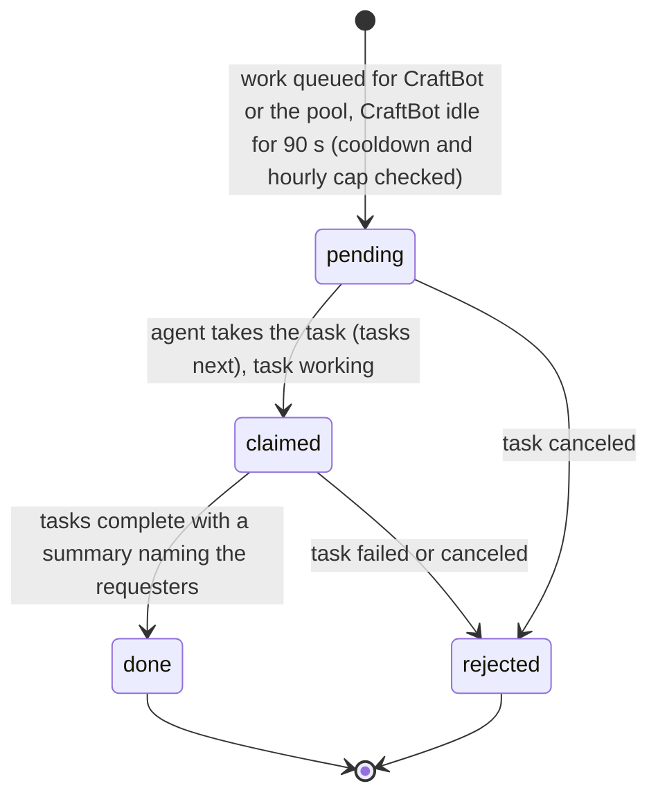
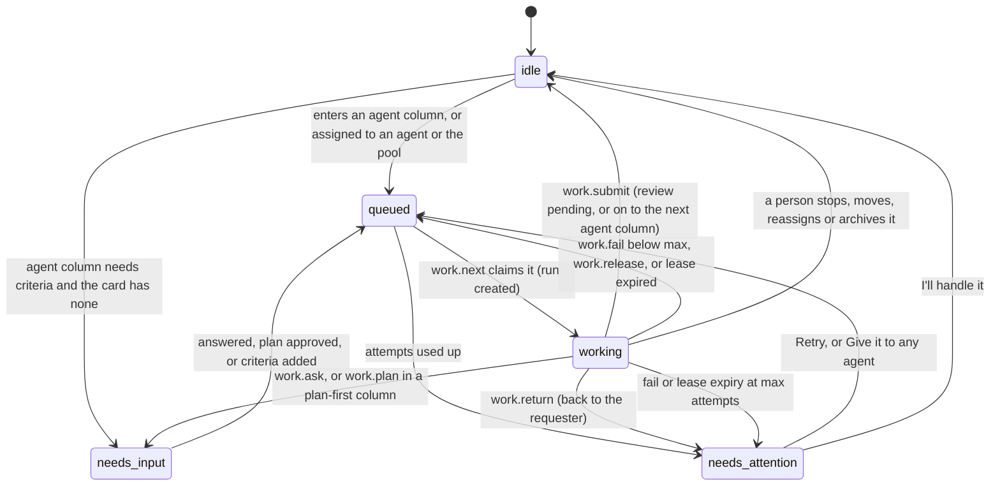
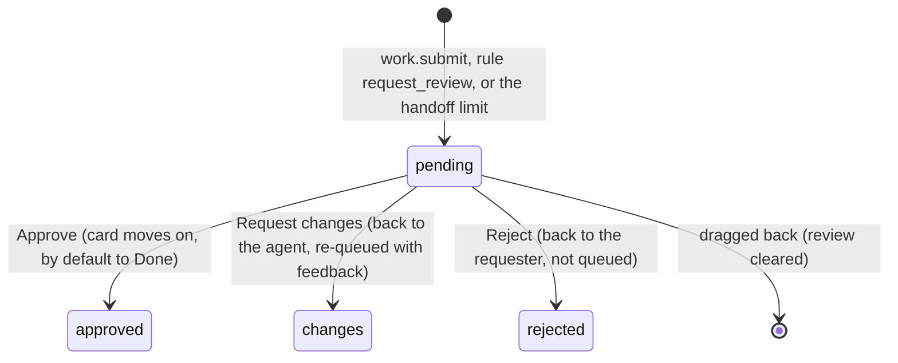
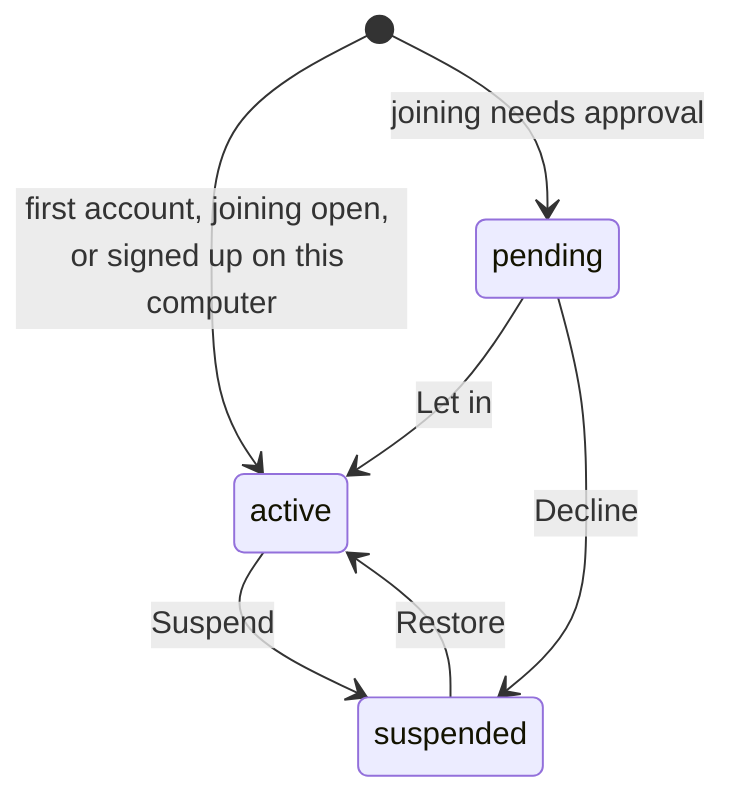

# Requirements: Kanban Online

PART A — REQUIREMENTS (SRS). User-approved before build; frozen after; changes via ## Changes.

## Introduction

### Purpose
Kanban Online is a set of Kanban boards that a team of people shares with several AI agents: CraftBot and any other agent that runs the agent-app CLI under its own name. People sign in with email and password. Each agent connects through the CLI under its own name. Its one job is to get the team's work done on shared boards where every card has a person accountable for it, its requester. Agents do the work they are given and hand it back with evidence. People keep the decisions: reviews, Done, and the switches that pause one agent or all of them. Columns are small contracts: what the stage means, a WIP limit, who works it, the gates agents pass, and where finished work goes. Agents work the same boards through A2App, with 44 declared operations. The app wakes CraftBot with one task (`work_waiting`) when work waits for it, and other agents ask for work themselves.

### Scope
**Goals**
1. A card that enters a column worked by agents is queued at once. It is claimed by exactly one agent, atomically and most urgent first, and no agent touches a card another agent holds.
2. Every claimed card ends in a submit with evidence, a question, a hand-back or a failure. A card whose lease runs out goes back to the queue, or to "needs attention" after its last attempt.
3. Agents never move a card to Done or Canceled, never decide a review, never change a board's structure, and are refused by full WIP limits, frozen boards and pauses. The server enforces all of this.
4. Every change is attributed to the person, agent, rule or system that made it, with before and after, and can be reverted. Ctrl+Z undoes only your own last change.
5. Nobody is stuck on their first sign-in on the computer that runs the app, and the workspace always keeps an active admin.

**Core functionalities:** sign-in and team access · boards with column contracts · cards with requester, assignee, acceptance criteria and checklist · animated drag and drop with live glide · agent queue with leases, attempts and plans · questions, hand-backs and proposals · review queue · inbox and interruptions · presence · activity with revert and undo · board rules · flow insights and agent report cards · team and agent administration · settings

### Approval
Approved by the user: 2026-11-04 — carried over from the published marketplace app `kanban-online` 2.0.0, whose requirements were approved when it was built; this document restates them in the framework's form without changing any feature.

## Product Description

### Product Perspective
`authMode: multi-user`, because a team of people shares the boards. People sign in with email and password (PocketBase auth, through the kit's sign-in gate). Agents connect through the agent-app CLI as the app's operator and name themselves with `X-A2App-Agent`. manifest.json declares no integrations (`capabilities.integrations: []`). The app makes no outbound calls: no language model, no email, no push. Everything stays on the computer that runs it, or on the host the team shares it from. Notices are in-app only. CraftBot is woken by the `work_waiting` task, and other agents poll `work.next`.

### User Characteristics
A team made of admins (the first account and anyone they promote), members, and accounts waiting for an admin or suspended, which see only their own gate screen. Several AI agents work alongside them through the CLI only. People work the boards through the day on desktops: sidebar, swimlanes and inline stats from 1280 px. They also use phones: a drawer for the sidebar, columns that snap one at a time, and press-and-hold drags. Touch and pointer input are both used.

### Constraints
- C-1: Roles are admin and member. Statuses are active, pending and suspended. The first account is an active admin, and later accounts are members. A new account is active when joining is open (the default) or when it signs up on the computer that runs the app; otherwise it is pending. Nobody chooses their own role or status, nobody changes their own, and the workspace always keeps an active admin.
- C-2: Column categories: triage ("Proposed"), backlog, todo ("To do"), doing ("In progress"), review, done, canceled. A column is worked by people, any agent, or one agent, and review, done and canceled columns are always people's.
- C-3: A card is assigned to a person, one agent, any agent (the pool) or nobody. Whoever hands a card to agents becomes its requester.
- C-4: Fixed vocabularies. Card agent state: idle, queued, working, needs_input (a question, a plan or criteria), needs_attention. Review state: pending, approved, changes, rejected. Run outcome: working, submitted, asked, returned, failed, expired, stopped, released, planned. Priority: No priority, Urgent, High, Medium, Low. Label color: gray, red, orange, yellow, green, teal, blue, purple, pink. Return reason: cant, scope, judgment, access, budget, other.
- C-5: A card's key is `<BOARD KEY>-<number>`. The number is the board's sequence plus 1, assigned once inside a transaction and never changed. A board key matches `^[A-Z][A-Z0-9]{0,5}$` and is unique among boards, and changing it changes every card key on the board.
- C-6: A WIP limit of 0 means none. A limit binds agents (409 `wip_full`) and only warns people, and blocked cards count toward it.
- C-7: Agents never move a card to Done or Canceled, never decide a review, never change structure (boards, columns, labels, rules), and never delete or archive. An agent edits a started card only while it holds it. What an agent creates is a proposal in the first triage column, at most 20 per agent in any 24 hours.
- C-8: A frozen board, the team pause, or the agent's own pause refuses agent work (423 `board_frozen`, `agents_paused`, `agent_paused`).
- C-9: A column's lease is 15 minutes by default (2–240) and its attempts 3 by default (1–10). Heartbeats are due every max(1, ⌊lease ÷ 3⌋) minutes, and a held card becomes resumable after 1.5 times that without one. Cards at once: a workspace default of 2 (1–10), which an agent may override.
- C-10: An agent asks at most 4 questions per card in any 24 hours. A card handed between agent columns more than 3 times goes to review in place.
- C-11: An agent's identity is the name its CLI sends, slugged to `[a-z0-9_-]` and at most 40 characters. Generic names ('', a2app-cli, cli, craftbot, agent, lui-cli, ops-verify, op-smoke) are CraftBot. A new name registers on its first call, and a removed agent's calls are refused (403 `agent_removed`).
- C-12: Undo reverts only your own revertible change from the last 30 minutes.
- C-13: Activity events are kept for 365 days.
- C-14: No emoji appears: icons are lucide line icons. Color beyond the greys carries state and identity only. Each person and agent has one of nine tones. People are solid circles, agents soft rounded squares, and "any agent" a dashed square.
- C-15: Size limits: card title 300 characters, description 30,000, acceptance criteria 6,000, comment 20,000, checklist 200 items of 500 characters, plan 40 steps, rule actions 10.
- C-16: Rule triggers: enters_column, created, checklist_done, approved, changes_requested, needs_attention, blocked, idle, due_soon. Rule actions: move, assign, priority, label, unlabel, request_review, block, comment, archive. A rule that runs 5 times on one card in 10 minutes is switched off.
- C-17: Board templates: simple, pipeline, content, software, basic. A fresh install seeds one board, "Team board" (key TEAM), with Backlog, To do, In progress (WIP 4), Review and Done, plus the labels Bug, Feature, Research and Docs.

### Assumptions
- A-1: Volume ceiling: 2,000 cards on one board, the most a single `cards.list` call returns (its default page is 300). The board view loads every non-archived card of its board at once, and Activity loads 80 events at a time (up to 400).
- A-2: Agent names are declared by the caller, so the identity rules catch mistakes, not malice.
- A-3: Presence (who is online and where) lives in the server's memory and is rebuilt as people come back after a restart.
- A-4: Agents other than CraftBot ask for work themselves with `work.next`.

## Features

### Module: Access (me, people, settings)
- F-ACC-1: The user can create an account with email and password on a sign-in page that carries the app's mark and name. Each mode has its own heading: "Sign in to your team" or "Create your account".
- F-ACC-2: WHEN the first account is created THE SYSTEM SHALL make it the workspace's active admin.
- F-ACC-3: WHEN an account is created on the computer that runs the app, or while joining is open, THE SYSTEM SHALL let it in at once. Otherwise the account waits for an admin, and every admin is told at once.
- F-ACC-4: WHEN an account is waiting THE SYSTEM SHALL show only "You are on the list", naming the admins who can let it in and letting it give its name. WHEN it is let in, its page opens the boards by itself.
- F-ACC-5: WHEN an account is suspended THE SYSTEM SHALL show only "This account is suspended". A waiting or suspended account can read and change nothing else, through the app or the API.
- F-ACC-6: The user gives a display name before seeing the boards. The first admin also names the workspace and chooses how new people join.
- F-ACC-7: WHEN the app's backend does not answer at start THE SYSTEM SHALL show "The board did not answer" with "Try again" and "Sign out".

### Module: Frame (app)
- F-FRM-1: The user sees a sidebar with: the app name and a collapse button; a highlighted "New card"; Inbox, Review, Insights, Activity and Team with their counts; a folding Boards section; the team's agents with their live status and pause switches; and their own account at the foot.
- F-FRM-2: The user can collapse the sidebar to a narrow rail, and it stays collapsed on the next visit.
- F-FRM-3: The user sees on each board row who else is looking at it, a pulsing dot while agents work there, and how many of its cards need people.
- F-FRM-4: On phones the user opens the sidebar as a drawer, from a menu button that carries a dot when something needs them.
- F-FRM-5: The user can press C for a new card, / to search the board, Esc to close the open card, and Ctrl/Cmd+Z to undo their own last change.
- F-FRM-6: WHEN something the user chose to be interrupted by happens THE SYSTEM SHALL show a notice at the bottom of the screen. That covers a question, a plan to approve, a card needing attention, or work ready for review; admins are always told when someone asks to join. At most four notices show at once.
- F-FRM-7: The user sees one look in light and dark from the host. The board has clear grey steps: the page, darker columns, cards on the plain surface. It uses Inter with 8 px corners, a hand cursor on everything clickable, and no emoji.
- F-FRM-8: WHEN a newer version of the app has been deployed THE SYSTEM SHALL reload an open page onto it, waiting while a dialog is open.

### Module: Boards and columns (boards, cards, rules)
- F-BRD-1: Any member can create a board from a template, with a name and a key ("Card ids: KEY-12"; automatic when left empty).
- F-BRD-2: The user sees a board's columns and cards. Each column shows who works it and a count or count/WIP pill, amber when full and red when over.
- F-BRD-3: The user can drag cards between and within columns. The card lifts and tilts with the motion, the others make room, and it settles into place. On phones a drag starts with a press-and-hold.
- F-BRD-4: WHEN a teammate or an agent moves a card THE SYSTEM SHALL glide it to its new place on everyone's screen.
- F-BRD-5: The user can add a card quickly at the bottom of a column, or with the New card dialog: title, description, board, column, assignee and priority, plus acceptance criteria when the card is for an agent.
- F-BRD-6: The user can search a board's cards, and filter them by assignee, agent state, priority and labels. The user can show swimlanes by assignee or by priority, and dropping a card into another lane reassigns it or changes its priority.
- F-BRD-7: The user sees the board's live counts (working, queued, need people) and who else is viewing it.
- F-BRD-8: The user can add, rename, collapse, move and remove columns. Removing one asks "Remove the column "<name>"?" and moves its cards to the next column.
- F-BRD-9: The user can set a column's contract, and changes save as they are made. The contract covers: name, what it means (category), WIP limit, and who works it (People, Any agent, One agent). It covers the gates: plan first, needs acceptance criteria, checklist done to leave. It covers the lease minutes and attempts, where finished or approved work goes, where requested changes send a card, when aging cards are flagged, the policy, and the agent instructions.
- F-BRD-10: The user can edit a board's name, key, description and "How we work". The user can freeze the board ("Agents cannot change this board until someone unfreezes it"), choose its swimlanes, and manage its labels.
- F-BRD-11: The user can create board rules (When, If, Then), turn them on and off, and remove them.
- F-BRD-12: An admin can delete a board after confirming "Delete this board?", which names its cards, columns, rules and activity. The team's only board cannot be deleted.
- F-BRD-13: WHEN a card enters a column worked by agents, or is assigned to an agent or the pool, THE SYSTEM SHALL queue it, and the person who handed it over becomes its requester. WHEN the column needs acceptance criteria and the card has none THE SYSTEM SHALL ask for them first.
- F-BRD-14: WHEN there is no board yet THE SYSTEM SHALL show "No board yet" with "New board".

### Module: Card panel (cards)
- F-CRD-1: The user can open any card docked on the right while the board stays live behind it.
- F-CRD-2: The user can edit the title, the description (markdown), the acceptance criteria and the checklist. The user can set status (column), assignee, priority, labels and due date, and sees the requester and who created the card and when.
- F-CRD-3: The user sees the card's session and its actions. Queued shows Stop. Working shows the progress, lease, attempt and Stop. A plan offers "Approve plan" and "Ask to revise". A question offers answer and "Take it over". Needs attention offers Retry, "Give it to any agent" and "I'll handle it". Proposed offers Accept and Dismiss. Waiting for review offers Approve, Request changes and Reject.
- F-CRD-4: The user can comment, flag the card blocked with a reason and clear the flag, and archive and restore the card.
- F-CRD-5: The user can delete a card after confirming "Delete this card?" ("<KEY> and its activity are deleted for good. Archive it instead to keep the history.").
- F-CRD-6: The user sees the card's activity, with each agent run folded into "<agent> · <n> steps", and can revert a change from it.

### Module: Inbox (inbox)
- F-INB-1: The user sees "Needs you": questions and plans, cards needing attention, proposals from agents, blocked cards and overdue cards. It shows the user's own (cards they asked for or hold, and ones nobody owns) or everyone's.
- F-INB-2: The user can answer, approve, retry or accept from the inbox.
- F-INB-3: The user sees "Since you were away" and can mark it all as seen.
- F-INB-4: WHEN nothing needs the user THE SYSTEM SHALL say "Nothing needs you" and what lands there.

### Module: Review (review)
- F-REV-1: The user sees the cards waiting for review (mine or everyone's) beside the selected card's packet: each acceptance criterion, how it was checked, and what the agent could not verify.
- F-REV-2: Anyone on the team can approve; request changes with a reason, which sends the card back to the agent; or reject with a reason, which sends it back to the requester. The next card is selected after a decision.
- F-REV-3: The user can move through reviews with J and K (or the arrow keys), approve with A, and request changes with R.

### Module: Insights (insights)
- F-INS-1: The user can choose one board or all boards, and a 7, 30 or 90 day window.
- F-INS-2: The user sees work in progress now, cards finished in the window (with the share done by agents), median cycle time and median review wait, with agents and people in separate colors.
- F-INS-3: The user sees the agents' report card, together and for each agent: runs, approved, first pass, questions, failed or timed out, median run time.
- F-INS-4: The user sees the aging work in progress, cycle time, throughput and cumulative flow charts.

### Module: Activity (activity)
- F-ACT-1: The user sees every change grouped by day. Each change is attributed to the person, agent, rule or board that made it, with before and after. The list filters by everyone, me, people, agents, rules, one actor, or one board, and has "Load older".
- F-ACT-2: The user can revert a change.
- F-ACT-3: WHEN the user presses Ctrl/Cmd+Z THE SYSTEM SHALL undo only their own last revertible change from the last 30 minutes.

### Module: Team (people, agents)
- F-TEAM-1: The user sees each person: online and where (the board they are on), or when they were last active, and their open cards.
- F-TEAM-2: An admin can let waiting people in or decline them, suspend and restore members, and make or unmake admins.
- F-TEAM-3: The user sees each agent: its status, what it is doing now, its working cards, a 7-day report card, and a link to its activity.
- F-TEAM-4: Any member can pause one agent, or every agent at once.
- F-TEAM-5: An admin can rename an agent and set how many cards it works at once. An admin can remove an agent after confirming "Remove <name>?": its cards go back to the pool or to nobody, and its columns to any agent. An admin can bring a removed agent back.
- F-TEAM-6: The user sees "Add an agent" with the CLI command that connects one.

### Module: Settings (settings, me)
- F-SET-1: The user can set their name and color, and sign out.
- F-SET-2: The user can choose what interrupts them (questions, attention, reviews: interrupt or inbox) and where their inbox opens (Mine or Everyone).
- F-SET-3: An admin can rename the workspace, choose how new people join ("Join at once" or "An admin lets them in"), and set the cards each agent works at once (1, 2, 3 or 5).
- F-SET-4: The user can turn "Let agents work" off and on for the whole team.
- F-SET-5: The user sees how agents work with these boards and the list of keyboard shortcuts.

### Agent (via A2App)
- F-AGT-1: The agent can work the boards through the 44 operations in ## Operations Design. Every refusal names what to do instead.
- F-AGT-2: Each agent is its own identity: the name its CLI sends, with generic names counting as CraftBot. It is registered on its first call, with its own queue, its own cards-at-once limit (or the workspace default) and its own pause switch.
- F-AGT-3: The agent can claim the most urgent card assigned to it or to the pool with `work.next`, atomically. A pool card becomes the claiming agent's, so rework comes back to it, and it goes back to the pool if the claim ends unfinished.
- F-AGT-4: The agent can post a plan, log steps, send heartbeats, ask one question, and submit with a summary, evidence, unverified items and criteria. It can also return, fail or release a card, and resume a card its own session left behind.
- F-AGT-5: WHEN a lease runs out without a heartbeat THE SYSTEM SHALL put the card back in the queue. After the last attempt it marks the card as needing attention ("<agent> stopped responding (<n> tries).").
- F-AGT-6: WHEN an agent tries to move a card to Done or Canceled, decide a review, change structure, delete or archive, touch a card another agent holds, or work past a full WIP limit, a frozen board or a pause, THE SYSTEM SHALL refuse it with a code and a message saying what to do instead.
- F-AGT-7: The agent can create a card. It lands as a proposal in the triage column for a person to accept, at most 20 per agent in any 24 hours.
- F-AGT-8: An agent's questions and hand-backs go to the card's requester, and anyone on the team may answer, approve a plan or decide a review.
- F-AGT-9: WHEN work waits for CraftBot (cards assigned to it or to the pool) THE SYSTEM SHALL wake it with one `work_waiting` task. It does not do so while CraftBot has called in the last 90 s.
- F-AGT-10: WHEN an agent calls a destructive operation (`agents.remove`, `boards.delete`) THE SYSTEM SHALL answer `approval_required` until a person has approved that call.

## Non-Functional Requirements
- N-1: A change made by anyone shows on every open screen without a refresh. Views reload after a short debounce (board 120 ms, card 100 ms, inbox and frame 400 ms with a 1.5 s minimum gap), and moved cards glide into place.
- N-2: Presence is posted every 45 s while the page is visible, and when the view, board or card changes. A person or agent counts as online when seen within the last 120 s. The app frame refreshes every 60 s.
- N-3: An expired lease is noticed within a minute (`kb_work`, every minute).
- N-4: A waiting account checks every 20 s whether it was let in, and opens the boards by itself.
- N-5: The app's own operation routes accept 300 calls a minute per address, and sign-in accepts 30 a minute.
- N-6: Drag pick-up needs a 5 px mouse movement, or a 280 ms press-and-hold on touch. A drop settles in 260–280 ms.

## Data Requirements
- **users** (module: records): password (string, required), tokenKey (string, required, max 60), email (string, required), emailVisibility (boolean), verified (boolean), name (string, max 255), avatar (binary), created (datetime, server-set), updated (datetime, server-set), role (enum), status (enum), tone (string, max 20), prefs (json), seen_at (datetime). Deletion/retention: never deleted (delete rule closed). Declining or suspending sets the status, and an account updates only itself; role, status and seen_at are set by the app.
- **settings** (module: settings): name (string, max 80), joining (enum), paused (boolean), defaults (json), max_working (number), created (datetime, server-set), updated (datetime, server-set). Deletion/retention: one row, seeded "Our team" (joining open, 2 cards at once), and never deleted.
- **agents** (module: agents): handle (string, required, max 40), name (string, required, max 60), kind (enum), tone (string, max 20), paused (boolean), max_working (number), last_seen (datetime), archived (boolean), created (datetime, server-set), updated (datetime, server-set). Deletion/retention: never deleted. Removing an agent archives it, and it can be brought back. Seeded with CraftBot (handle `craftbot`).
- **boards** (module: boards): name (string, required, max 80), key (string, required, max 6), description (string, max 400), instructions (string, max 12000), seq (number), frozen (boolean), archived (boolean), sort (number), swimlanes (enum), created (datetime, server-set), updated (datetime, server-set). Deletion/retention: kept until an admin deletes it. Deleting deletes its cards first, then cascades to its columns, labels, events, runs and rules. The only board cannot be deleted.
- **columns** (module: cards): board (ref, required → boards), name (string, required, max 60), category (enum, required), position (number), wip (number), policy (string, max 4000), instructions (string, max 8000), agent_mode (enum), agent (ref → agents), plan_first (boolean), need_criteria (boolean), need_checklist (boolean), next (string, max 15), return_to (string, max 15), lease_minutes (number), max_attempts (number), aging_days (number), collapsed (boolean), created (datetime, server-set), updated (datetime, server-set). Deletion/retention: deleted with their board (cascade). Removing a column first moves its cards to the next column.
- **labels** (module: boards): board (ref, required → boards), name (string, required, max 40), color (enum), created (datetime, server-set). Deletion/retention: deleted with their board (cascade), or removed one at a time. Names are unique per board, ignoring case.
- **cards** (module: cards): board (ref, required → boards), column (ref, required → columns), number (number), title (string, required, max 300), description (string, max 30000), acceptance (string, max 6000), priority (number), labels (list<ref> → labels), due (datetime), estimate (number), checklist (json), position (number), assignee (string, max 30), requester (ref → users), created_by (string, max 40), proposed (boolean), agent_state (enum), claimed_by (ref → agents), lease_until (datetime), attempt (number), handoffs (number), run (string, max 15), progress (string, max 300), plan (json), plan_ok (boolean), question (json), attention (string, max 600), review (json), review_state (enum), feedback (string, max 4000), work_column (string, max 15), blocked (boolean), blocked_reason (string, max 600), column_at (datetime), started_at (datetime), done_at (datetime), done_kind (string, max 10), cost (number), version (number), archived (boolean), created (datetime, server-set), updated (datetime, server-set). Deletion/retention: kept until deleted; archiving keeps the card and its history. Deleting a card cascades to its events and runs, and logs a `deleted` event on the board.
- **events** (module: records): board (ref → boards), card (ref → cards), actor (string, max 40), actor_kind (enum), kind (string, required, max 30), text (string, max 20000), field (string, max 30), before (json), after (json), run (string, max 15), meta (json), reverted (boolean), created (datetime, server-set). Deletion/retention: append-only, and kept 365 days (`kb_prune`, daily at 03:23). Deleted with their card or board.
- **runs** (module: work): agent (ref → agents), from_pool (boolean), card (ref → cards), board (ref → boards), column (string, max 15), attempt (number), started (datetime), ended (datetime), outcome (enum), note (string, max 2000), cost (number), decision (enum), decided (datetime), created (datetime, server-set). Deletion/retention: deleted with their card or board. Otherwise kept.
- **rules** (module: rules): board (ref, required → boards), name (string, max 120), enabled (boolean), when (enum, required), column (string, max 15), days (number), conditions (json), actions (json), position (number), runs (number), last_run (datetime), paused_reason (string, max 300), created (datetime, server-set), updated (datetime, server-set). Deletion/retention: deleted with their board (cascade), or removed one at a time.
- Every board collection (settings, agents, boards, columns, labels, cards, events, runs, rules) is readable only by active signed-in accounts. Each refuses direct creates, updates and deletes, so changes go through the app's operations.

## External Interfaces
- **Human (browser):** one View served by PocketBase at the app's own origin, and the same View for every role. It starts with the sign-in page (create an account, sign in), then the screens before the boards: loading, "The board did not answer", waiting, suspended, and welcome. Then come the hash routes `#/board?id=<board>` (the default), `#/inbox`, `#/review`, `#/insights`, `#/activity[?who=]`, `#/team[?agent=]` and `#/settings`. The card panel docks on the right over any route. Admins also see the workspace settings, people administration, agent administration and board deletion. Members see the rest, and waiting or suspended accounts see only their gate screen.
- **Agent (A2App):** the modules and collections in AGENT_APP.md § Modules; operations exactly as declared in ## Operations Design; tasks with the capabilities `work_waiting` (events.json). No other machine interface is offered to agents; the app's own screens call their own routes.

## Out of Scope
- Calls to anything outside the app: language models, email, push notifications, integrations. Notices are in-app only.
- File attachments on cards.
- Deleting user accounts. Declining or suspending keeps the account.
- Agents deciding reviews, moving cards to Done or Canceled, changing boards, columns, labels or rules, deleting or archiving.
- Verifying agent identities beyond the declared name. The rules catch mistakes, not malice.
- Deep links to a single card. The open card is not part of the URL.
- A screen listing archived cards, and archiving a board from the UI.
- Editing a card's estimate or a workspace's column defaults from the UI.
- Undoing other people's changes with Ctrl+Z. Use "Revert this change" in the activity instead.
- Reordering a card within a column from the keyboard. The Status picker moves it between columns.
- Languages other than English.

## Quality of Life
- The last board opened is remembered on this browser, and so is the collapsed sidebar.
- Pasting several lines into a new card's title splits them into a title and a description.
- A card picked up by touch gives a short vibration where the device supports it.
- Server warnings (such as a column over its WIP limit for people) show as information, not errors.
- The phone's columns snap one at a time, except while a card is being dragged.

PART B — TECHNICAL SPECIFICATION.

## System Overview
PocketBase 0.39 (JS hooks, migrations) + React 19 / Vite / Tailwind 4 View in `frontend/` built into `pb/pb_public/`, on the `blueprint-pocketbase-kit` toolkit. The View calls the app's own 68 routes `/api/ops/<group>/<verb>` (`ops.pb.js`, all through `lib_util.handle`). The generated `a2app_routes.pb.js` serves the 44 agent operations as `POST /api/ops/<name>` through the same handlers. The other 24 routes are person-only actions, not offered to agents. Domain logic lives in `lib_*.js`: `lib_cards` (cards, review), `lib_work` (the agent queue), `lib_boards`, `lib_team`, `lib_auto` (rules), `lib_app` (frame state, inbox, activity, insights) and `lib_model` (identity, events). Record guards and the jobs are in `hooks.pb.js`.

Modules → navigation map:

| Module (manifest) | Where a person meets it | Route |
| --- | --- | --- |
| `app` | The sidebar, its counts, presence and notices (`app.state`) | every route |
| `boards`, `cards`, `rules` | The board (columns, cards, swimlanes), the New card and New board dialogs, Board settings, Column settings, and the card panel | `#/board?id=` |
| `inbox` | Inbox | `#/inbox` |
| `review` | Review | `#/review` |
| `insights` | Insights | `#/insights` |
| `activity`, `records` (events) | Activity, and the card's activity | `#/activity` |
| `people`, `agents`, `me` | Team (People, Agents), and the sidebar's agents and account | `#/team` |
| `settings`, `me` | Settings | `#/settings` |
| `work` | No screen of its own: agents call it, and people see it as card sessions, chips and agent status | — |

## UI Design
- **Design system:** the agent-app UI kit 0.6.0 is vendored in `frontend/src/kit` (system-managed): the sign-in gate, theme bridge, PocketBase client, toasts and error boundary. The app extends the kit's warm-neutral tokens in `frontend/src/app/theme.css`. Its `--kb-*` tokens are mixed from `--agent-app-bg`, `-surface`, `-text`, `-muted`, `-border`, `-accent`, `-accent-contrast`, `-radius` and `-font` with `color-mix`, and they are redefined for `[data-theme='dark']`. The surfaces are side, main, col, tile, card and sunken; then lines, ink/ink-2/muted/faint text, hover, the accent set, and the radii (`--kb-radius` = the kit radius, 8 px by default, with ×0.75 and ×1.5 steps). State colors come in green, amber, red, blue and violet, each with a soft variant, for light and dark. Nine identity tones sit beside them, with shadows and an overlay. The font is Inter Variable (`@fontsource-variable/inter`), body 13 px, with tabular figures in `.kb-num`. Icons are lucide-react, plus the app's own SVG marks: category rings, priority bars and the app mark (`marks.tsx`). The app's widgets are written once in `components/ui.tsx`: Dialog, Sheet, Popover, menus, Segmented, Toggle, IconButton, Empty, avatars and `useConfirm`. Charts are hand-made SVG.
- **Layout:** the sidebar is 268 px, collapsible to a 60 px rail, and holds the views, boards, agents and account. The main area shows the board, with columns 284 px wide (at most the viewport less 56 px) scrolling sideways in their own container. The card panel docks on the right (up to 600 px) over a live board. Sheets (560 or 460 px) hold board and column settings, and centered dialogs hold confirmations and creation. The board has three grey steps: the page, darker columns, cards on the plain surface; in dark mode the columns sink and the cards rise. Density is compact for the board and lists, calmer for settings.
- **Screen — Sign-in:** primary object: the account · primary action: "Sign in" / "Create account" · the kit's form, dressed with the mark, "Kanban Online", and the headings "Sign in to your team" / "Create your account" with "Use the email you work with." / "The first account runs the workspace; the rest join the team." · error: the kit's inline message · narrow: one centered column.
- **Screen — Before the boards (gate):** primary object: the signed-in account's standing · loading: a spinner · unreachable: "The board did not answer", with the error, "Try again" and "Sign out" · waiting: "You are on the list", naming the admins, with a "Your name" field ("Saved: the admins see your name") · suspended: "This account is suspended" · welcome: "Welcome" (admin) or "Welcome to the team", with the name, and for the admin the workspace name and "Join at once" / "An admin lets them in", then "Open the boards" · narrow: one column.
- **Screen — Board:** primary object: one board's columns and cards · primary action: drag cards, "New card" · loading: a centered spinner · empty: "No board yet" ("Create a board, then let agents work a column or assign them cards.") with "New board"; a deleted board shows "This board is not here" with "Open another board" · in-flight: moves apply at once and revert with a toast if refused · success: info toasts such as "<KEY> is queued for <agent>" or "<KEY> needs acceptance criteria before an agent can start", and cards glide when others move them · narrow: below 1280 px the live counts move to a second bar and swimlanes are hidden; below 768 px the search is hidden, the sidebar becomes a drawer, and columns snap one at a time; below 640 px the key chip, viewers and button labels are hidden.
- **Screen — Card panel:** primary object: one card · primary action: the session's action (answer, approve, retry, accept, review) or edit fields · loading: a spinner · error: "This card is not here any more." · success: toasts ("Archived", "Stopped. The card is yours.") · narrow: the panel takes the full width.
- **Screen — New card / New board dialogs:** primary action: "Create card" ("Enter in the title or Ctrl+Enter to create · Esc to close") / "Create board"; creating a card opens it. An agent's column locks the assignee and explains why. Narrow: the fields stack in two columns.
- **Screen — Board settings / Column settings (sheets):** tabs General, Columns, Labels, Rules; the column's contract (Stage, Who works here, Flow, Policy) that "save as you make them" · empty rules: "No rules yet" ("For example: when a card is approved, assign it back to whoever asked for it.") · admin-only "Delete board" is disabled for members, with "Only an admin can delete a board."
- **Screen — Inbox:** primary object: cards that need people · primary action: answer, approve, retry or accept inline · tabs "Needs you" and "Since you were away", Mine / Everyone, "Mark all as seen" · empty: "Nothing needs you" / "Nothing needs the team" ("Questions from agents, plans to approve, cards handed back and proposals land here."), and "You are up to date" · loading: blank until the first load · narrow: row details hidden below 640 px.
- **Screen — Review:** primary object: the cards waiting for review · primary action: Approve / Request changes / Reject · keys "J K move · A approve · R request changes" (shown from 768 px) · empty: "Nothing waits for your review" ("When an agent submits work, it comes here with its evidence…") · loading: a spinner · narrow: the list or the detail, with "All reviews" to go back.
- **Screen — Insights:** primary object: flow measures for a board and window · primary action: choose a board and window · empty: "Not much to measure yet" ("The charts fill in as cards move from start to done."), "No card finished in this window", "Pick one board to see its flow." · loading: a spinner · narrow: KPIs in 2 columns (4 from 768 px), the report card in 2/3/6 columns, panels stacked below 1024 px, and the per-agent table scrolls in its container.
- **Screen — Activity:** primary object: every change · primary action: revert a change, "Load older" · empty: "No activity yet" ("Every change by the team, its agents and the board's rules shows here, and can be reverted.") · loading: a spinner; errors are toasts · narrow: one column.
- **Screen — Team:** primary objects: people and agents · primary actions (admin): Let in / Decline, make an admin or a member, suspend, restore; rename, limit, remove or bring back agents · empty agents: "No agent has connected yet" ("Agents join the first time they call this app through the agent-app CLI. CraftBot is woken by the board when work waits for it.") · narrow: agent panels in one column (two from 768 px).
- **Screen — Settings:** sections You, What interrupts you, Workspace (admins), Agents ("Let agents work"), How agents work with these boards, Keyboard · non-admins see "Admins change these" · narrow: one column.
- **Formatting:** card ids read `KEY-12`. Times are relative ("just now", "5 min ago", "3 h ago", "yesterday", "<n> days ago", then "12 Oct", with the year outside the current one), and leases count down ("in 12 min"). Due dates read "Today" or "Tomorrow" in amber, past dates in red, and otherwise the day. Durations read in days ("3.5 d") or hours for review wait. Shares are percentages. Counts use tabular figures. An empty requester reads "Nobody yet", and an empty median "–".

## Quality Conformance

- **Q1 Completeness & IA:** the sidebar is the orientation model. The current view is marked (`aria-current="page"`), counts show what needs the user, and the boards and agents are always in view (a drawer on phones). The board is the default route, and the last board opened is remembered. Modules map to screens as in ## System Overview. `work` shows as card sessions and agent status rather than a screen of its own. One name per concept: card, column, board, requester, assignee, any agent (the pool), review, inbox, activity. Working sets past a screenful have their tools. The board has search, filters (assignee, agent state, priority, labels) and swimlanes. The inbox has Mine / Everyone and groups. Activity has actor and board filters with "Load older". Review lists can be Mine or Everyone.
- **Q2 Design system:** the tokens are the kit's warm-neutral `--agent-app-*` set, extended by the derived `--kb-*` set in `theme.css` (see ## UI Design) and redefined for dark. Semantic roles: the accent is for primary actions, "New card" and the inbox count. Green means working, done and online; amber means full, due soon and paused; red means over the limit, overdue, needing attention and destructive; blue means review and frozen; violet means proposed. The nine tones carry identity only. Inter Variable, body 13 px. Icons are lucide-react plus the app's own SVG marks, and there is no emoji. Light and dark come from the host, or from `prefers-color-scheme` standalone, through the kit theme bridge.
- **Q3 Layout & composition:** the board is a horizontal row of fixed-width columns that scrolls inside its own container. Counts and figures use tabular numbers, and long titles wrap on cards and truncate in rows. Each screen has one primary action in its header. Density is compact on the board, inbox and activity, and calm in settings. Activity pages at 80 events with "Load older". The board shows every non-archived card of one board (A-1).
- **Q4 Interaction:** every clickable element shows the hand cursor (`theme.css` base rule). Cards lift on hover and press. Disabled admin controls say why ("Only an admin can delete a board.", "Admins change these"). The confirm dialog (`useConfirm`, red primary, focus on the confirm button) names the target and the effect for each irreversible action: "Delete this card?", "Delete this board?", "Remove the column "<name>"?" (where its cards move), "Remove <name>?" (what happens to the agent's cards and columns). `window.confirm` is never used. Some actions apply at once without a confirmation: removing a label, a rule or a checklist item; archive; dismiss; suspend; decline; stop; pause. Archive is undone by Restore, and checklist edits can be reverted from the activity. Suspend is undone by Restore and pause by resuming. Removed labels and rules cannot be brought back (see ### Conventions and overrides). Ctrl/Cmd+Z undoes your own last revertible change. Keyboard map: C, /, Esc, Ctrl/Cmd+Z globally; J/K/↓/↑, A and R on Review; Enter or Space opens a focused card; Enter or Ctrl/Cmd+Enter submits composers; Esc closes popovers, dialogs and sheets. The keyboard alternative to dragging is the card's Status, Assignee and Priority pickers, and the column menu's Move left / Move right. Inputs are constrained by pickers and segmented choices, and an agent column locks the assignee and says why.
- **Q5 State & feedback:** each screen's states are listed in ## UI Design. Moves, pause switches and toggles apply optimistically and revert on refusal. Buttons disable while their call runs. Success shows where the user looks: the card glides into place, the session box changes, info toasts name what happened ("<KEY> is queued for any agent"), and every view reloads live. Agent work shows as Queued and Working chips with a progress line and a sweeping bar, with the lease and attempt in the card panel. Errors show the server's message as a toast. The board and card error screens appear only when nothing was ever loaded.
- **Q6 Motion:** utility transitions take 120–180 ms (field 0.12 s, tile 0.14–0.18 s, panel slide 0.18 s, drawer 0.2 s) on `cubic-bezier(0.2, 0.8, 0.2, 1)`. Drag motion: the ghost follows the pointer and tilts with its speed (up to ±9°). A drop flies into its slot over 260–280 ms, and the other cards make room through an animated placeholder. Others' moves glide 340 ms across columns and 220 ms within one, and new cards fade in over 220 ms. Under `prefers-reduced-motion: reduce`, the lift, placeholder, card-in, panel and drawer animations and the tile transforms are removed, and the glide and fly are skipped (see ### Conventions and overrides for what still moves).
- **Q7 Content:** the voice is plain and team-facing ("Your team and its AI agents, working one board."), in sentence case, with no emoji. Every refusal says what to do instead, for agents (error codes with a message, listed in `app.guide`) and for people: "The workspace needs at least one active admin. Make someone else an admin first.", "Nothing of yours to undo from the last 30 minutes". Gate screens say what is happening and who can help ("Waiting on <admins>. If it takes a while, send them a message."). Card text is rendered as markdown, never injected as HTML.
- **Q8 Accessibility:** contrast comes from the kit's tokens and the app's state colors, with separate light and dark values. Focus: `.kb-focus:focus-visible` draws a 2 px accent outline, and fields get a 3 px soft accent ring. Cards on the board are `role="button"` with `tabIndex=0`. The ARIA used: `role="dialog"` for dialogs, sheets and the drawer; `menu`/`menuitem`; `tablist`/`tab`; `switch`; `radiogroup`/`radio`; `checkbox`; `img` with a label for charts; `aria-current`, `aria-expanded`, `aria-pressed` and `aria-selected`. Every icon button carries `aria-label` and `title`, and decorative icons and drag clones are `aria-hidden`. Targets: nav rows 36 px, agent rows 44 px, buttons 32 px (small ones 28 px), icon buttons 24–28 px, toggles 18 × 32 px (see ### Conventions and overrides). Drag has single-pointer and keyboard alternatives (the pickers). State never relies on color alone: chips and pills carry words, and tooltips explain WIP pills.
- **Q9 Responsiveness:** from phone to wide desktop. Below 640 px the board header hides the key chip, viewers and button labels. Below 768 px the sidebar becomes a drawer, the search hides, and the columns snap one at a time (not while dragging). Below 1024 px the Insights panels stack. Below 1280 px the board's live counts move to a second bar and the swimlanes control hides. Touch drags start with a 280 ms press-and-hold (cancelled by an early 8 px move), with a short vibration and edge auto-scroll.
- **Q10 Performance:** board stats come from one SQL aggregate, and the whole frame from one `app.state` call. Server caps: `cards.list` 300 by default (up to 2,000); `review.list` 200; inbox 100 per group and 200 updates; `app.state` 60 per group; `cards.get` 400 events and 50 runs; agent reads lean (25 events, `--full true` for every field); activity 80 by default (up to 400) with a cursor. The board renders all of a board's non-archived cards without virtualization (A-1). Fonts are self-hosted. Charts are SVG with no library.
- **Q11 Caching & freshness:** the document shell is served `no-store, no-cache, must-revalidate` (`cache_control.pb.js`, plus the toolkit). Built assets have content-hashed names and keep PocketBase's default static headers. Data: operation responses carry no cache headers, and the View holds them as in-memory state. Freshness comes from one realtime hub that subscribes once to settings, users, agents, boards, columns, labels, cards, events, runs and rules. Each view reloads after its debounce (N-1), and a sequence guard keeps only the latest response. Presence is polled (frame every 60 s), because it lives in server memory. An open page reloads onto a new build after a reconnect or a tab show, waiting while a dialog is open.
- **Q12 Data integrity:** relations are real relation fields (card → board, column, labels, requester, claimed_by; column → board, agent; events and runs → card and board), with cascades as in ## Data Requirements. Unique `agents.handle`. Selects hold the fixed vocabularies. Every board collection refuses direct writes through hooks, so every change goes through an operation that keeps versions, leases, the activity log and the queues in step. Card numbers are assigned inside a transaction. A claim is atomic. A run's outcome and a review's decision are each set once. `version` gives optimistic concurrency when sent (409 `version_conflict`). Indexes: cards (board, archived), (agent_state), (assignee), (column); events (card, created), (created); runs (started), (agent, started). Board-key uniqueness and per-board label names are enforced in the operations, not by an index. The single migration builds the schema on a fresh database and converts a V1 install.
- **Q13 API:** beyond the adapter, the app's own 68 routes `/api/ops/<group>/<verb>` (GET reads, POST writes) all run through `lib_util.handle`. Typed readers answer 400 naming the parameter, with an example. One error shape: `{ status, message, data? }`, where `data.code` names the case (for example `wip_full`, `human_only`, `claim_required`, `proposal_cap`, `question_cap`, `board_frozen`, `agent_removed`, `last_admin`, `version_conflict`). Statuses: 400, 401, 403, 404, 409, 423, 429, 500. Lists are bounded as in Q10, and errors carry no stack traces.
- **Q14 Architecture:** the UI lives in `frontend/src/app` (pages, components, lib), the domain in `lib_*.js`, routes in `ops.pb.js`, and guards and jobs in `hooks.pb.js`. The UI calls the same handlers the agents call. Every permission rule (`adminOnly`, `personOnly`, agent-only, `memberGate`) is written once in `lib_util` and `lib_model`. Shared widgets exist once (`ui.tsx`, `marks.tsx`, `markdown.tsx`), and formatting has one module (`lib/format.ts`). App-wide state (the frame, boards, agents, presence, notices) has one provider (`context.tsx`).
- **Q15 Resilience:** leases make abandoned work recover by itself: `kb_work` expires leases every minute, re-queues or flags the card, and logs an `expired` event. `work.resume` lets an agent's new session take over its own stale card. CraftBot is re-woken only for newer work, or after 10 minutes if the same work still waits. A failed live load is retried up to 5 times with a growing back-off (1.5 s × n), but not on 403 or 404. At start an unreachable backend shows the gate's "The board did not answer" with "Try again". Later failures toast "Network error — is the backend running?" or the server's message, keep the last data, and revert optimistic moves. Rules that loop are switched off. The app makes no outbound calls.
- **Q16 Security & privacy:** `authMode: multi-user`. The board collections are readable only by active signed-in accounts, and writable only through operations. Users can read themselves and active members, sign up, and update only themselves (role, status and seen_at are guarded), and nobody deletes users. On the server, admin-only, person-only and agent-only operations are enforced. Waiting and suspended accounts reach only `me.get`, `me.update` and `app.guide`. Agents sign in as the app's operator through the CLI credential and name themselves. Destructive agent calls need the person's approval. Passwords are handled by PocketBase auth. Members' emails are visible to active members. Presence is kept only in memory. Logs carry no request bodies. Agent output is never injected as HTML, and links open http(s) only with `rel=noreferrer`. Credentials (`.agent-token`, `.principal`, `.superuser`) are git-ignored. Deliberately open defaults: joining is open (an admin can require approval), and a new CLI name registers itself.
- **Q17 Observability:** hook errors log `[kanban-online] …` lines through `console.error` (operation failures at 500 and above, job failures, rule failures). The toolkit adds `[handler-error] <METHOD> <path>: <message>`, and the console relay writes browser errors to `logs/`. The structured record is the `events` collection: actor, kind, before and after, run and meta for every change, including rule runs and failures. Health is `/api/_a2app`, the adapter's identity document.
- **Q18 Version control:** commits are per change ("revamp kanban board online", "Fix UI tokens", "kanban-online: pass strict tsc for V2 import (build gate)"). `.gitignore` excludes credentials, `pb/pb_data/`, the PocketBase binary, the built View, `frontend/node_modules/`, `.a2app/` runtime state and `logs/`. The app builds from a clean checkout with the manifest pipeline alone.

### Conventions and overrides
The published app is restated here unchanged, so these are standing decisions of the approved build, not new work. Revisit any of them when the app is next modified.
- Q6.3 and Q6.4 (reduced motion, pausable loops): under `prefers-reduced-motion` the working chip's pulse, the working bar's sweep, the loading spinners, the dragged card's tilt, and the Team page's smooth scroll still move. The pulse and sweep loop for as long as an agent works.
- Q8.3 (announcements): toasts and notices are not in a live region.
- Q8.4 (24 × 24 px targets): toggles are 18 × 32 px.
- Q11.2 (declared data policy): operation responses carry no Cache-Control. They are held as in-memory view state and refreshed by realtime changes and polling.
- Q15.1 (timeouts): the View's calls to its own backend use the PocketBase SDK without a client-side timeout, with retries as in Q15.
- Q17.1 (structured logs): hook log lines are prefixed text. The `events` collection is the structured record.
- Q4.2 and Q4.3 (confirm what cannot be undone): removing a label or a rule from a board applies at once, with no confirmation and no undo.
- Mirrored global rules: none recorded for this app.

## Process Flows

Work the app asks an agent for (`work_waiting`, CraftBot only): the request row follows the A2App task. Other agents ask for work with `work.next` directly.

Card agent state:

Review:

People:

A proposal (a card an agent created) sits in the triage column until a person accepts it, which moves it to the first backlog or to-do column with the acceptor as requester, or dismisses it, which archives it. A removed agent is archived, its cards go back to the pool or to nobody, and "Bring back" restores it.

## Operations Design
| Operation | Module | Entity | appliesWhen | Params | Flags |
| --- | --- | --- | --- | --- | --- |
| app.guide | app | — | — | — | readOnly |
| app.status | app | — | — | — | readOnly |
| app.state | app | — | — | — | readOnly |
| app.context | app | — | — | — | readOnly |
| app.ui | app | — | — | view: string, board: string, card: string | — |
| settings.get | settings | — | — | — | readOnly |
| me.get | me | — | — | — | readOnly |
| people.list | people | — | — | — | readOnly |
| people.update | people | — | — | person: string!, status: enum, role: enum | — |
| agents.list | agents | — | — | days: number, all: boolean | readOnly |
| agents.remove | agents | — | — | agent: string! | destructive |
| boards.list | boards | — | — | archived: boolean | readOnly |
| boards.get | boards | — | — | board: string!, full: boolean | readOnly |
| boards.templates | boards | — | — | — | readOnly |
| boards.delete | boards | — | — | board: string! | destructive |
| rules.list | rules | — | — | board: string! | readOnly |
| cards.list | cards | — | — | board: string, column: string, assignee: string, requester: string, state: enum, review: boolean, q: string, label: string, archived: boolean, full: boolean, limit: number | readOnly |
| cards.get | cards | — | — | card: string! | readOnly |
| cards.add | cards | — | — | board: string!, title: string!, column: string, description: string, acceptance: string, priority: string, labels: string, due: string, estimate: number, checklist: string, assignee: string, position: enum, reason: string | — |
| cards.update | cards | — | — | card: string!, version: number, title: string, description: string, acceptance: string, priority: string, labels: string, due: string, estimate: number, checklist: string | — |
| cards.move | cards | — | — | card: string!, version: number, column: string!, position: enum, index: number, before: string, after: string, reason: string | — |
| cards.comment | cards | — | — | card: string!, text: string! | — |
| cards.check | cards | — | — | card: string!, item: string, done: boolean, text: string, add: string, remove: boolean | — |
| cards.block | cards | — | — | card: string!, reason: string! | — |
| cards.unblock | cards | — | — | card: string! | — |
| review.list | review | — | — | board: string, mine: boolean | readOnly |
| review.approve | review | — | — | card: string!, note: string, column: string | — |
| review.changes | review | — | — | card: string!, reason: string! | — |
| review.reject | review | — | — | card: string!, reason: string! | — |
| work.queue | work | — | — | — | readOnly |
| work.next | work | — | — | board: string | — |
| work.heartbeat | work | — | — | card: string!, run: string, progress: string, cost: number | — |
| work.log | work | — | — | card: string!, run: string, kind: enum, text: string! | — |
| work.plan | work | — | — | card: string!, run: string, steps: string! | — |
| work.ask | work | — | — | card: string!, run: string, question: string!, options: string | — |
| work.submit | work | — | — | card: string!, run: string, summary: string!, evidence: string, unverified: string, criteria: string, cost: number | — |
| work.return | work | — | — | card: string!, run: string, reason: string!, why: enum | — |
| work.fail | work | — | — | card: string!, run: string, reason: string! | — |
| work.resume | work | — | — | card: string! | — |
| work.release | work | — | — | card: string!, run: string, reason: string | — |
| inbox.list | inbox | — | — | scope: enum, since: string | readOnly |
| inbox.seen | inbox | — | — | — | — |
| insights.flow | insights | — | — | board: string, days: number | readOnly |
| activity.list | activity | — | — | board: string, card: string, actor: enum, who: string, before: string, limit: number | readOnly |

## Original requirements

The requirements as published for CraftBot, kept verbatim as the source the sections above restate.

For a team of people and the several AI agents working with them (CraftBot
and any other agent that runs the agent-app CLI under its own name), sharing
the same boards. People sign in; agents connect through the CLI. Every card
has a person accountable for it (its requester); agents do the work they are
given and hand it back with evidence.

Visual language: CraftBot's own, the same as Kanban Board. The kit's
warm-neutral tokens, Inter, 8px corners, a CraftBot-style sidebar (the app
name with a collapse button, a highlighted New card, views, a folding Boards
section, the team's agents with their status and switches, and you at the
foot), pill choices, light and dark from the host. The board has clear grey
steps: the page, darker columns, cards on the plain surface. No emoji: lucide
line icons. Colour beyond the greys carries state and identity only: each
person and agent has a colour; people are solid circles, agents soft rounded
squares, "any agent" a dashed square. Everything clickable shows the hand.
Dragging is animated as in Kanban Board; what teammates and agents move
glides on everyone's screen.

##### People and access

1. People create an account with email and password on the sign-in page,
   which looks like the app (its mark and name, a heading per mode).
2. The first account runs the workspace (admin). Nobody is ever stuck on
   their first sign-in on the computer that runs the app: accounts made there
   join at once. Accounts made through a link the owner shared join at once
   too, unless the workspace asks an admin to approve new people; then every
   admin is told at once. Nobody chooses their own role or status.
3. An account waiting for an admin sees only that, with the names of the
   admins who can let it in (and may give its name); when let in, its page
   opens the boards by itself. A suspended account sees only that. Neither
   can read or change anything else, through the app or the API.
4. A new account gives its display name before the boards; the first admin
   also names the workspace and chooses how people join.
5. Admins let people in, decline them, suspend and restore members, and make
   or unmake admins; the workspace always keeps an active admin and nobody
   changes their own role or status.
6. Any member creates and shapes boards; deleting a board, workspace
   settings and agent administration are admins'.

##### Agents

7. Each agent is its own identity (the name its CLI sends; generic names are
   CraftBot), registered the first time it calls, with its own queue, its own
   cards-at-once limit (or the workspace default) and its own pause switch.
   Any member pauses one agent or every agent; admins rename agents, set
   their limit, remove them (their cards go back to the pool or to nobody,
   their columns to any agent) and bring them back.
8. A card is assigned to a person, to one agent, to any agent (the pool) or
   to nobody. A column is worked by people, by any agent, or by one agent;
   moving a card into an agent column hands it over and queues it. Whoever
   hands a card to agents becomes its requester.
9. An agent claims only cards assigned to it or to the pool, atomically,
   most urgent first; a pool card becomes the claiming agent's (rework
   comes back to it) and goes back to the pool if that claim ends unfinished.
   No agent touches a card another agent holds.
10. Everything Kanban Board requires of its agent holds for each agent:
    leases and attempts, results with evidence, one question rather than a
    guess, hand-backs, never Done, never a review decision, never structure,
    proposals for what it creates, refusals by WIP limits, frozen boards and
    pauses, all enforced by the server.
11. An agent's questions and hand-backs go to the card's requester; anyone on
    the team may answer, approve a plan, or decide a review.
12. CraftBot is woken by one trigger when work waits for it; other agents
    ask for work themselves.

##### The team at work

13. Each person's inbox shows what needs them (cards they asked for or hold,
    and ones nobody owns), or everyone's; the review queue likewise.
14. Each person chooses what interrupts them and where their inbox opens.
15. People see who else is online and where (the board they are on), and
    what each agent is doing now.
16. Every change is attributed to the person, agent, rule or board that made
    it, with before and after, and can be reverted; Ctrl+Z undoes only your
    own last change.
17. Flow is measured honestly, split between agents and people, with a
    report card for the agents together and for each one.

##### Pages

18. The sign-in page; the screens before the boards; a sidebar and the board
    first; Inbox, Review, Insights, Activity, Team and Settings as listed in
    `AGENT_APP.md`. Cards open docked on the right with the board still live.
    Phones get the drawer, snapping columns and press-and-hold drags.
19. Every action in the UI has an operation for the agents, and every
    refusal says what to do instead.
