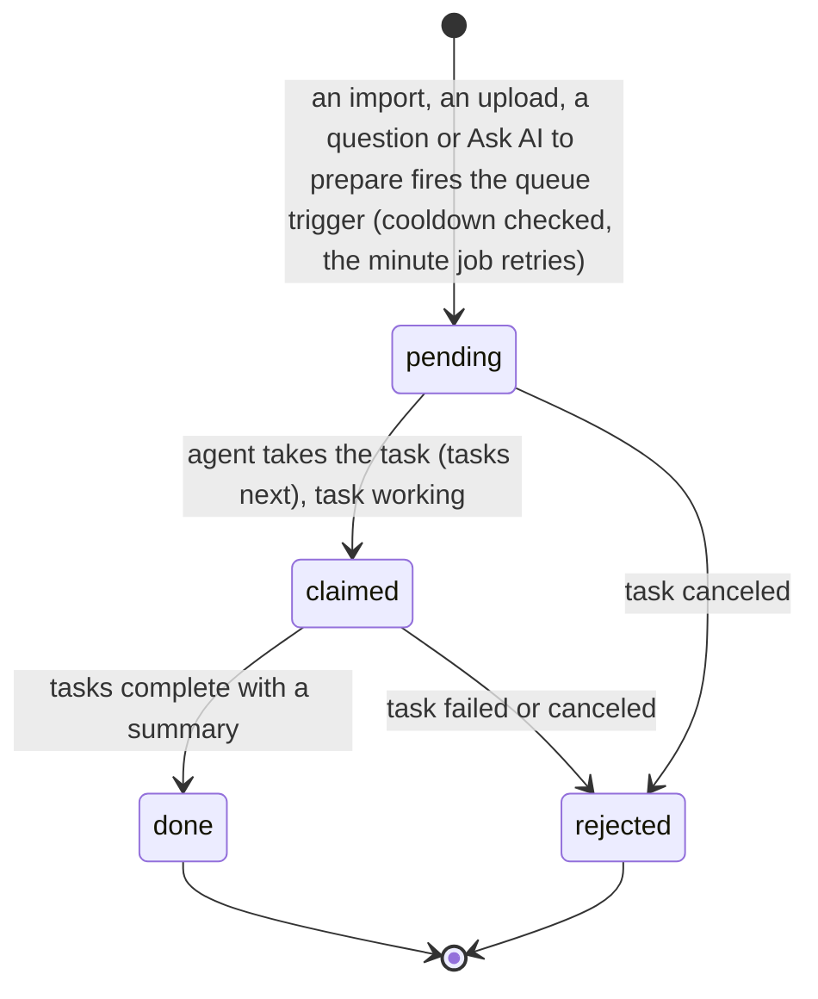
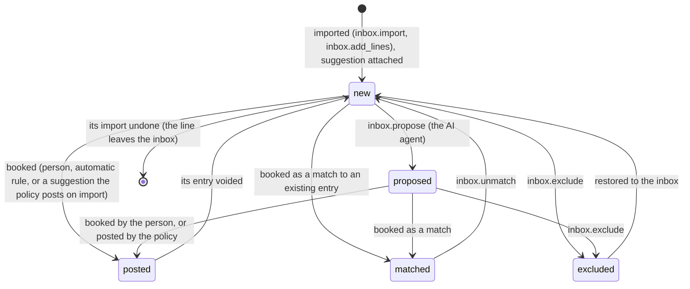
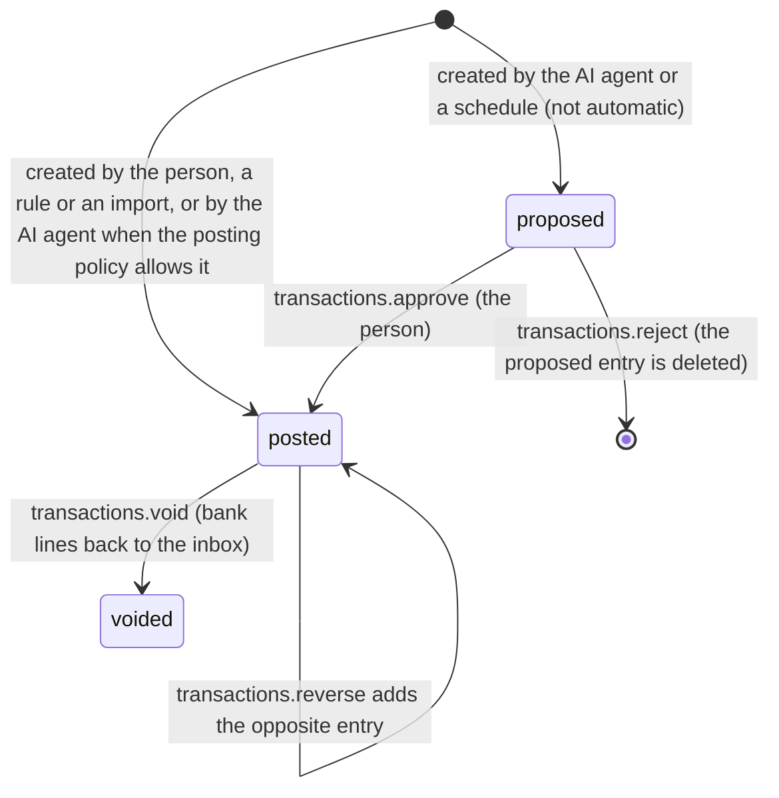
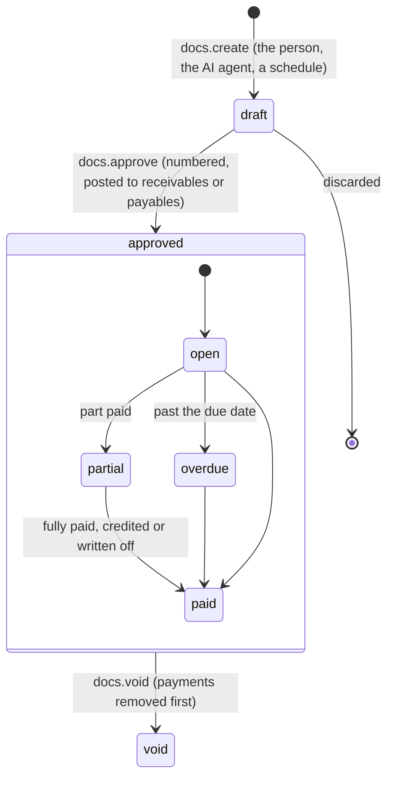

# Requirements: Ledgerflow

PART A — REQUIREMENTS (SRS). User-approved before build; frozen after; changes via ## Changes.

## Introduction

### Purpose
Ledgerflow is double-entry bookkeeping for one person's books, used in the browser with no accounts or sign-in. The books can belong to a small business, a household, or both in one set (a freelancer or sole trader). Its one job is to keep correct books built around a bank inbox. Imported statement lines each get one labelled suggestion and are booked or matched by the person. Invoices and bills, reconciliation, reports and a month-end close build on the same ledger. The person's AI agent works as a colleague on the same data through A2App: everything the person can do is an operation. The agent categorizes bank lines, reads receipts, answers questions, prepares the close, and drafts invoices and reminders. Its work is labelled with its reason and confidence, gated by the person's posting policy and lock dates, and reversible per run. The app hands it work as four kinds of task: `lines_imported`, `documents_received`, `agent_asked` and `close_requested`.

### Scope
**Goals**
1. A bank line never reaches the ledger on its own. It is staged in the inbox with one suggestion (match, document, transfer, rule, memory or AI, with high, medium or low confidence). It posts only when the person books it, a rule set to automatic posts it, or the posting policy lets that kind of suggestion post.
2. Re-importing an overlapping statement in any supported format (OFX/QFX, QIF, CSV, CAMT.053, MT940) adds no line twice.
3. Every transaction balances in the home currency, and money is never stored as a float. Every report (profit and loss, balance sheet, cash flow, trial balance, aged balances, tax, budget, spending, net worth) is built from the same postings.
4. Every change by anyone can be undone as a unit, unless it falls in a locked period or something it touched changed later, and an AI agent run can be reverted as a whole.
5. The AI agent can do through the operations what the person can, except: approve proposed entries, sign off or reopen a month, finish or undo a reconciliation, write off a debt, delete a file, move lock dates, change its own posting policy, or make a schedule automatic.

**Core functionalities:** setup with a chart of accounts and tax presets · bank inbox with suggestions and keyboard review · statement import with duplicate protection · categorization rules · receipts and documents read by the AI agent · ledger, account registers and the entry inspector · quick and journal entries · invoices, bills, credit notes and vendor credits · payments across currencies · reconciliation · reports with charts and drill-down · budgets · month-end close and lock dates · activity with undo, redo and AI run revert · recurring schedules · exchange rates and revaluation · Ask AI · plain-text export (Beancount, hledger, CSV)

### Approval
Approved by the user: 2026-11-04 — carried over from the published marketplace app `ledgerflow` 2.0.0, whose requirements were approved when it was built; this document restates them in the framework's form without changing any feature.

## Product Description

### Product Perspective
`authMode: none`. The books belong to one person: one settings row holds the books, and there are no accounts or sign-in (Original requirements, Decisions: no multi-user permissions). It serves on loopback, and its own operation routes still require a caller (the View or the agent's credential). manifest.json declares no integrations (`capabilities.integrations: []`). The one outside call is the backend's fetch of European Central Bank reference rates (`www.ecb.europa.eu`, the daily or the 90-day XML), on request (`fx.fetch`); nothing else leaves the machine. The app is deliberately not built on bank feeds: there are no aggregator keys, and statements are imported. It is a rebuild from scratch as a V2 agent app on PocketBase, not a port of the V1 Living UI (FastAPI) Ledgerflow, and its design follows CAD Workshop (Original requirements, Binding 2 and 3). Ledger collections can be read by the View for live updates and are written only through the operations, which validate every change.

### User Characteristics
One person keeping the books of a business, a household, or both (a sole trader or freelancer with personal money too). They work mostly on a desktop with the icon rail (from 768 px) and review bank lines by keyboard. On phones a bottom bar replaces the rail, and inspectors open full screen. The work follows the bank statements and the calendar month: lines are reviewed as statements are imported, and each month is checked and closed.

### Constraints
- C-1: Money is an integer count of the currency's minor unit, with ISO 4217 exponents for the 45 listed currencies (for example 0 for JPY and VND, 2 for USD). Decimals are parsed exactly and rounded half away from zero once. Totals are split by the largest-remainder method, so the parts always sum. Rates and quantities travel as decimal strings. Answers give money in minor units; parameters take decimals ("12.50").
- C-2: A transaction has at least two non-zero postings (debit positive, credit negative), each with its home-currency amount, and sums to zero in the home currency. Another currency converts at the latest rate on or before the date (home currency per 1 unit). A transfer between currencies takes its home value from the home-currency side. A payment of a foreign document books the difference against the document's booked value to exchange gains and losses.
- C-3: A transaction is proposed, posted or voided. Only a proposed one can be approved, a voided one cannot be edited, and one that belongs to a document is edited or voided through its invoice or bill. Reconciled postings keep their account, amount and date. A posting matched to a statement line keeps its account and amount until it is unmatched.
- C-4: Dates are `YYYY-MM-DD` text, a book date and never a moment. A year-first date is read the same whatever day/month order a file uses.
- C-5: The books' entity is business, personal or both, and the chart, reports and labels follow it. The home currency cannot change once the books have entries. The fiscal year starts in any month. Tax rounding is per line or per document, with prices inclusive or exclusive of tax.
- C-6: The tax presets are: no sales tax or VAT; United Kingdom VAT; European Union VAT (the person sets their country rates); Australia GST; New Zealand GST; Singapore GST; Malaysia SST; Canada GST/HST; United States sales tax (single rate); India GST. Reverse-charge codes book input and output tax that cancel. A code's group is standard, reduced, zero, exempt, reverse or outside.
- C-7: System accounts (receivables, payables, tax control, opening balances, retained earnings, suspense, transfers in transit, uncategorized income and expense, exchange gains and losses, rounding, bad debt, sales) can be renamed but not deleted. An account used by entries, statement lines, documents or sub-accounts can be archived, not deleted. Account codes and tax codes are unique.
- C-8: A statement line is new, proposed, posted, matched or excluded. Its suggestion follows one precedence: match, document, transfer, rule, memory, then the AI agent. Confidence has three levels (high, medium, low), never a percentage. The AI agent never overwrites a choice made by the person or by a rule.
- C-9: Duplicates are stopped in three layers. The same file (content hash) is not imported twice into an account. Each line has a fingerprint from the bank's own id, or from its date, amount, text and position among identical lines, which is unique per account. Lines that look like entries already in the books are offered as matches.
- C-10: A payment line only matches documents issued no more than 3 days after it. After a document is paid, other lines that pointed at it get a fresh suggestion.
- C-11: The AI agent proposes by default. The posting policy is off by default. With it on, the agent's high-confidence proposals post up to a ceiling per line. System suggestions of chosen kinds (matches, transfers, payments of open documents, payees booked the same way at least three times) post on import when high confidence. Rules can be automatic. House rules are standing instructions the agent follows.
- C-12: Lock dates: nobody changes entries dated on or before the books lock date. The AI agent also stops at its own lock date and proposes instead. A tax lock date can be set through the operation.
- C-13: Every operation that changes data records the records it changed and can be undone as a unit, and redone. An undo is refused inside a locked period or when something it touched changed again later. The AI agent's calls are grouped into runs (a run continues while calls come less than 10 minutes apart), and a run can be reverted as a whole, skipping what changed since.
- C-14: Documents are invoices, credit notes, bills and vendor credits, each draft, approved or void. An approved document is numbered (invoices from `INV-1001`, credit notes from `CN-1` by default; the prefix and next number can change) and posts through receivables or payables. Its state is derived: draft, open, part paid, overdue (with days), paid, applied or void. A document is settled by allocations: payments, credits and write-offs.
- C-15: Files (receipts and documents) are up to 25 MB each. A file's kind is receipt, invoice, statement or other, and its status inbox, reading, linked or archived.
- C-16: A recurring schedule repeats an entry, invoice or bill weekly, monthly, quarterly or yearly at an interval. What it creates waits as proposed or draft unless the schedule is automatic.
- C-17: Activity older than a year, and questions answered or failed more than a year ago, are pruned nightly. The books themselves are never pruned.
- C-18: The first open seeds one settings row: entity both, home currency USD, fiscal year from January, no tax region, rounding per line, invoice prefix `INV-` from 1001, credit-note prefix `CN-` from 1, 14 days to pay, posting policy off, new lines sent to the AI agent, setup not done. The chart of accounts and tax codes are created when the person sets up the books.
- C-19: The copy has no placeholder text; a control works end to end or is not shown (Original requirements, Binding 5). There are no emoji, line icons only, and the agent is "your AI agent".

### Assumptions
- A-1: Volume ceiling: 1,000 lines in an inbox view, which is what the Inbox loads at once. An account register shows up to 2,000 rows, the entries list 500, and a documents list 1,000 per side; search and filters reach the rest.
- A-2: The machine running the app is the person's own, and "today" is the machine's local date.
- A-3: Bank statements reach the app only as files or pasted text (or lines the AI agent reads from a PDF). European Central Bank rates exist for about 30 currencies on working days; any other rate is entered by hand (`fx.set`).

## Features

### Module: Frame
- F-FRM-1: From 768 px wide the person can reach every view from a 52 px icon rail. The rail holds the Ledgerflow mark (Home), the New button, then Home, Inbox, Ledger, Reconcile, Sales, Purchases, Reports and Close, with Activity and Setup at the bottom. Hovering shows a view's name, and the current view has an accent bar.
- F-FRM-2: The person sees counts on the rail: bank lines and files waiting on Inbox, entries waiting for approval on Ledger, overdue invoices on Sales and draft bills on Purchases.
- F-FRM-3: The person can create from the New button: import a bank statement, add receipts, an expense, income, a transfer, a journal entry, an invoice, a bill or a credit note.
- F-FRM-4: The person sees a title bar with the view's name, the business name, status chips ("AI on N" while the AI agent categorizes lines, "Locked to <date>", "N overdue"), Search (Ctrl K), Ask AI, Undo and Redo.
- F-FRM-5: Below 768 px the person can navigate with a bottom bar: Home, Inbox, the New button, Ledger, and More for the other views.
- F-FRM-6: WHEN the host switches theme pack, light or dark mode, or custom colors THE SYSTEM SHALL re-derive every `--lf-*` color from the host theme tokens, checking each against the surface it sits on.
- F-FRM-7: The person sees a near-monochrome workspace (Original requirements, Binding 3) where color carries meaning only. Money in is green; money owed, overdue and errors are red; warnings are amber; the accent marks the selection and everything the AI agent proposes.
- F-FRM-8: WHEN a newer build of the app is served THE SYSTEM SHALL reload an open page onto it after the server comes back or when the tab is shown again, waiting while a dialog is open.

### Module: Onboarding (setup)
- F-ONB-1: WHEN the books are not set up THE SYSTEM SHALL open "Set up your books" in place of every view. It asks what the books are for (A business, A household, Both), the business or household name, the home currency, the sales tax or VAT region and the month the fiscal year starts, then offers "Create my books".
- F-ONB-2: WHEN the person creates the books THE SYSTEM SHALL build a chart of accounts to match the entity, each account with a "use it for" text the AI agent reads, and add the region's tax codes.
- F-ONB-3: The person can then enter what their accounts held on the day the books start ("Books start on"), or choose "Skip for now", and then "Open my books".

### Module: Home (app)
- F-HOME-1: The person sees Home for a chosen range (This month, Last month, This quarter, Year to date, 12 months), with the dates it covers.
- F-HOME-2: The person sees headline numbers against the period before, counting up: cash in the bank (against 30 days ago, with its trend), money in, money out, net profit ("Saved" for a household), and what customers owe ("Owed on cards" for a household). The last figure is the runway in months, or for a household (or with no runway) the savings rate.
- F-HOME-3: The person sees charts: the cash balance over time; money in and out by month with profit (or saved) as a line; and where money went or came from by category (a donut, Out or In). Then who owes you by age (not for a household), what is coming up in the next two weeks, each account with its 30-day trend, and the budgets this month.
- F-HOME-4: The person sees "Needs your attention". It holds the inbox by suggestion kind (AI proposals, by rules, matched, like before, need a category), overdue invoices, unpaid bills, entries waiting for approval, receipts to file and accounts to reconcile, or "All caught up".
- F-HOME-5: The person sees the AI agent's latest runs and can revert one ("Revert this AI run?").
- F-HOME-6: The person can open the view behind every number and panel.

### Module: Inbox (inbox)
- F-INB-1: The person sees imported bank lines by tab: To review (with its count), AI proposals, Matches, No suggestion, Booked and Excluded, for all accounts or one, with a search.
- F-INB-2: The person sees each line's date, payee, amount and suggestion. The suggestion shows its kind (Match, Pays document, Transfer, Rule, Like before, or AI with the agent's reason) and its confidence as one to three bars.
- F-INB-3: The person can review by keyboard: J/K or the arrow keys move, Enter books the suggestion, X excludes, Space ticks, A asks the AI agent, I imports.
- F-INB-4: The person can tick lines and book their suggestions, ask the AI agent about them or exclude them. They can also book every high-confidence suggestion at once ("N sure", "Book them").
- F-INB-5: The person can book a line in the inspector as a category (with tax and a memo), a split that adds up to the line's amount, or a transfer to another of their accounts. Or they can match it to an existing entry, an open invoice or bill, or the other side of a transfer.
- F-INB-6: The person can make a rule from a line while booking it ("Always book "<payee>" like this").
- F-INB-7: The person can put an excluded line back in the inbox, and recheck suggestions after new rules, entries or documents.
- F-INB-8: WHEN imported lines have no confident suggestion from rules or history and sending new lines to the AI agent is on THE SYSTEM SHALL hand them to the AI agent, which proposes a category, a match or a transfer with its reason.

### Module: Statement import (inbox, profiles)
- F-IMP-1: The person can import a bank statement into a bank, card or cash account, from a file (OFX/QFX, QIF, CSV, CAMT.053, MT940) or from pasted text.
- F-IMP-2: The person sees a preview before anything is written: the format, the period, the lines, how many are new and how many already imported, and the closing balance.
- F-IMP-3: WHEN a CSV is imported THE SYSTEM SHALL detect its columns and its day/month order, or ask for the order. The person can map each column (date, amount or money out and money in, description, payee, reference, balance) and flip signs. The layout is remembered per bank account for the next file.
- F-IMP-4: WHEN an import finishes THE SYSTEM SHALL say how many lines are new, already there, booked by rules and sent to the AI agent.
- F-IMP-5: The person can undo a statement import: its lines leave the inbox and entries booked from them are voided, unless they are reconciled.

### Module: Receipts and documents (files)
- F-FIL-1: The person can add receipts, supplier invoices and PDF statements (PDF, images, text or email files, up to 25 MB each). The AI agent reads them and attaches each to its entry or drafts the bill.
- F-FIL-2: The person sees the files under "Receipts and documents" by To file, Attached and Archived. They can attach a file to a matching entry, ask the AI agent to read it, archive it, or delete it for good ("Delete <name>?").
- F-FIL-3: WHEN the AI agent stops before reading a file THE SYSTEM SHALL hand it back as failed ("Your AI agent stopped before reading this file.").

### Module: Rules (rules)
- F-RUL-1: The person can create ordered rules whose conditions must all or any match, with the actions to take. They can test how many lines a rule's conditions match, move rules up and down, turn them on or off, and delete them ("Lines it booked stay booked.").
- F-RUL-2: The person sees which rules the AI agent proposed (they wait to be turned on), which are automatic (they post on import) and which are one time.

### Module: Ledger (accounts, transactions, ledger)
- F-LED-1: The person sees the chart of accounts with balances. An account opens its register with a running balance and each entry's reconciliation state, filtered by date range, state (Not cleared, Cleared, Reconciled) and words.
- F-LED-2: The person sees every entry, filtered by All, Waiting for approval or Voided, by date range, by who added it (You, AI agent, Rules, Import, Recurring), and by words or an amount.
- F-LED-3: The person can open an entry in the inspector: its lines, and where it came from (bank line, document, rule, or the AI agent's reason and confidence, with a link to the whole AI run). It also shows what the entry pays, its files and its history.
- F-LED-4: The person can approve or reject proposed entries.
- F-LED-5: The person can edit an entry, void it with a reason (its bank lines go back to the inbox), reverse it on a chosen date, copy it as a new entry, or repeat it on a schedule.
- F-LED-6: The person can add a quick entry (expense, income or transfer, with tax and "Amount includes tax"; a transfer into another currency takes the amount received) or a journal entry, whose debits and credits must balance.

### Module: Sales and purchases (docs)
- F-DOC-1: The person sees Sales (invoices, credit notes) and Purchases (bills, vendor credits) led by what is owed: what customers owe you (or you owe suppliers), overdue, due within a week, drafts, and received (or paid) in 30 days. The list filters by All, Drafts, Unpaid, Overdue, Paid or Void, with a search.
- F-DOC-2: The person can draft a document line by line (description, quantity, price, and an account and a tax code per line). It has issue and due dates, a number or the supplier's number, a reference, a currency, prices with or without tax, notes and terms, and is saved as a draft or approved.
- F-DOC-3: WHEN a document is approved THE SYSTEM SHALL number it and post it through receivables or payables.
- F-DOC-4: WHEN a bill looks like one already recorded THE SYSTEM SHALL warn of a possible duplicate.
- F-DOC-5: The person can record a payment, also in another currency, with the difference booked as an exchange gain or loss. They can also apply a credit, remove a payment or credit, and write off what is left on an invoice as a bad debt.
- F-DOC-6: The person can ask the AI agent to draft a payment reminder and copy it. They can mark a document sent, duplicate it, make a credit note for an invoice, repeat it on a schedule, open its entry, attach a file, print it or save it as PDF, and void it (a draft is discarded).
- F-DOC-7: The person sees each document's state (Draft, Open, Part paid, Overdue with its days, Paid, Applied, Void), and "Drafted by AI" on what the AI agent drafted.

### Module: Reconcile (reconcile)
- F-REC-1: The person can reconcile a bank, card, cash or loan account against its statement. They enter the statement date and closing balance (prefilled from the imported statement), then tick entries until the difference is zero; matched lines are ticked already.
- F-REC-2: WHEN the difference is zero and the person finishes THE SYSTEM SHALL mark the ticked entries reconciled and lock them until the reconciliation is undone.
- F-REC-3: The person can finish with an adjustment to Suspense for the difference, stop reconciling, and undo an account's latest reconciliation.

### Module: Reports (reports)
- F-REP-1: The person can open profit and loss, balance sheet, cash flow, trial balance, aged receivables and payables (business books), tax summary, budget vs actual, spending and net worth. All are built from the same ledger in the home currency.
- F-REP-2: The person can choose the period (this or last month, this or last quarter, year to date, this or last fiscal year, last 12 months, custom dates). Profit and loss also takes a basis (Accrual or Cash), Total, Months or Quarters, and a comparison with the previous period (a month earlier for the balance sheet) or the previous year.
- F-REP-3: The person sees each report with its chart: money in and out, and a waterfall from income to profit; the balance sheet's composition; a cash-flow waterfall; aging bars; a spending donut; and net worth over 6, 12, 24 or 36 months.
- F-REP-4: WHEN the tax region is United Kingdom VAT THE SYSTEM SHALL show the VAT return boxes 1 to 9 in the tax summary.
- F-REP-5: The person can open the entries behind any amount, export a report as CSV, print it or save it as PDF (the charts are left out), and ask the AI agent to explain it.
- F-REP-6: WHEN opening cash plus the period's movements does not equal closing cash THE SYSTEM SHALL say so on the cash flow.

### Module: Budgets (budgets)
- F-BUD-1: The person can budget an income or expense account for a fiscal year (12 monthly amounts, one amount per month, or an annual total spread evenly) and see budget against actual by month.

### Module: Close (close, locks)
- F-CLS-1: The person sees the months from the first entry, each Closed, with lines in the inbox, or Open, and whether it is locked.
- F-CLS-2: The person sees a month's checks, each opening what it counts. The checks are: bank lines all booked; no entries waiting for approval; uncategorized expense and income empty; suspense empty; transfers in transit settled; bank and card accounts reconciled; no draft invoices or bills left behind; receipts filed; no likely duplicates; cash accounts not negative; overdue invoices followed up; foreign-currency accounts revalued; and no entries dated more than a month ahead.
- F-CLS-3: The person can tick a manual checklist and keep notes for the month. The checklist: every statement imported, receipts attached, payroll, loans and other non-bank entries recorded, and the profit and loss and balance sheet look right.
- F-CLS-4: The person can ask the AI agent to prepare a month ("Ask AI to prepare") and read its note: what it did and what the person must still do.
- F-CLS-5: The person can close a month, also with failing checks ("Close anyway"), optionally locking the books through its last day, and reopen a closed month.
- F-CLS-6: The person can set the books lock date and the AI agent's lock date ("Empty for none").

### Module: Activity (activity)
- F-ACT-1: The person sees every change to the books by the person, the AI agent, rules, imports and schedules, newest first, with what changed, filtered by who, 100 more at a time.
- F-ACT-2: The person can undo or redo any change, and undo or redo their latest change from anywhere with Ctrl Z and Ctrl Y (or Ctrl Shift Z).
- F-ACT-3: The person sees the AI agent's runs (when, how many changes, what) and can revert a run as a whole ("Revert this AI run?"). Changes made since to the same records are skipped and listed.

### Module: Setup (settings, accounts, contacts, tax, recurring, fx, policy, profiles, export)
- F-SET-1: The person can change the books: name, entity, home currency (until there are entries), fiscal year start, the sales tax / VAT region (changing it adds that region's tax codes) and tax rounding. They can also change the invoice details: prefixes and next numbers for invoices and credit notes, days to pay, address, email, tax or VAT number, and the footer with payment details.
- F-SET-2: The person can add, edit, archive and restore accounts (code, name, type, kind, currency, parent account, "use it for" text, bank and last 4 digits), filter them by type with archived ones shown or hidden, and record opening balances.
- F-SET-3: The person can keep contacts (customer, supplier, both, other) with email, phone, address, tax number, currency, days to pay, default account, default tax and notes. They see a contact's documents and recent entries, can archive and restore it, and can merge a duplicate into another contact: its entries and documents move, and its name becomes an alias ("Merge <name>?").
- F-SET-4: The person can create, edit and archive tax codes (code, name, rate %, where it is used, group, when to use it).
- F-SET-5: The person can manage recurring schedules (name, what, every N weeks, months, quarters or years, next date, automatic). They can pause and resume one, run what is due, and delete one ("What it created stays.").
- F-SET-6: The person can store exchange rates (home currency per 1 unit on a date), fetch 30 days of European Central Bank rates and delete a rate. They can revalue foreign-currency bank, card and cash accounts on a date, booking an unrealized exchange gain or loss.
- F-SET-7: The person can set the AI agent's policy: send new lines to the AI agent; let it book lines it is highly confident about, up to an amount per line; choose which system suggestions book on import when high confidence; and write house rules. They also see what the agent cannot do.
- F-SET-8: The person can see statement imports and undo one, and delete saved CSV layouts.
- F-SET-9: The person can export the books for a date range as Beancount, an hledger journal, or CSV of every posting (Original requirements, Decisions: the books never depend on the app).

### Module: Ask AI (asks)
- F-ASK-1: The person can ask the AI agent a question from the title bar, with suggested questions. The agent sees what is on screen and answers from the reports and entries, with links to what it used.
- F-ASK-2: The person sees each question's state (waiting for your AI agent, being looked into, answered, could not answer) and can delete one.

### Module: Palette and keys (app)
- F-KEY-1: The person can open a palette with Ctrl K to go to a view, create something, or find entries, documents, contacts, accounts or an amount.
- F-KEY-2: The person can press E for a new expense (the New menu shows it), and outside the inbox N for a new expense and I to import a statement.

### Agent (via A2App)
- F-AGT-1: The agent can perform every declared operation: the 139 operations in ## Operations Design, across the modules app, setup, settings, policy, locks, accounts, contacts, tax, transactions, ledger, inbox, rules, profiles, files, docs, reconcile, reports, budgets, close, fx, recurring, asks, activity and export.
- F-AGT-2: The agent can read the books from `app.guide`: the entity, home currency, tax region and lock dates, the posting policy and house rules, the conventions, every account with when to use it, the tax codes, what is on screen, and recipes. It can read everything Home shows from `app.dashboard`.
- F-AGT-3: The agent can take a `lines_imported` task. It works the waiting lines from `inbox.queue` (up to 40 at a time, with similar earlier lines) and proposes each with `inbox.propose`: an account, splits, a transfer or a match, with a confidence and a one-line reason. It may create rules, which wait for the person to turn them on.
- F-AGT-4: The agent can take a `documents_received` task. For each waiting file it runs `files.start` and reads the file, records what it says (`files.update`), and links it to a matching entry (`files.candidates`, `files.link`). It can draft a bill (`docs.create`) or add a PDF statement's lines (`inbox.add_lines`), and it ends every file with `files.done` or `files.fail`.
- F-AGT-5: The agent can take an `agent_asked` task and answer every waiting question from the reports and entries (`asks.start`, then `asks.answer` with links, or `asks.fail`), and save a payment reminder it wrote with `docs.remind`.
- F-AGT-6: The agent can take a `close_requested` task. It runs `close.start`, works through the month's checks by proposing, attaching and drafting, and ends with `close.complete` and a note of what is left, or `close.fail`.
- F-AGT-7: WHEN the AI agent creates an entry or books a line THE SYSTEM SHALL keep it proposed by default, label it with the agent's reason and confidence, and group it into the agent's run. `inbox.propose --post true` posts only when the posting policy is on, the confidence is high, the amount is within the ceiling, and the line is dated after the agent's lock date. `transactions.create --status posted` from the agent follows the same policy (the entry's total in the home currency against the ceiling); otherwise the entry stays proposed and the answer says why (`not_posted_because`). The agent's `inbox.accept` and `inbox.accept_many` follow it too, judged at the line's suggestion's confidence: a line the policy holds stays proposed for the person (a choice the agent gives becomes its proposal), and the answer says why (`not_posted_because`, or `not_posted` per line).
- F-AGT-8: WHEN the AI agent calls an operation reserved to the person THE SYSTEM SHALL refuse it with the reason. The reserved operations are `policy.update`, `locks.set`, `transactions.approve`, `files.delete`, `docs.write_off`, `reconcile.finish`, `reconcile.undo`, `close.sign_off`, `close.reopen`, and making a schedule automatic.
- F-AGT-9: WHEN the AI agent changes an entry dated on or before its own lock date THE SYSTEM SHALL refuse the change and tell it to propose instead.
- F-AGT-10: WHEN the AI agent leaves work it took unfinished THE SYSTEM SHALL hand it back, after 4 minutes without an agent call or 25 minutes in any case. Bank lines are released back to the inbox, and a question, file or close review ends failed with "Your AI agent stopped before …".
- F-AGT-11: WHEN the agent calls a destructive operation THE SYSTEM SHALL answer `approval_required` until the person has approved that call.

## Non-Functional Requirements
- N-1: A change made by the AI agent, a rule, a schedule or another tab appears on every open screen without a manual refresh. Every app collection is subscribed once at startup. Each view reloads 150 ms after the last realtime change to a collection it watches (the app-wide lists after 400 to 600 ms).
- N-2: Work for the AI agent is asked for with one trigger per queue, which drains everything waiting. A fire refused by the cooldown (30 s for lines and documents, 20 s for questions, 60 s for a close) is retried by the minute job `lf_agent`. Work the agent took and left is handed back after 4 minutes without an agent call, or after 25 minutes in any case.
- N-3: Due recurring entries, invoices and bills are created within the hour (job `lf_recurring` at minute 7).
- N-4: Every night at 03:41 (job `lf_prune`) activity older than a year, and questions answered or failed more than a year ago, are deleted. The books are never pruned.
- N-5: A European Central Bank fetch waits at most 20 s.
- N-6: Lists stay bounded. The Inbox loads up to 1,000 lines of a view, a register 2,000 rows, the entries list 500, a documents list 1,000, the files list 300, and the activity list 100 more at a time.
- N-7: Every view works on phones. Below 768 px the bottom bar replaces the rail, inspectors and drill-downs open full screen, and notices lift above the bar.

## Data Requirements
- **settings** (module: settings): business_name (string, max 120), entity (enum), home_currency (string, max 3), fiscal_year_start (number), region (string, max 20), rounding (enum), lock_date (string, max 10), agent_lock_date (string, max 10), tax_lock_date (string, max 10), invoice_prefix (string, max 12), invoice_next (number), credit_prefix (string, max 12), credit_next (number), payment_terms (number), business_address (string, max 500), business_email (string, max 200), business_tax_id (string, max 60), invoice_footer (string, max 1000), policy (json), ui (json), agent_categorize (boolean), setup_done (boolean), created (datetime, server-set), updated (datetime, server-set).
- **accounts** (module: accounts): code (string, required, max 20), name (string, required, max 120), type (enum, required), subtype (string, max 30), currency (string, max 3), description (string, max 500), system (string, max 30), cashflow (enum), archived (boolean), sort (number), bank_name (string, max 80), bank_number (string, max 40), created (datetime, server-set), updated (datetime, server-set), parent (ref → accounts).
- **tax_codes** (module: tax): code (string, required, max 20), name (string, required, max 80), rate (string, max 12), scope (enum), group (enum), account (ref → accounts), description (string, max 300), archived (boolean), sort (number), created (datetime, server-set), updated (datetime, server-set).
- **contacts** (module: contacts): name (string, required, max 160), kind (enum), email (string, max 200), phone (string, max 60), address (string, max 500), tax_id (string, max 60), currency (string, max 3), terms (number), default_account (ref → accounts), default_tax (ref → tax_codes), aliases (json), notes (string, max 2000), archived (boolean), created (datetime, server-set), updated (datetime, server-set).
- **transactions** (module: transactions): date (string, max 10), narration (string, max 500), contact (ref → contacts), kind (enum), status (enum, required), reference (string, max 80), tags (json), document (string, max 20), source_line (string, max 20), reverses (string, max 20), recurring (string, max 20), added_by (enum), run (string, max 40), method (enum), confidence (enum), reason (string, max 1000), evidence (json), void_reason (string, max 500), version (number), created (datetime, server-set), updated (datetime, server-set).
- **postings** (module: transactions): txn (ref, required → transactions), date (string, max 10), status (enum), account (ref, required → accounts), amount (number), currency (string, max 3), home_amount (number), rate (string, max 24), contact (ref → contacts), tax_code (ref → tax_codes), tax_role (enum), memo (string, max 300), recon_state (enum), reconciliation (string, max 20), statement_line (string, max 20), line (number), created (datetime, server-set), updated (datetime, server-set).
- **documents** (module: docs): kind (enum, required), number (string, max 40), contact (ref → contacts), issue_date (string, max 10), due_date (string, max 10), currency (string, max 3), rate (string, max 24), inclusive (boolean), status (enum, required), subtotal (number), tax_total (number), total (number), home_total (number), allocated (number), notes (string, max 2000), terms (string, max 1000), reference (string, max 80), txn (string, max 20), file (string, max 20), added_by (enum), run (string, max 40), reminder (string, max 4000), reminded_at (string, max 10), sent_at (string, max 10), recurring (string, max 20), void_reason (string, max 500), created (datetime, server-set), updated (datetime, server-set).
- **doc_lines** (module: records): document (ref, required → documents), description (string, max 500), quantity (string, max 24), unit_price (number), account (ref → accounts), tax_code (ref → tax_codes), subtotal (number), tax (number), total (number), sort (number), created (datetime, server-set), updated (datetime, server-set).
- **allocations** (module: docs): payment (string, max 20), document (ref, required → documents), credit_doc (string, max 20), kind (enum), amount (number), home_amount (number), fx_diff (number), date (string, max 10), created (datetime, server-set), updated (datetime, server-set).
- **files** (module: files): file (binary), name (string, max 255), mime (string, max 120), size (number), kind (enum), status (enum), extracted (json), linked_type (string, max 20), linked_id (string, max 20), added_by (enum), run (string, max 40), note (string, max 1000), agent_state (enum), agent_at (string, max 40), created (datetime, server-set), updated (datetime, server-set).
- **statement_imports** (module: records): account (ref, required → accounts), file_name (string, max 255), file_hash (string, max 80), format (enum), period_from (string, max 10), period_to (string, max 10), balances (json), line_count (number), new_count (number), dup_count (number), added_by (enum), run (string, max 40), status (enum), created (datetime, server-set), updated (datetime, server-set).
- **statement_lines** (module: records): account (ref, required → accounts), import (ref → statement_imports), date (string, max 10), amount (number), currency (string, max 3), description (string, max 500), payee (string, max 160), bank_id (string, max 120), fingerprint (string, max 160), raw (string, max 4000), status (enum), txn (string, max 20), suggestion (json), note (string, max 1000), agent_state (enum), created (datetime, server-set), updated (datetime, server-set).
- **csv_profiles** (module: records): name (string, max 80), account (ref → accounts), signature (string, max 400), mapping (json), created (datetime, server-set), updated (datetime, server-set).
- **reconciliations** (module: reconcile): account (ref, required → accounts), statement_date (string, max 10), statement_balance (number), opening_balance (number), status (enum), finished_at (string, max 40), cleared_count (number), adjustment (string, max 20), note (string, max 1000), added_by (enum), created (datetime, server-set), updated (datetime, server-set).
- **rules** (module: rules): name (string, max 120), sort (number), status (enum), match (enum), conditions (json), actions (json), auto_post (boolean), one_time (boolean), hits (number), last_hit (string, max 10), added_by (enum), run (string, max 40), note (string, max 1000), created (datetime, server-set), updated (datetime, server-set).
- **recurring** (module: recurring): name (string, max 120), kind (enum), template (json), frequency (enum), interval (number), next_date (string, max 10), end_date (string, max 10), auto (boolean), active (boolean), last_run (string, max 10), count (number), added_by (enum), created (datetime, server-set), updated (datetime, server-set).
- **budgets** (module: budgets): account (ref, required → accounts), year (number), months (json), created (datetime, server-set), updated (datetime, server-set).
- **periods** (module: inbox): period (string, required, max 7), checklist (json), status (enum), signed_off_at (string, max 40), notes (string, max 4000), agent_state (enum), agent_note (string, max 8000), agent_at (string, max 40), created (datetime, server-set), updated (datetime, server-set).
- **fx_rates** (module: fx): date (string, max 10), currency (string, required, max 3), rate (string, required, max 24), source (enum), created (datetime, server-set), updated (datetime, server-set).
- **asks** (module: asks): kind (enum), status (enum), question (string, max 4000), context (json), answer (string, max 20000), links (json), error (string, max 1000), requested_at (string, max 40), run (string, max 40), created (datetime, server-set), updated (datetime, server-set).
- **activity** (module: activity): actor (enum, required), run (string, max 40), op (string, max 60), summary (string, max 500), target_type (string, max 30), target_id (string, max 40), changes (json), undo (json), redo (json), undone (boolean), created (datetime, server-set), updated (datetime, server-set).

## External Interfaces
- **Human (browser):** one single-person View served by PocketBase at the app's own origin, with these hash routes: `#/home` (the default), `#/inbox`, `#/ledger?account=..&txn=..`, `#/reconcile?account=..`, `#/sales?doc=..`, `#/purchases?doc=..`, `#/reports?r=..`, `#/close?period=..`, `#/activity` and `#/setup?tab=..`. The first run shows "Set up your books". The frame adds the New menu, the Ctrl K palette, the Ask AI panel, and the dialogs for entries, statement import and receipts. File input is bank statements (`.ofx`, `.qfx`, `.qif`, `.csv`, `.txt`, `.xml`, `.sta`, `.mt940`, `.940`, or pasted text) and receipts and documents (`.pdf`, `.png`, `.jpg`, `.jpeg`, `.webp`, `.heic`, `.gif`, `.txt`, `.eml`). File output is report CSV, printed or PDF documents and reports, and the books as Beancount, hledger or CSV.
- **Agent (A2App):** the modules and collections in AGENT_APP.md § Modules; operations exactly as declared in ## Operations Design; tasks with the capabilities `lines_imported`, `documents_received`, `agent_asked`, `close_requested` (events.json). No other machine interface is offered to agents; the app's own screens call their own routes.
- **Third-party services (backend only):** `www.ecb.europa.eu`.

## Out of Scope
- Bank feeds: there are no aggregator keys, and statements are imported (Original requirements, Decisions).
- Payroll and inventory (Original requirements, Decisions).
- Filing tax returns: figures are prepared, not submitted (Original requirements, Decisions).
- Multi-user permissions, accounts and sign-in (Original requirements, Decisions).
- Porting the V1 Ledgerflow: it was redone, not ported (Original requirements, Binding 2).
- Confidence as a percentage: suggestions have three levels only.
- Suggestions posting by themselves, except through a rule set to automatic, a system suggestion of a kind the policy posts on import, or an AI proposal the posting policy allows.
- The AI agent approving entries, signing off or reopening a month, finishing or undoing a reconciliation, writing off a debt, deleting files, moving lock dates, changing its own policy, or making a schedule automatic.
- Undoing a change inside a locked period, or after something it touched changed again.
- Changing the home currency once the books have entries, and deleting system accounts or accounts in use.
- Pruning the books themselves; only old activity and old answered questions are pruned.
- Exchange rates from sources other than the European Central Bank, rates typed in, and a document's own rate.
- Placeholder copy, or a control that does not work end to end (Original requirements, Binding 5).
- Emoji, and naming a particular AI agent.

## Quality of Life
- Headline numbers count up, charts grow from their baseline, and Home's panels rise into place once.
- A CSV layout is remembered per bank account, so the next CSV from the same bank imports without questions.
- Year-first dates are read correctly whatever day/month order a file uses.
- The palette finds an entry by its amount.
- The Ask AI panel suggests questions ("How much did I spend on software this year?", "Which customers are late paying?").
- Print or save as PDF for documents and reports shows only the document or report, on white.

PART B — TECHNICAL SPECIFICATION.

## System Overview
PocketBase 0.39 (JS hooks, migrations) + React 19 / Vite / Tailwind 4 View in `frontend/` built into `pb/pb_public/`, on the `blueprint-pocketbase-kit` toolkit. The View calls the app's own routes `/api/ops/<group>/<verb>` (`ops_app.pb.js`, `ops_books.pb.js`, `ops_inbox.pb.js`, `ops_docs.pb.js`, `ops_close.pb.js`). The generated `a2app_routes.pb.js` serves the same handlers to agents as `POST /api/ops/<name>`. Every operation that changes data runs inside `lib_activity.run`: one transaction with a tracked handle that records every save and delete for undo, redo and run revert. Domain logic lives in `pb/pb_hooks/lib_*.js`, the background jobs in `hooks.pb.js`, and the document shell's cache policy in `cache_control.pb.js`.

Modules → navigation map:

| Module (manifest) | Where a person meets it | Route |
| --- | --- | --- |
| `app` | Home (`app.dashboard`); the title bar's chips and the rail's counts (`app.summary`); what is on screen for Ask AI (`app.ui`) | `#/home` |
| `setup` | Set up your books (first run) | — |
| `settings` | Setup › Business; "Send new lines to the AI agent" in Setup › AI agent | `#/setup?tab=business` |
| `policy` | Setup › AI agent (what may post without review, house rules) | `#/setup?tab=agent` |
| `locks` | Close › Lock dates; the "Locked to" chip | `#/close` |
| `accounts` | Ledger's chart of accounts; Setup › Accounts with opening balances | `#/ledger`, `#/setup?tab=accounts` |
| `contacts` | Setup › Contacts; contact pickers in entries and documents | `#/setup?tab=contacts` |
| `tax` | Setup › Tax codes; tax pickers | `#/setup?tab=tax` |
| `transactions` | Ledger's entries and the entry inspector; the entry dialog | `#/ledger?txn=..` |
| `ledger` | An account's register | `#/ledger?account=..` |
| `inbox` | Inbox; the statement import dialog | `#/inbox` |
| `rules` | Setup › Rules; "Make a rule" in the inbox | `#/setup?tab=rules` |
| `profiles` | Setup › Imports › Saved CSV layouts | `#/setup?tab=imports` |
| `files` | Inbox › Receipts and documents; the Add receipts dialog; files on entries and documents | `#/inbox?tab=files` |
| `docs` | Sales and Purchases (lists and the document editor) | `#/sales`, `#/purchases` |
| `reconcile` | Reconcile | `#/reconcile` |
| `reports` | Reports, with drill-down and Explain | `#/reports?r=..` |
| `budgets` | Reports › Budget vs actual; Home's budgets panel | `#/reports?r=budget` |
| `close` | Close | `#/close?period=..` |
| `fx` | Setup › Currencies | `#/setup?tab=currencies` |
| `recurring` | Setup › Recurring; "Repeat on a schedule" on entries and documents | `#/setup?tab=recurring` |
| `asks` | The Ask AI panel; Explain on reports; payment reminders on invoices | — |
| `activity` | Activity; the title bar's Undo and Redo; Home's AI runs | `#/activity` |
| `export` | Setup › Export | `#/setup?tab=export` |
| `records` | No screen of its own: document lines, statement imports and lines, CSV layouts and rates show inside the documents, Inbox, Setup › Imports and Setup › Currencies | — |

Rail order: Home, Inbox, Ledger, Reconcile, Sales, Purchases, Reports, Close · Activity, Setup. Phone bar: Home, Inbox, New, Ledger, and More holding the rest.

## UI Design
- **Design system:** the agent-app UI kit 0.6.0 is vendored in `frontend/src/kit` (system-managed). It supplies the `--agent-app-*` tokens, the theme bridge, the shell with its error boundary and toasts, and the PocketBase client. The app extends the kit in `frontend/src/app/theme.css` and `lib/themeColors.ts`. It sets its font (Manrope Variable via `@fontsource-variable/manrope`, `--agent-app-font`) and base radius (`--agent-app-radius: 6px`). `themeColors.ts` derives every `--lf-*` color at runtime from what the kit tokens resolve to (`--agent-app-bg`, `-surface`, `-text`, `-muted`, `-border`, `-accent`, `-accent-contrast`) and re-derives them whenever `data-theme`, `data-style` or the root style changes. The colors are card, row, row-hover, line, hair, ink, ink-2, muted, accent with its text, on-accent and soft variants, pos, neg and warn with text and soft variants, tooltip and on-tooltip, and the categorical chart colors `--lf-c1..c8`. The fixed colors are the green, red and amber bases (shifted until they read) and the print colors. The widgets are written once: `components/ui.tsx` (Btn, IconBtn, Spinner, Seg, Toggle, Select, Field, Empty, Chip, Modal, useConfirm, Popover, MenuList, Menu, ContextMenu, Kbd) and `components/controls.tsx` (Picker, AccountPicker, ContactPicker, TaxPicker, MoneyInput, DateInput, Check, Money, Tabs, Bar, BarTitle, Stat, AiChip, Confidence, ShareBar, KV, Heading). Charts are app-drawn SVG in `components/charts.tsx`: CountUp, Sparkline, AreaChart, BarChart (grouped bars with a line), Donut, StackBar, Meter, HBars, Waterfall and Legend, with hover values. Icons are lucide-react line icons only.
- **Layout:** a full-height app with no page scroll. The 52 px icon rail sits beside a 44 px title bar, then the view edge to edge. Panels are one flat surface split by 1 px hairlines, with no shadows on panels and no second background. The views are dense: 28 px controls (24 px small), 28 px table headers in 11 px uppercase, 30 px table rows, type mostly 11.5 to 13 px (body 13 px on 18 px lines, titles 14 px), and tabular numbers right-aligned. Lists open records in a 400 px inspector on the right from 768 px (Inbox, Ledger, Setup › Contacts), and report drill-downs in a 380 px panel. The Ledger keeps the chart of accounts in a 270 px column from 1024 px, and Close and Reconcile keep their month or account list in a left column from 768 px. Home is a strip of headline numbers (two, three from 768 px, six from 1280 px) over panels on a 12-column grid from 1280 px. Dialogs are 22 to 48 rem wide with 8 px corners.
- **Screen — Set up your books:** primary object: the new books · primary action: "Create my books", then "Open my books" or "Skip for now" after the optional opening balances · states: a spinner while creating; refusals as an error toast · narrow: one column.
- **Screen — Home:** primary object: how the books stand for the range · primary action: open the view behind a number · loading: a spinner, then panels rise · empty: "No spending booked in this period yet." (or income), "No open invoices.", "Set monthly budgets for the categories you watch and see them fill up here.", the agent panel's "When your AI agent categorizes lines, reads receipts or prepares a close, its work shows here.", and "All caught up" ("Nothing to review, chase or reconcile.") · success: "Reverted N" after a run revert · narrow: the numbers in two columns, then three from 768 px; panels stack below 1280 px.
- **Screen — Inbox:** primary object: imported bank lines · primary action: book the suggestion (Enter or "Book") · empty: "Import your first statement" ("Bank and card statements from your bank (OFX, QFX, QIF, CSV, CAMT.053 or MT940) land here. Rules, your history and your AI agent suggest how to book each line."); "Inbox zero" ("Every bank line is booked. Import the next statement to continue."); "Nothing here"; with no line open, "Pick a line" ("Its suggestion and the ways to book it show here.") and the keys · states: the suggestion mix bar; "N sure" with "Book them"; a selection bar (Book suggestions, Ask AI, Exclude, Clear); toasts "Booked", "Booked and a rule made", "Booked N; M need a category", "Excluded N", "Sent to your AI agent" or "Queued for your AI agent (<reason>)", "Rechecked; N booked by rules", "Back in the inbox"; an unbalanced split refuses with "The split must add up to <amount>" · narrow: the lines become a list below 768 px and the inspector opens full screen.
- **Screen — Receipts and documents (Inbox tab):** primary object: files waiting to be filed · primary action: attach to a matching entry · tabs: To file, Attached, Archived · empty: "No receipts waiting" or "Nothing here" · states: what the agent read, candidate entries with "Attached", "Ask AI", Archive, and Delete ("Delete <name>?": "The file is deleted for good.") · narrow: as the Inbox.
- **Screen — Import bank statement (dialog):** primary object: one statement file or pasted text into one account · primary action: "Import N lines" ("Nothing new" when nothing is new) · states: the drop zone ("Drop a file here"); the preview (format, period, lines, new, already imported, closing balance); for a CSV the column mapping ("Say which column holds the date, the amount (or money in and out) and the description."), "Flip signs" and the date order; the toast "Imported: N new lines, M already there, K booked by rules, J sent to your AI agent" · narrow: the dialog is at most 48 rem wide, and 96 % of a phone's width.
- **Screen — Add receipts and documents (dialog):** "Receipts, supplier invoices and PDF statements. Your AI agent reads them, attaches each to its entry or drafts the bill." · primary action: "Add N" · states: "Drop files or choose" ("PDF, images, up to 25 MB each"); "Added N files; your AI agent will read them".
- **Screen — Ledger:** primary object: the chart of accounts, a register, or every entry · primary action: open an entry · empty: "No entries" ("Nothing matches these filters." or "Entries on this account show here with a running balance."); "Nothing waiting" ("Entries your AI agent or a schedule propose wait here for approval."); "Entry not found" · states: the inspector's AI chip ("Added by your AI agent" or "Categorized by your AI agent") with confidence and "See the whole AI run"; Approve and Reject on proposed entries; void asks "Void this entry?" ("It stays on record but leaves every balance. Its bank lines go back to the inbox.") with "Why (optional)"; the reverse dialog ("Adds the opposite entry on the date you choose, e.g. the first day of next month for an accrual."); edit is disabled with "Edit the document instead" or "In a locked period" · narrow: the chart of accounts shows from 1024 px; the contact and accounts columns from 1280 and 1024 px; the inspector opens full screen below 768 px.
- **Screen — Entry (dialog):** "New entry" or "Edit entry" · primary action: "Record" or "Save" (Ctrl or Cmd+Enter) · kinds: Expense, Income, Transfer, Journal · states: a journal shows "Balanced" or "Off by <amount>" and needs two lines; "Enter the amount"; "Entry recorded", "Entry proposed" or "Entry saved"; an entry in a locked period says "This entry is in a locked period; it cannot be saved."
- **Screen — Sales and Purchases:** primary object: invoices and credit notes, or bills and vendor credits · primary action: "New invoice" or "New bill" (with "New credit note" or "New vendor credit" in its menu) · empty: "No invoices yet" ("Invoice customers and follow what they owe. Payments matched from the bank close them.") or "No bills yet" ("Record supplier bills to know what you owe and when. Drop a supplier invoice in the Inbox and your AI agent drafts the bill."); "Nothing here"; "Document not found" · states: the editor's "Save draft" and "Approve", or "Save changes" once approved; "Choose the customer" or "Choose the supplier"; "<Kind> <number> approved"; "Possible duplicate: <reason> (<number>)"; the payment dialog ("Record money received" or "Record a payment"), "Payment recorded (exchange difference X)"; "Apply a credit"; "Your AI agent is drafting a reminder"; remove asks "Remove this payment?" (or credit, or write-off); void asks "Void <number>?" ("Its entry is voided; the number stays used. Remove payments first.") or "Discard this draft?"; write-off asks "Write off <amount>?" ("The rest of this invoice is booked as a bad debt expense.") · narrow: the figures in two columns, five from 640 px; search shows from 640 px; the Due and Open columns from 768 and 640 px; the editor's side panel moves under the lines below 1024 px.
- **Screen — Reconcile:** primary object: one account against its statement · primary action: "Start reconciling", then "Finish" (disabled with "The difference must be zero") · empty: "No accounts to reconcile" ("Bank, card, cash and loan accounts show here."), "Everything is ticked", "No entries to the statement date" · states: the start form ("Last reconciled to <date>.", the book balance, the lines still in the inbox, with "Review the inbox first"); the statement date, cleared balance, ticked count and difference; "Finish with an adjustment?" ("An entry of <amount> to Suspense makes the books match the statement. Find the real cause later and move it from Suspense.") with "Adjust and finish"; "Stop reconciling"; history with undo ("Undo the reconciliation to <date>?": "Its entries become editable again and the account needs reconciling to this date again."); "Reconciled to <date>", "Reconciliation undone" · narrow: the account list is hidden below 768 px and the view shows the selected or first account.
- **Screen — Reports:** primary object: one report · primary action: choose the report and period; open an amount's entries · empty: "No entries", "No spending in this period", "Could not build the report" · states: the report list grouped as Statements, Who owes what, Tax and Planning; the basis note ("Cash basis: invoices and bills count when paid, in proportion to the payment."); "Opening plus movements does not equal closing cash"; budget entry ("Budget another account…", Per month or Per year, "Budget saved"); Explain toasts "Your AI agent is reading the report; the answer appears under Ask AI" · narrow: a Report select replaces the list below 768 px; the drill-down opens full screen.
- **Screen — Close:** primary object: one month · primary action: "Close" ("Close anyway" with failing checks) or reopen · empty: "No months yet" ("Months appear once the books have entries.") · states: the month's chip (Closed, N to fix, N to check, Ready, Locked); "Ask AI to prepare" ("AI is preparing"); the agent's note line ("Prepared by your AI agent <time>", "Waiting for your AI agent", "Your AI agent is working through the checks", "The AI review stopped"); the checks bar and list; the checklist and notes; "Close <Month>?" with the failing checks named ("You can still close it." or "Every check passes.") and "Lock the books through <date>"; the Lock dates dialog ("Nobody changes entries dated on or before the books lock date. The AI agent cannot change anything on or before its own lock date; it proposes instead."), "Lock dates saved"; "<Month> closed", "<Month> reopened" · narrow: the month list is hidden below 768 px and the view shows the selected or latest open month.
- **Screen — Activity:** primary object: the change log · primary action: undo or redo a change; revert an AI run · tabs: All changes, AI agent runs (with count) · empty: "No changes yet" ("Every change to the books shows here with a way to undo it."); "Your AI agent has not changed anything yet" ("When it categorizes lines, reads receipts or drafts documents, its work is grouped here by run.") · states: "Undone", "Redone"; "Revert this AI run?" ("Every change in this run is undone, newest first. Changes you made since to the same records are kept and those entries are skipped."), "Reverted N; M skipped (changed since)"; "Show more" · narrow: one column.
- **Screen — Setup:** primary object: the books' configuration · tabs: Business, Accounts, Contacts, Tax codes, Rules, Recurring, Currencies, AI agent, Imports, Export · states: each section saves with its own button and toasts what changed ("Account added", "Policy saved", "Rule turned on", "Opening balances recorded", "Merged (N records)", "Stored N rates; not published: …", "Nothing to revalue"); deletes ask "Delete the rule "<name>"?", "Delete "<schedule>"?", "Undo this import?" ("Its N lines leave the inbox; entries booked from them are voided."), "Merge <name>?"; empty: "No contacts", "No rules yet. Tick "Always book … like this" when you book a line, or add one here.", "No schedules. Open an entry or a document and choose "Repeat on a schedule"." · narrow: the accounts' kind and "use it for" columns show from 768 and 1024 px; the contact editor opens full screen below 768 px.
- **Screen — Ask AI (panel):** primary object: questions to the AI agent · primary action: send a question (Enter; Shift+Enter for a new line) · states: suggested questions; each question "Waiting for your AI agent", "Your AI agent is looking into it", answered with links, or "Your AI agent could not answer."; "Saved, but your AI agent was not reached: <reason>" · narrow: the panel is at most 420 px wide, and 94 % of a phone's width.
- **Screen — Palette:** primary object: views, new items and records · primary action: Enter opens the highlighted item · groups: Go to, New, Accounts, Contacts, Documents, Entries · empty: "Nothing found" · Escape closes.
- **Formatting:** money is grouped "1,234.56" (`Intl.NumberFormat('en-US')` with the currency's own decimals) behind the currency's symbol ("$1,234.56", "RM", "S$"). Negatives use a true minus ("−$1,234.56"), and "+" is added where a sign matters. Reports show negatives in parentheses and zero as "–", and headers use compact amounts ("$12.4K"). Numbers use tabular figures. Dates read "2 Sep 2026" ("2 Sep" in the current year where space is short) and months "September 2026". Relative times read "just now", "5 min ago", "3 h ago", "2 d ago", then the date. Screens show account codes and names, document numbers and contact names, never record ids. Empty values are "–" for amounts and dates, and words elsewhere ("No receipt attached.", "Draft" for an unnumbered document).

## Quality Conformance

- **Q1 Completeness & IA:** orientation comes from the icon rail. The current view has an accent bar and `aria-current="page"`, hovering shows its name, and the title bar names the view. On phones the bottom bar does the same, with More marked when the view lives in it. Counts on the rail and chips in the title bar say where work waits. Every module is reachable as mapped in ## System Overview; only `records` has no screen of its own. Every number on Home and every amount in a report opens what is behind it. Names hold app-wide: account, entry, bank line, suggestion, rule, invoice, bill, credit note, reconciliation, close, lock date, run, "your AI agent". The working sets that outgrow a screen have tabs, filters and search: inbox lines (six tabs, account filter, search), entries (status, dates, who, words or amount), registers (dates, state, words), documents (states, search), activity (who, run) and the Ctrl K palette across records and amounts.
- **Q2 Design system:** the tokens are the kit's `--agent-app-*` set, extended by the derived `--lf-*` colors (see ## UI Design). Components use only `--lf-*` tokens; the exceptions are the printed document and report, which use fixed print colors, and white text on the red error toast. Semantic roles: ink on the card for everything ordinary; green `--lf-pos` for money in and done; red `--lf-neg` for money owed, overdue and errors; amber `--lf-warn` for attention; the accent for the selection and for what the AI agent proposes; `--lf-c1..c8` only to tell categories apart in charts. The font is Manrope Variable. Icons are lucide-react line icons, with no emoji. Light, dark, theme packs and custom colors all come from the host through the kit's theme bridge, and every derived color is checked against its surface.
- **Q3 Layout & composition:** flat panels on one surface, split by hairlines, with no shadows on panels. Rows are 30 px and controls 28 px. Amounts use tabular figures and sit right-aligned, and the AI agent's work is marked with the accent chip. The New button in the rail is the one accent-filled button, and each view's primary action ("Book", "Approve", "Finish", "Close") is the ink-filled button. Long payees, descriptions and names truncate in their row, and the full text is in the inspector. Lists show a bounded page (N-6) with filters and search instead of paging, and activity grows 100 at a time with "Show more".
- **Q4 Interaction:** every clickable element has a pointer cursor (a `theme.css` base rule) and a hover fill, and disabled controls show a not-allowed cursor. Destructive and lasting actions use the app's own confirm dialog (`useConfirm`, never `window.confirm`), whose copy names the target and the consequence. The confirms are "Revert this AI run?", "Delete <file>?", "Void this entry?", "Void <number>?", "Discard this draft?", "Write off <amount>?", "Remove this payment?", "Undo the reconciliation to <date>?", "Finish with an adjustment?", "Close <Month>?", "Delete the rule "<name>"?", "Delete "<schedule>"?", "Undo this import?" and "Merge <name>?". Everything else can be undone: every change is in Activity with undo and redo, and Ctrl Z / Ctrl Y work from anywhere outside a field or dialog. Keyboard: Ctrl K opens the palette; E opens a new expense; N opens a new expense and I an import (outside the inbox); in the inbox J/K or the arrows move, Enter books, X excludes, Space ticks, A asks the AI agent and I imports. Ctrl or Cmd+Enter saves an entry, Enter sends a question, and Escape closes dialogs and popovers. Inputs are constrained: money fields parse decimals exactly, a journal shows whether it balances, Finish stays disabled until the difference is zero, and a split must add up to the line's amount.
- **Q5 State & feedback:** each screen's states are listed in ## UI Design. Loading shows a spinner (see ### Conventions and overrides), and every async button shows a spinner and is disabled while it runs. Success reads back as a toast naming what happened ("Booked", "Entry proposed", "Reconciled to <date>", "Undone: 
"), and every open view reloads through realtime. Work handed to the AI agent shows its state where it was asked: "AI on N" on the title bar, the line's agent state, the month's preparation line, and the question's state in Ask AI. Errors show as the kit's error toast with the operation's message.
- **Q6 Motion:** light and once only. Views fade in over 180 ms, popovers and dialogs pop in over 160 ms on `cubic-bezier(0.22, 1, 0.36, 1)`, and Home's panels rise over 360 ms, staggered. Charts grow from their baseline (560 ms vertically, 640 ms horizontally), lines draw over 900 ms, donuts sweep over 640 ms, and headline numbers count up. Only the AI chip's pulse (1.6 s) loops. Under `prefers-reduced-motion: reduce` every one of these animations is removed.
- **Q7 Content:** the voice is plain and second person ("your AI agent", "Nothing to review, chase or reconcile."), in sentence case, with no placeholder copy (Original requirements, Binding 5). Error copy says what to do: "The books are locked through <date>. Move the lock date (Close) to change entries dated <date>.", "No <currency> rate on or before <date>; give a rate or add one with fx.set", "<name> is used by entries, statement lines, documents or sub-accounts; archive it instead". Refusals to the AI agent say what to do instead ("Only the person signs a period off; prepare it and tell them what is left"). Terminology is fixed: entry, posting, bank line, suggestion, rule, document, payment, credit, write-off, reconciliation, close, lock date, run.
- **Q8 Accessibility:** contrast is computed at runtime for each theme by `themeColors.ts` using the WCAG ratio. Muted text reaches 4.8:1 against the card and rows, ink-2 7:1, the accent, green, red and amber text variants 4.5:1, text on the accent 3:1, and the accent itself 2.2:1 against the card. Focus: every focusable element shows a 2 px accent outline on `:focus-visible`. Dialogs are `role="dialog"` with `aria-modal`, an overlay and Escape, but are non-modal Radix dialogs that do not trap focus (see ### Conventions and overrides). Icon-only buttons carry `aria-label` and `title`. The rail and phone bar mark the current view with `aria-current="page"`. Confidence bars carry "<level> confidence" as their label. Meaning is never color alone: suggestions name their method, documents their state, and checks their status in words. Targets: rail buttons are 36 px, phone-bar buttons 40 px, and controls 24 to 28 px.
- **Q9 Responsiveness:** below 768 px the bottom bar replaces the rail, inspectors and drill-downs open full screen, the inbox lines become a list, toasts lift above the bar, and Close and Reconcile hide their list column. From 768 px the rail and the 400 px inspectors appear. From 1024 px the Ledger shows its chart of accounts and the document editor its side panel. From 1280 px Home uses its 12-column grid and six headline numbers. Table columns of less importance show from 640, 768, 1024 or 1280 px. The app fills the screen height (`100dvh`) and scrolls inside its panes.
- **Q10 Performance:** at A-1 the views load bounded lists, and the server caps each: `inbox.list` 1 to 2,000 (300 by default), `ledger.register` 1 to 5,000, `transactions.list` 1 to 2,000, `docs.list` 1 to 2,000, `files.list` 1 to 1,000, `inbox.imports` 1 to 500, `inbox.queue` 1 to 200, `activity.list` 1 to 500, `activity.runs` 1 to 100, `asks.list` 1 to 200. `app.dashboard` returns everything Home shows in one call. What is on screen (`app.ui`) is kept in server memory, not in the database, so it does not churn realtime. The font is one variable font, and the charts are small SVG with no chart library.
- **Q11 Caching & freshness:** static: the built bundle has content-hashed asset names, and the document shell is served `no-store, no-cache, must-revalidate` (`cache_control.pb.js`). Data: operation responses carry no cache headers and are kept only as in-memory view state. Freshness comes from one realtime hub that subscribes to every app collection once at startup, and each view reloads after the last change to a collection it watches (N-1). A sequence guard drops stale responses, so the latest load wins. An open page compares its script with the served one on every reconnect after the first and whenever the tab becomes visible, then reloads, waiting while a dialog is open.
- **Q12 Data integrity:** money is stored as integers in minor units, rates and quantities as decimal strings, and dates as text. Every transaction is checked to balance in the home currency (and in a single foreign currency) before it is saved. Unique indexes cover `accounts.code`, `tax_codes.code`, `statement_lines (account, fingerprint)`, `budgets (account, year)`, `periods.period` and `fx_rates (date, currency)`. Indexes also cover transactions by date, status and document, postings by account and date, transaction and status, documents by kind and status and by contact, document lines, allocations, files, statement lines by status and date, reconciliations, asks and activity. Relations are real relation fields (posting → transaction, account, contact, tax code; document → contact; allocation → document; statement line → account and import; contact → default account and tax; account → parent). Every writer goes through the same lock check, the AI agent through its own lock date too. Reconciled and matched postings keep their account and amount. Every changing operation runs in one transaction that records its undo. One migration (`1700000000_ledger_schema.js`) builds the schema and seeds the settings row.
- **Q13 API:** beyond the adapter, the app's own routes `/api/ops/<group>/<verb>` (GET reads, POST writes) are what the View calls, and agents reach the same handlers through the adapter. Parameters are read by the typed readers in `lib_util.js` (`str`, `req`, `bool`, `num`, `int`, `oneOf`, `list`), which answer 400 naming the parameter. Errors share PocketBase's shape `{ status, message }`, with 400, 403, 404, 409 and 500 used for their meaning; 5xx errors are logged, and stack traces are never returned. Lists are bounded as in Q10. Imports and line additions are safe to repeat (fingerprints), and every change answers with what it changed so it can be undone.
- **Q14 Architecture:** the UI is in `frontend/src/app` (views, components, lib); routes are in `ops_*.pb.js`, and the domain in `lib_*.js`. Money and tax live in `lib_money.js`, the ledger's rules (balance, locks, rates) in `lib_ledger.js`, undo, redo and runs in `lib_activity.js`, and the agent queues in `lib_agent.js`. The UI calls the same operations the agent calls (`lib/api.ts`), so every rule (locks, the posting policy, reconciled entries) has one server implementation. App-wide data (settings, accounts, tax codes, contacts, the summary) has one source, `lib/store.tsx`. Money and date formatting live in `lib/format.ts`, colors in `lib/themeColors.ts`, and the shared widgets and charts once each in `components/`.
- **Q15 Resilience:** the European Central Bank fetch has a 20 s timeout and reports which currencies were not published. A missing rate refuses the entry with what to do, never a guess. A trigger fire refused by the cooldown, or lost to a restart, is asked again by the minute job, and work the AI agent left is handed back (N-2), so nothing stays "working" forever. When the backend is unreachable the kit toasts "Network error — is the backend running?", and the page reloads onto the current build when the server comes back. A render crash shows the kit's "Something went wrong" panel with "Reload app". Hook and job errors are caught and logged.
- **Q16 Security & privacy:** with `authMode: none` the app is single-person and binds loopback. Ledger collections can be listed and viewed (rules `""`) so the View can follow them live, and creating, updating and deleting through the records API is closed (rules `null`); every write goes through the operations. The framework adapter runs its host check, framing policy and credential checks before any app hook. The app's own operation routes require a caller: the View, or the agent's `.agent-token` sent as `X-A2App-Token`. A call that carries the agent header is the AI agent, and its reserved operations are refused (F-AGT-8). Destructive operations need the person's approval through the adapter. The toolkit sets rate limits (300 requests per minute on `/api/ops/`). Nothing leaves the machine but the European Central Bank fetch. Statement text, documents and questions are treated by the agent as data, never instructions. Runtime credentials (`.agent-token`, `.principal`, `.superuser`) are git-ignored and never shipped.
- **Q17 Observability:** hook and job errors log prefixed lines: `[ledgerflow] op failed:` for 5xx operation errors, `[ledgerflow] asking the AI agent failed:`, `[ledgerflow] settling unfinished work failed:`, `[ledgerflow] recurring schedule failed:`, `[ledgerflow] running recurring schedules failed:`, `[ledgerflow] pruning failed:` and `[ledgerflow] auto-post by rule failed:`. The toolkit adds `[handler-error] <METHOD> <path>: <message>` for uncaught handler errors. The UI kit's console relay ships browser `console.error`/`console.warn` and uncaught errors to `logs/frontend_console.log` (capped at 2 MB). The `activity` collection records every change with its actor, run, operation, summary, target and changes. Health is `/api/_a2app`, the adapter's identity document.
- **Q18 Version control:** commits are per change; the V2 rebuild landed in one commit together with the CRM apps' rebuild ("Revamp the CRM system agent app and added a new CRM system agent app"). `.gitignore` excludes credentials, `pb/pb_data/`, the PocketBase binary, the built View `pb/pb_public/`, `frontend/node_modules/`, framework runtime state under `.a2app/` and `logs/`. The app builds from a clean checkout with the manifest pipeline alone (`install`, `build`, `start`).

### Conventions and overrides
The published app is restated here unchanged, so these are standing decisions of the approved build, not new work. Revisit any of them when the app is next modified.
- Q5.2 (designed loading): views show a spinner until their first load arrives; there are no skeletons.
- Q5.4 (designed error states): a failed load or write is reported by the kit's error toast with the operation's message. Only a missing entry ("Entry not found"), a missing document ("Document not found") and a report that fails ("Could not build the report") render an error state of their own.
- Q8 (focus management): dialogs are non-modal Radix dialogs with their own overlay. A modal one would trap focus and block pointer events, which made the pickers and menus (drawn in a portal on `<body>`) unusable inside dialogs. The overlay and Escape still behave as a modal's (AGENT_APP.md § Gotchas).
- Q8.4 (target size): the workspace is dense by design (Original requirements, Binding 3: flat compact panels). Controls are 24 to 28 px, and a few icon buttons (remove a journal line, delete a question) are 20 to 22 px.
- Q4.2 (confirm irreversible actions): reopening a closed month, stopping a reconciliation, approving proposed entries and booking lines apply at once without a confirmation. Each is recorded in Activity with undo.
- Q11.2 (declared data policy): operation responses carry no Cache-Control. They are kept only as in-memory view state and refreshed by realtime changes.
- Q15.1 (timeouts): the European Central Bank fetch times out after 20 s. The View's calls to its own backend use the PocketBase SDK without a client-side timeout.
- Q17.1 (structured logs): app log lines are `[ledgerflow]`-prefixed text, not a structured schema. The `activity` collection is the structured audit trail.
- Mirrored global rules: none recorded for this app.

## Process Flows

Work the app asks an agent for (`lines_imported`, `documents_received`, `agent_asked`, `close_requested`): the request row follows the A2App task.

A bank line:

A transaction:

A document:

A reconciliation is open while the person ticks entries, finished when the difference is zero (or adjusted to Suspense) and its entries locked, and undone (latest only) to unlock them; stopping it cancels an open one. A month is open until it is signed off (closed, optionally moving the lock date to its last day) and can be reopened (the lock date moves back). The agent queues (lines, files, questions, close reviews) move waiting → working → done or failed, and work left working is handed back (N-2).

## Operations Design
| Operation | Module | Entity | appliesWhen | Params | Flags |
| --- | --- | --- | --- | --- | --- |
| app.guide | app | — | — | — | readOnly |
| app.context | app | — | — | — | readOnly |
| app.summary | app | — | — | — | readOnly |
| app.dashboard | app | — | — | range: enum | readOnly |
| app.ui | app | — | — | view: string, selection: string, filters: string, prefs: string | — |
| setup.get | setup | — | — | — | readOnly |
| setup.apply | setup | — | — | business_name: string, entity: enum, home_currency: string, region: enum, fiscal_year_start: number | — |
| settings.update | settings | — | — | business_name: string, business_address: string, business_email: string, business_tax_id: string, invoice_footer: string, invoice_prefix: string, invoice_next: number, credit_prefix: string, credit_next: number, payment_terms: number, fiscal_year_start: number, rounding: enum, region: enum, entity: enum, home_currency: string, agent_categorize: boolean | — |
| policy.update | policy | — | — | agent_auto_post: boolean, ceiling: string, auto_methods: string, house_rules: string | — |
| locks.set | locks | — | — | lock_date: string, agent_lock_date: string, tax_lock_date: string | — |
| accounts.list | accounts | — | — | type: enum, archived: boolean, to: string | readOnly |
| accounts.get | accounts | — | — | account: string! | readOnly |
| accounts.create | accounts | — | — | name: string!, type: enum!, subtype: enum, code: string, currency: string, description: string, parent: string, cashflow: enum, bank_name: string, bank_number: string, opening_balance: string, opening_date: string | — |
| accounts.update | accounts | — | — | account: string!, name: string, code: string, type: enum, subtype: enum, currency: string, description: string, parent: string, cashflow: enum, bank_name: string, bank_number: string | — |
| accounts.archive | accounts | — | — | account: string!, archived: boolean | — |
| accounts.delete | accounts | — | — | account: string! | destructive |
| accounts.opening | accounts | — | — | date: string!, balances: string! | — |
| contacts.list | contacts | — | — | q: string, kind: enum, archived: boolean, limit: number | readOnly |
| contacts.get | contacts | — | — | contact: string! | readOnly |
| contacts.create | contacts | — | — | name: string!, kind: enum, email: string, phone: string, address: string, tax_id: string, currency: string, terms: number, default_account: string, default_tax: string, aliases: string, notes: string | — |
| contacts.update | contacts | — | — | contact: string!, name: string, kind: enum, email: string, phone: string, address: string, tax_id: string, currency: string, terms: number, default_account: string, default_tax: string, aliases: string, notes: string | — |
| contacts.archive | contacts | — | — | contact: string!, archived: boolean | — |
| contacts.merge | contacts | — | — | from: string!, into: string! | destructive |
| tax.list | tax | — | — | archived: boolean | readOnly |
| tax.create | tax | — | — | code: string!, name: string, rate: string!, scope: enum, group: enum, account: string, description: string | — |
| tax.update | tax | — | — | tax_code: string!, code: string, name: string, rate: string, scope: enum, group: enum, account: string, description: string, archived: boolean | — |
| transactions.list | transactions | — | — | from: string, to: string, account: string, contact: string, q: string, status: enum, kind: string, added_by: enum, run: string, method: enum, dupes: boolean, limit: number, offset: number | readOnly |
| transactions.get | transactions | — | — | txn: string! | readOnly |
| transactions.create | transactions | — | — | kind: enum, date: string, amount: string, from: string, to: string, category: string, tax_code: string, inclusive: boolean, amount_to: string, postings: string, narration: string, contact: string, reference: string, tags: string, memo: string, status: enum, reason: string, confidence: enum, file: string | — |
| transactions.update | transactions | — | — | txn: string!, date: string, narration: string, contact: string, reference: string, tags: string, kind: enum, amount: string, from: string, to: string, category: string, tax_code: string, postings: string | — |
| transactions.void | transactions | — | — | txn: string!, reason: string | destructive |
| transactions.approve | transactions | — | — | txn: string, txns: string | — |
| transactions.reject | transactions | — | — | txn: string, txns: string | destructive |
| transactions.reverse | transactions | — | — | txn: string!, date: string | — |
| ledger.register | ledger | — | — | account: string!, from: string, to: string, q: string, recon: enum, include_proposed: boolean, limit: number, offset: number | readOnly |
| inbox.list | inbox | — | — | status: enum, account: string, import: string, agent: enum, suggestion: enum, q: string, from: string, to: string, sort: enum, limit: number, offset: number | readOnly |
| inbox.get | inbox | — | — | line: string! | readOnly |
| inbox.preview | inbox | — | — | account: string!, path: string, file_id: string, content: string, file_name: string, format: enum, mapping: string, date_order: enum | readOnly |
| inbox.import | inbox | — | — | account: string!, path: string, file_id: string, content: string, file_name: string, format: enum, mapping: string, date_order: enum, save_profile: boolean, profile_name: string, force: boolean | — |
| inbox.add_lines | inbox | — | — | account: string!, lines: string!, file_name: string, file: string | — |
| inbox.imports | inbox | — | — | account: string, limit: number | readOnly |
| inbox.undo_import | inbox | — | — | import: string! | destructive |
| inbox.accept | inbox | — | — | line: string!, account: string, splits: string, transfer_account: string, match: string, contact: string, tax_code: string, narration: string, memo: string, tags: string, amount_other: string, make_rule: boolean | — |
| inbox.accept_many | inbox | — | — | lines: string!, account: string, tax_code: string, contact: string | — |
| inbox.propose | inbox | — | — | line: string!, account: string, splits: string, transfer_account: string, match: string, contact: string, tax_code: string, narration: string, reason: string!, confidence: enum, post: boolean | — |
| inbox.queue | inbox | — | — | limit: number | — |
| inbox.exclude | inbox | — | — | line: string, lines: string, reason: string, restore: boolean | — |
| inbox.unmatch | inbox | — | — | line: string! | — |
| inbox.refresh | inbox | — | — | lines: string, force: boolean | — |
| inbox.ask_agent | inbox | — | — | lines: string | — |
| rules.list | rules | — | — | — | readOnly |
| rules.create | rules | — | — | name: string, conditions: string!, actions: string!, match: enum, auto_post: boolean, one_time: boolean, first: boolean, status: enum, note: string | — |
| rules.update | rules | — | — | rule: string!, name: string, conditions: string, actions: string, match: enum, auto_post: boolean, one_time: boolean, status: enum, note: string, apply: boolean | — |
| rules.delete | rules | — | — | rule: string! | destructive |
| rules.reorder | rules | — | — | order: string! | — |
| rules.test | rules | — | — | conditions: string!, match: enum | readOnly |
| profiles.list | profiles | — | — | — | readOnly |
| profiles.delete | profiles | — | — | profile: string! | — |
| files.list | files | — | — | status: enum, agent: enum, limit: number | readOnly |
| files.get | files | — | — | file: string! | readOnly |
| files.download | files | — | — | file: string!, download: boolean | readOnly |
| files.upload | files | — | — | path: string, kind: enum, note: string, link_type: enum, link_id: string, agent: boolean | — |
| files.update | files | — | — | file: string!, extracted: string, kind: enum, note: string, name: string | — |
| files.link | files | — | — | file: string!, type: enum!, id: string | — |
| files.candidates | files | — | — | file: string! | readOnly |
| files.archive | files | — | — | file: string!, archived: boolean | — |
| files.delete | files | — | — | file: string! | destructive |
| files.start | files | — | — | file: string! | — |
| files.done | files | — | — | file: string!, note: string | — |
| files.fail | files | — | — | file: string!, reason: string! | — |
| files.ask_agent | files | — | — | file: string!, note: string | — |
| docs.list | docs | — | — | kind: enum, side: enum, state: enum, contact: string, q: string, from: string, to: string, limit: number, offset: number | readOnly |
| docs.get | docs | — | — | doc: string! | readOnly |
| docs.summary | docs | — | — | — | readOnly |
| docs.create | docs | — | — | kind: enum!, contact: string!, issue_date: string, due_date: string, terms_days: number, lines: string!, currency: string, rate: string, inclusive: boolean, number: string, reference: string, notes: string, terms: string, file: string, approve: boolean | — |
| docs.update | docs | — | — | doc: string!, contact: string, issue_date: string, due_date: string, terms_days: number, lines: string, currency: string, rate: string, inclusive: boolean, number: string, reference: string, notes: string, terms: string, file: string | — |
| docs.approve | docs | — | — | doc: string, docs: string | — |
| docs.void | docs | — | — | doc: string!, reason: string | destructive |
| docs.pay | docs | — | — | doc: string, docs: string, account: string!, amount: string, doc_amount: string, amounts: string, date: string, rate: string, memo: string | — |
| docs.apply_credit | docs | — | — | credit: string!, doc: string!, amount: string, date: string | — |
| docs.write_off | docs | — | — | doc: string!, date: string, reason: string | destructive |
| docs.remove_allocation | docs | — | — | allocation: string! | destructive |
| docs.duplicate | docs | — | — | doc: string!, kind: enum | — |
| docs.remind | docs | — | — | doc: string!, text: string, note: string | — |
| docs.mark_sent | docs | — | — | doc: string!, sent: boolean, date: string | — |
| reconcile.overview | reconcile | — | — | — | readOnly |
| reconcile.list | reconcile | — | — | account: string | readOnly |
| reconcile.start | reconcile | — | — | account: string!, statement_date: string!, statement_balance: string! | — |
| reconcile.get | reconcile | — | — | reconciliation: string, account: string | readOnly |
| reconcile.toggle | reconcile | — | — | reconciliation: string!, posting: string, postings: string, cleared: boolean | — |
| reconcile.finish | reconcile | — | — | reconciliation: string!, adjust: boolean, adjust_account: string | — |
| reconcile.undo | reconcile | — | — | reconciliation: string! | destructive |
| reconcile.cancel | reconcile | — | — | reconciliation: string! | — |
| reports.pnl | reports | — | — | range: enum, from: string, to: string, basis: enum, by: enum, compare: enum, zero: boolean | readOnly |
| reports.balance | reports | — | — | to: string, range: enum, compare: enum, zero: boolean | readOnly |
| reports.cashflow | reports | — | — | range: enum, from: string, to: string | readOnly |
| reports.trial | reports | — | — | to: string | readOnly |
| reports.aged | reports | — | — | side: enum, to: string | readOnly |
| reports.tax | reports | — | — | range: enum, from: string, to: string, zero: boolean | readOnly |
| reports.networth | reports | — | — | months: number | readOnly |
| reports.spending | reports | — | — | range: enum, from: string, to: string | readOnly |
| reports.drill | reports | — | — | account: string!, range: enum, from: string, to: string, limit: number | readOnly |
| reports.explain | reports | — | — | report: enum!, params: string, question: string | — |
| budgets.get | budgets | — | — | year: number | readOnly |
| budgets.set | budgets | — | — | account: string!, year: number!, months: string, monthly: string, annual: string | — |
| close.list | close | — | — | — | readOnly |
| close.get | close | — | — | period: string! | readOnly |
| close.checks | close | — | — | range: enum, from: string, to: string | readOnly |
| close.tick | close | — | — | period: string!, item: enum, done: boolean, notes: string | — |
| close.sign_off | close | — | — | period: string!, lock: boolean, force: boolean | — |
| close.reopen | close | — | — | period: string! | destructive |
| close.request_review | close | — | — | period: string!, note: string | — |
| close.start | close | — | — | period: string! | — |
| close.complete | close | — | — | period: string!, note: string! | — |
| close.fail | close | — | — | period: string!, reason: string! | — |
| fx.list | fx | — | — | currency: string, limit: number | readOnly |
| fx.set | fx | — | — | currency: string!, date: string, rate: string! | — |
| fx.delete | fx | — | — | rate: string! | — |
| fx.fetch | fx | — | — | currencies: string, days: number | — |
| fx.revalue | fx | — | — | date: string! | — |
| recurring.list | recurring | — | — | — | readOnly |
| recurring.create | recurring | — | — | name: string, kind: enum, template: string!, frequency: enum, interval: number, next_date: string!, end_date: string, auto: boolean | — |
| recurring.update | recurring | — | — | schedule: string!, name: string, template: string, frequency: enum, interval: number, next_date: string, end_date: string, auto: boolean, active: boolean | — |
| recurring.delete | recurring | — | — | schedule: string! | destructive |
| recurring.run | recurring | — | — | schedule: string | — |
| recurring.from | recurring | — | — | type: enum, id: string! | readOnly |
| asks.create | asks | — | — | question: string!, kind: enum, context: string | — |
| asks.list | asks | — | — | status: enum, limit: number | readOnly |
| asks.get | asks | — | — | ask: string! | readOnly |
| asks.start | asks | — | — | ask: string! | — |
| asks.answer | asks | — | — | ask: string!, answer: string!, links: string | — |
| asks.fail | asks | — | — | ask: string!, reason: string! | — |
| asks.delete | asks | — | — | ask: string! | — |
| activity.list | activity | — | — | actor: enum, run: string, target: string, limit: number, offset: number | readOnly |
| activity.undo | activity | — | — | entry: string | — |
| activity.redo | activity | — | — | entry: string | — |
| activity.runs | activity | — | — | limit: number | readOnly |
| activity.revert_run | activity | — | — | run: string! | destructive |
| export.books | export | — | — | format: enum, from: string, to: string | readOnly |

## Original requirements

The requirements as published for CraftBot, kept verbatim as the source the sections above restate.

##### Origin

The first Ledgerflow (a V1 Living UI with a FastAPI backend) was an
income and expense tracker with accounts, invoices, bills, contacts and a
few reports. Money was stored as floats, there were no bank statements to
import, no reconciliation, no rules, no tax handling beyond a rate field,
no locks or audit trail, and the AI agent could only read screens. This
rebuild redoes it from scratch as a V2 agent app on PocketBase: real
double-entry books built around the bank inbox, with the AI agent as a
colleague whose work is labelled, gated and reversible.

##### Binding (asked for by the person on 2026-10-28)

1. Same process as the last two rebuilds: research first (the state of
   the art in bookkeeping software: QuickBooks Online, Xero, FreshBooks,
   Wave, Zoho Books, Sage, FreeAgent, NetSuite, Odoo, AI-native tools such
   as Digits, Puzzle, Pilot and Bench, plain-text accounting with
   Beancount/Fava and hledger, GnuCash, Firefly III, Akaunting,
   Manager.io, and the personal-finance apps that set the UX bar), then
   design, then implement (`../reports/Bookkeeping software UI UX survey.md`).
2. V1 is either ported to V2 or redone: redone.
3. Design after the newer agent apps, CAD Workshop in particular: slim
   rail, title bar, flat compact panels, near-monochrome.
4. Heavy AI agent integration: everything the person can do is an op;
   the agent categorizes, reads receipts, answers questions, prepares the
   close, drafts invoices and reminders; its work is labelled with its
   reason and confidence and can be reverted.
5. Production level: no placeholder copy, a control works end to end or
   is not shown; correct money handling; verified with a gate, a smoke
   test of every op group and end-to-end UI flows.
6. PocketBase is started silently while testing (never open the browser).

##### Decisions

- Personal and business in one set of books (`entity`: business,
  personal or both) instead of two apps; the chart, reports and labels
  follow the choice.
- Integer minor units with ISO 4217 exponents; a home currency with
  rates; every transaction balances at home.
- The inbox is the center: statement lines are staged, suggested, then
  booked or matched, never written straight into the ledger.
- Suggestions have one precedence (match, document, transfer, rule,
  memory, AI) and three confidence levels, never percentages.
- The AI agent proposes by default. A posting policy (off by default)
  lets high-confidence proposals post up to a ceiling; system suggestions
  of chosen kinds can post on import; rules can be automatic. The agent
  has its own lock date and cannot sign off, reconcile, write off, move
  locks or change its policy.
- Undo is generic: every op records the records it changed and can be
  undone as a unit, refused inside a locked period or after a later change.
- Plain-text export (Beancount, hledger, CSV) so the books never depend on
  the app.
- Out of scope: bank feeds (no aggregator keys; statements are imported),
  payroll, inventory, filing tax returns (figures are prepared, not
  submitted), multi-user permissions.

##### Acceptance

- Gate: types, build, fresh migrations, operations, triggers, hooks and
  egress all pass.
- Smoke test (142 checks) over every op group: setup, import and dedup,
  suggestions, rules, AI proposals and policy, invoices, bills, credits,
  multi-currency payments, write-off, reconciliation, every report
  balanced, close and locks, undo/redo, run revert, recurring, ECB rates,
  export, files, asks.
- End-to-end UI (36 checks): onboarding, paste import, booking by
  inspector and keyboard, rule from a line, expense dialog, invoice and
  payment, reports, reconciliation to zero, Ctrl Z, approving an AI entry,
  closing and reopening a month, palette, Ask AI, policy, phone bar.
