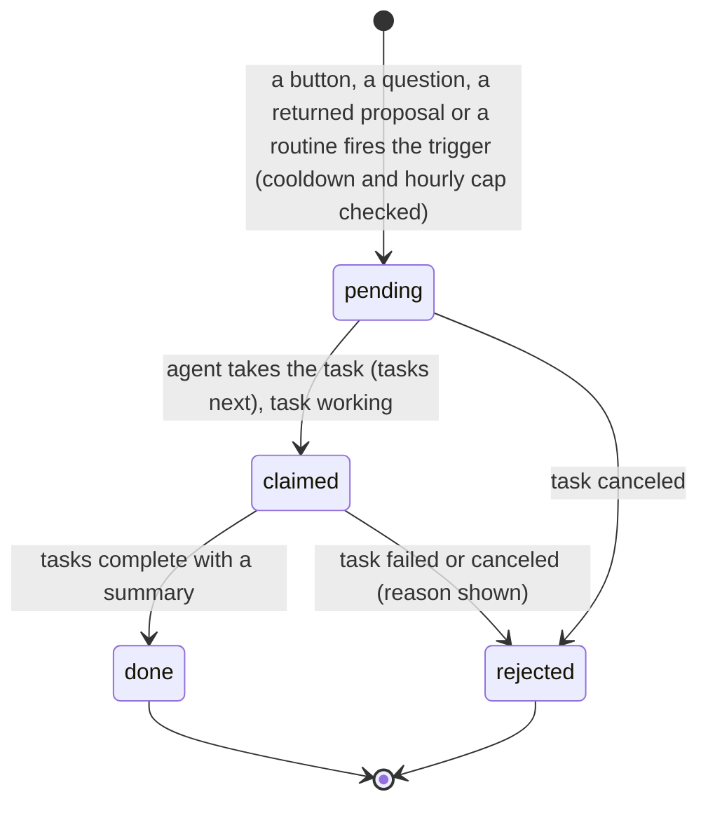
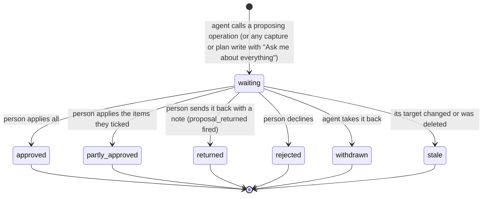
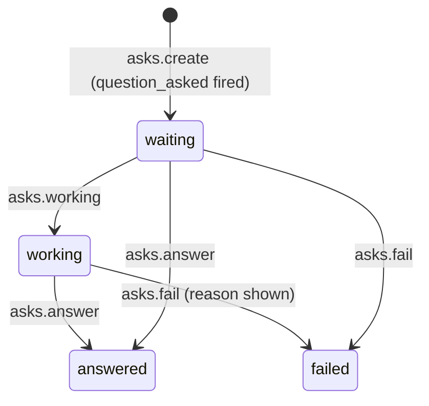

# Requirements: Life OS

PART A — REQUIREMENTS (SRS). User-approved before build; frozen after; changes via ## Changes.

## Introduction

### Purpose
Life OS is a personal life app for one person, used in the browser with no accounts or sign-in. Its one job is to be a life on one screen, not a database to fill in. It shows useful things by itself: the weather where the person lives, the news, who to get in touch with, what is due, and how the money is going. It keeps count by itself, so goals fill from a savings jar, the books finished, the weigh-ins or the habits kept. And it asks for as little typing as possible: one line to add a task, one tap for a habit, one tap for "Talked today", an amount and a tap for what it was for. Home shows today at a glance. A board holds every card, and a habit tracker, a balance chart of eight parts of life (each with its own tool), goals, projects and a journal complete it. An AI agent works on the same data through A2App. It adds cards, logs and notes freely. New goals, habits, people and projects, deletions and plans for a day arrive as proposals the person keeps item by item. The app hands the agent work as tasks: plan the day, sort the inbox, break a goal down, help with a habit, write the week's recap, the morning note, the evening check-in, answer a question, and rework a proposal that was sent back.

### Scope
**Goals**
1. Home shows today with no typing beyond the first run: the landscape and the weather where the person lives (found from the internet address the first time), the nudges, today's cards, the habits, the mood, the water, the money left this month, what is coming in the next seven days, and the news.
2. A goal measured by a jar, books, weigh-ins, habits, cards or milestones shows its progress and pace without the person typing a number.
3. Every tap changes the screen at once. When the server refuses, the screen goes back and says why, and a page you return to shows at once, without a loading flash.
4. The agent can do through operations what the person does in the app, except the 16 actions kept for the person. What the person defined (goals, habits, people, projects, settings, the parts of life, a plan for the day) changes only when the person keeps a proposal, and the agent can never read a private journal page.
5. Every write names who made it in the activity trail. An undoable write can be taken back (Undo, Ctrl Z, or the trail), and the agent can undo only its own.

**Core functionalities:** Home · the Board and the week · the habit tracker · the My life balance chart · eight parts of life with their own tools (Health, Money, Friends and family, Work, Home, Growth, Fun, Mind) · goals that count themselves · projects as journeys · the journal with privacy · the week's recap · quick add and find · your AI agent (questions, proposals, suggestions, routines, activity with undo) · settings and JSON export · first run · weather and news · read-only Google Calendar mirror

### Approval
Approved by the user: 2026-11-04 — carried over from the published marketplace app `life-os` 1.0.0, whose requirements were approved when it was built; this document restates them in the framework's form without changing any feature.

## Product Description

### Product Perspective
`authMode: none`. The app is for personal use: one person, no accounts or sign-in, bound to this machine (Original requirements). Every collection's API rules are closed (null). Record hooks refuse direct API writes, even a superuser's, so the person and the agent reach the data only through the app's operations. PocketBase's `users` collection is closed and its password sign-in switched off. A caller is the person, unless it presents the app's agent token (`X-A2App-Token`), which makes it the agent. manifest.json declares no integrations (`capabilities.integrations: []`). The backend alone calls four keyless services: Open-Meteo for the weather (`api.open-meteo.com`) and for finding a town (`geocoding-api.open-meteo.com`), `ipwho.is` to guess once where the person lives, and Google News RSS (`news.google.com`) for headlines. The optional Google Calendar mirror is read-only and goes through the host (`callAction('list_google_calendar_events')`) with the host's connected account. The app has no language model of its own: the morning note, the recap paragraph, answers and plans come from the person's AI agent through tasks. It is deliberately not a database to fill in. The first version was rejected as "boxes, forms and a database the user has to populate", so the 2026-10-24 revamp removed values, reviews, captures, insights and the separate goals and areas pages on purpose. The app says "your AI agent" and names no product.

### User Characteristics
One person keeping their own life, on a phone as much as at a desk. Phones get a bottom bar and stacked panels, wide screens the sidebar, with touch and pointer input. They open Home each day and tap habits, water, the mood and spends as things happen. Widths from 320 px up are in scope (AGENT_APP.md records checks at 320, 390, 768, 1024, 1280, 1440 and 1920 px).

### Constraints
- C-1: Days are `YYYY-MM-DD` text in the person's calendar and must be real dates. A day starts at `day_starts_hour` (0 to 6, default 4:00), so a late night still counts as the day before. Operations also take `today`, `tomorrow` and `yesterday`. Times are `HH:MM`, 24 hours.
- C-2: Money is kept as a whole number of the currency's minor unit. JPY, KRW, VND, CLP, ISK, UGX, PYG, XAF, XOF, TWD and IDR have no decimals, and every other currency has two. An amount is a plain number with at most the currency's decimals ("12.50"), and commas are dropped. The currency is one of the 43 codes the app knows (default USD).
- C-3: A life has eight fixed parts (areas): health, money, relationships (shown as "Friends and family"), work, home, growth, fun and mind. Each is on or off and has an order. An area is always one of these kinds, never a free name, and cards, goals, habits and projects carry it as a kind.
- C-4: Fixed vocabularies. Goal state: active, paused, done, dropped. Goal measure: number_up, number_down, milestones, tasks, habits, pot, books, weight, none. Pace: ahead, on_track, behind, done, none. Card list: inbox, today, coming, later, done; card stage: todo, doing. Habit schedule: daily, weekdays, per_week; time of day: morning, afternoon, evening, anytime; a habit's day: done or skipped; a habit's source: water, mind_min. Circle: partner, family, friends. Being in touch: talk, message, meet, gift, other. Workouts: walk, run, gym, yoga, bike, swim, sport, dance. Money: spend or income, with the categories food, groceries, transport, home, bills, fun, health, shopping, gifts and other (spends) and salary and extra (income). Bill categories: home, bills, transport, health, fun, shopping, other. Books: want, reading, done. Learning: course, skill, language. Bucket list: place, experience, skill, food, other. Chore rooms: kitchen, bathroom, living, bedroom, laundry, outside, other. Project state: active, someday, done, dropped. Journal privacy: private, shared_with_agent. Actor: person, agent, system. Proposal status: waiting, approved, partly_approved, rejected, returned, withdrawn, stale. Suggestion status: open, accepted, dismissed, stale. Question status: waiting, working, answered, failed. Routine run: fired, quiet, missed, refused.
- C-5: Names people see (titles, names, units) refuse emoji, because the app draws its own pictures. Text longer than its field's maximum is refused, not cut.
- C-6: Goals measure themselves where they can. A pot goal counts what its jar has saved against the jar's target, and a pot goal made without a jar gets its own, named after the goal. A books goal counts the books finished between its start and its deadline, a weight goal the latest weigh-in from its baseline to its target, and a habits goal the share of the last 30 days its habits were done. A tasks goal counts its cards (and its projects' cards) done, milestones count ticked milestones, number goals take the latest check-in, and "none" is done or not. Progress runs from 0 to 1.
- C-7: Pace: with a start and a deadline, a goal is compared with where a steady line would be by today. It is ahead or behind by more than a tenth, otherwise on track. Habits and "none" goals have no pace. A second active goal with the same title is refused (`duplicate`, with its id).
- C-8: A card's list follows from its day: done cards are in Done; "someday" cards and cards more than seven days ahead are in Later; cards with no day are in the Inbox; cards dated today or earlier are in Today; the next seven days are Coming up. Moving a card sets its day: today for Today, the day it lands among (or tomorrow) for Coming up, no day for the Inbox and Later. Steps of a project with no day stay in the project, not the Inbox. Done shows the last seven days.
- C-9: At most three cards are today's top three (`top_full`).
- C-10: Finishing a repeating card (every so many days, weeks or months) makes its next one. Finishing a card with a person on it counts as being in touch with them. Undoing the finish takes back the next card and that note.
- C-11: A habit's streak counts its scheduled days done in a row back from today, and a skipped day never breaks it. A times-a-week habit counts the weeks it met its number. The rate is the share of the last 30 days done (a times-a-week habit: partial credit over the last four full weeks). A habit whose source is water or calm minutes counts itself from the body log, so the glasses on Home and the habit always agree, and logging either writes the body log.
- C-12: People get a keep-in-touch rhythm by circle when added: none for a partner, 14 days for family, 30 days for friends. "Who knows whom" links are kept on both people.
- C-13: Journal pages are the person's. A new page is private. The agent reads only pages shared with it, and none when Settings say "Never". It learns only the days of private pages (`private_days`), never their words, never writes a page and never sets the mood.
- C-14: Every operation is marked for the agent: allowed, denied (the person's own actions), or proposed (its call becomes a proposal). With "Ask me about everything" (`agent_autonomy: propose_all`), its other writes that capture or plan become proposals too, except the ones it must run itself (asks, `proposals.withdraw`, `suggestions.create`, `activity.undo`, `calendar.sync`). An agent's own deletion runs only with `--confirm true`, after the person's approval.
- C-15: A proposal is applied whole, or with only the items the person ticked. It is refused as stale when its target changed after it was made, and deleting a goal, habit, card or project makes its waiting proposals and open suggestions stale. Each record and field has at most one open suggestion: a new one replaces the old. Suggestions can set a card's goal, area, project, person, do date, due date and length, a habit's goal, area, cue and time of day, and a goal's area, deadline and purpose.
- C-16: Routines stay off until the person turns them on. The seed times are a morning note at 07:30 every day, an evening check-in at 21:00 every day, and the weekly recap at 18:00 on Sundays. A routine due in quiet hours (default 22:00 to 07:00) is recorded as quiet and not sent, and one more than two hours late is recorded as missed.
- C-17: The first open seeds one settings row: no name, not set up yet, the day starting at 04:00, the week on Monday, metric, USD, no budget, 8 glasses, 8 hours of sleep, 8,000 steps, journal pages read when shared, the agent doing small things directly, quiet hours 22:00 to 07:00, and the calendar off. It also seeds the eight parts of life switched on and the three routines switched off. No goals, habits, people or cards are seeded.
- C-18: No emoji appear anywhere. The app says "your AI agent" and names no product.

### Assumptions
- A-1: Volume ceiling: one person's life, read in bounded pieces. The Board reads every open card at once and shows at most 40 done cards from the last seven days. Lists that page take at most 500 rows (`tasks.list`, `journal.list`), and `money.entries` takes 2,000, `activity.list` 1,000 and `suggestions.list` 1,000. A habit's history covers at most 365 days, and the health trend 400.
- A-2: The machine running the app is the person's own. Its local clock and date are the person's, and the minute tick reads local time.
- A-3: Weather and news come from keyless public services. When one does not answer, the last good copy is shown marked stale; with no copy, the page says so.
- A-4: The calendar mirror needs the host's Google Calendar connection. Without it the state reads "Google Calendar is not connected yet".

## Features

### Module: Frame (app, find)
- F-FRM-1: On screens from 768 px the user sees a deep green sidebar: a carved wooden sign with the person's name ("Welcome back", or "Welcome to Life OS" before a name is set), "Add a task", Find and Settings, then the places as drawings: Home, Board, Habits, My life (with each part of life switched on beneath it), Projects (with its projects beneath it and "+" for a new one), Journal, and Your AI agent. Today's weather sits at the foot.
- F-FRM-2: The user sees the current place marked, and quiet counts beside Board (today's open cards) and Habits (habits still due), and a badge on Your AI agent (waiting proposals, open suggestions and answered questions).
- F-FRM-3: The user can open and close the My life and Projects trees with a chevron. The open state is remembered in this browser.
- F-FRM-4: On phones the user navigates with a bottom bar (Home, Board, Habits, My life, More). More opens the sidebar as a menu sliding from the left, without the weather.
- F-FRM-5: The user can add tasks from anywhere with "Add a task" or the Q key ("Add to your board"). It takes one task per line, to Today or the Inbox.
- F-FRM-6: The user can find goals, habits, cards, people, projects, books and journal pages from anywhere with Ctrl K ("Find"). Find also jumps to the pages and to Add a task, New goal, Write in the journal and See the week, and it is driven by the arrow keys and Enter.
- F-FRM-7: WHEN the user does something that can be taken back THE SYSTEM SHALL show a small bar at the bottom saying what was done, with Undo, for 6 s. Ctrl Z undoes the person's newest undoable write the same way.
- F-FRM-8: Every color follows the host's theme pack, light or dark mode and custom colors: an ink pack turns the drawings gray, and nothing light sits on light or dark on dark in any pack.
- F-FRM-9: WHEN a newer version of the app has been deployed THE SYSTEM SHALL reload an open page onto it after the server comes back or when the tab is shown again, waiting while a dialog is open, an editable text has focus, or a journal page is saving.

### Module: Home (home)
- F-HOME-1: The user sees a landscape at the top that follows the time of day, the season and the weather outside (rain falls when it rains). It carries the date, a greeting with the person's name, and your AI agent's note for the day, or the day in a sentence when no note has been written. The weather now (temperature, words, high and low, feels like, the place, and rain, strong sun or sunset) sits on it.
- F-HOME-2: WHEN no place is known THE SYSTEM SHALL offer "Where do you live? Your weather shows up here." with a town search.
- F-HOME-3: The user sees Home as rows of one to three panels side by side from 1280 px: Today and Heads up; Habits and You today; Goals and Money; Coming up, People and Weather; News across. On narrower screens every panel stacks.
- F-HOME-4: The user can drag a row by its handle, or move it with the arrow keys on the handle, to put the rows in their own order, which is kept. On phones "Arrange Home" opens a short list with up and down.
- F-HOME-5: The user sees "Today" with a big "What do you want to do today?" add line, today's top three, the rest of today's cards, and "<n> done today" to show the finished ones. With nothing on it reads "A clear day. Add the one thing that would make it a good one."
- F-HOME-6: The user sees "Heads up", up to five nudges: a birthday within seven days, someone not heard from, a bill due within three days or late, rain likely (or strong sun), a trip within 14 days, chores overdue. Each opens the person or the part of life it is about; with none it reads "Nothing needs you right now."
- F-HOME-7: The user can tap habit buttons on Home (or start one from ideas when there are none) and sees "<done> of <due> done".
- F-HOME-8: The user sees "You today": "How is today?" with five mood stickers (Rough, Low, Okay, Good, Great), water glasses to tap with a "+1", the glasses, sleep, steps and workouts of the day, and the latest journal page (or "A few lines about today, whenever you like.").
- F-HOME-9: The user sees up to four goals as trails, or "Something you want to reach?" to start the first.
- F-HOME-10: WHEN Money is switched on THE SYSTEM SHALL show the money left this month in a jar, about how much a day, a meter of the budget spent, and a quick spend (type an amount, tap one of six categories). Without a budget it shows what was spent with "Set a budget".
- F-HOME-11: The user sees "Coming up" for the next seven days (plans, calendar events, bills, birthdays, trips), or "A quiet week ahead.".
- F-HOME-12: WHEN Friends and family is switched on THE SYSTEM SHALL show the people to reach (birthdays within 14 days first) with "Talked today", "Everyone is in touch.", or a prompt to add the people who matter.
- F-HOME-13: The user sees "Weather" by the hour (the next hours, with chance of rain) and the week (each day's drawing and its high and low as a bar).
- F-HOME-14: The user sees "News" by topic (Top stories, World, Your country, Business, Technology, Science, Health, Sports, Culture), newest first, each opening the story. The chosen topic is remembered in this browser, and when the news cannot be reached it reads "The news is not reachable right now."

### Module: Board (board, todos)
- F-BRD-1: The user sees the board as lists by time: Inbox, Today (with the minutes planned and how many are done), Coming up (grouped by day), Later and Done (grouped by day, the last seven days). Each list has its own empty line.
- F-BRD-2: The user can add a card at the top of every list except Done ("Add a card"; "Add for tomorrow" in Coming up). The composer stays open for the next one, and Enter adds, Escape closes.
- F-BRD-3: The user can drag cards between and within lists. A card dropped in Coming up takes the day of the card it lands by.
- F-BRD-4: The user sees each card in its area's color, with its tick, the goal it moves (with its progress), its project, the person it is for, its steps done, its planned and due dates (late ones marked), its time and length, whether it repeats, and a star for the top three.
- F-BRD-5: The user can filter the board by part of life ("Everything" or one area).
- F-BRD-6: The user can switch to the Week: seven days from today (or moved by seven days, with "From today"), each with its weather, its plans and calendar events and its cards, and the inbox beside them to drag from. Days still to come take "Add".
- F-BRD-7: The user can press "Plan my day with your AI agent". The button shows the request's state: Asked, "Waiting: no agent has picked this up yet" after 25 s, Working on it, Done, or "Could not: <reason>". The plan it proposes waits on the Board as a proposal card.
- F-BRD-8: WHEN the Inbox holds two or more cards THE SYSTEM SHALL offer "Sort with your AI agent".
- F-BRD-9: On phones the lists snap one by one when swiped.

### Module: Cards (todos)
- F-CRD-1: The user can tick a card off with one tap: the tick shows, then the card folds out of its list ("Ticked off "<title>"", and "The next one is on the board" for a repeating card).
- F-CRD-2: The user can star a card as one of today's top three, at most three.
- F-CRD-3: The user can open a card's drawer: its title; When (Inbox, Today, Tomorrow, Weekend, Later, or pick a day); Due; Time (a start time, and 15 min, 30 min, 1 h or 2 h); Repeat (No, Daily, Weekly, Monthly); the area of life; the goal it moves, its project, and who it is with; steps to tick, add and remove; notes; and its history (who did what, when). A card the agent made says "Added by your AI agent".
- F-CRD-4: The user can mark a card done or not done from its drawer, and delete it after "Delete this card?" ("<title>" will be deleted. You can undo it right after.).
- F-CRD-5: The user sees cards as rows in lists (Home, a part of life, a goal, a person), opened with a click or Enter.

### Module: Habits (habits)
- F-HAB-1: The user sees today's habits as big drawn buttons grouped by time of day (Morning, Afternoon, Evening, Any time), with "<done> of <due> done today" and the best streak.
- F-HAB-2: The user can tap a habit to tick it off. A counted habit fills a ring one tap at a time ("<n>/<target>"), and the streak and "Resting today" for days it is not due show under it.
- F-HAB-3: The user sees "The last two weeks" as a tracker grid, one row per habit, where every square can be tapped to mark that day done or undo it, with the streak at the end.
- F-HAB-4: The user can start a habit with one tap from ideas for the parts of life switched on, or in their own words with a drawing ("A habit in your own words", Start).
- F-HAB-5: The user can open a habit's drawer: its button, In a row, Best, Last 30 days and Days done, its year as a calendar of days, and its name, drawing, how often (Every day, Some days with the weekdays, Times a week 1 to 7), each day (once up to 100 times, with a unit), what it counts itself from (Nothing, Glasses of water, Calm minutes), when, "After what" (the cue), its area and the goal it helps.
- F-HAB-6: The user can skip today (the streak keeps going), put a habit away or bring it back ("Put away" lists them), and delete it after "Delete this habit?" ("<name>" and every day you ticked will be deleted. You can undo it right after.).
- F-HAB-7: WHEN a habit's last 30 days are under half done THE SYSTEM SHALL offer "Not sticking? Ask your AI agent".
- F-HAB-8: WHEN there are no habits THE SYSTEM SHALL show "Start with one": ideas, a habit in your own words, and how streaks work ("Skipping a day on purpose never breaks it.").

### Module: My life (life, areas)
- F-LIFE-1: The user sees a balance (spider) chart with a spoke per part of life switched on, reaching out as far as that part is going well. A part with too little to go on sits at the middle as an open dot, and tapping a spoke opens the part.
- F-LIFE-2: The user sees beside it a list of each part with its drawing, how it is going (Going well, Ticking along, Needs a look, Quiet), its line, and its score out of 100 or "Not enough yet".
- F-LIFE-3: The user sees every goal under its part of life, with "New goal". With none it reads "No goals yet. Open a part of life above, or start one here: most of them count by themselves."
- F-LIFE-4: The user can switch a part of life back on from "More parts of life", and switch one off with "Put away" on its page, or with the switches in Settings.
- F-LIFE-5: THE SYSTEM SHALL score each part from 0 to 1 from what is done there: Health from the days moved, water and sleep of the last seven days; Money from the spending against the month's budget and late bills (no score without a budget); Friends and family from the share of people not due a call; Work from this week's focus minutes, wins and work cards done; Home from the chores not overdue; Growth from reading now, learning practised and books this year; Fun from a trip in the next 90 days and the bucket list; Mind from the moods and calm minutes of the last seven days.

### Module: A part of life (life)
- F-AREA-1: The user sees a part's page with its own drawing, color, blurb, name and how it is going, then its own tool first, and the same three panels on the right: Goals, To do and Habits.
- F-AREA-2: The user can set a goal for the part ("Set a goal here", "Another goal"), and sees the goals reached before.
- F-AREA-3: The user can add a card for the part ("Something for <part>") and sees its open cards, or "Nothing waiting here.".
- F-AREA-4: The user can tap the part's habits and start one from four ideas for it.

### Module: Health (health, workouts)
- F-HLT-1: The user sees "Your body today": water glasses to tap; last night's sleep in half hours; steps with a meter and a field for the steps so far; and the weight with a weigh-in field in kg or lb and a line of the last month.
- F-HLT-2: The user can note a workout with one tap on one of eight drawings (Walk, Run, Gym, Yoga, Bike, Swim, Sport, Dance) and its length (15, 30, 45, 60 or 90 min), and remove one.
- F-HLT-3: The user sees the last two weeks as bars for water, sleep, steps or workouts against the daily aim, with the averages.

### Module: Money (money, pots, bills)
- F-MON-1: The user sees the month in a jar: what is left to spend (or over the budget), what was spent of the budget, about how much a day for the days left, more or less than last month by now, and what came in. They can set or change the monthly budget.
- F-MON-2: The user can note money out ("Spent") or in ("Got") with an amount, an optional note and a tap on a category drawing.
- F-MON-3: The user sees where it went by category and day by day, and the latest entries, each of which can be deleted.
- F-MON-4: The user can keep savings jars: each fills toward its goal amount, and money can be put in or taken out. They can make a new jar with a name and a goal amount.
- F-MON-5: The user can keep monthly bills (name, amount, day of the month). Each shows Paid, Late or its due day, and a tap marks this month's bill paid and notes it as a spend.

### Module: Friends and family (people, calendar-x)
- F-PPL-1: The user sees a connection map with "You" in the middle and everyone on rings by how close they are (partner, family, friends). A line to each person shows who is due a call (green when in touch lately, dashed amber when it is time to reach out), and thin lines join people who know each other. Tapping a face opens the person.
- F-PPL-2: The user can add someone with just a name, in a chosen circle (Partner, Friends, Family).
- F-PPL-3: The user sees "Time to reach out" with "Talked today" for each, birthdays coming (Today, Tomorrow, in <n> days, and the age they turn), and plans made together.
- F-PPL-4: The user can make a plan (what, when, with whom) and remove one.
- F-PPL-5: The user can open a person's drawer: a new look, name, who they are to them, when they were last in touch, one-tap "Talked / Messaged / Met up / Gave a gift today", how often to keep in touch (Every week, Every 2 weeks, Every month, Every 3 months, No reminder), the circle, the birthday, who they know (lines on the map), plans, cards for them, notes to remember, and the times in touch (each removable).
- F-PPL-6: The user can put a person away or delete them after "Delete <name>?" ("<name> and the times you noted being in touch will be deleted. You can undo it right after.").

### Module: Work (focus, wins)
- F-WRK-1: The user can run a focus timer of 15, 25, 50 or 90 minutes, optionally on one of today's work cards, with Start, Pause, Go on and "Stop and note it". It keeps running when the user leaves the page, and the minutes are noted when it rings.
- F-WRK-2: The user sees the week's focus as bars with the total.
- F-WRK-3: The user can write wins down in a line as they happen ("A win, big or small") and remove them.

### Module: Growth (books, learning)
- F-GRW-1: The user sees what they are reading now and where they are in it, and can note the page they are on. Reaching the last page finishes the book, which goes on the shelf.
- F-GRW-2: The user sees a wooden bookshelf of the books they want and the ones they finished, with how many were finished this year.
- F-GRW-3: The user can add a book by its title as reading or want to read, and open a book to change its title, author, status, pages and rating (1 to 5), or take it off the shelf.
- F-GRW-4: The user can keep things they are learning (a skill, a language, a course), note practice with one tap (15, 30 or 60 min, adding up), and set how far along they are.

### Module: Fun (trips, bucket)
- F-FUN-1: The user sees each trip as one full-width ticket: where, the dates and nights, how much is packed, and on the stub the days to go ("Away now", "Someday" or "Been" otherwise). The ticket opens to its packing list.
- F-FUN-2: The user can plan a trip from one add bar: the trip's name first, then where and the dates appear once it has a name. Its packing list starts with the basics (passport or ID, chargers, toothbrush, clothes).
- F-FUN-3: The user can tick, add and remove things to pack, and delete a trip after "Delete this trip?" ("<title>" and its packing list will be deleted.).
- F-FUN-4: The user can keep a bucket list of stamps (a place, an experience, a skill, food, something else) that get stamped when done, tapped again to undo, and removed.

### Module: Home, the part of life (chores, shopping)
- F-HSE-1: The user sees chores by room with when each is due ("Not done yet", "<n> days late", Today, Tomorrow, "In <n> days"). A tap on Done starts it over.
- F-HSE-2: The user can add a chore with its room and how often (Daily, Weekly, 2 weeks, Monthly), and remove one.
- F-HSE-3: The user sees the shopping list on a notepad: add things (a whole pasted list works, one per line), tick them off, remove them, and "Clear <n> bought".

### Module: Mind (days, health)
- F-MND-1: The user can set how today feels with the mood stickers, and sees a month of moods as stickers. Tapping a past day sets its mood, and the user can move between months.
- F-MND-2: The user can breathe with a circle ("Breathe in", "Hold", "Breathe out", ten seconds a round). Stopping notes the minutes, rounded, as calm time.
- F-MND-3: The user can note other quiet time (5, 10 or 20 minutes) and sees today's calm minutes.

### Module: Goals (goals)
- F-GOAL-1: The user sees a goal as a trail to a flag, the area's drawing standing where the goal is now and a mark where it would be on pace. Its title, numbers in words, by when and pace (Ahead, On track, Behind, Done) show with it.
- F-GOAL-2: The user can start a goal in one dialog ("A new goal"): which part of life, ideas for that part, the goal in their own words, how it counts (Saving money, A number going up, A number going down, My weight, Books read, Milestones, Habits, Tasks, Just done or not), how much or the aim, a unit, milestones, and by when (3 months, 6 months, A year, or a date).
- F-GOAL-3: The user can open a goal's drawer: its progress, the one action its measure needs (a check-in for a number, money into the jar, milestones to tick and add, habits to start for it), its next steps (cards, with an add line), why it matters, by when, and its area.
- F-GOAL-4: The user can pause a goal, pick it up again, mark it "Reached it", and delete it after "Delete this goal?" ("<title>" will be deleted. Its tasks and habits stay. You can undo it right after.).
- F-GOAL-5: The user can press "Ask your AI agent for steps" on a goal (`breakdown_requested`).

### Module: Projects (projects)
- F-PRJ-1: The user sees projects as journeys of stepping stones to a flag, with the next step in words ("Next: <step>", "Add the first step", "Every step done"), by On the go, Someday and Done.
- F-PRJ-2: The user can start a project with a name, its part of life and first steps, one per line ("A new project"), from the page or the "+" in the sidebar.
- F-PRJ-3: The user can open a project: its journey, its steps on To do, Doing and Done to drag between (with "Add a step" on To do and Doing), and its details (part of life, the goal it serves, by when, notes).
- F-PRJ-4: The user can mark a project Finished, Someday or "On the go again", and delete it after "Delete this project?" ("<title>" will be deleted. Its steps stay as cards on the board.).

### Module: Journal (journal, recap, days)
- F-JRN-1: The user can write today's page on lined paper. It keeps itself as they type, 700 ms after typing stops ("Saving", "Kept"), with today's writing prompt as the placeholder.
- F-JRN-2: The user can put a mood sticker, a photo as a polaroid, and the parts of life it touched as stickers on the page. The day's weather is noted on the page by itself.
- F-JRN-3: The user can share a page with your AI agent or keep it to themselves ("Shared with your AI agent" or "Only you"). A page is private until shared.
- F-JRN-4: The user can delete a page after "Delete this page?" ("This page will be deleted for good.").
- F-JRN-5: The user sees a timeline: the pages of the last year as a calendar of days with the writing streak, every page by month (mood, weekday, the first words, weather, stickers, shared or not, words, the photo), and "On this day" pages from earlier months and years.
- F-JRN-6: The user sees "The week": the week counted by itself (cards done, habit ticks, moving, focused, people in touch, books finished, money spent, pages written), the mood by day, the best day, wins, goals that moved, and your AI agent's paragraph ("In a few words"), or "Ask your AI agent to sum it up". They can move between weeks.

### Module: Your AI agent (asks, proposals, suggestions, routines, activity)
- F-AI-1: The user can ask your AI agent a question about their life, a part of life, a goal, a habit or someone. The answers show under it (Asked, "Thinking about it", the answer, or "Could not answer: <reason>").
- F-AI-2: The user sees what waits on them: proposals as cards ("Your AI agent proposes", the title, why, and the items or the changes) and field suggestions as dashed chips.
- F-AI-3: The user can keep a proposal's items one by one ("Apply all", "Apply <n>"), approve it whole, send it back with a note ("What should it change?"), or decline it.
- F-AI-4: The user can keep or dismiss each suggestion.
- F-AI-5: The user can switch each visit on or off on a schedule and set its time and days: "A morning note", "An evening check-in", "The week in a few words".
- F-AI-6: The user sees "What was done", by everyone, by your AI agent or by them, with Undo on every write that can be taken back.

### Module: Settings (settings, calendar)
- F-SET-1: The user can set their name, where they live (with a town search), units (Metric or Imperial), currency, the day the week starts, and when a new day starts (00:00 to 06:00).
- F-SET-2: The user can set the daily aims: water (glasses), sleep (hours) and steps.
- F-SET-3: The user can switch each part of life on or off.
- F-SET-4: The user can choose what your AI agent may read ("Pages I share" or "Never"), how it works ("Small things directly" or "Ask me about everything"), and quiet hours with no scheduled visits.
- F-SET-5: The user can switch the read-only calendar mirror on, name which calendar, and see its state (Connected, not connected yet, could not reach, off) with the number of events and when it last looked.
- F-SET-6: The user can export everything as a JSON file.

### Module: First run (settings)
- F-RUN-1: WHEN the app is opened before it is set up THE SYSTEM SHALL show the first run over the whole window: a wooden sign over the landscape, a card with step dots, and five steps (You, Areas, A goal, A habit, Rhythm). Each step can be skipped, and the whole setup too.
- F-RUN-2: The user can give their name and week start, choose the parts of life, an optional first goal (done or not, or a number with a unit, by when, why), an optional first habit (drawing, cue, how often, when, its area, and whether it counts toward the goal), and the rhythm (morning note, evening check-in, weekly recap). "Start my Life OS" saves it all at once.
- F-RUN-3: THE SYSTEM SHALL find where the person lives by itself (from the internet address), and the first run sets the currency and units from that country. Both can be changed in Settings.

### Module: Feel (all screens)
- F-FEEL-1: Every tap answers at once: the screen changes first and the server keeps it behind. WHEN the server refuses THE SYSTEM SHALL put the screen back and show the operation's message, and give an add line its words back.
- F-FEEL-2: Pages open without loading flashes: a page you return to shows what it last had at once and refreshes behind, and moving between pages keeps the old page until the new one is ready.
- F-FEEL-3: Things move with purpose: panels rise in when a page opens, new rows slide in, removed or finished rows fold away, drawers slide, dialogs ease in, and progress fills smoothly. Nothing moves when the system asks for reduced motion.
- F-FEEL-4: On touch screens nothing only shows on hover, every small control has about 44 px of tap area, fields do not make an iPhone zoom, and every drag can also be done by tapping (cards move from their drawer, Home rows from "Arrange Home").

### Agent (via A2App)
- F-AGT-1: The agent can perform the app's operations: the 155 operations in ## Operations Design, across the modules app, home, find, settings, activity, calendar, routines, world, agent, asks, proposals, suggestions, life, areas, goals, board, todos, projects, habits, days, journal, recap, people, calendar-x, health, workouts, money, pots, bills, books, learning, bucket, trips, chores, shopping, focus and wins. The 16 person's own actions are not offered to it.
- F-AGT-2: The agent can read the conventions, today's date, what it may do, the error codes and the recipes from `app.guide` (topics day_plan, inbox, breakdown, habit_help, recap, morning_note, question, evening_checkin, logging; `--part arts` for habit drawings), and today's life in one read from `agent.brief`.
- F-AGT-3: The agent can add cards, logs, check-ins, plans and notes freely, several at once where it fits (`tasks.add-many` as one batch with one undo, `trips.add --packing`, `trips.pack --text` and `shopping.add` one per line, `people.create --links`).
- F-AGT-4: WHEN the agent calls an operation that shapes what the person defined (settings, the parts of life, goals, projects, habits, people, a plan for the day, their deletions) THE SYSTEM SHALL store it as a proposal with a preview, which the person keeps whole or item by item, sends back or declines, and which the agent may withdraw.
- F-AGT-5: The agent can suggest one field of one record, or many in one call (`suggestions.create`), shown to the person as a dashed chip to keep or dismiss.
- F-AGT-6: WHEN the agent calls one of the person's own actions (writing or deleting journal pages, the mood, changing or running routines, setting the place, asking for agent work, asking or deleting questions, deciding proposals and suggestions, the export, the first run) THE SYSTEM SHALL refuse it with `agent_not_permitted`.
- F-AGT-7: WHEN the agent asks for a journal page that is private, or Settings say "Never", THE SYSTEM SHALL refuse it with `private_record`. `journal.list` gives the agent only shared pages plus the days of private ones, and `find.all` never searches the journal for it.
- F-AGT-8: WHEN the agent deletes something itself THE SYSTEM SHALL answer `approval_required` until the person approves, and then delete only with `--confirm true` (otherwise it answers `confirm_required` and says what would go).
- F-AGT-9: The agent can undo only what it did itself (`activity.undo`, `activity.last`).
- F-AGT-10: The agent can take `day_plan_requested` and propose the day in one `board.plan` call (moves, today's top three, new cards, a note on Home).
- F-AGT-11: The agent can take `inbox_sort_requested` and suggest a day, an area, a goal, a project, a person or a length for each inbox card with `suggestions.create`.
- F-AGT-12: The agent can take `breakdown_requested` and propose first steps for a goal with `goals.breakdown` (milestones, habits, cards, a project).
- F-AGT-13: The agent can take `habit_help_requested` and suggest small changes to a habit that is not sticking.
- F-AGT-14: The agent can take `recap_requested` (the weekly routine or the button) and write its paragraph with `recap.write`, and take `morning_note_due` and write today's note on Home with `days.note`.
- F-AGT-15: The agent can take `question_asked` and answer with `asks.working` and `asks.answer`, or say why it cannot with `asks.fail`.
- F-AGT-16: The agent can take `evening_checkin` and send one short message about the day, and take `proposal_returned` to read the person's note and propose again.
- F-AGT-17: WHEN the agent passes a name where an id belongs, or a wrong id, THE SYSTEM SHALL answer `not_found` with that name's id or some real ids to choose from. An unknown parameter is answered with the closest name.

## Non-Functional Requirements
- N-1: A tap shows on the screen before the server answers (`act()` in `lib/live.ts`); AGENT_APP.md records 26 to 120 ms from click to screen for 18 taps, and about 300 ms for removals with their fold.
- N-2: A change made elsewhere (the agent, another window, a job) reaches every open view without a refresh: the server names the changed collections on the realtime topic `lo`, and views reload 120 ms after the message plus their own 150 ms debounce. A view's own actions reload it at once.
- N-3: Weather is cached 20 minutes and news 30 minutes per topic, and every outside call times out after 8 s.
- N-4: Due routines are sent within a minute (the `lo_tick` job runs every minute and once at boot). The calendar mirror syncs every 15 minutes while it is on.
- N-5: The day job runs once per person-day: it recomputes every goal's pace, takes bought shopping off the list after a week, and deletes routine runs older than 120 days.
- N-6: Every page is usable from 320 px wide, with no sideways scrolling, and every small control has about 44 px of tap area on touch screens.

## Data Requirements
- **settings** (module: settings): owner_name (string, max 80), onboarded (boolean), day_starts_hour (number), week_starts_on (enum), units (enum), currency (string, max 3), month_budget (number), city (string, max 120), region (string, max 120), country (string, max 2), lat (number), lon (number), timezone (string, max 60), news_topics (json), home_rows (json), water_goal (number), sleep_goal (number), steps_goal (number), reflections_to_agent (enum), agent_autonomy (enum), quiet_start (string, max 5), quiet_end (string, max 5), calendar_enabled (boolean), calendar_id (string, max 200), calendar_state (enum), calendar_synced_at (string, max 30), calendar_error (string, max 400), last_day_job (string, max 10), created (datetime, server-set), updated (datetime, server-set).
- **areas** (module: areas): kind (enum, required), enabled (boolean), rank (number), created (datetime, server-set), updated (datetime, server-set).
- **money_pots** (module: money): name (string, required, max 80), target (number), saved (number), look (number), rank (number), done_at (string, max 30), actor (enum), created (datetime, server-set), updated (datetime, server-set).
- **goals** (module: goals): title (string, required, max 200), area (enum, required), state (enum, required), measure (enum, required), unit (string, max 30), baseline (number), target (number), current (number), pot (ref → money_pots), milestones (json), start_date (string, max 10), deadline (string, max 10), purpose (string, max 1000), progress (number), pace (number), pace_state (enum), last_activity (string, max 10), done_at (string, max 30), rank (number), actor (enum), created (datetime, server-set), updated (datetime, server-set).
- **goal_checkins** (module: records): goal (ref, required → goals), date (string, max 10), value (number), note (string, max 500), actor (enum), created (datetime, server-set), updated (datetime, server-set).
- **people** (module: people): name (string, required, max 80), circle (enum, required), relation (string, max 60), birthday (string, max 10), keep_in_touch_days (number), last_contact (string, max 10), look (number), links (json), notes (string, max 4000), rank (number), archived (boolean), actor (enum), created (datetime, server-set), updated (datetime, server-set).
- **interactions** (module: records): person (ref, required → people), date (string, max 10), kind (enum, required), note (string, max 1000), actor (enum), created (datetime, server-set), updated (datetime, server-set).
- **events** (module: schedule): title (string, required, max 200), date (string, max 10), time (string, max 5), area (enum, required), place (string, max 200), person (ref → people), actor (enum), created (datetime, server-set), updated (datetime, server-set).
- **projects** (module: projects): title (string, required, max 200), area (enum), goal (ref → goals), state (enum, required), deadline (string, max 10), notes (string, max 8000), look (number), rank (number), done_at (string, max 30), actor (enum), created (datetime, server-set), updated (datetime, server-set).
- **tasks** (module: todos): title (string, required, max 300), notes (string, max 8000), area (enum), project (ref → projects), goal (ref → goals), person (ref → people), state (enum, required), stage (enum), do_date (string, max 10), due_date (string, max 10), start_time (string, max 5), duration_min (number), someday (boolean), top (boolean), recurrence (json), series (string, max 15), checklist (json), done_at (string, max 30), done_date (string, max 10), rank (number), actor (enum), created (datetime, server-set), updated (datetime, server-set).
- **focus_sessions** (module: focus): date (string, max 10), minutes (number), task (ref → tasks), note (string, max 300), actor (enum), created (datetime, server-set), updated (datetime, server-set).
- **wins** (module: wins): text (string, required, max 300), date (string, max 10), area (enum), actor (enum), created (datetime, server-set), updated (datetime, server-set).
- **habits** (module: habits): name (string, required, max 120), art (string, max 30), area (enum), goal (ref → goals), schedule (enum, required), days (json), times (number), target (number), unit (string, max 30), time_of_day (enum), cue (string, max 200), source (enum), started_on (string, max 10), archived (boolean), rank (number), actor (enum), created (datetime, server-set), updated (datetime, server-set).
- **habit_logs** (module: records): habit (ref, required → habits), date (string, max 10), value (number), state (enum, required), note (string, max 300), actor (enum), created (datetime, server-set), updated (datetime, server-set).
- **days** (module: days): date (string, required, max 10), mood (number), energy (number), agent_note (string, max 1200), agent_note_at (string, max 30), created (datetime, server-set), updated (datetime, server-set).
- **health_logs** (module: health): date (string, required, max 10), water (number), sleep_h (number), steps (number), weight (number), mind_min (number), created (datetime, server-set), updated (datetime, server-set).
- **workouts** (module: workouts): date (string, max 10), kind (enum, required), minutes (number), note (string, max 300), actor (enum), created (datetime, server-set), updated (datetime, server-set).
- **money_entries** (module: money): date (string, max 10), amount (number), kind (enum, required), category (enum, required), note (string, max 200), actor (enum), created (datetime, server-set), updated (datetime, server-set).
- **bills** (module: bills): name (string, required, max 80), amount (number), due_day (number), category (enum, required), paid_month (string, max 7), active (boolean), rank (number), actor (enum), created (datetime, server-set), updated (datetime, server-set).
- **books** (module: books): title (string, required, max 200), author (string, max 120), status (enum, required), pages (number), page (number), started_on (string, max 10), finished_on (string, max 10), look (number), rating (number), rank (number), actor (enum), created (datetime, server-set), updated (datetime, server-set).
- **learning** (module: learning): name (string, required, max 120), kind (enum, required), progress (number), last_practiced (string, max 10), minutes (number), note (string, max 500), archived (boolean), rank (number), actor (enum), created (datetime, server-set), updated (datetime, server-set).
- **bucket_items** (module: bucket): title (string, required, max 200), kind (enum, required), done_on (string, max 10), note (string, max 500), rank (number), actor (enum), created (datetime, server-set), updated (datetime, server-set).
- **trips** (module: trips): title (string, required, max 120), place (string, max 120), start_date (string, max 10), end_date (string, max 10), checklist (json), notes (string, max 4000), actor (enum), created (datetime, server-set), updated (datetime, server-set).
- **chores** (module: chores): name (string, required, max 120), room (enum, required), every_days (number), last_done (string, max 10), rank (number), actor (enum), created (datetime, server-set), updated (datetime, server-set).
- **shopping_items** (module: shopping): text (string, required, max 120), done (boolean), done_at (string, max 30), rank (number), actor (enum), created (datetime, server-set), updated (datetime, server-set).
- **journal_entries** (module: journal): date (string, max 10), body (string, max 40000), mood (number), weather (json), tags (json), photo (binary), privacy (enum), actor (enum), created (datetime, server-set), updated (datetime, server-set).
- **recaps** (module: recap): week_start (string, required, max 10), text (string, max 12000), written_at (string, max 30), created (datetime, server-set), updated (datetime, server-set).
- **routines** (module: routines): kind (enum, required), enabled (boolean), days (json), time (string, max 5), last_due (string, max 16), created (datetime, server-set), updated (datetime, server-set).
- **routine_runs** (module: records): routine (ref, required → routines), due_at (string, max 16), state (enum, required), request (string, max 20), note (string, max 400), created (datetime, server-set), updated (datetime, server-set).
- **suggestions** (module: suggestions): target_kind (enum, required), target_id (string, max 15), field (string, max 30), value (json), why (string, max 1000), status (enum, required), actor (enum), created (datetime, server-set), updated (datetime, server-set).
- **proposals** (module: proposals): op (string, max 80), params (json), kind (string, max 60), title (string, max 400), summary (string, max 4000), preview (json), why (string, max 8000), target_collection (string, max 40), target_id (string, max 15), target_updated (string, max 40), status (enum, required), decision_note (string, max 4000), decided_at (string, max 30), result (json), created (datetime, server-set), updated (datetime, server-set).
- **asks** (module: asks): question (string, required, max 4000), about (enum, required), target (string, max 15), status (enum, required), answer (string, max 20000), failure (string, max 2000), request (string, max 20), created (datetime, server-set), updated (datetime, server-set).
- **activity** (module: activity): actor (enum, required), op (string, max 80), label (string, max 600), target (string, max 40), record (string, max 20), batch (string, max 40), data (json), undoable (boolean), undone (boolean), created (datetime, server-set), updated (datetime, server-set).
- **calendar_events** (module: calendar): external_id (string, required, max 300), calendar (string, max 200), start (string, max 30), end (string, max 30), all_day (boolean), title (string, max 300), location (string, max 300), date (string, max 10), synced_at (string, max 30), created (datetime, server-set), updated (datetime, server-set).

## External Interfaces
- **Human (browser):** one single-user View served by PocketBase at the app's own origin, with hash routes `#/` (Home, or the first run until it is done), `#/board?view=&area=`, `#/habits`, `#/life`, `#/area?kind=`, `#/projects`, `#/project?id=`, `#/journal?tab=&entry=`, `#/agent`, `#/settings` and `#/welcome`. Back buttons follow the app's own trail inside the host's frame. The drawers (card, habit, person, goal) and dialogs (Add to your board, Find, A new goal, A new project, Arrange Home) open over any page. File input is a journal photo (JPEG, PNG, WebP or GIF, up to 15 MB). File output is the JSON export.
- **Agent (A2App):** the modules and collections in AGENT_APP.md § Modules; operations exactly as declared in ## Operations Design; tasks with the capabilities `day_plan_requested`, `inbox_sort_requested`, `breakdown_requested`, `habit_help_requested`, `recap_requested`, `morning_note_due`, `question_asked`, `evening_checkin`, `proposal_returned` (events.json). No other machine interface is offered to agents; the app's own screens call their own routes.
- **Third-party services (backend only):** `api.open-meteo.com`, `geocoding-api.open-meteo.com`, `ipwho.is`, `news.google.com`.

## Out of Scope
- More than one person: accounts, sign-in, sharing or roles. PocketBase's own `users` collection is closed.
- Values, reviews, captures, insights, experiments and imports, and separate Goals, Areas, Today, Week and Tasks pages. The 2026-10-24 revamp removed them on purpose.
- Parts of life other than the eight fixed kinds, or free-named areas. The Community area and the work and community circles were removed.
- A language model of the app's own. Notes, plans, recaps and answers come from the person's AI agent.
- Writing to the calendar. The Google Calendar mirror is read-only.
- The agent writing journal pages or setting the mood.
- Export formats other than JSON.
- Currencies other than the 43 the app knows, or more than one currency at a time.
- Emoji, and naming a particular AI product.

## Quality of Life
- The greeting follows the time of day ("Good morning", "Good afternoon", "Good evening"), and the journal offers a writing prompt for today.
- Habit ideas leave out the habits already started, and goal ideas follow the chosen part of life.
- "Sort with your AI agent" appears only once the Inbox holds two cards or more.
- The news topic and the open sidebar trees are remembered in this browser.
- Snacks echo what changed ("<chore> done. Next in 7 days", "Skipped "<habit>" today. The streak keeps going").

PART B — TECHNICAL SPECIFICATION.

## System Overview
PocketBase 0.39 (JS hooks, migrations) + React 19 / Vite / Tailwind 4 View in `frontend/` built into `pb/pb_public/`, on the `blueprint-pocketbase-kit` toolkit. The View calls the app's own routes `/api/ops/<group>/<verb>` (GET reads, POST writes) generated into `routes.pb.js` from the operation catalog (`pb/pb_hooks/cat_core.js`, `cat_life.js`, `cat_areas.js`: 171 operations, of which the 155 in ## Operations Design are offered to agents and 16 are the person's own). Every route goes through one dispatcher (`lib_ops.js`): it looks the operation up, tells the person from the agent (`lib_auth.js`), checks the parameters against the declaration, runs the handler or stores a proposal (`lib_agent.js`), and names the changed collections on the realtime topic `lo` (`lib_bus.js`). The generated `a2app_routes.pb.js` serves the same handlers to agents as `POST /api/ops/<name>`. Domain logic lives in `pb/pb_hooks/lib_*.js`, and record guards and the minute job `lo_tick` in `hooks.pb.js`.

Modules → navigation map:

| Module (manifest) | Where a person meets it | Route |
| --- | --- | --- |
| `home` | Home | `#/` |
| `board`, `todos` | Board (Lists and Week); Today on Home; the card drawer; To do on every part of life | `#/board` |
| `habits` | Habits; habit buttons on Home, parts of life and goals; the habit drawer | `#/habits` |
| `life`, `areas` | My life; each part of life's page; "Put away"; the switches in Settings | `#/life`, `#/area?kind=` |
| `goals` | Goals on Home, My life and each part; the goal drawer; "A new goal" | `#/life` |
| `projects` | Projects and a project's page; "+" on Projects in the sidebar | `#/projects`, `#/project?id=` |
| `journal`, `recap` | Journal (Today, Timeline, The week); the latest page on Home | `#/journal` |
| `days` | Mood stickers on Home, Mind and the journal; your AI agent's note on Home; the month of moods | `#/`, `#/area?kind=mind` |
| `people`, `calendar-x` | Friends and family; the person drawer; People on Home; plans | `#/area?kind=relationships` |
| `health`, `workouts` | Health; water on Home | `#/area?kind=health` |
| `money`, `pots`, `bills` | Money; Money on Home; a pot goal's jar | `#/area?kind=money` |
| `focus`, `wins` | Work | `#/area?kind=work` |
| `books`, `learning` | Growth | `#/area?kind=growth` |
| `trips`, `bucket` | Fun | `#/area?kind=fun` |
| `chores`, `shopping` | Home (the part of life) | `#/area?kind=home` |
| `world` | The landscape and weather on Home, the weather at the sidebar's foot, the Week's weather, News, the town search | `#/` |
| `asks`, `proposals`, `suggestions`, `routines`, `activity`, `agent` | Your AI agent; proposals on the Board; Undo in the snack | `#/agent` |
| `settings`, `calendar` | Settings; the first run; Home's row order | `#/settings`, `#/welcome` |
| `find` | Find (Ctrl K) | — |
| `app` | The frame's badges and pickers (`app.status`); `app.guide` is the agent's starting point | — |
| `records` | No screen of its own: the logs, jars, check-ins and other records the modules above show | — |

Sidebar order: the sign, Add a task, Find, Settings · Home, Board, Habits, My life (the parts of life switched on), Projects (the projects), Journal · Your AI agent · the weather. Phone bar: Home, Board, Habits, My life, More (the sidebar as a menu).

## UI Design
- **Design system:** the agent-app UI kit 0.6.0 vendored in `frontend/src/kit` (system-managed) supplies the `--agent-app-*` tokens, the theme bridge, the shell with its error boundary and toasts, and the PocketBase client. `lib/themeColors.ts` reads what the kit tokens resolve to and writes the app's `--lo-*` tokens on `<html>`, re-deriving them on every theme change. These cover paper, card, sunk, hair and line, ink, ink-2 and muted, accent and primary, moss, the grove (sidebar) and plaque, and the sky's text. It also writes `--lo-art-*` for the drawings (natural hues, gray in ink packs) and `--lo-k-<kind>` with `-soft` and `-text` for each part of life, ten color slots spread around the accent's hue. Only the state hues red, green and amber are fixed, each with a derived text variant. `theme.css` sets the kit radius to 12 px and the font to Nunito, plus the radii (6, 8, 12, 16, 20 px), warm shadows (separate in dark), the paper grain, the pointer rules, focus rings, touch tap areas and every animation. Fonts: Fraunces for headings (`.serif`) and Nunito for text, both variable fonts from `@fontsource-variable`. Type scale: 12, 13, 14, 15 and 26 px, with hierarchy from weight and color, on a 4 px grid. Every page is built from one panel (`components/panel.tsx`): a drawing, a title, a quiet note and one action in the same places, with the content under a hairline. The app's widgets live in `components/ui.tsx` (Button, IconButton, Modal and Drawer on Radix, Popover, Toggle, Segmented, Skeleton, LoadError, Spinner, Ring, Count, useConfirm), `bits.tsx` (Chip, AddLine, CheckButton, InlineText, AreaChoice, Stepper, Meter) and `pickers.tsx` (DateButton, TimeField, RecordPicker, WeekdayPicker). The drawings are app-drawn SVG (`art.tsx`, `art2.tsx`: places, parts of life, 25 habit drawings, workouts, rooms, categories, moods, weather) with landscapes in `Scene.tsx`. Charts are app-drawn SVG (`charts.tsx`, `radar.tsx`), and icons come from lucide-react.
- **Layout:** a full-height frame. From 768 px the 256 px grove sidebar sits on the left, and the page scrolls on paper beside it. Pages open with a landscape banner (136 to 164 px; 260 px on Home) carrying the title, then a body at most 1,320 px wide (920 px for narrow pages) with 16 px side padding (32 px from 768 px). Panels have 20 px corners, a hairline edge, a soft shadow and a header of at least 52 px. Grids: Home's rows hold one to three panels from 1280 px; My life sits 7 + 5 and a part of life 8 + 4 of 12 columns from 1280 px; Board lists are 300 px wide side by side, scrolling sideways in their own container. Below 768 px a 64 px bottom bar replaces the sidebar, and every panel stacks.
- **Screen — Home:** primary object: today · primary action: "What do you want to do today?" · loading: a sunk banner and a skeleton until the first summary arrives, then the remembered copy on later visits · error: "This did not load: <message>" with "Try again" · empty: "A clear day. Add the one thing that would make it a good one.", "Nothing needs you right now.", "A quiet week ahead.", "Something you want to reach?", "A few lines about today, whenever you like.", "Where do you live? Your weather shows up here." · success: snacks ("Ticked off "<title>"", "Spent <amount> on <category>", "Noted: talked with <name>", "Weather for <city>") · narrow: panels stack, the weather-now card moves under the landscape, the row handles hide, and "Arrange Home" appears.
- **Screen — Board:** primary object: the cards by list · primary action: "Add a card" · states: each list's empty line ("Anything not placed yet lands here.", "Drag cards here, or add one.", "The next seven days.", "Someday, no rush.", "Ticked off cards rest here for a week."; in the Week, "Nothing waiting." and "Free"); the drop place shows an accent line, and the list rings in the accent while dragging; skeleton and LoadError as on Home; agent request states under "Plan my day with your AI agent"; waiting plan proposals as cards under the filters · narrow: lists scroll sideways and snap one by one.
- **Screen — Card drawer:** primary object: one card · primary action: Mark done · states: a skeleton until the card arrives; the title reads where it is ("In the inbox", "On today", "Coming up", "Later", "Done"); "Added by your AI agent"; "Delete this card?" ("<title>" will be deleted. You can undo it right after.) · narrow: the drawer is min(96vw, 520 px) wide.
- **Screen — Habits:** primary object: today's habits · primary action: tap a habit · empty: "Start with one" ("Tap a habit to start it. Each day you tap its button here or on Home, and the streak grows. Skipping a day on purpose never breaks it.") · states: the subtitle reads "Small things, done most days", "Nothing due today", "All <n> done today" or "<done> of <due> done today"; snacks "<habit>: done for today", "<habit>: <n> days in a row", "Started "<name>"" · habit drawer: "Delete this habit?", "Put away" / "Bring back", "Skip today" · narrow: the tracker grid scrolls sideways inside its panel.
- **Screen — My life:** primary object: the balance of the parts of life · primary action: open a part (tap a spoke or a row) · empty: "No goals yet. Open a part of life above, or start one here: most of them count by themselves." · states: a part without enough to go on reads "Not enough yet" and sits at the middle of the chart; snacks "<part> is back on" and "<part> is put away" · narrow: the chart measures its container and shows only the drawing and score on each spoke below 380 px; panels stack below 1280 px.
- **Screen — A part of life:** primary object: one part with its own tool · primary action: the tool's first action (log water, note a spend, add someone, start the timer, add a book, plan a trip, mark a chore done, set the mood) · states: per tool, with empty lines such as "Nothing spent yet this month.", "Add someone first.", "Everyone is in touch.", "Add a birthday to someone and it shows here.", "Write them down as they happen. They make the hard weeks easier.", "Nothing on the go. Pick one from the shelf, or add it below.", "Something to look forward to. Add the next trip, even a weekend.", "The list is empty."; "Nothing waiting here." under To do; "Put away" toasts "<part> is put away. Turn it on again in My life" · narrow: the tool and the three panels stack.
- **Screen — Person drawer:** primary object: one person · primary action: "Talked today" · confirm: "Delete <name>?" · states: "Last in touch: Today / Yesterday / <n> days ago / <n> weeks ago / <n> months ago / Not noted yet"; "Add more people to connect them." when there is no one else.
- **Screen — Goal drawer and "A new goal":** primary object: one goal · primary action: the measure's action (a check-in, money into the jar, a milestone) · states: progress in percent, the numbers in words, by when and pace; "Weigh-ins from Health move this goal.", "Every book you finish on your shelf in Growth counts.", "Tick it off with Reached it when it is done."; snacks "New goal: <title>", "Goal reached. Well done"; confirm "Delete this goal?".
- **Screen — Projects and a project:** primary object: projects as journeys; one project's steps · primary action: "New project"; "Add a step" · empty: "Nothing on the go", "No someday projects", "None finished yet" ("Moving house, a trip, a kitchen. Name it and list the first steps.") · confirm: "Delete this project?" · narrow: the three step lists sit side by side from 768 px and stack below, and the details panel moves under them below 1280 px.
- **Screen — Journal:** primary object: today's page · primary action: write · tabs: Today (or "The page"), Timeline, The week · states: "Saving", "Kept" (announced politely); "Shared with your AI agent" or "Only you"; "Your pages will collect here."; "A mood, no words" for a page with only a mood; "Page deleted" · narrow: the page is at most 820 px wide, and the timeline's panels stack below 1280 px.
- **Screen — Your AI agent:** primary object: what the agent did and what waits on the person · primary action: Ask · states: questions show Asked, "Thinking about it", the answer, or "Could not answer: <reason>"; when the agent cannot be reached a question is saved with "Saved. Your AI agent could not be reached right now; it will see it when it is back."; "Nothing waiting on you. What your AI agent suggests lands here for you to keep or decline."; "Questions and answers show up here."; proposals fold away when decided and come back if the server refuses; "Applied" or "Kept the items you ticked" · narrow: the panels sit in two columns (7 + 5) from 1280 px and stack below.
- **Screen — Settings:** primary object: the person's settings · primary action: change one (each saves on its own) · states: "Exported"; the calendar state line with its events and when it last looked · narrow: each row's controls wrap under its label.
- **Screen — First run:** primary object: the five steps · primary action: Next (Skip on an empty optional step), "Start my Life OS" at the end · states: "Skip setup" on the first step, Back after it, step dots that jump, "Welcome, <name>" when done · narrow: the card is at most 760 px wide and takes the window's width below that.
- **Screen — Add to your board and Find:** dialogs over any page. Add takes one task per line ("Call the dentist") to Today or the Inbox and confirms "Added to Today" or "<n> cards added to the Inbox". Find shows actions and pages before typing, then results grouped (Goals, Habits, Cards, People, Projects, Books, Journal), or "Nothing found.".
- **Formatting:** days come from `lib/format.ts`: "Today", "Tomorrow", "Yesterday", the weekday within the coming week, otherwise "Oct 21" (with the year outside the current one). Long days read "Friday, October 23" and ranges "Oct 19 to 25". Relative times read "just now", "5 min ago", "3 h ago", "yesterday", "<n> days ago", then the date. Clock times are 24-hour HH:MM. Lengths read "45 min" or "1 h 30 min". Counts use en-US grouping ("8,000"). Money is formatted by `Intl.NumberFormat` in the person's currency with its decimals, whole amounts of 1,000 or more without decimals, and a leading "-" for negatives; server messages write "€1,234.50" or "MYR 12.00". Temperatures read "21°" in the person's units. Numbers use tabular figures (`.num`). Screens show names, not record ids. Empty values are words: "Not set", "No date", "No due date", "Any time", "No goal", "Nobody", "Not noted", "No weigh-in", "Not enough yet", and "-" for a 30-day rate with nothing to go on.

## Quality Conformance

- **Q1 Completeness & IA:** orientation comes from the sidebar on wide screens and the bottom bar on phones: the current place is marked (`aria-current="page"`), every page has a landscape banner with its title, and Back follows the app's own trail. Every module is reachable from the navigation, a panel's link ("Board", "Tracker", "Open", "Week", "My life"), a drawer, or Find. The modules map to screens as in ## System Overview, and only `records` has no screen of its own. Names hold app-wide: card, list, habit, goal, project, part of life, journal page, your AI agent, proposal. Working sets that outgrow a screen have Find across goals, habits, cards, people, projects, books and pages, the Board's filter by part of life, the Journal's month grouping, and the activity filter by who did it.
- **Q2 Design system:** tokens are the kit's `--agent-app-*` set, extended by the derived `--lo-*`, `--lo-art-*` and `--lo-k-*` colors (see ## UI Design). Components draw colors from tokens and pass runtime colors (a part's color) as inline styles. The exceptions are the fixed red, green and amber state hues, and the shadows and dim overlays in `theme.css` and the dialogs. Semantic roles: primary (the accent, deepened until white reads on it) for main actions, moss for done and "good", red for over-budget, late and destructive, amber for "time to reach out" and "needs a look", and muted for secondary text. Type is Fraunces and Nunito on the 12/13/14/15/26 px scale. Icons are lucide-react, the pictures are the app's own drawings, and there is no emoji. Light and dark, and all 16 theme packs, re-derive every token with contrast checks.
- **Q3 Layout & composition:** spacing follows a 4 px grid, and pages place panels on a grid with the most important panel first and widest (Today and Habits span two of three columns on Home; the tool spans 8 of 12 on a part of life). Each panel has one action in its header. Home is calm and visual, the Board dense. Amounts and counts use tabular figures. Long titles truncate in rows, and the full text is in the drawer. Lists that grow are bounded: the Board's Done shows the last seven days, Home's lists show their first items (four goals, eight coming up, eight news), and the activity shows its latest 60.
- **Q4 Interaction:** affordances come from a base rule giving the pointer to everything clickable (drag handles use grab), hover fills, and `disabled:opacity-50`. Destructive actions on whole records use the app's own confirm dialog (`useConfirm`, never `window.confirm`), naming the target and the consequence and mostly offering undo: "Delete this card?", "Delete this habit?", "Delete <name>?", "Delete this goal?", "Delete this project?", "Delete this trip?", "Delete this page?". Small removals act at once and offer Undo in the snack. Undo also comes from Ctrl Z and the activity trail. Keyboard: Q opens Add a task and Ctrl K Find (arrow keys and Enter inside it); Enter adds in every add line and Escape closes it; Enter opens a focused card or row; the arrow keys move a Home row from its handle; Escape closes drawers, dialogs and popovers. Inputs are constrained rather than validated: chips, steppers, pickers and sliders for fixed values, disabled buttons until a field has text, and category taps that only work once an amount is typed.
- **Q5 State & feedback:** each screen's states are listed in ## UI Design. Every tap changes the screen at once (`act()`), and the server's answer settles it. A refusal puts the screen back and shows the operation's message, and add lines get their words back. Busy buttons spin. Pages load behind skeletons, a page returned to shows its last copy at once and refreshes behind, and a failed load shows "This did not load: <message>" with "Try again". Agent requests show Asked, Waiting (after 25 s with no agent), Working on it, Done or "Could not: <reason>". Success reads where the user is looking: the snack, the folded row, the filled ring.
- **Q6 Motion:** panels rise in (`lo-rise`, 380 ms) with lower panels up to 280 ms later, rows that arrive slide in once (`lo-in`, 240 ms), removed or finished rows fold away (180 to 260 ms), drawers slide (280 ms in, 200 ms out), dialogs ease in (220 ms in, 160 ms out), the dim fades (220 ms), the phone menu slides from the left (260 ms), and glasses and mood stickers bounce (300 ms). Rings fill (420 ms) and charts grow (520 ms). Easing is `cubic-bezier(0.2, 0.8, 0.2, 1)` for entrances. Animations leave no lasting transform when they end. Under `prefers-reduced-motion: reduce` every keyframe animation (landscape, rain and snow, breathing, panels, rows, drawers, dialogs, bounces, skeleton shimmer) is removed, bar transitions are switched off, and the scripted folds and bounces are skipped (see ### Conventions and overrides for the landscape's loops).
- **Q7 Content:** the voice is warm, plain and second person, in sentence case ("A clear day. Add the one thing that would make it a good one.", "Skipping a day on purpose never breaks it."). Error copy says what to do: "Today already has its top 3. Take one off first.", "Your AI agent was asked for this a moment ago. Try again shortly.", "Cannot reach the app right now. Try again in a moment." Operation errors name the parameter and give an example ("must be a real date written YYYY-MM-DD (or today, tomorrow, yesterday)"). The app says "your AI agent" and names no product. Terms are fixed: card, list, top three, habit, streak, goal, project, part of life, page, proposal, suggestion.
- **Q8 Accessibility:** contrast is computed for each theme by `themeColors.ts` with the WCAG ratio: muted and secondary text, the state text colors and the muted text on the grove reach 4.6:1 on the surfaces they sit on, and each part of life's text color reads at 4.5:1. White on primary reaches 4.6:1, and text on the accent 3:1 or falls back. Focus: `:focus-visible` draws a 2 px outline in the accent, and fields turn their border to the accent. Modals and drawers are Radix dialogs that trap focus and close on Escape. ARIA: `radiogroup` and `radio` for moods and ratings, a labelled `group` for the water glasses, `aria-pressed` on stickers and drawings, `aria-expanded` on trees and tickets, `role="img"` with a label on the balance chart, `role="status"` on the snack, `aria-live="polite"` on the journal's save state and the focus timer, and `aria-label` and `title` on icon buttons. Targets: buttons are 28, 36 or 44 px tall, and `.hit` / `.hit-y` add an invisible tap area of about 44 px to small controls on coarse pointers. Meaning is never color alone: states are written out ("Late", "Paid", "Not enough yet", "Needs a look"), and the map has a key.
- **Q9 Responsiveness:** the range is 320 px and up (AGENT_APP.md records checks at 320, 390, 768, 1024, 1280, 1440 and 1920 px). Below 768 px the bottom bar and phone menu replace the sidebar, panels stack, the Board's lists snap, banner badges sit under the title, and Home rows move with "Arrange Home". From 1280 px Home, My life and the parts of life use their multi-column grids. On touch screens controls that appear on hover are always shown, the star stays in the card's drawer, and sliders save on pointer up. iPhone Safari fields are 16 px so the page never zooms. `prefers-color-scheme` comes through the kit's theme bridge.
- **Q10 Performance:** every page is a lazy chunk fetched in the background 1.2 s after start, and moving between pages is a React transition. Each view keeps its last answer in memory and aborts a superseded load. Operation answers and built assets are gzip-compressed (not photos). The hooks cache their `require()`s, use day numbers instead of `Date`, and share reads through a memo keyed by the write version `lo_v`. Lists are bounded as in A-1. The fonts are two variable fonts, the pictures are inline SVG, and journal photos are capped at 15 MB.
- **Q11 Caching & freshness:** static: built files under `/assets/` carry a content hash and are served `public, max-age=31536000, immutable`, and the toolkit serves the document shell `no-store`. Data: operation answers carry no cache headers. Views hold them in memory and reload when the realtime topic `lo` names a collection they read (120 ms flush, then a 150 ms debounce; at once for the view's own actions). Reloads pause while the tab is hidden and catch up when it is shown. An edit laid over a view keeps applying to data fetched before the server had it, so an early reload never flickers back. Weather (20 minutes) and news (30 minutes per topic) are cached on the server and kept warm by the minute job. An open page reloads onto a newly deployed build after a reconnect or a tab show, waiting while a dialog is open or a page is saving.
- **Q12 Data integrity:** every collection's API rules are closed, and record hooks refuse direct creates, updates and deletes, so all writes go through operations that keep progress, pace and the activity trail in step. Each write and its activity row are saved in one transaction, and so are the first run, the day job and each routine run. Unique indexes hold one row per area kind, habit and day, day, health-log day, recap week, routine kind and calendar event and day. Logs, check-ins, times in touch and routine runs belong to their record and are deleted with it. Deleting a goal, habit, card or project stales its waiting proposals and open suggestions. Money is whole minor units, days are checked `YYYY-MM-DD` text, and select fields hold the fixed vocabularies with bounded numbers (look 0–7, mood 0–5, focus 1–600 minutes). Migrations replay on a fresh database: 1700000100 deletes the starter `items` collection, closes `users` and builds the schema, and 1700000200 seeds.
- **Q13 API:** beyond the adapter, the app's own routes `/api/ops/<group>/<verb>` (GET reads, POST writes) are what the View calls; agents reach the same handlers through the adapter. The dispatcher checks every parameter against its declaration: `unknown_param` names the closest name, `missing_param` gives an example, and `invalid_param` names the allowed values or form. Errors share one shape, `{ status, message, code, data }`, with the codes listed in `app.guide` (invalid_param, missing_param, unknown_param, unknown_key, not_found, agent_not_permitted, private_record, confirm_required, top_full, emoji_not_allowed, invalid_state, stale_proposal, cooldown, too_many, calendar_off, unreachable), plus `duplicate` for a second active goal and `nothing_to_undo`. A 5xx answers "Something went wrong on the server; it has been logged. Try again." with no SQL or engine text, and a unique clash reads "That would duplicate an existing record." Lists are bounded as in A-1, and batch calls are capped (`tasks.add-many` 1–20 cards). Writes are safe to repeat where it matters (`habits.log` sets a day, `trips.pack --item` takes exactly one change). Every answer carries `Server-Timing`.
- **Q14 Architecture:** the operation catalog is plain data (`cat_core.js`, `cat_life.js`, `cat_areas.js`); `node tools/gen.mjs` checks it and writes `routes.pb.js`, `tools/operations.catalog.json` and the View's `lib/ops.gen.ts`. Requests run through one dispatcher (`lib_ops.js`) and one caller check (`lib_auth.js`), domain logic lives in `pb/pb_hooks/lib_*.js`, and record guards and the minute job in `hooks.pb.js`. The UI is in `frontend/src/app` (pages, components, `components/areas` for the eight tools, lib). Every server call goes through `lib/api.ts`, live data through `lib/live.ts`, and formatting, colors and motion each live in one module (`lib/format.ts`, `lib/themeColors.ts`, `lib/motion.ts`). The UI calls the same operations the agent calls, so every rule has one server implementation. Configuration lives in manifest.json and the toolkit's launcher.
- **Q15 Resilience:** every outside call has an 8 s timeout. When the weather or the news does not answer, the last good copy is served marked stale, and with none the page says so ("The news is not reachable right now."). The place lookup is tried again no sooner than 10 minutes later. The calendar mirror records `unreachable` or `not_connected` with the error and tries again on its 15-minute rhythm. A request to the agent refused by the cooldown or the hourly cap (30 fires an hour) shows "Could not: <reason>", and a routine run records `refused` with the code. The minute job runs once at boot to catch up the day job, and routines more than two hours late are recorded missed. A refused write puts the screen back. When the backend is unreachable, calls say "Cannot reach the app right now. Try again in a moment." A render crash shows the kit's "Something went wrong" panel with "Reload app". Hook and job errors are caught and logged, never shown raw.
- **Q16 Security & privacy:** with `authMode: none` and one local person, every collection's rules are closed and direct writes are refused, even a superuser's. The agent is told apart by the app's `.agent-token` sent as `X-A2App-Token`, compared in constant time and never shown to pages. Person-only operations refuse the agent (`agent_not_permitted`). What the person defined changes only through proposals, and deletions need the person's approval and `--confirm true`. Journal pages are private by default and unreadable by the agent unless shared (C-13), and photos are protected files served through `journal.photo`. The agent's recipes tell it to treat titles, notes and journal text as data, never as instructions. Outside calls send only what they need: the coordinates for the weather, the typed town for the search, the country for the news. The toolkit sets rate limits (300 requests per minute on `/api/ops/`). Runtime credentials (`.agent-token`, `.principal`, `.superuser`) are git-ignored and never shipped.
- **Q17 Observability:** operation failures at 500 and above log `[lo] <operation> failed:` with the full error, and jobs and outside calls log their own `[lo] …` lines (tick, routine, day job, calendar, weather, place lookup, news, realtime flush, proposal cleanup, boot catch-up). The toolkit adds `[handler-error] <METHOD> <path>: <message>`, and the kit's console relay writes browser errors to `logs/`. Every operation answer carries `Server-Timing: op;dur=<ms>`. `routines.list` shows each routine's last runs with their state, and `calendar.status` the mirror's state and error. Health is `/api/_a2app`, the adapter's identity document.
- **Q18 Version control:** the app was added to the marketplace in its own commit ("Added life os and yc applicant agent app"). `.gitignore` excludes credentials, `pb/pb_data/`, the PocketBase binary, the built View `pb/pb_public/`, `frontend/node_modules/`, framework runtime state under `.a2app/`, and `logs/`. The app builds from a clean checkout with the manifest pipeline alone (`install`, `build`, `start`), and the generated operation surface is rebuilt with `node tools/gen.mjs`.

### Conventions and overrides
The published app is restated here unchanged, so these are standing decisions of the approved build, not new work. Revisit any of them when the app is next modified.
- Q6.4 (pausable loops): the landscape's clouds, trees, stars, smoke and rain or snow loop while a page is open, and only reduced motion stops them. The rings' fill transitions are inline and still ease under reduced motion.
- Q8.3 (announcements): the kit's toasts (used for "Applied", "Welcome" and the saved-question notice) are not in a live region. The app's own snack is.
- Q8.4 (single-pointer alternatives): moving a card between lists has a tap alternative (its drawer's When), but reordering cards within a list and moving a project step between To do and Doing are drag only.
- Q11.2 (declared data policy): operation answers carry no Cache-Control. They are held as in-memory view state and refreshed by the realtime topic.
- Q15.1 (timeouts): outside calls time out after 8 s, but the View's calls to its own backend have no client-side timeout.
- Q17.1 (structured logs): app log lines are prefixed text (`[lo] …`, `[handler-error] …`), not a structured schema.
- Mirrored global rules: none recorded for this app.

## Process Flows
Work the app asks an agent for (`day_plan_requested`, `inbox_sort_requested`, `breakdown_requested`, `habit_help_requested`, `recap_requested`, `morning_note_due`, `question_asked`, `evening_checkin`, `proposal_returned`): the request row follows the A2App task.

A proposal (an agent call on what the person defined):

A question to the agent:

A routine: each minute an enabled routine whose day and time have come records one run: `fired` (its trigger sent), `quiet` (inside quiet hours), `missed` (more than two hours late), or `refused` (the trigger was not accepted, with the code).

A card: Inbox (no day) → Today or Coming up (a day) or Later (someday or more than seven days ahead) → Done (ticked; it rests there seven days). Ticking a repeating card makes the next one, and undoing a tick puts the card back where it was.

## Operations Design
| Operation | Module | Entity | appliesWhen | Params | Flags |
| --- | --- | --- | --- | --- | --- |
| app.guide | app | — | — | topic: string, part: enum | readOnly |
| app.status | app | — | — | — | readOnly |
| home.summary | home | — | — | — | readOnly |
| find.all | find | — | — | q: string!, limit: number | readOnly |
| settings.get | settings | — | — | — | readOnly |
| settings.update | settings | — | — | owner_name: string, day_starts_hour: number, week_starts_on: enum, units: enum, currency: string, month_budget: string, water_goal: number, sleep_goal: number, steps_goal: number, reflections_to_agent: enum, agent_autonomy: enum, quiet_start: string, quiet_end: string, calendar_enabled: boolean, calendar_id: string, home_rows: string, why: string | — |
| activity.list | activity | — | — | actor: enum, target: string, record: string, since: string, limit: number, offset: number | readOnly |
| activity.undo | activity | — | — | entry: string, batch: string | — |
| activity.last | activity | — | — | — | readOnly |
| calendar.status | calendar | — | — | — | readOnly |
| calendar.events | calendar | — | — | from: string, to: string | readOnly |
| calendar.sync | calendar | — | — | — | — |
| routines.list | routines | — | — | — | readOnly |
| world.place | world | — | — | — | readOnly |
| world.places | world | — | — | q: string! | readOnly |
| world.weather | world | — | — | — | readOnly |
| world.news | world | — | — | topic: enum, limit: number | readOnly |
| agent.brief | agent | — | — | — | readOnly |
| agent.status | agent | — | — | — | readOnly |
| asks.list | asks | — | — | status: enum, limit: number | readOnly |
| asks.get | asks | — | — | ask: string! | readOnly |
| asks.working | asks | — | — | ask: string! | — |
| asks.answer | asks | — | — | ask: string!, answer: string! | — |
| asks.fail | asks | — | — | ask: string!, reason: string! | — |
| proposals.list | proposals | — | — | status: enum, kind: string, limit: number | readOnly |
| proposals.withdraw | proposals | — | — | proposal: string!, note: string | — |
| suggestions.list | suggestions | — | — | status: enum, target_kind: enum, target_id: string, limit: number | readOnly |
| suggestions.create | suggestions | — | — | target_kind: enum, target_id: string, field: string, value: string, why: string, items: string | — |
| life.overview | life | — | — | — | readOnly |
| life.area | life | — | — | area: enum | readOnly |
| areas.set | areas | — | — | area: enum, enabled: boolean, why: string | — |
| areas.reorder | areas | — | — | areas: string!, why: string | — |
| goals.list | goals | — | — | area: enum, state: enum | readOnly |
| goals.get | goals | — | — | goal: string! | readOnly |
| goals.create | goals | — | — | title: string!, area: enum!, measure: enum, target: string, baseline: string, unit: string, pot: string, milestones: string, start_date: string, deadline: string, purpose: string, why: string | — |
| goals.update | goals | — | — | goal: string!, title: string, area: enum, measure: enum, target: string, baseline: string, unit: string, pot: string, milestones: string, start_date: string, deadline: string, purpose: string, why: string | — |
| goals.set-state | goals | — | — | goal: string!, state: enum!, why: string | — |
| goals.checkin | goals | — | — | goal: string!, value: number!, date: string, note: string | — |
| goals.uncheckin | goals | — | — | checkin: string! | — |
| goals.milestone | goals | — | — | goal: string!, text: string, item: string, done: boolean, remove: boolean | — |
| goals.delete | goals | — | — | goal: string!, why: string | destructive |
| goals.breakdown | goals | — | — | goal: string!, items: string!, why: string | — |
| board.get | board | — | — | area: enum | readOnly |
| board.week | board | — | — | start: string, date: string | readOnly |
| board.plan | board | — | — | moves: string, top: string, new_tasks: string, note: string, why: string | — |
| tasks.list | todos | — | — | column: enum, area: enum, project: string, goal: string, person: string, q: string, limit: number, offset: number | readOnly |
| tasks.get | todos | — | — | task: string! | readOnly |
| tasks.create | todos | — | — | title: string!, notes: string, area: enum, project: string, goal: string, person: string, column: enum, do_date: string, due_date: string, someday: boolean, start_time: string, duration_min: number, stage: enum, recurrence: string, checklist: string, top: boolean | — |
| tasks.add-many | todos | — | — | items: string! | — |
| tasks.update | todos | — | — | task: string!, title: string, notes: string, area: enum, project: string, goal: string, person: string, column: enum, do_date: string, due_date: string, someday: boolean, start_time: string, duration_min: number, stage: enum, recurrence: string, checklist: string, top: boolean | — |
| tasks.move | todos | — | — | task: string!, column: enum!, do_date: string, order: string | — |
| tasks.complete | todos | — | — | task: string!, done: boolean | — |
| tasks.top | todos | — | — | task: string!, top: boolean | — |
| tasks.check | todos | — | — | task: string!, item: string, text: string, done: boolean, remove: boolean | — |
| tasks.reorder | todos | — | — | tasks: string! | — |
| tasks.delete | todos | — | — | task: string!, confirm: boolean | destructive |
| projects.list | projects | — | — | state: enum, area: enum | readOnly |
| projects.get | projects | — | — | project: string! | readOnly |
| projects.create | projects | — | — | title: string!, area: enum, goal: string, deadline: string, notes: string, look: number, why: string | — |
| projects.update | projects | — | — | project: string!, title: string, area: enum, goal: string, deadline: string, notes: string, look: number, why: string | — |
| projects.set-state | projects | — | — | project: string!, state: enum!, why: string | — |
| projects.reorder | projects | — | — | projects: string! | — |
| projects.delete | projects | — | — | project: string!, with_tasks: boolean, why: string | destructive |
| habits.list | habits | — | — | area: enum, archived: boolean, date: string | readOnly |
| habits.get | habits | — | — | habit: string!, days: number | readOnly |
| habits.create | habits | — | — | name: string!, art: string, area: enum, goal: string, schedule: enum, days: string, times: number, target: number, unit: string, time_of_day: enum, cue: string, source: enum, started_on: string, why: string | — |
| habits.update | habits | — | — | habit: string!, name: string, art: string, area: enum, goal: string, schedule: enum, days: string, times: number, target: number, unit: string, time_of_day: enum, cue: string, source: enum, archived: boolean, why: string | — |
| habits.reorder | habits | — | — | habits: string! | — |
| habits.tap | habits | — | — | habit: string!, date: string | — |
| habits.log | habits | — | — | habit: string!, date: string, state: enum, value: number, add: number, note: string | — |
| habits.unlog | habits | — | — | habit: string!, date: string | — |
| habits.delete | habits | — | — | habit: string!, why: string | destructive |
| days.get | days | — | — | date: string | readOnly |
| days.month | days | — | — | month: string | readOnly |
| days.note | days | — | — | text: string, date: string | — |
| journal.list | journal | — | — | from: string, to: string, tag: enum, photos: boolean, q: string, limit: number, offset: number | readOnly |
| journal.get | journal | — | — | entry: string! | readOnly |
| journal.photo | journal | — | — | entry: string!, v: string | readOnly |
| journal.memories | journal | — | — | date: string | readOnly |
| journal.heat | journal | — | — | days: number | readOnly |
| recap.week | recap | — | — | date: string | readOnly |
| recap.write | recap | — | — | date: string, text: string | — |
| people.list | people | — | — | circle: enum, area: enum, archived: boolean | readOnly |
| people.get | people | — | — | person: string! | readOnly |
| people.reach | people | — | — | days: number | readOnly |
| people.create | people | — | — | name: string!, circle: enum, relation: string, birthday: string, keep_in_touch_days: number, notes: string, look: number, archived: boolean, links: string, why: string | — |
| people.update | people | — | — | person: string!, name: string, circle: enum, relation: string, birthday: string, keep_in_touch_days: number, notes: string, look: number, archived: boolean, why: string | — |
| people.link | people | — | — | person: string!, other: string!, linked: boolean | — |
| people.touch | people | — | — | person: string!, kind: enum, date: string, note: string | — |
| people.untouch | people | — | — | interaction: string! | — |
| people.delete | people | — | — | person: string!, why: string | destructive |
| events.list | schedule | — | — | from: string, to: string, area: enum | readOnly |
| events.create | schedule | — | — | title: string!, date: string!, time: string, area: enum!, place: string, person: string | — |
| events.update | schedule | — | — | event: string!, title: string, date: string, time: string, area: enum, place: string, person: string | — |
| events.delete | schedule | — | — | event: string!, confirm: boolean | destructive |
| health.day | health | — | — | date: string | readOnly |
| health.log | health | — | — | date: string, water: number, add_water: number, sleep_h: number, steps: number, weight: number, mind_min: number, add_mind: number | — |
| health.trend | health | — | — | days: number, to: string | readOnly |
| workouts.list | workouts | — | — | from: string, to: string | readOnly |
| workouts.add | workouts | — | — | kind: enum!, minutes: number!, date: string, note: string | — |
| workouts.update | workouts | — | — | workout: string!, kind: enum, minutes: number, date: string, note: string | — |
| workouts.delete | workouts | — | — | workout: string!, confirm: boolean | destructive |
| money.month | money | — | — | month: string | readOnly |
| money.entries | money | — | — | from: string, to: string, category: enum, limit: number | readOnly |
| money.add | money | — | — | amount: string!, kind: enum, category: enum, date: string, note: string | — |
| money.update | money | — | — | entry: string!, amount: string, kind: enum, category: enum, date: string, note: string | — |
| money.delete | money | — | — | entry: string!, confirm: boolean | destructive |
| pots.list | pots | — | — | — | readOnly |
| pots.create | pots | — | — | name: string!, target: string, saved: string, look: number | — |
| pots.update | pots | — | — | pot: string!, name: string, target: string, saved: string, look: number | — |
| pots.add | pots | — | — | pot: string!, amount: string!, take: boolean | — |
| pots.delete | pots | — | — | pot: string!, confirm: boolean | destructive |
| bills.list | bills | — | — | — | readOnly |
| bills.create | bills | — | — | name: string!, amount: string, due_day: number!, category: enum | — |
| bills.update | bills | — | — | bill: string!, name: string, amount: string, due_day: number, category: enum, active: boolean | — |
| bills.pay | bills | — | — | bill: string!, paid: boolean, record: boolean | — |
| bills.delete | bills | — | — | bill: string!, confirm: boolean | destructive |
| books.shelf | books | — | — | — | readOnly |
| books.list | books | — | — | status: enum | readOnly |
| books.add | books | — | — | title: string!, author: string, status: enum, pages: number, page: number, look: number | — |
| books.update | books | — | — | book: string!, title: string, author: string, status: enum, pages: number, page: number, rating: number, finished_on: string | — |
| books.delete | books | — | — | book: string!, confirm: boolean | destructive |
| learning.list | learning | — | — | — | readOnly |
| learning.add | learning | — | — | name: string!, kind: enum, progress: number, note: string | — |
| learning.update | learning | — | — | item: string!, name: string, kind: enum, progress: number, note: string, archived: boolean | — |
| learning.practice | learning | — | — | item: string!, minutes: number, progress: number, date: string | — |
| learning.delete | learning | — | — | item: string!, confirm: boolean | destructive |
| bucket.list | bucket | — | — | — | readOnly |
| bucket.add | bucket | — | — | title: string!, kind: enum, note: string | — |
| bucket.update | bucket | — | — | item: string!, title: string, kind: enum, note: string, done: boolean, date: string | — |
| bucket.delete | bucket | — | — | item: string!, confirm: boolean | destructive |
| trips.list | trips | — | — | — | readOnly |
| trips.add | trips | — | — | title: string!, place: string, start_date: string, end_date: string, packing: string | — |
| trips.update | trips | — | — | trip: string!, title: string, place: string, start_date: string, end_date: string, notes: string | — |
| trips.pack | trips | — | — | trip: string!, text: string, item: string, done: boolean, remove: boolean | — |
| trips.delete | trips | — | — | trip: string!, confirm: boolean | destructive |
| chores.list | chores | — | — | — | readOnly |
| chores.add | chores | — | — | name: string!, room: enum, every_days: number, last_done: string | — |
| chores.update | chores | — | — | chore: string!, name: string, room: enum, every_days: number, last_done: string | — |
| chores.done | chores | — | — | chore: string!, date: string, done: boolean | — |
| chores.delete | chores | — | — | chore: string!, confirm: boolean | destructive |
| shopping.list | shopping | — | — | — | readOnly |
| shopping.add | shopping | — | — | text: string! | — |
| shopping.check | shopping | — | — | item: string!, done: boolean | — |
| shopping.update | shopping | — | — | item: string!, text: string | — |
| shopping.clear | shopping | — | — | — | — |
| shopping.delete | shopping | — | — | item: string!, confirm: boolean | destructive |
| focus.week | focus | — | — | date: string | readOnly |
| focus.list | focus | — | — | from: string, to: string | readOnly |
| focus.log | focus | — | — | minutes: number!, date: string, task: string, note: string | — |
| focus.delete | focus | — | — | session: string!, confirm: boolean | destructive |
| wins.list | wins | — | — | area: enum, limit: number | readOnly |
| wins.add | wins | — | — | text: string!, date: string, area: enum | — |
| wins.update | wins | — | — | win: string!, text: string, date: string, area: enum | — |
| wins.delete | wins | — | — | win: string!, confirm: boolean | destructive |

## Original requirements

The requirements as published for CraftBot, kept verbatim as the source the sections above restate.

Personal use only: one person, no accounts or sign-in. Life OS is a life on
one screen, not a database to fill in. It shows useful things by itself (the
weather where the person lives, the news, who to get in touch with, what is
due, how the money is going), keeps count by itself (goals fill from the
jar, the books finished, the weigh-ins, the habits kept), and asks for as
little typing as possible: one line to add a task, one tap for a habit, one
tap for "talked today", type an amount and tap what it was for.

Revamped 2026-10-24 after the first version was rejected as "boxes, forms
and a database the user has to populate". Values, reviews, captures,
insights and the separate goals and areas pages are gone on purpose.

##### Look

A cozy illustrated life in the family of an island dashboard. A deep green
sidebar with a carved wooden sign (the person's name), every place drawn
(a cottage for Home, a pinboard for the Board, a sprout for Habits, an
island for My life, stepping stones for Projects, a notebook for the
Journal, the agent's seedling), the parts of life as drawings under My life,
and today's weather at the foot. Every part of life has its own drawing and
its own color taken from it (an apple for Health, a coin jar for Money, two
mugs for Friends and family, a briefcase for Work, a cottage for
Home, books with a sprout for Growth, a kite for Fun, a lotus for Mind).
The landscape at the top of Home follows
the time of day, the season and the weather outside (rain falls when it
rains). Fraunces for headings, Nunito for text, one type scale of 12, 13,
14, 15 and 26 px, a pointer on everything clickable. Every color derives
from the host's theme tokens (an ink pack turns the drawings gray); nothing
light sits on light or dark on dark in any of the 16 packs, light or dark.
No emoji anywhere. The app says "your AI agent" and names no product.

##### Layout

Every page is built from one kind of panel (a drawing, a title, a quiet
note and one action in the same places, the content under a hairline), on
a clear grid with the most important panel first and widest. Home is a
stack of rows, each with one to three panels side by side from 1280 px
(Today and Heads up; Habits and You today; Goals and Money; Coming up,
People and Weather; News across); on phones every panel stacks. The person
drags a row by its handle (or uses the arrow keys on it) to put the rows in
their own order, which is kept (on a phone: "Arrange Home", a short list
with up and down). Every part of life has its own tool on the left and the
same three panels on the right (Goals, To do, Habits).

##### Feel

Every tap answers at once: the screen changes first and the server keeps
it behind; if the server refuses, the screen goes back and says why. Pages
open without loading flashes, and a page you return to shows at once.
Things move with purpose: panels rise in when a page opens, new rows slide
in, removed or finished rows fold away, drawers slide and dialogs ease in,
progress fills smoothly. Nothing moves when the system asks for reduced
motion.

##### Phones

Made for a phone as much as a desk: a bottom bar (Home, Board, Habits, My
life, More), every panel stacked, nothing that only shows on hover, every
control easy to hit with a thumb (about 44 px of tap area), no page that
scrolls sideways, fields that do not make an iPhone zoom, Board lists that
snap into place, and every drag also possible by tapping (cards move from
their drawer, Home rows from "Arrange Home").

##### Places

1. **Home**: greeting and your AI agent's note on the landscape, the weather
   now; nudges (a birthday, someone not heard from, a bill due, rain, a trip,
   chores late); Today with a big "What do you want to do today?" and the
   top three; habit buttons to tap; how today feels (five stickers); the body
   today (water glasses to tap); goals as trails; the latest journal page;
   the weather by the hour and the week; money left this month with a quick
   spend; people to reach with "Talked today"; what is coming up; the news by
   topic.
2. **Board**: lists by time (Inbox, Today with the minutes planned and
   how many are done, Coming up by day, Later, Done), "Add a card" at the
   top of every list, drag and drop between and within lists, cards in their
   area's color with the goal they move, the person they are for, steps,
   dates, length and repeat; a filter by part of life; the next seven days
   with each day's weather and plans; "Plan my day with your AI agent".
   Unscheduled steps of a project stay in the project.
3. **Habits**: big drawn buttons by time of day (a counted habit fills a ring
   one tap at a time), the last two weeks as a tracker grid where every
   square can be tapped, streaks that skips never break, one-tap ideas and a
   habit in your own words; a habit's drawer with its year, numbers,
   schedule, drawing, cue, area and goal.
4. **My life**: a balance (spider) chart with a spoke per part of life,
   reaching out as far as that part is going well (scored from what is done
   there; a part with too little to go on sits at the middle), beside a list
   of each part with how it is going; every goal under its part; parts
   switch on and off.
5. **A part of life**: its own tool first (Health: water, sleep, steps,
   weigh-ins, workouts by drawing, two weeks of bars; Money: the month in a
   jar, spend by drawing, where it went, jars, bills; Friends and family
   (partner, family and friends together): a connection map
   with you in the middle and everyone on rings by how close they are, a
   line to each person showing who is due a call, thin lines between people
   who know each other (set in a person's drawer), then time to reach out,
   birthdays, plans; Work: a focus timer that keeps running, the
   week's focus, wins; Growth: reading now, a wooden bookshelf, learning with
   one-tap practice; Fun: each trip one full-width ticket (where, the dates
   and nights, how much is packed, the days to go on the stub) that opens to
   its packing list, and one add bar where the place and dates appear once
   the trip has a name, then a bucket list of stamps; Home: chores by room with when they are due, the
   shopping list on a notepad; Mind: a month of moods, a breathing circle,
   calm minutes), then its goals, its cards and its habits.
6. **Goals** live in their part of life and count by themselves where they
   can: a savings goal from its jar, a reading goal from books finished, a
   weight goal from weigh-ins, a habits goal from how often its habits are
   done, tasks and milestones from what is ticked; number goals take a
   check-in. Started from ideas per part of life in one dialog.
7. **Projects**: journeys of stepping stones to a flag with the next step;
   a project's To do, Doing and Done to drag between.
8. **Journal**: a page of lined paper for today that keeps itself as you
   type, mood stickers, the day's weather, a photo as a polaroid, parts of
   life as stickers, private unless shared with your AI agent; a timeline by
   month with a year of days and "On this day"; the week counted by itself
   with your AI agent's paragraph.
9. **Your AI agent**: ask a question, keep or decline what it proposes, its
   visits on a schedule (a morning note, an evening check-in, the week's
   recap), what was done by whom with undo.
10. **Settings**: name, where you live, units, currency, week start, when a
    day starts, daily aims (water, sleep, steps), the parts of life, what
    your AI agent may read and when it stays quiet, the calendar mirror,
    export.
11. **First run** (the first version's onboarding, kept by request): a
    wooden sign over the landscape, a card with step dots; your name and week
    start; the parts of life; an optional first goal (done or not, or a
    number, by when, why); an optional first habit (drawing, cue, how often,
    when, counts toward the goal); the rhythm (morning note, evening
    check-in, weekly recap). Where you live, the currency and units are found
    by themselves.

##### Rules

- Your AI agent adds cards, logs and notes freely (all in the activity with
  undo); new goals, habits, people and projects, deletions and plans for a
  day arrive as proposals kept item by item. Journal pages are the person's:
  the agent reads only pages shared with it (and none when Settings say
  never) and never writes them; it never sets the mood.
- Every UI action has a CLI operation; changes show live on open screens.
  Your AI agent sees and does through the CLI what the person sees and does
  in the app (the brief, every list, proposals for what the person defined),
  with safe-to-repeat writes, several things per call, ids in every answer,
  and errors that name the right id.
- Money is kept in minor units; zero-decimal currencies have none.
