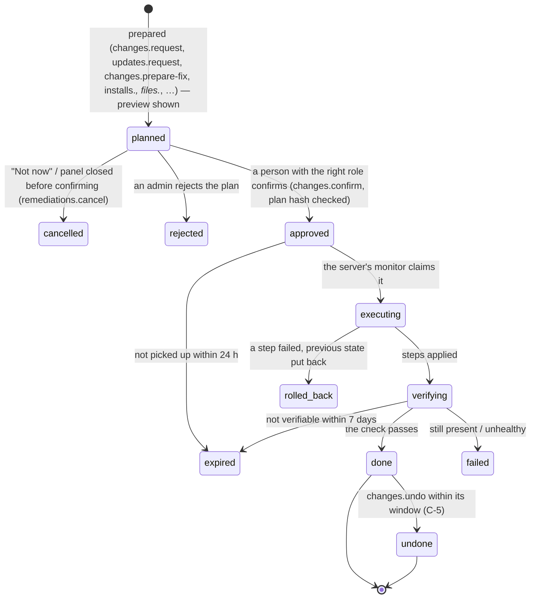
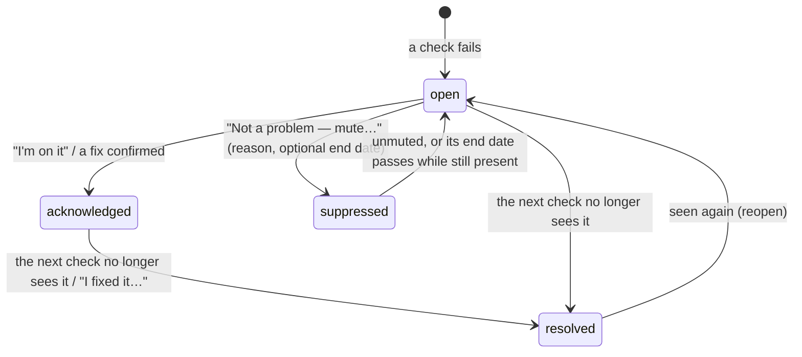
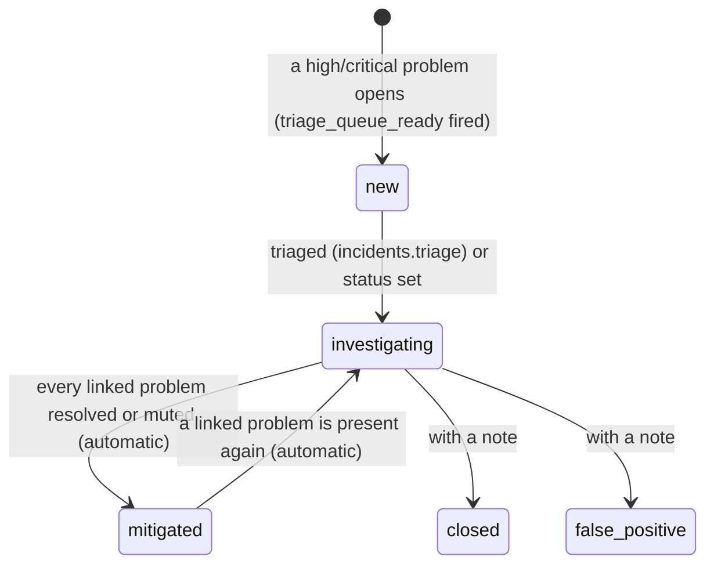

# Requirements: NetSentry

PART A — REQUIREMENTS (SRS). User-approved before build; frozen after; changes via ## Changes.

## Introduction

### Purpose
NetSentry is a team console that looks after the one server it runs on, and nothing else, in plain words. Its one job is to answer "is everything OK on this server, and what needs me?", and to let a person fix what needs them with one previewed, confirmed change. A small helper on that server, the monitor, reports how the server and its apps are doing. It applies only the typed changes a person confirmed, and only when changes are allowed at the server itself. The console covers what runs (apps with live processor and memory numbers) and what to fix, grouped by cause, each with its one button. It also covers app updates and backups, files, app settings, installing apps (from templates or a pasted Compose file), disk space, programs, the firewall, SSH keys, scheduled jobs and a recorded terminal. Every change is shown before it happens, is confirmed by a person, and most kinds can be undone. The team signs in with accounts and roles. An AI agent works on the same data through A2App with the 122 declared operations. It answers questions people ask on Home, triages cases and prepares changes. It never confirms one.

### Scope
**Goals**
1. Home shows in one load whether the server is OK: the monitor's state, the processor, memory and fullest-disk numbers, every app's running state, and the things to fix grouped by cause. It uses one count of things to fix everywhere.
2. Nothing changes on the server on a click alone. Every change is prepared and shown exactly (what will change, what it does to you, how to undo it). It runs only after a person with the right role confirms that exact plan, bound to its hash, and the agent's confirm is refused.
3. A confirmed change is applied by the server's own monitor, and only while changes are allowed at the server. It is followed live until it ends: done, didn't work, or put back. Files, app settings, removals, installs, firewall rules, SSH keys, scheduled jobs, starts and stops, and remote access can be undone within their window.
4. A question asked on Home reaches the agent and stays in sight until it is answered or withdrawn. When no agent is connected, or nobody answered within 15 minutes, the page says so.
5. Every mutation is recorded in a hash-chained audit log that an admin can verify and download.

**Core functionalities:** server home · problems grouped by cause with one fixing button · live server and app numbers · apps and app pages (logs, settings, updates, backups, access and safety) · installs from templates or a Compose file · server tools (files, disk space, programs, network and firewall, users and keys, scheduled jobs, terminal) · change preview, confirm, follow and undo · ask the agent · activity review · problems, fixes, cases and accepted risks · alert destinations and daily summary · monitor setup · team roles · tamper-evident audit log

### Approval
Approved by the user: 2026-11-04 — carried over from the published marketplace app `netsentry` 1.0.0, whose requirements were approved when it was built; this document restates them in the framework's form without changing any feature.

## Product Description

### Product Perspective
`authMode: multi-user`: a team looks after the server together, with roles enforced on the server. People sign in with email and password (PocketBase auth, through the kit's sign-in gate). Since v4, NetSentry looks after the one server it runs on and nothing else. It does not watch domains, websites or IP addresses, keep a list of machines, offer home, organisation or cloud setup modes, or discover devices on the local network (Original requirements, v4). The monitor (`sensor/`, Python) is installed on that server with `install.sh` (Linux, a systemd service) or `install.ps1` (Windows), using a one-time join key. It checks in, reports what it sees, samples live numbers while someone looks, and applies only the typed changes a person confirmed. Changes apply only when they are allowed at the server itself (`NETSENTRY_MANAGE=yes` at install). The terminal works only when it was switched on there too. manifest.json declares no integrations (`capabilities.integrations: []`). The backend alone calls the keyless public sources listed under External Interfaces: threat intelligence, container registries and GitHub for update and advisory intel, and DNS over HTTPS. Alert destinations are https addresses that admins enter, checked when they are entered. Email alerts go through CraftBot. NetSentry has no language model of its own. The agent is external, and it prepares changes for people to confirm.

### User Characteristics
People who run a self-hosted server: an owner or a small team. Admins set NetSentry up, confirm changes, and manage alerts, the team and settings. Analysts restart apps, back them up, work on problems and prepare changes. Viewers and auditors only read. They open Home to see whether the server is OK, and come back when an alert or the daily summary tells them something changed. Desktop browsers are the main device: from 1024 px the apps list stays beside the chosen app, and Home sets its cards side by side. Phones work too: a "Navigate" select replaces the sidebar, and the list and an app are two pages. The agent works only through the CLI.

### Constraints
- C-1: Roles are admin, analyst, viewer and auditor. Viewer and auditor have the same read-only level. The first account is admin and later accounts are viewers. Once one account exists, sign-up is closed unless an admin opens it ("Sign-up is closed. Ask a NetSentry admin to open sign-up in Workspace → Settings."). The role a client sends is ignored, and roles change only through `members.set-role` (admin). The last admin cannot be demoted ("This is the only admin. Make someone else admin first.").
- C-2: The agent acts with analyst rights. It is refused on every human-only operation (`lib/core/roles.js` HUMAN_ONLY): asking or withdrawing a question, confirming or undoing a change, file contents and file changes, app settings and Compose saves, and the terminal. The same goes for alert destinations, members, settings, detection rules, retention, backup plans and links, app keys and access reviews, activity verdicts, muting a problem, join tokens, registering and revoking monitors, approving and rejecting fixes, update policies and maintenance windows. Sensor-only operations refuse people and the agent ("Only a registered NetSentry sensor can call this.").
- C-3: Who confirms what: starts, stops, restarts and backups need an analyst or admin. Built-in fixes, restores, updates, installs, operating-system changes, files, app settings, removals, clean-ups, program stops, firewall, keys, scheduled jobs, remote access and commands need an admin ("Only an admin can confirm this kind of change."). A confirm is bound to the plan hash the person saw ("This change was altered after you saw it — look at it again before confirming."), and only a change still waiting (`planned`) can be confirmed.
- C-4: The monitor on the server applies changes only while changes are allowed there. Otherwise a confirm is refused ("Changes are switched off on this server — switch them on there first."). A confirmed change that has not started within 24 hours expires. One the server cannot verify within 7 days expires as "Could not be verified within 7 days."
- C-5: Undo windows, counted from when the change finished: files 7 days, app removals 7, installs 7, app settings 14, firewall 30, SSH keys 30, scheduled jobs 30, remote access 30, starts and stops 1. Restarts and every other kind cannot be undone. Only a change that worked can be undone, and only once. Undo is for admins and people only.
- C-6: Severities are info, low, medium, high and critical. On Home and in alerts they read "For your information", "When you have time", "Soon", "Important" and "Urgent", and a group broken right now reads "Broken now". Problem (finding) statuses are open, acknowledged (being handled), resolved and suppressed (muted, an accepted risk).
- C-7: Muting a problem needs a reason. An end date is optional, must be in the future and at most a year ahead ("Accept a risk for at most a year, then look at it again."). Once the end date passes, the problem counts again.
- C-8: Files: only the folders the server allows, set on the server itself (`NETSENTRY_FILE_ROOTS` for the monitor). Uploads and downloads go up to 20 MB. A deleted file goes to NetSentry's bin for 7 days. Saving a file that changed on the server since it was read is refused. Opening, editing, uploading and downloading files are for admins (people only).
- C-9: Terminal: admins only, who type their password again (after 5 wrong tries in ten minutes: "Too many wrong passwords — wait ten minutes."). It works only when the terminal is switched on at the server, with at most three open at once. A terminal closes after 15 minutes without typing and after 4 hours at most. Its transcript has secrets hidden and is kept 90 days.
- C-10: A question to the agent is 3–1000 characters, and at most 20 can wait at once ("The agent already has a lot waiting — give it a moment."). Only a person asks or withdraws one.
- C-11: Settings ranges: the name shown at the top 1–80 characters, change-history retention 7–3650 whole days, daily summary hour 0–23 UTC or -1 for off, access reviews every 30–366 days. The console address is https (plain http only on the server itself).
- C-12: Alert destinations: webhook (format slack, discord, ntfy or json), heartbeat (pinged every 1–1440 minutes) or craftbot_email. Names are 1–80 characters. Addresses must be public https: private, loopback, link-local and internal hosts are refused. They are stored encrypted and never returned; only a hint is shown.
- C-13: Every REST write to any collection is refused, for the superuser credential as well ("Use NetSentry operations (/api/ops/…) to change data; direct writes are disabled."). The only exceptions are signing up and changing your own email or password. Every write goes through an operation with its role check and audit entry. The audit log is append-only and hash-chained.
- C-14: A new scheduled job has a name of letters, numbers, spaces and - _ . ( ) of up to 60 characters, never containing "netsentry". It runs one command of up to 1000 characters on one schedule: every 5, 10, 15 or 30 minutes, every hour at a minute, every day at a time, every week on a day at a time, or when the server starts. Jobs can be made only while the terminal is switched on at the server. Only jobs made in NetSentry can be deleted; any other job can only be paused and resumed. NetSentry's own jobs are not paused here.
- C-15: Firewall and keys: closing the last rule that lets SSH in is refused, and remote login (22, 3389) is never blocked. Switching the firewall on allows remote login and NetSentry's own port first. Adding a key takes one public key line, and a private key is refused. Removing a key is refused when it would leave no administrator able to sign in while password logins are off.
- C-16: Words on screen: "server", never "machine"; "your local network"; no internal names (collector ids, rule ids) outside technical details.

### Assumptions
- A-1: Volume ceiling: 500 assets, 5,000 observations and 2,000 findings per workspace (Original requirements, Increment 1). Since v4 the workspace looks after one server and the apps on it.
- A-2: The monitor runs on the same server as NetSentry and checks in on its own schedule. A monitor that has not checked in for 10 minutes counts as offline.
- A-3: An agent counts as connected when NetSentry runs inside CraftBot or an agent has acted in NetSentry recently (`agent.presence`). Without one, questions and triage requests wait.

## Features

### Module: Access and frame (members, settings)
- F-ACC-1: The user can sign in, or create an account, with email and password on the kit's sign-in gate ("Sign in" / "Create account").
- F-ACC-2: WHEN the first account is created THE SYSTEM SHALL make it admin. Later accounts join as viewers, and only while sign-up is open.
- F-ACC-3: On wide screens the user sees a sidebar: the shield mark and the name shown at the top, then Home, Apps, Server, Activity and Settings, and at the foot their email, role pill and "Sign out". On phones a "Navigate" select and "Sign out" sit above the page.
- F-ACC-4: The user can reach every page and every level of detail at its own address (`#/…`), with breadcrumbs back up and a working browser Back.
- F-ACC-5: WHEN the user opens an address from an earlier version (`#/findings`, `#/incidents`, `#/fixes`, `#/assets`, `#/item`, `#/machines`, `#/protected`, `#/network`, `#/reports`, `#/sources`, `#/rules`, `#/workspace`, `#/overview`) THE SYSTEM SHALL open the place where that now lives.
- F-ACC-6: WHEN an admin opens Home and no monitor is set up on this server THE SYSTEM SHALL open the setup guide once per browser session, unless the admin finished or skipped it before.
- F-ACC-7: The user sees only the controls their role can use; others are hidden or read-only. WHEN a call goes beyond the role anyway THE SYSTEM SHALL refuse it ("Your role (viewer) cannot do this — it needs analyst.").
- F-ACC-8: The user sees NetSentry's own Slate colours in light and dark, whatever style the host is set to, with green, amber and red for status.

### Module: Home (home, help, changes)
- F-HOME-1: The user sees one status card. Its headline reads "Everything's running and safe", "One thing needs you" / "<n> things need you" (with "— <k> urgent" when some are urgent), "<app> is stopped" / "<n> apps are stopped", or "<server> isn't reporting". Under it are the server's name, its operating system, "<n> of <m> apps running", the stopped apps by name, "needs a restart", and "updated <n> s ago" with a "Live" pill while live.
- F-HOME-2: The user sees processor and memory as small graphs of the last 80 s while live (plain meters otherwise), and the fullest disk with its free space.
- F-HOME-3: An admin can press "Reconnect the monitor" when the monitor is silent, or "Update the monitor" when a newer one is ready. A drawer shows the one command to run on the server, and it turns to "Connected" or "Up to date" by itself.
- F-HOME-4: An analyst or admin can press "Check now". The server's monitor then runs every check ("Checking everything now — results arrive over the next minute."), or the page says "The monitor isn't running — start it, then try again."
- F-HOME-5: The user sees "Needs you": one tile per cause, so several apps without a backup are one item. Things broken right now come first, then the worst. Six tiles show, then "Show <n> more". Each tile has its urgency chip, a title, what it means, the apps it concerns (each a link to its page), "Why?", and the one button that fixes it.
- F-HOME-6: An analyst or admin can use a tile's button. It opens the update preview ("Update to …"), NetSentry's built-in fix ("Fix it"), the "Back them up" dialog (a folder and a daily plan), "Start now", the app's tab, "Open <app> to finish setup" (with "Stop it for now"), or "Show me how". Updates and fixes need an admin.
- F-HOME-7: WHEN a tile's problem is already being fixed THE SYSTEM SHALL show "Being fixed…" instead of its button. WHEN changes are switched off on the server THE SYSTEM SHALL disable change buttons and say "Changes are switched off on this server (Server → Overview)."
- F-HOME-8: WHEN nothing needs the user THE SYSTEM SHALL show "Nothing needs you right now", with a link to the items being handled.
- F-HOME-9: The user sees "Your apps". Each app shows Running, Stopped or "Not reported yet", its live memory and CPU, and "<n> to look at", with Open (its address on this server), Start (analyst or admin) and Manage. Admins also see "Add an app".
- F-HOME-10: The user sees "Recent activity" beside the apps, newest first. It lists changes made through NetSentry, with who asked, who confirmed and the result, and apps the monitor saw stop, start or restart. Admins get Undo on a change while it can still be undone.
- F-HOME-11: The user can ask the agent a question in their own words under "Ask the agent". The question shows "The agent is looking…" until the agent's answer appears. Any change the agent prepared shows with "Review" (analyst or admin), which opens the change panel to confirm.
- F-HOME-12: The user can withdraw a question while it waits. Every waiting question stays in sight, and the latest answers fill the list up to three.
- F-HOME-13: WHEN no agent is connected THE SYSTEM SHALL say "Waiting for an agent — none is connected. Open NetSentry from CraftBot (Agent Apps) and its agent picks this up; your question stays here until then." WHEN a question has waited 15 minutes THE SYSTEM SHALL say the agent hasn't answered yet instead of "looking".
- F-HOME-14: WHEN no monitor is set up THE SYSTEM SHALL show "Let NetSentry look after this server", with "Set it up" for admins and "An admin needs to set NetSentry up first." for everyone else.

### Module: Changes (changes, remediations)
- F-CHG-1: WHEN the user starts any change THE SYSTEM SHALL prepare it and open a side panel before anything happens. The panel has the steps Prepared → Review → Confirm → Checked and the blocks "What will change", "What it does to you", "Good to know" and "If you change your mind", with "Nothing happens until you confirm."
- F-CHG-2: The user can confirm a change with its own button ("Restart now", "Update now", "Remove it", "Install it", …). "Not now", or closing the panel before confirming, withdraws the prepared change.
- F-CHG-3: After Confirm, the user sees the change followed live in the panel: "Sent — waiting for the server to pick it up…", "Happening on the server now…", "Checking it worked…". It ends with done, "It didn't work", "It didn't work — everything is back as it was" or "The server didn't pick it up in time".
- F-CHG-4: WHEN the user closes the panel while a change runs THE SYSTEM SHALL carry on ("You can close this — it carries on.") and say how it ended in a toast ("<change> — done." or "<change> — didn't work: <reason>").
- F-CHG-5: An admin can undo a change that worked, from the panel or from a changes list ("Put it back as it was?" → "Undo it"), within its window. The undo is followed in the same panel.
- F-CHG-6: The user sees "Changes made" for the server and for each app: who asked, who confirmed, and the result. A change waiting for a person shows "Review". The list shows the last 50, with "Show all".

### Module: Apps (apps, updates, backups, accounts, logs)
- F-APP-1: The user sees Apps grouped Running, Stopped and "Not reported yet", with "Find an app". Each app shows its problem count, what it is, its version and its live memory and CPU, with a memory bar compared with the other apps. The header reads "<n> apps on this server · live", or "not live — numbers from …".
- F-APP-2: On screens 1024 px and wider the user sees the list beside the chosen app (the first app when none is chosen). On narrower screens the list and the app are two pages.
- F-APP-3: The user sees an app page header: its icon and name, "Important" for critical apps, and Running, Stopped, "Not on the server any more" or "State not reported yet". It also shows live memory and CPU, what it is and its version, with Open, Start / Stop / Restart for containers, and "Remove…".
- F-APP-4: The user sees the tabs Overview, Logs, Settings, Updates, Backups and "Access & safety"; Logs and Settings appear only for containers. Overview shows the app's numbers, "To fix" (or "Nothing to fix in <app>.") and "Changes made".
- F-APP-5: An analyst or admin can read an app's log. The server returns the last 300 lines, with secrets hidden, when asked, and the user can filter with "Only lines with…" and follow new lines.
- F-APP-6: An admin can change a container's settings on its Settings tab: ports, the settings it starts with (secret values hidden unless a new one is typed), the restart rule (Always unless someone stopped it, Always, Only when it crashed, Never) and folders. A running app restarts with the new settings. If it doesn't come back healthy, the old ones go back by themselves. A stopped app stays stopped.
- F-APP-7: An admin can choose "Edit the Compose file". Docker checks the edit, and each new risk it allows beyond the app's own folder must be ticked before Save. Settings of containers not started with Compose are shown, not changed.
- F-APP-8: On Updates, the user sees the waiting version ("<version> is ready (fixes only)" or "(new features)"). An analyst prepares an update and an admin confirms it: NetSentry copies the app's settings first, updates it, checks it comes back healthy, and puts the old version back by itself if not. "Roll back now" is offered within 14 days.
- F-APP-9: An admin can set an app's update policy: "Tell me when one is out", "Update small ones in my maintenance window" or "Never update it".
- F-APP-10: On Backups, an analyst can let NetSentry back the app up: a folder on the server and how often. NetSentry keeps 7 daily, 4 weekly and 6 monthly copies and tests a restore every month. The tab shows the last backup and offers back up now and test a restore. A restore from a chosen backup is confirmed by an admin.
- F-APP-11: A person can tell NetSentry about a backup tool they already use. It gives a private link, shown once, for the backup job to open when it finishes. The user sees what matters to back up for that app.
- F-APP-12: On "Access & safety", the user sees who can reach the app as paths in plain words: "This server", "Your local network" (or "Your VPC"), "Your devices away", "The whole internet". An analyst can choose who should reach it. The tab also has "Use it from away, safely" (Tailscale, Cloudflare Tunnel or a VPN), sign-in and safety checks, every check NetSentry runs on it, and technical details.
- F-APP-13: For apps whose accounts NetSentry can read with a read-only key (Gitea, Forgejo, Odoo), the user sees "Who has an account" (administrators and accounts that can't sign in), its owner and importance ("Critical — alert sooner"), and the access review. An admin can give or remove the key, which is stored encrypted and never shown again. An analyst can record an access review with a note.
- F-APP-14: An analyst can prepare "Remove…" and an admin confirms it. The choices are "Keep its data." (Undo starts it again) or "Remove everything." (its folder goes to NetSentry's bin for 7 days and its Docker volumes are deleted for good), with "Back it up first" when NetSentry backs it up.
- F-APP-15: WHEN an app has gone from the server THE SYSTEM SHALL say "Gone from the server since …" and show no controls.

### Module: Install an app (installs)
- F-INS-1: An admin can add an app from NetSentry's 13 templates: Jellyfin, Plex, Prowlarr, qBittorrent, Home Assistant, Immich, Vaultwarden, Nextcloud, Uptime Kuma, Odoo, Gitea, Wiki.js and Mattermost. The admin gives a name (its folder), who should reach it ("Everyone on my local network" or "Only this server"), and the media folder or apps folder where needed. Passwords are generated on the server.
- F-INS-2: An admin can install any other app by pasting its Compose file. Docker reads it, and NetSentry lists what it runs and every risk it allows beyond its own folder: full control, extra powers, the Docker socket, system folders, the server's network, open on every address, root. "Install it" stays disabled until each risk is ticked.
- F-INS-3: WHEN changes are switched off on the server THE SYSTEM SHALL say "Changes are switched off on this server" instead of offering the install.
- F-INS-4: The user sees apps NetSentry doesn't recognise under Apps, named after their Compose project or what the person called them at install, with logs, settings, updates, reach, backups and Remove.

### Module: Server (server, assets, metrics, os, files, disk, processes, firewall, keys, remote, schedules, terminal)
- F-SRV-1: The user sees the server header: its name, "Monitor reporting" or "Monitor silent since …" or "No monitor yet", the operating system, the monitor version, and "Changes allowed" or "Changes switched off". When changes are switched off, it says how to switch them on at the server. An analyst or admin has "Check now".
- F-SRV-2: The user can open the tabs Overview, Files, "Disk space", Programs, "Network & firewall", "Users & keys", "Scheduled jobs", Terminal, History and Details.
- F-SRV-3: Overview shows health: processor, memory, temperature and uptime over 1 h, 24 h, 7 d or 30 d. It also shows operating-system updates ("<n> security updates waiting" with "Install now", and "Restart in 5 minutes"; the kernel, remote login, networking and Docker are never updated by NetSentry), the server's own "To fix on the server" tiles, and "Changes made here".
- F-SRV-4: An admin can work with files in the folders the server allows: browse, open and edit text, and see the change line by line before saving. The admin can also upload, download, make a new folder, rename, and delete to NetSentry's bin for 7 days. Folders the server allows read-only say "Read-only here."
- F-SRV-5: The user sees each disk's free space and the biggest folders. An analyst can prepare a clean-up that removes only caches: Docker images no app uses, Docker's build cache, the system journal (down to 200 MB), roll-back copies older than 3 days, and NetSentry's bin. Each shows what it frees, and volumes and people's files are never touched.
- F-SRV-6: The user sees the busiest programs (CPU, memory, user, app). An analyst can prepare "Stop": the program is asked to close and forced after 10 s. The operating system, remote login, Docker, NetSentry and programs inside an app show a dash instead.
- F-SRV-7: The user sees the firewall in words (ufw, firewalld, Windows Firewall; plain nftables is only shown) and what accepts connections. An analyst can prepare "Open a port for an app", "Close", "Switch it on", and Windows rule and profile toggles.
- F-SRV-8: An analyst can prepare "Install Tailscale" under "Reach this server from away, privately". The person who asks can then sign it in; the sign-in link is shown only to them and never stored. Cloudflare Tunnel stays a guide.
- F-SRV-9: The user sees who can sign in, the administrators and their SSH keys. An analyst can prepare "Add a key" (one public key line; "That is a private key — never share it. Paste the .pub file instead.") or "Remove".
- F-SRV-10: The user sees cron lines, systemd timers and Windows tasks in words ("every day at 02:30"). An analyst can prepare Pause and Resume, and "New scheduled job", which shows "Runs <schedule>, as <user>". Jobs made in NetSentry are marked "made in NetSentry" and can be deleted, and Undo puts a deleted one back.
- F-SRV-11: An admin can open a real shell on the server when the terminal is switched on there. NetSentry asks for the password again ("Your password, please"). The session is marked "recorded" and "closes after 15 minutes without typing". Past sessions open "What the terminal showed", recorded with passwords, tokens and keys hidden.
- F-SRV-12: The user sees History (what appeared, disappeared or changed between checks) and Details: links to the security score and to every problem in a table, "What NetSentry checks here", and "Everything the monitor sees".
- F-SRV-13: WHEN the server has no monitor yet THE SYSTEM SHALL say "This server isn't set up yet", with "Set it up" for admins.

### Module: Activity (detections, changes, audit)
- F-ACT-1: The user can open Activity's tabs "To review", "On the server", Network and "Who did what", with links to All problems and Accepted risks.
- F-ACT-2: The user sees "To review": things that happened on the server, such as a new program, a new startup item or a changed system file. An analyst or admin can answer "Expected", which closes it for good, or "Looks wrong", which adds it to Needs you.
- F-ACT-3: The user sees what changed on the server between checks over 7 days, the network (destinations, programs on the network, DNS names and IDS alerts), and a readable 7-day slice of the audit log under "Who did what".

### Module: Problems, fixes and cases (findings, remediations, incidents, baselines, posture)
- F-PRB-1: The user sees an issue page in order: what was found, what it means or why it matters, "How to fix it", "Other options", and technical details (detection rule, raw evidence, references) one level down.
- F-PRB-2: Under "How to fix it", the user sees "Do it yourself" steps. When fixes apply, "NetSentry can fix this itself" or "Let the agent do it" is listed with risk words ("Low risk", "Medium risk", "High impact", "Done by you"). An analyst or admin can start one ("Guide me through it", "Ask the agent to fix it"). A fix under way shows its state with "Open the fix".
- F-PRB-3: An analyst or admin can mark a problem "I'm on it", "I fixed it…" (saying what they did) or "Not a problem — mute…" (a reason and an optional "Mute until" date), and can unmute it.
- F-PRB-4: WHEN something new appeared THE SYSTEM SHALL ask "Is this expected?", and an analyst or admin can confirm it as expected, which closes the issue.
- F-PRB-5: WHEN a later check no longer sees a problem THE SYSTEM SHALL resolve it automatically, and WHEN it is seen again THE SYSTEM SHALL reopen it.
- F-PRB-6: The user sees "Accepted risks": what people decided is fine, why, and until when. A risk past its date shows "Lapsed — counting again". Muted problems don't count against the score.
- F-PRB-7: The user sees a fix page with its progress as steps and who acts next, following the change live. An admin can reject a plan with a reason. A person can mark a fix done by hand ("I did this — verify it"); NetSentry re-checks, and the fix counts as done only if the problem is gone.
- F-PRB-8: WHEN a high or critical problem opens, reopens or is raised to high or critical THE SYSTEM SHALL add it to the active case for its root (the server), or open a new case. Lower severities never open cases.
- F-PRB-9: The user sees Cases and each case page: the assessment (summary, who triaged, when, confidence), the issues in the case, and a timeline of system events and notes.
- F-PRB-10: An analyst or admin can change a case's status, assign a member, add a note, write the assessment (at least 20 characters, with a confidence), or ask the agent to take a look. Closed and false positive need a note.
- F-PRB-11: WHEN every problem of a case is resolved or muted THE SYSTEM SHALL mark the case mitigated. WHEN one of them is present again THE SYSTEM SHALL reopen the case to investigating. A case's severity follows its problems up and down.
- F-PRB-12: The user sees the security score page ("100 means nothing is open. Every open problem takes points off — urgent ones the most"), where the points go, every problem one by one (`#/issues`), and every problem in a table (`#/issues/all`).
- F-PRB-13: An analyst or admin can mark the server's current open ports as expected under "Programs expected to accept connections" (Network & firewall), so that a new-listener check stops flagging them.

### Module: Settings (settings, sensors, notifiers, members, rules, sources, windows, digest, retention, audit)
- F-SET-1: The user can open the Settings tabs Monitor, Alerts, Team, "General & fixes" and Updates. "More settings" holds "Detection rules", Checks and "Audit log".
- F-SET-2: The user sees "The monitor on this server" (status, version, changes allowed or switched off), with the command to update it and the command to allow or switch off changes for the server's operating system. Only the server can change that.
- F-SET-3: An admin can add alert destinations: a chat app or phone notification (Slack, Discord, ntfy, or another service as JSON), a "still running?" check-in service (heartbeat, pinged every N minutes), or email sent by the agent through CraftBot. Each destination has a minimum severity ("Important and urgent", "Soon and above (also checks that stop working)", "Everything except "for your information"") and "Include the daily summary".
- F-SET-4: An admin can test a destination ("Test alert delivered." / "Delivery failed."), see its last result, switch it off and on, and remove it after "Remove destination?".
- F-SET-5: WHEN a new case opens (or a critical problem joins one) THE SYSTEM SHALL alert the destinations whose minimum severity it meets. Failing checks alert at medium.
- F-SET-6: An admin can set the hour (UTC) of the daily summary, or turn it off, and send it now. It goes to destinations with "Include the daily summary" on, carries an audit checkpoint, and asks the agent (if connected) to go through it.
- F-SET-7: The user sees the members, with the role (Admin, Analyst, Viewer, "Auditor (read-only, with the audit log)") and when each joined. An admin changes roles there.
- F-SET-8: An admin can change the name shown at the top and the change-history retention days, open or close sign-up ("Open — anyone who can reach this app can create a viewer account"), and pause all fixes (the emergency brake). An admin can also delete old history now after "Delete old history?". Others see "Only admins can change settings."
- F-SET-9: An admin can create, change and remove weekly maintenance windows (days, start, duration, in the browser's time zone). Updates that a policy allows are applied only inside a window.
- F-SET-10: An admin can turn a detection rule off or change its severity, and open problems follow at once. Everyone else sees the rules read-only.
- F-SET-11: The user sees Checks, each with its health, last run, next run and last error, plus the check history of the last 24 hours. An analyst or admin can "Run now", and an admin can switch a check off and on.
- F-SET-12: The user sees the audit log of the last 30 days (When, Actor, Action, Summary), filtered by People, Agent or System. An admin can "Verify chain", which reports intact or the first broken entry, and "Download" the whole log as JSON Lines that `scripts/verify-audit-export.cjs` checks anywhere.

### Module: Setup (sensors, apps, notifiers)
- F-STP-1: An admin can follow "Let NetSentry look after this server" in three steps: "Install the monitor on this server", "Who should reach your apps", "Get told when something is wrong". The admin can stop at any point and come back from Home.
- F-STP-2: The user sees the exact install command for the server's operating system, with a one-time key that works once for one day: `curl … install.sh | sudo … sh` in a terminal, or `irm … install.ps1 | iex` in PowerShell as Administrator. The step shows "Reporting ✓" by itself once the monitor reports.
- F-STP-3: The user can answer, for each app the monitor found, who should be able to reach it. NetSentry then checks that only they can.

### Agent (via A2App)
- F-AGT-1: The agent can work NetSentry through the 122 operations in ## Operations Design, with analyst rights. WHEN it calls a human-only operation THE SYSTEM SHALL refuse it (`"<op>" can only be done by a person (signed in to NetSentry), never by the agent.`). Sensor-only operations refuse it too.
- F-AGT-2: The agent can take a `help_requested` task. It reads the waiting questions with `help.pending` and looks with read-only operations (`home.overview`, `metrics.series`, `logs.request` / `logs.result`, `changes.list`, `findings.explain`, `assets.timeline`). It prepares any change with `changes.request`, `updates.request`, `changes.prepare-fix` or `commands.prepare`, then answers with `help.answer`, listing up to 10 prepared changes that are still waiting.
- F-AGT-3: WHEN the agent prepares a change THE SYSTEM SHALL leave it waiting until a person confirms it in NetSentry, and SHALL refuse the agent's own confirm.
- F-AGT-4: The agent can take a `triage_queue_ready` task: `incidents.untriaged`, then `incidents.context` (internet data marked `untrusted_evidence`), then `incidents.triage` with a summary of at least 20 characters, a confidence and an optional corrected severity. That clears "needs triage" and moves a new case to investigating.
- F-AGT-5: The agent can take a `daily_digest` task (posture, digest preview and cases waiting, summarised for the user) and a `source_unhealthy` task (diagnose a check that failed 3 times in a row, with one `sources.run-now` at most).
- F-AGT-6: WHEN a question waits THE SYSTEM SHALL ring the agent again every 5 minutes for a day. WHEN triage waits THE SYSTEM SHALL ring it again every 6 hours.
- F-AGT-7: The agent can prepare one exact command with `commands.prepare` (argv, why, a time limit of up to 600 s), only while the terminal is switched on at the server. It is shown verbatim, runs as root after an admin confirms, and its output is recorded with secrets hidden.
- F-AGT-8: WHEN the agent calls a destructive operation (`assets.delete`, `retention.prune`, `notifiers.delete`, `sensors.revoke`, `backups.delete-plan`, `apps.remove`, `windows.delete`) THE SYSTEM SHALL answer `approval_required` until a person has approved that call.
- F-AGT-9: WHEN the agent changes anything THE SYSTEM SHALL record it in the audit log with the actor `agent`.

## Non-Functional Requirements
- N-1: While NetSentry is open in a visible tab, the server's processor, memory, fullest disk and every app's state, CPU and memory update every 2 s. A sample older than 10 s is not live. When nobody is looking, the monitor stops sampling.
- N-2: An app that stops, crashes or starts reaches NetSentry within seconds, from Docker's own events, even with nobody looking. Home's tile, the app's state and a toast ("<app> just stopped." / "<app> is running again.") follow without a reload.
- N-3: While someone looks at the server or an app, its monitor checks in every 2 s for the next minute (`machines.watch`, re-sent every 45 s while the tab is visible). A confirmed change is then picked up within seconds.
- N-4: A monitor that has not checked in for 10 minutes is marked offline (minute job).
- N-5: Every outbound call has a timeout of at most 60 s (collectors 20 s by default). The minute tick runs due checks within a 40 s budget, and one failing source never blocks the others in the same tick.
- N-6: Rate limits: 300 requests per minute on `/api/ops/`, 30 per minute on sign-in and 1,200 per minute on `/api/collections/`. The terminal stream has its own routes outside the operations' limit.
- N-7: No external data request is made from the browser. Every outside source is called from the hooks.
- N-8: First paint on an empty database produces no errors.
- N-9: Server and app numbers are kept as 1-minute, then 15-minute, then hourly points, and hourly points go after 90 days. `metrics.series` returns at most 240 points per range (1 h, 6 h, 24 h, 7 d, 30 d, 90 d).

## Data Requirements
- **users** (module: incidents): password (string, required), tokenKey (string, required, max 60), email (string, required), emailVisibility (boolean), verified (boolean), name (string, max 255), avatar (binary), created (datetime, server-set), updated (datetime, server-set), role (enum).
- **settings** (module: settings): workspace_name (string, required, max 80), signup_open (boolean), retention_days (number), created (datetime, server-set), updated (datetime, server-set), digest_hour (number), digest_last_sent (string, max 10), remediation_paused (boolean), auto_approve_low_risk (boolean), setup_mode (enum), report_recipients (json), access_review_days (number), cloud_enrol_roles (json), console_url (string, max 300).
- **audit_log** (module: audit): seq (number, required), actor_type (enum, required), actor_label (string, max 200), action (string, required, max 80), target_collection (string, max 60), target_id (string, max 60), summary (string, max 500), detail (json), at (string, required, max 30), prev_hash (string, max 64), hash (string, required, max 64).
- **assets** (module: assets): kind (enum, required), identifier (string, required, max 255), label (string, max 120), ownership (enum, required), verify_token (string, max 64), status (enum, required), added_by (string, max 200), first_seen (datetime), last_seen (datetime), created (datetime, server-set), updated (datetime, server-set), parent (ref → assets).
- **sources** (module: sources): collector (string, required, max 60), target (ref → assets), schedule_minutes (number, required), next_run (datetime), enabled (boolean), health (enum, required), last_run (datetime), last_error (string, max 1000), consecutive_failures (number), run_count (number), created (datetime, server-set), updated (datetime, server-set), sensor (ref → sensors).
- **scan_runs** (module: records): source (ref → sources), collector (string, max 60), target_label (string, max 255), trigger (enum), status (enum, required), observations (number), changes (number), findings_opened (number), findings_resolved (number), duration_ms (number), error (string, max 1000), note (string, max 500), started (datetime, required), created (datetime, server-set).
- **observations** (module: assets): asset (ref, required → assets), source (ref → sources), kind (string, required, max 60), subject (string, required, max 255), key (string, required, max 400), data (json), present (boolean), first_seen (datetime), last_seen (datetime), created (datetime, server-set), updated (datetime, server-set).
- **changes** (module: changes): asset (ref, required → assets), kind (string, required, max 60), subject (string, required, max 255), change (enum, required), before (json), after (json), at (datetime, required).
- **rules** (module: rules): rule_id (string, required, max 20), title (string, required, max 200), category (string, required, max 40), severity_default (enum, required), severity_override (enum), enabled (boolean), version (number), rationale (string, max 4000), params (json), updated (datetime, server-set).
- **baselines** (module: baselines): asset (ref, required → assets), kind (string, required, max 60), accepted (json), accepted_by (string, max 200), at (datetime, required).
- **findings** (module: findings): fingerprint (string, required, max 400), rule_id (string, required, max 60), asset (ref, required → assets), subject (string, max 255), title (string, required, max 300), category (string, max 40), severity (enum, required), status (enum, required), evidence (json), first_seen (datetime, required), last_seen (datetime, required), resolved_at (datetime), reopen_count (number), status_note (string, max 1000), status_by (string, max 200), created (datetime, server-set), updated (datetime, server-set), incident (ref → incidents), plain_title (string, max 300).
- **suppressions** (module: findings): fingerprint (string, required, max 400), reason (string, required, max 500), until (datetime), created_by (string, max 200), created (datetime, server-set).
- **intel** (module: posture): cve (string, required, max 30), kev (boolean), kev_name (string, max 300), kev_added (string, max 10), epss (number), epss_percentile (number), refreshed_at (datetime).
- **indicators** (module: records): type (enum, required), value (string, required, max 255), source (string, required, max 40), refreshed_at (datetime).
- **incidents** (module: incidents): title (string, required, max 300), severity (enum, required), status (enum, required), correlation_key (string, required, max 200), root_asset (ref → assets), assignee (ref → users), needs_triage (boolean), summary (string, max 8000), confidence (enum), triaged_by (string, max 200), triaged_at (datetime), finding_count (number), opened_at (datetime, required), last_activity (datetime, required), closed_at (datetime), agent_request (string, max 40), created (datetime, server-set), updated (datetime, server-set).
- **incident_notes** (module: records): incident (ref, required → incidents), kind (enum, required), body (string, required, max 5000), actor_type (enum, required), actor_label (string, max 200), created (datetime, server-set).
- **notifiers** (module: notifiers): kind (enum, required), name (string, required, max 80), format (enum), url_encrypted (string, max 4000), url_hint (string, max 120), min_severity (enum), send_digest (boolean), interval_minutes (number), enabled (boolean), last_sent (datetime), last_ok (boolean), last_error (string, max 1000), sent_count (number), created (datetime, server-set), updated (datetime, server-set).
- **sensors** (module: sensors): name (string, required, max 80), status (enum, required), hostname (string, max 255), platform (string, max 40), os (string, max 200), version (string, max 40), is_admin (boolean), last_seen (datetime), environment (json), capabilities (json), config (json), asset (ref → assets), dropped (number), registered_by (string, max 200), created (datetime, server-set), updated (datetime, server-set), password (string, required), tokenKey (string, required, max 60), email (string, required), emailVisibility (boolean), verified (boolean), run_requested (datetime), joined_with (string, max 300).
- **signals** (module: sensors): asset (ref, required → assets), sensor (ref → sensors), kind (string, required, max 60), key (string, max 255), window_start (datetime, required), count (number), data (json).
- **agent_access** (module: agent): asset (ref, required → assets), can_execute (boolean), method (string, max 60), missing (string, max 1000), reported_at (datetime).
- **apps** (module: apps): key (string, required, max 300), app_type (string, required, max 60), asset (ref, required → assets), display_name (string, max 120), label (string, max 120), container (string, max 200), compose_project (string, max 120), compose_service (string, max 120), version (string, max 60), endpoints (json), recognised_by (json), importance (enum, required), owner (string, max 200), status (enum, required), first_seen (datetime), last_seen (datetime), created (datetime, server-set), updated (datetime, server-set), update (json), update_policy (enum).
- **intents** (module: apps): app (ref, required → apps), reach (enum, required), specific (json), sign_in_required (boolean), source (enum, required), set_by (string, max 200), set_at (datetime), created (datetime, server-set), updated (datetime, server-set).
- **backup_plans** (module: records): name (string, required, max 120), asset (ref → assets), apps (list<ref> → apps), method (enum, required), schedule_hours (number), grace_hours (number), destination (string, max 200), token_hash (string, max 128), last_success (datetime), last_failure (datetime), last_note (string, max 300), created_by (string, max 200), created (datetime, server-set), updated (datetime, server-set), keep_daily (number), keep_weekly (number), keep_monthly (number), test_every_days (number), last_test (datetime), last_test_result (string, max 300).
- **evaluations** (module: records): fingerprint (string, required, max 400), control (string, required, max 60), control_version (number), outcome (string, max 30), subject_type (enum, required), subject_key (string, required, max 300), asset (ref → assets), app (ref → apps), state (enum, required), reason (string, max 500), severity (string, max 20), factors (json), evidence (json), sources (json), plain_title (string, max 200), finding (ref → findings), first_failed (datetime), evaluated_at (datetime), created (datetime, server-set), updated (datetime, server-set), alerted_at (datetime), alerted_severity (string, max 20).
- **app_intel** (module: records): app_type (string, required, max 60), latest_version (string, max 60), latest_published (datetime), advisories (json), advisory_source (string, max 200), fetched_at (datetime), error (string, max 500), created (datetime, server-set), updated (datetime, server-set).
- **detections** (module: detections): dedupe_key (string, required, max 400), rule_id (string, required, max 60), asset (ref → assets), subject (string, max 255), summary (string, max 300), severity (string, max 20), evidence (json), verdict (enum, required), verdict_by (string, max 200), count (number), first_at (datetime), last_at (datetime), finding (ref → findings), created (datetime, server-set), updated (datetime, server-set).
- **networks** (module: os): cidr (string, required, max 50), name (string, max 120), purpose (enum), source (enum, required), state (enum, required), gateway (string, max 50), seen_by (ref → assets), confirmed_by (string, max 200), confirmed_at (datetime), last_scan (datetime), device_count (number), created (datetime, server-set), updated (datetime, server-set).
- **devices** (module: records): key (string, required, max 100), network (ref → networks), ip (string, required, max 50), mac (string, max 30), hostname (string, max 200), kind (enum, required), label (string, max 120), owner (string, max 200), open_ports (json), web (json), apps (json), monitored_by (ref → assets), status (enum, required), first_seen (datetime), last_seen (datetime), created (datetime, server-set), updated (datetime, server-set).
- **app_access** (module: records): app (ref, required → apps), secret (string, max 500), hint (string, max 20), added_by (string, max 200), added_at (datetime), last_ok (datetime), last_error (string, max 300), created (datetime, server-set), updated (datetime, server-set).
- **access_reviews** (module: records): app (ref, required → apps), reviewer (string, max 200), reviewed_at (datetime), note (string, max 1000), accounts (json), created (datetime, server-set).
- **reports** (module: sensors): period (string, required, max 20), kind (enum, required), generated_at (datetime), generated_by (string, max 200), data (json), sent_to (json), created (datetime, server-set).
- **join_tokens** (module: records): label (string, required, max 120), token_hash (string, required, max 128), expires_at (datetime, required), max_uses (number), uses (number), revoked (boolean), created_by (string, max 200), last_used (datetime), created (datetime, server-set), updated (datetime, server-set).
- **metrics** (module: metrics): asset (ref, required → assets), subject (string, required, max 200), tier (enum, required), t (datetime, required), v (json).
- **image_intel** (module: records): registry (string, required, max 120), repo (string, required, max 200), tag (string, required, max 128), digest (string, max 100), newer_patch_minor (string, max 128), newer_major (string, max 128), checked_at (datetime), error (string, max 300).
- **maintenance_windows** (module: records): name (string, required, max 80), assets (list<ref> → assets), weekdays (json), start_minute (number), duration_minutes (number), utc_offset_minutes (number), enabled (boolean), last_run (datetime), created_by (string, max 200), created (datetime, server-set), updated (datetime, server-set).
- **backups_taken** (module: backups): plan (ref → backup_plans), app (ref → apps), asset (ref → assets), archive (string, required, max 200), size_bytes (number), sha256 (string, max 64), taken_at (datetime), contents (string, max 300), removed (boolean), tested_at (datetime), test_result (string, max 300), created (datetime, server-set).
- **help_requests** (module: help): question (string, required, max 1000), asked_by (string, max 200), status (enum, required), answer (string, max 8000), changes (json), answered_at (datetime), created (datetime, server-set), updated (datetime, server-set).
- **file_transfers** (module: files): asset (ref → assets), direction (enum, required), name (string, required, max 255), size (number), sha256 (string, max 64), file (binary), created_by (string, required, max 40), created (datetime, server-set).
- **terminal_sessions** (module: terminal): user (ref, required → users), user_email (string, max 200), asset (ref → assets), status (enum, required), start_by (datetime), started_at (datetime), ended_at (datetime), reason (string, max 200), run_as (string, max 100), cols (number), rows (number), transcript (string, max 2000000), created (datetime, server-set), updated (datetime, server-set).
- **terminal_io** (module: terminal): session (ref, required → terminal_sessions), seq (number), data (string, max 100000), created (datetime, server-set).
- **live_status** (module: records): asset (ref, required → assets), at (datetime), data (json), created (datetime, server-set), updated (datetime, server-set).

## External Interfaces
- **Human (browser):** one multi-user View behind the kit's sign-in gate, served by PocketBase at the app's own origin, with hash routes. They are `#/` (Home); `#/apps` and `#/app/<id>[/logs|settings|updates|backups|access|remote]`; `#/install`; `#/server[/files|disk|programs|network|users|schedules|terminal|history|details]`; and `#/activity[/changes|network|actions]`. Then `#/settings/<monitor|alerts|team|general|updates|rules|checks|audit>`, `#/setup[/apps]`, `#/issue/<id>[/technical|steps]`, `#/fix/<id>[/technical]`, `#/case/<id>[/technical]`, `#/issues[/cases|fixes|handled|all]`, `#/score` and `#/accepted`. On top of these come the change side panel and the dialogs opened from these pages. File input: files up to 20 MB to upload to the server, and a pasted Compose file. File output: files downloaded from the server, and the audit log as JSON Lines.
- **Agent (A2App):** the modules and collections in AGENT_APP.md § Modules; operations exactly as declared in ## Operations Design; tasks with the capabilities `triage_queue_ready`, `daily_digest`, `source_unhealthy`, `help_requested` (events.json). No other machine interface is offered to agents; the app's own screens call their own routes.
- **Third-party services (backend only):** `api.first.org`, `api.github.com`, `cloudflare-dns.com`, `feodotracker.abuse.ch`, `ghcr.io`, `hub.docker.com`, `urlhaus.abuse.ch`, `www.cisa.gov`, `www.spamhaus.org`.

## Out of Scope
- Looking after anything but the one server NetSentry runs on. That excludes watching domains, websites or IP addresses, a list of machines or "add a machine", changes across many machines, home / organisation / cloud setup modes, an organisation menu (Network, Reports), and devices on the local network (Original requirements, v4).
- Any change to the server without a person's confirmation, and any change while changes are switched off at the server.
- The agent confirming or undoing a change, running anything itself, opening a terminal, reading or changing file contents or app settings, or deciding alerts, rules, members, settings, backups or verdicts.
- Updating the kernel, remote login, networking or Docker (left to a person with a restart planned), and automatic database major-version updates.
- Cleaning up Docker volumes or people's files. Stopping the operating system, remote login, Docker, NetSentry or a program inside an app.
- Deleting scheduled jobs not made in NetSentry, and pausing NetSentry's own jobs.
- Changing plain nftables firewalls (shown only), and setting up Cloudflare Tunnel (a guide only).
- Files over 20 MB through NetSentry (the terminal is for those).
- Keeping log lines read on request, or the Tailscale sign-in link.
- Identity and MFA checks, lookalike domains, and the HTTP→HTTPS redirect check (Increment 7 gaps).
- Whole-account or AWS Organizations cloud scanning, and enrolment through CraftBot's share channel (Increment 8).
- A language model of NetSentry's own. Questions and triage go to an external agent.

## Quality of Life
- Coming back to Home shows the last overview at once (kept in the store) while it reloads.
- "Needs you" shows six tiles and "Show <n> more" instead of a scrolling box, and a tile's description scrolls inside a fixed-height tile.
- A long app name on a tile's button is cut with "…", and the button's title names it in full.
- The newest item in Recent activity is marked with the accent for its first 10 minutes.
- On the Apps list, the memory bars compare the apps with each other.
- The install and reconnect commands have a copy button. When copying is blocked, the text is selected with "Selected — press Ctrl+C to copy it."

PART B — TECHNICAL SPECIFICATION.

## System Overview
PocketBase 0.39 (JS hooks, migrations) + React 19 / Vite / Tailwind 4 View in `frontend/` built into `pb/pb_public/`, on the `blueprint-pocketbase-kit` toolkit. The View calls the app's own routes `/api/ops/<group>-<verb>`, one per declared operation (`ops.pb.js`, GET for reads and POST for writes), through the dispatcher `lib/ops.js`. The dispatcher resolves the actor, checks the role (`lib/core/roles.js`), reads the parameters and calls a service in `lib/services/`. The generated `a2app_routes.pb.js` serves the same handlers to agents. The detection engine lives in `lib/v2/` (catalogue, recognition, reach, checks, typed actions, the "to fix" grouping in `todo.js`) and `lib/rules/`. Jobs live in `scheduler.pb.js`, membership and the write guard in `bootstrap.pb.js`, and the superuser limits in `security.pb.js`. The monitor (`sensor/netsentry_sensor`, Python) talks to the console through the sensor-only operations and its own routes: `/api/netsentry/join`, `/api/netsentry/sensor/install.sh`, `install.ps1` and `files`, `/api/netsentry/terminal/exchange` and `input`, and the backup heartbeat link `/api/netsentry/hb/{token}`. `/api/netsentry/whoami` lets NetSentry recognise its own console as an app.

Modules → navigation map:

| Module (manifest) | Where a person meets it | Route |
| --- | --- | --- |
| `home`, `help`, `metrics` | Home: status card, Needs you, Your apps, Recent activity, Ask the agent | `#/` |
| `changes`, `remediations` | The change side panel opened from every change button; "Changes made" lists; fix pages | everywhere; `#/fix/<id>` |
| `apps`, `logs`, `updates`, `backups`, `accounts` | Apps list and app page tabs | `#/apps`, `#/app/<id>/<tab>` |
| `installs`, `catalogue` | Add an app (templates, paste a Compose file); app names and icons | `#/install` |
| `server`, `assets`, `os`, `files`, `disk`, `processes`, `firewall`, `keys`, `remote`, `schedules`, `terminal`, `machines`, `baselines` | Server page and its tabs | `#/server/<tab>` |
| `detections`, `activity` | Activity: To review, On the server, Network, Who did what | `#/activity/<tab>` |
| `findings`, `incidents`, `posture` | Issue, case and problem pages, security score, accepted risks | `#/issue/<id>`, `#/case/<id>`, `#/issues`, `#/score`, `#/accepted` |
| `settings`, `members`, `notifiers`, `digest`, `windows`, `retention` | Settings: General & fixes, Team, Alerts, Updates | `#/settings/<tab>` |
| `sensors` | Settings → Monitor; Setup; reconnect and update drawers (the sensor-only operations are the monitor's) | `#/settings/monitor`, `#/setup` |
| `rules`, `sources`, `audit` | Settings → More settings: Detection rules, Checks, Audit log | `#/settings/rules`, `/checks`, `/audit` |
| `agent`, `commands`, `fixes` | No screen of their own. `agent.presence` decides what Ask the agent says; `commands.prepare` is the agent's; `fixes.monitor-report` is the monitor's | — |

Menu order: Home, Apps, Server, Activity, Settings. Pages that open from Home sit under the place they belong to: an app under Apps, the security score under Server, problems, cases and accepted risks under Activity.

## UI Design
- **Design system:** the agent-app UI kit 0.6.0 vendored in `frontend/src/kit` (system-managed). It supplies the `--agent-app-*` tokens (`kit/theme/tokens.css`, Inter font stack), the shell, the sign-in gate, the sidebar, the components (Button, Pill, Dialog, Drawer, Tabs, Table, Select, Input, Textarea, Spinner, EmptyState, PageHeader, Section) and toasts. NetSentry extends it in `frontend/src/app/theme.css`, where its own Slate palette sets the kit's colour tokens with `!important` for light and `[data-theme='dark']` (background, surface, text, muted, border, accent, accent-contrast, radius 0.5rem). It keeps that look whatever style the host is set to. Status colours are fixed in `components/visual.tsx` (`TONE_COLOR`): good `rgb(22 163 74)`, warn `rgb(217 119 6)`, bad `rgb(220 38 38)`, and neutral (the muted token). The app's own pieces: `Breadcrumbs` / `DrillList` / `DrillRow`, `PageTabs`, `useChange` (the change side panel), `ProblemCard`, `Live`, and its own SVG icons in `components/icons.tsx`. The terminal uses xterm.js.
- **Layout:** the kit's app shell with a left sidebar from 768 px (brand, the five places, the account at the foot). Below 768 px a "Navigate" select and "Sign out" sit above the page. Pages are centred, up to `max-w-6xl` (the app page alone `max-w-3xl`). They are made of bordered cards with rounded corners (`rounded-xl`) and a header row (title on the left, links on the right). Home is a column of cards. From 1024 px the status text sits beside the 300 px meters, and Your apps beside Recent activity (340 px). Tiles flow in a grid of at least 240 px each. Long lists scroll inside their card (480 px high at most).
- **Screen — Sign-in:** primary object: the account · primary action: "Sign in" / "Register" · the kit's gate with "Sign in" / "Create account" and "No account? Register" / "Have an account? Sign in" · error: the kit's inline message, or the server's refusal ("Sign-up is closed. …") · narrow: one centred card.
- **Screen — Home:** primary object: the server's state · primary action: the button on the first "Needs you" tile ("See what needs you" scrolls to it) · loading: a centred spinner until the overview arrives; coming back shows the last overview at once · empty: no monitor → "Let NetSentry look after this server" with "Set it up"; nothing to fix → "Nothing needs you right now"; no apps → "No apps found on this server yet."; no activity → "Nothing has happened yet. Changes you make here, and apps stopping or starting, show up as they happen." · error: "NetSentry couldn't load this page. Reload to try again."; a silent monitor → "<server> isn't reporting" with "Reconnect the monitor" · in-flight: buttons show a spinner and are disabled while a change is being prepared · success: toasts ("Checking everything now — results arrive over the next minute.", the server's own message), and tiles, apps and activity update live · narrow: one column ordered status, Needs you, Your apps, Recent activity, Ask the agent.
- **Screen — Change panel:** a side drawer, 480 px wide, over any page · primary object: one prepared change · primary action: its confirm button ("Restart now", "Update now", "Remove it", "Install it", "Undo it"; red for risky ones) · states: Review ("Nothing happens until you confirm."), sent / happening / checking with a spinner, done, didn't work, put back, the server didn't pick it up in time, and undo ("Put it back as it was?") · closing it never cancels a confirmed change, and a toast reports the end · narrow: the drawer takes the screen width.
- **Screen — Apps and app page:** primary object: the apps on the server, and one app · primary action: Open the app, or Start, Stop and Restart · loading: a spinner in the list; "Reading its settings on the server…" on Settings · empty: "No apps yet" ("NetSentry lists the apps it finds on this server here — or add one."), "No app matches" ("Try another name."), "App not found" ("It may have been removed.") · error: the server's message inline (for example "The server didn't answer in 30 seconds — is its monitor running?" on Logs) · role states: "Only an admin can see and change an app's settings." · narrow: below 1024 px the list and the app are separate pages, and the tabs scroll sideways.
- **Screen — Add an app:** primary object: a template, or a pasted Compose file · primary action: "Install now" / "Install it" (through the change panel) · states: "Only an admin can add apps."; "Changes are switched off on this server" ("Installing an app is a change: allow changes on the server first (Settings → Monitor)."); "Docker could not read it."; the risk list must be ticked in full · narrow: one column.
- **Screen — Server:** primary object: the server and its tools · primary action: "Check now" and each tab's prepare buttons · loading: a spinner, and "Starting the shell on the server…" on Terminal · empty: "This server isn't set up yet"; "No folders allowed yet"; "This folder is empty."; "No scheduled jobs on this server."; "No terminal has been opened yet."; "Nothing over 1 MB in the folders NetSentry may look at." · role and server states: "The terminal is for admins."; "The terminal is switched off on this server."; "Changes switched off" with how to switch them on · success: toasts ("Asked the server to check everything now.", "Marked <n> open port(s) as expected.") and the change panel · narrow: the ten tabs scroll sideways in one row, and forms stack (two columns from 640 px).
- **Screen — Activity:** primary object: what happened · primary action: "Expected" / "Looks wrong" on To review · empty: "Nothing to review" ("New activity that needs a look will appear here."), "No changes" ("Nothing changed between checks this week."), "Nothing yet" · success: "Marked as expected — it won't come back." / "Added to Needs you." · narrow: one column.
- **Screen — Issue, fix and case pages:** primary object: one problem, one fix, one case · primary action: the fix choice ("Guide me through it", "Ask the agent to fix it"), approve or confirm on a fix, a status change on a case · states: resolved ("Fixed — the latest check no longer sees this."), muted, under way; a fix's live step words ("Waiting for an agent to pick this up.", "Approved — the monitor on this server applies it at its next check-in (within about 30 seconds).", "Done and checked: the problem is gone."); "Case not found" with "Back to cases"; dialogs that require a note ("Say what you did.", "Why? (required)", "At least 20 characters.") · narrow: one column, technical details one level down.
- **Screen — Problems, security score, accepted risks:** primary object: every problem, the score, the muted problems · primary action: open a problem; "No longer accepted" on a risk · empty: "Nothing accepted" ("When you press "It's fine" on an issue, it is listed here with your reason and its end date."), "No open cases" · narrow: the table scrolls inside its own container.
- **Screen — Settings and More settings:** primary object: NetSentry's configuration · primary action: per tab (Add destination, the role select, Save, Add a window, Verify chain, Download) · loading: spinners · empty: "No alert destinations" ("Without one, you only see problems when you open NetSentry. …"), "No monitor yet", "No maintenance window yet.", "No audit entries", "No checks yet", "No runs in the last 24 hours" · read-only: "Only admins can change settings." and rules read-only for non-admins · validation: "Enter a name.", "At most 80 characters.", "Whole days between 7 and 3650.", "Give it a name.", "Enter the full https:// URL." · confirms: "Delete old history?", "Remove destination?" · success: "Settings saved.", "Sign-up opened — new accounts join as viewers.", "Test alert delivered.", "Exported <n> audit entries." · narrow: the tab list scrolls sideways, and tables scroll inside their container.
- **Screen — Setup:** primary object: the monitor install, the apps' reach and the alerts · primary action: copy and run the install command · states: "Installing the monitor needs an admin."; waiting until "Reporting ✓"; "Once the monitor reports, the apps appear here."; "No apps found yet" · each finished step shows "✓" in its title · narrow: one column, and the command wraps.
- **Formatting:** relative times read "just now", "<n> min ago", "<n> h ago", "<n> d ago" (and "in …" for future times), and live freshness reads "<n> s ago". Dates read with the browser's medium date style, and date-times with medium date plus short time. Sizes read "1.2 GB", "340 MB", "12 KB". Percentages are whole numbers ("42%"), and live figures use tabular numbers. Schedules read in words ("every day at 03:00", "every Monday at 03:00", "every hour at :05", "when the server starts"). Screens show app and server names, never record ids or rule ids outside technical details. Ports read like "127.0.0.1:8096", and 0.0.0.0 reads "every address". An empty value shows "—".

## Quality Conformance

- **Q1 Completeness & IA:** five places in the menu (Home, Apps, Server, Activity, Settings), and the current one is marked. Every deeper page belongs to one of them (`placeOf` in `App.tsx`) and carries breadcrumbs back. Every level of detail is its own address, Back works, and old addresses redirect (F-ACC-5). Modules map to screens as in ## System Overview. `agent`, `commands` and `fixes` have no screen because they are the agent's and the monitor's. One name per concept: server (never machine), app, problem, case, fix, change, monitor, "your local network". Working sets that outgrow a screen have their tools. The Apps list has a search and groups. Needs you shows six and "Show <n> more". Changes made shows 50 with "Show all". The audit log filters by actor. Every problem is also available as a table (`#/issues/all`).
- **Q2 Design system:** tokens are the kit's `--agent-app-*` set, overridden by NetSentry's Slate palette in `theme.css` for light and dark (see ### Conventions and overrides), plus the fixed status colours `TONE_COLOR`. Semantic roles: the accent is for primary buttons, the selected app and the newest activity. Green means running, reporting, done and live. Amber means "Soon", outdated, or something to look at. Red means stopped, silent, "Urgent", "Important" and destructive confirms. The neutral muted colour is for "For your information" and secondary text. Type is the kit's Inter stack, with 12–21 px text in the app. Icons are the app's own SVG set (`components/icons.tsx`). Light and dark come from the host's theme attribute through the kit.
- **Q3 Layout & composition:** pages are centred up to `max-w-6xl`, and cards have one header row with the title left and links right. Each page has one primary action: Home's first tile, the app's Open, the server's "Check now", the change panel's confirm. Live figures use tabular numbers. Long names truncate with "…" and keep the full name in the title. A tile's description scrolls inside its fixed height, and long lists scroll inside their card instead of growing the page. Density is calm on Home and tighter in tables (members, audit log, every problem).
- **Q4 Interaction:** nothing changes the server on a click alone. Every change opens the change panel with its preview, and its own confirm button names the action. Risky ones (stop, remove, risky updates) use the red style. Closing the panel before confirming withdraws the change. Dialogs confirm what is not a server change ("Delete old history?", "Remove destination?", "Remove <app>"), and none uses `window.confirm`. Undo is offered after a change that worked, for its window (C-5). Inputs are constrained: digits only for ports and minutes, "Ask" disabled under 3 characters, "Back up every day" disabled until a folder is given, "Install it" disabled until every risk is ticked, and the job form checks name, command and time as you type. Keyboard: Escape closes the drawer and dialogs, and the terminal takes the keyboard while focused.
- **Q5 State & feedback:** each screen's states are listed in ## UI Design. Buttons show a spinner and are disabled while their call runs. A change is followed through its live steps in the panel, and a toast reports the end when the panel was closed. Agent work shows honestly: "The agent is looking…", none connected, not answered after 15 minutes; on cases, "Waiting for a look". Load errors on Home show "NetSentry couldn't load this page. Reload to try again."; operation errors show the server's message as the kit's toast. Live data says when it is not live ("not live — numbers from …").
- **Q6 Motion:** the live dot pulses every 2 s (`ns-pulse`), and a live counter's dot pings (`animate-ping`). Memory bars glide to their new width over 500 ms, and score rings over 400 ms. Disclosure arrows rotate, and button colours transition. "See what needs you" scrolls smoothly to the tiles. Under `prefers-reduced-motion: reduce`, `theme.css` removes the pulse (and its unused `ns-flash` class); see ### Conventions and overrides.
- **Q7 Content:** plain, second-person and calm ("Nothing needs you right now", "The agent can't change anything without your tap."). Every refusal says what to do instead ("Changes are switched off on this server — switch them on there first.", "Too many wrong passwords — wait ten minutes.", "That is a private key — never share it. Paste the .pub file instead."). Severity reads as an action word (C-6). Internal names (collector ids, rule ids, `host.container_stats`) appear only in technical details. "Server" and "your local network" are used throughout.
- **Q8 Accessibility:** the kit's Dialog (Radix) traps focus and closes on Escape. The drawer is `role="dialog"` with `aria-modal` and closes on Escape. Labels: "Navigate", "Your question", "Filter lines", "Find an app", "Role for <email>", "Server load, live". The apps list is a `listbox` of `option`s with `aria-selected`. The change stepper is a list labelled "Where this change is". Decorative dots and graphs are `aria-hidden`. Targets: "Show <n> more" is 44 px tall, "Withdraw question" at least 32 px, and app row buttons at least 76 px wide. State never rests on colour alone: every dot comes with words (Running, Stopped, "Monitor reporting", the severity word).
- **Q9 Responsiveness:** from phone to wide desktop. Below 768 px the sidebar is replaced by the "Navigate" select. Below 1024 px Home is one column, and the apps list and an app are separate pages. From 1024 px the status text sits beside the meters, Your apps beside Recent activity, and the apps list beside the chosen app. Tab rows (Server, app, Settings) scroll sideways in one line. Tables scroll inside their own container, and the change drawer takes the full width on narrow screens.
- **Q10 Performance:** Home is one `home.overview` call, kept in the store, so coming back shows the last result at once. It reloads when a watched record changes, never on a timer. Server-side bounds: `assets.timeline` 200, `changes.list` 50, `metrics.series` 240 points, logs 300 lines, the audit log view 30 days and Recent activity 30 rows. The minute tick has a 40 s budget. Metrics roll up to 15-minute and hourly points every 15 minutes. File transfers go up to 20 MB, and staged files are deleted after an hour.
- **Q11 Caching & freshness:** static: the built bundle has content-hashed asset names, and the document shell is served `Cache-Control: no-store` by the toolkit (`_compat_system.js`). Data: operation responses carry no cache headers. Freshness comes from realtime subscriptions to the collections each view reads (findings, remediations, apps, sensors, backup plans, help requests, changes and others). Home reloads on a signature of those records. The live sample (`live_status`) is followed while the tab is visible, with a 6 s safety re-ask, and `machines.watch` is re-sent every 45 s.
- **Q12 Data integrity:** every REST write is refused, so every change goes through an operation that checks the role and appends to the audit log. The log is hash-chained (`seq`, `prev_hash`, `hash`) and verifiable. A confirmed change is bound to its plan hash. Unique indexes: `assets(kind, identifier)`, `findings.fingerprint`, `observations.key`, `sources(collector, target)`, `rules.rule_id`, `audit_log.seq`, `apps.key`, `intents.app`, `evaluations.fingerprint`, `suppressions.fingerprint`, `baselines(asset, kind)`, `backup_plans.token_hash`, `join_tokens.token_hash`, `live_status.asset`, `app_access.app`, `intel.cve`, `indicators(type, value, source)`, `image_intel(registry, repo, tag)`, `app_intel.app_type`, `networks.cidr`, `devices.key`, `reports(kind, period)`, `agent_access.asset`. Relations are real relation fields. The 33 migrations run in order on a fresh database. Later ones convert earlier data in place: 1700000019 is the v2 release and 1700000026 the move to one server.
- **Q13 API:** beyond the adapter, the app's own 122 routes `/api/ops/<group>-<verb>` (GET reads, POST writes) all run through `lib/ops.js handle`. A missing parameter answers 400 `Missing required parameter "<key>".`, and a role refusal answers 403 (401 when signed out) with the reason. Errors share one shape, `{ ok: false, error, message, code? }`, with 400, 401, 403, 404, 409, 429 and 500 used for their meaning; codes include `plan_changed`, `executor_off`, `last_admin`, `invalid_url`, `terminal_off`, `not_found` and `forbidden`. A 500 reads "Internal error while running <op> — see the app log." (see ### Conventions and overrides). The monitor uses its own routes (see ## System Overview).
- **Q14 Architecture:** UI in `frontend/src/app` (pages, components, lib, and a Redux store for cached operation results). Routes in `ops.pb.js`, the dispatcher `lib/ops.js`, roles once in `lib/core/roles.js`, pure rules in `lib/core/`, outbound HTTP, records and secrets in `lib/infra/`, the domain in `lib/services/`, and the engine in `lib/v2/`. The UI calls the same operations the agent calls (`lib/ops.ts runOp`), so every rule has one server implementation. Every change on any screen goes through one hook, `useChange`. Formatting lives in `lib/format.ts`, and plain words in `lib/words.ts`. The monitor is its own Python package in `sensor/`.
- **Q15 Resilience:** every outbound call has a timeout. Failures mark a source degraded (1–2 failures) or failing (3 or more) and back off, and each scheduled job is wrapped so one failure never stops the others. A change that is never picked up expires after 24 hours, and one that can't be verified within 7 days expires too. Monitor-side changes put the previous state back when they fail. A log request that gets no answer says "The server didn't answer in 30 seconds — is its monitor running?". A silent monitor is shown at once, with "Reconnect the monitor". A waiting question is asked again every 5 minutes for a day, and waiting triage every 6 hours. The live view falls back to the last report when the sample is stale.
- **Q16 Security & privacy:** `authMode: multi-user`. Collections are readable only by signed-in people (`@request.auth.collectionName = "users"`); monitors read nothing, and terminal data is readable only by its own user. REST writes are refused for everyone, including the superuser. The superuser API refuses impersonation, log reading, backup listing, download, restore and delete, settings, schema changes and record writes (`security.pb.js`). Roles are checked on the server for every operation, and human-only operations refuse the agent (C-2). Monitors are their own auth collection, enrolled with hashed, time-limited and capped join tokens. Alert URLs and app keys are encrypted with a key in `pb_data/.netsentry_key` and never returned. Alert URLs must be public https. The terminal asks for the password again and is recorded with secrets hidden. Log lines and command output are masked on the server and logs are not stored. Rate limits are in N-6. Credentials (`.agent-token`, `.principal`, `.superuser`) are git-ignored and never shipped.
- **Q17 Observability:** jobs and hooks log prefixed lines through `console.log` and `console.error` (`[netsentry] tick: …`, `[netsentry] digest failed: …`, `[netsentry] … failed:`). The toolkit's console relay writes browser errors to `logs/`. The structured record is the hash-chained `audit_log` (actor type and label, action, target, summary, detail) for every mutation, plus `scan_runs` for every check run. Health is `/api/_a2app`, the adapter's identity document.
- **Q18 Version control:** commits are per app and change ("net sentry", "netsentry: agent prepares, monitor applies; re-ask waiting questions; honest agent status; thumbnail"). `.gitignore` excludes credentials, `pb/pb_data/`, the PocketBase binary, the built View `pb/pb_public/`, `frontend/node_modules/`, framework runtime state under `.a2app/`, `logs/`, `__pycache__/`, `.dev-accounts` and lab state. The app builds from a clean checkout with the manifest pipeline alone (`install`, `build`, `start`).

### Conventions and overrides
The published app is restated here unchanged, so these are standing decisions of the approved build, not new work. Revisit any of them when the app is next modified.
- Q2 (host theme): NetSentry forces its Slate palette with `!important`, whatever style pack the host uses. The owner chose this (Original requirements, v4 N6). Light and dark still follow the host.
- Q5.2 (designed loading): loading is a spinner, with no skeletons. Home shows the last overview at once when it has one.
- Q5.4 (designed error states): operation errors are reported by the kit's toast with the server's message. Home renders its own load error ("NetSentry couldn't load this page. Reload to try again."), and other pages keep their last data.
- Q6 (reduced motion): only the live pulse is removed under reduced motion. The ping, the bar and ring transitions and the smooth scroll stay.
- Q11.2 (declared data policy): operation responses carry no Cache-Control. They are held as in-memory and store state, and refreshed by realtime changes. The app has no `cache_control.pb.js` of its own; the toolkit sets `no-store` on the document shell.
- Q13 (errors): a 500 answer also carries `detail` with the error's text (not a stack trace).
- Q17.1 (structured logs): log lines are prefixed text, and the structured record is the audit log.
- Mirrored global rules: none recorded for this app.

## Process Flows

A change (`remediations`), from any change button:

A problem (`findings`):

A case (`incidents`): opened or grown by high and critical problems on the server.

A question to the agent (`help_requests`): `waiting` (asked on Home, `help_requested` fired, asked again every 5 minutes for a day), then `answered` (`help.answer`, with any prepared changes) or `withdrawn` (`help.withdraw`).

## Operations Design
| Operation | Module | Entity | appliesWhen | Params | Flags |
| --- | --- | --- | --- | --- | --- |
| assets.rescan | assets | — | — | asset_id: string! | — |
| assets.retire | assets | — | — | reason: string, asset_id: string! | — |
| assets.reactivate | assets | — | — | asset_id: string! | — |
| assets.delete | assets | — | — | asset_id: string! | destructive |
| assets.impact | assets | — | — | asset_id: string! | readOnly |
| assets.timeline | assets | — | — | asset_id: string, hours: number | readOnly |
| findings.acknowledge | findings | — | — | note: string, finding_id: string! | — |
| findings.resolve | findings | — | — | note: string!, finding_id: string! | — |
| findings.suppress | findings | — | — | reason: string!, until: string, finding_id: string! | — |
| findings.unsuppress | findings | — | — | note: string, finding_id: string! | — |
| findings.explain | findings | — | — | finding_id: string! | readOnly |
| posture.overview | posture | — | — | — | readOnly |
| sources.run-now | sources | — | — | source_id: string! | — |
| sources.set-enabled | sources | — | — | source_id: string!, enabled: boolean! | — |
| rules.configure | rules | — | — | rule_id: string!, enabled: boolean, severity_override: enum, params_json: string | — |
| members.set-role | members | — | — | user_id: string!, role: enum! | — |
| settings.update | settings | — | — | workspace_name: string, signup_open: boolean, retention_days: number, digest_hour: number, remediation_paused: boolean, access_review_days: number, console_url: string | — |
| audit.verify-chain | audit | — | — | — | readOnly |
| audit.export | audit | — | — | from_seq: number, limit: number | readOnly |
| retention.prune | retention | — | — | — | destructive |
| incidents.untriaged | incidents | — | — | limit: number | readOnly |
| incidents.context | incidents | — | — | incident_id: string! | readOnly |
| incidents.triage | incidents | — | — | incident_id: string!, summary: string!, confidence: enum!, severity: enum | — |
| incidents.request-triage | incidents | — | — | incident_id: string! | — |
| incidents.set-status | incidents | — | — | incident_id: string!, status: enum!, note: string | — |
| incidents.assign | incidents | — | — | incident_id: string!, user_id: string | — |
| incidents.add-note | incidents | — | — | incident_id: string!, body: string! | — |
| notifiers.create | notifiers | — | — | kind: enum!, name: string!, url: string, format: enum, min_severity: enum, send_digest: boolean, interval_minutes: number | — |
| notifiers.update | notifiers | — | — | notifier_id: string!, name: string, url: string, format: enum, min_severity: enum, send_digest: boolean, interval_minutes: number, enabled: boolean | — |
| notifiers.delete | notifiers | — | — | notifier_id: string! | destructive |
| notifiers.test | notifiers | — | — | notifier_id: string! | — |
| sensors.install-info | sensors | — | — | — | readOnly |
| sensors.register | sensors | — | — | name: string! | — |
| sensors.revoke | sensors | — | — | sensor_id: string! | destructive |
| sensors.checkin | sensors | — | — | info: string! | — |
| sensors.live | sensors | — | — | sample: string! | — |
| sensors.report | sensors | — | — | payload: string! | — |
| baselines.accept-listeners | baselines | — | — | asset_id: string! | — |
| remediations.suggest | remediations | — | — | finding_id: string! | readOnly |
| remediations.queue | remediations | — | — | status: enum | readOnly |
| remediations.request-plan | remediations | — | — | finding_id: string!, playbook_id: string | — |
| remediations.approve | remediations | — | — | remediation_id: string! | — |
| remediations.reject | remediations | — | — | remediation_id: string!, note: string! | — |
| remediations.mark-manual | remediations | — | — | remediation_id: string!, note: string! | — |
| remediations.cancel | remediations | — | — | remediation_id: string!, note: string | — |
| activity.stats | activity | — | — | asset_id: string | readOnly |
| agent.presence | agent | — | — | — | readOnly |
| fixes.monitor-report | fixes | — | — | remediation_id: string!, event: enum!, step_index: number, outcome: enum, output: string, plan_hash: string, reason: string, rolled_back: boolean | — |
| detections.verdict | detections | — | — | detection_id: string!, verdict: enum! | — |
| catalogue.list | catalogue | — | — | — | readOnly |
| apps.set-intent | apps | — | — | app_id: string!, reach: enum! | — |
| sensors.create-join-token | sensors | — | — | label: string, days: number, max_uses: number | — |
| sensors.revoke-join-token | sensors | — | — | join_token_id: string! | — |
| accounts.set-access | accounts | — | — | app_id: string!, token: string! | — |
| accounts.remove-access | accounts | — | — | app_id: string! | — |
| accounts.review | accounts | — | — | app_id: string!, note: string | — |
| accounts.reviews-due | accounts | — | — | — | readOnly |
| installs.templates | installs | — | — | — | readOnly |
| installs.request | installs | — | — | asset_id: string!, template: string!, name: string, reach: enum, data_root: string, root: string, port: number, tz: string, puid: number, pgid: number | — |
| backups.run-now | backups | — | — | app_id: string! | — |
| backups.test-now | backups | — | — | app_id: string!, backup_id: string | — |
| backups.restore | backups | — | — | app_id: string!, backup_id: string! | — |
| updates.request | updates | — | — | app_id: string!, to: string, anyway: boolean | — |
| updates.rollback | updates | — | — | change_id: string! | — |
| updates.set-policy | updates | — | — | app_id: string!, policy: enum! | — |
| updates.check-now | updates | — | — | — | — |
| os.request | os | — | — | asset_id: string!, what: enum!, delay_minutes: number | — |
| windows.save | windows | — | — | window_id: string, name: string, weekdays: string!, start_minute: number!, duration_minutes: number!, utc_offset_minutes: number, asset_ids: string, enabled: boolean | — |
| windows.delete | windows | — | — | window_id: string! | destructive |
| changes.request | changes | — | — | action: enum!, app_id: string, asset_id: string, service: string, label: string | — |
| changes.confirm | changes | — | — | remediation_id: string!, plan_hash: string! | — |
| changes.list | changes | — | — | app_id: string, asset_id: string | readOnly |
| machines.watch | machines | — | — | asset_id: string! | — |
| logs.request | logs | — | — | app_id: string, asset_id: string, service: string, lines: number, since: string | — |
| logs.result | logs | — | — | request_id: string! | readOnly |
| sensors.logs-reply | sensors | — | — | request_id: string!, lines: string!, error: string | — |
| home.overview | home | — | — | — | readOnly |
| help.ask | help | — | — | question: string! | — |
| help.pending | help | — | — | — | readOnly |
| help.withdraw | help | — | — | help_id: string! | — |
| help.answer | help | — | — | help_id: string!, answer: string!, remediation_ids: string | — |
| changes.prepare-fix | changes | — | — | finding_id: string! | — |
| metrics.series | metrics | — | — | asset_id: string!, subject: string, range: enum | readOnly |
| apps.update | apps | — | — | app_id: string!, label: string, importance: enum, owner: string, ignored: boolean | — |
| apps.evaluate-now | apps | — | — | asset_id: string! | — |
| backups.create-plan | backups | — | — | asset_id: string!, name: string!, app_ids: string, schedule_hours: number, grace_hours: number, destination: string, method: enum, keep_daily: number, keep_weekly: number, keep_monthly: number, test_every_days: number | — |
| backups.new-link | backups | — | — | plan_id: string! | — |
| backups.delete-plan | backups | — | — | plan_id: string! | destructive |
| digest.preview | digest | — | — | — | readOnly |
| digest.send-now | digest | — | — | — | — |
| files.stage-upload | files | — | — | name: string, sha256: string! | — |
| sensors.transfer-put | sensors | — | — | request_id: string!, name: string, sha256: string | — |
| changes.undo | changes | — | — | remediation_id: string! | — |
| server.read | server | — | — | kind: enum!, path: string, app_id: string, content: string, name: string | — |
| server.read-result | server | — | — | request_id: string! | readOnly |
| sensors.read-reply | sensors | — | — | request_id: string!, result: string, error: string | — |
| files.save | files | — | — | path: string!, content: string!, expected_sha256: string | — |
| files.new-folder | files | — | — | path: string! | — |
| files.rename | files | — | — | path: string!, to: string! | — |
| files.delete | files | — | — | path: string! | — |
| files.upload | files | — | — | transfer_id: string!, folder: string! | — |
| apps.settings-save | apps | — | — | app_id: string!, changes: string!, file: string!, file_sha256: string!, accepted_risks: string | — |
| apps.compose-save | apps | — | — | app_id: string!, content: string!, file: string!, file_sha256: string!, accepted_risks: string | — |
| apps.remove | apps | — | — | app_id: string!, mode: enum!, backup_first: boolean | destructive |
| installs.request-custom | installs | — | — | name: string!, content: string!, accepted_risks: string, label: string | — |
| disk.cleanup | disk | — | — | what: enum! | — |
| processes.stop | processes | — | — | pid: number!, start: string!, name: string!, user: string | — |
| firewall.change | firewall | — | — | action: enum!, rule_id: string, rule_ids: string, enable: string, profile: enum, port: number, proto: enum, source: string, label: string, keep_open: string | — |
| keys.add | keys | — | — | user: string!, key: string! | — |
| keys.remove | keys | — | — | user: string!, fingerprint: string!, comment: string | — |
| schedules.set | schedules | — | — | kind: enum!, pause: boolean!, file: string, id: string, unit: string, name: string, path: string, words: string | — |
| schedules.create | schedules | — | — | name: string!, command: string!, when: string! | — |
| schedules.delete | schedules | — | — | kind: enum!, file: string, name: string, path: string, words: string | — |
| remote.tailscale-install | remote | — | — | — | — |
| commands.prepare | commands | — | — | argv: string!, why: string!, timeout: number, cwd: string | — |
| terminal.open | terminal | — | — | password: string!, cols: number, rows: number | — |
| terminal.input | terminal | — | — | session_id: string!, data: string! | — |
| terminal.resize | terminal | — | — | session_id: string!, cols: number!, rows: number! | — |
| terminal.close | terminal | — | — | session_id: string! | — |
| terminal.sessions | terminal | — | — | — | readOnly |
| terminal.transcript | terminal | — | — | session_id: string! | readOnly |
| sensors.terminal-exchange | sensors | — | — | session_id: string!, out: string, transcript: string, closed: boolean, reason: string, wait_ms: number | — |

## Original requirements

The requirements as published for CraftBot, kept verbatim as the source the sections above restate.

#### Requirements: NetSentry — Increment 1 (Foundation + Attack Surface)

Binding spec for the build that walk-verify checks against. Full product plan:
`docs/PLAN.md`. This increment is phases **P0 (foundation)** and **P1
(external attack surface, "Tier 0")**. Later phases extend this file under
`## Changes`, never by silently rewriting it.

##### Purpose

NetSentry is a team security console that watches what an organisation exposes
to the internet — domains, subdomains, public IPs, open services, known
vulnerabilities, certificates, DNS/email configuration, domain registration and
blocklist reputation. It explains every finding in plain language with fix
steps. An agent operates the same data through declared operations.

##### Scope of this increment

**Goals**
1. A user can add a domain or IP and, within one scan, see real observations
   and findings fetched from live public sources (no mock data).
2. Findings open, auto-resolve, reopen and can be acknowledged/suppressed with
   an auditable trail.
3. A multi-user workspace with admin/analyst/viewer roles enforced server-side.
4. Every mutation is recorded in a tamper-evident (hash-chained) audit log.

**Not in this increment** (later phases, see docs/PLAN.md): incidents &
correlation, agent triggers, alert notifiers, the Sensor (host/network/cloud),
remediation execution, lookalike domains, web-header checks.

##### Product perspective

- `authMode: multi-user`. One workspace per install.
- Data sources (all keyless, called from hooks only): Shodan InternetDB,
  Cloudflare DNS-over-HTTPS, crt.sh (fallback: SSLMate CertSpotter), RDAP
  (rdap.org), CISA KEV, FIRST EPSS, Spamhaus DROP, abuse.ch Feodo Tracker and
  URLhaus host file.
- Passive only: NetSentry never port-scans or probes targets in this increment.

##### Constraints

- C-1 Roles: `admin`, `analyst`, `viewer`. Fixed vocabulary.
- C-2 Severities: `info`, `low`, `medium`, `high`, `critical`. Fixed.
- C-3 Finding statuses: `open`, `acknowledged`, `resolved`, `suppressed`. Fixed.
- C-4 Asset kinds a user may add: `domain`, `ip` (IPv4). `subdomain` and `ip`
  may also be discovered automatically (ownership `discovered`).
- C-5 Asset ownership: `unverified`, `verified`, `discovered`.
- C-6 Source health: `unknown`, `ok`, `degraded`, `failing`.
- C-7 Audit log and change log are append-only; no role can edit or delete rows
  (retention pruning of the change log by an admin is the only exception).
- C-8 Only human admins may change roles or workspace settings; the agent never can.

##### Assumptions

- A-1 Volume ceiling: 500 assets, 5,000 observations, 2,000 findings per workspace.

##### Features

###### Workspace
- F-WS-1 The first account registered becomes `admin`. After that, sign-up is
  closed unless an admin opens it; accounts created while open become `viewer`.
- F-WS-2 An admin can change a member's role. The last admin cannot be demoted.
- F-WS-3 An admin can open or close sign-up and rename the workspace.
- F-WS-4 Everyone can view the audit log: time, actor (user email / agent /
  system), action, target. An admin can run "Verify chain", which reports
  "intact" or the first broken entry.
- F-WS-5 Non-admins see settings and role controls as read-only (no editable controls).

###### Assets
- F-AS-1 An analyst or admin can add a domain or IPv4 address. Invalid input is
  rejected inline with the reason; a duplicate is rejected with "already watched".
- F-AS-2 The assets list shows kind, identifier, ownership, open findings count
  and last seen, with a search box and kind filter.
- F-AS-3 Asset detail shows observations grouped by kind, a change timeline,
  its findings, its sources, and (for domains) the ownership-verification
  TXT record to publish.
- F-AS-4 "Verify ownership" checks DNS TXT for `netsentry-verify=<token>` and
  reports verified / not found.
- F-AS-5 "Scan now" runs every source of that asset immediately and shows the outcome.
- F-AS-6 Scanning a domain discovers its IPv4 addresses (A records) and, from
  certificate transparency, its subdomains; these appear as assets with
  ownership `discovered` linked to their parent.
- F-AS-7 An analyst/admin can retire an asset (scanning stops). An admin can
  delete an asset after a confirmation that names what will be removed.

###### Scanning & sources
- F-SRC-1 Adding an asset creates its sources automatically (domain: DNS,
  certificate transparency, registration, reputation; subdomain: DNS; IP:
  InternetDB, reputation).
- F-SRC-2 Sources run on schedule in the background; failures back off and mark
  the source `degraded` (1–2 consecutive failures) or `failing` (3+).
- F-SRC-3 The Sources page lists every source with target, health, last run,
  next run and last error, plus recent scan runs; "Run now" per source.
- F-SRC-4 Threat intelligence (KEV, EPSS, blocklists) refreshes daily and its
  freshness is shown.

###### Findings
- F-FD-1 The findings queue lists open findings sorted by severity with filters
  for severity, status and category.
- F-FD-2 Opening a finding shows its rationale, evidence and remediation steps.
- F-FD-3 An analyst/admin can acknowledge, resolve (with note) or suppress
  (reason required, optional expiry) a finding; viewers cannot.
- F-FD-4 WHEN a later scan no longer shows the problem, the finding SHALL become
  `resolved` automatically; WHEN it reappears it SHALL reopen.
- F-FD-5 Checks in this increment: EXP-001 sensitive service exposed, EXP-002
  exposed service with known CVE (critical when in CISA KEV), EXP-003 open port
  not in accepted baseline, DNS-001 DNS record changed, DNS-002 dangling CNAME,
  MAIL-001 SPF/DMARC missing or not enforcing, CT-001 certificate from a
  new issuer, CT-002 new subdomain discovered, TLS-001 latest certificate
  expiring soon, REG-001 domain registration expiring, REP-001 asset on a blocklist.

###### Rules & baselines
- F-RL-1 The rules page lists every check with category, severity and enabled
  state; an admin can enable/disable and override severity.
- F-RL-2 An analyst/admin can accept an IP's current open ports as its baseline;
  EXP-003 then stops flagging those ports.

###### Overview
- F-OV-1 Overview shows the posture score (0–100) with its breakdown, open
  findings by severity, changes in the last 24 hours and source health.
- F-OV-2 With no assets, Overview shows an onboarding empty state with an input
  to add the first domain or IP.

###### Agent (via operations)
- F-AGT-1 The agent can add assets, rescan, read posture, read an asset
  timeline, explain/acknowledge/resolve/suppress findings, accept baselines and
  run sources — exactly the operations in `operations.json`.
- F-AGT-2 Every agent mutation is recorded in the audit log with actor `agent`.
- F-AGT-3 The agent cannot change roles or settings (rejected with 403).

##### Non-functional

- N-1 Every external call has a timeout (≤ 60 s) and a failure never blocks
  other sources in the same scheduler tick (tick budget 40 s).
- N-2 No external request is made from the browser.
- N-3 First paint on an empty database produces no errors.

##### Data (collections)

users(+role) · settings · audit_log · assets · sources · scan_runs ·
observations · changes · rules · baselines · findings · suppressions · intel ·
indicators — field lists in `AGENT_APP.md`. Domain collections are read-only
over the REST API for signed-in users; all writes go through operations.

##### Out of scope (this increment)

Incidents, correlation, triggers, notifiers, sensors, remediation, network
traffic, host checks, cloud accounts, identity, code, devices, lookalike
domains, active scanning, IPv6 assets, CIDR ranges, CSV import/export.

##### Changes

- 2026-09-30 — Increment 1 defined (P0 + P1).
- 2026-09-30 — **Increment 2 (P2: incidents, agent loop, alerts)** added below.
  Decision: admins may enter webhook / heartbeat URLs (stored encrypted).

###### Increment 2 features

**Incidents**
- F-IN-1 WHEN a finding of severity high or critical opens, reopens, or is
  raised to high/critical, it SHALL join the active incident for its root asset
  (the domain it was discovered from, or itself), or open a new incident. Lower
  severities never open incidents.
- F-IN-2 The Incidents page lists incidents with severity, root asset, finding
  count, status and "Needs triage", filterable by Active / Awaiting triage /
  Mitigated / Closed.
- F-IN-3 Incident detail shows the assessment (summary, who triaged, when,
  confidence), linked findings, and a timeline of system events and notes.
- F-IN-4 An analyst/admin can change status (new → investigating → mitigated →
  closed / false positive; closed and false positive need a note), assign a
  member, add notes, write the assessment, or ask the agent to triage.
- F-IN-5 WHEN every linked finding is resolved or suppressed, the incident SHALL
  become mitigated automatically with a timeline entry.
- F-IN-7 WHEN a finding linked to a mitigated incident is present again (reopened
  by a scan or unsuppressed by a person), the incident SHALL reopen to
  investigating with a timeline entry, and severity SHALL follow its findings
  up and down.
- F-IN-6 Overview shows active incidents and how many await triage; the nav shows
  an active-incident count; a finding in an incident links to it.

**Agent loop**
- F-TR-1 Opening or growing an incident fires `triage_queue_ready`; a failing
  source (3 consecutive failures) fires `source_unhealthy`; the digest fires
  `daily_digest`. Fires land as pending requests (verifiable without an agent).
- F-TR-2 The agent can list incidents awaiting triage, read a bounded context
  bundle (evidence marked untrusted), and record a triage, which clears
  "Needs triage" and appears in the UI attributed to the agent.
- F-TR-3 "Ask agent to triage" shows the request's state honestly (waiting / working / done).

**Alerts (independent of any agent)**
- F-AL-1 An admin can add alert destinations: webhook (Slack, Discord, ntfy,
  JSON), heartbeat (pinged every N minutes), or email via CraftBot. URLs must be
  public https; private, loopback, link-local and internal hosts are refused.
- F-AL-2 Destination URLs are never returned by the API; only a hint is shown.
- F-AL-3 "Test" sends a test alert and reports delivered / the failure reason.
  Each destination shows its last result.
- F-AL-4 New incidents (and critical findings joining one) alert destinations
  whose minimum severity they meet; failing sources alert at medium.
- F-AL-5 A daily digest is sent at the configured UTC hour (or off) to
  destinations with "digest" on; an admin can send it now.
- F-AL-6 Only human admins manage destinations; the agent is refused.

**Correctness fix in this increment**
- Certificate transparency fallback (CertSpotter) is treated as a partial view:
  it only adds names/issuers, never removes or modifies them, and issuer names are
  normalised across sources.

- 2026-09-30 — **Increment 3 (P3: the Sensor, host security)** added below.

###### Increment 3 features

**Sensors**
- F-SN-1 An admin can register a sensor by name and receives a token shown once,
  with the exact command to run. Sensors are listed with status (pending /
  online / offline / revoked), host, OS, whether it runs as admin/root, cloud or
  container environment, last check-in, and per-collector availability with reasons.
- F-SN-2 A sensor can only check in and report; people and the agent are refused
  on those operations, and a sensor cannot read any workspace data.
- F-SN-3 On first check-in a `host` asset is created and linked, with one source
  per sensor collector; sources show "Reported by sensor", and "Unavailable" with
  the reason when the host cannot provide that data.
- F-SN-4 An admin can revoke a sensor; its token stops working immediately.
- F-SN-5 WHEN a sensor stops checking in for 10 minutes, RES-002 SHALL open on its
  host (and alert like any high finding); it resolves when the sensor is back.
- F-SN-6 Reports are validated (declared kinds only, size caps, sane timestamps);
  the sensor spools reports while the console is unreachable.

**Host checks** (on sensor data)
- F-HO-1 HOST-001 sensitive service listening on all interfaces; HOST-002 Docker
  port published on all interfaces; HOST-003 SSH password / root login;
  HOST-004 new listener vs baseline (baseline from the first report; "Accept current
  listeners" on the host page); HOST-006 new user, new administrator or SSH key;
  HOST-007 security updates pending > 7 days; HOST-008 watched critical file
  added / changed / removed; HOST-009 new autostart entry; DEV-001 disk not
  encrypted; DEV-002 host firewall off; DEV-004 real-time antivirus off.
- F-HO-2 HOST-005 failed-login burst (≥20 from one source in 15 min) and HOST-016
  successful login from a source with ≥10 recent failures (critical). Because
  host findings share the host's root, a break-in chain lands in one incident.
- F-HO-3 Event checks (HOST-006/008/009) never fire on a collector's first report.
- F-HO-4 Command lines are redacted on the host (passwords, tokens, URL
  credentials, long keys); SSH keys are reported by fingerprint only.

- 2026-09-30 — **Increment 4 (P4: network monitoring)** added below.

###### Increment 4 features

- F-NW-1 The sensor reports which programs talk to the network and aggregated
  outbound connections and DNS lookups (signals), and IDS alerts when Suricata or
  CrowdSec is installed; unavailable with the reason otherwise.
- F-NW-2 NET-001 contact with a blocklisted IP/domain (Spamhaus, Feodo, URLhaus);
  NET-004 tunnelling-like or generated DNS names; NET-006 mining-pool/backdoor
  ports; NET-007 new program on the network (silent on first report); NET-008 Tor
  ports; NET-009 IDS alert.
- F-NW-3 A Network page shows destinations, DNS names, programs and IDS alerts.
- F-NW-4 Existing hosts get newly added collectors without being re-added.

- 2026-09-30 — **Increment 5 (P5: fixes applied by the agent, verified by NetSentry)** added below.

###### Increment 5 features

- F-FX-1 Each finding lists the fixes that apply to it (playbooks) with risk,
  downtime, cost, lockout risk and what verifies it.
- F-FX-2 An analyst can ask the agent for a plan; the agent writes concrete steps
  with rollback for each, blast radius and downtime.
- F-FX-3 ONLY a human admin can approve or reject a plan. Approval is bound to the
  exact plan (hash) and expires after 24 h; `high` fixes need a backup reference
  before they may start.
- F-FX-4 The agent claims an approved fix, reports every step, and completes with
  the hash of the plan it executed; a mismatch fails the fix and flags it.
- F-FX-5 After completion NetSentry re-checks the finding with its own rule on the
  next report: resolved → done, still present → failed. `guided` fixes are done
  by a person and marked manually.
- F-FX-6 An admin can pause all fixes (kill switch) and may allow automatic
  approval of the `auto` class only.
- ~~F-FX-7 Triggers `plans_requested` and `remediation_approved` wake the agent;
  every step is in the audit log.~~ Retired (N-B43, 2026-10-05): the agent never writes or runs command
  plans — it ran them on its own machine, not necessarily the server. A fix NetSentry has no built-in
  action for becomes the person's question to the agent, which prepares changes the server's monitor
  applies after a person confirms.

- 2026-09-30 — **Increment 6 (P6: cloud, via the instance's identity)** added below.

###### Increment 6 features

- F-CL-1 On AWS/GCP/Azure the sensor reads its own cloud context with the VM's
  identity (instance role / service account / managed identity). NetSentry never
  asks for cloud keys. Without an identity it reports instance metadata and names
  the missing permission.
- F-CL-2 CLD-001 cloud firewall opens a sensitive port (or every port) to the
  internet; CLD-002 GuardDuty findings; CLD-003 security-group changes with the
  actor (high when opened to the internet; silent on first report); CLD-004
  GuardDuty off; CLD-005 unencrypted disk; CLD-006 IMDSv1 allowed.
- F-CL-3 A denied or failed cloud call never resolves existing findings.
- F-CL-4 A firewall change and the exposure it creates join one incident.
- F-CL-5 DEPLOYMENT.md and PERMISSIONS.md document every setup and the exact
  read-only permissions.

- 2026-09-30 — **Increment 7 (P7: breadth — web, code, more engines, GCP/Azure)** added below.

###### Increment 7 features

- F-BR-1 Once a day the console requests each domain/subdomain's front page over
  HTTPS (only when it resolves to public addresses only) and records whether
  HTTPS works and which security headers are sent. WEB-001 missing HSTS /
  clickjacking protection / nosniff (low); WEB-004 HTTP works but HTTPS fails
  (medium). Response bodies are never stored.
- F-BR-2 On assets with VERIFIED ownership only, it checks whether `/.git/HEAD` or
  `/.env` is publicly readable — WEB-003 (critical).
- F-BR-3 Opt-in code checks on a sensor host (NETSENTRY_CODE_PATHS): lockfiles
  (npm, PyPI, crates.io, Go, Packagist) → OSV.dev (only name + version + ecosystem
  leave the host) → CODE-002, severity raised by EPSS and critical on CISA KEV;
  gitleaks when installed → CODE-001 (critical) with file/line/rule only, never
  the secret.
- F-BR-4 IDS alerts also come from Zeek (notice.log) and Falco (JSON output); DNS
  names on Linux also come from Zeek dns.log.
- F-BR-5 GCP and Azure VMs: firewall / NSG rules via the VM's own identity (CLD-001).
- F-BR-6 Playbooks for every new check (security headers, exposed files, HTTPS,
  rotate a leaked secret, upgrade a dependency).

Not in this increment (documented as gaps): identity/MFA checks (need connected
account integrations), lookalike domains, HTTP→HTTPS redirect check (the console
HTTP client always follows redirects).

- 2026-09-30 — **Increment 8 (P8: fleet & off-box evidence)** added below.

###### Increment 8 features

- F-FL-1 A sensor can report from another machine: it requires `https://` for any
  console that is not on its own machine, never follows redirects, and accepts a
  private CA (`--ca-file`). DEPLOYMENT.md shows a reverse proxy that publishes
  only the three sensor endpoints.
- F-FL-2 Admins can export the whole audit log (`audit.export`, paged; Workspace →
  Audit log → Download) as JSON Lines; `scripts/verify-audit-export.cjs` verifies
  a copy anywhere, optionally against a checkpoint.
- F-FL-3 Every daily digest carries an audit checkpoint (entry number + hash).
- F-FL-4 DEPLOYMENT.md documents a separate security VM.

Not in this increment: whole-account / AWS Organizations scanning, built-in fleet
enrolment through CraftBot's share channel.

- 2026-09-30 — **Increment 9 (UX: plain words, five places, one to-do list, setup guide)** added below. Design: docs/UX-PLAN.md.

###### Increment 9 features

- F-UX-1 Navigation has five places: Home, Issues, Protected, Activity, Settings. Old links (#/findings, #/assets/<id>, #/incidents/<id>, #/workspace…) open the matching new place.
- F-UX-2 The UI uses plain words: issue (not finding), case (not incident), machine monitor (not sensor), check (not source/collector), protected item (not asset), "expected" (not baseline), mute (not suppress). Severities carry an action word (Critical · Act now, High · Today, Medium · This week, Low · When convenient).
- F-UX-3 Home answers "Am I OK? What needs me?": a headline ("N things need you" / "All clear"), the security score with a one-line meaning, ONE "Needs you" queue (serious issues, grouped cases, fixes waiting for approval for admins, smaller issues rolled into one line, broken checks, missing alert destination), each item with one button; "Being handled"; and the protected items with their coverage.
- F-UX-4 A setup guide (#/setup) — choose what to protect; for a machine it shows the exact command (real folder path, per OS) and turns to "Connected ✓" live when the monitor reports; website/IP input; code and cloud instructions; alert destinations; what the agent can and cannot do. It opens automatically on the first visit when nothing is protected, can be skipped, and Home offers "Continue setup" until finished.
- F-UX-5 Issues has three tabs: Issues, Cases (only real groups are presented as cases), Fixes. An issue always reads: what we found → why it matters → how to fix it (do it yourself / let the agent do it / other options: I'm on it, I fixed it, not a problem — mute) → technical details collapsed.
- F-UX-6 A fix shows its progress as steps (Plan → Approval → Applying → Checking → Fixed, or the guided variant) with who acts next; risk is shown as Low risk / Medium risk / High impact / Done by you with a one-line meaning.
- F-UX-7 Protected groups items as Machines, Websites and domains, IP addresses and "Found automatically" (collapsed), each with a coverage badge and its worst open issue. An item page has Issues, Coverage, What we see, Changes (and "Found from this" for domains); Coverage lists each check as Working / Having trouble / Not working / Not available here / Starting / Turned off, and for "Not available here" says what would switch it on.
- F-UX-8 Activity has Network, Changes (7 days, all items) and Actions (a readable 7-day slice of the audit log). Settings has Machine monitors, Alerts, Team, General & fixes, Detection rules, Checks, Audit log.

- 2026-09-30 — **Increment 10 (two levels: Simple for everyone, Detailed for experts)** added below.

###### Increment 10 features

- F-LV-1 A Simple / Detailed switch (sidebar; top of the page on phones; Settings) chooses the view for this person. Simple is the default.
- F-LV-2 Every check has an everyday-language version (lib/rules/plain.js): a plain title built from the issue's own facts, "what this means" and "what to do" steps a person without IT knowledge can follow. Each issue stores its plain title (`plain_title`); older issues get one automatically.
- F-LV-3 Simple view: plain titles everywhere (Home, Issues, item pages, cases, fixes); urgency words (Urgent / Important / Soon / When you have time); the issue view shows "What this means" and plain numbered steps, technical details collapsed; the Issues list is a simple list (no table, no "area" filter); cases read "N related problems on X"; fix plans show steps without commands; the score says "Higher is safer".
- F-LV-4 Simple view hides the expert places: Activity (network, changes, actions), an item's "What we see / Changes / Found from this" tabs and domain ownership proof, and Settings → Detection rules / Checks / Audit log (with a pointer to the Detailed view). Links to them still work.
- F-LV-5 Detailed view shows everything: technical titles (with the plain one underneath), severity + action ("High · Today"), the rule's rationale and technical fix, technical details open, the issues table with areas, commands in fix plans, and all places and tabs.

- 2026-09-30 — **Increment 11 (interactive Simple view: less text, more doing)** added below.

###### Increment 11 features

- F-IX-1 Simple Home: a status ring (score, colour = state) with one line ("N things to look at" / "You're protected"); your things as tiles (icon, name, coloured dot + two-word state, tap to open); problems one at a time as a card with a counter, Previous / "Skip for now"; approvals and "set up alerts" appear as their own cards; "N being handled" as one link.
- F-IX-2 The problem card: urgency chip, icon, one-line plain title, "Why does this matter?" toggle, and big buttons — "Fix it for me" (asks the agent for a plan; nothing changes until approved), "Show me how" (the plain steps as a checklist; "I've done it" after every step is ticked), "It's fine" (confirm → hidden; for "something new appeared" issues: "I know this — it's fine" closes it). A fix already under way shows its state instead. Viewers see the card without action buttons.
- F-IX-3 The same card is the issue view in Simple (technical details collapsed below it) and the list on an item page, where a chip grid shows what is watched (✓ / ! / –; tap a chip for one line).
- F-IX-4 Protected in Simple is a tile grid (found-automatically items behind a toggle); the Issues list shows an icon per problem; intro paragraphs and page subtitles are hidden in Simple; setup choices are picture tiles.

- 2026-09-30 — **Increment 12 (does what it says: real "Check now", honest agent state, details per screen)** added below.

###### Increment 12 features

- F-RL-1 "Check now" on a computer asks its monitor to run every check straight away (picked up at the next check-in, every 30 s); the message says whether that happened, or that the monitor is not running / not set up.
- F-RL-2 "Fix it for me" says plainly when no AI agent has ever worked in NetSentry (NetSentry never changes machines itself), offers "Show me how instead" and "Ask anyway — it waits for the agent". `agent.presence` (from agent actions in the audit log) drives this; the server's reply to a plan request is honest too.
- F-RL-3 No global Simple/Detailed switch: every screen starts simple and has its own "Details" button (issue, fix, item, issue list, cases, settings "More settings", protected); Home links to "Details: full overview" and "Details: activity".
- F-RL-4 Verified by using the app in a browser with a real monitor running: sign-up → setup command → Connected ✓ → real issues → Fix it for me (no agent) → Ask anyway → agent plan → Home "The agent has a plan" → approve → agent applies → Check now → re-check → "Did not work" (test steps changed nothing) → issue needs attention again.

###### v4 — one server, easy to use (docs/SYSTEM-V4-PLAN.md, N1) — SUPERSEDES earlier increments where they conflict

NetSentry now looks after **the one server it runs on**, and nothing else (V4-D8). Removed, and must
NOT appear anywhere in the UI: adding or watching domains, websites or IP addresses; a list of machines
or "add a machine"; changes across many machines; home/organisation/cloud setup modes; an organisation
menu (Network, Reports); devices on the local network. Earlier requirements about those are withdrawn.

**Navigation:** Home · Apps · Server · Activity · Settings (no Issues entry). Every page is its own
address; Back works; addresses from earlier versions (#/machines, #/item/…, #/protected, #/network)
land on the Server page.

**Home** (`home.overview`) answers "is everything OK?" in this order:
1. One status line: how many things to fix (or "Everything's running and safe" / "<server> isn't
   reporting"), the server's name, how many apps are running, any stopped app by name; processor,
   memory and fullest-disk meters.
2. **To fix**: problems grouped by cause — several apps without a backup are ONE item ("N apps aren't
   backed up"); Docker publishing several apps is one item. Worst first, five shown, "Show N more".
   Each item has the one button that fixes it: *Update to X* (opens the safe-update preview),
   *Fix it* (NetSentry's built-in fix, preview first), *Back them up* (folder + daily plan),
   *Choose who can reach it* (app's Access & safety tab), *Open <app> to finish setup* (+ *Stop it for
   now*), or *Show me how* when NetSentry can't do it. Every change shows exactly what will happen
   and needs a person's confirmation; closing the preview withdraws it.
3. **Your apps**: one tile per app — running / stopped / problems, *Open* (the app's address on this
   server) and *Restart* (or *Start*).
4. **Ask the agent**: a person types a question in their own words; it waits for the agent; the
   agent's answer appears there, with any change it prepared shown as *Review* → confirm.
   The agent never confirms a change. A question nobody answers within 15 minutes says so,
   rather than "looking" forever, and the person can withdraw a waiting question.
One count everywhere: the number of things to fix is the number of To-fix items.

**App page** (#/app/<id>[/<tab>]): a header with name, what it is, version, Running/Stopped and
*Open* / *Restart* / *Stop*; tabs **Overview** (its numbers, its problems, changes made) · **Logs** ·
**Updates** · **Backups** · **Access & safety** (who can reach it vs who should, sign-in and safety
checks, accounts inside it — for apps whose accounts NetSentry can read with a read-only key: Gitea, Forgejo, Odoo — every check, technical details).

**Server page** (#/server[/<tab>]): header with monitor reporting / OS / version, Changes allowed or
switched off, *Check now*; tabs **Overview** (health, operating-system updates and restart, the server's
own problems, changes made) · **Network & firewall** · **Users & keys** · **History** · **Details**
(every check, everything the monitor sees, links to the security score and the problems table).

**Activity**: To review · On the server · Network · Who did what; links to All problems and Accepted
risks.

**Settings**: Monitor (status, version, the command to update it, the command to allow or switch off
changes — only the server can change that) · Alerts · Team · General & fixes · Updates · More settings.

**Setup** ("Let NetSentry look after this server"): 1. install the monitor here — one command with a
one-time key (Linux: install.sh via curl | sudo sh; Windows: install.ps1), waits live until it
reports; 2. who should reach each app; 3. alerts.

**Words**: no internal names on screen (no `host.container_stats`, collector ids or rule ids outside
technical details); "server", never "machine"; "your local network", never home/office.

###### v4 — everyday jobs, server jobs, terminal (docs/SYSTEM-V4-PLAN.md §6–§8, §15; N2–N4)

Every job below is a change NetSentry prepares, shows exactly, and an **admin confirms**; the server's
monitor applies it (only when changes are allowed at the server) and re-checks what it may touch by
its own rules. The agent may prepare any of them; it never confirms. A change that worked can be
**undone** (Changes made → *Undo*): files and app removals for 7 days, app settings 14, firewall,
keys and scheduled jobs 30. A refusal before anything happened reads "didn't work", never "put back".

**Server page** tabs (in order): Overview · **Files** · **Disk space** · **Programs** · Network & firewall ·
Users & keys · **Scheduled jobs** · **Terminal** · History · Details.

1. **Files**: the folders the server allows (set on the server itself — each app's own folder, /srv and
   folders its owner listed can be changed; /etc and logs only read; NetSentry's own folders never
   shown). Browse; open and edit text — the change is shown line by line before saving, and a file
   changed on the server meanwhile is refused; upload and download up to 20 MB; new folder; rename;
   delete (to NetSentry's bin, 7 days). Opening, editing, uploading and downloading files are for
   admins and people only (the agent may only list names).
2. **Disk space**: each disk's free space; what can be cleaned safely with what each frees — Docker
   images no app uses, Docker's build cache, the system journal (to 200 MB), roll-back copies older
   than 3 days, NetSentry's bin — never volumes or people's files; the biggest folders.
3. **Programs**: the busiest programs (CPU, memory, user, which app); *Stop* (asked to close, forced
   after 10 s). Never the operating system, remote login, Docker or NetSentry, nor a program inside
   an app (stop the app instead) — shown with a dash.
4. **Network & firewall**: the firewall (ufw, firewalld, Windows Firewall changed; plain nftables only
   shown) in words — "Jellyfin — open to your local network"; *Open a port for an app*, *Close*,
   *Switch it on* (remote login and NetSentry's own port are allowed first; closing the last rule
   that lets SSH in is refused). **Reach it from away**: *Install Tailscale* (its official installer)
   and *Sign it in* (the sign-in link is shown only to the admin who asked, never stored); Cloudflare
   Tunnel stays guided.
5. **Users & keys**: who can sign in, administrators, their SSH keys; *Add a key* (one public key line —
   a private key is refused), *Remove* (refused when it would leave no administrator able to sign in
   while password logins are off).
6. **Scheduled jobs**: cron lines, systemd timers and Windows tasks in words ("every day at 02:30");
   *Pause* / *Resume*; NetSentry's own jobs aren't paused here.
7. **Terminal**: a real shell on the server for admins — only when switched on at the server itself
   (the installer asks; it runs as the installer's sudo user, never root unless chosen); your password
   again before it opens; recorded (what it shows, secrets hidden — typed passwords never kept); closes
   after 15 minutes without typing, 4 hours at most; past sessions with *What it showed*. The agent
   never gets a terminal.

**App page**: a **Settings** tab — ports, settings it starts with (secret values hidden unless you type a
new one), restart rule, folders; *Edit the Compose file* (shown line by line; anything new it lets
the app do beyond its own folder must be ticked to accept); saved changes restart it, and if it
doesn't come back healthy the old settings go back by themselves. Containers not started with
Compose: settings shown, not changed. Header: *Remove…* — keep its data (Undo starts it again) or
remove everything (folder to NetSentry's bin for 7 days; Docker volumes deleted for good); *Back it
up first* when NetSentry backs it up.

**Add an app**: also **any other app — paste its Compose file**: NetSentry asks Docker to read it, lists
what it will run and every risk it sees (full control, extra powers, the Docker socket, system
folders, the server's network, open on every address, root); each must be ticked before *Install*.
Apps NetSentry doesn't recognise still appear under Apps (named after their Compose project, or what
the person called it at install) with logs, settings, updates, reach, backups and Remove.

**The agent** may prepare a command for what no button covers (*commands.prepare*): the exact command,
why, a time limit — shown verbatim, run as root after an admin confirms, output recorded with secrets
hidden; off unless the terminal is switched on at the server.

###### v4 N-B43 — the agent prepares, the monitor applies (found testing inside CraftBot, 2026-10-05)

1. "Ask the agent to fix it" on a problem NetSentry can't fix itself asks the agent (as the person's
   question, answered under *Ask the agent* on Home). The agent prepares changes for the server's own
   monitor — never runs anything itself — and a person confirms each.
2. A question that waits (the agent was away, or CraftBot had not been allowed to pass requests on yet)
   is asked again every 5 minutes for a day.
3. Inside CraftBot, *Ask the agent* knows an agent is connected from the start; outside it, it says to
   open NetSentry from CraftBot.
4. The marketplace card shows NetSentry's Home.

###### v4 N-B42 — make scheduled jobs (docs/SYSTEM-V4-PLAN.md §17; asked 2026-10-05)

1. Server → Scheduled jobs has **New scheduled job** (when the terminal is on at the server; otherwise it
   says why): a name, the command (one line), and how often — every 5/10/15/30 minutes, every hour, every
   day or every week at a time, or when the server starts. It shows "Runs every Monday at 03:00, as root".
2. The change is shown exactly and an admin confirms; *Undo* deletes the job.
3. Jobs made in NetSentry are marked "made in NetSentry" and can be paused or **deleted** (Undo puts it
   back); every other job can be paused and resumed, never deleted.
4. Each Windows task says when it runs.

###### v4 N6 — Slate look and live data (docs/SYSTEM-V4-PLAN.md §16; approved 2026-10-02 from the mockup)

1. **Slate colours, always**: blue-grey neutrals with a near-black (light) / near-white (dark) accent; NetSentry keeps
   them whatever style CraftBot is set to. Status colours (green / amber / red) are unchanged.
2. **Home**: one sentence on how the server is ("3 things need you — 1 urgent"), *Live* and "updated N s ago"
   while someone looks, small live graphs of processor and memory, the fullest disk; *Check now*.
   **Needs you**: one tile per cause — how serious, *Why?*, what it means, and the one button that fixes it.
   **Your apps** (running or stopped, live; *Open* / *Start*, *Manage*) beside **Recent activity** (changes made
   here, with *Undo* while it's possible, and apps the monitor saw stop or start). **Ask the agent** below.
3. **Every change opens a side panel**: Prepared → Review → Confirm → Checked. *Not now* withdraws it; after
   *Confirm* the panel follows the change live (each step, the check) and ends with done / didn't work /
   put back, and *Undo* when it can be undone (a restart has nothing to undo). Closing it never cancels.
4. **Live**: while NetSentry is open in a visible tab, the server's numbers and every app's state, CPU and
   memory update every 2 s; nobody looking, the monitor stops sampling. An app that stops, crashes or
   starts — even with nobody looking — reaches NetSentry within seconds (Docker's own events), so Home's
   tile, the app's state and a "just stopped" notice appear without a reload.
5. **Apps**: on a wide screen the list (Running / Stopped, live memory and CPU) stays beside the app you
   chose; on a phone they are two pages.
