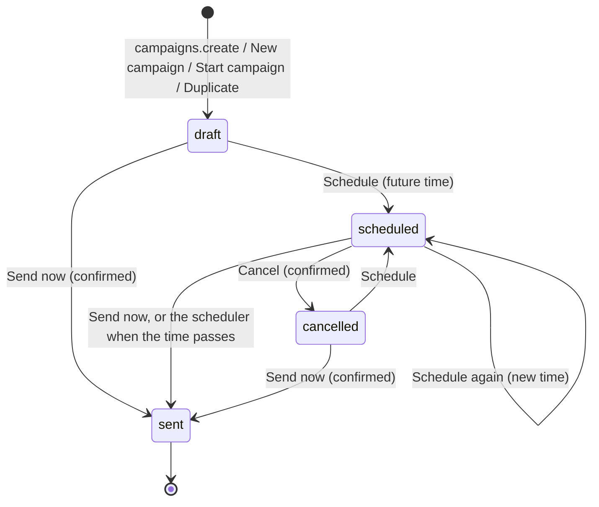

# Requirements: Newsletter Tool

PART A — REQUIREMENTS (SRS). User-approved before build; frozen after; changes via ## Changes.

## Introduction

### Purpose
Newsletter Tool is a newsletter workspace for one person, used in the browser with no accounts or sign-in. Its one job is to prepare email campaigns for a subscriber list and send them. The person keeps the subscribers and their tags, builds emails from reusable templates in a block editor, previews them as a recipient would see them, and sends them now or at a scheduled time. A send records the audience snapshot: every subscribed contact in the campaign's audience (everyone, or the contacts with any of its tags) becomes a recipient of the campaign. The app delivers no email. An AI agent works on the same data through A2App. Every screen action is a declared operation, and an operation stores exactly what the same action on the screen stores.

### Scope
**Goals**
1. A campaign started from a template carries the template's subject, preheader, blocks and design, and the template's use count rises by one.
2. Sending a campaign, now or when its scheduled minute arrives, records exactly one recipient row per subscribed contact in the campaign's audience and marks the campaign sent with that count. A sent campaign cannot be edited, scheduled or sent again.
3. A campaign or template edit is saved without a Save button, 700 ms after the last change, and the Review tab shows the email rendered for the first subscribed contact.
4. Importing a CSV never duplicates an email: existing subscribers are updated, and new ones are added as subscribed.
5. Every screen action is available to an agent as an operation, and an agent's write stores the same record as the same action on the screen.

**Core functionalities:** dashboard · subscriber list with tags, search, filters, CSV import and export · templates · campaign editor (blocks, rich text, design, audience, review) · AI writer · scheduling with a month calendar · send as an audience snapshot · sender settings · agent operations

### Approval
Approved by the user: 2026-11-11 — carried over from the published marketplace app `newsletter-tool` 1.0.0, whose requirements were approved when it was built; this document restates them in the framework's form without changing any feature.

## Product Description

### Product Perspective
`authMode: none`. The app is for one person on their own machine: there are no accounts or sign-in, every collection is open, and it serves on loopback only. Its own operation routes still require a caller (the View or the agent's credential). manifest.json declares no integrations (`capabilities.integrations: []`). The AI writer uses the host's language model through `_craftbot_bridge.js`: CraftBot when it launched the app, or the Agent App Framework bridge. Without either, it falls back to a starter draft.

The app is deliberately not an email-sending service. It has no SMTP server or email provider of its own, no open or click tracking, and no public signup or unsubscribe endpoint. Its Send records the audience snapshot; the schema notes that delivery is out of scope for a local app, and the recipient list can be exported instead. A Gmail path through CraftBot's integration bridge exists in `deliver.js`, but no screen and no declared operation turns it on. The screens' logic runs in the browser: `frontend/src/app/services/apiAdapter.ts` maps the original app's REST calls onto PocketBase records and the app's own routes.

### User Characteristics
One person who writes a newsletter every week or month. They add subscribers in batches, prepare a campaign over a session or two, and send or schedule it. The desktop browser comes first. Tablet and phone widths are supported, with a collapsed sidebar or a bottom tab bar, and with touch and pointer input.

### Constraints
- C-1: A subscriber's email is unique, and the Add form and the import store it in lower case. Status is `subscribed` or `unsubscribed`; "Bounced" in the drawer saves as unsubscribed. The name is one field, "First Last", split at the first space for display.
- C-2: Tags are free text, stored comma-separated as "a, b". A tag filter matches a whole tag exactly.
- C-3: A campaign's name, preheader, sender overrides, design, audience, logical status and error message are stored as a JSON sidecar (`{"__meta":true,…}`) in its `body`. A template's preheader, design, category, icon and use count are stored the same way. The `subject` column holds the subject, else the name, else "(no subject)".
- C-4: A campaign's logical status is draft, scheduled, cancelled or sent. The status column is draft or sent: a scheduled campaign stays draft with `scheduled_at` set. Sending and failed exist only as filter values.
- C-5: A sent campaign is read-only and cannot be sent or scheduled again. It can be duplicated or deleted.
- C-6: A send records the subscribers whose status is "subscribed" at that moment: all of them, or, when the campaign targets tags, only those with any of its tags (nobody when no tag is chosen). It delivers no email.
- C-7: Blocks are of six types: heading, text, button, image, divider and spacer. Each has the fields the editor's controls write (app.guide). Colors are #RRGGBB, spacer heights run from 4 to 96 px in steps of 4, heading levels are 1 to 3, and links are http, https or mailto.
- C-8: Settings is one row: the sender name and email, the reply-to address, and the organization name and mailing address shown in the email footer.
- C-9: The first start seeds three subscribers (Ada Lovelace and Grace Hopper tagged vip, and Alan Turing). It also seeds one template, "Monthly update", with plain text (the first campaign started from it stores that text as the template's one text block, so the template keeps it), and the sender "My Newsletter" <newsletter@example.com>.
- C-10: A campaign's or template's blocks JSON is at most 31,457,280 bytes (30 MB), uploaded images included: room for a few 5 MB uploads. A save over the limit fails with a visible error.

### Assumptions
- A-1: Volume ceiling: 500 subscribers, 200 campaigns and 200 templates. That is the one page each screen loads, newest first. Operations page over every row.
- A-2: The machine running the app is the user's own. Dates and times show in the browser's locale and time zone, and scheduled times are stored in UTC.
- A-3: Email delivery, when wanted, happens outside this app, for example from the exported CSV.

## Features

### Module: Frame
- F-FRM-1: On wide screens the user can reach Dashboard, Campaigns, Subscribers, Templates, Schedule and Settings from a left sidebar that marks the current section.
- F-FRM-2: The user can collapse the sidebar to icons. WHEN the window is between 640 and 959 px wide THE SYSTEM SHALL collapse it, and it expands again on wider screens.
- F-FRM-3: On phones (below 640 px) the user navigates with a bottom tab bar.
- F-FRM-4: The user sees in the sidebar whether the AI generator is connected.
- F-FRM-5: WHEN the host switches the theme pack or light and dark mode THE SYSTEM SHALL recolor the app from the kit's theme tokens. The brutalist style flattens every corner.
- F-FRM-6: The user sees every success and failure as a toast at the top right.

### Module: Dashboard (dashboard)
- F-DSH-1: The user sees a briefing with a greeting, the date, a headline with a supporting line, and header stats: new subscribers in 30 days and sends queued.
- F-DSH-2: The user sees a Campaigns panel with up to six scheduled and then draft campaigns, with their counts; a scheduled one shows how many contacts its send will record. The user can open one or start a new campaign.
- F-DSH-3: The user sees Quick start, up to four templates already used (most used first), and can start a campaign from one.
- F-DSH-4: The user sees Recent sends, up to four sent campaigns with their sent count and when they were sent.
- F-DSH-5: The user sees a growth chart of cumulative subscribers over the last 30 days. Past sends and the sends scheduled in the next 14 days show as dots that open the campaign.
- F-DSH-6: The user sees the audience split (subscribed, unsubscribed, bounced) and can go to Subscribers from it.

### Module: Subscribers (subscribers)
- F-SUB-1: The user sees the subscriber list newest first (name or email, up to three tags, status) under a header "N total · M active".
- F-SUB-2: The user can search by email or name, and filter by status (subscribed, unsubscribed, bounced) and by tag, with each tag's count.
- F-SUB-3: The user can add a subscriber with an email, first and last name, and tags. WHEN the email is already on the list THE SYSTEM SHALL update that subscriber instead (name set if given, tags merged).
- F-SUB-4: The user can open a subscriber in a drawer and edit the email, names, tags (replaced) and status, and sees the joined date.
- F-SUB-5: The user can remove a subscriber after confirming.
- F-SUB-6: The user can import pasted CSV, one subscriber per line (email, first name, last name; lines starting with # skipped), with tags applied to every row. Existing emails are updated, and a toast counts the new, updated and skipped rows.
- F-SUB-7: The user can export the subscribed contacts as a CSV file (email, name, tags).

### Module: Templates (templates)
- F-TPL-1: The user sees template cards (name, subject or preheader, uses, block count), ordered by uses and then by last change.
- F-TPL-2: The user can create a blank template by name. It starts with a "Hello!" heading and one paragraph, and opens in the template editor.
- F-TPL-3: The user can edit a template's name, subject, preheader, blocks and design on the same canvas as campaigns. Changes save automatically.
- F-TPL-4: The user can duplicate a template as "<name> (copy)".
- F-TPL-5: The user can delete a template after confirming. Campaigns made from it keep their content.
- F-TPL-6: The user can start a campaign from a template (its card, its editor, or Quick start). The campaign gets the template's subject, preheader, blocks and design and is named "<template> — campaign", and the template's use count rises by one.

### Module: Campaigns (campaigns)
- F-CMP-1: The user sees campaign cards (status, scheduled time, name, subject, recipients, error), last edited first, with filter chips: all, draft, scheduled, sending, sent, failed, cancelled.
- F-CMP-2: The user can create a campaign by name from Campaigns, or as "New campaign" from the Dashboard. It opens in the editor.
- F-CMP-3: The user can duplicate any campaign as a new draft "<name> (copy)", and delete any campaign after confirming; its recorded recipients go with it.
- F-CMP-4: The user can cancel a scheduled campaign after confirming. It becomes a cancelled draft that can be scheduled again.

### Module: Campaign editor (campaigns, blocks, ai)
- F-EDT-1: The user can edit the campaign's name, from name, from email, reply-to, subject and preheader. WHILE a campaign is sent THE SYSTEM SHALL keep every field and control read-only.
- F-EDT-2: The user can add blocks from a palette (heading, text, button, image, divider, spacer). Each new block is appended at the end.
- F-EDT-3: The user can edit heading and text in place with bold, italic, underline, color and links (http, https or mailto), and edit button labels in place.
- F-EDT-4: The user can reorder blocks by dragging them. From a block's context menu the user can move it up or down, delete it, and set its style: heading size 1–3, text size, alignment, colors, button link, image address or upload (up to 5 MB), alt text and width, divider color, and spacer height 4–96 px.
- F-EDT-5: The user can set the email design: background, card, text, heading, button and button-text colors, and the font (sans, serif, mono).
- F-EDT-6: WHEN the user changes a field or a block and pauses for 700 ms THE SYSTEM SHALL save the campaign, design included, and show "Saved". A design-only change is saved with the next other change.
- F-EDT-7: The user can choose the audience on the Audience tab, everyone subscribed or by tag. The tab shows the matching count, the active, unsubscribed and bounced counts, and up to six sample recipients. A send records exactly that audience.
- F-EDT-8: The user sees on the Review tab the subject, preheader, sender and audience. Below them is the email rendered for the first subscribed contact, with placeholders filled and the footer: the organization name and mailing address from Settings, then "Created by Newsletter Tool livingUI".
- F-EDT-9: The user can open the AI writer (what the email is about, the tone, the audience) and apply its draft, which replaces the subject, preheader and blocks. WHEN no language model is connected THE SYSTEM SHALL produce a starter draft instead.
- F-EDT-10: The user can schedule the campaign for a date and time in local time. The time defaults to the next full hour.
- F-EDT-11: The user can send now after confirming; the confirm names the number of subscribers it records and says no email is delivered. THE SYSTEM SHALL record the campaign's audience as recipients, mark the campaign sent with that count, and deliver no email.

### Module: Schedule (campaigns)
- F-SCH-1: The user sees a month calendar that marks the days with scheduled sends. It has previous month, next month and Today, and counts for the month and in total.
- F-SCH-2: The user sees the agenda of scheduled sends by date, and can pick a day to filter it, open a campaign, or cancel its schedule after confirming.
- F-SCH-3: WHEN a scheduled campaign's time arrives THE SYSTEM SHALL record its send within a minute, exactly as Send now does.

### Module: Settings (settings)
- F-SET-1: The user sees the Integrations card. Email delivery shows as not connected and says that no email leaves the app: Send and scheduled sends record the campaign and its audience, and the person mails it from their own email service or asks their AI agent to send it. The AI writer shows as connected when an AI agent's language model is connected (CraftBot, or the framework bridge).
- F-SET-2: The user can set the sender name and email, which are stored.
- F-SET-3: The user can set a reply-to address, and the organization name and mailing address for the email footer, which are stored with the sender.

### Agent (via A2App)
- F-AGT-1: The agent can perform every screen action, and read what the screens show, through the 28 operations in ## Operations Design (modules app, dashboard, subscribers, templates, campaigns, blocks, settings, ai, integrations).
- F-AGT-2: The agent can read how the app works, the block format, the design keys, the placeholders and the statuses from `app.guide`.
- F-AGT-3: WHEN the agent writes through an operation THE SYSTEM SHALL store exactly what the same action on the screen stores: the same sidecar, blocks, columns and side effects.
- F-AGT-4: The agent can reach only `subscribers` as raw records. Campaigns, templates, settings and campaign recipients are reached through operations only.
- F-AGT-5: WHEN the agent calls a destructive operation (templates.delete, campaigns.delete, campaigns.cancel, campaigns.send-now) THE SYSTEM SHALL answer `approval_required` until the person has approved that call.
- F-AGT-6: WHEN the agent schedules a campaign THE SYSTEM SHALL refuse a time that is not in the future and point to campaigns.send-now.
- F-AGT-7: The agent can page every list with limit and offset, and always gets the total.
- F-AGT-8: The agent can edit one block at a time by index (blocks.edit), and reads long uploaded-image addresses shortened unless it asks for them in full.

## Non-Functional Requirements
- N-1: Campaign and template edits are saved 700 ms after the last change; in the campaign editor, a design-only change is saved with the next other change.
- N-2: A scheduled send is recorded within a minute of its time (`newsletter-scheduler` runs every minute).
- N-3: A language-model call waits at most 120 s through CraftBot and 300 s through the framework bridge. Without a model, the AI writer answers at once with the starter draft.
- N-4: Lists answer one page with the total: 500 subscribers, 200 campaigns and 200 templates by default.
- N-5: The layout adapts at 640 px (phone: bottom tab bar, full-screen drawer) and at 960 px (tablet: collapsed sidebar, single-column editor).

## Data Requirements
- **subscribers** (module: subscribers): email (string, required), name (string, max 200), status (enum), tags (string, max 500), created (datetime, server-set), updated (datetime, server-set).

## External Interfaces
- **Human (browser):** one single-user View served by PocketBase at the app's own origin, without URL routes. The sidebar switches between Dashboard, Campaigns, Subscribers, Templates, Schedule and Settings, and the campaign and template editors open in the content area. Dialogs: new campaign, new blank template, add subscriber, import CSV, AI writer, schedule; and the subscriber drawer. File output: the subscribers CSV download.
- **Agent (A2App):** the modules and collections in AGENT_APP.md § Modules; operations exactly as declared in ## Operations Design. No other machine interface is offered to agents; the app's own screens call their own routes.
- **Host services (backend only):** the host's language model through `_craftbot_bridge.js` (CraftBot's bridge, or the Agent App Framework bridge).

## Out of Scope
- Delivering email from Send or a schedule (SMTP, Gmail or any provider), and per-recipient delivery results.
- Open, click, unsubscribe and bounce tracking; a public unsubscribe page; a public signup endpoint or form embed.
- Applying per-campaign sender fields to a send.
- Built-in templates (none ship), and template categories as a feature.
- More than one person: accounts, sign-in, roles or sharing.
- Automations, drip sequences, A/B tests, and segments beyond tags.
- HTML blocks, and undo or redo of edits.
- Live updates of an open screen from another tab or from an agent.

## Quality of Life
- The greeting follows the time of day ("Good morning", "Good afternoon", "Good evening", "Late night").
- Quick start on the Dashboard lists the templates already used, most used first.
- The Audience tab shows up to six sample recipients with their tags.
- The schedule dialog defaults to the next full hour.
- Block drag handles show only on hover, and a right-click opens a block's context menu.

PART B — TECHNICAL SPECIFICATION.

## System Overview
PocketBase 0.39 (JS hooks, migrations) + React 19 / Vite / Tailwind 4 View in `frontend/` built into `pb/pb_public/`, on the `blueprint-pocketbase-kit` toolkit.

The View keeps its original logic in the browser. `frontend/src/app/services/apiAdapter.ts` answers the screens' REST calls by reading and writing PocketBase records and by calling the app's own routes in `ops.pb.js` (`campaigns/send`, `ai/draft`, `integrations/status`, `subscribers/export`). The send is `send.js`, shared with the minute scheduler in `scheduler.pb.js`. Agent operations are routed in `agent_ops.pb.js`. Their logic is in `lib_agent.js`, a server port of the adapter's handlers, and `lib_agent_render.js`, a port of its email renderer. The generated `a2app_routes.pb.js` serves every declared operation as `POST /api/ops/<name>`.

Modules → navigation map:

| Module (manifest) | Where a person meets it | Section |
| --- | --- | --- |
| `dashboard` | Dashboard panels | Dashboard |
| `subscribers` | Subscriber list, drawer, Add and Import dialogs, Export | Subscribers |
| `templates` | Template grid, template editor | Templates |
| `campaigns` | Campaign grid; campaign editor (Content, Audience, Review, Schedule, Send now); Schedule calendar and agenda | Campaigns, Schedule |
| `blocks` | The canvas in both editors | Campaigns, Templates |
| `ai` | The AI writer in the campaign editor | Campaigns |
| `settings`, `integrations` | Sender identity and the Integrations card; the integration dots in the sidebar | Settings |
| `app` | No screen: `app.guide` is the agent's starting point | — |

Sidebar order: Dashboard, Campaigns, Subscribers, Templates, Schedule, Settings. The same six sections form the bottom tab bar on phones.

## UI Design
- **Design system:** the app's own variables in `frontend/src/app/styles/global.css`: the Inter font, a 12–20 px type scale, 4/6/8/12 px radii, a 4 px spacing scale, and 100–200 ms transitions. `styles/theme-bridge.css` maps them onto the kit's `--agent-app-*` theme tokens, so the host's theme pack and light or dark mode recolor the app, and the brutalist style flattens every corner. The components are the app's own in `components/ui/index.tsx`: Button, Input, Textarea, Select, Toggle, Card, Alert, Badge, Modal, EmptyState, Tabs, List. `Panel`, `Drawer` and `Sidebar` sit beside them. The vendored kit 0.5.0 (`frontend/src/kit`) supplies the shell and the theme bridge. Icons are react-icons Feather. Toasts are react-toastify, top right, closing after 3 s. Drag and drop is @dnd-kit.
- **Layout:** a left sidebar 232 px wide (64 px collapsed) beside the content area, which has 20 px padding. Pages open with a title and a short subtitle, with the page's primary action on the right. Lists are cards in grids (campaign cards; template cards 280–300 px wide) or one card with rows (subscribers). The editors take the whole content area: from 960 px, a 240 px column (palette and design) sits beside the canvas. The subscriber drawer is 520 px wide on the right. On phones the bottom tab bar replaces the sidebar, the content keeps 80 px of bottom padding, and the drawer fills the screen.
- **Screen — Dashboard:** primary object: what is in progress and how the list is growing · primary action: "New" campaign, or a Quick start template · loading: "Loading…" until the app has started; panels fill as their lists arrive · empty: "Nothing in progress. Start a new campaign or pick a Quick Start template below."; "No sends yet. Once you send one, it shows here."; "Add your first subscriber to populate this."; the headline "It's quiet in here." when there are no subscribers · error: "Backend unavailable. Reload after the server starts." when the server does not answer · narrow: one column.
- **Screen — Campaigns:** primary object: the campaign cards · primary action: "New campaign" (a dialog asking for the name) · empty: "No campaigns yet" with "Create your first campaign"; a filter with no match shows "No <status> campaigns" and "Try a different filter." · success: toasts `Created "<name>"`, `Duplicated as "<name>"`, "Campaign removed", "Schedule cancelled" · confirms: `Delete "<name>"?`, `Cancel the schedule for "<name>"?` · narrow: the cards wrap to one column.
- **Screen — Campaign editor:** primary object: one campaign · primary actions: Send now, Schedule, AI write · tabs: Content (sender and subject fields, the palette and design column, the canvas), Audience, Review · loading: "Loading campaign…" · in-flight: "Saving…", then "Saved" · read-only when sent: every input and button disabled · errors: "Last action failed" alert with the campaign's error, and toasts such as "Save failed: …" · send: the confirm `Record the send of "<name>" to <n> subscribers now? The campaign is marked sent; no email is delivered by this app.`, then "Send recorded for <n> subscribers (no email delivered)" · schedule: a dialog with a date-time field defaulting to the next hour, then "Scheduled for <date>" · AI writer dialog: "No language model connected" note (connect an AI agent: CraftBot, or any agent harness running the app's bridge) when no model is connected, and "Generate with AI" or "Generate starter draft" · narrow: below 960 px the palette and design column stacks above the canvas.
- **Screen — Subscribers:** primary object: the subscriber list · primary actions: "Add subscriber", "Import CSV", "Export" · empty: "No subscribers yet" with "Add your first subscriber"; filters with no match show "No matches" and "Try clearing the filters above." · success: "Added <email>", "Saved", "Removed", "Imported <n> new, updated <m>, skipped <k>" · confirm: "Remove <email>?" · drawer: name, "Joined <date>", the fields, the unsubscribe link text, Remove, Cancel and Save · narrow: the drawer is full screen.
- **Screen — Templates:** primary object: the template cards · primary action: "New blank template" · empty: "No templates yet" with "Create a blank template" · each card: Edit and Start campaign, and a Delete button shown on hover (confirm `Delete "<name>"?`) · success: "Template created", "Template removed" · narrow: the cards wrap.
- **Screen — Template editor:** primary object: one template · primary actions: Start campaign, Duplicate, Delete · subject and preheader fields, the palette and design column, the canvas · "Saving…", then "Saved" on each autosave (no toast) · narrow: as the campaign editor.
- **Screen — Schedule:** primary object: scheduled sends · primary action: pick a day, open a campaign or cancel its schedule · the month calendar has previous month, next month and Today, and reads "<n> this month · <m> total" · empty: "Nothing scheduled" ("Open any draft campaign and pick a send time to schedule it."), or "No sends on this day" with a clear-filter button · confirm: `Cancel "<name>"?` · narrow: the agenda goes under the calendar.
- **Screen — Settings:** primary object: the sender identity · primary action: "Save settings" ("Settings saved") · cards: Integrations (Email delivery, always not connected; AI writer), Sender identity (from name, from email, reply-to), Footer (CAN-SPAM) (organization name, mailing address) · every field is stored and reloads with the page · error: "Save failed: …" names the refused field · narrow: one column.
- **Formatting:** dates and times are shown with the browser's `toLocaleString` and `toLocaleDateString` in its locale. A scheduled time on a card reads "in 5h" or "in 3d" within a week, and a short date beyond. Counts use `toLocaleString`. Screens show names, not record ids. Empty values are words: "No subject yet", "No subject set", "—", and on the Review tab "empty", "uses Settings" and "none".

## Quality Conformance

- **Q1 Completeness & IA:** orientation comes from the sidebar, which highlights the current section; on phones the bottom tab bar does the same. Every section has a title header. The editors open in the content area with a back button ("Campaigns", "Templates"). Every screen is reachable from the sidebar or tab bar, and every Dashboard row opens its campaign or section. The modules map to sections as in ## System Overview; only `app` (the agent's guide) has no screen. Names hold app-wide: campaign, subscriber, template, block, schedule, send. The working sets that grow have finders: search and status and tag filters for subscribers, status chips for campaigns, and the month calendar with a day filter for scheduled sends. The current section is not kept across a page reload, which opens the Dashboard.
- **Q2 Design system:** tokens are the app's variables in `global.css`, bridged onto the kit's `--agent-app-*` tokens by `theme-bridge.css` (see ## UI Design). Semantic roles: the accent for primary buttons and highlights; status badges success (sent), info (scheduled), warning (sending), error (failed); error alerts for failures. Type is Inter on a 12–20 px scale. Icons are react-icons Feather only. Light and dark come from the host through the kit's theme bridge.
- **Q3 Layout & composition:** spacing follows the 4 px scale (`--space-*`). Each section has one primary action in its header. Campaign and template cards keep a steady height, with single-line titles cut by an ellipsis. The Dashboard pairs Quick start and Recent sends in two columns on wide screens. Lists show one page (500 subscribers, 200 campaigns, 200 templates) without pagination controls.
- **Q4 Interaction:** buttons show hover and disabled states, with a pointer cursor on everything clickable. Destructive and irreversible actions ask with the browser's `window.confirm`, naming the target: delete a subscriber, template or campaign, cancel a schedule, send now. Inputs are constrained: Add stays disabled until the email has "@", Create until a name is typed, and the editor is read-only once a campaign is sent. Keyboard: Escape closes dialogs, the drawer and the block context menu; Ctrl or Cmd with B, I or U formats rich text; Enter is blocked in headings; paste is plain text; blocks can be dragged with the keyboard sensor. A right-click on a block opens its context menu.
- **Q5 State & feedback:** each screen's states are listed in ## UI Design. Every mutation answers with a toast, success or failure with the server's message, and the editors show "Saving…" and then "Saved". "Loading…" shows while the app starts, and "Loading campaign…" while an editor opens. A server that does not answer at start shows "Backend unavailable. Reload after the server starts." The AI writer's Generate button shows a spinner while it runs.
- **Q6 Motion:** transitions take 100–200 ms (`--transition-fast/base/slow`). The keyframes `spin`, `pulse`, `fadeIn`, `slideUp` and `slideInRight` (the drawer) run on entry. A dragged block becomes a faded overlay, and an orange line marks where it will drop. The app adds no `prefers-reduced-motion` rule of its own (see ### Conventions and overrides).
- **Q7 Content:** the voice is plain, friendly and second person ("Start your first newsletter with a built-in template or from scratch."), in sentence case. Errors name the action and the server's message ("Save failed: …", "Import failed: …"). Hints explain fields ("The first thing recipients see in their inbox.", "Short preview text shown after the subject."). Terminology is fixed: campaign, subscriber, template, block, schedule, send.
- **Q8 Accessibility:** dialogs and the drawer are `role="dialog"` with `aria-modal="true"`, and Escape closes them. Icon-only buttons carry `aria-label` and `title` (Duplicate, Delete, Collapse sidebar, Previous month, Next month, Drag to reorder). Editor tabs and the campaign filter chips mark the current one (`aria-current`, `aria-pressed`). Status is always a written word in a badge, never color alone. Contrast follows the host's theme tokens through the bridge; the app adds no checks of its own.
- **Q9 Responsiveness:** `useViewport` sets two breakpoints. Below 640 px the bottom tab bar replaces the sidebar, the content keeps 80 px of bottom padding, and the drawer fills the screen. From 640 to 959 px the sidebar collapses to icons. From 960 px it expands, and the editors show the palette column beside the canvas. Grids reflow with `auto-fit`/`auto-fill` columns.
- **Q10 Performance:** at A-1 each screen loads one page from PocketBase: 500 subscribers, 200 campaigns, 200 templates. The Dashboard numbers and every filter are computed in the browser from those lists. Uploaded images are embedded in the blocks as data URLs, within the 30 MB JSON limit. The agent operations compute over every row on the server, and require their library once per call.
- **Q11 Caching & freshness:** static: the toolkit serves the SPA entry uncached and the built assets with content-hashed names. Data: there are no realtime subscriptions. Each section reloads its lists when it opens and after the person's own writes. An open editor keeps its own copy, and its autosave writes that copy back (AGENT_APP.md § Gotchas). The app's state cache in localStorage is written but never read.
- **Q12 Data integrity:** emails have a unique index. Recipients relate to their campaign with cascade delete. The sidecar is rebuilt key by key on each save, and the `subject` column is never empty. A send refuses a campaign already sent. Writes are not transactional: a campaign started from a template is two writes, and an import saves row by row. Migrations: the schema, then the seed.
- **Q13 API:** the View reaches PocketBase's record API and the app's own routes `/api/ops/<group>/<verb>` (`ops.pb.js`) through its in-browser adapter. Agents use the declared operations at `POST /api/ops/<name>`, through the adapter's parameter guard and approvals. Operation errors answer `{ "error": "…" }`: 400 for a bad parameter or block, 404 for an unknown id, 409 for a state that forbids the action, 422 for an email without "@". Lists are paged with a total. Stack traces are never returned.
- **Q14 Architecture:** the UI is in `frontend/src/app`: `AppController` holds the state, `ApiService` makes the REST calls, `apiAdapter.ts` translates them for PocketBase, and the components sit beside them. The server is in `pb/pb_hooks`: `ops.pb.js` holds the routes, `send.js` and `deliver.js` the send, `scheduler.pb.js` the cron, and `agent_ops.pb.js`, `lib_agent.js` and `lib_agent_render.js` the agent operations. The screen rules exist twice, in the browser adapter and in its server port (see ### Conventions and overrides).
- **Q15 Resilience:** a failed health check at start shows "Backend unavailable. Reload after the server starts." The AI writer falls back to the starter draft when no language model answers. Failed loads and writes toast their message. A scheduler error is logged, and the campaign stays scheduled for the next minute. Operations refuse impossible states with 409 instead of writing.
- **Q16 Security & privacy:** with `authMode: none` the collection rules are open, because the app is single-user and binds loopback. The framework adapter runs its host, origin and credential checks first. Mutations on the app's own `/api/ops/` routes need a caller (the View, or the agent's `.agent-token` as `X-A2App-Token`). Destructive operations need the person's approval. The toolkit rate-limits `/api/ops/` to 300 requests a minute. Campaigns, templates, settings and recipients are hidden from raw agent writes. Block text accepts only the editor's inline markup, and the preview iframe is sandboxed. Credentials (`.agent-token`, `.principal`, `.superuser`) are git-ignored.
- **Q17 Observability:** the scheduler logs `[newsletter-scheduler] sent …` and `[newsletter-scheduler] failed: …`. A failed agent operation (5xx) logs `[newsletter agent op] failed: …`, and the toolkit logs `[handler-error] <METHOD> <path>: <message>` for uncaught handler errors. The kit's console relay ships browser errors and warnings to `logs/frontend_console.log` (capped at 2 MB). Health is `/api/_a2app`, the adapter's identity document.
- **Q18 Version control:** commits are per app and per change ("Port newsletter-tool Living UI to the V2 (PocketBase) platform", "Migrate agent apps to match agent app framework standard"). `.gitignore` excludes credentials, `pb/pb_data/`, the PocketBase binary, the built View `pb/pb_public/`, `frontend/node_modules/`, framework runtime state under `.a2app/`, and `logs/`. The app builds from a clean checkout with the manifest pipeline alone (`install`, `build`, `start`).

### Conventions and overrides
The published app is restated here unchanged, so these are standing decisions of the approved build, not new work. Revisit any of them when the app is next modified.
- Q4.2 (in-app confirm dialogs): destructive and irreversible actions confirm with the browser's `window.confirm`, not an app dialog.
- Q5.2 (designed loading): there are no skeletons. The app shows "Loading…" text until it has started, and panels fill as their lists arrive.
- Q6.3 (reduced motion): the app's own CSS has no `prefers-reduced-motion` rule; its motion is short transitions and entry keyframes.
- Q11.1 (live freshness): there are no realtime subscriptions. Sections reload when opened and after the person's own writes, and an open editor keeps a local copy that its autosave writes back.
- Q14.4 (one implementation per rule): the screens' rules live in the browser adapter (`apiAdapter.ts`) and again in its server port for agents (`lib_agent.js`, `lib_agent_render.js`). The two are kept in step by hand, and each ported function names its source.
- Mirrored global rules: none recorded for this app.

## Process Flows

Campaign lifecycle (logical status; the `status` column stays `draft` until sent):

Any campaign can be deleted (confirmed), which removes its recorded recipients. A sent campaign is read-only; Duplicate makes a new draft from it.

## Operations Design
| Operation | Module | Entity | appliesWhen | Params | Flags |
| --- | --- | --- | --- | --- | --- |
| app.guide | app | — | — | — | readOnly |
| dashboard.get | dashboard | — | — | — | readOnly |
| subscribers.list | subscribers | — | — | status: enum, tag: string, search: string, limit: number, offset: number | readOnly |
| subscribers.add | subscribers | — | — | email: string!, first_name: string, last_name: string, tags: string | — |
| subscribers.import | subscribers | — | — | csv: string!, tags: string | — |
| subscribers.export | subscribers | — | — | — | readOnly |
| templates.list | templates | — | — | limit: number, offset: number | readOnly |
| templates.get | templates | — | — | template_id: string!, include_data_urls: boolean | readOnly |
| templates.create | templates | — | — | name: string!, subject: string, preheader: string, blocks: json, design: json | — |
| templates.update | templates | — | — | template_id: string!, name: string, subject: string, preheader: string, blocks: json, design: json | — |
| templates.duplicate | templates | — | — | template_id: string! | — |
| templates.delete | templates | — | — | template_id: string! | destructive |
| campaigns.list | campaigns | — | — | status: enum, limit: number, offset: number | readOnly |
| campaigns.get | campaigns | — | — | campaign_id: string!, include_data_urls: boolean | readOnly |
| campaigns.preview | campaigns | — | — | campaign_id: string!, format: enum | readOnly |
| campaigns.create | campaigns | — | — | name: string, template_id: string | — |
| campaigns.update | campaigns | — | — | campaign_id: string!, name: string, subject: string, preheader: string, from_name: string, from_email: string, reply_to: string, target_all: boolean, target_tags: string, blocks: json, design: json | — |
| campaigns.duplicate | campaigns | — | — | campaign_id: string! | — |
| campaigns.delete | campaigns | — | — | campaign_id: string! | destructive |
| campaigns.schedule | campaigns | — | — | campaign_id: string!, scheduled_at: datetime! | — |
| campaigns.cancel | campaigns | — | — | campaign_id: string! | destructive |
| campaigns.send-now | campaigns | — | — | campaign_id: string! | destructive |
| campaigns.ai-write | campaigns | — | — | campaign_id: string!, prompt: string!, tone: enum, audience: string | — |
| blocks.edit | blocks | — | — | campaign_id: string, template_id: string, action: enum!, index: number, to: number, block: json | — |
| settings.get | settings | — | — | — | readOnly |
| settings.update | settings | — | — | from_name: string, from_email: string, reply_to: string, organization_name: string, organization_address: string | — |
| ai.draft | ai | — | — | topic: string!, tone: string | — |
| integrations.status | integrations | — | — | — | readOnly |
