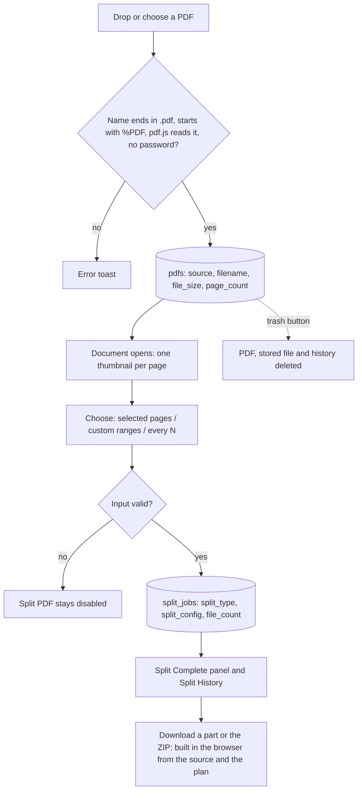

# Requirements: PDF Splitter

PART A — REQUIREMENTS (SRS). User-approved before build; frozen after; changes via ## Changes.

## Introduction

### Purpose
PDF Splitter is a single-page PDF splitter for one person, used in the browser with no accounts or sign-in. Its one job is to cut a PDF into smaller PDFs:
- the person uploads a PDF and sees every page as a thumbnail;
- they split it by the pages they selected, by custom ranges, or every N pages;
- they download the parts one by one or as a ZIP.

Every split is kept per document as its Split History, so its parts can be downloaded again later. All PDF processing runs in the person's browser: page counting, thumbnails, and building the parts and the ZIP. The server stores only the source PDF and each split's plan.

An AI agent works on the same data through A2App, where every lasting action of the UI is a declared operation. The agent cannot run the browser's PDF code, so `splits.get` gives it the source file and each part's pages, and it builds the same parts itself.

### Scope
**Goals**
1. **Uploading.** A PDF dropped on the app appears at the top of the sidebar with its page count, and opens with one thumbnail per page.
2. **Splitting.** A split by selected pages, custom ranges or every N pages adds one row to the document's Split History. Its parts download as separate PDFs and as one ZIP. A range the split controls reject is never written.
3. **History.** Every split of a document can be downloaded again after a reload. Its parts are rebuilt from the stored PDF and the stored plan, and no output file is ever stored.
4. **Privacy.** No page of a PDF is sent anywhere except the app's own server on the same machine.
5. **Agents.** Every lasting action of the UI is available to an agent as an operation, with the UI's checks and the UI's record shapes.

**Core functionalities:** PDF upload (drag and drop or file picker) · document sidebar · page thumbnails · page selection · split by selected pages, custom ranges or every N pages · part and ZIP downloads · per-document split history · document delete · agent operations

### Approval
Approved by the user: 2026-11-11 — carried over from the published marketplace app `pdf-splitter` 1.0.0, whose requirements were approved when it was built; this document restates them in the framework's form without changing any feature.

## Product Description

### Product Perspective
`authMode: none`. The app is for one person, on their own computer, with no accounts or sign-in, and it serves on loopback only. manifest.json declares no integrations (`capabilities.integrations: []`), and the app calls no third-party service. The View bundles pdf.js (`pdfjs-dist`), pdf-lib and JSZip, so every PDF operation works offline in the browser.

The app is deliberately not built on server-side PDF processing. PocketBase hooks have no PDF library. An earlier Python backend that used PyMuPDF on the server, described in the stale `LIVING_UI.md`, was replaced when the app moved to PocketBase. The screens are the original ones, kept unchanged; a client-side adapter answers their requests in the browser.

### User Characteristics
One person who needs to extract or chunk pages out of PDFs without uploading them to a third-party site. Use is occasional: a few documents when one needs splitting. They work mainly in a desktop browser with a mouse; shift+click selects a run of pages. Phones and tablets down to 320 px wide are in scope with touch input.

### Constraints
- C-1: **Accepted files.** Only PDF files are accepted: the name ends in `.pdf` (any case) and the file starts with `%PDF` at byte 0. A file may be at most 100 MB, the `source` field's limit.
- C-2: **Pages and selection.** Page numbers are 1-based. The selection is a set of existing pages (1 to the page count), stored in ascending order.
- C-3: **Range grammar.** Parts are separated by commas.
  - Each part is `a-b` with 1 ≤ a ≤ b ≤ page count, or a single page p, stored as `[p, p]`.
  - Blank parts are skipped.
  - One bad part makes the whole input invalid.
  - Numbers are read with `parseInt` in base 10, so `5x` reads as 5.
- C-4: **Every N.** N is a whole number from 1 to the page count, and the input starts at 2.
- C-5: **File names.** Parts are named `page_
.pdf` for selected pages and `pages_<a>-<b>.pdf` for ranges and every-N chunks. Within a split every name is unique: a name that repeats gets " (2)", " (3)"… before `.pdf`. The ZIP is `split_output.zip`.
- C-6: **File order.**
  - A split makes its files in plan order: selected pages ascending, ranges as typed, chunks from page 1. The Split Complete panel lists them in that order.
  - Every download follows the same order: the panel's i-th button and "Part i" give the i-th file, and the ZIP holds the files in that order.
- C-7: **Record shapes.** `split_type` is one of `pages`, `ranges`, `every_n`. `split_config` is exactly `{pages: […]}`, `{ranges: [[a, b], …]}` or `{n}`. `file_count` is the number of files the plan makes, repeats included.
- C-8: **No stored outputs.** Output files are never stored; each download rebuilds them from the stored source PDF and plan.
- C-9: **Deletion.** Deleting a PDF deletes its stored file and its whole split history (relation cascade).
- C-10: **List limits.** The document list and each document's history show at most 500 rows, newest first.
- C-11: **Encrypted PDFs.** An encrypted PDF cannot be split, because pdf-lib cannot decrypt it: its parts would come out blank. Every upload, the person's and the agent's, refuses one, whether it needs a password to open or has only an owner password.
- C-12: **Page counts.** A PDF's page count is pdf.js's `numPages` when the person uploads it. When an agent uploads it, the count comes from the file's page tree, or else from the agent.

### Assumptions
- A-1: **Volume ceiling.** 500 documents and 500 splits per document, the lists' page size. Source PDFs are up to 100 MB. Every thumbnail of a document renders when it opens, so documents of a few hundred pages are the practical upper bound.
- A-2: **Machine.** The machine running the app is the person's own, and an agent runs on the same machine. It uploads by local path and builds parts from the stored file's local path.
- A-3: **Browser.** The browser supports pdf.js's worker, canvas rendering and Blob downloads.

## Features

### Module: Frame
- F-FRM-1: The user sees a two-pane layout: a Documents sidebar on the left, and the main area with a top bar showing a scissors icon and "PDF Splitter".
- F-FRM-2: The user can collapse the sidebar to a 48 px strip and expand it to 280 px with its chevron button.
- F-FRM-3: WHEN the window is narrower than 768 px THE SYSTEM SHALL start with the sidebar closed and show a menu button in the top bar. The sidebar opens as a drawer over a dimmed backdrop, and tapping the backdrop or choosing a document closes it.
- F-FRM-4: WHEN the host sends a theme message (`craftbot-theme` for light or dark, `livingui-theme` with a theme id or custom colors) THE SYSTEM SHALL recolor the app. Without one, it uses the CraftBot dark theme.
- F-FRM-5: The user sees results and errors as toasts in the top-right corner, closing after 3 seconds.
- F-FRM-6: WHEN the app opens THE SYSTEM SHALL show a spinner until the document list has loaded.

### Module: Documents (pdfs)
- F-DOC-1: The user can upload a PDF by dropping it on the drop zone ("Drop a PDF here or click to browse") or by choosing it with "Choose File". A drop takes the first file and ignores a file that is not a PDF.
- F-DOC-2: WHEN a file's name does not end in `.pdf`, the file does not start with `%PDF`, or pdf.js cannot read it THE SYSTEM SHALL refuse it with "Only PDF files are allowed", "Invalid PDF file" or "Failed to process PDF: <reason>". WHEN the PDF is password-protected (it needs a password to open, or it has an owner password) THE SYSTEM SHALL refuse it, saying that PDF Splitter cannot split password-protected PDFs and that it can be uploaded once the password is removed.
- F-DOC-3: WHEN an upload succeeds THE SYSTEM SHALL count the pages, store the file, add the document to the top of the sidebar, open it, and toast `Uploaded "<name>" (<n> pages)`. While it uploads, the drop zone shows a spinner and "Uploading...".
- F-DOC-4: The user sees "Documents (<n>)" in the sidebar, newest first. Each row shows the name, "<n> pages · <size>" and the upload date and time. With no documents it reads "No documents yet. Upload a PDF to get started."
- F-DOC-5: The user can open a document by clicking it in the sidebar, and the open one is highlighted.
- F-DOC-6: WHEN no document is open THE SYSTEM SHALL show "Upload a PDF to get started", "Split your PDF into individual pages, ranges, or equal chunks." and the drop zone.
- F-DOC-7: The user can upload another PDF while a document is open. "Upload another" in the top bar ("Upload" on phones) shows or hides a drop zone above the pages.
- F-DOC-8: WHEN the user presses a document's trash button THE SYSTEM SHALL delete it with its stored file and its split history, and toast `Deleted "<name>"`. When it was the open document, the newest remaining document opens, or the upload view when none is left.

### Module: Pages (pdfs)
- F-PAG-1: The user sees the open document's name and "<n> pages", then a grid with one thumbnail per page, labelled "Page <n>". A thumbnail shows a spinner while it renders and "Failed" when it cannot.
- F-PAG-2: The user can click a page to select or unselect it, and shift+click to select every page between the last clicked page and this one.
- F-PAG-3: The user can press "Select all" and "Deselect all". They see "<x> of <n> pages selected" and the hint "Click to select · Shift+click for range".
- F-PAG-4: The user sees a selected page with an orange border, a light orange overlay and a checked box. Hovering a page lifts it and shows an empty box.
- F-PAG-5: WHEN another document is opened THE SYSTEM SHALL clear the selection.

### Module: Split (splits)
- F-SPL-1: The user can choose how to split from three tabs under the pages: "Selected Pages (<n>)", "Custom Ranges" and "Every N Pages".
- F-SPL-2: The user sees, in Selected Pages, "<n> pages selected (1, 3, 5)" and can "Clear" the selection. That split makes one file per selected page.
- F-SPL-3: The user can type ranges like "1-5, 8, 11-15" in Custom Ranges. A valid input shows "<n> ranges → <n> files", and a bad one shows "Invalid range. Use format: 1-5, 8, 11-15 (pages 1-
)". That split makes one file per range.
- F-SPL-4: The user can set N in Every N Pages; it starts at 2. The panel shows "→ <k> files", and that split makes a file every N pages, the last one possibly shorter.
- F-SPL-5: WHEN the chosen tab has no valid input THE SYSTEM SHALL keep "Split PDF" disabled. That means an empty selection, a missing or invalid range, or N outside 1 to the page count.
- F-SPL-6: WHEN the user presses "Split PDF" THE SYSTEM SHALL show "Splitting..." with a spinner, record the split in the document's history, toast "Split complete! <n> files created." and replace the controls with the Split Complete panel.
- F-SPL-7: The user sees "Split Complete — <n> files", with one button per file (its file name) and "Download All (ZIP)". Dismissing it with the close button returns to the controls.

### Module: Downloads and history (splits, records)
- F-HIS-1: The user can download one part as its own PDF, or every part as `split_output.zip`. The browser builds them from the stored PDF at the moment of the download.
- F-HIS-2: The user sees "Split History (<n>)" under the document, newest first. Each row shows:
  - the type: "By Pages", "By Ranges" or "Every N";
  - the summary: "Pages: 2, 10", "1-5, 8" or "Every 2 pages";
  - the date and time, a ZIP button, and "Part 1" to "Part <n>".

  The section is hidden while the document has no splits.
- F-HIS-3: The user can collapse and expand Split History.
- F-HIS-4: WHEN the user presses the i-th file button of the Split Complete panel or "Part i" THE SYSTEM SHALL download the i-th file in the order the panel lists them. With pages 2 and 10, the first button and "Part 1" download `page_2.pdf`.
- F-HIS-5: WHEN a split repeats a range THE SYSTEM SHALL make every repeat its own file with its own name: the second `pages_1-2.pdf` is `pages_1-2 (2).pdf`. Those parts download the same pages, and the ZIP holds every file.
- F-HIS-6: The user can download any earlier split of a document again after reloading the app.

### Agent (via A2App)
- F-AGT-1: The agent can do every lasting action of the UI through the 7 operations in ## Operations Design, across the modules pdfs and splits: list and open documents, upload, delete, preview and create splits, and read a split's download plan.
- F-AGT-2: The agent can upload a PDF from an absolute path on this computer with `pdfs.upload`. The UI's checks apply: name, `%PDF` start, 100 MB. The record matches the UI's: the file's name, the stored file, its size in bytes and its page count.
- F-AGT-3: WHEN the server cannot read a PDF's page count (compressed object streams, or a count written as a reference) THE SYSTEM SHALL refuse the agent's upload until it passes `page_count`. WHEN the server can read the count THE SYSTEM SHALL refuse a `page_count` that differs.
- F-AGT-4: WHEN the agent uploads an encrypted PDF THE SYSTEM SHALL refuse it, as the person's upload does, because the app can never split it.
- F-AGT-5: The agent can preview and create a split with `splits.preview` and `splits.create`. They use the split controls' rules and messages, and they store the UI's exact `split_type`, `split_config` and `file_count`.
- F-AGT-6: The agent can read a split's download plan with `splits.get` and build the same files with its own PDF tool. The plan gives:
  - the source PDF's local path;
  - each file's name and first and last page, in download order ("Part i" is `files[i-1]`);
  - the ZIP's entries.
- F-AGT-7: WHEN the agent calls `pdfs.delete` THE SYSTEM SHALL answer `approval_required` until the person has approved that call.
- F-AGT-8: The agent can name a PDF by id or by its exact file name. WHEN several PDFs share that name THE SYSTEM SHALL answer with their ids instead of guessing.

## Non-Functional Requirements
- N-1: All PDF processing happens in the browser: page counts, thumbnails, parts and the ZIP. No PDF content reaches any service other than the app's own server on the same machine.
- N-2: Uploads of up to 100 MB are accepted.
- N-3: An agent upload, or the first agent split or `splits.get` of a stored PDF, scans the file once: about 3 s for 40 MB, measured on Windows with PocketBase 0.39.7. Later agent splits of that PDF answer in tens of milliseconds.
- N-4: Every screen is usable from 320 px wide. Under 768 px the sidebar becomes a drawer.

## Data Requirements
- **pdfs** (module: pdfs): filename (string, required, max 500), source (binary, required), file_size (number), page_count (number), created (datetime, server-set), updated (datetime, server-set).
- **split_jobs** (module: records): document (ref, required → pdfs), split_type (enum), split_config (json), file_count (number), created (datetime, server-set).

## External Interfaces
- **Human (browser):** one single-page View served by PocketBase at the app's own origin, with no routes. File input is one PDF at a time, by drop or file picker. File output is the part PDFs and `split_output.zip`, built in the browser and saved as downloads.
- **Agent (A2App):** the modules and collections in AGENT_APP.md § Modules; operations exactly as declared in ## Operations Design. No other machine interface is offered to agents; the app's own screens call their own routes.

## Out of Scope
- More than one person: accounts, sign-in, sharing.
- Processing PDFs on the server, and storing output files.
- Merging PDFs, and reordering, rotating, deleting or editing pages.
- Renaming a document, or editing or deleting a single Split History row.
- Splitting encrypted PDFs, and entering PDF passwords.
- Split modes other than selected pages, custom ranges and every N pages (for example by file size, bookmarks or blank pages).
- Choosing the names of the parts or of the ZIP.
- Uploading several PDFs at once.
- Text extraction, OCR, compression, and conversion to other formats.
- Live updates from other tabs or from the agent: a reload shows them.

## Quality of Life
- The drop zone turns orange while a file is dragged over it.
- The ranges field's placeholder ends at the document's last page ("e.g. 1-5, 8, 11-
").
- The file picker can pick the same file again, because its input is reset after each pick.
- Long file names are cut with an ellipsis in the sidebar, with the full name on hover.

PART B — TECHNICAL SPECIFICATION.

## System Overview
PocketBase 0.39 (JS hooks, migrations) + React 19 / Vite / Tailwind 4 View in `frontend/` built into `pb/pb_public/`, on the `blueprint-pocketbase-kit` toolkit.

The View is the app's original screens, kept unchanged: `MainView`, `Sidebar`, `DropZone`, `ThumbnailGrid`, `SplitControls` and `SplitHistory`, with `AppController` holding the state and `ApiService` making the calls. `services/apiAdapter.ts` patches `window.fetch` and answers their requests in the browser:
- the page count and thumbnails with pdf.js;
- the parts with pdf-lib, and the ZIP with JSZip;
- records through PocketBase's collection API (`pdfs`, `split_jobs`).

Agents reach the same records through `pb/pb_hooks/agent_ops.pb.js` and `lib_agent.js` (`/api/ops/<group>/<verb>`). The generated `a2app_routes.pb.js` serves those handlers to A2App as `POST /api/ops/<name>`.

Modules → navigation map (one screen, no routes):

| Module (manifest) | Where a person meets it | Route |
| --- | --- | --- |
| `pdfs` | Sidebar (list, open, delete); drop zone (upload); the open document's header and page grid | — |
| `splits` | Split controls under the pages; Split Complete panel | — |
| `records` (`split_jobs`) | Split History under the open document, with its download buttons | — |

## UI Design
- **Design system:**
  - **Tokens.** The app's own tokens live in `frontend/src/app/styles/global.css`, "Living UI Design System, based on CraftBot Browser Interface". They cover:
    - the orange primary (`--color-primary` #FF4F18, hover #E64515, light and subtle tints);
    - semantic colors, a gray scale, background, text and border roles;
    - the `--space-*` spacing, radii and font sizes;
    - shadows, 100 and 150 ms transitions, and Inter with a system sans fallback.
  - **Themes.** `theme/themes.ts` applies one of six theme variants as `:root` variables: craftbot, normal, ocean, forest, pastel and custom, each dark or light.
  - **Components.** Preset `Button` (primary and ghost), `Input` and `Spinner` come from `components/ui`. Icons are lucide-react. Toasts are react-toastify with its colored theme.
  - **Kit.** The UI kit (`frontend/src/kit`, system-managed) supplies the Shell (error boundary, console relay) and the tokens in `app.css`.
  - **Styling.** The screens style themselves with inline styles over the app's tokens.
- **Layout:** full height, two panes.
  - **Sidebar.** 280 px wide (48 px collapsed) on the secondary background, with a right border.
  - **Main column.** A top bar (at least 48 px, with a bottom border) over a scrolling content area (24 px padding, 12 px on phones).
  - **Empty view.** Centered, at most 600 px wide.
  - **Document view.** Top to bottom:
    - the header;
    - the drop zone, when shown;
    - the selection toolbar and the thumbnail grid (auto-fill columns of at least 150 px, tiles at a 0.707 aspect ratio);
    - the split panel, sticky at the bottom of the content area;
    - Split History.
- **Screen — Loading:** a full-screen spinner until the first document list arrives.
- **Screen — Upload (no document open):**
  - **Primary object:** the drop zone. **Primary action:** drop a PDF, or "Choose File".
  - **States:** dragging (orange dashed border, tinted fill); uploading (spinner, "Uploading...", the zone does not respond); refusal or failure (an error toast).
  - **Narrow:** full width with the smaller padding.
- **Screen — Document:**
  - **Primary object:** the open PDF's pages. **Primary action:** "Split PDF".
  - **States:** each thumbnail shows a spinner, then the page or "Failed".
  - **Split controls:** "Split PDF" stays disabled until the tab's input is valid. A bad range shows its message under the field. "Splitting..." shows a spinner. The Split Complete panel replaces the controls after a split.
  - **Feedback:** toasts for success and failure. Split History is hidden while there are no splits.
  - **Narrow:** the grid's columns shrink, the top bar wraps, and "Upload another" reads "Upload".
- **Screen — Documents sidebar:**
  - **Primary object:** the document list. **Primary action:** open a document.
  - **Delete:** the trash button deletes. It turns red on hover and asks for no confirmation.
  - **Empty:** "No documents yet. Upload a PDF to get started."
  - **Collapsed:** a 48 px strip with only the chevron.
  - **Narrow:** a drawer over a backdrop, opened from the menu button.
- **Formatting:**
  - **Sizes.** "<n> B", "<x.x> KB" or "<x.x> MB": base 1024, one decimal.
  - **Dates.** In the browser's locale: short month, day, hour and minute.
  - **Counts.** Page numbers are 1-based. "file" and "files", and "page" and "pages" in the selection line, follow the count. The document header and sidebar always read "<n> pages".
  - **Ids** are never shown.

## Quality Conformance

- **Q1 Completeness & IA:** one screen with no navigation beyond the sidebar.
  - The sidebar lists the documents.
  - The open document reads top to bottom: pages, then how to split, then Split History.
  - Every capability is reachable from that screen, and the modules map to it as in ## System Overview.
  - Names hold app-wide: document, page, split, part, Split History.
- **Q2 Design system:** the app's own tokens (`styles/global.css`) and theme variants (`theme/themes.ts`), applied as CSS variables.
  - **Semantic roles:** orange for the selection, primary buttons, the active tab and the history badges; red for an invalid range and the trash button's hover; muted for secondary text.
  - **Fixed colors:** components style themselves inline against the tokens. Two colors are fixed: the selected-page overlay (`rgba(255, 79, 24, 0.1)`) and the drawer backdrop (`rgba(0, 0, 0, 0.5)`).
  - **Icons:** lucide-react only, with no emoji.
- **Q3 Layout & composition:** spacing comes from the `--space-*` tokens.
  - Each state has one primary button: "Choose File", "Split PDF" or "Download All (ZIP)".
  - The split panel stays in reach at the bottom of the content area.
  - Long file names are cut with an ellipsis, with the full name on hover.
  - Lists are not paginated; they stop at 500 rows (C-10).
- **Q4 Interaction:**
  - **Affordances.** Sidebar rows, thumbnails, tabs, buttons and the drop zone use a pointer cursor and hover states: a thumbnail lifts, a file button highlights, the trash icon turns red.
  - **Disabled states.** "Split PDF" is disabled while its input is invalid, and while a split runs.
  - **Selection.** Shift+click selects a run of pages.
  - **Delete.** Deleting a document needs no confirmation; see ### Conventions and overrides.
- **Q5 State & feedback:**
  - **Progress.** The first load, an upload and a split each show a spinner.
  - **Thumbnails.** Each one has its own loading and "Failed" state.
  - **Toasts.** Upload, delete and split report success or failure with the operation's message.
  - **Double submission.** The drop zone does not respond while uploading, and "Split PDF" is disabled while splitting.
  - **Silent cases.** A failed download, and a failed first load, are not reported; see ### Conventions and overrides.
- **Q6 Motion:** the sidebar width and the mobile drawer slide in 0.2 s (ease), and hover changes take 100 ms.
  - A hovered thumbnail rises 2 px with a shadow.
  - Spinners rotate, and toasts animate in.
  - Reduced motion is not handled; see ### Conventions and overrides.
- **Q7 Content:** plain, short copy, with title-case tabs and buttons ("Custom Ranges", "Split PDF", "Download All (ZIP)").
  - **Errors say what to do:** "Invalid range. Use format: 1-5, 8, 11-15 (pages 1-
)". Agent operation errors name the parameter and give an example.
  - **Emoji:** none.
- **Q8 Accessibility:**
  - **Focus.** Focus shows a 2 px orange outline on `:focus-visible` (`global.css`).
  - **Labels.** Thumbnails have the alt text "Page <n>". Icon buttons carry titles: "Delete document", "Download all as ZIP", "Download part <n>", "Collapse sidebar" / "Expand sidebar". The menu button has the aria-label "Toggle sidebar".
  - **Keyboard.** Page tiles and sidebar rows are clickable elements without keyboard access; see ### Conventions and overrides.
  - **Contrast.** It comes from the theme variants and is not computed at run time.
- **Q9 Responsiveness:** works from 320 px up, with one breakpoint at 768 px.
  - Below it: the drawer sidebar, the menu button, the shorter "Upload" label and smaller padding.
  - The grid's columns are `minmax(min(150px, 100%), 1fr)`, and the top bar wraps.
  - The main area has no maximum width.
- **Q10 Performance:**
  - **Opening a document.** pdf.js renders every page at 1.5× scale, with no virtualization.
  - **Caching.** The source bytes and the parsed document are kept in memory per document for the session.
  - **Parts and ZIPs** are built only when downloaded.
  - **Lists** are capped at 500 rows.
  - **Agent side.** The operations scan a stored PDF once and remember what they found (N-3).
- **Q11 Caching & freshness:**
  - **Static files.** The built bundle has hashed asset names, and the toolkit serves the page shell uncached.
  - **Document list.** It loads once at start, and the person's own uploads and deletes update it in place.
  - **Split History.** It reloads when the document changes and after a split.
  - **Other changes.** There is no realtime subscription: changes from other tabs or from the agent show after a reload; see ### Conventions and overrides.
- **Q12 Data integrity:** the database enforces the shapes; the checks run before any write.
  - **Field rules.** `source` accepts only `application/pdf` up to 100 MB. `filename` is required (at most 500 characters). `split_jobs.document` is a required relation that cascades on delete. `split_type` is a select field, and `split_config` is JSON of at most 200 KB.
  - **Checks.** The browser checks each upload and split before writing, and the agent operations repeat the same checks on the server.
  - **Raw writes.** A raw record write is not checked (open rules), and AGENT_APP.md tells agents to use the operations.
- **Q13 API:** the agent operations are `/api/ops/<group>/<verb>` in `agent_ops.pb.js`: GET for reads, POST for writes, served to A2App through the adapter.
  - **Parameters.** They are checked with messages that name the parameter.
  - **Errors.** They share the shape `{status, message, data?}`, with 400, 404 and 500 used for their meaning.
  - **Lists** are bounded at 500.
  - **The View** uses PocketBase's records and files API through the adapter.
- **Q14 Architecture:** the original component tree is kept unchanged. The adapter is the one place in the browser where PDF work and record access happen. The agent logic is `lib_agent.js`; each of its functions names the browser function it ports. The page-group logic therefore exists twice; see ### Conventions and overrides.
- **Q15 Resilience:**
  - **Browser.** The adapter never throws into the screens: a failed request becomes an error response or an empty value. Upload, split and delete failures toast their message, and a thumbnail that fails shows "Failed". Browser calls have no timeouts.
  - **Agent side.** The operations answer designed errors. A missing or unreadable source makes a split fail with "Failed to open PDF".
- **Q16 Security & privacy:** `authMode: none`, with open collection rules, on loopback only.
  - **Framework checks.** The adapter's host, origin and credential checks run before any app hook. The kit's compatibility layer requires a caller (the View or an agent credential) on the app's `/api/ops/` routes, and `pdfs.delete` needs the person's approval.
  - **Rate limits.** 300 per minute on `/api/ops/` and 1,200 per minute on `/api/collections/`.
  - **PDF content** never leaves the machine.
  - **Agent uploads** read only an absolute `.pdf` path whose file starts with `%PDF`.
- **Q17 Observability:**
  - **Browser.** The kit's console relay writes browser warnings and errors to `logs/frontend_console.log`, capped at 2 MB.
  - **Agent operations.** 5xx errors log `[pdf-splitter] agent operation failed:`, and the toolkit logs uncaught handler errors.
  - **Health** is `/api/_a2app`.
- **Q18 Version control:**
  - **Commits** are per app and per change ("Port pdf-splitter Living UI to the V2 (PocketBase) platform").
  - **`.gitignore`** excludes credentials, `pb/pb_data/`, the PocketBase binary, `pb/pb_public/`, `frontend/node_modules/`, framework runtime state under `.a2app/`, and `logs/`.
  - **Clean builds.** The app builds from a clean checkout with the manifest pipeline alone.

### Conventions and overrides
The published app is restated here unchanged, so these are standing decisions of the approved build, not new work. Revisit any of them when the app is next modified.
- Q4 (destructive confirmation): a person deletes a document in one click, without confirmation. An agent's `pdfs.delete` needs the person's approval.
- Q5.4 (designed error states): a failed first load of the document list shows the empty list. A failed download does nothing visible.
- Q6 (reduced motion): `prefers-reduced-motion` is not handled. Motion is limited to 100–200 ms transitions and the spinners.
- Q8 (keyboard access): page tiles and sidebar rows respond to the pointer only.
- Q11 (freshness): there is no realtime subscription, so a reload shows changes made elsewhere (AGENT_APP.md § Conventions).
- Q14.4 (one implementation per rule): the page-group, file-name and file-order logic exists in `apiAdapter.ts` for the browser and in `lib_agent.js` for agents. The two are kept in step by hand, and each server function names its browser source.
- Q17.1 (structured logs): log lines are prefixed text, not a structured schema.
- Mirrored global rules: none recorded for this app.

## Process Flows

A document's life: upload, split, download, delete. Every download rebuilds its files in the browser.

An agent follows the same path through `pdfs.upload`, `splits.preview` and `splits.create`, and `pdfs.delete` after the person approves. In place of a download, it reads `splits.get` and builds the files from `source.path`.

## Operations Design
| Operation | Module | Entity | appliesWhen | Params | Flags |
| --- | --- | --- | --- | --- | --- |
| pdfs.list | pdfs | — | — | — | readOnly |
| pdfs.get | pdfs | — | — | pdf: string! | readOnly |
| pdfs.upload | pdfs | — | — | path: string!, page_count: number | — |
| pdfs.delete | pdfs | — | — | pdf: string! | destructive |
| splits.preview | splits | — | — | pdf: string!, split_type: enum!, pages: string, ranges: string, n: number | readOnly |
| splits.create | splits | — | — | pdf: string!, split_type: enum!, pages: string, ranges: string, n: number | — |
| splits.get | splits | — | — | split: string! | readOnly |

## Changes
- 2026-11-11 defect fixes: the user asked for the published app's known defects to be fixed. A password-protected PDF is refused at upload, including one with only an owner password that used to be accepted and then failed to split (C-11, F-DOC-2, F-AGT-4); every download follows the order the Split Complete panel lists the files in, and so does the ZIP (C-6, F-HIS-4); repeated file names get " (2)", " (3)"…, so the ZIP holds every part (C-5, F-HIS-5). The agent operations follow the same rules (F-AGT-4, F-AGT-6).
