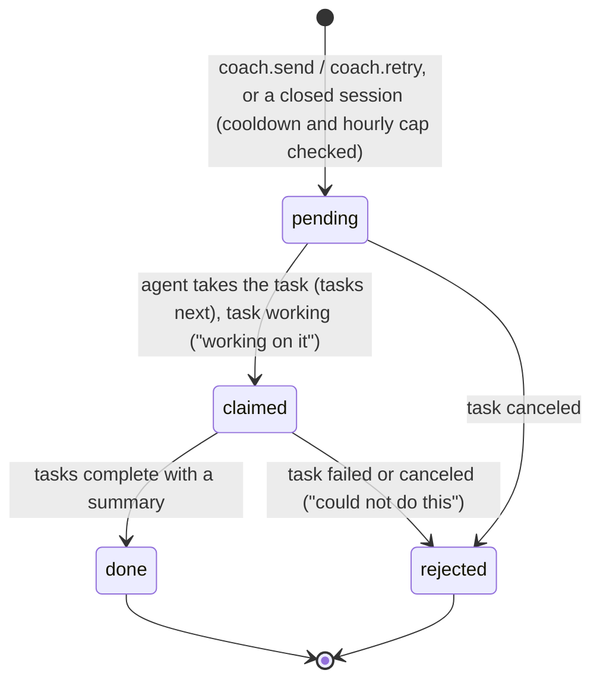
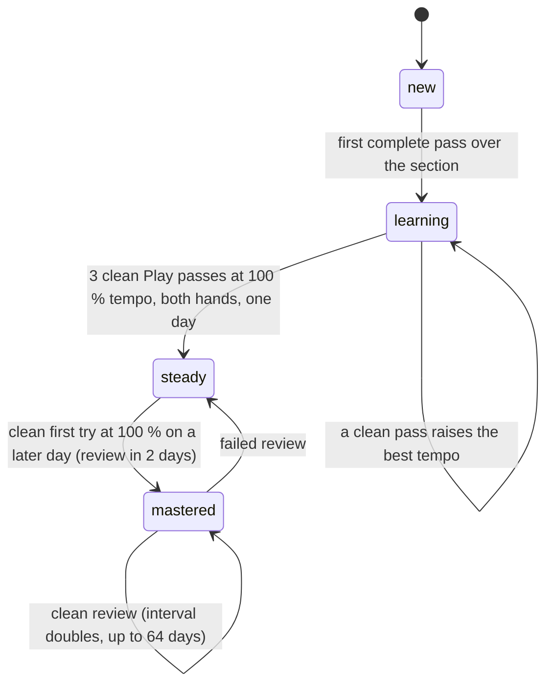
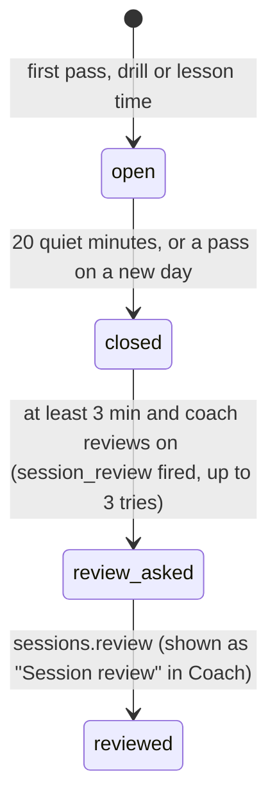
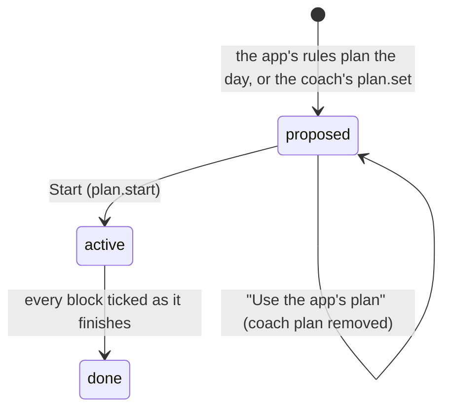

# Requirements: Piano Coach

PART A — REQUIREMENTS (SRS). User-approved before build; frozen after; changes via ## Changes.

## Introduction

### Purpose
Piano Coach is a practice and learning app for one person learning piano, from the first keys to concert repertoire, with one AI agent working for them as their coach. There are no accounts, and nothing leaves the computer. The app listens through a MIDI piano, the computer keys, the keys on screen or a microphone. It judges every note for pitch and timing and keeps the score. Sections climb from new to mastered, the learner's level rises, and the app's own rules make a plan for each day. It teaches the whole subject: 62 lessons in 12 units, a drill for each of 41 skills, a ten-level path, and a reference. Everything measurable is decided by the app, the same way every time. The coach judges and explains between sessions, working through A2App with 24 declared operations and two kinds of task (`coach_message`, `session_review`). It adds music in ABC notation, reviews sessions, proposes a day's plan and answers questions.

### Scope
**Goals**
1. Every note played in Play mode is judged for pitch and timing at the learner's strictness. Each pass reports accuracy, wrong notes, timing, and the bars that went wrong.
2. Each section of a song moves new → learning → steady → mastered by fixed rules, and mastered sections come back for review at growing intervals.
3. Today always has a plan scaled to the daily goal: warm-up, due reviews, the weakest sections at their next tempo, a run-through, the next lesson, and a drill for the weakest skill. The coach may propose its own instead.
4. A fresh install can teach from the very first keys: 32 starter pieces and exercises, 62 lessons, a drill for every skill, and a ten-level path whose level rises by itself.
5. A message to the coach shows whether the agent has picked it up (waiting, working, could not), and the answer appears in the conversation with any songs it added.

**Core functionalities:** four ways to play (MIDI, computer keys, screen keys, microphone) · practice screen with falling notes or sheet music · Listen, Learn and Play modes · note-by-note judging · section stages with spaced review · the day's plan · dashboard · song library with ABC notation and MusicXML import · 62 lessons · drills for 41 skills · technique, progressions and sight-reading · the ten-level path · reference (chords, scales, keys, intervals, terms) · coach conversation and session reviews · settings and first-open setup

### Approval
Approved by the user: 2026-11-04 — carried over from the published marketplace app `piano-coach` 1.1.0, whose requirements were approved when it was built; this document restates them in the framework's form without changing any feature.

## Product Description

### Product Perspective
`authMode: none`. The app has one learner, no accounts, and no agent profiles (Original requirements). The coach is told apart from the person by the app's agent token (`X-A2App-Token`), which pages never see. manifest.json declares no integrations (`capabilities.integrations: []`), and the app makes no outbound calls. The piano voice is synthesised in the browser, so no samples are downloaded, and the sheet-music font (VexFlow with Bravura) and the type are bundled. MIDI (Web MIDI) and the microphone are asked for only when the person chooses to connect. The app deliberately has no language model of its own: the coach is the person's AI agent, working between sessions.

### User Characteristics
One learner at any level, from never having played to advanced, practising most days against a daily goal of 10 to 90 minutes. They play at a desktop or laptop with a digital piano over MIDI (Chrome and Edge) or the computer keys. They may also use a tablet or phone, with the keys on screen or an acoustic piano through the microphone. Touch, mouse and keyboard input are all used.

### Constraints
- C-1: Strictness sets what clean means and the timing window: lenient (clean at 90 %, ±220 ms), normal (95 %, ±160 ms), strict (98 %, ±110 ms).
- C-2: Section stages: new, learning, steady, mastered. Only complete Learn or Play passes over the whole section count. The first such pass moves a section to learning, where its best clean tempo climbs. Three clean Play passes at 100 % tempo with both hands on one day make it steady. A clean, full-tempo, both-hands first try on a later day makes it mastered, with a review due after 2 days. Each clean review doubles the interval, up to 64 days, and a failed review drops the section back to steady.
- C-3: Tempo is a percent of the song's tempo, from 30 to 150 in steps of 5. The ladder's next tempo is 60 at first, +10 below 70 %, then +5, up to 100. After a complete Play pass the suggestion is up when the pass was clean and below 100 %, down 10 (not below 30) when accuracy is under 80 %, and otherwise again.
- C-4: Accuracy in Play mode is hits ÷ (expected + wrong). In Learn mode it is first-try accuracy, hits ÷ expected. Measured latency is subtracted before timing is judged.
- C-5: The learner's level runs from 1 to 10: First steps, Beginner, Elementary, Late elementary, Intermediate, Upper intermediate, Early advanced, Advanced, Concert, Virtuoso. It rises when the learner masters a song at a higher level, or when every requirement of the current level is met. It can also be set by hand.
- C-6: A session is opened by the first pass, drill or lesson time, and closed after 20 quiet minutes. A closed session of at least 3 minutes is sent to the coach for review when coach reviews are on, with at most three tries.
- C-7: Songs are ABC notation: at most 400,000 characters and 2,000 bars once repeats are unrolled, at most 6 voices. Every bar of every voice must fill the metre, and all voices have the same bars. A song has at most 60 sections, with names up to 24 characters, covering every bar in order. By default a piece of 6 bars or fewer is one section, up to 48 bars is phrases of 4, and longer pieces are phrases of 8. Voice overlay and lyrics are not supported, and grace notes are ignored.
- C-8: File import reads ABC, MusicXML and compressed MXL. MIDI files are refused (they carry no notation). Only the first MusicXML part is read, and scores with more than 6 voices are refused.
- C-9: Only public-domain or traditional music is added. Copyrighted music is never transcribed.
- C-10: Fixed vocabularies. Input: midi, keyboard, screen, mic. Mode: listen, learn, play. Hands: both, right, left. Song kind: piece, exercise. Song source: starter, agent, you, import. Message role: you, coach; kind: chat, request, review, plan; status: pending, answered, failed. Plan source: rules, coach; status: proposed, active, done. Plan block purpose: warm-up, review, climb, polish, run, new, lesson, skill.
- C-11: Days are local `YYYY-MM-DD`, and a pickup is bar 0.
- C-12: The coach cannot record practice, open, remove or restart songs, change settings, or tick plan blocks (403 `agent_not_permitted`). Coach replies and session reviews come only from the agent (403 `agent_only`).
- C-13: A coach plan has at most 12 blocks of 1 to 30 minutes each, tempos from 30 to 150, and a total of at most max(goal × 2, goal + 20) minutes. It cannot be for a past day or a day already started, and it is refused when coach plans are off.
- C-14: Drill mastery runs from 0 to 100, with stars at 60 % (one), 80 % (two) and 92 % (three). Sight-reading has 30 levels: it climbs after a pass of 85 % or more and steps back below 60 %.
- C-15: Color carries meaning only: blue is the right hand, teal the left, red a wrong or missed note. The coach is black and white with a four-point star. There is no accent color and no emoji.
- C-16: Removing a song archives it and keeps its practice history. A duplicate title among the library's songs is refused unless asked for.
- C-17: The content: 32 starter songs (levels 1 to 8), 62 lessons in 12 units, 41 skills, 30 sight-reading levels, 13 scale types, 22 chord types, 10 progressions plus the 12-bar blues, and 6 accompaniment patterns.

### Assumptions
- A-1: Volume ceiling: 400 days of practice history. That is the longest `runs.list` window and the streak scan, and the library loads whole on one screen. A song is at most 2,000 bars.
- A-2: MIDI is available in Chrome and Edge. Inside a host frame that does not allow MIDI, the app opens in its own tab.
- A-3: The microphone hears one note at a time.
- A-4: The coach writes only music it knows accurately and checks every song with `songs.check` before adding it.

## Features

### Module: Frame (app)
- F-FRM-1: The user sees a sidebar with: a strong "Practice" button; Today, Learn, Train, Library (with a badge for new songs from the coach), Reference and Coach (with an unread badge); today's minutes against the goal; the coach's status; and Settings.
- F-FRM-2: The user can collapse the sidebar to a rail. It is always a rail on the practice screen and in an open lesson or drill.
- F-FRM-3: On phones the sidebar is a drawer, headers wrap, and the practice deck drops its secondary readouts.
- F-FRM-4: WHEN the user presses "Practice" THE SYSTEM SHALL open the next undone block of the day's plan (starting the plan if needed), or else the last song, or else the Library.
- F-FRM-5: The user sees a quiet instrument in light and dark from the host. Cool greys are derived from the host's tokens. Hairline panels carry small monospaced uppercase labels ("01 PLAN"), readouts are large thin monospaced numbers, and a faint measuring grid sits behind the practice stage and the dashboard. Everything clickable shows the hand.
- F-FRM-6: WHEN the app is opened for the first time THE SYSTEM SHALL ask, in one dialog, how the user plays, where they start (never played, a little, well) and how many minutes a day.
- F-FRM-7: WHEN a newer version of the app has been deployed THE SYSTEM SHALL reload an open page onto it, waiting while a dialog is open.

### Module: Playing in (settings)
- F-INP-1: The user can play four ways: a digital piano over MIDI (Chrome and Edge); the computer keys (two rows, C3 to F5, with - and = shifting the octave); the keys on screen (mouse or touch); or an acoustic piano through the microphone (one note at a time, and any note of a chord counts).
- F-INP-2: WHEN the user has not chosen to connect THE SYSTEM SHALL not ask the browser for MIDI or the microphone.
- F-INP-3: WHEN the host's frame does not allow MIDI THE SYSTEM SHALL say so and offer to open the app in its own browser tab.
- F-INP-4: The user sees the input's state on the practice screen (the device name and a status dot) and can switch the input there.
- F-INP-5: The user can measure latency (eight clicks, pressing with each), and it is subtracted when timing is judged.

### Module: Practice (runs, songs)
- F-PRC-1: The user sees the practice screen. The song's bars run across the top: sections named and shaded by stage, the bars being practised bracketed, and the cursor moving through. The music is in the middle and the keys at the bottom. Between them a deck shows bar, beat, tempo, live accuracy and run, the round start/stop button (Space), and the coach.
- F-PRC-2: The user can show the music as falling notes onto the keys, or as engraved grand-staff sheet music sliding past a fixed cursor. Played notes take the hand's color, and missed notes turn red.
- F-PRC-3: The user can practise in three modes. Listen: the app plays it. Learn: the cursor waits on each note or chord until the right keys are pressed. Play: in time, after a count-in, with the metronome, and every note judged for pitch and timing.
- F-PRC-4: The user sees on the keys what to play next: a dot in the hand's color with the finger number. Right notes ring, and wrong notes flash red.
- F-PRC-5: The user can practise the left hand, the right hand or both, and let the other hand play along by itself.
- F-PRC-6: The user can set the tempo from 30 to 150 % in steps of 5 (arrow keys) or by presets, and loop the chosen bars.
- F-PRC-7: The user can choose what to practise on the bar strip: a section's name, any stretch dragged across the bars, or a double-click for the whole song. The arrow keys move between sections.
- F-PRC-8: WHEN a pass ends THE SYSTEM SHALL show accuracy (first-try accuracy in Learn), right notes of expected, wrong notes, timing (early or late), a bar-by-bar strip, the sections whose stage changed, Again, and the suggested next tempo. While looping, a small summary follows each pass.
- F-PRC-9: The user sees while playing the time into the song and its length, the chord sounding and the sustain pedal. Chord names fall with the notes (and sit over the sheet music), and the pedal is a lane beside the falling notes and brackets under the sheet. Playback sustains under the pedal, and chords and pedal can each be switched off.
- F-PRC-10: WHEN the sheet music cannot be drawn THE SYSTEM SHALL say so and keep the falling notes working.

### Module: Progress (songs, sessions)
- F-PRG-1: The user sees each song split into sections (phrases of 4 to 8 bars), each moving through new, learning, steady and mastered (C-2).
- F-PRG-2: The user's level rises when they master a song at a higher level, or when they complete every requirement of their level.
- F-PRG-3: The user's practice sittings are kept as sessions: the first pass opens one, and twenty quiet minutes close it.

### Module: Today (plan, stats)
- F-TOD-1: The user sees the day's plan: timed blocks with song, bars, mode, tempo and minutes. The user can start the plan or any block.
- F-TOD-2: The user sees the week as a dial against the daily goal, with today's minutes, the streak and the level.
- F-TOD-3: The user sees minutes and accuracy over 7 days with deltas and sparklines, sections mastered, reviews due, and thirty days of minutes and accuracy.
- F-TOD-4: The user sees the coach's latest word with a quick ask, the songs in progress with their sections, and an 18-week calendar.
- F-TOD-5: WHEN a day begins THE SYSTEM SHALL make its plan by the app's rules, scaled to the daily goal: warm-up, due reviews, the weakest sections at their next tempo, a run-through, a new piece when nothing is in progress, the next lesson, and a drill for the weakest skill.
- F-TOD-6: WHEN the coach has proposed a plan THE SYSTEM SHALL show it marked as the coach's, with "Use the app's plan".
- F-TOD-7: WHILE the user practises a plan block THE SYSTEM SHALL count the open block down and follow it with the next.

### Module: Library (songs)
- F-LIB-1: The user sees a shelf per level. Each tile shows the song's notes as a small roll, its sections' stages, how far along it is, and marks for exercises, reviews due and songs the coach just added.
- F-LIB-2: The user can search the library and filter it: All, In progress, New, Mastered, Exercises.
- F-LIB-3: The user can open a song's panel. It shows the notes, key, metre, tempo, bars, length and range, with Practise and Listen. It also shows the coach's note, each section with its stage and best tempo (click to practise it), the tempo ladder over time, and the bars that go wrong most.
- F-LIB-4: The user can edit a song's details, sections and notation. The user can start it over after confirming "Start this song over?", or remove it after confirming "Remove this song?", which keeps its history.
- F-LIB-5: The user can add a song three ways: ask the coach; write ABC notation, checked as they type with every problem named by line and bar and what was read; or import a file (ABC, MusicXML, compressed MXL) that opens in the notation tab to check before adding.
- F-LIB-6: WHEN the app is installed fresh THE SYSTEM SHALL fill the library with 32 starter pieces and exercises (levels 1 to 8). WHEN it is updated THE SYSTEM SHALL add only the new starter pieces to the existing library.

### Module: Coach (coach)
- F-CCH-1: The user sees one conversation with the coach: questions, song requests, replies and session reviews.
- F-CCH-2: The user sees on each message whether the agent has picked it up (waiting, working, could not), with "Ask again" when it was not asked.
- F-CCH-3: The user sees the songs the coach added under its answer, each with Play.
- F-CCH-4: The user can ask from Today, from the practice screen (about the bars on screen, which travel with the question), and from Add song.

### Module: Learn (learn)
- F-LRN-1: The user can take 62 lessons at levels 1 to 10 in twelve units: the keyboard; rhythm and pulse; reading music; scales and keys; intervals; chords; harmony and accompaniment; technique; musicianship; advanced harmony; practice and performance; playing by ear and improvising.
- F-LRN-2: The user works through a lesson's pages: short explanations, staff and keyboard pictures that can be heard, and engraved examples that play with the sounding notes lit and open in the practice screen. Every page has something to do: play it on the keys, pick the answer, a short drill, an exercise. Continue unlocks when the task is done.
- F-LRN-3: The user can leave a lesson and resume it where they left off. The end shows the score (right first time) and the next lesson.
- F-LRN-4: The user sees the path: ten levels, each asking for lessons, skill mastery, scales clean at a tempo, a sight-reading level and pieces at a stage, plus a recital programme from level 9. A matrix shows every level by track, and a level opens its requirements, each a click from its lesson or drill.

### Module: Train (drills)
- F-TRN-1: The user sees a drill for every skill, each with its mastery (0 to 100) and up to three stars.
- F-TRN-2: The user can take quizzes, answering by tapping, 1 to 9, or playing. They cover finding keys; note reading in treble, bass and both clefs, with ledger lines and accidentals; naming and playing intervals; key signatures; the chords of a key (Roman numerals); terms and signs; playing triads, inversions, and seventh, extended and slash chords from symbols; naming chords on the staff. Ear training covers intervals (melodic and harmonic), chord qualities, scales and modes, cadences, and melodies played back.
- F-TRN-3: WHEN a quiz answer is right THE SYSTEM SHALL move on by itself. WHEN it is wrong THE SYSTEM SHALL show the answer and wait.
- F-TRN-4: The user can play drills generated fresh in the practice screen. Scales: all 13 types in every key, one to four octaves, either hand, both, or contrary motion, in three rhythms. Arpeggios: major, minor, dominant and diminished sevenths. Also five-finger patterns, chromatic scales, progressions (ten plus the 12-bar blues) in six accompaniment patterns, and rhythm at five levels. Sight-reading has 30 levels.
- F-TRN-5: WHEN a technique drill gets a clean Play pass THE SYSTEM SHALL record the best tempo for that key.

### Module: Reference (learn)
- F-REF-1: The user can look up any chord (22 types, any root, inversions) on the staff and the keys, with its intervals, and any scale with its fingering and whole and half steps.
- F-REF-2: The user can explore the circle of fifths: each key's signature, its relative and neighbouring keys, and its chords (triads and sevenths, playable).
- F-REF-3: The user can hear intervals, with their inversion and a song to remember each by, and search the glossary of terms and signs by category.

### Module: Settings (settings)
- F-SET-1: The user can set: how they play (with each input's status); latency; minutes a day; strictness; count-in; metronome; other hand; note names; falling notes or sheet music; piano and metronome volume, each with a test; whether the coach reviews sessions and plans days; their level; and their name.
- F-SET-2: WHEN the user changes a setting THE SYSTEM SHALL save it at once, without a save button.

### Agent (via A2App)
- F-AGT-1: The agent can read and act through the 24 operations in ## Operations Design, and its reads are lean. The person's own actions are not offered to it (C-12).
- F-AGT-2: The agent can take a `coach_message` task and answer the person's message. It reads it with `coach.get`, adds a song when asked (`songs.list` first, then `songs.check` until the notation is accepted, then `songs.add --message`), and replies with `coach.reply`.
- F-AGT-3: The agent can take a `session_review` task, read `review.pack`, and write a 3–6 sentence review with `sessions.review`. It may update a song's note, and propose a plan when coach plans are on.
- F-AGT-4: The agent can propose a day's plan of song sections, lessons and drills with `plan.set`.
- F-AGT-5: WHEN notation reaches the server THE SYSTEM SHALL check it and refuse it with every problem named by line and bar.
- F-AGT-6: WHEN the agent calls a person-only action THE SYSTEM SHALL refuse it with `agent_not_permitted`.
- F-AGT-7: WHEN anyone writes a record directly through the records API THE SYSTEM SHALL refuse it and name the operation to use instead.
- F-AGT-8: WHEN a session of at least 3 minutes closes and coach reviews are on THE SYSTEM SHALL ask the coach to review it, with at most three tries.

## Non-Functional Requirements
- N-1: The practice screen draws from one animation-frame loop, with no React renders while playing.
- N-2: Notes are judged within the strictness window (±220, ±160 or ±110 ms) after the measured latency is subtracted.
- N-3: A quiet session closes, and its review is asked, within a minute of the 20-minute idle mark (the `pc_tick` job runs every minute).
- N-4: Agent reads stay lean: `songs.list` is about 3,000 characters for a dozen songs, `review.pack` is under 3,000 characters per session, and the agent's `learn.state` is about 1,200 characters.
- N-5: Changes from the coach appear on open screens without a refresh. Views reload 120–300 ms after a watched change, at most once per 0.8–2 s.
- N-6: Notation typed in Add song is checked 380 ms after typing stops.

## Data Requirements
- **settings** (module: settings): name (string, max 80), daily_minutes (number), strictness (enum), input (enum), midi_device (string, max 200), latency_ms (number), other_hand (boolean), metronome (boolean), count_in (boolean), view (enum), note_names (boolean), volume (number), click_volume (number), coach_reviews (boolean), coach_plans (boolean), level (number), onboarded (boolean), seeded (boolean), last_song (string, max 15), coach_seen (datetime), created (datetime, server-set), updated (datetime, server-set). Deletion/retention: one row, created on first use with the defaults (20 minutes a day, normal strictness, level 1, coach reviews and plans on). It is never deleted.
- **songs** (module: songs): title (string, required, max 160), composer (string, max 160), level (number), kind (enum), abc (string, max 400000), model (json), preview (json), tempo (number), bars (number), seconds (number), key_name (string, max 40), meter (string, max 12), hands (enum), range (string, max 20), notes_count (number), sections (json), tags (json), source (enum), starter_key (string, max 40), note (string, max 2000), note_at (datetime), fav (boolean), seen (boolean), archived (boolean), request (string, max 15), created (datetime, server-set), updated (datetime, server-set). Deletion/retention: kept. Removing a song only archives it, so its history stays, and a removed starter song never comes back. A fresh install seeds the 32 starter songs, and an update adds only new starter keys.
- **progress** (module: songs): song (ref, required → songs), sections (json), last_at (datetime), minutes (number), runs (number), created (datetime, server-set), updated (datetime, server-set). Deletion/retention: one row per song (unique), deleted with its song (cascade). "Start over" clears its sections.
- **sessions** (module: sessions): day (string, max 10), started (datetime), last_at (datetime), ended (datetime), minutes (number), runs (number), songs (json), status (enum), review (string, max 6000), review_at (datetime), review_asked (boolean), created (datetime, server-set), updated (datetime, server-set). Deletion/retention: kept, with no purge. A new review replaces the earlier one.
- **runs** (module: runs): song (ref, required → songs), session (ref → sessions), day (string, max 10), mode (enum), from_bar (number), to_bar (number), hands (enum), tempo_pct (number), bpm (number), duration_ms (number), expected (number), hits (number), wrong (number), missed (number), accuracy (number), timing_mad (number), timing_bias (number), clean (boolean), cold (boolean), complete (boolean), per_bar (json), results (json), created (datetime, server-set). Deletion/retention: never edited (no `updated`). Deleted only with their song (cascade), otherwise kept.
- **messages** (module: coach): role (enum, required), kind (enum), text (string, max 20000), song (string, max 15), session (string, max 15), reply_to (string, max 15), context (json), status (enum), request_id (string, max 15), error (string, max 1000), created (datetime, server-set), updated (datetime, server-set). Deletion/retention: kept, with no purge.
- **plans** (module: plan): day (string, required, max 10), source (enum), blocks (json), note (string, max 2000), status (enum), done (json), created (datetime, server-set), updated (datetime, server-set). Deletion/retention: one per day (unique). "Use the app's plan" deletes today's stored plan, and the rules plan for a day is computed, not stored, until it is started.
- **lessons** (module: app): key (string, required, max 40), score (number), best (number), attempts (number), done_at (datetime), created (datetime, server-set), updated (datetime, server-set). Deletion/retention: one row per lesson key (unique), kept. A repeat raises `attempts` and keeps the best score.
- **skills** (module: plan): key (string, required, max 40), mastery (number), attempts (number), items (number), correct (number), avg_ms (number), level (number), best_level (number), data (json), history (json), last_at (datetime), created (datetime, server-set), updated (datetime, server-set). Deletion/retention: one row per skill key (unique), kept. Its history keeps the last 60 entries.
- **drills** (module: drills): drill (string, required, max 30), skill (string, max 40), session (ref → sessions), day (string, max 10), items (number), correct (number), accuracy (number), avg_ms (number), duration_ms (number), tempo_pct (number), level (number), score (number), title (string, max 160), detail (json), created (datetime, server-set). Deletion/retention: never edited (no `updated`), and kept with no purge.
- Every collection's API rules are open (`""`, a single local user), and record hooks refuse every direct create, update and delete. Changes go only through the app's operations, which keep progress, sessions and plans in step.

## External Interfaces
- **Human (browser):** one single-user View served by PocketBase at the app's own origin. Its hash routes are `#/today` (the default), `#/learn` (lessons, the path, the lesson player), `#/train` (drills, technique, sight-reading, progressions), `#/library` (with the song panel), `#/reference`, `#/practice` (a song, a generated exercise, or a lesson example), `#/coach` and `#/settings`, plus the first-open dialog. Instrument input comes from Web MIDI (Chrome, Edge), the computer keyboard, pointer and touch on the screen keys, and the microphone. Sound is synthesised in the browser. File input is ABC, MusicXML and MXL.
- **Agent (A2App):** the modules and collections in AGENT_APP.md § Modules; operations exactly as declared in ## Operations Design; tasks with the capabilities `coach_message`, `session_review` (events.json). No other machine interface is offered to agents; the app's own screens call their own routes.

## Out of Scope
- Accounts, more than one learner, or agent profiles.
- Anything leaving the computer: no cloud, no downloads of samples or sound fonts, no outbound calls.
- A language model inside the app. The coach is the person's AI agent.
- Copyrighted music. Only public-domain or traditional pieces and arrangements are added.
- Hearing chords through the microphone (one note at a time), and MIDI outside Chrome and Edge.
- Importing MIDI files (they carry no notation), MusicXML parts after the first, or timewise MusicXML.
- ABC voice overlay and lyrics. Grace notes, slurs and text annotations are ignored.
- The coach recording practice, opening, removing or restarting songs, changing settings, or ticking plan blocks.
- Screens for restoring removed songs, favourites, ending a session by hand, a list of past sessions, or unticking plan blocks.
- Recording or playing back audio of the learner's playing.

## Quality of Life
- A lesson resumes where it was left, on this browser.
- The sidebar remembers whether it was collapsed.
- The first key or click unlocks sound, so nothing plays before the learner acts.
- MIDI can also play the app's own piano sound for the learner's keys ("Play the app's piano sound for my keys").
- Quiz answers that are right move on after 650 ms without a click.
- Count badges cap at "99+".

PART B — TECHNICAL SPECIFICATION.

## System Overview
PocketBase 0.39 (JS hooks, migrations) + React 19 / Vite / Tailwind 4 View in `frontend/` built into `pb/pb_public/`, on the `blueprint-pocketbase-kit` toolkit. The View calls the app's own 40 routes `/api/ops/<group>/<verb>` (`ops.pb.js`, all through `lib_util`), and the generated `a2app_routes.pb.js` serves the 24 agent operations as `POST /api/ops/<name>` through the same handlers. Domain logic lives in `lib_*.js`: `lib_runs` (judging results, stages, sessions), `lib_songs`, `lib_abc` (the notation parser), `lib_plan`, `lib_learn`, `lib_curriculum`, `lib_coach`, `lib_stats`, `lib_starter` and `lib_model`. Record guards and the minute job are in `hooks.pb.js`. Judging, sound, input and drawing live in `frontend/src/app/music/`, and lessons and drills in `frontend/src/app/learn/`.

Modules → navigation map:

| Module (manifest) | Where a person meets it | Route |
| --- | --- | --- |
| `app` | The sidebar, its badges and status (`app.state`); the first-open dialog | every route |
| `plan`, `stats` | Today: plan, week dial, KPIs, charts, calendar | `#/today` |
| `learn` | Learn (lessons, path, lesson player) and Reference | `#/learn`, `#/reference` |
| `drills` | Train (quizzes, technique, sight-reading, progressions) | `#/train` |
| `songs` | Library and the song panel; Add song; Edit song | `#/library` |
| `runs` | Practice screen (results of each pass) | `#/practice` |
| `coach`, `sessions`, `review` | Coach conversation (including session reviews), and the quick ask on Today and Practice | `#/coach` |
| `settings` | Settings, and the input chip on Practice | `#/settings` |
| `abc` | Turning generated drills and lesson examples into playable music on the practice screen (notation is checked in Add song and Edit song by `songs.check`) | `#/practice` |

## UI Design
- **Design system:** the agent-app UI kit 0.6.0 is vendored in `frontend/src/kit` (system-managed): theme bridge, PocketBase client, agent-request hooks, toasts and error boundary. The app extends the kit tokens in `frontend/src/app/theme.css`. Its `--pc-*` tokens are mixed from `--agent-app-bg`, `-surface`, `-border`, `-text`, `-muted`, `-radius` and `-font` with fixed cool greys through `color-mix`, and they are redefined for `[data-theme='dark']`. They cover the surfaces (page, side, panel, raised, sunk), the lines, the ink steps, the coach (the ink itself), and the radius (the kit radius, at most 8 px). The meaning colors are rh blue #2563eb, lh teal #0d9488, bad #dc2626, warn #c2700c and good #15803d, each with soft variants and their own dark values. Key colors, shadows and an overlay complete the set. The kit's accent is never used. Type: Inter Variable for text (body 13 px) and JetBrains Mono Variable for labels (`.pc-label`, 10.5 px uppercase) and readouts; `.pc-num` uses tabular figures. Icons are lucide-react, plus the app's key mark, and the coach's star is lucide `Sparkle`. Musical symbols (♩ ♪ ♯ ♭ ★) are text, not emoji. The app's widgets are written once in `components/ui.tsx`: Button, IconButton, Segmented, Toggle, Dialog, Sheet, Popover, menus, PageHeader, Panel, Spinner and `useConfirm`. Charts are in `charts.tsx`, sheet music uses VexFlow, and the falling notes are drawn on a canvas.
- **Layout:** a 232 px sidebar, which collapses to a 60 px rail (always a rail while practising or in a lesson or drill), sits beside full-height pages (`100dvh`). Pages are grids of hairline panels with numbered monospaced labels ("01 PLAN") over a faint 24 px measuring grid. Today uses 12 columns from 1024 px. The practice screen stacks the bar strip, the stage (falling notes or sheet), a 58 px deck and the keyboard. Density is calm for reading and lessons, and dense for the deck and the dashboard.
- **Screen — Today:** primary object: the day's plan · primary action: "Practice" / "Start" or "Continue" the plan · loading: a spinner until the dashboard loads, with the plan panel spinning on its own · empty: "Nothing to plan yet" with "Open the library", "No song started yet" with "Choose a song", and the coach panel's "Ask for a song to learn, or anything about practice." · in-flight: the send button busy · success: "Sent to your coach", or "Saved. <reason>" when the coach could not be asked · narrow: one column below 1024 px, KPIs in two columns below 768 px, sparklines and secondary text hidden below 640 px.
- **Screen — Learn:** primary object: lessons by unit, or the path · primary action: the next lesson · states: "Every lesson up to your level is done"; in the player, "This lesson could not be loaded." with "Back"; Continue disabled until the page's task is done; the end screen "Lesson complete" · narrow: units in one column (two from 768 px, three from 1536 px), and the path matrix scrolls inside its own container.
- **Screen — Train:** primary object: skills with mastery and stars, plus technique, sight-reading and progressions · primary action: a drill · states: focus cards for up to three unmet skills of the level; the quiz summary (score, stars, mastery before and after, "Again" / "Done") · narrow: panels stack (two columns from 1024 px), and the technique key grid is 6 columns (12 from 640 px).
- **Screen — Library:** primary object: songs on shelves by level · primary action: "Add song" · empty: "The library is empty" or "Nothing matches", with "Add song" · the song panel (a sheet on the right) shows a shimmer for the tempo ladder while it loads ("Clean passes in Play mode climb this ladder toward 100%." when empty) and its error text if loading fails · removal and start-over are confirmed · narrow: tiles fill columns at least 210 px wide.
- **Screen — Practice:** primary object: one song, generated exercise or lesson example · primary action: the round Start/Stop button (Space) · empty: "Pick a song to practise" with "Open the library" · error: "This song could not be opened" with "Back to the library"; "This exercise link is broken"; "This example could not be found"; "The sheet music could not be drawn; the falling notes still work." · in-flight: a count-in number, the live deck · success: the result card or, while looping, the loop summary · narrow: the header wraps, and the deck drops time and run below 640 px, chord and pedal below 768 px, and pass dots below 1024 px. The keyboard is 96 px tall below 640 px, and computer-key hints show from 768 px.
- **Screen — Reference:** primary object: chords, scales, keys, intervals or terms · primary action: pick and hear · static content, so there is no loading or error state; the terms search shows its count · narrow: one column below 1024 px.
- **Screen — Coach:** primary object: the conversation · primary action: send a message ("Ask for a song, a plan, or anything about practice") · empty: "Your coach" ("Ask for any piece and it is written at your level. After each session you get a short review and tomorrow's plan.") with three idea chips · per-message states: waiting, working, "could not do this: <error>", or the refusal with "Ask again" · narrow: the conversation keeps a 760 px maximum and fills narrower screens.
- **Screen — Settings:** primary object: the four panels (How you play, Practice, Sound, Coach) · primary action: change a value, which saves at once · error: "Could not save the setting" · narrow: one column (two from 1280 px).
- **First-open dialog:** "Welcome to Piano Coach": how you play, where you start, minutes a day; "Start" stays disabled until an input is chosen, and closing saves with the screen keys.
- **Formatting:** times read "just now", "<n> min ago", "<n> h ago", "yesterday", "<n> days ago", then a short local date. Durations read "m:ss" or "h:mm:ss", and minutes "<1 min", "<n> min" or "<h> h <m>". Due reviews read "due", "tomorrow" or "in <n> d". Tempo is a percent of the song's tempo, with ♩/min for beats. Bars read "bar 12" or "bars 9–16". Accuracy is a whole percent, and timing reads "<n> ms early" or "<n> ms late", or "On the beat". Counts cap at "99+", and empty values show "—".

## Quality Conformance

- **Q1 Completeness & IA:** the sidebar is the orientation model. The current page is marked (`aria-current="page"`), badges show new songs and unread coach messages, and "Practice" always leads to the next thing to play. Routes carry their state (song, bars, mode, tempo, lesson page, skill), so Back returns to the lesson or drill a practice came from. Modules map to screens as in ## System Overview. One name per concept: song, section, pass, session, plan block, lesson, drill/skill, level, coach. Working sets past a screenful have their tools: the library has search and five filters on shelves by level, the glossary has search and category chips, and the path matrix scrolls inside its own container.
- **Q2 Design system:** the tokens are the kit's, extended by the derived `--pc-*` set (see ## UI Design) and redefined for dark. Semantic roles: blue is the right hand, teal the left hand, red a wrong or missed note and destructive actions, amber a warning or waiting state, green good or done. Ink is primary, and the coach is black and white with its star. There is deliberately no accent color. Inter for text and JetBrains Mono for labels and numbers. Icons are lucide-react only, with no emoji. Light and dark follow the host, or `prefers-color-scheme` when standalone, and the canvas re-reads its colors when the theme changes.
- **Q3 Layout & composition:** hairline panels align on the page grid with numbered monospaced labels. Readouts are large thin tabular numbers. The practice stage leads with the music, with the deck and keys under it. The dashboard is dense, lessons are calm, and the deck holds a fixed 58 px. Lists are bounded by the learner's own data (A-1), and long tables (the path matrix) scroll in their own container.
- **Q4 Interaction:** every clickable element shows the hand (`theme.css` rules). Buttons show busy and disabled states, and Continue in a lesson stays disabled until the page's task is done. The app's confirm dialog (`useConfirm`, red primary, focus on the confirm button) names the song and the consequence: "Remove this song?" ("<title> leaves the library; its practice history stays."), "Start this song over?" ("Every section goes back to new. Past passes stay in the history."). `window.confirm` is never used. Keyboard: Space starts and stops, Escape stops, ↑/↓ change the tempo by 5, ←/→ move between sections, and the two rows of computer keys play notes, with - and = shifting the octave. 1–9 answer a quiz and Enter moves on. Enter continues a lesson or sends a message (Shift+Enter for a new line), and Ctrl/Cmd+Enter sends from Add song and the practice corner. Escape closes dialogs, sheets and popovers. Inputs are constrained: tempo 30–150 in steps of 5, segmented choices, and an ABC editor that names every problem as you type.
- **Q5 State & feedback:** each screen's states are listed in ## UI Design. Busy buttons spin and disable, and settings save optimistically, with the server's values winning once no write is in flight. Success reads where the learner is looking: each pass ends in the result card, the stage changes appear in it, toasts confirm sends and removals, and every view reloads live. The coach's work shows on each message (waiting, working, could not) and in the sidebar's status (working, waiting, ready). Most pages show a spinner while loading, and the song panel shows a shimmer for its tempo ladder (see ### Conventions and overrides for load failures).
- **Q6 Motion:** panels rise in (`pc-in` 260 ms, `pc-rise` 340 ms), dialogs and sheets enter in 220–240 ms, the drawer in 200 ms, and the scrim in 160 ms, on eased curves. Charts draw (900 ms) and grow (600 ms), and numbers count up (700 ms). Notes glow (600 ms) and ring (520 ms) where they land, and keys go down in 70–90 ms. The selected segment of a switch slides in 200 ms, and a wrong answer shakes (360 ms). Under `prefers-reduced-motion: reduce`, the entrance, dialog, sheet, drawer, draw and grow animations are removed, and numbers show their final value at once (see ### Conventions and overrides for what still moves).
- **Q7 Content:** the voice is quiet, direct and encouraging, with few labels: the layout explains. Error copy says what happened and what to do: "No MIDI device found. Plug in the piano (USB or Bluetooth) and press Connect again.", "This browser has no MIDI. Use Chrome or Edge.", "MIDI permission was refused. Allow it in the browser's site settings, then press Connect.", "The sheet music could not be drawn; the falling notes still work." Notation errors name the line and the bar. Musical terms follow standard usage (section, bar, metre, tempo, clean pass).
- **Q8 Accessibility:** contrast comes from the kit's tokens and the app's fixed meaning colors, with separate dark values. Focus: `.pc-focus:focus-visible` draws a 2 px outline, and fields show a ring. The ARIA used: `role="dialog"` with `aria-modal` (dialogs, the song sheet, the drawer); `radiogroup`/`radio` for segmented choices and input cards; `switch` for toggles; a "Hands" `group` with `aria-pressed`; `listbox`/`option` for the circle of fifths; `nav` "Main" with `aria-current`. Icon buttons carry `aria-label` and `title`, and decorative icons are `aria-hidden`. Targets: buttons 28–40 px, icon buttons 28–30 px, rows 36–44 px, the start button 46 px, toggles 18 × 32 px. The screen keys take pointer and touch with sliding between keys. Meaning is never color alone: wrong notes also flash, and stages and results are written out. See ### Conventions and overrides for live regions, targets and keyboard gaps.
- **Q9 Responsiveness:** phone to desktop (Original requirement 28). Below 640 px page meta, sparklines and secondary readouts hide, and the keyboard is 96 px tall. Below 768 px the sidebar becomes a drawer and computer-key hints hide. Below 1024 px Today and Train stack into one column and the deck hides its pass dots. Two-column Settings starts at 1280 px. The root uses `100dvh`, and the screen keys use `touch-action: none` for playing by touch.
- **Q10 Performance:** the practice screen runs one animation-frame loop with no React renders while playing (N-1). Library tiles use previews downsampled to about 360 notes. VexFlow and its Bravura font load lazily on the first sheet-music view, and lesson content is a dynamic import. There are no audio samples: the piano is synthesised. Server caps: `runs.list` 7 days by default (up to 400) and 50 rows (up to 500); `sessions.list` 20 (up to 200); `coach.list` 80 (up to 300); `drills.list` 60 (up to 500); `review.pack` 12 runs per song. The library loads whole (A-1).
- **Q11 Caching & freshness:** the document shell is served `no-store, no-cache, must-revalidate` (`cache_control.pb.js`), and built assets have content-hashed names. Data: operation responses carry no cache headers, and the View holds them in memory. Freshness comes from one realtime hub that subscribes once to settings, songs, progress, runs, sessions, messages, plans, lessons, skills and drills. Each view reloads after its debounce and minimum gap (N-5), and a sequence guard drops out-of-order replies. After each pass the practice screen merges the `runs.save` reply instead of refetching. An open page reloads onto a new build after a reconnect or a tab show, waiting while a dialog is open.
- **Q12 Data integrity:** relations are real (progress → song with cascade, run → song with cascade and → session, drill → session). Unique indexes cover `progress.song`, `plans.day`, `lessons.key` and `skills.key`, and other indexes cover songs by level, sessions by day, runs by day and song, and drills by day and skill. Selects hold the fixed vocabularies, and numbers are bounded in the schema (level 1–10, daily minutes 5–240, tempo 20–400, accuracy 0–1). Every collection refuses direct writes through hooks, so practice, sessions, progress and plans change together through operations. Notation is parsed and checked on the server before any song is stored. Runs and drills are never edited. Days are local `YYYY-MM-DD` keys. The migrations build the schema on a fresh database.
- **Q13 API:** beyond the adapter, the app's own 40 routes `/api/ops/<group>/<verb>` (GET reads, POST writes) all run through `lib_util`. Typed readers answer 400 naming the parameter. One error shape: `{ status, message, data? }`, where `data` carries a code (`agent_not_permitted`, `agent_only`, `not_found`, `coach_plans_off`, `started`, `exists`) or the notation's `{ errors, warnings }`. Statuses: 400, 403, 404, 409, 500. Lists are bounded as in Q10, and errors carry no stack traces.
- **Q14 Architecture:** the UI lives in `frontend/src/app` (pages, components, lib), the music engine in `music/` (judging, audio, input, MIDI, microphone, sheet), and lessons and drills in `learn/`. Domain logic lives in `pb/pb_hooks/lib_*.js`, routes in `ops.pb.js`, and guards and the job in `hooks.pb.js`. The judging thresholds are in `lib_model` (server) and `engine.ts` (client). Shared widgets exist once (`ui.tsx`, `charts.tsx`), and formatting has one module (`lib/format.ts`). App-wide state (settings and the frame) has one provider (`lib/context.tsx`).
- **Q15 Resilience:** the app makes no outbound calls, and the browser's calls go only to its own origin. A coach request refused by the trigger cooldown or the hourly cap is saved with its reason and shows "Ask again". Session reviews are asked at most three times per session. Sessions close by themselves after 20 quiet minutes. Device problems are designed states: MIDI none, unsupported, blocked or denied each say what to do, and the sheet music falls back to the falling notes. When the backend is unreachable, the kit toasts "Network error — is the backend running?" for calls that are not quiet, and the page reloads onto the current build when the server comes back. A render crash shows the kit's "Something went wrong" with "Reload app".
- **Q16 Security & privacy:** with `authMode: none` and a single local user, the collection read rules are open (`""`), and every direct write is refused by hooks. The person and the agent are told apart by the agent token, compared in constant time and never shown to pages. Person-only and agent-only operations are enforced on the server (C-12). Nothing leaves the computer: practice, messages and songs stay in `pb/pb_data`. Hooks log only errors, never message text, notation or request bodies. The agent's rules treat message text, titles and notes as data, never as instructions. Credentials are git-ignored.
- **Q17 Observability:** hook errors log `[piano-coach] …` lines through `console.error` (operation failures at 500 and above, the minute job, starter songs that fail to parse). The toolkit adds `[handler-error] <METHOD> <path>: <message>`, and the console relay writes browser errors to `logs/`. The agent's last call is recorded, so `app.state.agent_active` reports whether the coach was active in the last 90 s. Health is `/api/_a2app`, the adapter's identity document.
- **Q18 Version control:** the app was added to the marketplace in its own commit ("Add piano coach agent app"). `.gitignore` excludes credentials, `pb/pb_data/`, the PocketBase binary, the built View, `frontend/node_modules/`, `.a2app/` runtime state and `logs/`. The app builds from a clean checkout with the manifest pipeline alone.

### Conventions and overrides
The published app is restated here unchanged, so these are standing decisions of the approved build, not new work. Revisit any of them when the app is next modified.
- Q5.4 (designed error states): when the first load of Today, Library, Coach, Learn, Train or Settings fails, the page keeps its spinner. Errors from writes are toasts, and the song panel and practice screen have their own error copy.
- Q6.3 and Q6.4 (reduced motion, pausable loops): under `prefers-reduced-motion` the coach status pulse, the shimmer, the ripples and rings where notes land, the shake, the glow, the falling-notes canvas and smooth scrolling still move. The falling notes are the music itself.
- Q8.2 (keyboard operable): rows of the path matrix and the keys on the circle of fifths respond to pointer clicks only, not to the keyboard.
- Q8.3 (announcements): toasts are not in a live region.
- Q8.4 (24 × 24 px targets): toggles are 18 × 32 px, and the small segmented control is 24 px tall.
- Q11.2 (declared data policy): operation responses carry no Cache-Control. They are held as in-memory view state and refreshed by realtime changes.
- Q15.1 (timeouts): the View's calls to its own backend use the PocketBase SDK without a client-side timeout.
- Q17.1 (structured logs): hook log lines are prefixed text, not a structured schema.
- Mirrored global rules: none recorded for this app.

## Process Flows

Work the app asks an agent for (`coach_message`, `session_review`): the request row follows the A2App task, and the person's message follows its reply.

Section stage:

Session and review:

Day plan:

The person's message to the coach moves from pending to answered, or to failed when the coach replies that it could not do it. "Ask again" fires it once more unless it is already answered.

## Operations Design
| Operation | Module | Entity | appliesWhen | Params | Flags |
| --- | --- | --- | --- | --- | --- |
| app.guide | app | — | — | — | readOnly |
| app.state | app | — | — | — | readOnly |
| app.context | app | — | — | — | readOnly |
| settings.get | settings | — | — | — | readOnly |
| songs.list | songs | — | — | level: number, kind: enum, status: enum, q: string, archived: boolean, preview: boolean | readOnly |
| songs.get | songs | — | — | song: string!, abc: boolean, model: boolean, preview: boolean | readOnly |
| songs.check | songs | — | — | abc: string!, sections: string | readOnly |
| songs.add | songs | — | — | abc: string!, title: string, composer: string, level: number, kind: enum, sections: string, tags: string, note: string, message: string, duplicate: boolean, source: string | — |
| songs.update | songs | — | — | song: string!, title: string, composer: string, level: number, kind: enum, tags: string, sections: string, note: string, abc: string, fav: boolean | — |
| runs.list | runs | — | — | song: string, days: number, limit: number | readOnly |
| sessions.list | sessions | — | — | limit: number | readOnly |
| sessions.get | sessions | — | — | session: string! | readOnly |
| sessions.review | sessions | — | — | session: string!, text: string! | — |
| review.pack | review | — | — | session: string | readOnly |
| coach.list | coach | — | — | limit: number | readOnly |
| coach.get | coach | — | — | message: string! | readOnly |
| coach.reply | coach | — | — | text: string!, message: string, song: string, kind: enum, failed: boolean | — |
| plan.today | plan | — | — | day: string | readOnly |
| plan.set | plan | — | — | blocks: string!, note: string, day: string | — |
| stats.home | stats | — | — | — | readOnly |
| learn.state | learn | — | — | — | readOnly |
| drills.list | drills | — | — | days: number, limit: number | readOnly |
| abc.parse | abc | — | — | abc: string! | readOnly |
| stats.song | stats | — | — | song: string! | readOnly |

## Original requirements

The requirements as published for CraftBot, kept verbatim as the source the sections above restate.

#### Piano Coach: requirements

For one person learning piano, from the first keys to concert repertoire,
and the one AI agent working for them (CraftBot, through the agent-app
CLI) as their coach. No accounts; nothing leaves the computer. The app
listens, judges and keeps the score; the coach adds music, reviews
sessions, plans days and answers questions. There are no agent profiles.

Visual language: a quiet instrument. Cool light greys derived from the
host's kit tokens, hairline panels with small monospaced uppercase labels
("01 PLAN"), large thin monospaced numbers for readouts, a faint measuring
grid behind the practice stage and the dashboard. Two colours carry
meaning: blue is the right hand, teal the left; red marks a wrong or missed
note. The coach is black and white with a four-point star (its avatar,
its plan, its notes, new songs it added); no accent colour. Inter and JetBrains Mono, lucide icons, no
emoji. Light and dark follow the host. Motion is purposeful and quiet:
panels rise in, charts draw, numbers count up, notes glow and ring where
they land, keys go down, the selected segment of a switch slides. Labels
are few: the layout explains. Everything clickable shows the hand.

##### Playing in

1. Four ways to play: a digital piano over MIDI (Chrome and Edge), the
   computer keys (two rows, C3 to F5, - and = shift the octave), the keys on
   the screen (mouse or touch), an acoustic piano through the microphone
   (one note at a time; any note of a chord counts).
2. Nothing asks the browser for MIDI or the microphone until the person
   chooses to connect. Inside CraftBot's frame, when MIDI is not allowed,
   the app says so and offers to open itself in its own browser tab.
3. The input's state is always visible on the practice screen (device name
   and a status dot) and can be switched there.
4. Latency can be measured (eight clicks, press with each) and is
   subtracted when timing is judged.

##### Practising

5. The practice screen: the song's bars across the top (sections named and
   shaded by stage, the bars being practised bracketed, the cursor moving
   through), the music in the middle, the keys at the bottom, and between
   them a deck with bar, beat, tempo, live accuracy and run, one round
   start/stop button (Space) and the coach.
6. The music shows as falling notes onto the keys, or as engraved sheet
   music (grand staff) sliding past a fixed cursor. Played notes take the
   hand's colour, missed notes turn red.
7. Three modes. Listen: the app plays it. Learn: the cursor waits on each
   note or chord until the right keys are pressed. Play: in time, after a
   count-in, with the metronome; every note is judged for pitch and timing
   (lenient ±220 ms, normal ±160 ms, strict ±110 ms).
8. The keys show what to play next: a dot in the hand's colour with the
   finger number; right notes ring, wrong notes flash red.
9. Hands: left, right or both; the other hand can play along by itself.
10. Tempo as a percent of the song's tempo (30 to 150), with steps of 5
    (arrow keys) and presets. Loop the chosen bars.
11. Choose what to practise on the bar strip: a section's name, any
    stretch dragged across the bars, a double-click for the whole song;
    the arrow keys move between sections.
12. After each pass: accuracy (or first-try accuracy in Learn), right of
    expected, wrong notes, timing (early or late), a bar-by-bar strip, the
    sections whose stage changed, Again and the suggested next tempo.
    While looping, a small summary follows each pass.

While playing, the deck shows the time into the song and its length, the
chord sounding and the sustain pedal; chord names fall with the notes (and
sit over the sheet music), the pedal is a lane beside the falling notes and
brackets under the sheet, and playback sustains under it. Both can be
switched off. Every song in the library shows its length.

##### Progress

13. Songs are split into sections (phrases of 4 to 8 bars). Each section
    moves new → learning (its best clean tempo climbs) → steady (three
    clean passes at full tempo in a day) → mastered (clean at full tempo on
    the first try of a later day; reviewed after 2, 4, 8 … 64 days; a
    failed review drops it to steady). Clean = accuracy at the person's
    strictness (90/95/98%).
14. The learner has a level (1 First steps … 10 Virtuoso) that rises when
    they master a song at a higher level.
15. Practice sittings are sessions: the first pass opens one, twenty quiet
    minutes close it.

##### Today

16. Today is the dashboard: the day's plan (timed blocks with song, bars,
    mode, tempo and minutes; start it or any block), the week as a dial
    against the daily goal with today's minutes, streak and level, the
    numbers that matter (minutes and accuracy over 7 days with deltas and
    sparklines, sections mastered, reviews due), thirty days of minutes and
    accuracy, the coach's latest word with a quick ask, the songs in
    progress with their sections, and an 18-week calendar.
17. The plan is made by the app's rules every day (warm-up, due reviews,
    the weakest sections at their next tempo, a run-through, a new piece
    when nothing is in progress), scaled to the daily goal; the coach may
    propose one instead. During practice the open block counts down and
    the next follows.

##### Library

18. A shelf per level; each tile shows the song's notes as a small roll,
    its sections' stages, how far along it is, and marks for exercises,
    reviews due and songs the coach just added. Search and filters (in
    progress, new, mastered, exercises).
19. A song's panel: its notes, key, metre, tempo, bars, length and range;
    Practise and Listen; the coach's note; each section with its stage and
    best tempo (click to practise it); the tempo ladders over time; the
    bars that go wrong most; edit (details, sections, notation), start
    over, remove.
20. Add a song three ways: ask the coach, write ABC notation (checked as
    you type, with every problem named by line and bar, and what was read),
    or import a file (ABC, MusicXML, compressed MXL), which opens in the
    notation tab to check before adding.
21. A fresh install has 32 starter pieces and exercises (levels 1 to 8),
    classical originals checked against public-domain editions and a few
    arrangements; an update adds new starter pieces to an existing library.

##### Coach

22. A conversation with the coach: questions, song requests, replies and
    session reviews. Each message shows whether CraftBot has picked it up
    (waiting, working, could not), with Ask again when it was not asked.
    Songs the coach added sit under its answer with Play.
23. Asking is possible from Today, from the practice screen (about the bars
    on screen, which travel with the question) and from Add song.
24. The coach can: add and update songs (notation checked by the server),
    write the note shown with a song, review sessions, propose a day's
    plan, answer. It cannot record practice, open or remove songs, change
    settings or tick plan blocks.

##### Learning (theory, skills and the path)

L1. Learn: every lesson a pianist needs from the first keys to concert
    level, in twelve units (the keyboard; rhythm and pulse; reading music;
    scales and keys; intervals; chords; harmony and accompaniment;
    technique; musicianship; advanced harmony; practice and performance;
    playing by ear and improvising), 62 lessons at levels 1 to 10.
L2. A lesson is a few pages: short explanations, staff and keyboard
    pictures that can be heard, engraved examples that play with the
    sounding notes lit (and open in the practice screen), and on every page
    something to do: play it on the keys (a note, every note of a set, a
    melody in order, a chord held or tapped key by key), pick the answer,
    a short drill, an exercise. Continue unlocks when the task is done. A
    lesson resumes where it was left; the end shows the score (right first
    time) and the next lesson.
L3. Train: a drill for every skill, each with a mastery (0-100) and up to
    three stars. Quizzes (answer by tapping, 1-9, or playing): finding
    keys; note reading in the treble, bass and both clefs, with ledger
    lines and accidentals; naming and playing intervals; key signatures;
    the chords of a key (Roman numerals); terms and signs; playing triads,
    inversions, seventh, extended and slash chords from symbols; naming
    chords on the staff; ear training for intervals (melodic and
    harmonic), chord qualities, scales and modes, cadences, and melodies
    played back. Right answers move on by themselves; a wrong one shows the
    answer and waits.
L4. Played drills in the practice screen, generated fresh: every scale (13
    types) in every key, one to four octaves, either hand, both or contrary
    motion, three rhythms; arpeggios (major, minor, dominant and diminished
    sevenths); five-finger patterns; chromatic scales; progressions (ten,
    plus the 12-bar blues) in six accompaniment patterns; rhythm (five
    levels, any key counts, timing is judged); sight-reading at 30 levels
    that climb after a strong pass and step back after a weak one. A clean
    Play pass records the best tempo per key.
L5. The path: ten levels (First steps, Beginner, Elementary, Late
    elementary, Intermediate, Upper intermediate, Early advanced, Advanced,
    Concert, Virtuoso). Each asks for lessons, skill mastery, scales clean
    at a tempo, a sight-reading level and pieces at a stage (and from
    level 9 a recital programme). A matrix shows every level by track; a
    level opens its requirements, each one a click from its lesson or
    drill. The level rises by itself when a level is complete.
L6. Reference: any chord (22 types, any root, inversions) on the staff and
    keys with its intervals; any scale with fingering and its whole/half
    steps; the circle of fifths with each key's signature, relative and
    neighbouring keys and its chords (triads and sevenths, playable);
    intervals with sound, inversion and a song to remember them by; the
    glossary of terms and signs, searchable by category.
L7. The day's plan mixes song sections with the next lesson and a drill for
    the weakest skill; the coach can plan lessons and drills too.

##### Settings

25. How you play (with each input's status), latency; minutes a day,
    strictness, count-in, metronome, other hand, note names, falling notes
    or sheet music; piano and metronome volume with a test; whether the
    coach reviews sessions and plans days; level; name.
26. First open: one dialog for how you play, where you start (never played,
    a little, well) and minutes a day.

##### Platform

27. Every UI action is an operation the agent can call too; reads for the
    agent are lean. Direct record writes are refused.
28. Phones: the sidebar is a drawer, headers wrap, the deck drops the
    secondary readouts.
