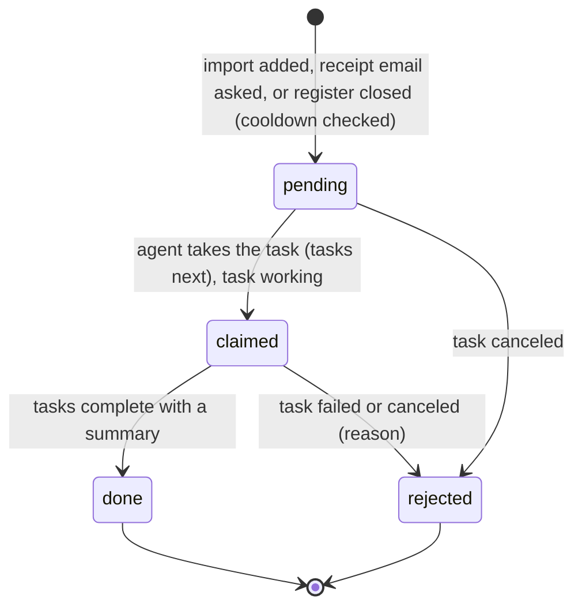
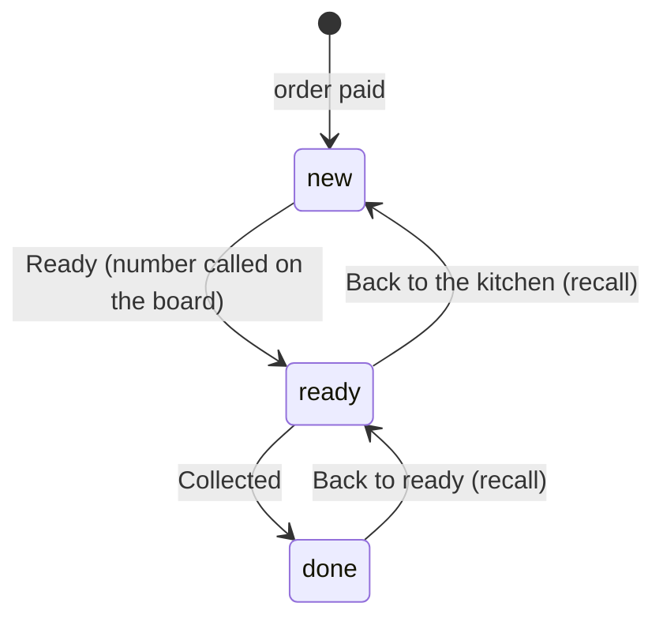
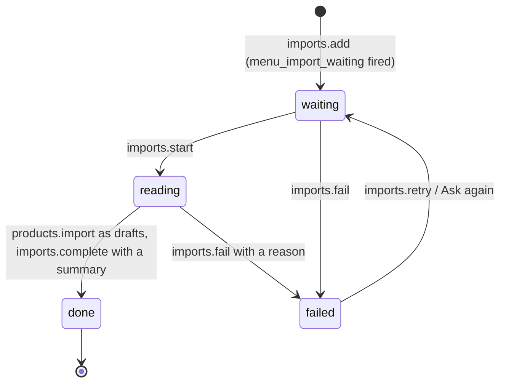

# Requirements: POS

PART A — REQUIREMENTS (SRS). User-approved before build; frozen after; changes via ## Changes.

## Introduction

### Purpose
POS is a point of sale for cafes, restaurants and shops, from a one-person kiosk to a few registers, a kitchen screen and an order board. Its one job is to ring up and take payment for sales at the counter, correctly to the minor unit. The home page is the register, and a new cashier must be able to use it without training. Everything else sits one click away for the people whose role allows it: orders, kitchen, products and stock, customers, cash and shifts, reports and settings. Staff sign in with a PIN, and a manager's PIN approves exceptions in place. An AI agent works on the same data through A2App and runs the back office (catalog, stock, customers, imports, reports, receipt emails, draft tickets). It never moves money. The app hands it work as tasks: read waiting menu files into drafts, email a receipt, write the day's brief when a register closes.

### Scope
**Goals**
1. A sale is rung up and paid on the register page alone: tiles, search or a scan add items; Pay takes cash, card, QR or other methods, split across several; the done screen shows the change, the receipt number and the order number.
2. The counter and the server compute the same totals to the minor unit. The server recomputes every sale and refuses one whose total changed since the counter priced it, and a sale sent twice is recorded once.
3. Receipt numbers are gapless per register. Sales, their lines and payments are never edited or deleted, and no sale line is ever returned more than once in total.
4. Closing a register is blind: the drawer is counted before the expected cash is shown, and the Z report is frozen at close.
5. Every UI action has an operation. The agent is refused every operation that takes payment, refunds, voids a ticket, opens or closes a register, moves cash, sees or sets PINs, or changes staff, taxes, payment methods, registers or owner settings.

**Core functionalities:** register with product tiles, search and barcode scanning · sale with order types, customers, discounts, notes and service charge · split payments with cash rounding · printed and emailed receipts · customer display and order board · returns and exchanges · open tickets · kitchen screen · orders · products with sizes, options, barcodes and stock · categories, option groups and discount presets · stock · CSV and menu-file import · customers · reports and the audit trail · cash and shifts with blind close and X/Z reports · staff, roles, PINs and manager approvals · training mode · settings with region presets · agent tasks

### Approval
Approved by the user: 2026-11-04 — carried over from the published marketplace app `pos` 1.0.0, whose requirements were approved when it was built; this document restates them in the framework's form without changing any feature.

## Product Description

### Product Perspective
`authMode: none`. The app binds loopback and has no accounts. Who is at the counter is decided inside the app: each person signs in with their own PIN and gets a session that the page sends as `X-Pos-Session`. The agent is recognised by the app's agent token (AGENT_APP.md § Notes). manifest.json declares no integrations (`capabilities.integrations: []`) and the app calls no outside service (AGENT_APP.md § External data). Card and QR payments are taken on the shop's own card terminal or QR code, and the app records them. Receipts are printed through the browser's print dialog. A receipt email is sent by the person's AI agent from their own email account. The customer display follows its register through a `BroadcastChannel` in the same browser. The UI names no particular agent ("your AI agent").

### User Characteristics
Owners, managers and cashiers of cafes, restaurants and shops, at the counter all day. The register runs on a counter device with touch or a mouse, a physical keyboard, a keyboard-wedge barcode scanner and a receipt printer (58 or 80 mm). The kitchen screen and the order board run on any device (the board on a TV over the counter). The customer display runs on a second screen of the counter machine. Owners and managers also use phones and desktops for the back office. Widths down to 320 px are in scope, with touch and pointer input.

### Constraints
- C-1: Money is an integer of minor units in one currency, and percentages are basis points (600 is 6%). No floating point touches money on the server or at the counter. Money parameters are text in major units ("4.50", "500" in yen), and every money value read back is an integer of minor units.
- C-2: Totals: line discounts come first, then the order discount, shared across lines by largest remainder. Tax is computed once per rate per receipt (not per line), with the shop's tax rounding (`half_up` nearest, `floor` down, `ceil` up), and prices are either inclusive or exclusive of tax. A tax class's dine-in rate replaces its rate on dine-in orders (Japan's food 8% becomes 10%). The service charge applies to the net before tax and is taxed with its own class.
- C-3: Cash rounding (to 0, 5 or 10 minor units) applies only to the part paid in cash and is recorded as rounding. Card and QR payments stay exact.
- C-4: The server is the authority: it re-prices every line of a sale and refuses one whose total differs from `expected_total` (`total_changed`).
- C-5: Sales, sale lines and payments are written once and never edited or deleted. A refund or an exchange is a new sale whose return lines point at the lines they return (`origin`). A line can never be returned more than once in total, and each return refunds exactly its share of the original discounts and tax.
- C-6: Receipt numbers are gapless per register (R1-000001), and a sale that fails takes no number. Training sales have their own series (TR1-…). Order numbers for calling orders restart every trading day. Every register keeps a hash chain over its sales (`prev_hash`, `hash`).
- C-7: A sale is recorded once even if the counter sends it twice: the same `ref` with the same body returns the stored sale (`replayed`), and a different body under the same `ref` is refused (`ref_conflict`).
- C-8: A trading day may end after midnight (`day_cutoff_hour`), so late-night sales count in the evening they belong to.
- C-9: PINs are 4 to 6 digits, unique among active staff, and stored salted and hashed (sha256). Five wrong PINs lock that person for five minutes. A session lasts 16 hours or until the register is locked. A manager approval is single use and expires after 30 minutes.
- C-10: Roles: an owner may do everything. A manager may do everything except settings and staff. A cashier may sell, save tickets, give discounts up to the cashier limit, open and close the register, add customers, work the kitchen screen and reprint. A manager's PIN can approve, for a cashier, a discount over the limit, a price change, a refund, a refund without a receipt, voiding a ticket and moving cash.
- C-11: The agent may read everything and do only these actions: reports, catalog, customers (including archiving), stock, imports, the business details and receipt wording in settings, clearing a PIN, drafting tickets and pricing carts, and receipt emails. It is refused the counter actions (payments, refunds, voids, shifts, cash moves, reprints, sign-in, approvals) and setup, staff, PINs, taxes, payment methods, registers, the other settings, and approving imported products.
- C-12: Every collection changes only through the operations. Request hooks refuse direct API creates, updates and deletes, even a superuser's. PIN hashes, sessions, approvals and the hot counters are readable by superusers only.
- C-13: Region presets set the currency, price mode, tax rounding, cash rounding, tax-number label, order types and starting tax classes at setup. They cover Malaysia (MYR, exclusive, 5 sen cash rounding, SST 6%), Singapore (SGD, inclusive, GST 9%), Japan (JPY, inclusive, floor rounding, Standard 10%, Food 8% that is 10% eaten in), Australia (AUD, inclusive, 5 cents, GST 10%), New Zealand (NZD, inclusive, 10 cents, GST 15%), the United Kingdom (GBP, inclusive, VAT 20% and 5%), the United States (USD, exclusive, sales tax) and another country (USD, exclusive). Afterwards every value is the shop's own.
- C-14: Fixed vocabularies. Order type: dine_in, takeaway, delivery. Payment method kind: cash, card, qr, other. Role: owner, manager, cashier. Sale kind: sale, refund, exchange. Ticket (cart) status: parked, resumed, done, void; source: counter, agent. Kitchen ticket status: new, ready, done. Import status: waiting, reading, done, failed; added_by: staff, agent. Cash move: pay_in, pay_out, drop. Stock move: sale, refund, receive, adjust, count. Audit actor: staff, agent, system. Product status: active, draft. Receipt width: 80, 58. After a sale: ask, print, none. Service charge scope: dine_in, all.
- C-15: Nothing that was sold is deleted. A product is archived and restored, a customer is archived, a tax class no product uses is archived, and a register is archived (at least one stays in use). Deleting a category leaves its products without a category.
- C-16: Every scannable code is unique: product SKUs, size SKUs and barcodes, ignoring case. Category names and tax class names are unique ignoring case, and register codes are unique.
- C-17: Product photos, the logo and the QR image are JPEG, PNG, WebP or GIF, up to 8 MB each. Menu and price-list files are JPEG, PNG, WebP, GIF, PDF, CSV, plain text, XLS or XLSX, up to 20 MB each. Sale line quantities are whole units.
- C-18: Training sales are numbered in their own series and never count in reports, stock or cash.
- C-19: The first open seeds the settings (not set up; receipt footer "Thank you", a 10% cashier discount limit, 80 mm paper, a receipt barcode, "ask" after a sale, order numbers on, kitchen off, prices on tiles), one register "Register 1" (R1) with its counters, and three payment methods: Cash, Card and QR pay. No products, staff or sample data are seeded.
- C-20: No emoji appears anywhere. Categories wear line icons from a fixed set of 67 (`tag` by default). The app names no particular AI agent, and what the agent does is recorded with the actor `agent`.
- C-21: Numbers on screen read "1,234.50" whatever the browser language. Typed amounts take "." as the decimal point, take "," only between thousands, and allow no more decimals than the currency has.

### Assumptions
- A-1: Volume ceiling: a few registers per shop, sharing 1,800 operation requests per minute (the `/api/ops/` rate limit set by the seed migration). List operations page their results: sales and the audit trail 50 per page (up to 500), customers up to 1,000, shifts up to 200, imports up to 200, tickets up to 500.
- A-2: The machine running the app is the shop's own, and its local date and time are the shop's.
- A-3: Barcode scanners act as a keyboard (USB or Bluetooth "keyboard wedge"). Receipt printers print through the browser.

## Features

### Module: Frame
- F-FRM-1: On wide screens the user can reach every page from a slim rail on the left: the mark, then the pages in white pill groups (Register, Orders, Kitchen; Products, Customers, Cash and shifts, Reports), with Settings and the signed-in person at the bottom.
- F-FRM-2: The user sees the current page as a solid round button. Hovering a rail button shows the page's name.
- F-FRM-3: The user sees counts on Register (tickets your AI agent drafted), Kitchen (open kitchen tickets) and Products (drafts to review plus products running low).
- F-FRM-4: On phones the user can navigate with a floating bar: Register, Orders, the sale button raised in the middle (with the number of items), a menu for the remaining pages, and the person.
- F-FRM-5: WHEN a person is signed in THE SYSTEM SHALL show only the pages their role allows (Kitchen only while the kitchen is on), and send any other page to the register.
- F-FRM-6: The user always sees who is at the register. Their menu shows their role, marks training mode, and offers "Lock the register" and "Change my PIN".
- F-FRM-7: WHEN the register has been idle for the time set in settings THE SYSTEM SHALL lock it and keep the cart. It never locks while a payment is being taken.
- F-FRM-8: WHEN a newer version of the app has been deployed THE SYSTEM SHALL reload an open page onto it, after the server comes back or when the tab is shown again. It waits while a dialog is open or the cart has items.
- F-FRM-9: The user can use every page down to 320 px wide.
- F-FRM-10: WHEN the host switches the theme pack, light or dark mode, or custom colors THE SYSTEM SHALL recolor the app from the host's theme tokens with contrast checks. Only the state colors (green, amber, red, always with a label) and the eight category hues stay fixed, and receipts print black on white.
- F-FRM-11: The user sees no emoji anywhere, categories with line icons, and the agent called "your AI agent".

### Module: Setup and signing in (setup, auth, registers)
- F-SUP-1: WHEN the app is opened for the first time THE SYSTEM SHALL show "Set up your register": two numbered step cards on one screen. Step 1 takes the business name and the country (Malaysia, Singapore, Japan, Australia, New Zealand, United Kingdom, United States, or another country), which sets the currency, price mode, tax classes, tax rounding and cash rounding. Step 2 takes the owner's name and PIN.
- F-SUP-2: The user sees the chosen country's currency (which can be changed) and the taxes it starts with before finishing.
- F-SUP-3: WHEN setup is finished THE SYSTEM SHALL sign the owner in, and the register asks for a float counted by denomination before it opens.
- F-AUTH-1: WHEN the shop has more than one register THE SYSTEM SHALL ask a new device "Which register is this?" and remember the answer in that browser. With one register, the device is that register.
- F-AUTH-2: The user can sign in on the lock screen ("Who is at the register?") by picking their tile and typing their PIN on a keypad or the keyboard.
- F-AUTH-3: WHEN a person has no PIN (new, or cleared by the owner) THE SYSTEM SHALL have them choose one by typing it twice, then sign them in.
- F-AUTH-4: WHEN a PIN is wrong five times THE SYSTEM SHALL lock that person for five minutes, and their tile reads "Locked for a few minutes".
- F-AUTH-5: The signed-in person can change their own PIN (current PIN, then the new one twice).

### Module: Register (catalog, products, lookup)
- F-REG-1: The user sees a greeting with their first name, the date, and the register's state ("open since 14:05" or "is closed"), which links to Cash and shifts.
- F-REG-2: The user can browse products by category from a row of pills: Amount, Favorites, All, and each category with its color and icon.
- F-REG-3: The user sees soft rounded square tiles that show the product's photo, or a round icon badge on the category's tint. The name is centered under the tile and rolls when it is too long. Under it is the price (or the "from" price) when the shop shows prices on tiles. A tile also shows a sold-out mark, and stock left when the product is tracked and low.
- F-REG-4: The user can tap a tile to add the product. WHEN the product has sizes, open price or required options THE SYSTEM SHALL open the item dialog instead.
- F-REG-5: The user can search (F2 or /) to narrow the tiles by name, SKU or barcode as they type. Enter adds the only match, or acts on an exact code as a scan.
- F-REG-6: WHEN a barcode scanner reads a code anywhere on the register THE SYSTEM SHALL add the product whose SKU, size SKU or barcode it is, open the return for a receipt number, or, for an unknown code, offer people who may change products "New product with this code" or "Add it to a product".
- F-REG-7: WHEN a scanned product is sold out or not for sale THE SYSTEM SHALL say so and add nothing. Scans beep high when recognised and low twice when not.
- F-REG-8: The user can open a product's item dialog: sizes as tiles, every option group in its own card with its rule ("Pick 1", "Up to 3") and Required or Done, defaults already picked, quantity and a note. The Add pill shows the line's price as it is built.
- F-REG-9: The user can enter an amount with no product from the Amount pill on a keypad, with what it is for.
- F-REG-10: The user can hold or right-click a tile to open its menu: options, mark as sold out (or back in stock), and, for people who may change products, add to favorites and edit the product.
- F-REG-11: People who may change products can enter arrange mode and drag tiles into the order the counter wants, per category and for Favorites. Tiles keep that order.
- F-REG-12: The user can open the customer display and the order board (when the kitchen is on) in their own windows, put cash in or out, and go to Cash and shifts from the register's More menu.
- F-REG-13: WHEN the register is closed THE SYSTEM SHALL show the float count in place of the tiles, and the pay button reads "Open the register first".

### Module: The sale (tickets, sales)
- F-CART-1: The user sees the sale on the right, always in view in its own card. On phones it is a full-screen sheet opened from a pill showing the item count and total, or from the bar's sale button.
- F-CART-2: The user can set the order type (the shop's types among dine-in, takeaway and delivery), name the sale, and add a customer (search by name, phone or email, or add one with what was typed).
- F-CART-3: The user sees the lines as soft rows with their options, notes and tax marks. Tapping a line opens its quantity, discount, price change, note and options.
- F-CART-4: WHEN a line is removed THE SYSTEM SHALL offer Undo for six seconds.
- F-CART-5: The user sees a dark card at the foot of the sale with the subtotal, discounts, service charge, tax per rate (or "Tax included" when prices include tax), the total, and the pay button.
- F-CART-6: The user can add a note to the order, return items, and clear the sale from the sale's More menu.
- F-CART-7: The cart of each register is kept in that browser, so a reload or a locked register never loses it.

### Module: Discounts and approvals (discounts, auth)
- F-APR-1: The user can discount a line or the order with a preset or a typed percent or amount.
- F-APR-2: WHEN a cashier gives a discount above the shop's limit, changes a price, refunds, returns without a receipt, voids a ticket or moves cash THE SYSTEM SHALL ask a manager. The manager picks their tile and types their PIN on the same screen, and the action goes through with their name on it.
- F-APR-3: WHEN a discount over the limit or a changed price is set THE SYSTEM SHALL ask for the approval at once, before payment.
- F-APR-4: WHEN nobody who can approve has a PIN THE SYSTEM SHALL say "Nobody who can approve this has a PIN yet. The owner can add a manager in Settings, Staff."

### Module: Paying and receipts (sales, tenders, receipts)
- F-PAY-1: WHEN the user presses Pay (or F9) THE SYSTEM SHALL grow a full screen out of the pay button with three numbered steps: how (the shop's active payment methods as tiles), the amount (what is due on a dark display, large), and the button that takes it.
- F-PAY-2: The user can take cash with quick amounts (the exact amount and the next notes up), a keypad, and the change due.
- F-PAY-3: The user can take card and other methods for the exact amount, with a reference when the method asks for one. A card payment cannot exceed what is due.
- F-PAY-4: The user can take a QR payment, which shows the shop's QR image (also on the customer display).
- F-PAY-5: The user can split a payment across methods, and the remaining balance is always shown.
- F-PAY-6: WHEN the payments cover what is due THE SYSTEM SHALL record the sale at once and turn the screen into the done screen. It shows the change due (large), the receipt number, the order number ("Sent to the kitchen" when it made a kitchen ticket), print, email, and New sale, which shrinks the screen back into the register.
- F-PAY-7: WHEN the shop's setting is "Always print" THE SYSTEM SHALL print the receipt automatically after a sale.
- F-PAY-8: The user can email the receipt from the done screen (the customer's address on file is filled in). Your AI agent sends it.
- F-PAY-9: WHEN the sale needs a manager's approval THE SYSTEM SHALL ask for it on the pay screen. WHEN the server refuses the sale THE SYSTEM SHALL show the reason in place.
- F-RCT-1: The user's printed receipt shows the shop's logo, details, tax and company numbers, header and footer, every line with options and discounts, tax per rate with marks, the service charge, payments, change and rounding, the cashier, and (by setting) a barcode of the receipt number, on 80 or 58 mm paper.
- F-RCT-2: WHEN a receipt is printed again THE SYSTEM SHALL mark it COPY and record the reprint. A training receipt reads "TRAINING: NOT A RECEIPT".
- F-RCT-3: The user can open a customer display in a second window on the same machine. It mirrors the cart, the amount due, the QR code to scan and the change, and shows "Welcome" when idle.

### Module: Totals and recording (sales)
- F-SAL-1: WHEN a sale is finalized THE SYSTEM SHALL re-price every line, check the total against what the counter priced, take the payments and assign the receipt number in one transaction.
- F-SAL-2: WHEN the same sale is sent again with the same `ref` THE SYSTEM SHALL return the stored sale, and the pay screen shows it instead of charging twice.
- F-SAL-3: The user's even exchange (nothing to pay either way) is recorded as soon as the pay screen opens.

### Module: Returns and exchanges (sales)
- F-RET-1: The user can find a receipt by number, by scanning it, or from today's recent receipts, and choose the lines and quantities still returnable, and whether they go back to stock.
- F-RET-2: The user can add new items to the same sale to make an exchange. The pay button then collects or refunds the difference.
- F-RET-3: WHEN a refund is paid THE SYSTEM SHALL suggest the original payment methods. The person can refund in cash instead, the whole refund in one tap or part of it typed.
- F-RET-4: The user can return a product without a receipt, which needs a manager's approval at payment.
- F-RET-5: The user can start a return from a sale on the Orders page.

### Module: Open tickets (tickets)
- F-TKT-1: The user can save the sale as a ticket with a name (a table, a tab, a phone order), with quick names T1 to T8, Bar and Takeaway.
- F-TKT-2: The user can see every open ticket with its age, total, items, order type and who saved it, and which register has it open.
- F-TKT-3: The user can resume a ticket on any register. WHEN the cart has items THE SYSTEM SHALL save it as a ticket first, after asking.
- F-TKT-4: The user sees tickets your AI agent drafted marked "From your AI agent".
- F-TKT-5: A ticket can be released back to waiting, unchanged (`tickets.release`), or voided with a reason (`tickets.void`), where a cashier needs a manager's approval.

### Module: Orders (sales, receipts)
- F-ORD-1: The user can see every sale, refund and exchange, newest first, one card each, with the total of what is shown.
- F-ORD-2: The user can search by receipt number, ticket name, customer or order number, or scan a receipt to open it.
- F-ORD-3: The user can filter by kind, training sales, how it was paid, the register (with more than one), and the days (Today, Yesterday, 7 days, 30 days, All).
- F-ORD-4: The user sees the selected sale beside the list (in a dialog on narrow screens): its receipt as printed, the sales it returns from and the returns against it, and the approvals it carried.
- F-ORD-5: The user can print a copy, email the receipt through your AI agent, and start a return from the selected sale.

### Module: Kitchen and order board (kitchen)
- F-KIT-1: WHEN an order with products from kitchen categories is paid THE SYSTEM SHALL make a kitchen ticket with the order number, name, order type, items with options and notes, and the time waiting.
- F-KIT-2: The user can move a kitchen ticket from new to ready (the number is called) to collected, and recall it one step back.
- F-KIT-3: The user sees the wait turn amber at 5 minutes and red, with the word "late", at 10 minutes.
- F-KIT-4: The user can switch between the Open and Collected views and sees a dark "All day" card adding up what is still to make.
- F-KIT-5: WHEN a new order arrives on the kitchen screen THE SYSTEM SHALL chime once.
- F-KIT-6: The user can open the order board on any device. It shows the order numbers being prepared and ready to collect, large, zoomed to fill the screen.

### Module: Products (products, categories, modifiers, discounts)
- F-PRD-1: The user can list products with status chips (For sale, To review, Archived) and their counts, a category filter, search by name, SKU or barcode, a for-sale switch per product, and the sold-out count.
- F-PRD-2: WHEN the user opens a product or "New product" THE SYSTEM SHALL grow the editor out of it into a full screen of three numbered steps. "What it is" holds the name, category, price or open price, and tax class. "Sizes and options" holds the sizes, each with price, SKU and cost, and the option groups offered. "Stock and details" holds the SKU, cost, barcodes (typed or scanned), stock tracking with opening stock and a low level, for sale now, favorite, tile color, photo and description.
- F-PRD-3: The user can archive and restore a product. Nothing that was sold is deleted.
- F-PRD-4: The user can add products your AI agent imported (To review) to the register, or discard them, all at once or a selection.
- F-PRD-5: The user can edit categories (name, color, line icon, kitchen, order), option groups (options with prices, defaults, minimum and maximum, sold out per option) and discount presets (percent or amount, on the order or a line).
- F-PRD-6: WHEN the user deletes a category, an option group or a discount preset THE SYSTEM SHALL ask first. The confirmation says what happens: its products stay without a category, the group is taken off its products, or past sales keep the discount.

### Module: Stock (stock)
- F-STK-1: The user sees the products that count their stock, lowest first, with what is on hand per size against its alert level, and the low and out counts.
- F-STK-2: The user can receive a delivery, adjust stock with a reason, count what is on hand, and see a product's history of moves.
- F-STK-3: WHEN a sale is recorded THE SYSTEM SHALL take its tracked items out of stock. Returns put them back when marked "back to stock", and training never touches stock.

### Module: Import (imports, products)
- F-IMP-1: The user can import products from a CSV file with a header row, mapping columns to fields (with a template to download), and see the rows that will be left out and why. The products are added at once.
- F-IMP-2: The user can give your AI agent a menu photo, a PDF or a price list. The agent reads it into products that wait under To review for a person to add or discard.
- F-IMP-3: The user sees each menu file's state (waiting for your AI agent, being read, done with a summary, could not be read with the reason), and can ask again or delete it. The products it added stay.

### Module: Customers (customers)
- F-CUS-1: The user can search customers by name, phone or email, one card each with visits, spend and the last visit.
- F-CUS-2: The user can open a customer to see and edit their contact details, notes for the counter and marketing consent, with their visits, spend, average, last visit, the products they usually buy and their recent receipts.
- F-CUS-3: Owners and managers can archive and restore a customer. Their sales stay.

### Module: Reports (reports)
- F-RPT-1: The user can report over today, yesterday, the last 7 or 30 days, this month or chosen dates, for one register or all.
- F-RPT-2: The user sees what was collected on the dark card, then net sales, orders, average sale, tax and service charge, each against the previous period.
- F-RPT-3: The user sees "Where the money came from" (net sales by category as a ring with its legend), collected by hour (one day) or by day, top products, and breakdowns by category, staff, order type, discount and tax rate.
- F-RPT-4: The user sees payment methods, gross profit (where products have a cost), discounts and returns.
- F-RPT-5: The user can export sales (one row per receipt), items sold (one row per line) or payments as CSV for the chosen days.
- F-RPT-6: Training sales never count in reports.

### Module: Activity (audit)
- F-ACT-1: The user can read the audit trail of every sale, refund, exchange, override, void, cash move, shift, sign-in failure, PIN lock, approval, reprint, receipt email, drafted ticket, import, and change to staff, settings, products, stock and customers, with who did it and who approved it.
- F-ACT-2: The user can group it (Everything, Sales and cash, Approvals and voids, Changes, Your AI agent) and search it. Overrides, voids, failed sign-ins and PIN locks wear the warning color, and what the agent did is marked "Your AI agent".

### Module: Cash and shifts (shifts, cash)
- F-CSH-1: The user can open a register with a float counted by denomination.
- F-CSH-2: While the register is open, the user can put cash in, take it out (paid out) or drop it to the safe, each with a reason. A cashier needs a manager.
- F-CSH-3: People who may see reports see the live X report beside the register and can print it, with every shift of every register.
- F-CSH-4: WHEN the user closes the register THE SYSTEM SHALL grow a full screen of two numbered steps out of the Close button. The drawer is counted by denomination before the screen shows what was expected. Then come the difference ("Balanced", or over or short) and a note when it is over or short.
- F-CSH-5: WHEN a register is closed THE SYSTEM SHALL freeze the Z report (orders, net sales, tax, service charge, discounts, refunds, payment methods, cash expected and counted, cash moves, voids and overrides) so it can be printed later, and ask your AI agent for the day's brief.
- F-CSH-6: Shift numbers are gapless per register.

### Module: Staff and settings (staff, settings, tax, tenders, registers)
- F-STF-1: The owner can add a person with a name, color, role (owner, manager, cashier) and PIN, change them, reset their PIN (they choose a new one at their next sign-in), put them in training mode, and turn them off.
- F-STF-2: WHEN a person is in training mode THE SYSTEM SHALL number their sales TR… and keep them out of reports, stock and cash.
- F-STG-1: The owner can change settings in sections shown as pills: Business and receipts, Taxes and money, Selling, Payment methods, Registers, Staff, and Your AI agent. Each card saves on its own.
- F-STG-2: The owner can set the business and receipt details: name, address, phone, email, website, tax number label and number, company registration number, logo, the text printed at the top and bottom, paper width (80 or 58 mm), what happens after a sale (ask, always print, no receipt), and the receipt number as a barcode.
- F-STG-3: The owner can set taxes and money: currency, prices including tax or before tax, tax rounding, cash rounding, the service charge (percent, charged on dine-in orders or every order, its tax class), and tax classes with a rate, a dine-in rate, a receipt mark and a default.
- F-STG-4: The owner can set selling options: order types and the type new sales start as, order numbers, prices on tiles, the kitchen screen, the cashier discount limit, the idle lock (never, 1, 2, 5, 15 or 30 minutes), and the hour the trading day ends.
- F-STG-5: The owner can manage payment methods (add cash, card, QR with its image, or other; turn them on or off; ask for a reference) and registers (add one, use one on this device, archive a closed one while another stays). Renaming a register is done with `registers.update`.
- F-STG-6: WHEN a rate or a setting changes THE SYSTEM SHALL leave past sales as they were made.
- F-STG-7: The user sees a dark card listing what your AI agent does here: it reads menus, emails receipts, writes the day's brief, and runs the back office when asked.

### Agent (via A2App)
- F-AGT-1: The agent can perform every action it is permitted through the 99 operations in ## Operations Design, across the modules app, setup, auth, staff, settings, tax, tenders, registers, catalog, categories, products, modifiers, discounts, lookup, stock, imports, tickets, sales, receipts, shifts, cash, kitchen, customers, reports and audit.
- F-AGT-2: The agent can read the conventions, today's trading day, the currency, tax classes, categories, registers, what it may and may not do, and ready-to-run recipes from `app.guide`, and a summary of the shop's state from `app.status`.
- F-AGT-3: The agent can run the back office: catalog (products, categories, option groups, discounts), stock, customers, imports, reports and exports, receipt emails, the business details and receipt wording, and clearing a forgotten PIN when the owner asks.
- F-AGT-4: The agent can quote a cart with `sales.preview` and save a phone or chat order as a ticket with `tickets.draft`. Lines name products by id, SKU, barcode or exact name, and default options apply where none are named.
- F-AGT-5: WHEN the agent calls an operation that moves money or belongs to the counter or the owner THE SYSTEM SHALL refuse it (C-11).
- F-AGT-6: WHEN the agent imports products THE SYSTEM SHALL keep them as drafts to review. The agent cannot approve them.
- F-AGT-7: The agent can take a `menu_import_waiting` task and read each waiting menu file (`imports.start`, then `products.import` and `imports.complete`), or mark it unreadable with a reason (`imports.fail`).
- F-AGT-8: The agent can take a `receipt_email_requested` task and email the receipt text from `sales.receipt-text` to the customer from the user's email account.
- F-AGT-9: The agent can take a `day_closed` task and send the user a short brief on the closed shift and the day (`shifts.report`, `reports.summary`, `audit.list`, `stock.list`).
- F-AGT-10: WHEN the agent calls a destructive operation THE SYSTEM SHALL answer `approval_required` until the person has approved that call.
- F-AGT-11: WHEN the agent changes anything THE SYSTEM SHALL record it in the audit trail with the actor `agent`.

## Non-Functional Requirements
- N-1: A change made at another register, on the kitchen screen or by the agent appears on every open screen without a manual refresh. Views reload 150 ms after the last realtime change to a collection they watch.
- N-2: The counter (`frontend/src/app/lib/calc.ts`) and the server (`pb/pb_hooks/lib_calc.js`) compute the same totals to the minor unit for every cart. The order discount is shared by largest remainder using BigInt beyond 2^53.
- N-3: Receipt numbers stay gapless under concurrent registers: a sale's first statement in its transaction is the counter update, which takes the write lock (AGENT_APP.md § Gotchas).
- N-4: A scan is told from typing as a burst of at least 4 characters averaging under 40 ms per key, ended by Enter or Tab or a short pause.
- N-5: The idle lock is checked every 15 s. Kitchen wait times refresh every 15 s.
- N-6: Expired sessions are ended, and used or expired approvals deleted, within the hour (job `pos_cleanup` at minute 17). Ended sessions are deleted after 30 days. Waiting menu files whose ask was refused are asked about again within a minute (job `pos_imports`).
- N-7: The operations allow 1,800 requests per minute across every register, kitchen screen and display.
- N-8: Every page is usable from 320 px wide up to 1680 px, the app shell's maximum width.

## Data Requirements
- **tax_classes** (module: tax): name (string, required, max 40), rate_bp (number), dine_in_rate_bp (number), mark (string, max 4), sort (number), is_default (boolean), archived (boolean), created (datetime, server-set), updated (datetime, server-set).
- **settings** (module: settings): setup_done (boolean), business_name (string, max 80), address (string, max 300), phone (string, max 40), email (string, max 120), website (string, max 200), tax_reg_label (string, max 40), tax_reg_no (string, max 40), company_reg_no (string, max 40), region (enum, required), currency (string, required, max 3), price_mode (enum, required), tax_rounding (enum, required), cash_rounding (number), order_types (list<enum>), default_order_type (enum), service_charge_bp (number), service_charge_scope (enum), service_charge_tax (ref → tax_classes), receipt_header (string, max 500), receipt_footer (string, max 500), receipt_width (enum, required), receipt_barcode (boolean), after_sale (enum, required), logo (binary), kitchen_enabled (boolean), order_numbers (boolean), lock_minutes (number), cashier_discount_bp (number), day_cutoff_hour (number), created (datetime, server-set), updated (datetime, server-set), show_tile_prices (boolean).
- **registers** (module: registers): name (string, required, max 40), code (string, required, max 8), z_seq (number), archived (boolean), created (datetime, server-set), updated (datetime, server-set).
- **counters** (module: auth): key (string, required, max 80), num (number), text (string, max 80), created (datetime, server-set), updated (datetime, server-set).
- **tenders** (module: tenders): name (string, required, max 30), kind (enum, required), qr (binary), ask_reference (boolean), active (boolean), sort (number), created (datetime, server-set), updated (datetime, server-set).
- **staff** (module: staff): name (string, required, max 40), role (enum, required), color (number), active (boolean), training (boolean), pin_set (boolean), failed (number), locked_until (string, max 40), created (datetime, server-set), updated (datetime, server-set).
- **staff_pins** (module: staff): staff (ref, required → staff), salt (string, max 64), hash (string, max 64), created (datetime, server-set), updated (datetime, server-set).
- **sessions** (module: auth): staff (ref, required → staff), register (ref → registers), token_hash (string, required, max 64), expires (string, max 40), ended (boolean), created (datetime, server-set), updated (datetime, server-set).
- **approvals** (module: auth): action (enum, required), approver (ref, required → staff), for_staff (ref → staff), scope (string, max 80), token_hash (string, required, max 64), expires (string, max 40), used (boolean), created (datetime, server-set), updated (datetime, server-set).
- **customers** (module: customers): name (string, required, max 80), phone (string, max 40), email (string, max 120), notes (string, max 1000), marketing (boolean), archived (boolean), created (datetime, server-set), updated (datetime, server-set).
- **categories** (module: categories): name (string, required, max 40), color (number), icon (string, max 40), sort (number), kitchen (boolean), created (datetime, server-set), updated (datetime, server-set).
- **modifier_groups** (module: records): name (string, required, max 40), min (number), max (number), sort (number), created (datetime, server-set), updated (datetime, server-set).
- **modifiers** (module: modifiers): modifier_group (ref, required → modifier_groups), name (string, required, max 40), price (number), is_default (boolean), available (boolean), sort (number), created (datetime, server-set), updated (datetime, server-set).
- **products** (module: products): name (string, required, max 80), category (ref → categories), price (number), open_price (boolean), tax_class (ref → tax_classes), sku (string, max 40), description (string, max 500), photo (binary), color (number), cost (number), available (boolean), archived (boolean), status (enum, required), track_stock (boolean), low_stock (number), favorite (boolean), sort (number), fav_sort (number), modifier_groups (list<ref> → modifier_groups), import_ref (string, max 20), created (datetime, server-set), updated (datetime, server-set).
- **variants** (module: products): product (ref, required → products), name (string, required, max 40), price (number), sku (string, max 40), cost (number), sort (number), archived (boolean), created (datetime, server-set), updated (datetime, server-set).
- **codes** (module: products): code (string, required, max 64), product (ref, required → products), variant (ref → variants), created (datetime, server-set), updated (datetime, server-set).
- **discounts** (module: discounts): name (string, required, max 40), kind (enum, required), value (number), scope (enum, required), sort (number), created (datetime, server-set), updated (datetime, server-set).
- **shifts** (module: shifts): register (ref, required → registers), number (number), status (enum, required), opened_by (ref → staff), opening_float (number), opening_counts (json), closed_by (ref → staff), closed_at (string, max 40), counted_cash (number), closing_counts (json), expected_cash (number), variance (number), note (string, max 300), summary (json), created (datetime, server-set), updated (datetime, server-set).
- **sales** (module: sales): ref (string, required, max 64), body_hash (string, max 64), number (string, required, max 24), seq (number), register (ref, required → registers), shift (ref → shifts), staff (ref → staff), customer (ref → customers), order_type (enum), order_no (number), name (string, max 40), kind (enum, required), training (boolean), currency (string, max 3), price_mode (enum), item_count (number), subtotal (number), discount_total (number), service_charge (number), tax_total (number), taxes (json), rounding (number), total (number), paid (number), change (number), business_day (string, max 10), note (string, max 300), header (json), approvals (json), prev_hash (string, max 64), hash (string, max 64), created (datetime, server-set), updated (datetime, server-set).
- **sale_lines** (module: records): sale (ref, required → sales), line_no (number), product (ref → products), variant (ref → variants), name (string, required, max 120), variant_name (string, max 40), sku (string, max 40), category (string, max 40), category_id (string, max 20), qty (number), unit (number), modifiers (json), gross (number), line_discount (number), order_discount (number), discount_name (string, max 40), net (number), tax_class (string, max 20), tax_name (string, max 40), rate_bp (number), mark (string, max 4), tax (number), cost (number), kitchen (boolean), note (string, max 200), restock (boolean), price_changed (boolean), created (datetime, server-set), updated (datetime, server-set), origin (ref → sale_lines).
- **payments** (module: tenders): sale (ref, required → sales), tender (ref → tenders), kind (enum, required), name (string, max 30), amount (number), tendered (number), change (number), reference (string, max 60), register (ref → registers), shift (ref → shifts), staff (ref → staff), training (boolean), business_day (string, max 10), created (datetime, server-set), updated (datetime, server-set).
- **carts** (module: tickets): ref (string, required, max 64), register (ref → registers), staff (ref → staff), status (enum, required), source (enum, required), name (string, max 40), order_type (enum), customer (ref → customers), lines (json), discount (json), note (string, max 300), total (number), items (number), sale (ref → sales), void_reason (string, max 200), voided_by (ref → staff), created (datetime, server-set), updated (datetime, server-set).
- **cash_moves** (module: cash): shift (ref, required → shifts), register (ref → registers), kind (enum, required), amount (number), reason (string, max 200), staff (ref → staff), approver (ref → staff), created (datetime, server-set), updated (datetime, server-set).
- **stock** (module: stock): product (ref, required → products), variant (ref → variants), qty (number), created (datetime, server-set), updated (datetime, server-set).
- **stock_moves** (module: stock): product (ref, required → products), variant (ref → variants), qty (number), kind (enum, required), reason (string, max 200), sale (ref → sales), balance (number), staff (ref → staff), actor (enum, required), created (datetime, server-set), updated (datetime, server-set).
- **tickets** (module: tickets): sale (ref, required → sales), register (ref → registers), order_no (number), number (string, max 24), name (string, max 40), order_type (enum), items (json), note (string, max 300), status (enum, required), ready_at (string, max 40), done_at (string, max 40), training (boolean), created (datetime, server-set), updated (datetime, server-set).
- **imports** (module: imports): file (binary), filename (string, max 200), status (enum, required), summary (string, max 1000), error (string, max 300), created_count (number), added_by (enum, required), created (datetime, server-set), updated (datetime, server-set).
- **audit** (module: audit): kind (enum, required), actor (enum, required), staff (ref → staff), approver (ref → staff), register (ref → registers), ref (string, max 80), summary (string, max 300), data (json), created (datetime, server-set), updated (datetime, server-set).

## External Interfaces
- **Human (browser):** one View served by PocketBase at the app's own origin. The staff side has the hash routes `#/` (Register), `#/orders`, `#/kitchen`, `#/products`, `#/customers`, `#/shifts` (Cash and shifts), `#/reports` and `#/settings`, behind the setup screen, the register picker and the PIN lock screen. It also has the full screens that grow out of a button (pay, the product editor, closing a register) and the dialogs opened from the pages. Two customer-facing routes need no sign-in and show no rail: `#/display?register=<id>` (the customer display, in a second window of the same browser) and `#/board` (the order board, any device). Input is touch, mouse and keyboard, keyboard-wedge barcode scanners, image files (product photos, the logo, the QR image), menu files and CSV files. Output is receipts, X and Z reports printed through the browser on 58 or 80 mm paper, and CSV downloads (exports and the import template).
- **Agent (A2App):** the modules and collections in AGENT_APP.md § Modules; operations exactly as declared in ## Operations Design; tasks with the capabilities `menu_import_waiting`, `receipt_email_requested`, `day_closed` (events.json). No other machine interface is offered to agents; the app's own screens call their own routes.

## Out of Scope
- Taking card or QR payments through a payment processor or a connected terminal. Payments are taken on the shop's own terminal or QR code, and the app records them.
- Editing or deleting a recorded sale, sale line or payment. Corrections are refunds and exchanges.
- More than one currency at a time.
- Payment methods other than cash, card, QR and other (for example gift cards, store credit or loyalty points).
- Fractional or weighed quantities: sale line quantities are whole units.
- Accounts or sign-in beyond the staff PINs (`authMode: none`).
- Sending email from the app itself. Receipt emails are sent by your AI agent from the user's account.
- A customer display on another device: it follows its register in the same browser on the same machine.
- Printing other than through the browser's print dialog.
- The agent taking payments, refunding, voiding tickets, opening or closing a register, moving cash, reprinting, seeing or setting PINs, adding staff, changing roles, taxes, payment methods, registers or owner settings, or approving the products it imported.
- Training sales in reports, stock or cash.
- Emoji, and naming a particular AI agent.

## Quality of Life
- The greeting follows the time of day ("Good morning", "Good afternoon", "Good evening") and uses the person's first name.
- Quick picks: line notes ("No ice", "Less sugar", "Extra hot", "To go", "No onion"), ticket names (T1 to T8, Bar, and Takeaway or Patio), and reasons for cash in and out ("Float top-up", "Supplies", "Safe drop", …).
- A line just added glows once and scrolls into view. A wrong PIN shakes the PIN dots, and the item dialog shakes the required option group that is still missing.
- A new kitchen order chimes once, and scans beep.
- The done screen fills in the customer's email on file, and Enter or Escape there starts a new sale.
- Opening another ticket while ringing up saves the current sale as a ticket first, so nothing is lost.
- The customer display and the order board zoom up to fill a large screen (up to 3×).

PART B — TECHNICAL SPECIFICATION.

## System Overview
PocketBase 0.39 (JS hooks, migrations) + React 19 / Vite / Tailwind 4 View in `frontend/` built into `pb/pb_public/`, on the `blueprint-pocketbase-kit` toolkit. The View calls the app's own routes `/api/ops/<group>/<verb>` (`ops.pb.js`, `ops_catalog.pb.js`, `ops_sales.pb.js`). The generated `a2app_routes.pb.js` serves the same handlers to agents as `POST /api/ops/<name>`. Domain logic lives in `pb/pb_hooks/lib_*.js` (`lib_auth.gate` decides who may do what), and record guards and jobs live in `hooks.pb.js`. The totals engine exists twice, on the server (`lib_calc.js`, authoritative) and at the counter (`lib/calc.ts`).

Modules → navigation map:

| Module (manifest) | Where a person meets it | Route |
| --- | --- | --- |
| `setup` | First-open setup screen | (before any page) |
| `auth` | Register picker, lock screen, the person's menu (lock, change PIN), the manager approval overlay | (before any page) |
| `catalog`, `lookup` | Register tiles; scans on the Register and Orders pages | `#/`, `#/orders` |
| `tickets` | The sale card (Save, Tickets), the Open tickets dialog | `#/` |
| `sales` | Pay screen, returns dialog, Orders | `#/`, `#/orders` |
| `receipts` | Done screen and Orders (print, email) | `#/`, `#/orders` |
| `kitchen` | Kitchen page; order board | `#/kitchen`, `#/board` |
| `products` | Products view and product editor; the tile menu | `#/products` |
| `categories`, `modifiers`, `discounts` | Products › Categories, Options, Discounts; category pills, the item dialog, the discount dialog | `#/products` |
| `stock` | Products › Stock | `#/products?tab=stock` |
| `imports` | Products › Import | `#/products?tab=import` |
| `customers` | Customers page; the customer picker in the sale | `#/customers` |
| `shifts`, `cash` | Cash and shifts; the float count on the register; Cash in or out | `#/shifts`, `#/` |
| `reports` | Reports › Sales | `#/reports` |
| `audit` | Reports › Activity | `#/reports` |
| `settings`, `tax`, `tenders`, `registers`, `staff` | Settings sections; pay-screen method tiles; lock-screen tiles | `#/settings` |
| `app` | No screen: `app.guide` is the agent's starting point, and `app.status` feeds the rail counts | — |
| `records` | No screen: stored records reached through the modules above | — |

Rail order: the mark, then Register, Orders, Kitchen · Products, Customers, Cash and shifts, Reports · Settings and the person. Phone bar: Register, Orders, the raised sale button, a menu holding the rest, and the person.

## UI Design
- **Design system:** the agent-app UI kit 0.6.0 vendored in `frontend/src/kit` (system-managed). It supplies the `--agent-app-*` tokens in `theme/tokens.css`, the theme bridge, the shell with its error boundary and toasts, and the PocketBase client. The app extends the kit in `frontend/src/app/theme.css` and `lib/themeColors.ts`, in the Expenses tracker family. It sets its own font (Manrope Variable via `@fontsource-variable/manrope`) and base radius (`--agent-app-radius: 14px`). It derives every `--ps-*` color (canvas, shell, card, row, row-hover, sand, sand-2, ink, ink-2, muted, line, solid, dark, dark-2, and the accent in three roles: `--ps-accent` for marks and text, `--ps-accent-fill` for fills, `--ps-dot` for round icon badges) from what the kit tokens resolve to, and re-derives them on each theme change. Surface scopes `.ps-on-dark`, `.ps-on-sand`, `.ps-on-ink` and `.ps-on-card` re-point accent and muted text for their background. The fixed colors are the states `--ps-red` (#de4b33), `--ps-green` (#4f9a6c) and `--ps-amber` (#e2a43a), the eight category hues (terracotta, ochre, leaf, teal, blue, violet, rose, slate, each with a derived tint and text color), and receipt paper (#ffffff with #111111 ink). The widgets are written once in `components/ui.tsx`: Stage, Card (white, sand, dark), CardHeader, Panel, PageHeader, IconBadge, Button (with the accent `dot` for a screen's main action), IconButton, TextLink, Badge, Empty, LevelBar, the field classes, Select, Field, Toggle, Modal, useConfirm, Popover, RevealScreen, ScreenHeader, Step, Segmented, Tabs, Count, Chip, Spinner, SearchField, Avatar and TextField. The keypad (`Keypad.tsx`), charts (`Charts.tsx`: ring, columns, change pill, stat tiles), receipt (`Receipt.tsx`) and Code 128 barcode (`Barcode.tsx`) are app-drawn. Icons come from lucide-react, and categories use the 67-icon line set (`pb_hooks/lib_icons.js`, mirrored in `lib/icons.tsx`).
- **Layout:** a warm canvas holds one app shell, 1680 px wide at most, with 36 px corners from 768 px up. On wide screens the 96 px rail sits on the left, with the page in the main column. Setup, the register picker and the lock screen sit on their own shell (`Stage`, 1100 px at most). Cards have no borders and a 24 px radius; step cards and dialogs have 28 px, rows 18 px, and pills are fully rounded. The register puts the tiles on the left and the sale card on the right (340 px from 768 px, 400 px from 1024 px), sticky to the viewport. From 1024 px the other pages use 12-column grids (Orders 7 + 5, Reports 8 + 4, Kitchen 8 + 4 and 9 + 3 from 1280 px, Cash and shifts 7 + 5). Pay, the product editor and closing a register are full screens that grow out of the button pressed (a circular reveal). The type scale is 12, 13, 14, 15 and 26 px, with hierarchy from weight and color, and spacing follows a 4 px grid. Counter targets are large: tiles, keypad keys (56 to 64 px) and the 56 px pay button. On phones a floating bar replaces the rail, and pages keep 128 px of bottom padding to clear it.
- **Screen — Setup:** primary object: the business and its owner · primary action: choosing the PIN in step 2 · states: step 1 is current until the name and country are set, then shows a check; the country tiles are radios; the chosen preset shows its currency and starting taxes on a sand card; mismatched PINs read "The two PINs were different. Start again."; a failure toasts "Could not set up the register"; success toasts "Welcome, <name>" · narrow: the two steps stack, and the country tiles go to one column.
- **Screen — Register picker:** primary object: the shop's registers · primary action: pick this device's register · states: shown only with more than one register ("Which register is this?", "This device remembers it.") · narrow: one column.
- **Screen — Lock screen:** primary object: the staff tiles · primary action: sign in with a PIN · states: tiles read the role, "Choose a PIN" or "Locked for a few minutes"; the PIN pad shows filled dots, shakes on a wrong PIN, and shows the error under it (`role="alert"`); a person without a PIN types it twice ("Choose a PIN of 4 to 6 digits", "Type it again") · narrow: the tiles wrap and the keypad fills the width.
- **Screen — Register (home):** primary object: the sale being rung up · primary action: the pay button ("Pay", "Refund" or "Complete the exchange", with the amount) · loading: "Loading the register" until the catalog arrives · empty: the sale card reads "No items yet" with Open a ticket and Return items; a catalog with no products reads "No products yet" ("Add them one by one, import a spreadsheet, or give your AI agent a photo of your menu." or "Ask a manager to add products."); a search with no hits reads "Nothing matches "<q>""; an empty category reads "Nothing in this category yet" · closed register: the float count with "<register> is closed" and "Open <register>", and the pay button reads "Open the register first" · blocked: a line that needs attention makes the pay button read "Check the items" · error: the kit's error toast with the operation's message, or "The register cannot reach the app. Check that it is running."; scan misses toast "<product> is sold out" or "Nothing has the code <code>" · success: "Saved <ticket>", "Added <amount>", "<register> is open" · narrow: the sale folds into a pill above the bar ("<n> items", the total) that opens it as a full-screen sheet; Open tickets and Return items move into the More menu.
- **Screen — Item dialog:** primary object: one product's size and options · primary action: Add (or Update when reopened from a line) showing the line's price · states: each group reads its rule and Required or Done; sold-out options read "Sold out"; with a required choice missing the Add pill reads "Choose the required options" and the group shakes; an open-price product takes its price on a keypad ("Price entered here") · narrow: the dialog takes up to 94 % of the width.
- **Screen — Pay:** a full screen that grows out of the pay button · primary object: what is still due · primary action: the take button ("Take cash · change <amount>", "Card approved", "Paid by <method>", "Give <amount>" for a refund) · states: the three steps mark current and done; the dark display reads "Amount due", "Still to pay", "Refund" or "Still to refund"; payments taken so far are listed and can be removed until the sale is settled; while recording it shows a spinner and "Recording the sale"; a refusal shows in place (`role="alert"`), for example "Not approved. Change the sale or ask a manager again." or "The sale could not be recorded. Try again."; Escape goes back while nothing has been taken · done: the dark card with "Change", "Paid", "Refunded" or "Exchanged" and the amount, the receipt number (with "· training"), the order number, Print receipt, an email field with Send ("Asked" once sent, toast "Your AI agent will email the receipt"), and New sale · narrow: the steps stack in one column.
- **Screen — Returns dialog:** primary object: the receipt being returned from · primary action: add the chosen lines to the sale ("<n> to return from <receipt>") · states: "Scan the receipt or find the sale"; today's receipts are listed ("No sales today" when none); lines already returned read "All returned"; an unknown number reads "No receipt "<number>"" · narrow: one column.
- **Screen — Open tickets dialog:** primary object: the open tickets · primary action: open one · states: a spinner while loading; "No open tickets" ("Save a sale to finish it later."); the ticket open here is ringed; a ticket open elsewhere reads "open on <register>"; drafted tickets read "From your AI agent"; opening one over a cart asks "Open <ticket>?" ("Save and open") · narrow: one column, two from 640 px, three from 1024 px.
- **Screen — Orders:** primary object: the sales of the chosen days · primary action: select a sale, then print, email or return items · loading: a spinner in the list card · empty: "No sales in these days" or "Nothing matches "<q>""; with nothing selected the side card reads "No sale selected" · states: the header counts the sales, the list shows the total of what is shown, and "Show 50 more" pages on · error: a scanned unknown receipt toasts "No receipt "<code>"" · narrow: the selected sale opens as a "Receipt" dialog, and the filter pills scroll sideways.
- **Screen — Kitchen:** primary object: the paid orders the kitchen makes · primary action: "Ready", then "Collected" (recall: "Back to the kitchen", "Back to ready") · states: the header reads "<n> to make · <n> ready"; a ready order's card turns sand and sits under "Ready to collect"; the wait badge turns amber at 5 minutes and red with ", late" at 10; training orders are badged · empty: "Nothing to make", "Nothing collected yet"; the All day card reads "Nothing waiting" · narrow: the ticket grid goes from one column to two at 640 px and three at 1280 px, and the All day card moves under it.
- **Screen — Products:** primary object: the catalog · primary action: "New product" (dot pill), and opening a product · views as pills: Products, Categories, Options, Discounts (for people who may change products), Stock (with the low count), Import (with the drafts count) · states: status chips with counts and a sold-out badge; under To review a sand bar offers "Discard all"/"Discard selected" (asking "Discard the imported products?") and "Add all to the register"; deletes and archives ask first ("Delete <name>?", "Archive <name>?") · empty: "No products yet" with New product, "Nothing archived", "Nothing matches "<q>""; Stock reads "No product counts its stock yet" ("Turn on "Count its stock" in a product to follow it here."); history reads "No stock moves yet" · success: "Added <name>", "Saved <name>", "Stock saved", "Added <n> products" · narrow: the view pills scroll sideways and keep the open one in sight.
- **Screen — Product editor:** a full screen that grows out of the row or the New product button · primary object: one product · primary action: Save ("Add product" for a new one) · states: three numbered steps; an imported product reads "Imported by your AI agent, to review"; an existing one shows what it sold in the last 30 days; missing fields toast "Missing: <fields>"; Archive asks "Archive <name>?" ("<name> stops selling and leaves the register. Its sales stay in reports.") · narrow: the steps stack in one column.
- **Screen — Customers:** primary object: the customer cards · primary action: "New customer", or open a card (dialog) · states: the header counts customers; an Archived chip; the dialog shows contact details, notes, marketing consent, visits, spend, average, last visit ("Not yet"), "Usually buys" and "Recent receipts"; Archive asks "Archive <name>?" ("Their sales stay in reports and on their receipts.") · empty: "No customers yet" with New customer, "Nobody archived", "Nobody matches "<q>"" · narrow: one column of cards, two from 640 px, three from 1280 px.
- **Screen — Reports:** primary object: the chosen trading days · primary action: choose the days (chips, or "Days…" with from and to dates), and Export · tabs: Sales and Activity · states: the dark "Collected" card with the key figures and their change against the period before; the sand ring card; the columns chart; breakdown lists with "Show all <n>" · empty: "No sales in these days", "Nothing sold", "No payments", "No discounts", "No tax"; gross profit reads "No costs set" ("Add costs to products to see it") · Activity: search, group chips, rows with who did it and who approved it, "Nothing here yet" when empty · narrow: one column, with the Collected card first.
- **Screen — Cash and shifts:** primary object: this register's shift · primary action: the accent "Close" pill, which opens "Close <register>", or "Open <register>" when the register is closed · states: the dark register card shows collected, orders, float and cash expected ("Counted at close" for people who may not see reports), with "Cash in or out" and "X report" (print); the live X report and "Earlier shifts" are shown to people who may see reports, with "Show 30 more" and "No shifts yet" · closing: a full screen of two steps, "Count the drawer" and "Check and close" ("After the count"), with "Balanced" or the amount over or short, and "Why is it over?" or "Why is it short?"; success toasts "<register> is closed" and shows the Z report to print · narrow: one column.
- **Screen — Cash in or out:** a dialog · primary object: one cash move · primary action: "Pay in", "Pay out" or "Drop to the safe" · states: kind segments, an amount keypad, quick reasons, a manager's approval for a cashier; errors show in place (`role="alert"`); success toasts "Paid in", "Paid out" or "Dropped to the safe".
- **Screen — Settings:** primary object: the shop's settings (owner only) · primary action: change a field; each card saves on its own ("Saved") · sections as pill tabs: Business and receipts, Taxes and money, Selling, Payment methods, Registers, Staff, Your AI agent · states: tax classes and registers archive in place ("Archived <name>"); clearing a PIN asks "Clear <name>'s PIN?" ("Clear PIN"); staff rows read "Training" and "Chooses a PIN at sign-in"; the dark "Your AI agent" card lists what it does · narrow: the section pills scroll sideways and keep the open one centered.
- **Screen — Manager approval:** an overlay over any screen · primary object: the action that needs approval · primary action: a manager's tile, then their PIN · states: "A manager needs to approve this"; "Type your PIN"; errors in place (`role="alert"`); "Nobody who can approve this has a PIN yet. The owner can add a manager in Settings, Staff."
- **Screen — Customer display:** no rail, no sign-in · states: "Welcome" when idle; the items and total as they are rung up (subtotal, discounts, service charge, tax or "Tax included"); "Amount due" with the QR code while paying; "Thank you", "Your change:" and the order number when done · narrow: the items and the total stack; on large screens the whole screen zooms (1× to 3×).
- **Screen — Order board:** no rail, no sign-in · states: "Preparing" and "Ready to collect" columns of order numbers; empty columns read "No orders in the kitchen" and "No orders ready yet" · narrow: the two columns stack; large screens zoom.
- **Formatting:** money is formatted with `Intl.NumberFormat('en-US', { style: 'currency', currencyDisplay: 'narrowSymbol' })` with the currency's decimals ("$4.50", "RM4.50", "¥874"), and negatives use a true minus sign "−". Numbers use tabular figures (`.num`). Percentages read "12.5%". Times are 24-hour ("14:05"). Days read "Today", "Yesterday" or "Fri 10 Oct", with the year added outside the current year. Date-times read "10 Oct 2026, 14:05". Ages read "now", "4 min" or "1 h 5 min". Receipt numbers read R1-000123 (training TR1-…), and order numbers are plain integers. Receipts print in a monospace face, black on white. Screens show names, not record ids. Empty values are words: "Not yet", "No category", "No tax", "No color", "Never", "Midnight", "Counted at close".

## Quality Conformance

- **Q1 Completeness & IA:** orientation comes from the rail on wide screens: the current page is a solid round button, hovering a button shows its name, and counts sit on Register, Kitchen and Products. On phones the bar does the same, with the menu button marked when the page lives in it. Every page has a title header, and the register's greeting names the register and its state. Each person sees only the pages their role allows, and a page they may not open sends them to the register. The modules map to screens as in ## System Overview. Only `app` (the agent's guide and the rail counts) and `records` have no screen of their own. Names hold app-wide: register, sale, ticket, receipt, order, product, size, option, category, discount, stock, customer, shift, float, X and Z report, "your AI agent". Working sets that outgrow a screen have search, filters and paging: Orders (search, kind, payment, register, days, "Show 50 more"), Products (search, category, status), Customers (search, archived, "Show more"), Activity (search, groups), shifts ("Show 30 more").
- **Q2 Design system:** tokens are the kit's `--agent-app-*` set, extended by the derived `--ps-*` colors (see ## UI Design). Components never hardcode a hex color; the exceptions are the fixed state, category and paper colors and the shadows in `theme.css`. Semantic roles: ink pills with an accent dot for a screen's main action, the accent fill for the pay and take buttons, red for destructive actions and error toasts, amber for warnings and training, green for "Balanced" and open registers, the agent badge for what your AI agent did, sand and dark cards for emphasis. Type is Manrope Variable on the 12/13/14/15/26 px scale. Icons are lucide-react only, with no emoji anywhere. Light and dark come from the host (the kit theme bridge), and each scheme re-derives every `--ps-*` token with contrast checks (`themeColors.ts`).
- **Q3 Layout & composition:** spacing follows a 4 px grid, and pages align to 12-column grids from 1024 px. Each page has at most one dot pill as its main action (New product, New customer, New sale on the done screen). The register is the densest screen: the tiles and the sale side by side, with the pay button always in view in the dark card. Amounts use tabular figures and sit right-aligned in rows and totals. Long names truncate with an ellipsis, and a tile's name rolls. Lists page with "Show more" buttons instead of numbered pages.
- **Q4 Interaction:** affordance states come from the app's pills and round buttons: a pointer cursor on everything clickable (a `theme.css` base rule), a hover fill, a press scale on counter targets (`ps-press`), and `disabled:opacity-50` with a not-allowed cursor. Destructive actions use the app's own confirm dialog (`useConfirm`, a Radix dialog; never `window.confirm`) whose copy names the target and the consequence: "Delete <category>?" (its products stay), "Delete <group>?" (it is taken off its products), "Delete <discount>?" (past sales keep it), "Discard the imported products?", "Archive <product>?", "Archive <customer>?", "Delete <file>?" (products it added stay), "Clear <name>'s PIN?", "Open <ticket>?" (the current sale is saved first). Undo instead of confirm applies to removing a sale line. Keyboard: F2 or / searches, F9 pays, Escape closes what is open (and goes back from the pay screen while nothing is taken), Enter or Escape starts a new sale on the done screen, Enter adds a search's only match, and the keypad takes digits, ".", Backspace and Enter. Inputs are constrained rather than validated: keypad digits only, no more decimals than the currency, quantities whole, the pay button disabled until the sale can be paid, and card amounts capped at what is due.
- **Q5 State & feedback:** each screen's states are listed in ## UI Design. Async pills show a spinner in their dot or in place of their icon and are disabled while they run, which guards against double submission. The pay screen also relies on the sale's `ref`, so a retry never charges twice. Success reads back where the person is looking: a toast, the done screen, the removed-line Undo pill, and the realtime reload of every view. Requests to the agent read back as "Your AI agent will email the receipt" ("Asked"), the import row's status, and "Your AI agent was asked to read it". The frame shows a spinner until the shop's data arrives, and each view shows a spinner in its card until its first load (see ### Conventions and overrides). Load and write errors surface as the kit's error toast with the operation's message; the pay, approval, PIN and cash dialogs show theirs in place.
- **Q6 Motion:** card entrances (`ps-rise`) take 420 ms on `cubic-bezier(0.22, 1, 0.36, 1)`, staggered by 60 ms. Dialogs, popovers and pills pop in over 200 ms (`ps-pop`). Columns grow (`ps-grow`, 520 ms) and the ring draws (`ps-draw`, 640 ms). A line just added flashes once (800 ms), a wrong PIN shakes (320 ms), and a too-long tile name rolls (8 s loop). The full screens grow with a circular reveal from the button pressed (480 ms open, 340 ms close). The status pulse (1.6 s) and the amount caret (1 s) loop. Under `prefers-reduced-motion: reduce`, every keyframe animation and the press scale are removed, the full screens open and close with a 160 ms opacity fade, and a long name ends in an ellipsis.
- **Q7 Content:** the voice is plain, second person and friendly ("Who is at the register?", "your AI agent"), in sentence case. Error copy says what to do: "Open the register first", "Check the items", "Not approved. Change the sale or ask a manager again.", "The register cannot reach the app. Check that it is running.", "Wrong PIN. <n> tries left.", "Too many wrong PINs. Try again in <n> minutes.". Operation errors name the parameter and give a valid example. Terminology is fixed: register, sale, ticket, receipt, refund, exchange, float, shift, X report, Z report, payment method, size, option group.
- **Q8 Accessibility:** contrast is computed at runtime for each theme by `themeColors.ts` using the WCAG ratio. Muted, secondary and state text reaches 4.6:1 against the surfaces it sits on, category text reaches 4.6:1 on its tint, and text on fills reaches 3:1 or falls back to the theme's ink or card color. Focus: dialogs are modal (Radix dialog) and trap focus, and the full screens are `role="dialog"` with `aria-modal`. Escape closes them. Fields show a 2 px ring on `:focus-visible`. Icon-only buttons carry `aria-label` and `title`. The rail marks the current page with `aria-current="page"`; choice tiles and segments are radios with `aria-checked`, toggles are switches (`role="switch"`, `aria-checked`), and pressable choices use `aria-pressed`. Targets: rail and bar buttons are 44 px, the raised sale button 56 px, md pills 44 px, lg pills and the pay button 56 px, and keypad keys 56 to 64 px. Announcements: the pay amount and the close count are `aria-live="polite"`, the removed-line pill is `role="status"`, and errors in dialogs are `role="alert"`. Meaning is never color alone: states read as words ("Sold out", "late", "Balanced", "Short", "Training").
- **Q9 Responsiveness:** the range is 320 px to 1680 px (the shell's maximum width). Below 768 px the floating bar with the raised sale button replaces the rail, the sale becomes a pill and a full-screen sheet, toasts lift above the bar, and the shell loses its outer margin and corners. From 768 px the sale card sits beside the tiles (340 px, 400 px from 1024 px). From 1024 px Orders shows the selected sale beside the list, and the pages use their 12-column grids. Tiles take two columns, then fill 148 px columns from 520 px. Pill rows (filters, view tabs, settings sections) scroll sideways on phones and keep the active pill in view.
- **Q10 Performance:** at A-1 the register loads the whole catalog once (`catalog.register`) and prices carts locally; the server re-prices only at finalize. Lists are bounded on the server: `sales.list` and `audit.list` 1–500 (default 50), `customers.list` 1–1,000 (default 50), `shifts.list` and `imports.list` 1–200, `tickets.list` 1–500, `kitchen.list` done view 1–200, `stock.history` 1–500, `products.list` 0–5,000. Product photos have 160 px and 480 px thumbnails, and dense screens load the 480 px one. The font is one variable font. Scheduled jobs touch the database only when needed (the import ask runs from an in-memory flag).
- **Q11 Caching & freshness:** static: the built bundle has content-hashed asset names, and the document shell is served `no-store` by the toolkit's SPA header. Data: operation responses carry no cache headers, and the View keeps them only as in-memory view state; each register's cart is kept in that browser's local storage. Freshness comes from one realtime hub that subscribes to 21 collections once at startup; each view reloads 150 ms after the last change to a collection it watches, a sequence guard drops stale responses, and a reconnect reloads every view. An open page compares its script with the served one on every reconnect after the first and whenever the tab becomes visible, then reloads, waiting while a dialog is open or the cart has items.
- **Q12 Data integrity:** money is stored as integers and rates as basis points. Unique indexes: `sales.ref`, `sales.number`, `carts.ref`, `codes.code` (ignoring case), product and size SKUs (ignoring case, when set), category and tax class names (ignoring case), `registers.code`, `counters.key`, `stock (product, variant)`, `tickets.sale`, the session and approval token hashes, one PIN row per person. Relations are real relation fields. Every collection changes only through the operations (request hooks refuse API writes, even a superuser's), and the ledger (sales, sale_lines, payments, cash_moves, stock_moves, audit) is append-only. Multi-step writes run in one transaction: a sale (the counter bump first, then lines, payments, stock moves, the kitchen ticket, the audit row and the approval consumed), a ticket void, stock receive, adjust and count with their balance, a cash move, opening and closing a shift. `sales.finalize` is idempotent on `ref` + `body_hash`, and each register's sales carry a hash chain. Migrations are additive and replay on a fresh database. The starter `items` collection was removed by the schema migration, and the earlier one stays as applied history.
- **Q13 API:** beyond the adapter, the app's own routes `/api/ops/<group>/<verb>` (35 GET reads, 64 POST writes) are what the View calls; agents reach the same handlers through the adapter. Every parameter is read by the typed readers in `lib_util.js`, which accept the CLI's strings and the View's JSON and answer 400 naming the parameter and showing a valid example. Errors share the shape `{ status, message, code }`. The machine `code` is what the View acts on (for example `approval_required` opens the manager's PIN pad and `session_required` locks the register). Other codes include `agent_not_permitted`, `not_permitted`, `wrong_pin`, `pin_locked`, `total_changed`, `ref_conflict`, `code_taken` and `ticket_closed`. Statuses: 400, 401, 403, 404, 409, 423 and 500. Lists are bounded as in Q10. `sales.finalize` is safe to repeat. Stack traces are never returned.
- **Q14 Architecture:** UI is in `frontend/src/app` (pages, components, lib), the application logic in `pb/pb_hooks/lib_*.js`, routes in the three `ops*.pb.js` files, and record guards and jobs in `hooks.pb.js`. The UI calls the same operations the agent calls (`lib/api.ts`), so every permission and money rule has one server implementation; the counter's totals engine (`lib/calc.ts`) mirrors the server's (`lib_calc.js`) only to price carts before payment. Shared widgets exist once in `components/ui.tsx`. Shop-wide data (settings, catalog, taxes, tenders, registers, staff, status counts) has one source, `lib/context.tsx`. Money and time formatting live in `lib/format.ts`. Configuration lives in manifest.json and the toolkit's launcher.
- **Q15 Resilience:** the app calls no outside service. A sale lost on the way back is retried under the same `ref`, and the server answers with the stored sale; a `ref_conflict` loads the sale already recorded. A `total_changed` or a closed shift shows its message on the pay screen, and a closed shift reloads the register. A menu file whose ask was refused by the trigger cooldown, or lost to a restart, is asked about again by the minute job. Expired sessions and approvals are cleaned up hourly. When the backend is unreachable, calls toast "The register cannot reach the app. Check that it is running.", and the page reloads onto the current build when the server comes back. The cart survives a reload and a lock. A render crash shows the kit's "Something went wrong" panel with "Reload app". Hook errors are caught and logged, and never shown raw.
- **Q16 Security & privacy:** with `authMode: none`, the app binds loopback and its read rules are open (`""`), while every create, update and delete rule is closed (`null`) and request hooks refuse API writes. PIN hashes, sessions, approvals and counters are readable by superusers only. The framework adapter runs its host check, framing policy and credential checks before any app hook. The app's own operations require a caller: a staff session (`X-Pos-Session`, from a PIN) or the agent's `.agent-token` sent as `X-A2App-Token`, checked by `lib_auth.gate` against the role or agent permissions. PINs are salted and hashed, unique, and locked after five wrong tries; sessions end on lock or after 16 hours; approvals are single use. The agent never moves money (C-11), and destructive operations need the person's approval through the adapter. The seed migration sets rate limits (30 auth requests and 1,800 operation requests per minute). Runtime credentials (`.agent-token`, `.principal`, `.superuser`) are git-ignored and never shipped.
- **Q17 Observability:** hook errors log prefixed lines: `[pos] op failed:` for 5xx operation errors, `[pos] asking about imports failed:` and `[pos] cleanup failed:` for the jobs, and `[pos] day_closed not sent:` when the brief could not be asked for. The toolkit adds `[handler-error] <METHOD> <path>: <message>` for uncaught handler errors. The UI kit's console relay ships browser `console.error`/`console.warn` and uncaught errors to `logs/frontend_console.log`. Every money event, exception and change is also in the audit trail (Reports › Activity). Health is `/api/_a2app`, the adapter's identity document.
- **Q18 Version control:** the app was committed as one change with its sibling ("Added two new POS Agent Apps"). `.gitignore` excludes credentials, `pb/pb_data/`, the PocketBase binary, the built View `pb/pb_public/`, `frontend/node_modules/`, framework runtime state under `.a2app/`, and `logs/`. The app builds from a clean checkout with the manifest pipeline alone (`install`, `build`, `start`).

### Conventions and overrides
The published app is restated here unchanged, so these are standing decisions of the approved build, not new work. Revisit any of them when the app is next modified.
- Q5.2 (designed loading): there are no skeletons. The frame shows one spinner until the shop's data has loaded, the register reads "Loading the register", and each view shows a spinner in its card until its first load.
- Q5.4 (designed error states): a failed load or write is reported by the kit's error toast with the operation's message. Only the pay screen, the approval overlay, the PIN pads and the cash dialog render an error in place.
- Q11.2 (declared data policy): operation responses carry no Cache-Control. They are never cached beyond in-memory view state (and the cart in local storage), and they are refreshed by realtime changes.
- Q15.1 (timeouts): the app makes no outside calls. The View's calls to its own backend use the PocketBase SDK without a client-side timeout.
- Q17.1 (structured logs): app log lines are prefixed text (`[pos] …`, `[handler-error] …`), not a structured schema; the audit trail is the structured record of what happened.
- Q14.4 (one implementation per rule): the totals engine exists twice, `pb_hooks/lib_calc.js` (authoritative) and `frontend/src/app/lib/calc.ts` (the counter's quote), and must agree to the minor unit. The line-icon set is listed in `pb_hooks/lib_icons.js` and `frontend/src/app/lib/icons.tsx`, kept in step by hand.
- Mirrored global rules: none recorded for this app.

## Process Flows

Work the app asks an agent for (`menu_import_waiting`, `receipt_email_requested`, `day_closed`): the request row follows the A2App task.

A sale at the counter:

```mermaid
stateDiagram-v2
  [*] --> cart: tiles, search or scans add lines (kept in this browser)
  cart --> parked: Save as a ticket (tickets.park)
  parked --> resumed: opened on a register (tickets.resume)
  resumed --> parked: saved again, or released (tickets.release)
  parked --> void: tickets.void with a reason (manager for a cashier)
  resumed --> void: tickets.void
  cart --> paying: Pay (F9)
  resumed --> paying: Pay
  paying --> recorded: payments cover what is due, sales.finalize (re-priced, numbered, write-once; its ticket becomes done)
  paying --> cart: Escape while nothing is taken
  recorded --> [*]: New sale
```

Kitchen ticket (made when a paid order has lines from kitchen categories):

Menu file import:

Shift: a register is closed until it is opened with a counted float (`shifts.open`). While open it takes sales and cash moves, and its X report is live. Closing (`shifts.close`) counts the drawer blind, writes the difference and the frozen Z report, numbers the shift, and fires `day_closed`.

## Operations Design
| Operation | Module | Entity | appliesWhen | Params | Flags |
| --- | --- | --- | --- | --- | --- |
| app.guide | app | — | — | — | readOnly |
| app.status | app | — | — | — | readOnly |
| setup.regions | setup | — | — | — | readOnly |
| setup.complete | setup | — | — | business_name: string!, region: enum!, currency: string, owner_name: string!, pin: string! | — |
| auth.me | auth | — | — | — | readOnly |
| auth.login | auth | — | — | staff: string!, pin: string!, register: string | — |
| auth.logout | auth | — | — | — | — |
| auth.first-pin | auth | — | — | staff: string!, pin: string!, register: string | — |
| auth.change-pin | auth | — | — | current: string!, pin: string! | — |
| auth.approve | auth | — | — | staff: string!, pin: string!, action: enum!, scope: string | — |
| staff.list | staff | — | — | include_inactive: boolean | readOnly |
| staff.add | staff | — | — | name: string!, role: enum!, pin: string!, color: string | — |
| staff.update | staff | — | — | staff: string!, name: string, role: enum, color: string, active: boolean, training: boolean | — |
| staff.set-pin | staff | — | — | staff: string!, pin: string! | — |
| staff.reset-pin | staff | — | — | staff: string! | — |
| settings.get | settings | — | — | — | readOnly |
| settings.update | settings | — | — | business_name: string, address: string, phone: string, email: string, website: string, receipt_header: string, receipt_footer: string, tax_reg_label: string, tax_reg_no: string, company_reg_no: string, region: enum, currency: string, price_mode: enum, tax_rounding: enum, cash_rounding: string, order_types: string, default_order_type: string, service_charge: string, service_charge_scope: enum, service_charge_tax: string, receipt_width: enum, receipt_barcode: boolean, after_sale: enum, kitchen_enabled: boolean, order_numbers: boolean, show_tile_prices: boolean, lock_minutes: string, cashier_discount: string, day_cutoff_hour: string, clear_logo: boolean | — |
| tax.list | tax | — | — | include_archived: boolean | readOnly |
| tax.add | tax | — | — | name: string!, rate: string!, dine_in_rate: string, mark: string, is_default: boolean | — |
| tax.update | tax | — | — | tax_class: string!, name: string, rate: string, dine_in_rate: string, mark: string, is_default: boolean | — |
| tax.archive | tax | — | — | tax_class: string!, archived: boolean | — |
| tenders.list | tenders | — | — | include_inactive: boolean | readOnly |
| tenders.add | tenders | — | — | name: string!, kind: enum!, ask_reference: boolean, qr_path: string | — |
| tenders.update | tenders | — | — | tender: string!, name: string, active: boolean, ask_reference: boolean, sort: string, qr_path: string, clear_qr: boolean | — |
| registers.list | registers | — | — | include_archived: boolean | readOnly |
| registers.add | registers | — | — | name: string!, code: string | — |
| registers.update | registers | — | — | register: string!, name: string, archived: boolean | — |
| catalog.register | catalog | — | — | — | readOnly |
| categories.list | categories | — | — | — | readOnly |
| categories.add | categories | — | — | name: string!, icon: string, color: string, kitchen: boolean | — |
| categories.update | categories | — | — | category: string!, name: string, icon: string, color: string, kitchen: boolean | — |
| categories.delete | categories | — | — | category: string! | destructive |
| categories.reorder | categories | — | — | categories: string! | — |
| products.list | products | — | — | q: string, category: string, status: enum, availability: enum, limit: string | readOnly |
| products.get | products | — | — | product: string! | readOnly |
| products.add | products | — | — | name: string!, stock: string, category: string, price: string, open_price: boolean, tax_class: string, sku: string, description: string, variants: string, barcodes: string, modifier_groups: string, cost: string, color: string, available: boolean, favorite: boolean, track_stock: boolean, low_stock: string, photo_path: string, clear_photo: boolean | — |
| products.update | products | — | — | product: string!, name: string, category: string, price: string, open_price: boolean, tax_class: string, sku: string, description: string, variants: string, barcodes: string, modifier_groups: string, cost: string, color: string, available: boolean, favorite: boolean, track_stock: boolean, low_stock: string, photo_path: string, clear_photo: boolean | — |
| products.set-available | products | — | — | product: string!, available: boolean! | — |
| products.archive | products | — | — | product: string! | — |
| products.restore | products | — | — | product: string! | — |
| products.reorder | products | — | — | products: string!, favorites: boolean | — |
| products.approve | products | — | — | products: string! | — |
| products.discard | products | — | — | products: string! | destructive |
| products.import | products | — | — | rows: string!, import: string, status: enum | — |
| modifiers.list | modifiers | — | — | — | readOnly |
| modifiers.add-group | modifiers | — | — | name: string!, min: string, max: string, options: string! | — |
| modifiers.update-group | modifiers | — | — | group: string!, name: string, min: string, max: string, options: string | — |
| modifiers.delete-group | modifiers | — | — | group: string! | destructive |
| modifiers.set-available | modifiers | — | — | option: string!, group: string, available: boolean! | — |
| discounts.list | discounts | — | — | — | readOnly |
| discounts.add | discounts | — | — | name: string!, kind: enum!, value: string!, scope: enum | — |
| discounts.update | discounts | — | — | discount: string!, name: string, kind: enum, value: string, scope: enum | — |
| discounts.delete | discounts | — | — | discount: string! | destructive |
| lookup.code | lookup | — | — | code: string! | readOnly |
| stock.list | stock | — | — | q: string, only: enum | readOnly |
| stock.history | stock | — | — | product: string!, limit: string | readOnly |
| stock.receive | stock | — | — | product: string!, variant: string, qty: string!, reason: string | — |
| stock.adjust | stock | — | — | product: string!, variant: string, qty: string!, reason: string! | — |
| stock.count | stock | — | — | product: string!, variant: string, counted: string!, reason: string | — |
| imports.list | imports | — | — | status: enum, limit: string | readOnly |
| imports.add | imports | — | — | path: string! | — |
| imports.start | imports | — | — | import: string! | — |
| imports.complete | imports | — | — | import: string!, summary: string! | — |
| imports.fail | imports | — | — | import: string!, reason: string! | — |
| imports.retry | imports | — | — | import: string! | — |
| imports.delete | imports | — | — | import: string! | destructive |
| tickets.list | tickets | — | — | status: enum, limit: string | readOnly |
| tickets.get | tickets | — | — | ticket: string! | readOnly |
| tickets.park | tickets | — | — | ref: string!, register: string, name: string, lines: string!, discount: string, order_type: string, customer: string, note: string | — |
| tickets.resume | tickets | — | — | ticket: string!, register: string | — |
| tickets.release | tickets | — | — | ticket: string! | — |
| tickets.void | tickets | — | — | ticket: string!, reason: string!, approval: string | destructive |
| tickets.draft | tickets | — | — | name: string!, lines: string!, order_type: string, customer: string, note: string | — |
| sales.finalize | sales | — | — | ref: string!, register: string!, lines: string!, payments: string!, discount: string, order_type: string, customer: string, name: string, note: string, expected_total: string, approvals: string, cart: string | — |
| sales.preview | sales | — | — | lines: string!, discount: string, order_type: string | — |
| sales.list | sales | — | — | q: string, from: string, to: string, kind: enum, register: string, staff: string, customer: string, tender_kind: enum, training: boolean, limit: string, offset: string | readOnly |
| sales.get | sales | — | — | sale: string! | readOnly |
| sales.refundable | sales | — | — | sale: string! | readOnly |
| sales.receipt-text | sales | — | — | sale: string! | readOnly |
| receipts.email | receipts | — | — | sale: string!, email: string! | — |
| receipts.reprint | receipts | — | — | sale: string! | — |
| shifts.current | shifts | — | — | register: string! | readOnly |
| shifts.list | shifts | — | — | register: string, status: enum, limit: string, offset: string | readOnly |
| shifts.report | shifts | — | — | shift: string! | readOnly |
| shifts.open | shifts | — | — | register: string!, float: string, counts: string | — |
| shifts.close | shifts | — | — | register: string!, counted: string, counts: string, note: string | — |
| cash.move | cash | — | — | register: string!, kind: enum!, amount: string!, reason: string!, approval: string | — |
| kitchen.list | kitchen | — | — | view: enum, limit: string | readOnly |
| kitchen.board | kitchen | — | — | — | readOnly |
| kitchen.bump | kitchen | — | — | ticket: string! | — |
| kitchen.recall | kitchen | — | — | ticket: string! | — |
| customers.list | customers | — | — | q: string, archived: boolean, limit: string | readOnly |
| customers.get | customers | — | — | customer: string! | readOnly |
| customers.add | customers | — | — | name: string!, phone: string, email: string, notes: string, marketing: boolean | — |
| customers.update | customers | — | — | customer: string!, name: string, phone: string, email: string, notes: string, marketing: boolean | — |
| customers.archive | customers | — | — | customer: string!, archived: boolean | — |
| reports.summary | reports | — | — | from: string, to: string, register: string | readOnly |
| reports.export | reports | — | — | what: enum, from: string, to: string | readOnly |
| audit.list | audit | — | — | group: enum, kind: string, from: string, to: string, staff: string, q: string, limit: string, offset: string | readOnly |

## Original requirements

The requirements as published for CraftBot, kept verbatim as the source the sections above restate.

A point of sale for cafes, restaurants and shops, from a one-person kiosk to
a few registers, a kitchen screen and an order board. The home page is the
register and must be usable by a new cashier without training; everything
else (products, stock, customers, reports, cash and shifts, settings) sits
one click away for the people allowed to use it. No emoji anywhere:
categories wear line icons.

Visual language: the Expenses tracker family. A warm canvas holding one app
shell with large rounded corners; a slim rail of white pill groups with round
icon buttons; white, sand and one dark card per screen, with no borders;
ink pills with an accent dot for a screen's main action; pill fields and
chips; round icon badges; large round touch targets at the counter (tiles,
keypad keys and the pay button are 56 to 64 px). Taking payment, a new
product and closing a register each grow out of the button that was pressed
into a full screen of numbered step cards. Manrope; one type scale of 12,
13, 14, 15 and 26 px on a 4 px grid; pointer cursor on everything
clickable. Every color comes from the host's theme tokens with
contrast checks in every pack, light and dark, and custom colors. The only
fixed colors are the states (green, amber, red, always with a label) and the
eight category hues (a till's categories stay recognisable from day to day).
Receipts print black on white. The app names no particular AI agent: it says
"your AI agent". Every page works down to 320 px wide.

##### Money truth

1. Money is an integer of minor units in one currency; percentages are basis
   points. No floating point touches money on the server or at the counter.
2. Totals: line discounts first, then the order discount shared across lines
   by largest remainder; tax computed once per rate per receipt (not per
   line) with the shop's rounding (nearest, down, up), prices inclusive or
   exclusive of tax; a dine-in rate replaces a class's rate on dine-in
   orders (Japan's 8% food rate becomes 10%); the service charge applies to
   the net before tax and is taxed with its own class. Cash rounding (to 5
   or 10 minor units) applies only to the part paid in cash and is recorded
   as rounding.
3. The counter and the server compute the same totals to the minor unit.
   The server is the authority: it recomputes every sale and refuses one
   whose total changed since the counter priced it.
4. Sales, their lines and payments are written once and never edited or
   deleted. A refund or an exchange is a new sale whose return lines point
   at the lines they return; a line can never be returned more than once
   in total, and each return refunds exactly its share of the original
   discounts and tax.
5. Receipt numbers are gapless per register (R1-000001); a sale that fails
   takes no number. Training sales have their own series (TR1-...). Order
   numbers for calling orders restart every trading day. Every register keeps
   a hash chain over its sales.
6. A sale is recorded once even if the counter sends it twice (network
   retries): the same sale returns the stored result; a different sale under
   the same key is refused.
7. A trading day may end after midnight (day cutoff hour), so late-night
   sales count in the evening they belong to.

##### Frame

8. A slim rail (wide screens) with the mark, then the pages in white pill
   groups: Register, Orders, Kitchen (when the kitchen is on); Products,
   Customers, Cash and shifts, Reports; Settings and the signed-in person at
   the bottom. The current page is a solid round button. Counts sit on
   Register (tickets your AI agent drafted), Kitchen (open tickets) and
   Products (drafts to review and low stock). On phones a floating bar with
   Register, Orders, the sale button raised in the middle (with the number
   of items), a menu for the rest, and the person. Each person sees only the
   pages their role allows.
9. The person at the register is always shown; their menu changes the PIN,
   locks the register or switches person. The register locks after the idle
   time in settings; the cart is kept.
10. A page left open picks up a new version of the app by itself, but never
    while a dialog is open or the cart has items.

##### Setup and signing in

11. First open: two numbered step cards on one screen. The business name
    and the country (Malaysia, Singapore, Japan, Australia, New Zealand,
    United Kingdom, United States, other) set the currency, price mode, tax
    classes, tax rounding and cash rounding; then the owner's name and PIN.
    The register opens with a counted float.
12. The lock screen asks who is at the register (people as tiles) and their
    PIN on a keypad (or the keyboard). PINs are 4 to 6 digits, unique, stored
    salted and hashed. Five wrong PINs lock that person for five minutes. A
    person without a PIN chooses one at their first sign-in.
13. With more than one register, a new device asks which register it is.

##### The register (home)

14. A greeting with the person's name, the date and the register's state;
    then product tiles by category: a row of pills (Amount, Favorites, All
    and each category with its color and icon), soft rounded square tiles
    showing the product's photo (or a round icon badge on the category's
    tint), with the name centered under the tile (a name too long rolls)
    and under it the price (or "from" price) when the shop shows prices on
    tiles (a setting, on at first), a sold-out mark, stock left when
    tracked and low. Tiles are big enough for fingers and keep their order.
15. Search (F2 or /) narrows the tiles as you type; Enter adds the only
    match. A barcode scanner works anywhere on the register: a product's SKU,
    a size's SKU or a barcode adds it; a receipt number opens its return; an
    unknown code offers to attach it to a product.
16. A product with sizes or options opens a dialog: sizes, option groups
    (each in its own card) with their minimum and maximum (required groups
    say so), quantity and a note. The Amount pill opens a keypad for an
    amount with no product.
17. The sale on the right, always in view in its own card (a full-screen
    sheet on phones, opened from a pill with the item count and total or
    the bar's sale button): order type (dine-in, takeaway, delivery), ticket
    name, customer, lines as soft rows with their options and notes; tapping
    a line opens quantity, discount, price change, note and options;
    removing a line offers Undo. The dark card at its foot holds subtotal,
    discounts, service charge, tax per rate (with its receipt mark), the
    total and the pay button.
18. Discounts: presets or a typed percent or amount, on a line or the order.
    A cashier's discount above the shop's limit, a price change, a refund, a
    blind return, voiding a ticket and moving cash need a manager: the
    manager types their PIN on the same screen and the action goes through
    with their name on it.
19. Arrange mode (people who may change products): drag tiles to reorder
    them, and a tile menu to mark a favorite, mark sold out or edit.
20. Keyboard: F2 search, F9 pay, Esc back.

##### Paying and receipts

21. Pay grows out of the pay button into a full screen of three numbered
    steps: how (the methods the shop turned on, as tiles), the amount (due
    on a dark display, large), and the button that takes it.
    Cash: quick amounts (exact and the next notes), a keypad, change due.
    Card and other: the exact amount, with a reference when the method asks
    for one. QR: shows the shop's QR image (and on the customer display).
    Payments can be split across methods; the remaining balance is always
    shown; card payments cannot exceed what is due.
22. Done (the same screen turns into it): the change due large, the receipt
    number and order number, print or email the receipt (or print
    automatically, by setting), New sale, which shrinks the screen back
    into the register.
23. Receipts: the shop's logo, details, tax and company numbers, header and
    footer; every line with options and discounts; tax per rate with marks;
    service charge; payments, change and rounding; the cashier; a barcode of
    the receipt number (by setting); 80 or 58 mm paper. Reprints are marked
    as copies and recorded.
24. The customer display (a second window on the same machine, facing the
    customer) mirrors the cart, the amount due, the QR code to scan and the
    change.

##### Returns, exchanges and tickets

25. Return items: find the receipt (number, scan, or today's recent
    receipts), choose lines and quantities still returnable, restock or not,
    then add new items for an exchange. Refunds go back to the original
    methods by default; the person can refund in cash instead, the whole
    refund in one tap or part of it typed. A return without a receipt needs
    a manager.
26. Open tickets: save the sale with a name (a table, a tab, a phone order),
    see every open ticket with its age and total, resume it on any register,
    release it, or void it with a reason (manager). Tickets your AI agent
    drafted are marked.

##### Kitchen and order board

27. Products in categories marked for the kitchen make a kitchen ticket when
    the order is paid: order number, name, order type, items with options and
    notes, time waiting. Tickets go new, ready (the number is called),
    collected; recall moves one back. Open and collected views.
28. The order board (any device) shows the numbers being prepared and ready
    to collect, large, with zoom.

##### Products and stock

29. Products: status chips (for sale, drafts to review, archived) with
    counts, category filter, search, a for-sale switch per product, sold-out
    count. The editor grows out of the product (or the new-product button)
    into a full screen of three numbered steps. What it is: name, category,
    price or open price, tax class. Sizes and options: sizes (each with
    price, SKU and cost) and the options offered. Stock and details: SKU,
    cost, barcodes, stock tracking with opening stock and a low level, for
    sale now, favorite, tile color, photo, description. Archive and
    restore; nothing that was sold is deleted.
30. Categories (name, color, line icon, kitchen, order), option groups
    (options with prices, defaults, minimum and maximum, sold out per
    option) and discount presets (percent or amount, order or line).
31. Stock for tracked products and sizes: levels with low and out, receive,
    adjust with a reason, count, history per product. Sales take stock out,
    returns put it back when restocked; training never touches stock.
32. Import: a CSV with a template and row-by-row problems; menus and price
    lists (photos, PDFs, spreadsheets) read by your AI agent into drafts that
    a person approves or discards.

##### Customers, reports and activity

33. Customers: search by name, phone or email; a card each, opening contact details,
    notes for the counter, marketing consent, visits, spend, top products and
    recent receipts; archive.
34. Reports: today, yesterday, the last 7 or 30 days, this month or chosen
    dates, per register or all: collected, net sales, orders, average order,
    refunds, discounts, tax and service charge, each against the previous
    period (collected leads on the dark card); collected by hour (one day)
    or by day; top products and categories; payment methods as a ring with
    its legend; taxes by rate; staff; CSV export. Training sales never
    count.
35. Activity: the audit trail of every sale, refund, override, void, cash
    move, shift, sign-in failure, PIN lock, approval, reprint, receipt email
    and change to staff, settings, products, stock and customers, by person,
    agent or system; grouped (money, exceptions, changes, your AI agent),
    filtered and searchable.

##### Cash and shifts

36. A register is opened with a float counted by denomination. While open:
    cash in, cash out and safe drops with a reason (a cashier needs a
    manager), and the X report.
37. Closing is blind, on a full screen of two numbered steps that grows out
    of the close button: the person counts the drawer by denomination
    before the screen shows what was expected; then the difference, a note
    when it is over or short, and the Z report: orders, net sales, tax, service charge, discounts, refunds,
    payment methods, cash expected and counted, cash moves, voids and
    overrides. The Z report is frozen at close and printable. Shift numbers
    are gapless per register. Closing a register asks your AI agent for the
    day's brief.

##### Staff and settings

38. Roles: an owner can do everything; a manager everything but settings and
    staff; a cashier sells, saves tickets, gives discounts up to the limit,
    opens and closes the register, adds customers, works the kitchen screen
    and reprints. Training mode per person.
39. Settings (owner): business and receipts; taxes and money (price mode,
    tax rounding, cash rounding, tax classes with a dine-in rate and a
    receipt mark); selling (order types and the default, service charge,
    the cashier discount limit, kitchen, order numbers, idle lock, day
    cutoff); payment methods (cash, card, QR with its image, other; asking
    for references); registers; staff (add, role, color, reset a PIN,
    training, turn off). A page showing what your AI agent does here.

##### The AI agent

40. Every action in the UI has a CLI operation. The agent reads everything
    and runs the back office: catalog, stock, customers, imports, reports,
    receipt emails, draft tickets for phone or chat orders, business details
    and receipt wording, clearing a forgotten PIN when the owner asks.
41. The agent never moves money: it cannot take payments, refund, void
    tickets, open or close a register or move cash. It cannot see or set
    PINs, add staff, change roles, change taxes, payment methods, registers
    or owner settings, or approve the products it imported.
42. The app hands work back through triggers: read waiting menu files into
    drafts; email a receipt; write the day's brief when a register closes.
    What the agent does is recorded as done by the agent.
