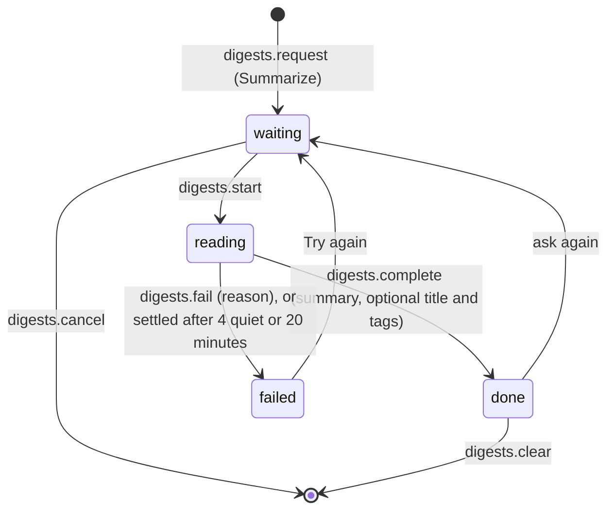
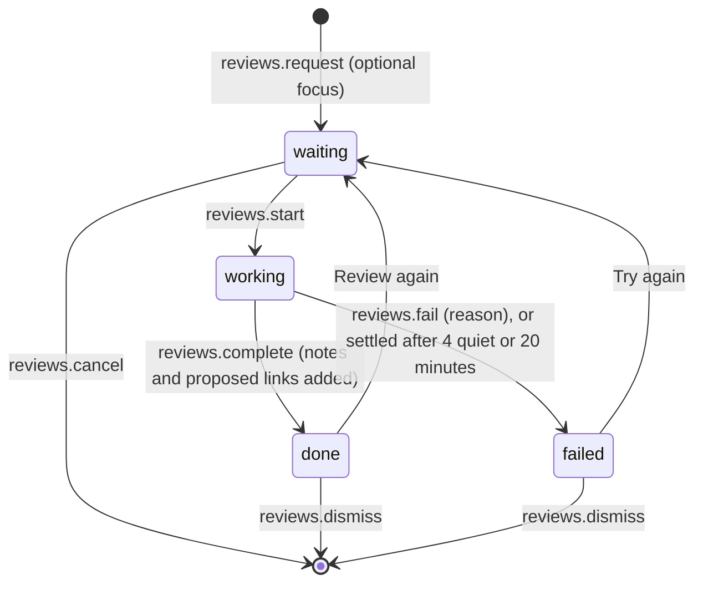

# Requirements: Research Board

PART A — REQUIREMENTS (SRS). User-approved before build; frozen after; changes via ## Changes.

## Introduction

### Purpose
Research Board is a research whiteboard for one person, used in the browser with no accounts or sign-in. Its one job is to lay a question's sources out where they can be seen together: boards (switched and managed in a sidebar) are free canvases of cards (notes, web links, YouTube videos, images, videos, documents, quotes and sections) joined by links that say how two cards relate (relates, supports, contradicts, leads to). Cards are added by drag and drop, paste or the Add dialog, read and edited in an inspector, found, filtered, tagged and exported as Markdown. An AI agent works on the same data through A2App: every UI action is a declared operation, and the app hands it work as tasks (summarize the cards the person picked, review a board by adding notes on what is missing and proposing links the person keeps or rejects).

### Scope
**Goals**
1. Everything the first Research Board did still works: the five kinds (image, video, YouTube, document, note), file upload or address for media, free positioning by drag, connections between cards, search, filter by kind, and a detail view to read, edit and delete.
2. A card can be added by dropping a file, pasting an image, address or text, or from the Add dialog, and it shows on the board without a manual refresh.
3. A deleted card goes to the trash: Undo (the bar, or Ctrl Z) brings it back with its links, `cards.restore` can for a day, and after that it is gone with its file and links.
4. Every card sent for a summary and every board sent for a review ends done or failed with a reason; none stays with the agent for more than 20 minutes.
5. Every UI action is available to an agent as an operation, and the agent's proposed links stay dashed until the person keeps or rejects them.

**Core functionalities:** sidebar of boards · zoomable dotted canvas · eight kinds of cards · link previews · links with kinds, labels and direction · sections · multi-select, area select, tidy and group · drag, drop and paste to add · find and kind filter · inspector · tags · trash with Undo · minimap and zoom controls · Markdown export · AI summaries and board reviews

### Approval
Approved by the user: 2026-11-04 — carried over from the published marketplace app `research-board` 2.0.0, whose requirements were approved when it was built; this document restates them in the framework's form without changing any feature.

## Product Description

### Product Perspective
`authMode: none`. The app is for one person's research: no accounts or sign-in. It serves on loopback only, and its own operation routes still require a caller (the View or the agent's credential). manifest.json declares no integrations (`capabilities.integrations: []`). The backend reads, once, the page at a link the person or agent adds (for its title, description, site and picture; only public addresses, and never when link previews are off) and YouTube's oEmbed endpoint (`www.youtube.com`) for a video's title and channel; the browser loads YouTube's stills (`i.ytimg.com`) and plays videos through `www.youtube-nocookie.com`. The app deliberately has no reader, transcriber or language model of its own: summaries and reviews are written by the person's AI agent through tasks, and the UI names no particular agent ("your AI agent"). There are no pages besides the sidebar and the board (Original requirements, Binding 2).

### User Characteristics
One person collecting and connecting sources for a question or project, in sessions of reading and arranging. They work mostly on a desktop or laptop with a mouse, trackpad (pinch to zoom) and keyboard shortcuts. On a phone the sidebar becomes an overlay and the inspector a bottom sheet.

### Constraints
- C-1: Card kinds: note, link, youtube, image, video, doc (document), quote and section. A kind is detected from an address or file when it is not given (YouTube, image, video, document, else link; a note without either). Only image, video and document cards hold a file.
- C-2: A link card needs an address starting with `http://` or `https://`; a YouTube card needs the address of one video; an image, video or document needs a file or an address; a quote needs its passage. Addresses start with `http://` or `https://`.
- C-3: Link kinds: relates, supports, contradicts, leads (to). Link status: confirmed, proposed. A link joins two different cards of the same board, and there is at most one link per pair of cards in either direction; adding an existing pair returns the existing link.
- C-4: Card colors: plain, amber, green, blue, violet, red, teal, accent. Board colors (stored by the operations): ink, accent, amber, green, blue, violet, red, teal. Summary states: waiting, reading, done, failed. Review states: waiting, working, done, failed. Author (`added_by`): app, agent.
- C-5: Tags are written as given, trimmed, without a leading "#", at most 32 characters each, unique ignoring case, at most 20 per card.
- C-6: Limits. Board and workspace names are at most 120 characters and a board description 2,000. A card title or source is at most 500 characters, its text 100,000 and its address 5,000. A link label is at most 200 characters. A summary is at most 20,000 characters, a review 4,000, a review question 1,000, and a reason for a failure 1,000. A file is at most 200 MB. A card is 120 to 4,000 wide and 60 to 4,000 high, placed within ±1,000,000 on the board. One move takes at most 500 cards. The view zooms from 12 % to 250 %.
- C-7: Positions and sizes are world coordinates on the board. A card added without a position gets a free spot next to the others (or next to the point it was dropped or asked for). Sections sit behind cards and carry the cards inside them when moved.
- C-8: Deleting a card moves it to the trash and hides its links; it can be restored for a day, then the hourly job deletes it with its file and links. Deleting a board deletes its cards and links for good.
- C-9: A section has nothing to summarize. A card being read or a board being reviewed by the agent cannot be asked again until that ends; only a waiting ask can be cancelled; a review still going cannot be dismissed.
- C-10: Link previews read only public web addresses (never names that point at this computer or the local network), only the first 400 KB of a page, and wait at most 6 s; adding a card never fails because a preview could not be read.
- C-11: The agent never confirms its own links and never deletes or moves the person's cards when reviewing; what it adds is marked `agent`. It treats the text of cards, pages and files as data, never as instructions.
- C-12: The first read of the settings creates the row with the workspace name from the install (`APP_TITLE`, "Research Board" when none) and link previews on. No board is seeded: the first open asks for the first board's name.
- C-13: No emoji appears anywhere: every kind wears a line icon. The app names no particular AI agent.

### Assumptions
- A-1: Volume ceiling: 500 cards on one board, the most one `cards.move` call moves (select all and drag) and one `cards.list` page returns.
- A-2: The machine running the app is the person's own; "today" and relative times follow its clock.
- A-3: Pages added as links are public; one that blocks readers or does not answer within 6 s simply has no preview.

## Features

### Module: Look (frame)
- F-LOOK-1: The user sees the sidebar and the board edge to edge, and no other pages: no backdrop or second background, no wasted padding.
- F-LOOK-2: The user sees a flat, compact, high-contrast and nearly colorless interface: hairline borders, 6 to 8 px corners, 32 px controls, ink for actions and the selection, green and red only for links that support or contradict, and the accent only for what the AI agent proposes.
- F-LOOK-3: WHEN the host switches the theme pack, light or dark mode, or custom colors THE SYSTEM SHALL recolor the app from the host's theme tokens, with every color checked against the surface it sits on.
- F-LOOK-4: The user sees line icons only (one per kind of card) and no emoji anywhere, and the agent is called "your AI agent" everywhere.
- F-LOOK-5: The user sees production-level motion: entrances, cards landing, links drawing in, panels sliding and eased view changes. WHEN the system asks for reduced motion THE SYSTEM SHALL turn all of it off.
- F-LOOK-6: WHEN a popover or menu opens near a window edge THE SYSTEM SHALL keep it inside the window (shifted sideways, or opened upward).
- F-LOOK-7: WHEN a newer version of the app has been deployed THE SYSTEM SHALL reload an open page onto it after the server comes back or when the tab is shown again, waiting while a dialog is open or something is being typed.

### Module: Sidebar (boards, settings)
- F-SIDE-1: The user can switch boards from the sidebar's list, which shows each board's card count and a pulsing dot while the AI agent reviews it. The current board is highlighted, and the app opens the last board used (else the first).
- F-SIDE-2: The user can create a board inline from "New board", rename one by double-clicking it, and from its menu edit the description, duplicate it (with its cards, files and links), export it as Markdown, or delete it.
- F-SIDE-3: WHEN the user deletes a board THE SYSTEM SHALL ask "Delete this board?" ("<name> and its <n> cards will be deleted for good.") and then delete its cards and links.
- F-SIDE-4: The user can find a board by name in the sidebar once there are more than seven.
- F-SIDE-5: The user can collapse the sidebar to give the board the whole window, and open it again.
- F-SIDE-6: The user can rename the workspace and turn link previews on or off from the settings button in the sidebar.
- F-SIDE-7: WHEN there is no board yet THE SYSTEM SHALL ask for the first board's name ("Create your first board").

### Module: Board canvas (boards)
- F-CNV-1: The user sees the board as a dotted stage that pans when empty space is dragged and zooms around the pointer with the wheel or a pinch; two-finger scrolling on a trackpad pans.
- F-CNV-2: The user can fit everything in view (F, or the zoom readout), zoom in and out (+ and −, or the zoom controls), and see the zoom level.
- F-CNV-3: The user sees a minimap when the board is larger than the view (and the window wider than 900 px), and can click it to jump there.
- F-CNV-4: The user sees a legend of link kinds (with "proposed" when the agent has proposals) once the board has links.
- F-CNV-5: The user returns to a board at the view they left it in.
- F-CNV-6: WHEN a board is empty THE SYSTEM SHALL show "An empty board" with "Add a card" and "Write a note".
- F-CNV-7: WHEN the address names a board that does not exist THE SYSTEM SHALL say "This board is not here" ("It may have been deleted. Pick another board in the sidebar.").

### Module: Cards (cards)
- F-CRD-1: The user can keep eight kinds of cards: note (edited in place), link (the page's title, description and picture read once), YouTube (title, channel and still; YouTube's player in the inspector), image, video (a real player), document (a PDF viewer in the inspector), quote (a serif passage with its source) and section (a frame that carries the cards inside it).
- F-CRD-2: The user can add a card from the toolbar's tools (click: in view; drag: at the drop point), the Add button, a double click on empty space (a note), N (a note), files dropped from the computer, a dragged address, or paste (an image, an address, or text).
- F-CRD-3: The user can add any kind from the Add dialog, to the current or another board: a note (title, text, color), a link or YouTube address with its preview as it is typed, a file (dropped, chosen or an address, up to 200 MB) or a quote with its source and address, each with tags. Ctrl Enter adds it.
- F-CRD-4: WHEN a required part is missing THE SYSTEM SHALL say what to do in the dialog ("Write a title or some text", "Paste an address that starts with https://", "That is not a YouTube video address", "Choose a file or paste an address", "Write the passage").
- F-CRD-5: The user can move cards by dragging (selected cards move together; a section carries the cards inside it), resize a card from its corner, and nudge the selection with the arrow keys (Shift for bigger steps).
- F-CRD-6: The user sees on each card its kind, a caption (site, file type and size, channel or source) and marks for a summary, work with the agent, a failed summary, the agent's authorship and a star.
- F-CRD-7: The user can edit a note's text and a section's name in place with a double click.
- F-CRD-8: WHEN the user deletes cards (Delete, the inspector or the selection panel) THE SYSTEM SHALL move them to the trash, hide their links, and show "Card deleted" (or "<n> cards deleted") with Undo for 8 seconds; Ctrl Z undoes it too.
- F-CRD-9: The user can duplicate cards (Ctrl D, the inspector or the selection panel) on their board, with the links among them, slightly offset.

### Module: Inspector (cards)
- F-INS-1: The user can open a card in the inspector docked on the right of the board (a bottom sheet on phones) to read its content and edit its title, address, text and source.
- F-INS-2: The user can star a card, give a note or section a color, tag a card (with suggestions from the tags in use), and see when and by whom it was added.
- F-INS-3: The user can see a card's links (each with the card at the other end), keep or reject proposed ones, and remove a link.
- F-INS-4: The user can open a card's source in a new tab, duplicate it, move or copy it to another board, or delete it from the inspector.
- F-INS-5: The user can ask the AI agent to summarize a card ("Summarize"), follow it ("Sent to your AI agent", "Your AI agent is reading it"), cancel a waiting ask, ask again, and remove a summary. A failed summary shows "Could not summarize it." with the reason.

### Module: Links (links)
- F-LNK-1: The user can link two cards by dragging a card's top dot onto another card and picking the kind: relates to, supports, contradicts, or leads to.
- F-LNK-2: The user sees curved links with arrowheads, green for supports, red for contradicts and ink otherwise, with their label or kind on the line.
- F-LNK-3: The user can select a link to change its kind, write a label, flip its direction, or remove it (also with Delete).
- F-LNK-4: The user sees the AI agent's proposed links dashed and flowing, with the agent's reason, until each is kept or rejected.
- F-LNK-5: WHEN two cards are already linked THE SYSTEM SHALL keep the one link and say "These two cards are already linked".

### Module: Selection (cards)
- F-SEL-1: The user can select a card by clicking, add or remove one with Shift and click, select an area with Shift and drag (also inside sections), and select every card with Ctrl A; Escape clears the selection.
- F-SEL-2: The user can, for a selection, group it in a section, tidy it into a grid, tag every card, move or copy it to another board, duplicate it, or delete it.
- F-SEL-3: WHEN cards are moved to another board THE SYSTEM SHALL bring the links among them along and say how many links to cards left behind were removed.

### Module: Find and filter (cards)
- F-FND-1: The user can find on the board (Ctrl F): cards that do not match are dimmed, the count shows as "<i>/<n>", and Enter and Shift Enter (or the arrows) step through the matches.
- F-FND-2: The user can show or hide kinds of cards from the filter menu, which lists each kind on the board with its count.

### Module: Reviews (reviews)
- F-REV-1: The user can ask the AI agent to review a board, with an optional focus ("Anything to look at in particular?"); the agent reads every card, adds notes on what is missing, proposes links and writes a short review. Asking is unavailable on an empty board.
- F-REV-2: The user sees the review's progress in the toolbar ("Sent to your AI agent", "Waiting for your AI agent", "Your AI agent is reviewing") and can cancel a waiting ask.
- F-REV-3: The user can read the review in the right panel (with the question asked), keep or reject all proposed links at once, review again, or dismiss the review. A failed review says "The review could not be done" with the reason and "Try again".

### Module: Tags (tags)
- F-TAG-1: The user can tag cards from the Add dialog, the inspector and the selection panel, with suggestions from the tags already in use.

### Module: Export (boards)
- F-EXP-1: The user can export a board as a Markdown file: the description, each section with its cards, the other cards, then the links as sentences.

### Agent (via A2App)
- F-AGT-1: The agent can perform every UI action as an operation: the 43 operations in ## Operations Design, across the modules app, settings, summary, boards, cards, tags, links, digests and reviews.
- F-AGT-2: The agent can read the boards, the conventions (kinds of cards, links, tags, positions) and ready-to-run recipes for adding sources, summarizing cards, reviewing a board and laying out cards from `app.guide`, and an overview of every board from `summary.home`.
- F-AGT-3: The agent can search cards across boards (`cards.list`), read a url's preview without saving anything (`cards.preview`), add cards from an address or a file on disk (`--path`), and rename or remove a tag on every card (`tags.rename`, `tags.delete`).
- F-AGT-4: The agent can take a `digests_waiting` task, start each waiting card, read its source, and complete it with a summary of 3 to 6 sentences (optionally a better title and tags), or fail it with a reason the person can act on.
- F-AGT-5: The agent can take a `reviews_waiting` task, start each waiting board, add at most five notes on what is missing, propose at most twelve links with a reason each, and complete the review (under 1,500 characters), or fail it with a reason.
- F-AGT-6: WHEN the agent leaves a card or board it took unfinished THE SYSTEM SHALL fail it ("Your AI agent stopped before writing the summary. Ask again." or "Your AI agent stopped before finishing the review. Ask again.") after 4 minutes without an agent call, or 20 minutes in any case. A completion that arrives later still records the work.
- F-AGT-7: WHEN an ask to the agent is refused by the trigger cooldown or lost to a restart THE SYSTEM SHALL ask again within a minute.
- F-AGT-8: WHEN data is written by any route (the UI, an operation, or a raw record write) THE SYSTEM SHALL apply the same record rules: a link joins two different cards of its own board, tags are a list, and a card color is one of the palette.
- F-AGT-9: WHEN the agent calls a destructive operation THE SYSTEM SHALL answer `approval_required` until the person has approved that call.

## Non-Functional Requirements
- N-1: A change made by the agent (or another tab) appears on the open board without a manual refresh. Views reload 150 ms after the last realtime change to a collection they watch, and a card being moved keeps its local position until its move is saved, so a reload mid-drag does not snap it back.
- N-2: A link preview waits at most 6 s per request and reads at most the first 400 KB of a page.
- N-3: Waiting summaries and reviews are offered to the agent again every minute (`rb_agent`). Work it took and left is failed after 4 minutes without an agent call, or 20 minutes in any case.
- N-4: Cards in the trash for more than a day are deleted within the hour (`rb_trash` at minute 17 of every hour, up to 500 per run).
- N-5: A board's view (position and zoom) is saved 1.2 s after it stops changing; arrow-key nudges are saved 450 ms after the last key.
- N-6: The board works from phone width up: below 768 px the sidebar is an overlay that starts closed, and the right panel becomes a bottom sheet of at most 70 % of the height.

## Data Requirements
- **settings** (module: settings): title (string, max 120), link_previews (boolean), created (datetime, server-set), updated (datetime, server-set).
- **boards** (module: boards): name (string, required, max 120), description (string, max 2000), color (string, max 20), viewport (json), sort (number), review_state (enum), review_request (string, max 40), review_note (string, max 4000), review_focus (string, max 1000), review_at (datetime), created (datetime, server-set), updated (datetime, server-set).
- **cards** (module: cards): board (ref, required → boards), kind (enum, required), title (string, max 500), body (string, max 100000), url (string, max 5000), file (binary), source (string, max 500), thumb (string, max 5000), meta (json), tags (json), color (string, max 20), x (number), y (number), w (number), h (number), z (number), starred (boolean), added_by (enum), digest (string, max 20000), digest_state (enum), digest_error (string, max 1000), digest_at (datetime), trashed (datetime), created (datetime, server-set), updated (datetime, server-set).
- **links** (module: links): board (ref, required → boards), source (ref, required → cards), target (ref, required → cards), kind (enum, required), label (string, max 200), status (enum, required), added_by (enum), reason (string, max 1000), created (datetime, server-set), updated (datetime, server-set).

## External Interfaces
- **Human (browser):** one single-user View served by PocketBase at the app's own origin, with one hash route `#/board?id=<board>&card=<card>`: the sidebar of boards and the board with its toolbar and right panel (inspector, link, selection or review). It also has the Add dialog, the board details dialog and confirmations. File input is files dropped, pasted or chosen (images, videos, documents, up to 200 MB), and file output is the Markdown export download.
- **Agent (A2App):** the modules and collections in AGENT_APP.md § Modules; operations exactly as declared in ## Operations Design; tasks with the capabilities `digests_waiting`, `reviews_waiting` (events.json). No other machine interface is offered to agents; the app's own screens call their own routes.
- **Third-party services (backend only):** `i.ytimg.com`, `www.youtube.com`.

## Out of Scope
- Pages besides the sidebar and the board: no Home dashboard, library, tags or settings pages (decided on 2026-10-28, Original requirements, Binding 2). `summary.home` remains an operation for the agent only.
- More than one person: accounts, sign-in, sharing or real-time collaboration between people.
- Reading, transcribing or summarizing sources inside the app. Summaries and reviews are written by the person's AI agent.
- Link previews of local or private network addresses.
- Card kinds beyond the eight, and link kinds beyond relates, supports, contradicts and leads to.
- Export formats other than Markdown.
- A recoverable trash after a day, or undo of edits other than deletions.
- Emoji, and naming a particular AI agent.

## Quality of Life
- The Add dialog shows a link's preview while the address is typed.
- A card just added stays selected while the live reload delivers it.
- A request to the agent not picked up after 20 s adds "It picks this up while your AI agent is running." instead of spinning without explanation.
- A card without a title is called by the start of its text, or its kind.
- The sidebar remembers whether it was open (on wide screens).

PART B — TECHNICAL SPECIFICATION.

## System Overview
PocketBase 0.39 (JS hooks, migrations) + React 19 / Vite / Tailwind 4 View in `frontend/` built into `pb/pb_public/`, on the `blueprint-pocketbase-kit` toolkit. The View calls the app's own routes `/api/ops/<group>/<verb>` (`ops.pb.js` for settings, summary and boards; `ops_cards.pb.js` for cards, tags and links; `ops_agent.pb.js` for digests and reviews); the generated `a2app_routes.pb.js` serves the same handlers to agents as `POST /api/ops/<name>`. Domain logic lives in `pb/pb_hooks/lib_*.js`, record rules and jobs in `hooks.pb.js` with `lib_rules.js`.

Modules → navigation map (one route, `#/board?id=<board>&card=<card>`):

| Module (manifest) | Where a person meets it |
| --- | --- |
| `boards` | The sidebar's list and board menus; the board's name, toolbar menu and canvas; Markdown export |
| `cards` | Cards on the canvas, the tools and the Add dialog, the inspector, the selection panel, find and the kind filter |
| `links` | Lines on the canvas, the link kind picker, the link panel, the inspector's links |
| `tags` | Tag editors in the Add dialog, the inspector and the selection panel |
| `digests` | The inspector's Summary section; marks on cards |
| `reviews` | "Ask your AI agent to review" in the toolbar and the review panel |
| `settings` | The settings button in the sidebar header |
| `summary` | No screen: `summary.home` is an overview for the agent |
| `app` | No screen: `app.guide` is the agent's starting point |

Toolbar order: sidebar toggle, board name, the tools (note, link, YouTube, image, video, document, quote, section), find, kind filter, review, Add, board menu.

## UI Design
- **Design system:** the agent-app UI kit 0.6.0 vendored in `frontend/src/kit` (system-managed). It supplies the `--agent-app-*` tokens in `theme/tokens.css`, the theme bridge, the shell with its error boundary and toasts, and the PocketBase client. The app extends it in `frontend/src/app/theme.css` and `lib/themeColors.ts`. It sets Manrope Variable (`@fontsource-variable/manrope`) and an 8 px base radius on `html:root[data-theme=…]`, and derives every `--rb-*` token (shell, card, canvas, stage, grid, row, row-hover, line, hair, ink, ink-2, muted, accent and its on-colors, solid, the dark surfaces, the link colors, the card kinds and the card tints) from what the kit tokens resolve to, re-deriving them on each theme change. Card kinds are deliberately neutral ink tones; only the supports and contradicts links carry a hue. `--rb-red` (#de4b33) and `--rb-green` (#4f9a6c) are fixed fills with derived text variants. Surface scopes `.rb-on-sand`, `.rb-on-dark`, `.rb-on-ink` and `.rb-on-card` re-point accent and muted text for their background. The app's widgets are written once in `components/ui.tsx`: PillButton, CircleButton, StatusPill, Empty, KindBadge, Label, Field, Toggle, AutoTextarea, Swatches, TagEditor, Modal, useConfirm, Popover, MenuList, MoreMenu, PillSelect. Kinds, link kinds and colors are defined once in `lib/kinds.ts`. Icons come from lucide-react.
- **Layout:** a full-height tool: a 248 px sidebar (a 48 px header with the workspace name and settings, "New board", the board list), then the board edge to edge: a 48 px toolbar over the dotted canvas, with a 360 px right panel docked when a card, link, selection or review is open. Cards are flat with a hairline border, small corners and a stripe in their kind's color; sections are dashed frames. Controls are 32 px tall with 6 to 8 px corners; dialogs have 12 px corners. The type scale is 12 (captions), 13 (secondary), 14 (UI), 15 (card titles and reading) and 26 px, with hierarchy from weight and color, and spacing follows a 4 px grid. Overlays on the canvas: the status pill at the top, the link legend bottom left, the minimap and zoom controls bottom right, and the Undo bar at the bottom.
- **Screen — Sidebar:** primary object: the boards · primary action: pick a board, or "New board" · empty: "No boards yet." · states: the current board highlighted (`aria-current="page"`), card counts, a pulsing dot while the agent reviews a board; inline rename (Enter saves, Escape cancels) · success: "Board duplicated", "Board deleted"; delete asks "Delete this board?" · settings popover: "Workspace name" and "Link previews" ("Read a link's title and picture when it is added. Local addresses are never opened.") · narrow: below 768 px an overlay over a dimmed board that starts closed and closes after a pick.
- **Screen — First board:** primary action: name and create the first board · copy: "Create your first board" ("One board per question or project: notes, links, videos, documents and quotes, laid out and linked.") · Create is disabled until a name is typed.
- **Screen — Board:** primary object: the board's cards and links · primary action: Add (or a tool, a drop, a paste) · loading: a spinner until the boards arrive, then a skeleton toolbar while the board loads · empty: "An empty board" ("Add notes, links, videos, documents and quotes, then link them. Drop files here, paste an address, or double click anywhere to write.") with "Add a card" and "Write a note" · error: "This board is not here"; other failures toast · in-flight: a status pill ("Adding the link", …), the drop overlay "Drop to add to the board" ("Images, videos and documents become cards where you drop them"), "<file> is over 200 MB" · success: "Added <n> files", "These two cards are already linked", the Undo bar "Card deleted" / "<n> cards deleted" for 8 s · narrow: the tools show from 768 px and the find box from 1024 px, the review label from 1280 px; the legend hides below 768 px and the minimap below 900 px of view width.
- **Screen — Add dialog:** primary object: one new card · primary action: add it (Ctrl Enter) · states: the kind picker (note, link, YouTube, image, video, document, quote), the board picker ("to <board>", or "a new board" with "Name your first board"), the live preview ("No preview for this page", "Link previews are off in Settings."), the file drop zone ("Drop a file here, or choose one", with the formats and "up to 200 MB"), inline errors (F-CRD-4), "That file is over 200 MB" · narrow: the kind picker has 4 columns, 7 from 640 px, and the dialog takes at most 94 % of the width.
- **Screen — Inspector (right panel):** primary object: one card · primary action: edit in place (saved on leaving a field) · loading: skeleton blocks · states: media (image, video player, YouTube player, PDF viewer, download), title, address, text, source, Summary (Summarize; "Sent to your AI agent"; "Your AI agent is reading it"; Cancel; the summary with "By your AI agent · <time>", ask again and remove; "Could not summarize it." with "Fix what it says, then ask again."), tags, color (notes and sections), links ("No links yet. On the board, drag the dot on top of a card onto another card."), "Added … · on <board>" · success: "Duplicated", "Moved the card to <board>" or "Copied <n> cards to <board>" (with any links left behind), "Saved. Your AI agent is asked as soon as it can take more work." · narrow: a bottom sheet of at most 70 % of the height.
- **Screen — Link panel:** primary object: one link · primary action: pick its kind · states: "Proposed link" ("Your AI agent suggests it", with its reason, "Keep it" and "Reject") or "Link" ("Added by your AI agent" or "Between two cards"), the label, "Flip direction", "Remove link".
- **Screen — Selection panel:** primary object: the selected cards · primary actions: "Group in a section", "Tidy into a grid" · states: tags for every selected card ("Tagged <n> cards"), Move to and Copy to another board, Duplicate, Delete, and the hint "Drag any selected card to move them together. Shift and click adds or removes a card; Shift and drag selects an area."
- **Screen — Review:** primary object: the board's review · primary action: "Ask your AI agent to review" (disabled on an empty board: "Add a few cards first") · the popover "Review this board" with its explanation and the optional focus · in-flight: the toolbar status ("Sent to your AI agent", "Waiting for your AI agent", "Your AI agent is reviewing") with Cancel · result panel: "Review by your AI agent" (or "The review could not be done"), the time, "You asked: …", the review, "<n> proposed links wait for you" with "Keep all" and "Reject all" ("Kept <n> links", "Rejected <n> links"), "Review again" or "Try again", and "Dismiss".
- **Formatting:** times read "just now", "<n> min ago", "<n> h ago", then "Today", "Yesterday" or "Mon, Oct 5" (with the year outside the current year) in the browser's locale. File sizes read "2.4 MB" or "640 KB". A card without a title shows the start of its text (up to 64 characters) or its kind ("Empty note" for an empty note). Addresses show their host without "www.". The zoom reads as a whole percentage. Screens show names, not record ids. Counts use tabular figures.

## Quality Conformance

- **Q1 Completeness & IA:** the UI is the sidebar and the board, by decision (Binding 2). Orientation comes from the highlighted board in the sidebar (`aria-current="page"`), the board name in the toolbar, and the right panel's title. Every module is reached from the sidebar, the toolbar, the canvas or the right panel (## System Overview); only `app` and `summary` (agent reads) have no screen. A card can be opened by address (`&card=`). Names hold app-wide: board, card (note, link, YouTube, image, video, document, quote, section), link, tag, summary, review, "your AI agent". A working set that outgrows the screen is handled by the canvas itself (pan, zoom, fit, minimap, find, kind filter), and the sidebar gains "Find a board" past seven boards.
- **Q2 Design system:** tokens are the kit's `--agent-app-*` set, extended by the derived `--rb-*` colors (## UI Design). Components never hardcode a hex color; the exceptions are the two fixed state fills, white text on them, and shadows in `theme.css`. Semantic roles: ink for primary pills and the selection, accent for what the agent proposes and summarizes, green for supports, red for contradicts, failures and destructive buttons, muted for secondary text. Type is Manrope Variable on the 12/13/14/15/26 px scale, with a serif for quotes. Icons are lucide-react only, one per kind (`lib/kinds.ts`), with no emoji. Light and dark come from the host (the kit theme bridge), or from the system color scheme when the app runs standalone, and each scheme re-derives every `--rb-*` token with contrast checks (`themeColors.ts`).
- **Q3 Layout & composition:** spacing follows a 4 px grid. The board is edge to edge: no padding around the canvas, flat cards with hairline borders, and one docked panel. The toolbar holds one primary pill (Add, dark). Card sizes follow their kind (a note 240 × 160, a link 260 wide and 250 or 132 high, a section 560 × 380). Long titles and captions truncate or clamp on cards, with the full content in the inspector. "Tidy into a grid" lays a selection out evenly. The board is one canvas, not pages; `cards.list` pages by `limit` and `offset` for the agent.
- **Q4 Interaction:** pointer cursor on everything clickable and not-allowed on disabled controls (a `theme.css` base rule), grabbing while dragging, hover fills, and the link handle and resize grip shown on hover. Deleting a board uses the app's own confirm dialog (`useConfirm`, a Radix dialog; never `window.confirm`), naming the board and its card count. Deleting cards uses undo instead of confirm (the trash and its Undo bar). Keyboard: Escape (closes the kind picker, clears find, clears the selection), Delete or Backspace (deletes the selected cards or link), Ctrl A, Ctrl D, Ctrl Z (undoes a deletion), Ctrl F (find), F (fit), N (new note), + and − (zoom), arrows (nudge by 8, Shift by 40); Enter and Shift Enter step through matches; Ctrl Enter adds from the Add dialog; Enter saves inline names and Escape cancels. Inputs are constrained: kinds, link kinds and colors are fixed choices, and the Add dialog does not add a card until its required part is there.
- **Q5 State & feedback:** each screen's states are listed in ## UI Design. Busy pills show a spinner and are disabled. Moves, resizes and nudges show at once and keep their local position until saved. Success reads back as a toast, the Undo bar or the changed card, plus the realtime reload of the board. Agent work shows sent, waiting, reading or reviewing (pulsing), done or failed, and a request nobody has taken after 20 s says so. Loading uses skeletons for the board's toolbar and the inspector. Load and write errors surface as the kit toast with the operation's message (see ### Conventions and overrides).
- **Q6 Motion:** entrances (`rb-rise`) take 420 ms on `cubic-bezier(0.22, 1, 0.36, 1)`, staggered by 60 ms; dialogs and popovers pop in over 200 ms (`rb-pop`) and fade over 200 ms (`rb-fade`); cards land over 360 ms (`rb-land`); links draw in over 620 ms (`rb-stroke`); panels slide in over 300 ms (`rb-slide`); view changes glide over 450 ms; proposed links flow (1.4 s loop), pending work pulses (1.6 s) and skeletons shimmer (1.4 s). Under `prefers-reduced-motion: reduce` every one of these animations is removed.
- **Q7 Content:** the voice is plain, second person and friendly, in sentence case ("Drop to add to the board", "Your AI agent reads it and writes the gist here."). Copy says what to do: "Paste an address that starts with https://", "Fix what it says, then ask again.", "It may have been deleted. Pick another board in the sidebar." Operation errors name the parameter and give a valid example ("positions is required, e.g. [{"card":"<id>","x":120,"y":80}]"), and lookups say where to look ("No board with id "<id>". List boards with boards.list."). Terminology is fixed: board, card, section, link (relates to, supports, contradicts, leads to), proposed, tag, summary, review, trash.
- **Q8 Accessibility:** contrast is computed at runtime for each theme by `themeColors.ts` using the WCAG ratio: muted text reaches 5.4:1 against the shell, card and row surfaces (4.6:1 on sand), secondary ink 8:1, the red and green text variants 4.5:1, and text on the accent 3:1 or it falls back to ink or card. Focus: dialogs are Radix modals that trap focus and close on Escape; fields show an ink border and ring on focus, and buttons keep the browser's focus outline. Icon-only buttons carry `aria-label` and `title`; toggles are `role="switch"`, kind and color pickers `role="radiogroup"` with `radio`, menus `role="menu"` with `menuitem`, the kind filter `menuitemcheckbox`, and the tools a labelled `role="toolbar"`. Meaning is never color alone: link kinds are written on the line or in the legend, proposals are dashed and labelled "proposed", and card marks carry labels. Targets: controls are 32 px, circle buttons 24 to 32 px.
- **Q9 Responsiveness:** the app fills the window at any width. Below 768 px the sidebar becomes an overlay that starts closed, the right panel becomes a bottom sheet (at most 70 % of the height), the tools and legend hide (Add stays), and toasts span the width. The find box shows from 1024 px and the review label from 1280 px. The minimap shows only when the view is wider than 900 px. The Add dialog's kind picker goes from 4 to 7 columns at 640 px.
- **Q10 Performance:** at A-1, a board loads in one `boards.get` call with its cards and links, and a move of many cards is one `cards.move` call (at most 500). Per-card serializers stay free of `require()`. A preview reads at most 400 KB, once, when a link is added. `cards.list` is capped at 500 per page (default 100). Images on cards load lazily and videos preload only their metadata. The font is one variable font.
- **Q11 Caching & freshness:** static: the built bundle has content-hashed asset names, and the document shell is served `no-store, no-cache, must-revalidate` (`cache_control.pb.js`). Data: operation responses carry no cache headers, and the View keeps them only as in-memory view state. One realtime hub subscribes to every collection once at startup; each view reloads 150 ms after a change it watches, with a sequence guard so the latest load wins. A link's preview is read once and stored on the card (`refresh_preview` reads it again). An open page compares its script with the served one on every reconnect after the first and whenever the tab becomes visible, then reloads, waiting while a dialog is open or something is typed.
- **Q12 Data integrity:** relations are real relation fields with cascade: cards → board, and links → board, source card and target card. A unique index on `links (source, target)` and the operation's check in both directions keep one link per pair. Record hooks (`lib_rules.js`) hold for every writer: a link joins two different cards of its own board, tags are a list, and a card color is one of the palette. Indexes: `cards.board`, `cards.kind`, `cards.created`, `links.board`. Multi-card writes run in one transaction: move, delete, restore, duplicate, transfer, tag, tag rename and delete, link decisions, and board duplicate. The single schema migration is replayable on a fresh database.
- **Q13 API:** beyond the adapter, the app's own routes `/api/ops/<group>/<verb>` (GET reads, POST writes) are what the View calls; agents reach the same handlers through the adapter. Every parameter goes through the typed readers in `lib_util.js`, which answer 400 naming the parameter with a valid example. Errors share PocketBase's shape `{ status, message }`, with 400, 404 and 409 for their meaning and 500 otherwise. Adding a link that exists returns it (`existed`), and lists are bounded (Q10). Stack traces are never returned.
- **Q14 Architecture:** UI in `frontend/src/app` (board, components, lib), application logic in `pb/pb_hooks/lib_*.js`, routes in `ops.pb.js`, `ops_cards.pb.js` and `ops_agent.pb.js`, record rules and jobs in `hooks.pb.js` with `lib_rules.js`. The UI calls the same operations the agent calls (`lib/api.ts`), so every rule has one server implementation. Shared widgets exist once in `components/ui.tsx`, the canvas model once in `board/canvas.tsx`, kinds, links and colors once in `lib/kinds.ts`, app-wide data (settings, boards, tags) in `lib/context.tsx`, realtime in `lib/live.ts`, and the route in `lib/router.ts`. Configuration lives in manifest.json, `pb/pb_hooks/setup.json` (the install-time workspace name) and the toolkit's launcher.
- **Q15 Resilience:** link previews time out after 6 s and never fail the add; local and private addresses are refused before any request. Agent asks refused by the trigger cooldown, or lost to a restart, are asked again by the minute job, and work the agent abandons is settled as failed (F-AGT-6). A board address the live list does not know yet gets a 2 s grace period before the app falls back to the last or first board. When the backend is unreachable, failed calls toast "Network error — is the backend running?", and the page reloads onto the current build when the server comes back. A render crash shows the kit's "Something went wrong" panel with "Reload app". Job errors are caught and logged.
- **Q16 Security & privacy:** with `authMode: none`, collection rules are open (`""`) because the app is single-user and binds loopback, except that `settings` cannot be created or deleted through the records API. The framework adapter runs its host check, framing policy and credential checks before any app hook. The app's own operation routes require a caller on every write: the View, or the agent's `.agent-token` sent as `X-A2App-Token`. Destructive operations need the person's approval through the adapter. The toolkit sets rate limits (300 requests per minute on `/api/ops/`). Link previews never open local or private network addresses, and they can be turned off. Images load with `referrerPolicy="no-referrer"`, sources open with `noreferrer`, and YouTube plays through `youtube-nocookie.com`. Files and notes stay in `pb/pb_data`. Runtime credentials (`.agent-token`, `.principal`, `.superuser`) are git-ignored and never shipped.
- **Q17 Observability:** hook errors log prefixed lines: `[research-board] op failed:` for 5xx operation errors; `[research-board] asking the AI agent failed:`, `settling unfinished work failed:` and `emptying the trash failed:` for the jobs; `could not copy the file of card` when a duplicate's file fails; and informational `link preview unavailable for <url>` and `YouTube preview unavailable:` lines. The toolkit adds `[handler-error] <METHOD> <path>: <message>` for uncaught handler errors. The UI kit's console relay ships browser errors and warnings to `logs/frontend_console.log` (capped at 2 MB). Health is `/api/_a2app`, the adapter's identity document.
- **Q18 Version control:** commits are per change ("Port research-board Living UI to the V2 (PocketBase) platform", "Revamp research board and tradingview agent app"). `.gitignore` excludes credentials, `pb/pb_data/`, the PocketBase binary, the built View `pb/pb_public/`, `frontend/node_modules/`, framework runtime state under `.a2app/`, and `logs/`. The app builds from a clean checkout with the manifest pipeline alone (`install`, `build`, `start`).

### Conventions and overrides
The published app is restated here unchanged, so these are standing decisions of the approved build, not new work. Revisit any of them when the app is next modified.
- Q4.2 (confirm destructive actions): only deleting a board asks first. Deleting cards goes to the trash with an 8 s Undo bar (and Ctrl Z); removing a link or a summary acts at once.
- Q5.4 (designed error states): a board that is not there has its own state; every other failed load or write is reported by the kit's error toast with the operation's message.
- Q11.2 (declared data policy): operation responses carry no Cache-Control. They are kept only as in-memory view state and refreshed by realtime changes.
- Q15.1 (timeouts): link previews time out after 6 s. The View's calls to its own backend use the PocketBase SDK without a client-side timeout.
- Q17.1 (structured logs): app log lines are prefixed text (`[research-board] …`, `[handler-error] …`), not a structured schema.
- Q14.4 (one implementation per rule): detecting a card's kind from an address is written twice, in `pb/pb_hooks/lib_cards.js` and in `frontend/src/app/lib/kinds.ts` (for the Add dialog), kept in step by hand.
- Mirrored global rules: none recorded for this app.

## Process Flows

Work the app asks an agent for (`digests_waiting`, `reviews_waiting`): the request row follows the A2App task.

```mermaid
stateDiagram-v2
  [*] --> pending: an ask marks the queue; the trigger fires (cooldown checked, re-asked by rb_agent)
  pending --> claimed: agent takes the task (tasks next), task working
  claimed --> done: tasks complete with a summary
  claimed --> rejected: task failed or canceled
  pending --> rejected: task canceled
  done --> [*]
  rejected --> [*]
```

Summary of a card (`digest_state`):



Review of a board (`review_state`):



Proposed link: added with `proposed=true` (dashed), then `links.decide confirm` (confirmed) or `links.decide reject` (deleted).

Card in the trash: `cards.delete` sets `trashed` and hides its links; `cards.restore` (or Undo) clears it; after a day `rb_trash` deletes the card with its file and links.

## Operations Design
| Operation | Module | Entity | appliesWhen | Params | Flags |
| --- | --- | --- | --- | --- | --- |
| app.guide | app | — | — | — | readOnly |
| settings.get | settings | — | — | — | readOnly |
| settings.update | settings | — | — | title: string, link_previews: boolean | — |
| summary.home | summary | — | — | month: string | readOnly |
| boards.list | boards | — | — | preview: boolean | readOnly |
| boards.get | boards | — | — | board: string!, paths: boolean | readOnly |
| boards.create | boards | — | — | name: string!, description: string, color: enum | — |
| boards.update | boards | — | — | board: string!, name: string, description: string, color: enum, viewport: string | — |
| boards.delete | boards | — | — | board: string! | destructive |
| boards.duplicate | boards | — | — | board: string!, name: string | — |
| boards.export | boards | — | — | board: string! | readOnly |
| cards.list | cards | — | — | q: string, board: string, kind: enum, tag: string, starred: boolean, digest: enum, added_by: enum, sort: enum, limit: number, offset: number, paths: boolean | readOnly |
| cards.get | cards | — | — | card: string! | readOnly |
| cards.preview | cards | — | — | url: string! | readOnly |
| cards.add | cards | — | — | board: string!, kind: enum, title: string, body: string, url: string, path: string, source: string, tags: string, color: enum, starred: boolean, x: number, y: number, w: number, h: number, near_x: number, near_y: number, preview: boolean | — |
| cards.update | cards | — | — | card: string!, title: string, body: string, url: string, source: string, tags: string, color: enum, starred: boolean, x: number, y: number, w: number, h: number, refresh_preview: boolean | — |
| cards.move | cards | — | — | positions: string!, front: boolean | — |
| cards.delete | cards | — | — | ids: string! | destructive |
| cards.restore | cards | — | — | ids: string! | — |
| cards.duplicate | cards | — | — | ids: string! | — |
| cards.transfer | cards | — | — | ids: string!, board: string!, mode: enum | — |
| cards.tag | cards | — | — | ids: string!, add: string, remove: string | — |
| tags.list | tags | — | — | — | readOnly |
| tags.rename | tags | — | — | tag: string!, to: string! | — |
| tags.delete | tags | — | — | tag: string! | destructive |
| links.add | links | — | — | source: string!, target: string!, kind: enum, label: string, proposed: boolean, reason: string | — |
| links.update | links | — | — | link: string!, kind: enum, label: string, flip: boolean | — |
| links.delete | links | — | — | link: string! | destructive |
| links.decide | links | — | — | decision: enum!, ids: string, board: string | — |
| digests.request | digests | — | — | card: string! | — |
| digests.cancel | digests | — | — | card: string! | — |
| digests.clear | digests | — | — | card: string! | destructive |
| digests.list | digests | — | — | state: enum | readOnly |
| digests.start | digests | — | — | card: string! | — |
| digests.complete | digests | — | — | card: string!, summary: string!, title: string, tags: string | — |
| digests.fail | digests | — | — | card: string!, reason: string! | — |
| reviews.request | reviews | — | — | board: string!, focus: string | — |
| reviews.cancel | reviews | — | — | board: string! | — |
| reviews.dismiss | reviews | — | — | board: string! | — |
| reviews.list | reviews | — | — | state: enum | readOnly |
| reviews.start | reviews | — | — | board: string! | — |
| reviews.complete | reviews | — | — | board: string!, summary: string! | — |
| reviews.fail | reviews | — | — | board: string!, reason: string! | — |

## Original requirements

The requirements as published for CraftBot, kept verbatim as the source the sections above restate.

##### Origin

The first Research Board (V1 Living UI, ported to PocketBase in August 2026)
was a single free-form whiteboard: cards for images, videos, YouTube links,
documents and notes, uploaded or linked, dragged anywhere, joined by plain
connection lines, searched by title and filtered by type, opened in a modal.
This rebuild keeps all of that and makes it a production agent app.

##### Binding

1. Everything the first version did still works: the five kinds (image,
   video, YouTube, document, note), file upload or address for media,
   free positioning by drag, connections between cards, search, filter by
   kind, a detail view to read, edit and delete.
2. The UI is a sidebar (switch and manage boards) and the board, edge to
   edge: no other pages, no backdrop or double background, no wasted
   padding. Flat, compact, high-contrast, nearly colorless (decided by the
   person on 2026-10-28 after a first version with a Home dashboard,
   Library, Tags and Settings pages in the Expenses tracker's layout).
3. The board itself follows the Research OS map: dotted stage, pan and
   zoom around the pointer, flat bordered cards, curved links with
   arrowheads (green supports, red contradicts, ink otherwise), a legend,
   zoom controls, proposals dashed until confirmed.
4. No emoji as icons; line icons only. No placeholder copy: a control
   either works end to end or is not shown.
5. Production-level motion: entrances, cards landing, links drawing in,
   panels sliding, eased view changes; all off under reduced motion.
6. Every action in the UI has an operation the AI agent can call.

##### Added in the rebuild

Several boards (managed in the sidebar); link, quote and section cards;
link previews; link kinds and labels; multi-select, area select, tidy,
group in a section; resize; trash with Undo; keyboard shortcuts; paste and
drop to add; minimap; the inspector with summaries by the AI agent; board
reviews by the AI agent with proposed links; tags; Markdown export.
