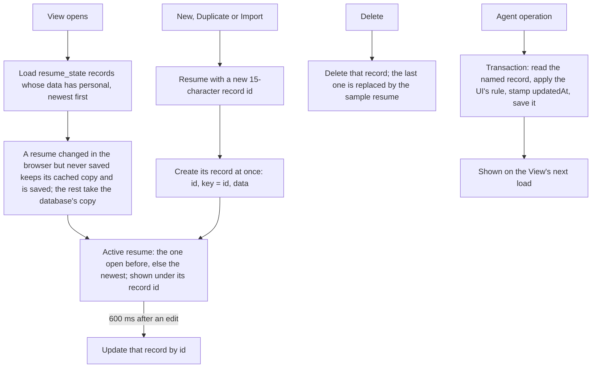

# Requirements: Resume Maker

PART A — REQUIREMENTS (SRS). User-approved before build; frozen after; changes via ## Changes.

## Introduction

### Purpose
Resume Maker is a split-view resume editor for one person who keeps several resumes, used in a desktop browser with no accounts or sign-in. Its one job is to write a resume section by section and see it, as you type, on an A4 page in one of 34 templates.

A person can create, duplicate, rename, delete, import and export resumes:
- **export:** PDF through the browser's print dialog, Word, LaTeX, or a JSON backup;
- **style:** template, accent, font, scale, line spacing and photo shape;
- **layout:** which sections show, and in which order;
- **score:** a 0–100 score with improvement tips.

An AI agent works on the same resumes through A2App: every edit a person can make to a resume's content, style or layout is a declared operation.

### Scope
**Goals**
1. A resume is edited in eleven tabs, and the A4 preview reflects every keystroke without a save action, in the chosen template and style.
2. A person keeps several resumes in one place and can create, duplicate, rename, delete, import (JSON) and export (PDF by printing, Word, LaTeX, JSON) them.
3. The header shows a 0–100 score in five 20-point groups with tips, recalculated as the person types.
4. Every edit a person can make to a resume is available to an agent as an operation, and an agent edit is stored in the same shape and with the same defaults as the app's own.

**Core functionalities:** multi-resume selector · New with a sample person · rename, duplicate, delete · JSON import and export · personal details and photo · work experience with smart bullets and action verbs · education · skills with categories and levels · My Time allocation · achievement badges · work philosophy · projects · certifications · publications · 34 templates with accent, font, scale, spacing and photo shape · section visibility and order · live A4 preview with page breaks and inline editing · resume score · PDF (print), Word and LaTeX export · agent operations

### Approval
Approved by the user: 2026-11-11 — carried over from the published marketplace app `resume-builder` 1.0.0, whose requirements were approved when it was built; this document restates them in the framework's form without changing any feature.

## Product Description

### Product Perspective
`authMode: none`. The app is for one person's own resumes, with no accounts or sign-in, and it serves on loopback only. manifest.json declares no integrations (`capabilities.integrations: []`), and the app calls no outside service.

The View reads and writes resumes through PocketBase's records API, and keeps a copy of the list in the browser. The agent operations are a server copy of what the screens do (`pb/pb_hooks/lib_agent.js`).

The app deliberately has:
- no server-side PDF renderer: PDF comes from the browser's print dialog;
- no language model or writing assistant of its own;
- no file parsing beyond its own JSON backup format.

### User Characteristics
One person building and tailoring their own resumes, typically around job applications: in bursts, then not for a while. They work at a desktop or laptop with a wide browser window and a mouse and keyboard. Phones and tablets are not served (see A-2).

### Constraints
- C-1: A resume is one JSON document in `resume_state.data`. Its parts and their types are fixed: `title`, `personal`, `experiences`, `educations`, `skills`, `myTime`, `mostProudOf`, `philosophy`, `projects`, `certifications`, `publications`, `sectionVisibility`, `sectionOrder`, `style` and `updatedAt` (`frontend/src/app/types/resume.ts`).
- C-2: A record is a resume the app shows only when its `data` holds a `personal` part. The app shows it under the record id. A part the document lacks is shown from the built-in sample resume (Alex River).
- C-3: A resume is one record, addressed by its record id. The app saves the active resume whole into that record and deletes that record. A new resume (New, Duplicate, Import) gets a 15-character record id when it is made, and its record is created at once with `key` and `data.id` equal to that id.
- C-4: Dates are free text shown as typed ("Jan 2021", "Present"). Bullets are lines starting with "• ", joined by line breaks.
- C-5: New work experience and education items are inserted first; skills, My Time rows, achievements, projects, certifications and publications are appended. Items cannot be reordered within a section.
- C-6: Fixed vocabularies:
  - 34 template ids;
  - fonts: Default, Outfit, Inter, Playfair Display, Space Mono, Plus Jakarta Sans;
  - sizes: small, medium, large;
  - line spacings: compact, normal, spacious;
  - photo shapes: round, square, hidden;
  - the 8 accent swatches #f97316, #0f172a, #0c2340, #004d40, #1d4ed8, #10b981, #8b5cf6, #d97706;
  - skill levels: Beginner, Intermediate, Advanced, Expert;
  - badge icons: trophy, rocket, target, star, award, zap, heart, flame;
  - section keys: summary, experience, education, skills, myTime, mostProudOf, philosophy, projects, certifications, publications.
- C-7: Choosing a template resets the font to "Default" (the template's own font) and sets every section's visibility to what the template supports. Fourteen templates omit My Time and Philosophy.
- C-8: An uploaded photo is stored inside the resume as a base64 data URL. A resume document is at most 1 MB (PocketBase's default for a json field).
- C-9: The first start seeds one sample resume: "Senior Software Engineer CV" (Alex River), with key `default_resume`. There is always at least one resume: deleting the last one leaves the sample resume "Software Engineer Resume".
- C-10: The app has no fields for experience `location`, education `fieldOfStudy`, `style.secondaryColor` or `style.showPageNumbers`. Only an imported JSON document sets them.

### Assumptions
- A-1: Volume ceiling: 50 resumes, each at most 1 MB. Every resume is loaded in full when the app opens and cached in the browser.
- A-2: The browser window is at least about 1,300 px wide: the editor panel (360–520 px) beside the 794 px A4 sheet.
- A-3: The resume fonts (Inter, Outfit, Playfair Display, Space Mono, Plus Jakarta Sans) are used when installed on the machine. Otherwise the browser's fallback family applies.
- A-4: One editor at a time: the app is open in one tab, and a person and an agent do not edit the same resume at the same moment.

## Features

### Module: Frame
- F-FRM-1: The user sees one workspace with four parts:
  - a header holding the "Resume Maker" brand, the resume selector with New, Rename, Duplicate and Delete, the score pill, Import and Export;
  - a style toolbar;
  - the editor panel on the left;
  - the live A4 preview on the right.
- F-FRM-2: The user can switch between eleven editor tabs: Personal, Experience, Education, Skills, My Time, Achievements, Philosophy, Projects, Certs, Papers and Layout.
- F-FRM-3: WHEN the host sends a theme message (`craftbot-theme`, `livingui-theme`, `theme-change` or `set-theme`) THE SYSTEM SHALL recolor the app in the CraftBot, Normal, Ocean, Forest or Pastel palette, or in the host's custom colors, dark or light. The app starts in the CraftBot dark palette and asks the host for its theme. The resume sheet stays white paper.

### Module: Resumes (resumes)
- F-RES-1: The user can switch between saved resumes from the header selector, which lists every resume by its title.
- F-RES-2: The user can create a resume with New. A dialog prefilled "Resume #<n>" asks for its name. The new resume is filled with a random sample person (one of four) to edit, and it opens.
- F-RES-3: The user can rename the current resume in a dialog prefilled with its title. An empty name is ignored.
- F-RES-4: The user can duplicate the current resume. The copy is named "<title> Duplicate" and opens.
- F-RES-5: The user can delete the current resume after a confirmation that names it and says it cannot be undone. WHEN the last resume is deleted THE SYSTEM SHALL replace it with the sample resume "Software Engineer Resume".
- F-RES-6: The user can import a JSON backup file as a new resume, and it opens. Parts the file lacks come from the built-in sample resume. WHEN the file is not a resume export THE SYSTEM SHALL say "Failed to import JSON file. Please ensure it is a valid resume export."
- F-RES-7: WHEN the app opens THE SYSTEM SHALL load every resume in `resume_state`, newest first, filling missing parts from the built-in sample. It reopens the resume that was open before, else the newest. When the backend cannot be reached it keeps the list cached in the browser. WHEN a resume was changed in the browser and the change never reached the database THE SYSTEM SHALL keep that change on the next load and save it; every other resume shows the database's copy.
- F-RES-8: WHEN the active resume changes THE SYSTEM SHALL save it whole into its own `resume_state` record 600 ms after the last change, and keep the list cached in the browser.
- F-RES-9: WHEN the app starts on an empty database THE SYSTEM SHALL seed the sample resume "Senior Software Engineer CV" (Alex River).

### Module: Personal details (personal)
- F-PER-1: The user can edit full name, job title / headline, email, phone, location, LinkedIn URL, GitHub URL, portfolio website and the professional summary.
- F-PER-2: The user can upload a profile photo from an image file (stored inside the resume), paste an image URL, or remove the photo. On templates that show a photo, the user can also click it on the preview to upload a new one.
- F-PER-3: The user can edit the full name, job title and summary directly on the preview, on the templates that offer inline editing.

### Module: Work experience (experience)
- F-WRK-1: The user can add a position with "Add Position". It appears first, with placeholder values: "New Company", "Role / Title", 2023, Present, current, and one sample bullet.
- F-WRK-2: The user can edit a position's title, company, start date and end date as free text, and remove the position.
- F-WRK-3: WHEN the user ticks "Current" THE SYSTEM SHALL set the end date to "Present" and disable the field. Unticking it clears the end date.
- F-WRK-4: The user can write accomplishments as bullets. WHEN the user presses Enter in an experience or project description THE SYSTEM SHALL start the next line with the same bullet ("•", "-", "*") or the next number. A plain line gets "• " first, and Enter on an empty bullet ends the list.
- F-WRK-5: The user can insert one of ten action verbs as a new bullet: Spearheaded, Engineered, Architected, Orchestrated, Optimized, Accelerated, Redesigned, Pioneered, Scaled, Transformed.
- F-WRK-6: The user can edit a position's title and bullets directly on the preview, on the templates that offer it.

### Module: Education (education)
- F-EDU-1: The user can add a degree with "Add Degree", edit it, and remove it.
  - The new degree appears first, with placeholders "University Name", "B.S. Degree", 2018 and 2022.
  - The editable fields are degree, institution, start year, end year and GPA / honors.

### Module: Skills (skills)
- F-SKL-1: The user can add a skill from a quick-add form with a name and one of four categories (Programming Languages, Technical Skills, Programs & Tools, Interpersonal Skills). The skill gets the level Advanced.
- F-SKL-2: The user can change a skill's name, category (free text) and level (Beginner, Intermediate, Advanced, Expert), and remove it.
- F-SKL-3: The user sees the skills on the preview in the template's own style. Three templates group them by category, and some draw each skill's level.

### Module: My Time (mytime)
- F-MYT-1: The user can add a time-allocation row with "Add Focus": "New Activity Focus", 15 %, in the next colour of a six-colour cycle. The user can change its colour, label and percentage, and remove it.
- F-MYT-2: The user sees the rows' total: green at 100 %, amber with "(Recommended to equal 100%)" otherwise. The preview draws each row as a bar of its percentage.

### Module: Achievements (achievements)
- F-ACH-1: The user can add an achievement badge with "Add Highlight" and remove it. The user can change its headline, description and icon (trophy, rocket, target, star, award, zap, heart, flame).

### Module: Philosophy (philosophy)
- F-PHI-1: The user can write a work-philosophy quote and its author. WHEN the author is left empty THE SYSTEM SHALL attribute the quote to the person's full name.

### Module: Projects (projects)
- F-PRJ-1: The user can add a project with "Add Project", edit its title, technologies, link and description, and remove it.

### Module: Certifications (certifications)
- F-CRT-1: The user can add a certification with "Add Cert", edit its name, issuer, issue date and credential URL, and remove it. With none, the tab says "No certifications added yet. Click "+ Add Cert" to add professional certificates."

### Module: Publications (publications)
- F-PUB-1: The user can add a publication with "Add Paper", edit its title, publisher, date, URL and description, and remove it. With none, the tab says "No publications added yet. Click "+ Add Paper" to add published papers or research articles."

### Module: Templates and style (style)
- F-STY-1: The user can choose among 34 templates in five groups: Popular & Executive, Academic & Traditional, Corporate & Banking, Modern & Tech, Creative & Portfolio.
- F-STY-2: WHEN the user picks a template THE SYSTEM SHALL reset the font to "Template Default" and set every section's visibility to what the template supports.
- F-STY-3: The user can pick one of eight accent swatches.
- F-STY-4: The user can choose:
  - the font: Template Default (named), Outfit, Inter, Playfair, Space Mono, Jakarta Sans;
  - the scale: Small, Medium, Large;
  - the line spacing: Compact, Normal, Roomy;
  - the avatar: Circle, Rounded Square, Hide Photo.

### Module: Layout (layout)
- F-LAY-1: The user sees the ten sections in their order in the Layout tab, and can show or hide each one. A section the template omits is marked "(Omitted in template)" and stays hidden.
- F-LAY-2: The user can move a section up or down; the arrow is disabled at the ends. Templates place their ordered sections in this order.

### Module: Preview
- F-PRV-1: The user sees the resume as a white A4 sheet, 794 px wide. It updates as the user types, in the chosen template, accent, font, scale and line spacing.
- F-PRV-2: The user sees how many A4 pages the resume takes, and dotted "Page n / Page n+1 Break" lines. WHEN an item would be cut by a page boundary THE SYSTEM SHALL move it to the next page.
- F-PRV-3: The user can follow links on the preview: website, LinkedIn, GitHub, email, phone, project links, and certification and publication URLs. An address without a scheme opens with "https://".

### Module: Export (resumes)
- F-OUT-1: The user can make a PDF from Export → PDF. It opens the browser's print dialog on an A4 print layout, with the document named "<Full_Name>_Resume".
- F-OUT-2: The user can download a Word file, "<Full_Name>_Resume.doc". It holds the name, the contact line, profile, work experience, education and skills.
- F-OUT-3: The user can download a LaTeX file, "<Full_Name>_Resume.tex", with the same sections.
- F-OUT-4: The user can download a JSON backup of the whole resume, "<Full_Name>_Resume.json", which Import reads back.

### Module: Score (resumes)
- F-SCO-1: The user sees a score out of 100 in the header, recalculated as the user types: green from 80, amber from 60, red below.
- F-SCO-2: The user can open the score breakdown and its recommendations.
  - The breakdown has five groups of 20 points: Personal & Contact, Summary Quality, Experience & Verbs, Metrics & Impact, Skills & Visuals.
  - The recommendations are: add quantified metrics, use action verbs, fill My Time and achievements, lengthen the summary, or a note of praise from 85.

### Agent (via A2App)
- F-AGT-1: The agent can perform every edit a person can make to a resume as an operation: the 42 operations in ## Operations Design, across the modules app, resumes, style, layout, personal, philosophy, experience, education, skills, mytime, achievements, projects, certifications and publications. PDF printing and choosing the open resume stay in the browser.
- F-AGT-2: The agent can read from `app.guide` how to drive the app: resume and item ids, leftover save copies, reloading, sample content, and every section's fields, defaults and insert position.
- F-AGT-3: WHEN the agent edits a resume THE SYSTEM SHALL store it in the shape the app's own save stores, into the record the app reads, stamped with `updatedAt`. That shape covers the same keys, item defaults and insert positions.
- F-AGT-4: WHEN an agent's value is one the app's controls cannot produce THE SYSTEM SHALL refuse it with a code and a message naming the parameter. Such values are:
  - a line break in a one-line field;
  - an accent outside the 8 swatches;
  - a percentage outside 0–100;
  - a colour that is not #rrggbb;
  - an end date while the position is current;
  - a skill without a name;
  - an empty title;
  - an unknown parameter.
- F-AGT-5: WHEN an imported document fails the app's own import test, or has a part whose type would break the app, THE SYSTEM SHALL refuse it. Otherwise the result lists the parts that come from the sample resume (`filledFromSample`) and any unknown keys kept.
- F-AGT-6: WHEN the agent lists or reads a record that an older version of the app saved as a copy of another resume (its `key` is that resume's record id) THE SYSTEM SHALL mark it with `shadowOf`, the original's id.
- F-AGT-7: The agent can get the score and the JSON, Word and LaTeX files, byte for byte as the app computes and downloads them.
- F-AGT-8: WHEN the agent calls `resumes.delete` THE SYSTEM SHALL answer `approval_required` until the person has approved that call.

## Non-Functional Requirements
- N-1: The active resume is saved 600 ms after the last change: one whole-document write per pause.
- N-2: Page breaks are recomputed 60 ms after a change and whenever the sheet resizes. A page is 1123 px (A4 at 96 DPI).
- N-3: A resume document is at most 1 MB in the database, uploaded photo included.
- N-4: The View reads the database once, when it opens. Changes made elsewhere (an agent, another tab) show after a reload.
- N-5: The workspace is a fixed desktop split view: an editor panel of 360–520 px (440 px by default) beside the 794 px sheet.
- N-6: An agent operation reads, changes and saves one resume inside one transaction and returns what it stored.

## Data Requirements
- **resume_state** (module: resumes): key (string, required, max 255), data (json), created (datetime, server-set), updated (datetime, server-set).

## External Interfaces
- **Human (browser):** one single-page View served by PocketBase at the app's own origin, with no routes.
  - It holds the workspace (header, toolbar, editor tabs, preview) and the New / Rename, Score and Delete dialogs.
  - File input: JSON backups and profile images. File output: PDF through the print dialog, and `.doc`, `.tex` and `.json` downloads.
  - It reads and writes `resume_state` through PocketBase's records API and caches the list in the browser's local storage.
  - It takes its theme from the host through `postMessage`.
- **Agent (A2App):** the modules and collections in AGENT_APP.md § Modules; operations exactly as declared in ## Operations Design. No other machine interface is offered to agents; the app's own screens call their own routes.

## Out of Scope
- More than one person: accounts, sign-in, sharing, roles or public resume links.
- PDF made without the browser (a server-side renderer), and true `.docx` files: the Word export is an HTML `.doc`.
- Live updates between open tabs, or of agent changes into an open editor.
- Reordering items within a section.
- Phone and tablet layouts.
- Controls for a secondary colour, page numbers, experience location or field of study.
- Importing anything but the app's own JSON backup: no PDF, Word or LinkedIn parsing.
- Writing help inside the app (suggestions, rewriting, a language model), cover letters and job tracking.
- Version history and undo.

## Quality of Life
- The New dialog suggests "Resume #<n>", and Rename suggests the current title.
- Each item card is headed by its company, institution, name or title as it is typed.
- The header's icon buttons and the accent swatches have tooltips.
- The Personal tab shows a round preview of the photo beside the upload button.
- The font menu names the template's own font ("Template Default (Inter)").

PART B — TECHNICAL SPECIFICATION.

## System Overview
PocketBase 0.39 (JS hooks, migrations) + React 19 / Vite / Tailwind 4 View in `frontend/` built into `pb/pb_public/`, on the `blueprint-pocketbase-kit` toolkit.

**The View.** `frontend/src/app` keeps every resume in one React context (`context/ResumeContext.tsx`). It loads and saves them through the PocketBase records API and caches the list in local storage.

**The agent side.** `pb/pb_hooks/agent_ops.pb.js` holds the app's own operation routes, `/api/ops/<group>/<verb>` (GET reads, POST writes). The logic lives in `lib_agent.js`. The generated `a2app_routes.pb.js` serves the same handlers to agents as `POST /api/ops/<name>`. The published route `POST /api/ops/resumes/duplicate` (`ops.pb.js`) is kept, runs the same `resumes.duplicate` handler, and is not declared.

Modules → navigation map (everything is on one screen):

| Module (manifest) | Where a person meets it |
| --- | --- |
| `resumes` | Header: resume selector, New, Rename, Duplicate, Delete, Import, Export menu, score pill and its breakdown dialog |
| `style` | Toolbar: Template, Accent, Font, Scale and line spacing, Avatar |
| `layout` | Editor tab Layout |
| `personal` | Editor tab Personal; inline name, title and summary and the photo on the preview |
| `philosophy` | Editor tab Philosophy |
| `experience` | Editor tab Experience; inline position and bullets on the preview |
| `education` | Editor tab Education |
| `skills` | Editor tab Skills |
| `mytime` | Editor tab My Time |
| `achievements` | Editor tab Achievements |
| `projects` | Editor tab Projects |
| `certifications` | Editor tab Certs |
| `publications` | Editor tab Papers |
| `app` | No screen: `app.guide` is the agent's starting point |

## UI Design
- **Design system:**
  - **Tokens:** the app's own tokens in `frontend/src/app/styles/index.css`:
    - colors `--bg-app`, `--bg-panel`, `--bg-card`, `--bg-hover`, `--border-color`, `--text-primary/secondary/muted`, `--accent-primary`, `--accent-hover`;
    - radii 6, 10 and 16 px; three shadows;
    - font stacks: Inter for the UI, Outfit for display, Playfair Display, Space Mono.
  - **Theme:** `theme/themes.ts` overrides those colors at run time from the host theme (CraftBot, Normal, Ocean, Forest, Pastel or custom; dark or light). It also restyles inputs, selects and scrollbars.
  - **Kit:** `app.css` imports Tailwind and the agent-app UI kit's tokens (kit 0.5.0 in `frontend/src/kit`: shell, error boundary, PocketBase client). The app's own screens use their own classes (`btn`, `form-control`, `select-input`, `form-card`, `modal-*`) and inline styles.
  - **Icons:** lucide-react.
  - **The resume sheet:** always white with dark text; each template draws with the resume's accent color.
- **Layout:**
  - **Frame:** a full-viewport column: header (brand and the resume group on the left; score, Import and Export on the right), then the toolbar (groups separated by thin dividers), then the workspace.
  - **Editor panel:** 440 px (360–520 px) with a right border. Its eleven tabs sit in a three-column grid, with the active tab's form scrolling below.
  - **Preview:** the rest of the width, scrolling, holding the page-count badge and the centered 794 px A4 sheet.
  - **Breakpoints:** there are none. The header and toolbar scroll sideways when the window is too narrow.
  - **Dialogs:** centered over a dimmed overlay, up to 600 px wide.
- **Screen — Workspace (editor and preview):**
  - **Primary object:** the active resume. **Primary action:** edit the active tab's form while the preview follows; Export is the header's primary button.
  - **Loading:** the cached list renders at once, then the database list replaces it, except the resumes changed while the backend could not be reached (no spinner).
  - **Empty:** never without a resume (seeded; the last delete restores the sample). Certs and Papers show their empty sentence; other lists show only their Add button.
  - **Error:** a failed save is silent and the change stays in the browser until a later save or the next load stores it; an import failure is a browser alert with the app's message.
  - **In-flight and success:** changes apply immediately and the preview, score and page count follow. There are no toasts.
  - **Narrow:** no layout change (A-2).
- **Screen — New / Rename resume dialog:**
  - **Primary object:** the resume name, under the label "Resume Name / Title".
  - **Primary action:** "Create Resume" or "Save Name"; Enter submits. An empty name does nothing.
  - **Dismissing:** ✕, Cancel or a click on the overlay.
- **Screen — Score breakdown dialog:**
  - **Primary object:** "Resume Score Breakdown (<n>/100)".
  - **Content:** five group cards out of 20 and "Actionable Recommendations": warnings in amber, tips with a bulb, success in green.
  - **Dismissing:** ✕ or the overlay.
- **Screen — Delete confirmation dialog:**
  - **Primary object:** the current resume.
  - **Copy:** "Are you sure you want to delete "<title>"? This action cannot be undone."
  - **Primary action:** the red "Delete Resume"; Cancel, ✕ or the overlay dismiss.
- **Screen — Print view (PDF):** the browser's print dialog on a print-only copy of the template.
  - A4 portrait, 4 mm top margin on page 1 and 18 mm on later pages; the editor chrome is hidden.
  - The document title becomes "<Full_Name>_Resume" for the file name, then is restored.
- **Formatting:**
  - Dates and other text show exactly as typed.
  - Links get "https://" when they have no scheme; email and phone become `mailto:` and `tel:`.
  - My Time shows "<n>%"; the score shows "<n>/100".
  - Skill levels show as dots, bars or "n/5" on the templates that draw them.
  - File names use the full name with spaces turned into underscores.

## Quality Conformance

- **Q1 Completeness & IA:**
  - Every feature is on the one workspace: the header for resumes, score, import and export; the toolbar for style; the eleven tabs for the resume's parts and its layout.
  - The manifest's modules map to these places as in ## System Overview. Only `app` (the agent's guide) has no screen.
  - Names: resume, section, template, accent, score; a tab label names its section.
  - Three tabs use short labels for their sections: Certs (Certifications), Papers (Publications), and Achievements, which the score tip calls "Most Proud Of".
  - The selector lists every resume without search, which holds at the volume ceiling A-1. Each section's items are one list.
- **Q2 Design system:**
  - **Tokens:** colors, radii, shadows and font stacks are tokens on `:root` (see ## UI Design). The host theme re-resolves the colors for dark and light.
  - **Hardcoded values:** components also use inline styles with literal sizes and a few literal colors: the red delete buttons (#ef4444), the score colors (#10b981, #f59e0b, #ef4444) and the white sheet.
  - **Icons:** lucide-react. The Export menu items and the template groups also carry emoji (see ### Conventions and overrides).
  - **Type:** Inter for the UI and Outfit for the brand and display text, at sizes of about 0.7–1.1 rem.
- **Q3 Layout & composition:**
  - **Grid:** a fixed three-band frame (header, toolbar, workspace) and a two-column workspace.
  - **Primary actions:** each tab has one primary "Add …" button in its title row, and the header's primary button is Export.
  - **Forms:** cards per item, with a two- or three-column grid for short fields.
  - **The sheet:** a centered, shadowed A4 page with its page-count badge above it.
  - **Lists:** items are short, so they need no truncation or pagination.
- **Q4 Interaction:**
  - **Affordance:** buttons have hover states, and the swatches scale on hover.
  - **Destructive actions:** deleting a resume uses the app's own dialog, which names the resume and says it cannot be undone. Removing an item is one click with neither confirmation nor undo.
  - **Keyboard:** the New and Rename dialogs submit with Enter. The experience and project descriptions continue bullets with Enter.
  - **Constrained inputs:**
    - selects for every fixed vocabulary;
    - the Current checkbox disables the end date;
    - a number input for percentages (1–100);
    - a color picker for My Time;
    - the image picker accepts images, and Import accepts `.json`.
  - **Not handled:** Escape does not close the dialogs, and an import failure uses the browser's `alert` (see ### Conventions and overrides).
- **Q5 State & feedback:**
  - **Acknowledgement:** every edit applies to the screen at once (local state), and the preview, score and page count follow the same render.
  - **Saving:** happens in the background 600 ms after the last change, with no indicator.
  - **Empty:** never without a resume. Certs and Papers have empty sentences.
  - **Errors:** save failures are silent, and the import failure is an alert (see ### Conventions and overrides).
  - **Long work:** none runs.
- **Q6 Motion:**
  - **Transitions:** 0.15–0.3 s ease on hover, focus and border changes, the swatch scale, and the My Time bar width.
  - **Movement:** nothing moves on its own and nothing loops.
  - **Reduced motion:** there is no `prefers-reduced-motion` rule; the motion is small hover feedback only (see ### Conventions and overrides).
- **Q7 Content:**
  - **Labels:** they name actions ("Add Position", "Create Resume", "Save Name", "Delete Resume"), and inputs carry example placeholders ("e.g. Alex River").
  - **Sample data:** the seeded resume and the New button's sample people are content the person edits, not debris.
  - **Tips:** the score tips say what to add.
  - **Messages:** the import failure says what was expected.
  - **Mismatch:** the Export menu labels the Word file ".docx" while it downloads a `.doc` (see ### Conventions and overrides).
- **Q8 Accessibility:**
  - **Labels and markup:** controls are real buttons, inputs and selects with visible labels. The labels are not bound to their inputs, and there are no ARIA attributes.
  - **Icon buttons:** the header's icon-only buttons carry `title` tooltips.
  - **Focus:** inputs show an accent border and a 2 px ring.
  - **Dialogs:** they are overlays without a focus trap.
  - **Contrast:** it comes from the host palettes.
  - **Color:** the score's color always comes with its number.
  - These gaps are recorded in ### Conventions and overrides.
- **Q9 Responsiveness:**
  - **Audience:** narrowed to desktop windows (User Characteristics, A-2). There are no breakpoints.
  - **Scrolling:** the header and toolbar scroll sideways in a narrow window, and the editor and preview each scroll vertically on their own.
  - **Theme:** light and dark come from the host's theme messages, not from `prefers-color-scheme`.
- **Q10 Performance:**
  - **Data:** all resumes load in one list call at open (A-1).
  - **Rendering:** the preview renders one template for the active resume, and page breaks are measured 60 ms after a change (N-2).
  - **Assets:** the View is one content-hashed script and one stylesheet. No font files are bundled (A-3), and photos are the person's own.
  - **Agent operations:** they read and write one record each; `resumes.list` reads every record.
- **Q11 Caching & freshness:**
  - **Static:** built assets have content-hashed names, and the SPA entry is served `Cache-Control: no-store` by the toolkit (`_compat_system.js`).
  - **Data:** loaded once when the View opens and cached in local storage (`living_resume_maker_list_v2`, `living_resume_maker_active_v2`, and `living_resume_maker_unsaved_v2`, the ids of the resumes whose changes the database does not hold yet). There is no realtime subscription, so a change from an agent or another tab shows after a reload.
  - **Operation responses:** they carry no cache headers.
  - See ### Conventions and overrides.
- **Q12 Data integrity:**
  - **Schema:** a resume is one JSON document. `key` (text, required, no unique index) and `data` (json, 1 MB default) are the whole schema.
  - **Enforcement:** the document's shape is enforced by the agent operations (`lib_agent.js` validates every value and every import), not by the store. A raw records-API write is checked only as JSON.
  - **Atomicity:** each agent write is one read-change-save in a transaction.
  - **Migrations:** two migrations (collection, sample seed), applied once and replayable on a fresh database.
  - **One record per resume:** the View and the agent operations read, save and delete a resume by its record id (C-3). Writes from the View run one at a time, so a save never races the create or delete of the same record, and a resume that has not changed since it was loaded or saved is not written.
  - **Leftover save copies:** older versions saved edits into a second record whose `key` is the open resume's id. Such records stay as ordinary resumes, nothing is merged or deleted, and the agent sees them marked `shadowOf` (F-AGT-6).
- **Q13 API:**
  - **The View:** uses PocketBase's records API directly.
  - **The app's own routes** (`/api/ops/<group>/<verb>`, the agent operations):
    - **Validation:** every parameter is validated server-side; unknown parameters are refused.
    - **Responses:** `{ success: true, … }`, or `{ error, code, field }` with 400, 404 or 500.
    - **Size:** `resumes.list` returns every resume, bounded by A-1 rather than paginated (see ### Conventions and overrides).
    - **Leaks:** no stack trace is returned.
  - **The published route** `POST /api/ops/resumes/duplicate` takes `{ id }` as published, runs the `resumes.duplicate` handler, and answers the new copy's `id` and `title` with the operation's result.
- **Q14 Architecture:**
  - **UI state:** one context (`ResumeContext.tsx`) owns the resumes, the active id and every mutation.
  - **Components:**
    - one form component per tab;
    - 34 template components sharing the section components `GroupedSkills`, `MyTimeChart`, `MostProudOfBadges` and `PhilosophyQuote`;
    - utilities for the score, bullets, links, proficiency and template sections.
  - **Agent side:** the logic is one module, `lib_agent.js`, required inside each handler. It copies the frontend's sample data, template tables, score and export builders, checked against the frontend sources by a parity test when the operations were added (see ### Conventions and overrides).
- **Q15 Resilience:**
  - **Backend unreachable:** the View keeps working from the cached list. A failed save is swallowed silently, and the change stays in the browser cache, marked unsaved. The next load keeps that resume's cached copy over the database's and saves it into its record; resumes not changed in the browser take the database's copy and are not written.
  - **Render crash:** shows the kit's error panel.
  - **Agent operations:** unexpected errors are caught, logged (`[agent_ops] <op> failed:`) and answered with a 500 message. Validation failures answer 400 before anything is written.
- **Q16 Security & privacy:**
  - **Rules:** with `authMode: none`, collection rules are open (`""`): the app is single-user and binds loopback.
  - **Adapter checks:** the framework adapter runs its host, origin and credential checks. Operation calls from outside the View need the `.agent-token` sent as `X-A2App-Token`.
  - **Approval:** `resumes.delete` needs the person's approval.
  - **Rate limits:** the toolkit allows 300 requests per minute on `/api/ops/` and 1,200 on the records API.
  - **Personal data:** contact details and photos stay in `pb/pb_data` and the browser's local storage, and are not logged.
  - **File reads:** `personal.set-photo` and `resumes.import` read local files only by absolute path, with image or `.json` extensions and size limits.
  - **Exports:** the Word and LaTeX exports insert the person's text unescaped, into their own downloaded file.
- **Q17 Observability:**
  - **App logs:** unexpected agent-operation errors log `[agent_ops] <op> failed: <message>`, and the toolkit logs `[handler-error] <METHOD> <path>: <message>`.
  - **Browser logs:** the kit's console relay writes browser errors and warnings to `logs/frontend_console.log` (capped at 2 MB).
  - **Health:** `/api/_a2app`, the adapter's identity document, answers once PocketBase, the migrations and the hooks are up.
- **Q18 Version control:**
  - **History:** the published app was committed as one unit, and the framework conversion is its own change.
  - **.gitignore:** excludes credentials, `pb/pb_data/`, the PocketBase binary under `pb/`, the built View `pb/pb_public/`, `frontend/node_modules/`, framework runtime state under `.a2app/`, and `logs/`.
  - **Published artifacts:** the published folder also carried a root `pocketbase.exe`, the built `pb/pb_public/` and `frontend/.vite/` metadata.
  - **Build:** the app builds from a clean checkout with the manifest pipeline alone (`install`, `build`, `start`).

### Conventions and overrides
The published app is restated here unchanged, so these are standing decisions of the approved build, not new work. Revisit any of them when the app is next modified.
- Q9.1 and Q9.2 (all widths): the audience is desktop windows of about 1,300 px or more (A-2). There is no phone or tablet layout.
- Q8.2 and Q8.3 (keyboard and semantics): dialogs have no focus trap or Escape, labels are not bound to their inputs, and no ARIA is used.
- Q4.2 (no platform dialogs): a failed import is reported with the browser's `alert`.
- Q4.3 (undo or confirmation): removing an item is one click, with neither confirmation nor undo.
- Q4.4 (keyboard dismissal): Escape does not close dialogs.
- Q5.4 and Q15.4 (designed errors): a failed save is silent; the change stays in the browser's cache until the next load saves it.
- Q5.5 and Q11.4 (changes without refresh): the View reads the database once when it opens. Agent changes and other tabs' changes show after a reload.
- Q6.3 (reduced motion): there is no reduced-motion rule; the only motion is hover and focus feedback of 0.3 s or less.
- Q2.4 (one icon set): the Export menu items (📄 📝 ⚙️) and the template group labels (⭐ 🏛️ 💼 ⚡ 🎨) carry emoji.
- Q7.2 (labels name the thing): the Word export is labelled "Word (.docx)" and downloads an HTML `.doc`.
- Q13.4 (paginated lists): `resumes.list` returns every resume, bounded by A-1.
- Q14.4 (one implementation per rule): the agent operations copy the frontend's sample resume, sample people, template tables, default fonts, score and export builders into `lib_agent.js`. A parity test matched them to the frontend sources when they were added; a later frontend change must be copied into them.
- Mirrored global rules: none recorded for this app.

## Process Flows

How a resume is loaded and saved. The View and the agent read and write the same record, addressed by its record id.

## Operations Design
| Operation | Module | Entity | appliesWhen | Params | Flags |
| --- | --- | --- | --- | --- | --- |
| app.guide | app | — | — | — | readOnly |
| resumes.list | resumes | — | — | — | readOnly |
| resumes.get | resumes | — | — | resume: string!, section: enum | readOnly |
| resumes.score | resumes | — | — | resume: string! | readOnly |
| resumes.export | resumes | — | — | resume: string!, format: enum! | readOnly |
| resumes.create | resumes | — | — | title: string | — |
| resumes.import | resumes | — | — | json: string, path: string | — |
| resumes.duplicate | resumes | — | — | resume: string! | — |
| resumes.rename | resumes | — | — | resume: string!, title: string! | — |
| resumes.delete | resumes | — | — | resume: string! | destructive |
| style.options | style | — | — | — | readOnly |
| style.set-template | style | — | — | resume: string!, template: enum! | — |
| style.update | style | — | — | resume: string!, accentColor: enum, fontFamily: enum, fontSize: enum, lineSpacing: enum, photoShape: enum | — |
| layout.set-visibility | layout | — | — | resume: string!, section: enum!, visible: boolean! | — |
| layout.move | layout | — | — | resume: string!, section: enum!, direction: enum! | — |
| personal.update | personal | — | — | resume: string!, fullName: string, jobTitle: string, email: string, phone: string, location: string, linkedin: string, github: string, website: string, photoUrl: string, summary: string | — |
| personal.set-photo | personal | — | — | resume: string!, path: string! | — |
| philosophy.update | philosophy | — | — | resume: string!, quote: string, author: string | — |
| experience.add | experience | — | — | resume: string!, position: string, company: string, startDate: string, endDate: string, isCurrent: boolean, description: string | — |
| experience.update | experience | — | — | resume: string!, item: string!, position: string, company: string, startDate: string, endDate: string, isCurrent: boolean, description: string | — |
| experience.remove | experience | — | — | resume: string!, item: string! | — |
| education.add | education | — | — | resume: string!, degree: string, institution: string, startDate: string, endDate: string, gpa: string | — |
| education.update | education | — | — | resume: string!, item: string!, degree: string, institution: string, startDate: string, endDate: string, gpa: string | — |
| education.remove | education | — | — | resume: string!, item: string! | — |
| skills.add | skills | — | — | resume: string!, name: string, category: string, proficiency: enum | — |
| skills.update | skills | — | — | resume: string!, item: string!, name: string, category: string, proficiency: enum | — |
| skills.remove | skills | — | — | resume: string!, item: string! | — |
| mytime.add | mytime | — | — | resume: string!, label: string, percentage: number, color: string | — |
| mytime.update | mytime | — | — | resume: string!, item: string!, label: string, percentage: number, color: string | — |
| mytime.remove | mytime | — | — | resume: string!, item: string! | — |
| achievements.add | achievements | — | — | resume: string!, title: string, description: string, icon: enum | — |
| achievements.update | achievements | — | — | resume: string!, item: string!, title: string, description: string, icon: enum | — |
| achievements.remove | achievements | — | — | resume: string!, item: string! | — |
| projects.add | projects | — | — | resume: string!, title: string, technologies: string, link: string, description: string | — |
| projects.update | projects | — | — | resume: string!, item: string!, title: string, technologies: string, link: string, description: string | — |
| projects.remove | projects | — | — | resume: string!, item: string! | — |
| certifications.add | certifications | — | — | resume: string!, name: string, issuer: string, issueDate: string, url: string | — |
| certifications.update | certifications | — | — | resume: string!, item: string!, name: string, issuer: string, issueDate: string, url: string | — |
| certifications.remove | certifications | — | — | resume: string!, item: string! | — |
| publications.add | publications | — | — | resume: string!, title: string, publisher: string, date: string, url: string, description: string | — |
| publications.update | publications | — | — | resume: string!, item: string!, title: string, publisher: string, date: string, url: string, description: string | — |
| publications.remove | publications | — | — | resume: string!, item: string! | — |

## Original requirements

The requirements as published for CraftBot, kept verbatim as the source the sections above restate.

#### Requirements: Resume Maker

##### Core Capabilities

1. **34 Template Engine**:
   - Provide 34 visual templates spanning classic, modern, creative, academic, tech, and executive layouts.
   - Live font selection, custom accent & secondary colors, line height, and font sizing.
   - Responsive live preview and print-ready A4 styling.

2. **Full Section Customization**:
   - Personal details, summary, experience, education, skills, projects, certifications, publications, philosophy, most proud of, and my time pie chart.
   - Section visibility toggles and reordering controls.
   - Project links and certification URLs displayed in all templates.
   - Smart bullet point insertion on Enter for experience descriptions.

3. **Data Management & Multi-Resume**:
   - Store resumes in PocketBase collection `resume_state`.
   - Create, duplicate, rename, switch, and delete resume profiles.
   - Import & export resumes in JSON format.
   - Random profile generator for quick testing.

4. **Analysis & Export**:
   - Real-time ATS compatibility scoring and actionable tips.
   - High-fidelity PDF export and direct browser printing.
