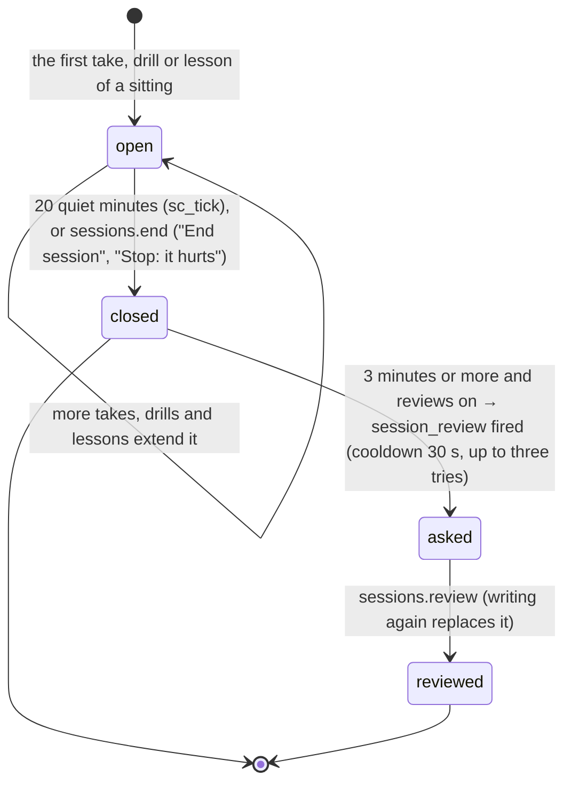
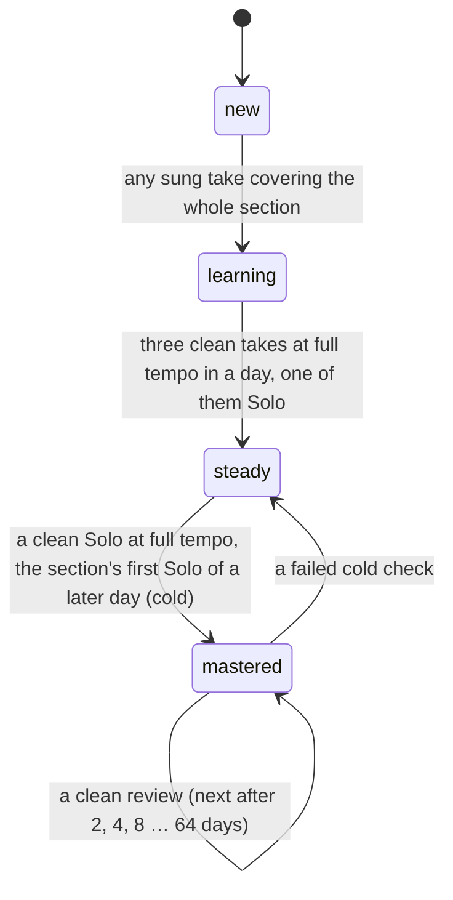

# Requirements: Singing Coach

PART A — REQUIREMENTS (SRS). User-approved before build; frozen after; changes via ## Changes.

## Introduction

### Purpose
Singing Coach is a practice and learning app for one person learning to sing, from matching a first note to recital repertoire, with one AI agent (CraftBot) working for them as their coach. There are no accounts, and nothing the person sings leaves the computer. The app listens through the microphone and shows the voice on the Voice Dial, an abstract instrument in place of a keyboard. It judges every note for pitch, onset and steadiness and keeps the score. Sections of songs climb from new to mastered in each key, and the app plans each day by its own rules. It looks after the voice with rules the coach cannot override. It teaches the whole subject: 80 lessons in 13 units, a drill for each of 41 skills, a ten-level path and a reference. Everything measurable is decided by the app, the same way every time. The coach judges and explains between sessions, working through A2App with 33 declared operations and two kinds of task (`coach_message`, `session_review`). It adds songs in ABC notation with their words, reviews sessions, proposes a day's plan and answers questions.

### Scope
**Goals**
1. Every sung note is judged for pitch (octave-folded cents: on, close or off at the chosen strictness), onset and hold. Each take reports where it went sharp or flat, phrase by phrase and bar by bar.
2. Each section of a song moves new → learning → steady → mastered in each key by fixed rules, and mastered sections come back for review after 2, 4, 8 … 64 days.
3. The voice is protected by rules the coach cannot override: a session cap by level, light days after heavy ones or a poor voice check, a weekly rest day, "Stop: it hurts" always on the practice screen, and the four-week hoarseness rule.
4. A fresh install can teach from the very first note: 41 starter songs and vocalises, 80 lessons, a drill for every skill, and a ten-level path whose level rises by itself.
5. A message to the coach shows whether the agent has picked it up (waiting, working, could not), and the answer appears in the conversation with any songs it added.

**Core functionalities:** microphone pitch tracking with setup, timing and range tests · the Voice Dial · practice screen with pitch lane or sheet music · Listen, Echo, Sing and Solo modes · guide voice and accompaniment · note-by-note judging and take results · section stages per key with spaced review · voice care (load, caps, light and rest days, check-ins) · the day's plan · Today dashboard · song library · songs from ABC, MusicXML, UltraStar or a recording · visual song editor · 80 lessons · drills for 41 skills · the ten-level path · reference (tuner, voice types, intervals, solfège, vowels, vocalises, tone lab, glossary, voice care) · coach conversation and session reviews · settings, data export and first-run setup

### Approval
Approved by the user: 2026-11-04 — carried over from the published marketplace app `singing-coach` 1.0.0, whose requirements were approved when it was built; this document restates them in the framework's form without changing any feature.

## Product Description

### Product Perspective
`authMode: none`. The app has one singer, no accounts and no agent profiles (Original requirements). The coach is told apart from the person by the app's agent token (`X-A2App-Token`), which pages never see. manifest.json declares no integrations (`capabilities.integrations: []`). The guide voice, piano, drone and clicks are synthesised in the browser, the sheet-music font and the type are bundled, and the microphone is analysed in the browser. Nothing is asked of the microphone until the person chooses to start. The one network use is the one-off fetch of the two models that turn a recording into a song: Demucs v4 (voice and music apart) and Whisper small (the words). The app's server fetches them from `huggingface.co` at pinned revisions in 16 MB parts and keeps them in `pb/model_cache`, and the browser keeps them in its cache. The app deliberately has no language model of its own: the coach is the person's AI agent, working between sessions. It never claims to hear tone, breathiness or tension, and never diagnoses.

### User Characteristics
One singer at any level, from never having matched a note to preparing a recital, practising most days against a daily goal of 10 to 60 minutes. They sing at a desktop or laptop with a microphone, ideally with wired headphones (Bluetooth headphones and speakers are also handled). They may also use a tablet or phone. Young singers (under 18) are in scope and get gentler rules. Mouse, touch and keyboard input are all used.

### Constraints
- C-1: Strictness sets what on and close mean and the onset window. Easy: on within ±35 cents, close within ±75, onsets ±150 ms. Normal: ±25, ±50, ±100 ms. Strict: ±15, ±35, ±50 ms. Pitch is judged in octave-folded cents on the stable part of each note (the first 120 ms and the last 50 ms are left out). Spoken notes are judged on voice and onset only, and free notes are drawn but not scored.
- C-2: A clean take (Normal) has 90 % of its notes on or close, 65 % on and 75 % of onsets in time, covers the whole section, and is sung in Sing or Solo.
- C-3: Section stages are new, learning, steady and mastered, kept per key (a section learnt in one key is not mastered in another). Any sung take moves a section to learning. Three clean takes at full tempo in a day, one of them Solo, make it steady. A clean Solo at full tempo that is the section's first Solo of a later day (the cold check) makes it mastered, and a failed cold check drops it to steady. Reviews come after 2, 4, 8 … 64 days. Only `runs.save` moves stages.
- C-4: A session opens with the first take, drill or lesson and closes after 20 quiet minutes, or at once through `sessions.end` (which "End session" and "Stop: it hurts" use). When session reviews are on, a closed session of 3 minutes or more asks the coach for a review, with at most three tries.
- C-5: The session cap goes by level: 20 minutes up to level 3 and for young singers, 30 up to level 6, and 60 after. The person may choose a shorter cap, never a longer one.
- C-6: Load per day is voiced minutes and fold cycles. A light day (gentle work only) follows a heavy day, meaning voiced minutes over 1.5× the 4-week daily mean and over 15. It also follows pain, or a check-in today with a 4 or 5. The weekly rest day is the one chosen, or the day after six days of singing in a row, and it has no singing (lessons and theory only). A ramp warning shows when this week's voiced minutes pass 1.3× the usual week.
- C-7: A check-in asks five questions from 1 (fine) to 5 (bad): hoarse, effort, discomfort, high notes lost and throat clearing, plus pain. It also offers an s/z ratio. Hoarseness at 3 or more on check-ins spanning 28 days asks the person to see an ENT doctor or a speech-language pathologist, sooner with risk factors. The app never diagnoses and never suggests medicine.
- C-8: Recordings of takes are kept only when the person turns that on, and they can all be deleted at once. Pitch traces and scores stay.
- C-9: Songs are ABC notation, at most 400,000 characters, with the words on `w:` lines (one syllable per note; several `w:` lines are verses). The melody is the first voice (or `%%melody`), one note at a time. Every syllable count that does not match is an error naming the line, verse and bar. Sections must cover every bar, and a pickup is bar 0. `songs.add` refuses notation with problems, a span over the level's cap, and a duplicate title unless asked for.
- C-10: The coach writes only public-domain or traditional songs it knows accurately, with `%%licence` pd or trad and `%%source` naming the edition. Those add-time rules bind the coach only on songs it added. A song made from a recording keeps its metre, pickup, tempo and bars.
- C-11: The singer's level runs from 1 to 10: First notes, Beginner, Elementary, Late elementary, Intermediate, Upper intermediate, Early advanced, Advanced, Concert, Artist. It rises by itself when a level's requirements are met.
- C-12: The coach cannot change settings, take the voice test or check-ins, open, transpose, attach a recording to, remove, restore or reset songs, record or dispute takes, end sessions, send or read messages, or start, tick or reset plans (403 `agent_not_permitted`). Coach replies and session reviews come only from the agent (403 `agent_only`). A coach reply can be taken back within 30 minutes while still unread.
- C-13: A coach plan is refused when coach plans are off and is checked against the health rules. Its total must be within 1.25× the goal and the cap, with a warm-up of 5 minutes or more first and a cool-down of 3 minutes or more last. Blocks are 2 to 20 minutes, nothing goes above the comfortable top, and light days get gentle blocks only. A plan longer than the session cap splits into two sittings.
- C-14: Fixed vocabularies. Mode: listen, echo, sing, solo. Guide: voice, piano, start, off. Vowel: oo, ah. Feedback: auto, full, after. Strictness: lenient, normal, strict. Syllables: movable, fixed, numbers, letters, neutral. View: lane, sheet. Clef: auto, treble, treble8, bass. Output: wired, bluetooth, speakers. Song kind: song, vocalise. Song source: starter, agent, you, import. Licence: pd, trad, own, import. Message role: you, coach; kind: chat, request, review, plan, health; status: pending, answered, failed. Plan source: rules, coach; status: proposed, active, done. Session status: open, closed.
- C-15: Color carries meaning only. Voice blue is the singer's voice, amber warns (over range, a health flag), and red marks a note off or missed, always with a glyph. The coach is black and white with a four-point star. There is no emoji.
- C-16: Days are local calendar days of the machine (`YYYY-MM-DD`).
- C-17: The content: 41 starter items (29 public-domain and traditional songs in English, German, Italian and French, levels 1 to 10, each checked against a named edition and glossed when not English, plus 12 original vocalises), 80 lessons in 13 units, 41 skills, 33 vocalises, sight-singing in 30 levels, and a ten-level path in eight tracks.

### Assumptions
- A-1: Volume ceiling: 400 days of take history, the longest `runs.list` window (up to 500 takes a call). The library loads whole on one screen. A recording to import is at most 80 MB.
- A-2: The microphone hears one voice at a time, and the host frame must allow `microphone`, or the app opens in its own tab.
- A-3: Separating a recording runs on the graphics card through WebGPU where the browser allows, else on the processor (WebAssembly).
- A-4: The health numbers are design defaults. The copy is to be reviewed by a speech-language pathologist or laryngologist before wide release (Original requirements).

## Features

### Module: Frame (app)
- F-FRM-1: The user sees a sidebar with the app's mark and a strong "Practice" button. Below it are Today, Learn, Train, Library (with a badge for new songs from the coach), Reference and Coach (with an unread badge). It also shows today's minutes against the goal, and the voice's minutes against the session cap (amber once the cap is reached). On a light or rest day it says so. At the foot sit the coach card with what the coach is doing, and Settings.
- F-FRM-2: The user can collapse the sidebar to a rail, and the choice is remembered. It is always a rail on the practice screen, in the song editor, in an open lesson and in a drill.
- F-FRM-3: On phones the sidebar opens as a drawer from a menu button.
- F-FRM-4: WHEN the user presses "Practice" THE SYSTEM SHALL open the next undone block of the day's plan (starting the plan if needed), or else the last song, or else the Library.
- F-FRM-5: The user sees a quiet instrument in light and dark from the host. Cool greys come from the host's kit tokens. Hairline panels carry small monospaced uppercase labels ("01 PLAN"), readouts are large thin monospaced numbers, and a faint measuring grid sits behind the practice stage and the dashboard. Everything clickable shows the hand.
- F-FRM-6: WHEN the app is opened for the first time THE SYSTEM SHALL show one dialog in four steps: Microphone, Timing, Your voice and Where to start (with minutes a day). Steps can be skipped ("Later", "Skip"), and everything can be changed later in Settings.
- F-FRM-7: WHEN the user moves to another page THE SYSTEM SHALL record what they are looking at (the view, lesson, skill or song; the practice screen reports its own bars, mode and key), so the coach can read it.
- F-FRM-8: WHEN a newer version of the app has been deployed THE SYSTEM SHALL reload an open page onto it, after the server comes back or when the tab is shown again. It waits while a dialog is open.

### Module: Listening (settings, voice)
- F-LIS-1: The user's voice is captured from the microphone raw (no echo cancellation, noise suppression or auto gain). Pitch comes from the McLeod method in an AudioWorklet, with a main-thread analyser where worklets are missing. It is voiced by clarity with hysteresis, smoothed by a median of five, and octave jumps are held back until they persist.
- F-LIS-2: WHEN the user has not chosen to start THE SYSTEM SHALL not ask the browser for the microphone. WHEN the host's frame does not allow the microphone THE SYSTEM SHALL say so and offer "Open in its own tab".
- F-LIS-3: The user can set up the microphone with a device picker, a live meter and the room's noise. They also say how they listen: wired headphones, Bluetooth or speakers. With speakers the guide gives the start note only, so it does not leak into the judging.
- F-LIS-4: The user can take a timing test: sing "ta" with eight clicks. The median offset is the round-trip latency, and it is subtracted when onsets are judged.
- F-LIS-5: The user can take a range test, holding the lowest and highest notes for a second within ±50 cents. From it come the comfortable range, the voice family and clef, and the passaggi, which are typical for the closest classical range until the person's own glides show where the voice turns. Ranges are kept with their date.
- F-LIS-6: WHEN the user leaves the practice screen, or it has been idle and quiet for two minutes, THE SYSTEM SHALL turn the microphone off.

### Module: The Voice Dial (runs)
- F-DIAL-1: The user sees the Voice Dial: a half circle whose top is the target note. A needle and its fading trail are the sung pitch, ticks mark ±10, ±25 and ±50 cents, and jaws close on the needle when a note is held in tune.
- F-DIAL-2: The user sees the dial in five modes. Song takes the target from the melody. Hold is a held note with a strobe ring. Free has no target and puts note names around the pitch (the tuner and the range test). Breath gives inhale, suspend and exhale cues. Blind has no needle and is judged after.
- F-DIAL-3: The user sees beside the dial the target (note, syllable, frequency, bar) and the voice (steadiness, vibrato, loudness, breath time).

### Module: Practice (runs, songs)
- F-PRC-1: The user sees the practice screen. The song's bars run across the top as a strip, with sections shaded by stage, the bars being practised bracketed and the cursor moving through. The pitch lane or the engraved melody with its words is in the middle, the Voice Dial is at the bottom, and there is one big button. On the bar strip the user chooses what to practise: a section's name, any stretch dragged across the bars, or a double-click for the whole song.
- F-PRC-2: The user can practise in four modes. Listen: the guide sings it. Echo: phrase by phrase, hear it and sing it back; the take's voiced time and fold cycles are those of every try, each counted once, and the take ends once (saved as one take, the drone stopping with it) whether its last phrase is sung or skipped. Sing: with the guide. Solo: no guide or accompaniment, judged against the singer's own key.
- F-PRC-3: The user can choose the verse; the key shift, which defaults to the best fit for the voice ([ and ] move it a semitone); the tempo (70 to 110 % from a menu, or - and = in steps of 5); and a loop of the chosen bars (L), whose every pass is saved as its own take with its own time (its count-in included), so a looped take's minutes count once. They can also set the metronome and count-in, the drone (D), the strictness, and the pitch lane or sheet music with the words.
- F-PRC-4: The user can choose the guide (G cycles through them): a formant voice on "oo" or "ah" (a Csound formant table per register, gentle vibrato on longer notes, legato glides), the piano, the start note only, or off. The accompaniment is a written piano part played as written, or else comes from the chord symbols.
- F-PRC-5: WHEN a note is sung THE SYSTEM SHALL judge it by C-1. It records on, close or off, the onset in its window, scoops and falls, the hold (spread after a 5 Hz low-pass), and vibrato rate and extent.
- F-PRC-6: WHEN a take ends THE SYSTEM SHALL show what it says, never one "voice score". That is: pitch (notes on or close) and in tune (notes on), which way the singer leans (bias and spread in cents), onsets, hold, vibrato or straight, scoops and falls, drift, an octave note, and the Solo offset. Below come per phrase and per bar, the weakest phrase with its words, the stage changes, one or two suggestions made by rules, and a voice map (pitch by loudness).
- F-PRC-7: The user sees live feedback fade as a section matures: full while learning, faded when steady, and after the take once mastered (Settings can fix it on, or after). In faded and after feedback the user first says how they think it went, and the numbers follow.
- F-PRC-8: The user can open any judged note with its trace and dispute it, and it is judged again.
- F-PRC-9: The user always sees "Stop: it hurts" on the practice screen. WHEN it is pressed THE SYSTEM SHALL end practice, close and mark the session, and make tomorrow gentle.
- F-PRC-10: The user can pause and resume a take (the button or P). The sound, the clock, the microphone and the take's recording stand still together, and the pause does not count.
- F-PRC-11: WHILE a take runs THE SYSTEM SHALL let the guide, the piano, the drone, the metronome, the loop, the count-in, the vowel and the strictness change from that moment on, and the take carries on. Only the mode, the bars, the tempo, the key and the verse start the take over.
- F-PRC-12: WHILE the user practises a plan block THE SYSTEM SHALL count the time toward it and follow it with the next block.
- F-PRC-13: The user can sing generated exercises on the same screen: vocalises, sight-singing, a scale against a drone, harmony parts and unaccompanied tunes. They can also sing a lesson's examples there. These takes move a skill instead of a song.
- F-PRC-14: The user can start and stop with Space and stop playback with Escape. From the practice screen they can open the song's editor, and ask the coach about the bars on screen, which travel with the question (Ctrl+Enter sends).

### Module: Progress (songs, sessions)
- F-PRG-1: The user sees each song split into sections (by default phrases of about 4 to 8 bars), each moving through its stages per key by C-3.
- F-PRG-2: WHEN a take is saved THE SYSTEM SHALL move the sections the take fully covered, extend the session (time, voiced time, fold cycles) and suggest the next tempo.
- F-PRG-3: The user's practice sittings are kept as sessions by C-4, and closed sessions are reviewed by the coach when reviews are on.

### Module: Voice care (health)
- F-HLT-1: The user's load is counted per day (voiced minutes and fold cycles) against the session cap of C-5. WHEN today's voiced time passes the cap, or a light day has had enough singing, THE SYSTEM SHALL say so after the take.
- F-HLT-2: The user sees light days, rest days and the ramp warning of C-6 as a health banner on Today with "Why", and the day's plan keeps to gentle work, or no singing on a rest day.
- F-HLT-3: The user can answer a voice check (C-7) before the day's first singing when check-ins are on, and any time. They can also take an s/z test. A 4 or 5, or pain, makes the day gentle.
- F-HLT-4: WHEN check-ins show hoarseness at 3 or more spanning 28 days THE SYSTEM SHALL ask the person to see an ENT doctor or a speech-language pathologist, naming the risk factors that make it sooner.
- F-HLT-5: The user can keep recordings of takes (off by default) and delete them all at once ("Delete all recordings?"). Pitch traces and scores stay.

### Module: Today (plan, stats)
- F-TOD-1: The user sees the day's plan as the hero, marked "Made by the app's rules" or "Proposed by the coach". It runs warm-up first, then reviews, focus sections, technique, a new song, a lesson and a drill, with the cool-down last. Each block shows its minutes and why. A plan longer than the cap is split into two sittings ("Second sitting · an hour or more later"), and light and rest days are honoured.
- F-TOD-2: The user can start the plan or any block of it (Start, Continue). A coach's plan offers "Use the app's plan".
- F-TOD-3: The user sees the week as a dial with the streak and the level, with a ring showing how many of the level's requirements are met.
- F-TOD-4: The user sees the numbers that matter for a singer with deltas and sparklines: Pitch and In tune over 7 days, Hold, Range, Load, and the last Voice check, which opens a check-in.
- F-TOD-5: The user sees 30 days of voiced minutes and pitch, the voice map of the last 7 days, the songs in progress with their contours and section stages, a 12-week calendar (a dash is a day without singing), and the coach panel with a quick ask.

### Module: Library (songs)
- F-LIB-1: The user sees a shelf per level. Each tile shows the tune as a contour over the comfortable range (amber past it in the key it is sung in), a fit badge, the sections' stages, progress and length. Songs made from a recording and songs the coach just added are marked.
- F-LIB-2: The user can search the library and filter it: All, In progress, New, Mastered, Fits my voice (once a range is measured), Vocalises.
- F-LIB-3: The user can open a song's panel. It shows the range in the current key against the voice, the best key with a transpose stepper, the first words, the language, and the sections with their stage and best take. It also shows the best takes over time, notes off by bar, the last takes, about the words (gloss), and the source and licence.
- F-LIB-4: The user can edit a song, start it over after "Start this song over?" (every section back to new; past takes stay), remove it after "Remove this song?" (it leaves the library; its practice history stays), and remove a song's recording after "Remove the recording?".
- F-LIB-5: WHEN the app is installed fresh THE SYSTEM SHALL fill the library with the 41 starter items. WHEN it is updated THE SYSTEM SHALL add only the new starter items.

### Module: Adding a song (songs, abc)
- F-ADD-1: The user can add a song by asking the coach, which writes the tune and words at the user's level and in their range.
- F-ADD-2: The user can write a song in ABC with its words, checked live. Problems show by line, verse and bar. Otherwise the user sees what was read: bars, key, metre, tempo, range, tessitura, syllables, verses, phrases, the longest phrase and the fit for the voice.
- F-ADD-3: The user can import ABC, MusicXML with lyrics or UltraStar. From MusicXML the sung part is read, and a piano part is kept as the accompaniment that plays as written. Chord symbols in a file are kept. A MusicXML or UltraStar file without them gets chords worked out (from the piano part and the melody, else from the melody in its key, ending on the tonic), written into the notation to check and correct, and the user is told where they came from. The import opens in the notation tab to be checked before adding.

### Module: A song from a recording (songs, models)
- F-REC-1: The user can drop a recording (mp3, wav, m4a, ogg, flac or webm, up to 80 MB) of a song with music or of a voice alone, and it is analysed on this computer.
- F-REC-2: WHEN the recording has music THE SYSTEM SHALL first separate it into its voice and its music with Demucs v4, on the graphics card through WebGPU where the browser allows, else on the processor. The melody is then followed in the voice alone and the key found from the sung notes alone. The beat, metre, bar 1 and chords (sevenths, sus4, diminished, inversions) come from the instruments alone, with the bass note of each beat from the bass by itself.
- F-REC-3: WHEN the recording is analysed THE SYSTEM SHALL hear the words in the voice with Whisper small (the language told or chosen), with the time of each piece. Heard words go on the note being sung when they were heard.
- F-REC-4: The user can hear the beat clicked over the recording, hear the voice and the music apart, and correct the metre, half or double speed, and bar 1. They can correct the heard words or replace them with the published lyrics, which keep the timing (matched character by character) and are laid under the notes nearest in time. The notation then opens to be checked and corrected before it is added.
- F-REC-5: WHEN the models are first needed THE SYSTEM SHALL download them once through the app's server (pinned revisions, kept on disk), and the browser keeps them.
- F-REC-6: The recording, its voice and its music stay with the song. In Listen, Sing and Echo the voice and the music each turn on or off (both off: the piano), at the recording's own key and full speed. In another key, at another speed, or in Solo, the piano accompanies, and a "Back to the recording" chip returns to the recording's key and speed. Turning the voice or the music on or off during a take changes what is heard from that moment, and the guide and the piano come in or stop with it.
- F-REC-7: The user sees a song made from a recording open in the recording's key (not the key that suits the range). No guide voice doubles the recording's singer while they are heard, and Echo's phrase to hear is always the whole recording.
- F-REC-8: WHEN a voice memo, or a song not separated, is imported THE SYSTEM SHALL analyse it directly. It plays with or without the voice, with the middle of a stereo mix taken out and the bass kept.

### Module: Song editor (songs)
- F-EDT-1: The user can edit a song visually on a page of its own, opened from Library > Edit, from the practice screen's Edit, and straight after a song is made from a recording. The notes sit on a piano roll (bars across, pitches up, the key's notes lighter), with the chords in a lane above and the words of every verse in lanes below.
- F-EDT-2: The user can select notes (click, Shift-click, a drag around them), move them in time and pitch by dragging or with the arrow keys, lengthen them by their right edge, draw them with the pen or a double-click, and split, join, copy and delete them. Breath, staccato, spoken and not-scored marks are switches.
- F-EDT-3: The user can type words under the notes (Tab moves to the next, and a closing hyphen joins the next syllable). Words can be dragged from one note to another, shifted a note earlier or later for the rest of their line, or typed as a line onto chosen notes. Verses can be added and deleted, and undo brings a deleted verse back.
- F-EDT-4: The user can add chords on the beat (the key's chords are offered), change them and drag them.
- F-EDT-5: The user can set beside the roll the key signature, a move of the whole song by semitones (every note and chord, with the key), the metre, the pickup and the tempo, with the level, kind, composer, sections and the words' gloss. Selected notes move a semitone with ↑ and ↓, or an octave with Shift. A song made from a recording keeps the recording's tempo, metre and pitch, so its whole-song move is locked.
- F-EDT-6: The user can play the song from any bar with the guide voice or the piano, the chords, and the recording (or its voice or music alone), with the playhead following.
- F-EDT-7: The user can undo and redo every change, and each change is saved by itself a moment later ("Editing…", "Saving…", "Saved"). WHEN the server would refuse the song THE SYSTEM SHALL hold it and show the problems by bar.
- F-EDT-8: The user can move around with a strip of the whole song (click or drag it) and the wheel. The wheel moves along the song over the bars, chords and words, or with Shift; Ctrl zooms where the pointer is. A hand tool, the middle mouse button and the arrow keys (when no note is chosen) also move the view.
- F-EDT-9: The user can still read and edit the notation as text.
- F-EDT-10: WHEN the song was changed elsewhere (by the coach) since it was opened THE SYSTEM SHALL keep the user's changes and offer to load the other version.
- F-EDT-11: Everything a song's notation holds comes back unchanged from the editor, except that repeats are written out and a change of metre becomes one metre.

### Module: Coach (coach)
- F-CCH-1: The user sees one conversation with the coach: questions and song requests, replies, session reviews and plans.
- F-CCH-2: The user sees on each message whether the coach has picked it up: "Waiting for CraftBot", "CraftBot is working on it", "CraftBot could not do this", or the reason it was not asked, with "Ask again".
- F-CCH-3: The user sees the songs the coach added under its answer, each with its level, key, bars and first words, ready to practise.
- F-CCH-4: The user can ask from the Coach page (with suggested ideas), from Today's coach panel, from the practice screen and from Add song.

### Module: Learn (app, learn)
- F-LRN-1: The user can take 80 lessons in 13 units at levels 1 to 10: the voice, breath, onset and release, resonance and vowels, registers, pitch matching, rhythm, reading, intervals and harmony, diction, expression, styles, and voice care. Each has pictures that sound and tasks that are sung (a note, a hold, a glide, an echo) or answered.
- F-LRN-2: The user can leave a lesson and resume it where they left off. The score is saved.
- F-LRN-3: The user sees the path: ten levels in eight tracks, each asking for lessons, pitch and ear skills, sight-singing, theory and rhythm, technique (vocalises clean from several starting notes), measured voice facts and songs. Level-up is automatic.

### Module: Train (drills, learn)
- F-TRN-1: The user sees a drill for every one of 41 skills, each with its mastery and stars (adaptive skills keep a level).
- F-TRN-2: The user can take quizzes on the ear, reading, theory, terms and IPA by tapping. Sung drills are judged on the dial: matching, holding and sliding onto notes, intervals, echoes, melodies from memory, scale degrees, sustain and phrase length. Rhythms are spoken on "ta".
- F-TRN-3: The user can sing 33 vocalises in their range. Each goes up a semitone a repetition to below the comfortable top (and not past the upper passaggio before level 4 or for young singers), then back down. Sight-singing has levels 1 to 30, with new music every time.

### Module: Reference (learn)
- F-REF-1: The user can use a tuner and pitch pipe (the dial in free mode, every note in the range, voice or piano) and a drone.
- F-REF-2: The user can compare their range with the classical voice types and their passaggi, and hear intervals up, down and together with song references.
- F-REF-3: The user can look up solfège (movable or fixed do, numbers, letters) with the Curwen hand signs, the vowel chart sung by the guide voice, and every vocalise in their range.
- F-REF-4: The user can explore a tone lab: brightness and clarity against the first take of the sitting. It is for exploring, not a score, and is never stored.
- F-REF-5: The user can search the glossary by category and read how the app looks after the voice.

### Module: Settings (settings)
- F-SET-1: The user can set the voice and range (measure again, clef, young singer), and the microphone and timing.
- F-SET-2: The user can set the sound: guide, vowel, volumes (everything, guide, accompaniment, metronome, each with a test), drone under vocalises, metronome and count-in.
- F-SET-3: The user can set practice and feedback: minutes a day (10, 15, 20, 30, 45, 60), strictness, live feedback, syllables, minor keys, lane or sheet music, and their level. The coaching rules are shown with their reasons.
- F-SET-4: The user can set voice care: voice check before singing, longest sitting (up to the level's cap), weekly rest day, the s/z test and recordings.
- F-SET-5: The user can set the coach: review each session, plan my next day, their name, and the coach's status.
- F-SET-6: The user can export their data: the library as ABC, one song as UltraStar for karaoke apps, and the session log as CSV.
- F-SET-7: WHEN the user changes a setting THE SYSTEM SHALL save it at once.

### Agent (via A2App)
- F-AGT-1: The agent can read and act through the 33 operations in ## Operations Design, and its reads are lean. The person's own actions are not offered to it (C-12), and a parameter an operation does not declare is refused with the operation's parameters and a "did you mean", not ignored.
- F-AGT-2: The agent can read the guide whole or by topic (`app.guide --topic protocol|words|recordings|abc|health|levels|curriculum`).
- F-AGT-3: The agent can take a `coach_message` task and answer the person's message. It reads the message with `coach.get`. For a song request it checks `songs.list` first, then runs `songs.check` until the notation is accepted, then `songs.add --message`. It replies with `coach.reply --message` (or `--failed true`).
- F-AGT-4: The agent can take a `session_review` task, read `review.pack` (under about 6,000 characters, with what the microphone cannot hear), and write a 3 to 6 sentence review with `sessions.review`. It may update a song's note, and propose a plan when coach plans are on.
- F-AGT-5: The agent can propose a day's plan with `plan.set`. It goes to today if today's plan has not started, else to tomorrow, and it is checked by C-13.
- F-AGT-6: The agent can read a song's words bar by bar (`songs.words`), shift a verse's words a note earlier or later to the end of the phrase (`songs.shift-words`), and lay words on chosen bars (`songs.set-words`), all without rewriting the notation. It may correct the person's own and imported songs, keeping a recording's timing.
- F-AGT-7: The agent can take back one of its own replies within 30 minutes while it is unread (`coach.unsend`), and the question waits again.
- F-AGT-8: The agent never sees a take with no voice heard reported as numbers: `review.pack` and `runs.get` mark it.
- F-AGT-9: WHEN data is written by any route other than the operations (a raw record write) THE SYSTEM SHALL refuse it and name the operation to use.

## Non-Functional Requirements
- N-1: A change made by the coach (or another tab) appears on every open screen without a manual refresh. Views reload 150 ms after the last realtime change to a collection they watch (200 ms on Today and the Library), and at most once a second by default (every 1.2 s for the app state and the Library, every 1.5 s on Today).
- N-2: Singing never waits on React. The practice page draws the engine frame, the dial, the lane or sheet, the bar strip and the readouts from one requestAnimationFrame loop, and pitch runs in an AudioWorklet.
- N-3: Onsets are judged after subtracting the measured round-trip latency, in a window of ±50 to ±150 ms by strictness (C-1).
- N-4: A session quiet for 20 minutes is closed, and its review asked for, within a minute (the `sc_tick` job runs every minute).
- N-5: `review.pack` stays under about 6,000 characters, and `songs.list` gives one line per song for the agent.
- N-6: The models for a song from a recording are fetched once in 16 MB parts and served from disk afterwards. The browser keeps them, so a second import downloads nothing.
- N-7: Every page works from phone width to desktop, in light and dark, by keyboard, and with reduced motion honoured (Original requirements, item 32).

## Data Requirements
- **settings** (module: settings): name (string, max 80), daily_minutes (number), session_cap (number), strictness (enum), feedback (enum), syllables (enum), minor_do (enum), clef (enum), guide (enum), vowel (enum), volume (number), guide_volume (number), accomp_volume (number), click_volume (number), drone (boolean), metronome (boolean), count_in (boolean), view (enum), output (enum), latency_ms (number), noise_db (number), input_device (string, max 200), under18 (boolean), checkins (boolean), keep_recordings (boolean), rest_day (number), coach_reviews (boolean), coach_plans (boolean), level (number), onboarded (boolean), seeded (boolean), last_song (string, max 15), coach_seen (datetime), created (datetime, server-set), updated (datetime, server-set).
- **voice** (module: voice): kind (enum), speaking_hz (number), low (number), high (number), comf_low (number), comf_high (number), family (enum), clef (enum), passaggio (json), breaks (json), sustain_s (number), note (string, max 400), created (datetime, server-set), updated (datetime, server-set).
- **songs** (module: songs): title (string, required, max 160), composer (string, max 160), kind (enum), level (number), abc (string, max 400000), model (json), preview (json), language (string, max 12), licence (enum), source_note (string, max 400), voicing (enum), tempo (number), bars (number), seconds (number), key_name (string, max 40), meter (string, max 12), low (number), high (number), span (number), median (number), tessitura (string, max 20), phrases (number), longest_phrase_s (number), syllables (number), verses (number), first_words (string, max 200), accompanied (boolean), sections (json), tags (json), source (enum), starter_key (string, max 40), note (string, max 2000), note_at (datetime), gloss (string, max 6000), fav (boolean), seen (boolean), archived (boolean), request (string, max 15), created (datetime, server-set), updated (datetime, server-set), backing (binary), backing_map (json), backing_voice (binary), backing_music (binary).
- **progress** (module: songs): song (ref, required → songs), key_shift (number), sections (json), by_key (json), last_at (datetime), minutes (number), runs (number), created (datetime, server-set), updated (datetime, server-set).
- **sessions** (module: sessions): day (string, max 10), started (datetime), last_at (datetime), ended (datetime), minutes (number), voiced_s (number), cycles (number), runs (number), songs (json), warmup_s (number), cooldown_s (number), pain (boolean), status (enum), review (string, max 6000), review_at (datetime), review_asked (boolean), created (datetime, server-set), updated (datetime, server-set).
- **runs** (module: runs): song (ref, required → songs), session (ref → sessions), day (string, max 10), mode (enum), from_bar (number), to_bar (number), verse (number), key_shift (number), tempo_pct (number), bpm (number), guide (string, max 10), feedback (string, max 10), memory (boolean), strictness (string, max 10), duration_ms (number), voiced_ms (number), cycles (number), expected (number), on_n (number), close_n (number), off_n (number), missed (number), pitch_pct (number), on_pct (number), bias_c (number), mad_c (number), timing_mad (number), timing_bias (number), onset_pct (number), hold_sd (number), vib_rate (number), vib_extent (number), vib_share (number), scoops (number), falls (number), drift_c (number), octave (number), offset_c (number), clean (boolean), cold (boolean), complete (boolean), per_phrase (json), per_bar (json), per_note (json), map (json), self_estimate (string, max 8), disputed (json), results (json), created (datetime, server-set).
- **tracks** (module: records): run (ref, required → runs), rate (number), frames (string, max 6000000), audio (binary), created (datetime, server-set).
- **checkins** (module: records): day (string, max 10), session (string, max 15), when (enum), hoarse (number), effort (number), discomfort (number), high_loss (number), clearing (number), pain (boolean), sz_ratio (number), note (string, max 600), created (datetime, server-set).
- **messages** (module: coach): role (enum, required), kind (enum), text (string, max 20000), song (string, max 15), session (string, max 15), reply_to (string, max 15), context (json), status (enum), request_id (string, max 15), error (string, max 1000), created (datetime, server-set), updated (datetime, server-set).
- **plans** (module: plan): day (string, required, max 10), source (enum), blocks (json), note (string, max 2000), status (enum), done (json), created (datetime, server-set), updated (datetime, server-set).
- **lessons** (module: app): key (string, required, max 40), score (number), best (number), attempts (number), done_at (datetime), created (datetime, server-set), updated (datetime, server-set).
- **skills** (module: learn): key (string, required, max 40), mastery (number), attempts (number), items (number), correct (number), avg_ms (number), level (number), best_level (number), data (json), history (json), last_at (datetime), created (datetime, server-set), updated (datetime, server-set).
- **drills** (module: drills): drill (string, required, max 30), skill (string, max 40), session (ref → sessions), day (string, max 10), items (number), correct (number), accuracy (number), avg_ms (number), duration_ms (number), voiced_ms (number), cycles (number), tempo_pct (number), level (number), score (number), title (string, max 160), detail (json), created (datetime, server-set).

## External Interfaces
- **Human (browser):** one single-user View served by PocketBase at the app's own origin, with hash routes `#/today`, `#/learn?lesson=`, `#/train?skill=`, `#/library?song=`, `#/reference?tab=`, `#/practice?song=&from=&to=&mode=&tempo=&key=&block=` (or `?gen=<exercise>`, `?ex=<lesson.step>`), `#/edit?song=&back=`, `#/coach` and `#/settings?section=`. It also has the dialogs: first run, voice check, add a song, a song from a recording, and confirmations. Device input is the microphone. File input is ABC, MusicXML and UltraStar files, plus recordings (mp3, wav, m4a, ogg, flac, webm). File output is the library as ABC, a song as UltraStar, and the session log as CSV.
- **Agent (A2App):** the modules and collections in AGENT_APP.md § Modules; operations exactly as declared in ## Operations Design; tasks with the capabilities `coach_message`, `session_review` (events.json). No other machine interface is offered to agents; the app's own screens call their own routes.

## Out of Scope
- More than one singer: accounts, sign-in, sharing, or agent profiles.
- Judging tone, breathiness, tension or breath support: the microphone cannot hear them, and the coach never claims to.
- Diagnosis or medicine of any kind. Lasting hoarseness or pain is referred to an ENT doctor or a speech-language pathologist.
- One overall "voice score" for a take.
- Singing more than one line at a time: the melody is one note at a time.
- Transcribing songs under copyright for the coach: it offers a public-domain song of a similar style instead.
- Sending audio or results anywhere. Takes, recordings and traces stay on this computer, and recordings are kept only when turned on.
- Network use beyond the one-off download of the two recording models.
- A language model inside the app: the coach is the person's AI agent.
- Coach overrides of the health rules (cap, light and rest days, Stop, the four-week rule).
- Writing records outside the operations (direct record API writes are refused).
- Emoji.

## Quality of Life
- The collapsed or open sidebar is remembered.
- Songs the coach added carry its mark in the Library until opened.
- Every chart shows exact values on hover and grows in once when it mounts.
- Numbers count up when a readout changes.
- The coach panel suggests what to ask ("A folk song for level <n> …", "A warm-up for my break", "Why do I go flat on long notes?").
- Tooltips name the keyboard shortcut of the practice controls ("Key: [ and ] move it a semitone", "Tempo: - and = change it", "Guide (G cycles)").

PART B — TECHNICAL SPECIFICATION.

## System Overview
PocketBase 0.39 (JS hooks, migrations) + React 19 / Vite / Tailwind 4 View in `frontend/` built into `pb/pb_public/`, on the `blueprint-pocketbase-kit` toolkit. The View calls the app's own routes `/api/ops/<group>/<verb>` (`ops.pb.js`: 55 routes, the 32 shared with agents plus the person's 23 own actions). The generated `a2app_routes.pb.js` serves the 33 declared operations to agents as `POST /api/ops/<name>`. The recording models are served as bytes at `GET /api/models/part` (`models.pb.js`, `lib_models.js`). Domain logic lives in `pb/pb_hooks/lib_*.js` (ABC and words, model, voice, health, songs, runs, plan, coach, stats, curriculum, learn, starter library, guide). Record guards and the `sc_tick` clock live in `hooks.pb.js`. The browser does the listening and judging (`frontend/src/app/music/`), with Demucs and Whisper in web workers (ONNX Runtime Web and transformers.js), VexFlow for sheet music, and the Web Audio API for the guide voice, piano, drone and clicks.

Modules → navigation map:

| Module (manifest) | Where a person meets it | Route |
| --- | --- | --- |
| `app` | The shell (sidebar counts, the coach's status); lessons in Learn; `app.guide` and `app.context` are the agent's | all, `#/learn` |
| `settings` | Settings page; the first-run dialog | `#/settings` |
| `voice` | Range test (first run, Settings); voice types in Reference; the comfortable range everywhere | `#/settings`, `#/reference?tab=voice` |
| `health` | Voice check dialog, health banner and Load on Today, voice care in Settings | `#/today`, `#/settings` |
| `songs` | Library and song panel, Add song, a song from a recording, the song editor | `#/library`, `#/edit` |
| `runs` | Every take on the practice screen and its result card | `#/practice` |
| `sessions` | Sessions behind Today's numbers; "End session" and "Stop: it hurts" on Practice | `#/today`, `#/practice` |
| `review` | No screen: the agent's pack for a session review | — |
| `coach` | Coach page; Today's coach panel; asking from practice and Add song | `#/coach` |
| `plan` | Today's plan; the Practice button | `#/today` |
| `stats` | Today dashboard; the song panel's history | `#/today`, `#/library` |
| `learn` | Learn (lessons and the path); Train's mastery | `#/learn`, `#/train` |
| `drills` | Train's drills | `#/train` |
| `abc` | The live notation check in Add song and the editor | `#/library`, `#/edit` |
| `models` | A song from a recording (the model downloads) | `#/library` |
| `records` | No operations: `tracks` (take traces and audio) and `checkins` | — |

Sidebar order: Practice · Today, Learn, Train, Library, Reference, Coach · the coach card and Settings at the foot.

## UI Design
- **Design system:** the agent-app UI kit 0.6.0 vendored in `frontend/src/kit` (system-managed). It supplies the `--agent-app-*` tokens, the theme bridge, the shell with its error boundary and toasts, and the PocketBase client and agent-request hooks. The app extends it in `frontend/src/app/theme.css` with the `--sc-*` tokens. Page, side, panel, raised, sunk, line, line-2, hair, ink, ink-2, muted, faint, hover and active are mixed by `color-mix()` from the kit tokens with cool greys, separately for light and `[data-theme='dark']`. The coach is `--sc-coach` (the ink) on `--sc-coach-ink`, black and white. Meaning colors are fixed per scheme: voice blue `--sc-voice` (#2f6fe4, dark #7aa7ff), `--sc-bad` (#dc2626 / #f87171), `--sc-warn` (#c2700c / #f2a541) and `--sc-good` (#15803d / #4ade80). The radius is the kit's, capped at 8 px (`--sc-radius`, small ×0.75). Type is Inter Variable for text and JetBrains Mono Variable for labels and readouts (`@fontsource-variable`). `.sc-label` is a 10.5 px mono uppercase label, `.sc-num` gives tabular figures, and `.sc-grid` is the measuring grid. The widgets are written once in `components/ui.tsx`: Button, IconButton, Input, Textarea, Select, Toggle, Segmented, Field, Row, Kbd, Spinner, Panel (with its index and label), Empty, Count, Popover, MenuItem, MenuSep, Dialog, Sheet, useConfirm, StageDots, PageHeader and MenuButton. Charts are hand-drawn SVG in `components/charts.tsx`. The Voice Dial and the lane draw on canvases (`music/dial.ts`, `music/lane.ts`). Icons are lucide-react.
- **Layout:** a full-height app. A 232 px sidebar (a 60 px rail when collapsed or focused) sits beside the page, and below 768 px it becomes a drawer up to 290 px wide behind a menu button. Each page has a header (title, a meta line, actions) and a body of hairline panels on a 12-column grid from 1024 px (one column below), with 20 px side padding (28 px from 768 px). Panels carry an index and a mono label ("04 VOICE · 30 DAYS"). Controls are 32 px (28 small, 40 large) with small corners and hairline borders. The primary button is ink, and icon buttons are quiet ghosts. A song's panel docks on the right as a sheet up to 540 px wide, and dialogs are centred. Base text is 13 px.
- **Screen — Today:** primary object: the day's plan · primary action: "Start" (or a block's Start/Continue) · loading: a spinner until the dashboard arrives · empty: the plan reads "Nothing to plan yet" with "Open the library". In progress shows "No song started yet" with "Choose a song". The voice map shows "No singing this week yet" ("Every note you sing lands here as a dot: across is pitch, up is loudness. The thickest cloud is where your voice lives.") · health: the banner leads with "Please get your voice checked.", "A rest day for the voice." or "A light day.", with "Why" · success: a voice check toasts its advice, and panels update live · narrow: one column ordered banner, plan, week, numbers, 30 days, coach, in progress, voice map, calendar. The level pill shows from 1024 px.
- **Screen — Practice:** primary object: one song (or exercise) and the take · primary action: the big button (Space): Listen, Echo, Sing or Solo, then Stop · loading: a spinner until the song, settings and state arrive · empty: "Pick a song to sing" with "Open the library" · error: "This could not be opened" with the reason and "Back to the library". A blocked microphone shows its problem and "Open in its own tab" · states: running, paused (P), and counting in. The result card follows each take, with the self-estimate first in faded feedback. "Stop: it hurts" is always visible. "End session" shows in the transport while a session is open and no take is running or waiting for its estimate, and toasts "Session ended." or, when a review was asked for, "Session ended. The coach will review it." "Back to the recording" shows when a recording song leaves its own key or speed · success: "Level <n> reached" toasts, and a cap or light-day notice after a take · narrow: below 640 px of stage width the mode switch shows icons only, and the menu button opens the drawer.
- **Screen — Library:** primary object: the shelves of songs by level · primary action: "Add song" · loading: a spinner · empty: "The library is empty" or "Nothing matches", with Add song · success: "Removed <title>" · narrow: the search and filter wrap above the shelves.
- **Screen — Song panel:** a sheet docked on the right · primary object: one song · primary actions: Practise from a section, Edit · states: range against the voice, best key and transpose, sections with stage and best take, history, trouble bars, last takes, about the words. Confirmations: "Start this song over?" ("Every section goes back to new. Past takes stay in the history."), "Remove this song?" ("<title> leaves the library; its practice history stays.") and "Remove the recording?" ("The song stays; the piano accompanies it from now on.") · narrow: the sheet takes the full width.
- **Screen — Add song (dialog):** primary object: a new song · primary action: Add (or Send to the coach) · states: four tabs (Ask the coach, Write notation, Import a file, From a recording). The live check lists problems by line, verse and bar, or shows what was read. An import opens in the notation tab · success: "Added <title>", "Sent to your coach" (or "Saved. <reason>" when the coach could not be asked).
- **Screen — A song from a recording:** primary object: one recording · primary action: hand the notation on to be checked and added · states: separating, hearing the words and analysing, each with progress. The beat grid can be corrected (metre, half or double speed, bar 1), the voice and the music can be heard apart, and the words corrected or pasted · error: "That file is over 80 MB. An mp3 or m4a of the song is plenty.", "This file could not be read as audio. …", "The voice could not be loaded." · success: "Added <title>, with its recording, voice and music".
- **Screen — Song editor:** primary object: one song's notes, chords and words · primary action: edit in place (saved by itself) · loading: a spinner · error: "This song could not be opened" with "Back to the library" · states: "Editing…", "Saving…", "Saved", "Not saved", and "Changed elsewhere" with a warning bar (`role="alert"`) offering to load the other version. Server problems show by bar. Deleting a verse toasts "Verse <n> deleted. Ctrl+Z brings it back." · tools: Select, Draw and Hand (H), Split (S), Join (J), zoom, undo and redo, and play from the playhead · narrow: the 312 px side panel (key, metre, tempo, details, sections, check, notation) shows from 1024 px, and below that the roll takes the whole width.
- **Screen — Learn:** primary object: the lessons and the path · primary action: open the next lesson · states: units with lessons done, the path matrix by level and track, and a level's requirements, each linking to its lesson or drill. A lesson opens full page, resumes where it was left, and ends with its score · narrow: one column, with more columns from 768 px.
- **Screen — Train:** primary object: the skills · primary action: open a drill · states: mastery and stars per skill, a level for adaptive skills, and "<n>✓" for vocalises clean from that many starting notes. A drill runs full page and records its result · narrow: one column.
- **Screen — Reference:** primary object: one of nine tabs (Tuner, Voice types, Intervals, Solfège, Vowels, Vocalises, Tone lab, Glossary, Voice care) · primary action: hear it · empty: "Range not measured yet" in Voice types, "No takes yet" in the Tone lab, "Nothing matches" in the Glossary · narrow: the tab switch scrolls sideways and the panels stack.
- **Screen — Coach:** primary object: the conversation · primary action: Send (Enter; Shift+Enter for a new line) · states: per message "Waiting for CraftBot", "CraftBot is working on it", "CraftBot could not do this: <reason>", or the reason it was not asked with "Ask again". The header meta reads Ready, Working or Waiting for CraftBot. Songs added sit under the reply, and suggested ideas are offered · success: "Your coach is on it", or "Saved. <reason>".
- **Screen — Settings:** primary object: the settings in seven panels (01 Voice and range, 02 Microphone and timing, 03 Sound, 04 Practice and feedback, 05 Voice care, 06 Coach, 07 Your data) · primary action: each control saves on change · states: "Delete all recordings?" ("Every saved recording of your takes is deleted. Scores and pitch traces stay.") · success: "Range saved", "Deleted <n> recordings." or "There were no recordings.", "Exported <n> songs." · narrow: one column; `?section=` scrolls to a panel.
- **Screen — First run and voice check (dialogs):** the first run has four steps (Microphone, Timing, Your voice, Where to start) with Back, Next, and Later (first step) or Skip. The voice check asks five questions from 1 to 5 plus pain and answers with advice ("Pain is a reason to stop. …" when there is pain).
- **Formatting:** days and times use the browser's locale: "12 Oct" (the year added outside the current year) and "5:42 PM". Relative times read "just now", "5 min ago", "3 h ago", "yesterday", "3 days ago". Durations read "<1 min", "12 min", "1 h 5", and clocks "3:05" or "1:02:10". Shares read "82%", and cents read "♭12¢", "♯8¢", "0¢". Key shifts read "+2", "−3", "0", and notes "C♯4" with ♯ and ♭. Bars read as ranges. Due reviews read "due", "tomorrow", "in 3 d". Levels read "Level 4 · Late elementary". Days are local `YYYY-MM-DD` keys. Empty numbers read "–" or "—", never 0, and a take with no voice is not shown as numbers. Screens show names, never record ids.

## Quality Conformance

- **Q1 Completeness & IA:** orientation comes from the sidebar: the current page is filled with an ink bar beside it, and the rail shows each page's name as a tooltip. On phones the same sidebar opens as a drawer. Every page has a header with its title and a meta line (the date, the level, the number of songs, the coach's status). The Practice button always leads to the next thing to do. Every screen is reachable from the sidebar, from Today's plan blocks, or from a song (practice, editor). The modules map to screens as in ## System Overview. `review` and the agent's `app.guide`/`app.context` have no screen, and `records` has no operations. Names hold app-wide: song, section, take, session, stage (new, learning, steady, mastered), plan and block, lesson, skill and drill, vocalise, voice check, "the coach". The library outgrows a screen, so it has search, six filters and shelves by level. Lessons are grouped in units, and drills by skill.
- **Q2 Design system:** tokens are the kit's `--agent-app-*` set, extended by the `--sc-*` tokens (see ## UI Design). Components use the tokens; the fixed meaning colors and the grey mixes live in `theme.css`. Semantic roles: ink for primary buttons and the coach, voice blue for the singer's voice and notes sung on pitch, amber for warnings (over range, health flags, the cap reached), red for a note off or missed (always with a glyph), and green for "working" and good states. Type is Inter Variable with JetBrains Mono Variable for labels and numbers. Icons are lucide-react only, with no emoji. Light and dark follow the host through the kit theme bridge, and `[data-theme='dark']` redefines every `--sc-*` token.
- **Q3 Layout & composition:** spacing is consistent within hairline panels on a 12-column grid. Each page has one primary action in its header ("Start" on Today, "Add song" in the Library), and the practice screen has one big button. Readouts are large thin mono numbers with tabular figures. Labels are few because the layout explains: index and label on each panel, and the dial's target and voice on either side. Long titles and lines truncate with an ellipsis, and the full text is in the song's panel or a tooltip. The library is shelved by level rather than paginated.
- **Q4 Interaction:** affordance states: the hand cursor on everything clickable (a `theme.css` base rule), hover and active fills, and disabled controls at reduced opacity. Destructive actions use the app's own confirm dialog (`useConfirm`, never `window.confirm`), and its copy names the target and the consequence: "Start this song over?", "Remove this song?", "Remove the recording?", "Delete all recordings?". The editor uses undo instead of confirm (a deleted verse comes back with Ctrl+Z). Keyboard on the practice screen: Space starts and stops, Escape stops playback, P pauses, L loops, [ and ] change the key, - and = the tempo, G cycles the guide, D toggles the drone. In the editor: the arrow keys move notes or the view, Shift with them moves an octave, S splits, J joins, H is the hand, Ctrl+Z and redo, and Tab or Enter step through the words. Enter sends to the coach, and Escape closes dialogs, sheets and popovers. Inputs are constrained rather than validated: segmented choices, preset tempos, the cap list limited to the level's cap, and notation checked live with its problems by bar.
- **Q5 State & feedback:** each screen's states are listed in ## UI Design. Busy buttons show a spinner and are disabled while they run. A take shows live feedback as configured, then its result card, with the self-estimate first in faded feedback. A message to the coach shows waiting, working or could not, with "Ask again". The editor shows Editing, Saving, Saved, Not saved or Changed elsewhere. The sidebar's coach card shows Ready, waiting or working. Pages show a spinner until their first load (see ### Conventions and overrides). Load and write errors surface as the kit toast with the operation's message, or as the screen's own "could not be opened" state.
- **Q6 Motion:** one subject moves, the voice: the dial's needle, trail and jaws, and the lane's ribbon. Panels rise in (`sc-rise`, 340 ms), messages and items slide in (`sc-in`, 260 ms), pages fade (`sc-fade`, 220 ms), dialogs and sheets enter over 220 to 240 ms, and the drawer over 200 ms. Charts draw (`sc-draw`, 900 ms) and grow (`sc-grow`, 600 ms), and numbers count up. The selected segment of a switch slides. Status dots pulse over 1.4 s. Under `prefers-reduced-motion: reduce` these CSS animations are removed, numbers appear without counting, and the dial drops its trail and strobe, with its head and jaws set at once.
- **Q7 Content:** the voice is plain and second person ("Pick a song to sing", "Every note you sing lands here as a dot …"), in sentence case. Results say what happened, never one score ("Pitch", "In tune", which way the singer leans in cents, "Hold"). Health copy points to rest and to a professional without diagnosing ("Pain is a reason to stop. Rest your voice today. …"). Operation errors name the parameter, show a valid example and suggest the nearest parameter name. Refusals for the coach say what to tell the person instead ("Your AI agent cannot …: the person does this in the app."). Terminology is fixed: song, section, take, stage, session, plan, block, lesson, drill, skill, vocalise, voice check, coach. The coach is named CraftBot in its status lines.
- **Q8 Accessibility:** focus: every control has the `.sc-focus` ring, a 2 px voice-blue outline on `:focus-visible`. Dialogs and sheets are `role="dialog"` with `aria-modal="true"` and close on Escape. Segmented switches are radio groups with `aria-checked`, toggles carry `aria-checked`, and the sidebar marks the current page with `aria-current="page"`. Icon-only buttons carry `aria-label` (and their shortcut in the title). The editor's "changed elsewhere" bar is `role="alert"`. Targets: controls are 32 px (28 small, 40 large), and sidebar rows 36 px. Meaning is never color alone: notes off carry a glyph (♭ or ♯ with the cents, ○ missed, ↗ scoop, ↘ fall), stages are named in tooltips and labels, and health flags are written sentences.
- **Q9 Responsiveness:** pages work from phone width to desktop. Below 768 px the sidebar becomes a drawer behind a menu button. From 1024 px panels sit on the 12-column grid, with one column below. The practice screen drops its mode labels to icons below a 640 px stage, and the editor's side panel shows from 1024 px. The Reference tab switch scrolls sideways, the song panel sheet takes the full width on phones, and dialogs keep within the window.
- **Q10 Performance:** the practice page draws from one requestAnimationFrame loop without React renders, pitch runs in an AudioWorklet, and separation and transcription run in web workers. VexFlow and the lesson content load lazily. The models are fetched once in 16 MB parts, kept on disk by the server and in the browser's cache. Reads for the agent are lean (`songs.list` one line per song, `review.pack` capped near 6,000 characters). Server-side caps: `runs.list` days 1–400 (default 7) and limit 1–500 (default 50); `sessions.list` limit 1–200 (default 20). Live reloads are debounced and spaced (N-1).
- **Q11 Caching & freshness:** static: the built bundle has content-hashed asset names, and the document shell is served `no-store` (`cache_control.pb.js`, plus the toolkit's SPA header). Data: operation responses carry no cache headers, and the View keeps them only as in-memory view state. Freshness comes from one realtime hub that subscribes to the twelve watched collections once at startup, and each view reloads after a change it watches, with a sequence guard so the latest load wins. The editor also checks every 15 s, while nothing waits to be saved, whether the song changed elsewhere. Model parts are immutable at their pinned revisions and kept forever. An open page compares its script with the served one on every reconnect after the first and whenever the tab becomes visible, then reloads, waiting while a dialog is open.
- **Q12 Data integrity:** every collection changes only through the operations, and `hooks.pb.js` refuses direct API writes and names the operation. Person-only and coach-only operations are enforced on the server (C-12). Stages move only through `runs.save`, and mastery only through `drills.save`. Unique indexes: `progress (song)`, `tracks (run)`, `plans (day)`, `lessons (key)`, `skills (key)`. Other indexes: `songs (level)`, `sessions (day)`, `runs (day)`, `runs (song)`, `checkins (day)`, `drills (day)`, `drills (skill)`. Songs are re-parsed whenever the notation changes, and the parsed model has a version (`model.v`), which `songs.open` re-parses when older. Sections whose bars did not change keep their progress on an edit, and a song's notation round-trips unchanged through the editor (checked on every starter song). Migrations are additive (the schema, then the recording backing, then its voice and music stems) and replay on a fresh database. The starter library is added by the clock, not by a migration.
- **Q13 API:** beyond the adapter, the app's own routes `/api/ops/<group>/<verb>` (GET reads, POST writes) are what the View calls, and agents reach the 33 declared operations through the adapter. A parameter an operation does not declare is refused for the agent with the operation's parameters and a "did you mean". Errors share PocketBase's shape `{ status, message }`, with 400, 403 (`agent_not_permitted`, `agent_only`), 404 and 500 used for their meaning. Words are read and changed bar by bar (`songs.words`, `songs.shift-words`, `songs.set-words`), each answering with the bars as they now are. `coach.reply` names the message it answers. Lists are bounded as in Q10, and stack traces are never returned.
- **Q14 Architecture:** the UI is in `frontend/src/app`: pages, components, `music/` (listening, judging, audio, notation, recording analysis) and `learn/` (lesson content, drills, the lesson player). The application logic is in `pb/pb_hooks/lib_*.js`, routes in `ops.pb.js` and `models.pb.js`, and record guards and the clock in `hooks.pb.js`. The UI calls the same operations the agent calls (`lib/api.ts`), so every rule has one server implementation. `lib_curriculum.js` is the one index of tracks, units, lessons, skills, vocalises and levels that both sides share. Shared widgets exist once in `components/ui.tsx` and charts in `components/charts.tsx`. App-wide data (settings, state, unread) has one source, `lib/context.tsx`, and formatting lives in `lib/format.ts`.
- **Q15 Resilience:** the microphone falls back to a main-thread analyser where AudioWorklets are missing. A frame that blocks the microphone gets "Open in its own tab". Separation falls back from WebGPU to the processor. A recording that cannot be read, or one over 80 MB, is refused with what to try instead. A message the coach could not be asked about keeps its reason and offers "Ask again", and a session review is asked for up to three times. A take with no voice heard is marked, never reported as 0 cents. A starter song that fails to parse is logged and skipped. When the backend is unreachable, every failed call toasts "Network error — is the backend running?", and the page reloads onto the current build when the server comes back. A render crash shows the kit's "Something went wrong" panel with "Reload app". Hook errors are caught and logged, and never shown raw.
- **Q16 Security & privacy:** with `authMode: none`, collection rules are open (`""`) because the app is single-user and binds loopback, and every write is still refused unless it comes through an operation. The framework adapter runs its host check, framing policy and credential checks before any app hook. The app's own operation routes require a caller for every write: the View, or the agent's `.agent-token` sent as `X-A2App-Token`, which is how the coach is told apart from the person. The toolkit's rate limit is 300 `/api/ops/` calls a minute, shared with the agent. Audio is analysed in the browser and stays on this computer, and recordings of takes are kept only when the person turns that on. The model route serves only an allow-list of pinned Hugging Face files. The playbooks treat message text, titles, lyrics and notes as data, never as instructions. Runtime credentials (`.agent-token`, `.principal`, `.superuser`) are git-ignored and never shipped.
- **Q17 Observability:** hook errors log prefixed lines: `[singing-coach] op failed:` for 5xx operation errors, `[singing-coach] clock failed:`, `[singing-coach] starter song failed to parse:` with its key and errors, and `[singing-coach] could not keep a model part:`. The toolkit adds `[handler-error] <METHOD> <path>: <message>` for uncaught handler errors. The UI kit's console relay ships browser `console.error`/`console.warn` and uncaught errors to `logs/frontend_console.log` (capped at 2 MB). Health is `/api/_a2app`, the adapter's identity document. `app.state` reports the shell's state (settings, voice, health, unread and pending messages, the open session).
- **Q18 Version control:** the app was committed as one change ("Added a singing coach agent app"). `.gitignore` excludes credentials, `pb/pb_data/`, the PocketBase binary, the built View `pb/pb_public/`, `frontend/node_modules/`, framework runtime state under `.a2app/`, `logs/`, Python caches and the downloaded models `pb/model_cache/`. The app builds from a clean checkout with the manifest pipeline alone (`install`, `build`, `start`).

### Conventions and overrides
The published app is restated here unchanged, so these are standing decisions of the approved build, not new work. Revisit any of them when the app is next modified.
- Q5.2 (designed loading): there are no skeletons. Pages show a spinner until their first load arrives.
- Q5.4 (designed error states): a failed load or write is reported by the kit's error toast with the operation's message. Only Practice and the song editor render their own "could not be opened" state.
- Q11.2 (declared data policy): operation responses carry no Cache-Control. They are never cached beyond in-memory view state, and they are refreshed by realtime changes.
- Q12 (multi-step writes in one transaction): the hooks write through the app handle without explicit transactions. A take's save updates the take, the song's progress and the session one after another.
- Q15.1 (timeouts): the View's calls to its own backend use the PocketBase SDK without a client-side timeout.
- Q17.1 (structured logs): app log lines are prefixed text (`[singing-coach] …`, `[handler-error] …`), not a structured schema.
- Q14.4 (one implementation per rule): judging runs in the browser (`music/judge.ts`), and the server records the result and moves the stages. Lesson content lives in the frontend (`src/app/learn/`), while its index is shared through `lib_curriculum.js`.
- Mirrored global rules: none recorded for this app.

## Process Flows

Work the app asks an agent for (`coach_message`, `session_review`): the person's message (or the session) and the A2App task.

```mermaid
stateDiagram-v2
  [*] --> pending: coach.send stores the message and fires coach_message (cooldown 10 s)
  pending --> pending: not asked (the reason shows) → Ask again (coach.retry)
  pending --> answered: coach.reply --message while the task is claimed ("CraftBot is working on it"); songs added with --message sit under it
  pending --> failed: coach.reply --message --failed true
  answered --> pending: coach.unsend within 30 minutes, unread (the question waits again)
  answered --> [*]
  failed --> [*]
```

While the message is pending, its line follows the A2App task. A task not yet taken reads "Waiting for CraftBot", a claimed one "CraftBot is working on it", and a rejected one "CraftBot could not do this: <reason>".

Session and its review:



Section stages (per key, moved only by `runs.save`):



The day's plan: `plan.today` returns the stored plan or the rules' plan (`proposed`). Starting it (`plan.start`) stores and activates it, blocks are ticked as done (`plan.done`), and a coach plan (`plan.set`, checked by C-13) can be replaced by the app's plan again (`plan.reset`).

## Operations Design
| Operation | Module | Entity | appliesWhen | Params | Flags |
| --- | --- | --- | --- | --- | --- |
| app.guide | app | — | — | topic: string | readOnly |
| app.state | app | — | — | — | readOnly |
| app.context | app | — | — | — | readOnly |
| settings.get | settings | — | — | — | readOnly |
| voice.get | voice | — | — | — | readOnly |
| health.get | health | — | — | — | readOnly |
| songs.list | songs | — | — | q: string, level: number, kind: string, status: string, language: string, archived: boolean | readOnly |
| songs.get | songs | — | — | song: string!, abc: boolean | readOnly |
| songs.check | songs | — | — | abc: string!, level: number, sections: string, song: string | — |
| songs.add | songs | — | — | abc: string!, level: number, kind: string, sections: string, message: string, note: string, gloss: string, tags: string, title: string, duplicate: boolean | — |
| songs.update | songs | — | — | song: string!, note: string, abc: string, sections: string, title: string, level: number, gloss: string, tags: string, composer: string, kind: string | — |
| songs.words | songs | — | — | song: string!, bars: string, verse: number | readOnly |
| songs.shift-words | songs | — | — | song: string!, bar: number!, note: number, by: number!, verse: number, through: string | — |
| songs.set-words | songs | — | — | song: string!, bars: string!, text: string!, verse: number | — |
| runs.list | runs | — | — | days: number, song: string, limit: number | readOnly |
| runs.get | runs | — | — | run: string!, track: boolean | readOnly |
| sessions.list | sessions | — | — | limit: number | readOnly |
| sessions.get | sessions | — | — | session: string! | readOnly |
| sessions.review | sessions | — | — | session: string!, text: string! | — |
| review.pack | review | — | — | session: string | readOnly |
| coach.list | coach | — | — | — | readOnly |
| coach.get | coach | — | — | message: string! | readOnly |
| coach.reply | coach | — | — | message: string, text: string!, new: boolean, failed: boolean | — |
| coach.unsend | coach | — | — | message: string! | — |
| plan.today | plan | — | — | day: string | readOnly |
| plan.set | plan | — | — | blocks: string!, note: string, day: string | — |
| stats.home | stats | — | — | — | readOnly |
| stats.song | stats | — | — | song: string! | readOnly |
| stats.voice | stats | — | — | — | readOnly |
| learn.state | learn | — | — | — | readOnly |
| drills.list | drills | — | — | days: number | readOnly |
| abc.parse | abc | — | — | abc: string! | — |
| models.part | models | — | — | f: string!, i: number! | readOnly |

## Original requirements

The requirements as published for CraftBot, kept verbatim as the source the sections above restate.

#### Singing Coach: requirements

For one person learning to sing, from matching a first note to recital
repertoire, and the one AI agent working for them (CraftBot, through the
agent-app CLI) as their coach. No accounts; nothing leaves the computer.
The app listens, judges and keeps the score; the coach adds songs, reviews
sessions, plans days and answers questions. There are no agent profiles.

Visual language: Piano Coach's quiet instrument. Cool light greys derived
from the host's kit tokens, hairline panels with small monospaced uppercase
labels ("01 PLAN"), large thin monospaced numbers for readouts, a faint
measuring grid behind the practice stage and the dashboard. In place of
the keyboard, an abstract digital instrument: the Voice Dial. One accent
carries the voice (its needle, trail, lane line and contours); amber warns
(over range, a health flag); red marks a note off. The coach is black and
white with a four-point star; no accent colour. Inter and JetBrains Mono,
lucide icons, no emoji. Light and dark follow the host. Motion is
purposeful: one subject moves, the voice; panels rise in, charts draw,
numbers count up, the selected segment of a switch slides; under reduced
motion the dial drops its trail and the lane pages by phrase. Labels are
few: the layout explains. Everything clickable shows the hand.

##### Listening

1. The microphone only, captured raw (no echo cancellation, noise
   suppression or auto gain, which bend pitch). Pitch by the McLeod method
   in an AudioWorklet (a main-thread analyser where worklets are missing),
   voiced by clarity with hysteresis, smoothed by a median of five, octave
   jumps held back until they persist.
2. Nothing asks for the microphone until the person chooses to start.
   Inside CraftBot's frame, when the microphone is not allowed, the app
   says so and offers to open itself in its own browser tab.
3. Setup: device picker, live meter, the room's noise, how the person
   listens (wired headphones, Bluetooth, speakers; speakers make the guide
   give the start note only, so it does not leak into the judging), and a
   timing test (sing "ta" with eight clicks; the median offset is the
   round-trip latency, subtracted when onsets are judged).
4. Range test: the lowest and highest notes held for a second within ±50
   cents; from them the comfortable range, the voice family and clef, and
   the passaggi (typical for the closest classical range until the
   person's own glides show where the voice turns). Ranges are kept with
   their date.

##### The Voice Dial

5. A half circle whose top is the target note; the needle and its fading
   trail are the sung pitch, ticks mark ±10, ±25 and ±50 cents; jaws close
   on the needle when a note is held in tune. Modes: song (target from the
   melody), hold (a held note with a strobe ring), free (no target, note
   names around the pitch: tuner and range test), breath (inhale, suspend,
   exhale cues), blind (no needle, judged after). Beside it the target
   (note, syllable, frequency, bar) and the voice (steadiness, vibrato,
   loudness, breath time).

##### Practising

6. Modes: Listen (the guide sings it), Echo (phrase by phrase: hear it,
   sing it back), Sing (with the guide), Solo (no guide or accompaniment;
   judged against the singer's own key). Verses, key shift (the best fit
   for the voice by default), tempo, loop a range of bars, metronome and
   count-in, drone, strictness, the pitch lane or sheet music with words.
7. The guide is a formant voice on "oo" or "ah" (Csound formant table per
   register, gentle vibrato on longer notes, legato glides), or the piano,
   or the start note only, or off. Accompaniment: a written piano part as
   written, else from the chord symbols.
8. Judging, per note: octave-folded cents on the stable part (first 120 ms
   and last 50 ms left out); on / close / off at ±25 / ±50 cents (Easy
   ±35 / 75, Strict ±15 / 35); onset in a window of ±100 ms (±150, ±50);
   scoops and falls; hold (spread after a 5 Hz low-pass); vibrato rate and
   extent; spoken notes judged on voice and onset only; free notes drawn,
   not scored. Per take: shares on and close, in tune, bias and spread in
   cents, onsets, hold, vibrato, scoops, falls, drift, octave, Solo offset;
   per phrase and per bar; a voice map (pitch by loudness).
9. Feedback fades as a section matures: full while learning, faded when
   steady, after the take once mastered (Settings can fix it on or after).
   Before a score the person may say how they think it went. A note can be
   disputed and is re-judged.
10. "Stop: it hurts" is always on the practice screen: it ends practice,
    marks the session and makes tomorrow gentle.

##### Progress

11. Sections climb new → learning → steady → mastered per key: learning on
    any sung take; steady after three clean takes at full tempo in a day,
    one of them Solo; mastered on a clean Solo at full tempo on a later day
    (cold); a failed cold check drops to steady; reviews after 2, 4, 8 … 64
    days. A clean take: Normal 90% of notes on or close, 65% on, 75% of
    onsets in time, the whole section, in Sing or Solo.
12. Sessions open with the first take, drill or lesson and close after 20
    quiet minutes or "End session"; a closed session of 3 minutes or more
    asks the coach for a review when reviews are on.

##### Voice care

13. Load per day: voiced minutes and fold cycles. Session cap by level
    (20 minutes to level 3 and for young singers, 30 to level 6, 60
    after); the person may choose shorter, never longer.
14. Light day after a heavy day (over 1.5× the 4-week daily mean and over
    15 voiced minutes), after pain, or when today's check-in has a 4 or 5:
    gentle work only. A weekly rest day (chosen, or after six days in a
    row). A ramp warning over 1.3× the usual week.
15. Check-ins (hoarse, effort, discomfort, high notes lost, throat
    clearing, 1-5, and pain) before the day's first singing when on, and
    any time. An s/z test. Hoarseness at 3 or more on check-ins spanning
    four weeks asks the person to see an ENT doctor or a speech-language
    pathologist; sooner with risk factors. Never a diagnosis, never
    medicine; the copy is reviewed by a professional before wide release.
16. Recordings of takes are kept only when the person turns that on, and
    can all be deleted at once; pitch traces and scores stay.

##### Today

17. The plan (rules or coach): warm-up first, cool-down last, reviews,
    focus sections, technique, a new song, a lesson and a drill; split into
    two sittings when longer than the cap; light and rest days honoured.
    Start it or any block of it.
18. Week dial, streak, level; KPIs (pitch, in tune, hold, range, load,
    voice check) with deltas and sparklines; 30 days of voiced minutes and
    pitch; the voice map of the week; songs in progress with contours and
    section stages; a 12-week calendar; the coach panel; a health banner.

##### Library

19. Shelves by level; tiles show the tune as a contour over the
    comfortable range (amber past it), a fit badge, stages, progress and
    length. Filters: in progress, new, mastered, fits my voice, vocalises.
20. Song panel: range in the current key against the voice, the best key
    and a transpose stepper, first words, language, sections with their
    stage and best take, best takes over time, notes off by bar, the last
    takes, about the words (gloss), source and licence; edit, start over,
    remove.
21. Add a song by asking the coach, writing ABC with its words (checked
    live: bars, key, range, tessitura, syllables, verses, phrases, the
    longest phrase, the fit for the voice) or importing ABC, MusicXML with
    lyrics (the sung part, and a piano part kept as the accompaniment that
    plays as written) or UltraStar. Chord symbols in a file are kept; a
    MusicXML or UltraStar file with none gets chords worked out (from the
    piano part and the melody, else from the melody in its key, ending on
    the tonic), written into the notation as chord symbols to check and
    correct, and the person is told where they came from.
22. A song from a recording: an mp3 (or wav, m4a, ogg, flac, webm) of a
    song with music or of a voice alone, analysed on this computer. A song
    with music is first separated into its voice and its music by a neural
    model (Demucs v4, on the graphics card through WebGPU where the browser
    allows, else on the processor); the melody is then followed in the
    voice alone, the key from the sung notes alone, and the beat, metre
    and bar 1 and the chords (sevenths, sus4, diminished and inversions)
    in the instruments alone, the bass note of each beat from the bass by
    itself. The words are
    heard in the voice (Whisper small, the language told or chosen) with
    the time of each piece. The models are downloaded once, through the
    app's server (pinned revisions, kept on disk) and kept in the browser.
    The person hears the beat clicked over the recording, hears the voice
    and the music apart, and corrects the metre, half or double speed and
    bar 1; the heard words can be corrected or replaced by the published
    lyrics, which keep the timing (matched character by character) and
    are laid under the notes nearest in time; the notation opens to be
    checked and corrected before it is added. The recording, its voice and
    its music stay with the song: in Listen, Sing and Echo the voice and
    the music each turn on or off (both off: the piano), at the
    recording's own key and full speed; in another key, at another speed
    or in Solo the piano accompanies, and a "Back to the recording" chip
    returns to its key and speed. Turning the voice or the music on or off
    during a take changes what is heard from that moment (the guide and
    the piano come in or stop with it); the take carries on. So do the
    guide, the piano, the drone, the metronome, the loop, the count-in, the
    vowel and the strictness; only the mode, the bars, the tempo, the key
    and the verse start a take over. A take can be paused and resumed
    (button or P): the sound, the clock, the microphone and the take's
    recording stand still together, and the pause does not count. Heard
    words go on the note being sung when they were heard (the start of the
    sung stretch), not on the next note. A song made from a recording opens in
    the recording's key (not the key that suits the singer's range), and
    no guide voice doubles the recording's singer while they are heard;
    Echo's phrase to hear is always the whole recording. A voice memo, or
    a song not separated, is analysed directly as before, and plays with
    or without the voice (the middle of a stereo mix taken out, the bass
    kept).
22a. Editing a song is visual, on a page of its own (Library > Edit, the
    practice screen's Edit, and straight after a song is made from a
    recording): the notes on a piano roll (bars across, pitches up, the
    key's notes lighter), the chords in a lane above, the words of every
    verse in lanes below. Notes are selected (click, Shift-click, a drag
    around them), moved in time and pitch by dragging or with the arrow
    keys, made longer by their right edge, drawn with the pen or a
    double-click, split, joined, copied and deleted; breath, staccato,
    spoken and not-scored marks are switches. Words are typed under the
    notes (Tab on to the next, a closing hyphen joins the next syllable),
    dragged from one note to another, shifted a note earlier or later for
    the rest of their line, or typed as a line onto chosen notes; verses
    are added and deleted (undo brings one back). Chords are
    added on the beat (the key's chords offered), changed and dragged. The
    key signature, a move of the whole song by semitones, the metre, the
    pickup and the tempo are set beside (a song made from a recording
    keeps the recording's tempo, metre and pitch), with the level, kind,
    composer, sections and the words' gloss. The song plays from any bar
    with the guide voice or the piano, the chords, and the recording (or
    its voice or music alone), the playhead following. Every change can be
    undone and redone and is saved by itself a moment later. Moving around:
    a strip of the whole song (click or drag it), the wheel (along the song
    over the bars, chords and words, or with Shift; Ctrl zooms where the
    pointer is), a hand tool and the middle mouse button to drag the view,
    the arrow keys when no note is chosen. What the
    server would refuse is held, with its problems shown by bar. The
    notation can still be read and edited as text. Everything a song's
    notation holds comes back unchanged from the editor (checked on every
    starter song), except that repeats are written out and a change of
    metre becomes one metre.
23. 41 starter items: public-domain and traditional songs in four
    languages, levels 1-10, each checked note by note against a named
    edition, with glosses for every non-English song; and original
    vocalises.

##### Coach

24. A conversation: questions and song requests with their live status
    (pending, answered, failed, ask again), replies, session reviews and
    plans; songs the coach added sit under its answer.
25. The coach writes only public-domain or traditional songs it knows
    accurately; the server checks notation, words and range before adding.
    It never claims to hear tone, breathiness or tension, and never
    diagnoses.

##### Learning (lessons, skills and the path)

26. 80 lessons in 13 units, levels 1-10, with pictures that sound and
    tasks that are sung (a note, a hold, a glide, an echo) or answered.
27. 41 skills, each with a drill (quiz, sing, speak, exercise or sight)
    and mastery; 33 vocalises in the singer's range, up a semitone each
    repetition to below the comfortable top (and not past the upper
    passaggio before level 4 or for young singers), then back down;
    sight-singing levels 1-30.
28. The path: ten levels in eight tracks; level-up is automatic.

##### Reference

29. Tuner and pitch pipe (the dial in free mode, every note in the range,
    voice or piano) and a drone; voice types with their ranges and
    passaggi against the person's; intervals up, down and together with
    song references; solfège (movable or fixed do, numbers, letters) and
    the Curwen hand signs; the vowel chart sung by the guide voice; every
    vocalise in the singer's range; a tone lab (brightness and clarity
    against the first take of the sitting: explore, not a score, never
    stored); the glossary; voice care.

##### Settings

30. Voice and range (measure again, clef, young singer); microphone and
    timing; sound (guide, vowel, volumes, drone, metronome, count-in);
    practice and feedback (daily minutes, strictness, feedback, syllables,
    minor, view, level, the coaching rules with their reasons); voice care
    (check-ins, longest sitting, rest day, s/z test, recordings); coach
    (reviews, plans, name, status); data (the library as ABC, a song as
    UltraStar, the session log as CSV). A first-run dialog sets the
    microphone, the timing and the range.

##### Platform

31. Every UI action is an operation the agent can call with the same
    rules; person-only and coach-only operations are enforced on the
    server; collections change only through operations. The agent's
    surface is checked by an agent working through the CLI alone: a
    param an operation does not have is refused with its params (not
    ignored); words can be read bar by bar and shifted or laid on bars
    without rewriting the notation; the coach may correct the person's own
    and imported songs (keeping a recording's timing); replies name the
    message they answer and can be taken back within 30 minutes unread;
    takes with no voice heard are never reported as numbers; the guide
    comes whole or by topic.
32. Production quality: no placeholder copy, responsive to phone width,
    keyboard reachable, light and dark, reduced motion honoured.
