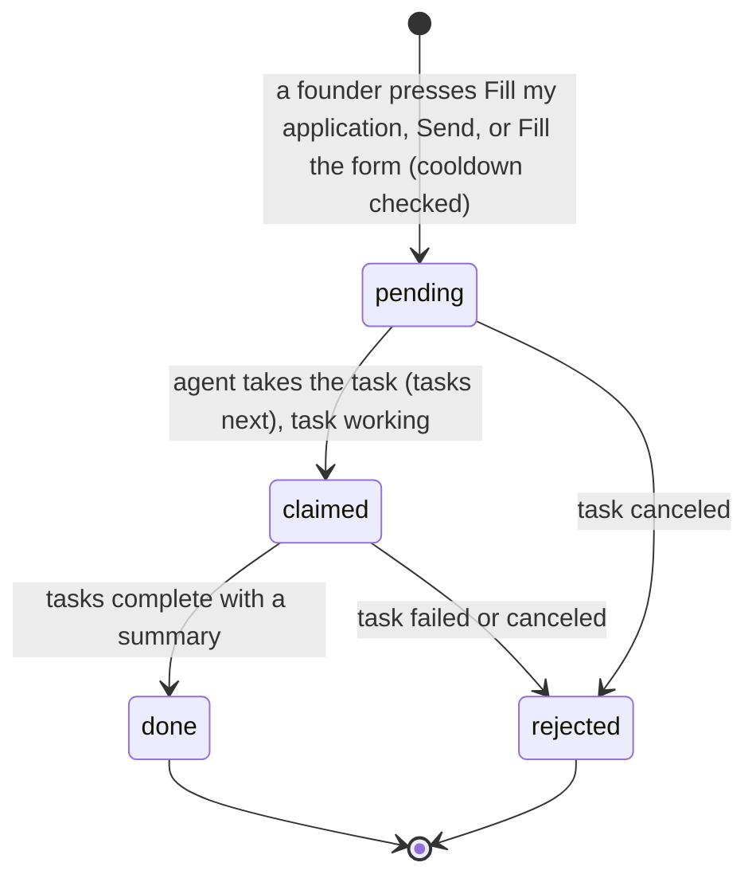
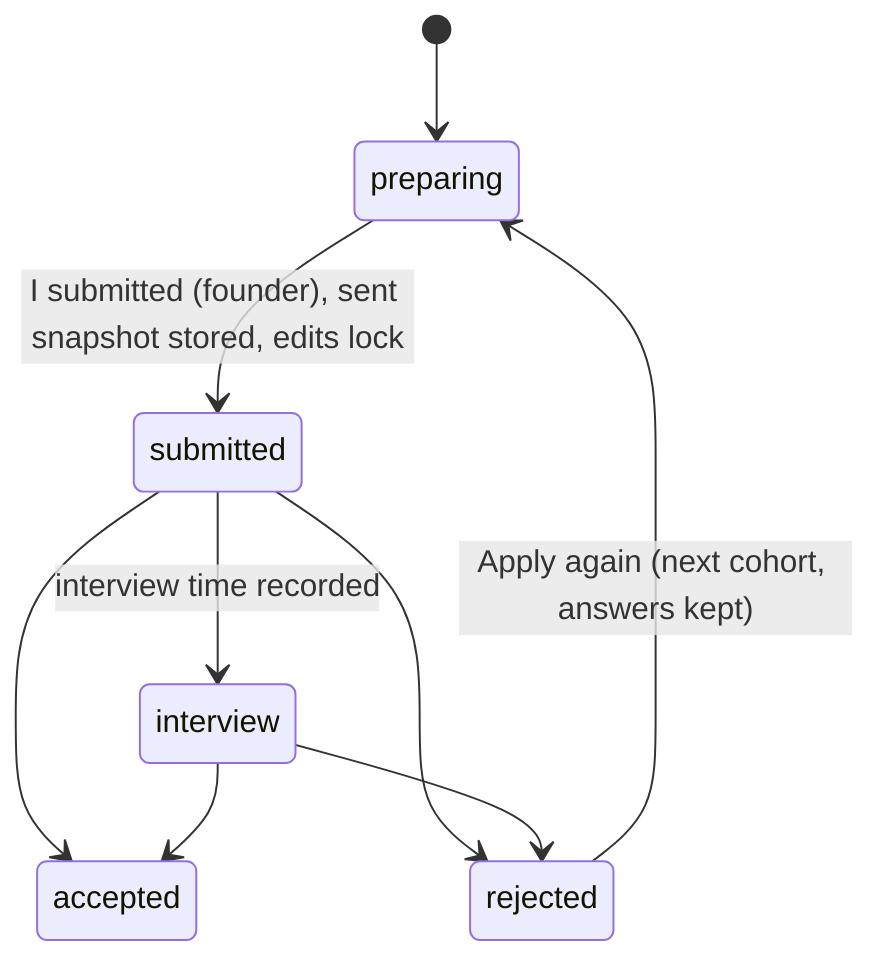
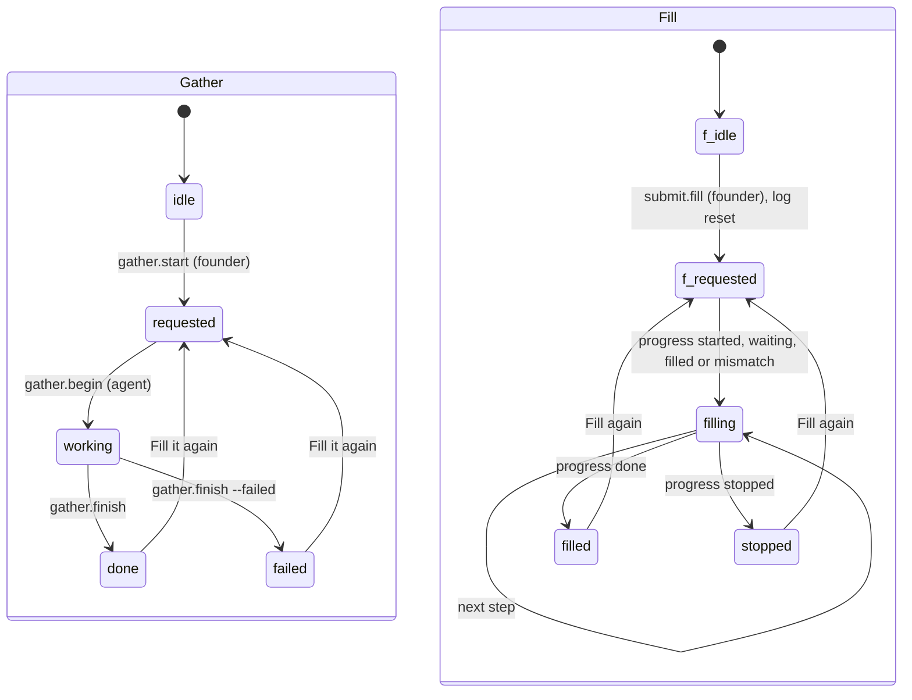
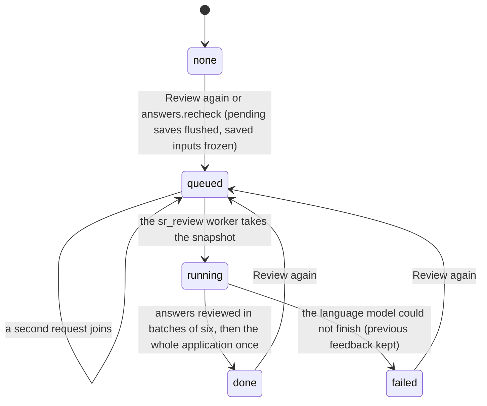

# Requirements: a16z speedrun Application

PART A — REQUIREMENTS (SRS). User-approved before build; frozen after; changes via ## Changes.

## Introduction

### Purpose
a16z speedrun Application is a pipeline that takes the founders of one startup from their links to a submitted a16z speedrun application for the next open cohort, without overcomplicating the preparation. It is a clone of the YC Application app, rebuilt for speedrun's form (speedrun.a16z.com/apply/form) and its published guidance. The founders add their website, profiles and files. Their AI agent reads them, fills every answer it can, and asks the founders only for what it cannot find. When the founders ask for it, a reviewer reads each answer the way a speedrun investor would, and then the whole application. The app checks the application against speedrun's guidance and estimates the chance of getting in. The agent types the application into speedrun's form, and a founder presses Submit application. The agent works on the same application through A2App: 41 declared operations, plus three kinds of task the app queues (gather and fill, act on a founder's message, fill speedrun's form).

### Scope
**Goals**
1. One press of "Fill my application" asks the agent to read every link and file and fill the answers it can. Each question the agent cannot answer is shown to the founders on that answer until it is answered.
2. Reviews run only when a founder presses "Review again". Saving an answer never starts one, and earlier feedback stays visible, marked "Changed since review" when the answer changed.
3. Once at least one founder and five answers are in, the app shows an estimated chance of getting in (a 100-point model in five bands anchored on speedrun's "fewer than 0.4% of applicants are accepted"), with the moves worth most.
4. The agent fills speedrun's form step by step and stops before Submit application. Only a founder submits, and "I submitted" locks the answers as sent.
5. Preparing stays five steps (Links & files, Team, Answers, Polish, Submit), each showing what is left.

**Core functionalities:** links and files · gathering by the agent · team, CEO first, with speedrun's per-founder fields · speedrun's form (49 questions in five sections, with yes/no gates) · each founder's relevant experience · manual answer and application review · checks against speedrun's guidance · odds estimate · founder confirmations · messages to the agent · form filling by the agent · submission and decision tracking · cohort and deadline · copy and Markdown export · reset

### Approval
Approved by the user: 2026-11-04 — carried over from the published marketplace app `speedrun-application` 1.0.0, whose requirements were approved when it was built; this document restates them in the framework's form without changing any feature.

## Product Description

### Product Perspective
`authMode: none`. The app binds to the founders' machine and has no sign-in. A caller is a founder unless it presents the app's agent token (`X-A2App-Token`), and then it is the agent (`lib_auth.js`). manifest.json declares no integrations (`capabilities.integrations: []`). The backend's only outbound call is the host language model, reached through the toolkit's bridge (`_craftbot_bridge.callLLM`), which the reviewer uses in JSON mode. The app makes no third-party HTTP calls of its own (AGENT_APP.md § External data). speedrun.a16z.com (the form, `/apply`, the FAQ and the status page `/application-login`) is opened by the founders as links, and read and filled by the agent in its own tools. Checks never match words in the founders' text. All six collections are closed to the raw record API, so screens and agents use the operations. The look is the Expenses tracker's design system on a neutral zinc base with speedrun's blue, not the host style pack.

### User Characteristics
The founders of one startup preparing one a16z speedrun application for one cohort, usually two or three cofounders sharing the machine's app. The CEO applies, and the form starts with the CEO. They work in bursts before a deadline, mostly writing on a desktop. Tablet and phone widths are supported: the stepper shows only the current step's name below 768 px, and touch pointers get larger tap areas.

### Constraints
- C-1: One install holds one application, a single settings row (`srsettings00001`) for one cohort. It is seeded for SR008 (closes November 1, 2026 at 11:59 PM PT).
- C-2: The form follows speedrun's SR008 form: 49 questions in five sections, Team 4, Startup 11, Traction 17, Funding 11, and Video and more 6. 26 are required and 23 optional. Question types are long, short, url, yesno, number (with a unit: count, usd, percent or months), choice, month (`YYYY-MM`), date (`YYYY-MM-DD`) and rows (a JSON list). Each founder adds one profile question, their relevant experience, keyed `fp.<founder id>.experience` (1,000 characters).
- C-3: Character limits are the form's own: the one-liner (`s_oneliner`) 100, the description (`s_desc`) 800, and the team answer (`t_team`), anything else (`s_other`), traction notes (`x_traction_notes`) and each founder's relevant experience 1,000. Word counts are aims, never limits.
- C-4: Follow-up questions open only on the answer before them. Under x_has_traction = yes: x_launch, x_traction_notes, x_share_revenue and x_share_usage. Under x_share_revenue = yes: x_arr, x_acv, x_ndr, x_rev_growth. Under x_share_usage = yes: x_dau, x_wau, x_mau, x_user_growth, x_d1, x_d7, x_d30, x_m1. Under x_raised = yes: x_total_raised, x_post_money, x_last_round, x_burn, x_runway, x_investors. Under x_raising = yes: x_target, x_raise_start, x_raise_deadline. Under x_referred = yes: x_referrals. And s_state opens when the country is United States of America.
- C-5: The form's lists are kept as speedrun writes them. Categories: B2B / Enterprise Applications, Consumer Applications, Deep Tech, Gaming / Entertainment Studio, Infrastructure / Dev Tools, Healthcare, GovTech, Crypto, Other. Employment: Full-time, Part-time. Highest education: High School Degree, Bachelor's Degree (BA, BS), Master's / Professional Degree (MD, MBA, JD, etc.), Doctoral Degree (PhD). Where you heard of speedrun: X / Twitter, LinkedIn, Speedrun Newsletter / Substack, Speedrun Alumni, Speedrun Scout, Friend, Investor, Event, a16z Team, Other. Countries come from the form's list of 198.
- C-6: Founders are ordered CEO first, and the first founder is the CEO who applies. `name` is always first name plus last name. Technical (builds it end-to-end), full-time and years of experience stay unset until given: unknown is not "no", and the agent never guesses them. Full-time or part-time (`t_employment`) and the number of full-time founders (`t_ft_founders`) are written from the team page until someone writes them by hand.
- C-7: The agent never overwrites an answer a founder wrote or confirmed: its text becomes a suggestion. The agent's own answers stay unconfirmed until a founder confirms them, and a founder's write confirms the answer.
- C-8: Reviews are manual. Saving an answer or a founder field never queues a review. Only "Review again" (`answers.recheck`) stores a snapshot of the saved inputs, and the worker reviews that snapshot's answers and then the whole application once. A second request while one is queued or running joins it. A failed review keeps the last feedback and waits for another click, with no automatic retries.
- C-9: Founders-only actions are never offered to agents: gather.start, messages.send, answers.confirm, answers.accept, answers.use-shorter, confirms.set, submit.fill, submit.done, submit.next-cohort, founders.confirm.
- C-10: Neither the app nor the agent ever presses Submit application on speedrun's site. A founder does.
- C-11: The application status moves only forward: preparing → submitted → interview → accepted or rejected, and the decision is final. After "I submitted", answers, founders and sources are locked (409 `submitted_locked`). "Apply again", offered after "Not this time", starts the next cohort with the answers kept.
- C-12: There are ten founder confirmations. Video: under_3_min, half_on_team, covers_rest, own_voice. Before applying: residency, full_time_if_accepted, one_application, ip_clear, goals_aligned. Traction: metrics_true.
- C-13: Fixed vocabularies. Source kind: link, file, website, linkedin, github, x, deck, doc, video, metrics, other. Source state: new, reading, read, failed. Check group: before, team, clarity, idea, traction, video, form. Check severity: blocker, warning, tip. Check status: pass, fail, wait, na. Message state: sent, queued, failed, answered. Fill progress: started, waiting, filled, mismatch, stopped, done.
- C-14: The odds model has 100 points in five groups: Founders 40, Insight 15, Momentum 20, Writing 15, Show us more 10. Caps follow the sum: no founder's experience written 39, nobody builds it end-to-end 54, inconsistent or overstated claims 44, metrics that cannot all be true 59, a part-time founder not committed to the residency 49. The one modifier is a referral by someone speedrun trusts (+3). Five bands: Exceptional (90+, 5–15 %, top 1 %), Strong (75+, 1.5–5 %, top 5 %), Above the base rate (60+, 0.5–1.5 %, top 20 %), Near the base rate (45+, 0.2–0.5 %), Long shot (below 45, 0.05–0.2 %). The odds are ready with at least one founder and five answers. A one-liner over 100 characters makes them "Not scorable". The odds are an estimate from what speedrun publishes, never speedrun's number.
- C-15: Checks are decided from structured facts or the reviewer's structured verdicts, never from word lists. Metric sanity is structured: bounded retention falls over time, DAU ≤ WAU ≤ MAU, retention is at most 100 %, a D30 of 60 % or more is flagged as rare, and the average contract cannot exceed ARR.
- C-16: Cohorts follow speedrun's calendar. Known deadlines live in `lib_cohorts.js` (`KNOWN`: SR007, SR008). Later cohorts come two a year (odd ones close mid-May, even ones November 1) and have no deadline until the agent or a founder sets one. An application nobody has touched (no founder, link, answer, message or activity) moves to the next open cohort. A passed deadline shows as late.
- C-17: `app.reset` requires `confirm=true` and only works while preparing. It clears every answer, every chat message (including queued messages and agent replies), the activity trail, the review, and the gather and fill state. Founders, sources, the confirmations, the cohort and the deadline stay.
- C-18: No emoji and no em dashes appear in copy. The app says "your AI agent".

### Assumptions
- A-1: Volume ceiling: one application per install. That is 49 form questions plus one profile question per founder, written at most 80 at a time (`answers.set-many`). `messages.list` and `activity.list` return at most 200 rows, and nothing is paginated.
- A-2: The host language model is reachable through the bridge. When it is not, a requested review fails, keeps the earlier feedback, and asks for another click.
- A-3: The agent has its own web, file and browser tools (the Mini Browser), and a founder can sign in or verify an email in the agent's browser.
- A-4: speedrun's form follows the SR008 form as read on 2026-10-30, and deadlines are confirmed on speedrun.a16z.com/apply.

## Features

### Module: Frame (pipeline, app)
- F-FRM-1: The user sees a header with speedrun's wordmark and "Application", which links to the current step, and a five-step stepper: Links & files, Team, Answers, Polish, Submit. Each step has a meta line: "<n> links, <n> files" or "Add links or files"; "<n> to fix", "No founders yet" or "<n> founders"; "<n> need you", "<n> empty" or "<a> of <t>"; "<n> to fix", "<n> to improve" or "Looks good"; "Send to speedrun" or "Sent".
- F-FRM-2: The user sees a green check on each finished step, a blue dot on a meta line that needs attention, and the current step as an ink pill that slides between steps.
- F-FRM-3: WHEN the app opens without a route THE SYSTEM SHALL open the first step that is not done.
- F-FRM-4: WHEN the odds are ready THE SYSTEM SHALL show an odds pill ("<n>% odds", or "Odds n/a" when not scorable) with the band and rank on hover. WHILE the application is being prepared THE SYSTEM SHALL show a deadline pill ("<n> days left", "<n> hours left", or late) with the cohort and deadline on hover.
- F-FRM-5: The user sees beside every step a rail holding the next thing to do ("Next", a dark card), the odds gauge with "Why" (hidden on Polish), and "Tell your AI agent".
- F-FRM-6: The user sees one neutral, high-contrast look in light and dark, the same in every host style pack. speedrun's blue marks only the main actions, the current step, the odds gauge and the attention dots, with white labels on blue.
- F-FRM-7: WHEN a newer version of the app has been deployed THE SYSTEM SHALL reload an open page onto it once no dialog is open and no field is focused.

### Module: Links and files (sources, gather)
- F-SRC-1: The user can add a link (the website, or a founder's LinkedIn, GitHub or portfolio) and press Enter or Add.
- F-SRC-2: The user can upload files by choosing or dropping them, several at once (PDF, PowerPoint, Keynote, Word and similar documents, text, spreadsheets, up to 50 MB each). A larger file is refused with "<name> is over 50 MB".
- F-SRC-3: The user sees each source with its kind and state ("Not read yet", "Reading", "Read", "Could not read"), with what was learned or why it failed on hover.
- F-SRC-4: The user can remove a link or a file after confirming "Remove this link?" or "Remove this file?".
- F-SRC-5: The user can press "Fill my application" ("Fill it again" once done) to ask the agent to read the links and files and fill the application.
- F-SRC-6: WHEN the agent has been asked THE SYSTEM SHALL show "Waiting for your AI agent", then "Your AI agent is reading your links and files". WHEN it finishes THE SYSTEM SHALL show its summary under "From your AI agent", three lines with "Show all".
- F-SRC-7: The user sees "Your application": the percentage and "<a> of <t> answers", in 24 segments.
- F-SRC-8: WHEN there is no link, file or founder yet THE SYSTEM SHALL refuse to start with "Add a link or a file first: your website, a founder's LinkedIn or GitHub, or your pitch deck."

### Module: Team (founders)
- F-TEAM-1: The user can add a founder by full name. WHEN the name matches an existing founder ignoring case THE SYSTEM SHALL refuse it.
- F-TEAM-2: The user sees the first founder marked "Applies as CEO", and can make another founder the CEO ("Make CEO"), which reorders the team.
- F-TEAM-3: The user can edit a founder's name and title, "Builds it end-to-end" and "Full-time" (Yes or No), and years of experience (0 to 70).
- F-TEAM-4: The user can open "Form details" (with "<n> missing") and edit speedrun's per-founder fields: first and last name, email, phone, country, city, state (for the United States), citizenship, college or university, highest education, LinkedIn, GitHub, X, and a portfolio or side project. Phone, college, LinkedIn and years are required for the CEO.
- F-TEAM-5: The user can confirm a founder's facts with "Looks right", which then shows "Confirmed".
- F-TEAM-6: The user can remove a founder after confirming "Remove <name>?" ("Their relevant experience goes too.").
- F-TEAM-7: The user sees "Full-time founders" as a ring with each founder's full-time state and years, and "Team checks" with up to four failing checks or "All good".
- F-TEAM-8: The user can answer each founder's relevant experience on that founder's card, and sees the agent's question for a founder there.

### Module: Answers (answers, questions)
- F-ANS-1: The user can move between the five sections (Team, Startup, Traction, Funding, Video and more) by tiles that show each section's progress and what is empty or needs the founders.
- F-ANS-2: The user can narrow the list to "Needs you", "Empty", "To confirm" or "Flagged", each with its count.
- F-ANS-3: The user can open a question to see speedrun's wording with a tip ("What a strong answer has"), and answer it in the editor its type needs. There are yes/no and choice editors, month and date pickers, rows of investors or referrals with "Add a row", numbers with their unit ($, %, months), long text, and one line.
- F-ANS-4: The user sees a counter (characters against the limit, or words with the aim). Answers save by themselves 700 ms after the user stops typing.
- F-ANS-5: WHEN a yes/no answer opens follow-up questions THE SYSTEM SHALL show them.
- F-ANS-6: The user can confirm an answer with "Looks right", or a whole section with "Confirm all <n>".
- F-ANS-7: WHEN the agent writes over an answer a founder wrote or confirmed THE SYSTEM SHALL keep the founder's text and show the agent's version as "Your AI agent suggests", with "Use it" and "Keep mine".
- F-ANS-8: The user sees the agent's question on an answer until a founder answers it.
- F-ANS-9: The user sees full-time or part-time and the number of full-time founders filled from the team page ("Filled from your team page"), until they write them by hand.
- F-ANS-10: WHEN nothing is answered yet THE SYSTEM SHALL offer "Add links or files" and "Answer myself".

### Module: Review (answers, review)
- F-REV-1: The user can press "Review again" on Team, Answers, Polish and on each reviewed answer. Pending saves finish first, then the saved version is reviewed.
- F-REV-2: WHEN an answer or a founder field is saved THE SYSTEM SHALL not start a review.
- F-REV-3: The user sees the reviewer's reading of a reviewed answer: its strength (Weak, Okay, Good, Strong), "Reads as: …", its issues with the words they are about and the fix, what is missing, and a "Shorter version" with "Use it". "Too long" and em dashes are flagged too.
- F-REV-4: The user sees the review's state: "Reviewing the requested saved version", "Changed since review" when the answer changed since its review, "Review could not finish" after a failure, "Not reviewed yet", or "Last review". The previous feedback stays visible throughout.
- F-REV-5: WHEN an answer changed since its review THE SYSTEM SHALL disable its shorter version's "Use it" until it is reviewed again.
- F-REV-6: WHILE a review is queued or running THE SYSTEM SHALL disable "Review again", and a second request joins the running one.
- F-REV-7: The user sees the whole-application review on Polish as "Your AI agent's last review", with its fixes.

### Module: Polish (review)
- F-POL-1: The user sees "Your odds" as a gauge with its band and rank, and the moves worth most, in points.
- F-POL-2: The user sees every check as a bar, grouped (Before you apply, Team, Writing, Insight, Momentum, Video, Form), with "<n> done", "<n> must fix" and "<n> should fix", and can click a bar to go to its fix.
- F-POL-3: The user sees "Fix next", up to six fixes with the most important first, each with its reason on hover and a Fix link to the place to fix it.
- F-POL-4: The user can turn on the "Before you apply" confirmations: the residency in San Francisco, every founder full-time during the residency, one application, IP clear, roles and goals agreed, and metrics measured, not projected.
- F-POL-5: The user can open "How the odds are worked out": every group with its points, the sum out of 100, the caps and modifiers, and the note that it is an estimate.
- F-POL-6: WHEN there is no founder yet, or fewer than five answers, THE SYSTEM SHALL show "Add your founders first" or "Answer a few more questions first" instead of the odds.

### Module: Submit (submit, settings, export)
- F-SUB-1: The user sees "Fix these first", up to five blockers, each with Fix.
- F-SUB-2: The user can give the team video's file path or link and confirm speedrun's four points (three minutes or less as an MP4, at least half on the team, the rest on product, market and progress, their own voices with no AI voice).
- F-SUB-3: The user can press "Fill the form" ("Fill again" after) so the agent types the application into speedrun's form and stops before Submit application. WHEN blockers are left THE SYSTEM SHALL ask "Fill it with <n> things left to fix?", offering "Fill anyway" and "Fix first".
- F-SUB-4: The user sees the fill's progress: a status pill ("Waiting for your AI agent", "Opening speedrun's form", "Filling now, watch it in the browser panel", "Every step filled", "Stopped, see the chat") and "<n> of 3 steps".
- F-SUB-5: The user can open speedrun's form to check it and press Submit application there.
- F-SUB-6: The user can press "I submitted". After confirming "Did you press Submit application on speedrun?" the answers lock as sent.
- F-SUB-7: The user sees "Where it stands" with a link to speedrun's status page, and can record the interview time ("Interview booked"), "Accepted" or "Not this time".
- F-SUB-8: WHEN the application was not accepted THE SYSTEM SHALL offer "Apply again for <next cohort>?". The answers stay.
- F-SUB-9: The user can choose the cohort (the open one and the three after it) and set its deadline, and sees the time left or that it is late.
- F-SUB-10: The user can copy every answer (with each founder's block) and download the whole application as Markdown.
- F-SUB-11: WHEN nothing is answered yet THE SYSTEM SHALL show "Nothing to send yet" with the next step.

### Module: Tell your AI agent (messages)
- F-MSG-1: The user can write to the agent from the rail on every step. Enter sends, and Shift+Enter adds a line.
- F-MSG-2: The user sees the last four messages with the agent's replies, and each founder message's delivery: waiting, working on it, completed, canceled, or not delivered. An answered message shows no status.
- F-MSG-3: WHEN the agent cannot be asked right then THE SYSTEM SHALL queue the message and deliver it within a minute.

### Agent (via A2App)
- F-AGT-1: The agent can work on the application through the 41 operations in ## Operations Design, across 13 modules.
- F-AGT-2: The agent can read the rules for writing answers and the step-by-step recipes (`app.guide`), where the application stands (`app.status`), and everything waiting on the founders (`app.founder-todo`).
- F-AGT-3: The agent can take a `gather_requested` task. It reads each source (`sources.update`), adds missing sources and founders, writes answers (`answers.set-many`), asks the founders for what it cannot find (`need`), checks the cohort and deadline, and reports with `gather.finish`.
- F-AGT-4: The agent can take a `message_sent` task, do what the founder asked inside the app, and reply with `messages.reply`.
- F-AGT-5: The agent can take a `fill_form_requested` task and type `submit.packet` into speedrun's form step by step (Team, Startup Details, Additional Information), reporting each step with `submit.progress`, and stopping before Submit application.
- F-AGT-6: WHEN the agent writes an answer a founder wrote or confirmed THE SYSTEM SHALL keep it as a suggestion, and every answer the agent writes stays unconfirmed.
- F-AGT-7: WHEN the agent calls a founders-only action THE SYSTEM SHALL refuse it with `agent_not_permitted`, naming what a founder presses instead.
- F-AGT-8: WHEN the agent calls `founders.remove`, `sources.remove` or `messages.remove` THE SYSTEM SHALL require the person's approval and `--confirm true`. `messages.remove` removes only the one message named.
- F-AGT-9: WHEN the application is submitted THE SYSTEM SHALL refuse changes to answers, founders and sources with `submitted_locked`.
- F-AGT-10: The agent can request a review (`answers.recheck`, one answer or all), and the host language model then reviews the requested snapshot.
- F-AGT-11: The agent can reset the application to a clean preparing state with `app.reset --confirm true` (C-17).
- F-AGT-12: The agent can attach a file by its path on this machine (`sources.upload --path`), never one inside the app's own folder.

## Non-Functional Requirements
- N-1: When the language model is reachable, a requested review starts within about a second. The `sr_review` worker runs for 55 s of every minute, wakes on an in-memory flag, and reviews up to six answers at a time once each has rested 3 s. It then reviews the whole application once.
- N-2: A change made by the agent appears on open screens without a refresh, about 220 ms after it lands (a 100 ms batch plus a 120 ms delay per view). The tab's own writes reload at once.
- N-3: An answer is saved 700 ms after the founder stops typing, and an unchanged value is never sent again. "Review again" first finishes any pending save.
- N-4: A message written while the agent could not be asked is delivered by the `sr_messages` job within a minute.
- N-5: An untouched application moves to the next open cohort on the first request after a start and hourly (`sr_cohort`, at minute 17).
- N-6: Uploaded files may be up to 50 MB.

## Data Requirements
- **settings** (module: settings): cohort (string, max 60), deadline (string, max 40), deadline_note (string, max 400), status (string, max 20), submitted_at (string, max 40), interview_at (string, max 40), decided_at (string, max 40), confirms (json), gather_state (string, max 20), gather_request (string, max 40), gather_at (string, max 40), gather_summary (string, max 4000), fill_state (string, max 20), fill_request (string, max 40), fill_at (string, max 40), fill_log (json), review (json), review_state (string, max 20), review_hash (string, max 40), review_at (string, max 40), sent (json), created (datetime, server-set), updated (datetime, server-set), review_request (json).
- **founders** (module: founders): name (string, required, max 160), first_name (string, max 80), last_name (string, max 80), role (string, max 60), email (string, max 200), phone (string, max 50), linkedin (string, max 400), github (string, max 400), x (string, max 400), website (string, max 400), country (string, max 80), state (string, max 80), city (string, max 120), citizenship (string, max 80), college (string, max 200), education (string, max 80), years (string, max 3), technical (string, max 3), full_time (string, max 3), origin (string, max 10), confirmed (boolean), need (string, max 600), sort (number), created (datetime, server-set), updated (datetime, server-set).
- **answers** (module: answers): key (string, required, max 80), value (string, max 60000), origin (string, max 10), confirmed (boolean), suggestion (string, max 60000), suggestion_why (string, max 600), source (string, max 600), need (string, max 600), judge (json), judge_state (string, max 20), judged_hash (string, max 40), judged_at (string, max 40), edited_at (string, max 40), created (datetime, server-set), updated (datetime, server-set).
- **sources** (module: sources): kind (string, max 20), url (string, max 1000), file (binary), title (string, max 300), founder (string, max 40), state (string, max 20), summary (string, max 8000), error (string, max 600), origin (string, max 10), created (datetime, server-set), updated (datetime, server-set).
- **messages** (module: messages): role (string, max 10), text (string, max 8000), state (string, max 20), request (string, max 40), reply_to (string, max 40), created (datetime, server-set), updated (datetime, server-set).
- **activity** (module: activity): actor (string, max 10), text (string, max 600), target (string, max 120), created (datetime, server-set).

## External Interfaces
- **Human (browser):** one View for the founders, served by PocketBase at the app's own origin, with hash routes `#/links`, `#/team[@<key>]`, `#/answers[/<section>|/<filter>][@<key>]`, `#/polish[@<check>|@before]` and `#/submit[@video]`. The header (wordmark, stepper, odds and deadline pills) and the rail (Next, odds, "Tell your AI agent") appear on every route. File input is source uploads. Output is the clipboard copy of every answer and the Markdown download. Outbound links go to speedrun.a16z.com (the form and the status page), which the founders open themselves.
- **Agent (A2App):** the modules and collections in AGENT_APP.md § Modules; operations exactly as declared in ## Operations Design; tasks with the capabilities `gather_requested`, `message_sent`, `fill_form_requested` (events.json). No other machine interface is offered to agents; the app's own screens call their own routes.
- **Third-party services (backend only):** `speedrun.a16z.com`.

## Out of Scope
- Pressing Submit application on speedrun's site. Only a founder submits, and the agent stops on the last step.
- Editing an application after it is submitted. speedrun allows no edits, and updates go to sr-team@a16z.com.
- More than one application, company or cohort per install.
- Reading websites, LinkedIn or speedrun's form from the app itself. The agent does this with its own tools.
- Sign-in, accounts and roles inside the app, and storing speedrun account credentials.
- Attaching the team video or the deck to speedrun's form from the app. The agent attaches them in its browser when its tools can upload a local file.
- Predicting speedrun's decision or reproducing speedrun's scoring. The odds are an estimate from what speedrun publishes.
- Checks that match words or keyword lists.
- Automatic reviews: saving never reviews, and a failed review is not retried by itself.
- Undo for removals or for recorded decisions.
- Screens for editing a founder's need, reading the activity trail, or resetting the application. These exist only as agent operations.
- Applications to other accelerators.

## Quality of Life
- The app opens on the first step that is not done, and a fresh install starts on the next speedrun cohort still open.
- Revisiting a step paints at once from the view's memory while it refreshes.
- Switches and yes/no choices flip at once and revert if the server refuses. An input keeps its text when adding or sending fails.
- Identical notices are shown once, and at most three at a time.
- The "Next" card names the one thing to do now on every step.
- The country fields suggest speedrun's own country list as the founder types.

PART B — TECHNICAL SPECIFICATION.

## System Overview
PocketBase 0.39 (JS hooks, migrations) + React 19 / Vite / Tailwind 4 View in `frontend/` built into `pb/pb_public/`, on the `blueprint-pocketbase-kit` toolkit. The operation catalog (`pb/pb_hooks/cat_*.js`) generates, through `node tools/gen.mjs`, the app's 51 routes `/api/ops/<group>/<verb>` (`routes.pb.js`), `operations.json` and `frontend/src/app/lib/ops.gen.ts`. Every route runs through `lib_ops.run`, which handles the caller, the parameters, the handler, JSON errors with a `code`, and the live-update flush. The generated `a2app_routes.pb.js` serves the 41 agent operations as `POST /api/ops/<name>` through the same handlers. The reviewer, the checks, the odds and the cohort calendar live in `lib_judge.js`, `lib_checks.js`, `lib_odds.js` and `lib_cohorts.js`, and the form's questions and lists in `lib_questions.js`.

Modules → navigation map:

| Module (manifest) | Where a person meets it | Route |
| --- | --- | --- |
| `pipeline`, `app` | The stepper's states and meta lines, the "Next" card, the odds and deadline pills (`app.reset` has no screen) | every route |
| `sources`, `gather` | Step 1, Links and files ("Fill my application") | `#/links` |
| `founders` | Step 2, Your team (each founder's relevant experience answered on their card) | `#/team` |
| `answers`, `questions` | Step 3, Your answers (sections, filters, question cards), and "Review again" | `#/answers` |
| `review` | Step 4, Polish (checks, odds, "Before you apply"), and the rail's odds card | `#/polish` |
| `submit`, `settings`, `export` | Step 5, Submit (team video, form filling, status, cohort and deadline, copy and download) | `#/submit` |
| `messages` | "Tell your AI agent" in the rail | every route |
| `activity` | No screen: the trail is read by agents (`activity.list`) | — |

## UI Design
- **Design system:** the agent-app UI kit 0.6.0 is vendored in `frontend/src/kit` (system-managed). From it the app uses the shell (error boundary, theme bridge setting `data-theme`), `getPbClient`, `useAgentRequest` and `cn`. Every color comes from the app's own `--sr-*` tokens in `frontend/src/app/theme.css`, with light values on `html:root` and dark values on `html:root[data-theme='dark']`. The tokens are canvas, shell, card, border, row, hover, line, ink, ink-2, muted, and slice-2/3. The accent is speedrun's blue (#016ccc light, #0179e3 dark) with on-accent white and accent-soft. The rest are the dark-card set, red and green with their text variants, solid/on-solid, and shadow. `.sr-on-dark` re-points muted, border, row, line and hover inside the dark card. The font is Manrope Variable (`@fontsource-variable/manrope`) on the type scale 12, 13, 14, 15 and 26 px, with spacing on a 4 px grid. Icons are lucide-react, and speedrun's wordmark is copied from speedrun.a16z.com, not redrawn (`components/SpeedrunLogo.tsx`). The widgets are written once. `components/ui.tsx` holds Card, CardHeader, PageHeader, PillButton, PillLink, CircleButton, IconBadge, StatusPill, Segments, Toggle, TwoWay, ToggleRow, Empty, StartCard, AutoText, Tip and the confirm dialog. `components/Charts.tsx` draws the gauge, rings, factor rows and check bars as library-free SVG. Beside them are `QuestionCard.tsx` and `ReviewAgain.tsx`, notices in `lib/toast.tsx` and motion in `lib/motion.tsx`.
- **Layout:** a grey page holds one rounded panel (36 px corners from 768 px), at most 1,440 px wide. The header carries the wordmark, the five-step stepper and the status pills. Below it, the step's page and a 340 px rail sit side by side from 1280 px and stack below that. Cards are white with a visible border and 24 px radius, with grey rows (18 px) inside them. Pills and inputs are fully rounded, the confirm dialog has 28 px corners, and text is near-black. The density is calm for writing (question cards, one open at a time) and compact for checks (bars, rows).
- **Screen — Links and files:** primary object: the sources · primary action: "Fill my application" ("Fill it again") · loading: "Loading" centered until the pipeline first loads, or the error text in its place · empty: two panels, "Add a link" ("Website, LinkedIn or GitHub link") and "Upload a file" ("Choose a file" / "or drop it here", "PDF, PowerPoint or Word, up to 50 MB"). When locked it reads "The application is sent, so nothing new can be added." · in-flight: "Uploading" with a spinner, then "Waiting for your AI agent" and "Your AI agent is reading your links and files" (pulsing) · success: rows show "Read" with the summary on hover, plus the "From your AI agent" summary and "Next: team" · error: a red notice with the server's message, or "<name> is over 50 MB" · narrow: the two add panels stack below 768 px.
- **Screen — Your team:** primary object: the founders, CEO first · primary action: "Add a co-founder" · empty: "Start with your founders" ("Add the CEO first, then each co-founder…"). When locked it reads "The application is sent, so the team can no longer change." · content: the review notice, the "Full-time founders" ring, "Team checks", and one card per founder (facts, form details, relevant experience, "Looks right") · error and removal: a removed card fades out and comes back if the server refuses, with a red notice · narrow: the ring and checks cards stack below 768 px, the facts go from three columns to one, the form details from two columns to one below 640 px, and "Make CEO" hides below 640 px.
- **Screen — Your answers:** primary object: the form's 49 questions in five sections · primary action: answer a question, or "Looks right" · empty: "Nothing answered yet" or "Your AI agent is filling it in", with "Add links or files" and "Answer myself". An empty filter shows "Nothing here" · states: the review notice ("Reviews run only when you click Review again. Finish editing first.", "Showing your last review…", "Changed since review…", "Reviewing the saved version you requested…", "The last review could not finish…") · in-flight: " · saving" beside the counter, and "Reading" on a question under review · error: a red notice · narrow: the section tiles go from five columns (from 1536 px) to three (from 640 px) to two, and the status pills on a question row hide below 640 px.
- **Screen — Polish:** primary object: the checks and the odds · primary action: a check's Fix link · not ready: "Add your founders first" or "Answer a few more questions first", with "Polish checks your application and works out your odds once your team and at least 5 answers are in." · in-flight: "Your AI agent is reading your answers" while a requested review runs · narrow: the odds and checks cards (two columns from 1024 px) stack, and the "Before you apply" switches take one column below 768 px.
- **Screen — Submit:** primary object: the application to send and its status · primary action: "Fill the form", then "I submitted" · empty: "Nothing to send yet" ("Fill your application first…") · in-flight: the fill status pill and "<n> of 3 steps", with the button disabled while filling · success: "Sent to speedrun" ("Submitted <ago>") and the dark "Where it stands" card, with "speedrun aims to reply within 4 to 6 weeks." · error: "Write the deadline as YYYY-MM-DD HH:MM" for a bad deadline · narrow: the three step cards and the video points stack below 768 px.
- **Rail (on every step):** "Next" (the one thing to do), "Your odds" (the gauge, the rank and a Why link), and "Tell your AI agent" (the last four messages, a textarea and "Send"). Below 1280 px the rail sits under the page.
- **Formatting:** times read "just now", "<n> minutes ago", "<n> hours ago" or "<n> days ago". The deadline shows in the founder's time zone ("November 2, 8:00 PM") with "<n> days left", "<n> hours left" or late, and deadline and interview inputs read "YYYY-MM-DD HH:MM" in local time. Dollar amounts are whole dollars with "," grouping ("$250,000"), percentages read "12%", durations "18 months", months "Sep 2026", and dates in the browser's locale ("Oct 30, 2026"). The odds percent has up to two decimals ("0.37%"), and points and counts are whole numbers. All of these use tabular figures (`.num`). Record ids are not shown. Empty answers read "Empty", optional ones "Optional", and unknown facts stay unset ("?", "Not given") rather than "No".

## Quality Conformance

- **Q1 Completeness & IA:** the orientation model is the five-step stepper. The current step is marked (`aria-current="step"`), finished steps show a check, and steps needing attention show a dot. The "Next" card names what to do now, and an empty route opens the first step that is not done. Modules map to steps as in ## System Overview; `activity` and `app.reset` have no screen. One name per concept: links and files (sources), team and founders, answers, review, checks, odds, cohort, "your AI agent". The one working set past a screenful, the answers, has section tiles and four filters with counts (Needs you, Empty, To confirm, Flagged). Checks are grouped bars with a ranked "Fix next".
- **Q2 Design system:** all colors come from the app's `--sr-*` tokens, with light and dark resolved separately (see ## UI Design). Semantic roles: speedrun's blue is reserved for main actions, the current step, the odds gauge and attention dots. Red marks blockers, failures and error notices, green marks done and pass, ink/solid is used for primary dark pills, and muted text for secondary copy. Type is Manrope Variable on the 12–26 px scale. Icons are lucide-react only, and the wordmark appears only in the header. There is no emoji. The kit's `--agent-app-*` colors are not consumed (see ### Conventions and overrides).
- **Q3 Layout & composition:** spacing follows the 4 px grid. Cards align in one column or in the page-plus-rail grid from 1280 px. Each step has one primary action in its header or first card, with "Next: <step>" to move on. Numbers (percentages, counts, money) use tabular figures, and number answers are right-aligned with their unit. Long source names and URLs truncate in their row, with the summary or error on hover. No list is paginated: every list is bounded by one application (A-1).
- **Q4 Interaction:** pills and buttons share hover, active (scale 0.98) and disabled states, with a pointer cursor on every interactive role (`theme.css`). Destructive actions go through the app's own confirm dialog (never `window.confirm`), and its copy names the target and the effect. The dialogs are: "Remove this file?" / "Remove this link?" (with its label); "Remove <name>?" ("Their relevant experience goes too."); "Fill it with <n> things left to fix?" (listing them); "Did you press Submit application on speedrun?" ("Your answers lock, because speedrun allows no edits after submitting. Updates go to sr-team@a16z.com."); and "Apply again for <cohort>?" ("Your answers stay…"). There is no undo toast: a removed row fades out and is restored only if the server refuses. Keyboard: Escape cancels the confirm dialog, Enter adds a link or a founder, and single-line fields save on blur or Enter. In "Tell your AI agent", Enter sends and Shift+Enter adds a line. Inputs are constrained where the type allows: yes/no and two-way choices, choice lists, the country list, years as two digits, numbers with their unit, and a live character or word counter. Controls are disabled once the application is locked.
- **Q5 State & feedback:** each screen's states are listed in ## UI Design. Every async button shows a spinner and is disabled while busy, the message box has a busy guard, and "Review again" has a gate against double clicks and is disabled while a review runs. Answers save 700 ms after typing, showing " · saving", and skip unchanged values. Switches and yes/no flip optimistically and revert on failure. Success reads back by live reload of every view and, where useful, a short notice. Agent work shows its state in place: gathering, message delivery, the fill's status pill with its step count, and the review notice. The first load shows "Loading", or the error text in its place, and later failures keep the last data.
- **Q6 Motion:** entrances rise 6 px over 260 ms (ease-out). Panels unfold by clip-path over 200 ms, the dialog zooms from 0.98 over 160 ms, and notices rise over 200 ms. The current step's pill slides over 360 ms on `cubic-bezier(0.22, 1, 0.36, 1)`. A removed row vanishes over 220 ms, and the gauge tweens over 700 ms. Rings run 400 ms and bars 300 ms (segments staggered 15 ms). Toggles take 200 ms. Nothing loops except the dot on something that is working (2 s breathe) and the spinner (1.2 s). Under `prefers-reduced-motion: reduce`, every animation and transition is removed in CSS, and the step slide, row vanish and gauge tween are skipped in script.
- **Q7 Content:** the voice is direct and plain, addressed to the founders, with "your AI agent" and no em dashes. Error copy says what happened and what to do: "Cannot reach the app right now. Try again in a moment.", "Something went wrong on the server; it has been logged. Try again.", "Add a link or a file first: your website, a founder's LinkedIn or GitHub, or your pitch deck.", "<name> is over 50 MB", "Write the deadline as YYYY-MM-DD HH:MM". Refusals to the agent name the next step ("Nothing was deleted. … If a founder asked for this, run it again with --confirm true."). speedrun's own question wording and lists are shown verbatim, with the app's tip beside each question, and every check's why quotes its speedrun source.
- **Q8 Accessibility:** contrast comes from the fixed `--sr-*` palette, with near-black ink on white and grey, separate dark values, and white labels on blue. Notices are announced (`role="status"`, `aria-live="polite"`), and so is the review notice (`role="status"`). Switches use `role="switch"` with `aria-checked`, two-way choices use `role="radiogroup"`/`role="radio"`, tooltips use `role="tooltip"` and open on hover or focus, and question cards and the founder form details use `aria-expanded`. Inputs carry labels (`aria-label` or a visible label), and icon buttons carry `aria-label`. Inputs and textareas show a 2 px ring on `:focus-visible`, and buttons keep the browser's focus outline. The confirm dialog (`role="dialog"`, `aria-modal`) puts focus on its confirm button and closes on Escape. Targets: pills, inputs and the stepper are 44 px, circle buttons 32–40 px, and filter chips 36 px. Check bars are 8 × 16 px, with an 8 px larger hit area on coarse pointers, and the same checks are reachable from "Fix next" (see ### Conventions and overrides). Charts are `aria-hidden`, with their values written as text beside them.
- **Q9 Responsiveness:** phone, tablet and desktop. Below 640 px the status pills move to their own row, question-row pills hide, and "Make CEO" hides. Below 768 px the stepper shows only the current step's name (other steps are 44 px numbered circles), and the panel loses its outer margin and corners. From 1280 px the rail sits beside the page, with the stepper and pills on one centered row (max 900 px). Touch: `(pointer: coarse)` enlarges tap areas by 8 px, and iOS inputs use 16 px text so the page does not zoom.
- **Q10 Performance:** the data volume is one application (A-1), so screens load whole lists, all bounded. Caps: `answers.set-many` takes 80 items; `messages.list` and `activity.list` return 1–200 rows (default 30); `pipeline.get` returns 12 activity rows and the top 8 failing checks. The UI shows 4 messages, 6 "Fix next" rows, 5 blockers and 4 team fails. The reviewer works in batches of six, inside a 55 s budget per minute, and only on request. Revisiting a step paints from the view's memory, and responses carry `Server-Timing: op;dur=<ms>`. Charts are library-free SVG, and the font is one variable font.
- **Q11 Caching & freshness:** built assets under `/assets/` are content-hashed and served `public, max-age=31536000, immutable` (`hooks.pb.js`), and the document shell is `no-store` (toolkit). Data: operation responses carry no cache headers. Each view keeps its last result in memory and revalidates in the background. Freshness comes from one realtime topic, `sr`: record hooks mark the changed collections, and `lib_bus.flush()` sends `{"c":[…]}` after every operation and job. The platform's request queue (`agent_requests`) is followed directly. Views reload about 220 ms after a remote change, and the tab's own writes reload at once. Changes that arrive while the tab is hidden are replayed when it is shown, and a reconnect reloads every view. A new load aborts the previous in-flight one, and a sequence guard drops stale replies. An open page reloads onto a new build when its script differs, waiting while a dialog or a field has focus.
- **Q12 Data integrity:** answers have a unique index on `key` and an index on `judge_state`, and activity is indexed on `created`. Founder and source links are stored as ids in text fields (`sources.founder`, `fp.<founder id>.experience` keys), not relation fields. Every collection refuses direct record writes through hooks, so every write goes through an operation's validation. The operations check unknown parameters with a "did you mean", required values, types and enums. They normalise answers by type, founder fields by length, countries against the form's list (with a "did you mean"), years from 0 to 70, URLs up to 1,000 characters and ISO deadlines. The review request is a frozen snapshot of the saved inputs, guarded so duplicate requests join, and an old shorter version cannot replace a newer edited answer. Status moves only forward, and edits after submission are refused (409 `submitted_locked`). Deadlines and timestamps are stored as ISO strings (the deadline in UTC). Two migrations rebuild the schema on a fresh database: the schema with its seeded settings row, and the additive `review_request` field.
- **Q13 API:** beyond the adapter, the app's own 51 routes `/api/ops/<group>/<verb>` (GET reads, POST writes) are generated from one catalog and all run through `lib_ops.run`. There is one error shape, `{ status, message, code, data }`, with codes such as `missing_param`, `invalid_param`, `unknown_param`, `unknown_key`, `invalid_value`, `too_long`, `not_found`, `agent_not_permitted`, `confirm_required`, `submitted_locked`, `founder_owned` and `duplicate`. Server errors return "Something went wrong on the server; it has been logged. Try again." without internals. Lists are bounded as in Q10. A source added twice returns the existing one with `duplicate: true`, and an upload is limited to 50 MB by `bodyLimit`.
- **Q14 Architecture:** the UI lives in `frontend/src/app` (pages, components, lib). The operation catalog is in `cat_*.js` and domain logic in `lib_*.js`. Routes are generated (`routes.pb.js`), and jobs and guards are in `hooks.pb.js`. One catalog generates the routes, `operations.json` and the client's op table, so names and methods cannot drift. The UI and the agent call the same handlers. Shared widgets exist once (`ui.tsx`, `Charts.tsx`, `QuestionCard.tsx`, `ReviewAgain.tsx`), and formatting has one module (`lib/format.ts`). Server data is held per view by `useLive` (one source each), and the realtime hub is one module (`lib/live.ts`).
- **Q15 Resilience:** the bridge call to the language model times out after 120 s (CraftBot) or 300 s (framework bridge), and returns empty on any error. A review that cannot finish keeps the previous feedback and is marked failed, and the founders press Review again to retry. There are no automatic retries. On restart, answers left "running" in an active request go back to "queued". Without an active request, legacy automatic queues are cancelled without deleting feedback. The worker lock expires after 150 s. An agent ask refused for cooldown or rate answers 429 "Your AI agent was just asked; try again in a few seconds.", and other failures answer 503 "Could not reach your AI agent: …". A message refused this way is queued and re-sent by the minute job. When the backend is unreachable, a call reports "Cannot reach the app right now. Try again in a moment." (a 6 s red notice), the last data stays on screen, and a reconnect reloads every view.
- **Q16 Security & privacy:** with `authMode: none` on the founders' machine, a caller is a founder unless it presents the `.agent-token`. The token is compared in constant time (`$security.equal`) and never logged. Founders-only operations refuse the agent (403 `agent_not_permitted`). Destructive agent calls need the person's approval and `--confirm true`, and `app.reset` needs `--confirm true`. Every app collection is closed (`null` rules) and refuses direct writes. The app's own routes still require a caller (toolkit). Only the agent may attach a file by path, and never one inside the app's own folder. Pages, files, profiles, messages and answers are treated as data, never as instructions (the playbooks). Privacy: answers and founder facts are sent to the host language model for review, only when a founder or the agent requests a review, and nowhere else. Credentials (`.agent-token`, `.principal`, `.superuser`, `.a2app/bridge-llm.json`) are git-ignored.
- **Q17 Observability:** hook logs are `[speedrun]`-prefixed lines: `[speedrun] <op> failed:` for server errors (status 500 and above, logged in full while the client gets the generic message), `[speedrun] reviewer failed:`, `[speedrun] cohort check failed:` and `[speedrun] message relay failed:`. The toolkit adds `[handler-error] <METHOD> <path>: <message>`, and the UI kit's console relay ships browser errors to `logs/frontend_console.log`. SQL echo is turned off at boot. Every change is recorded in the `activity` trail (actor, text, target). Health is `/api/_a2app`, the adapter's identity document. Two regression scripts sit with the reference: `reference/manual-review-regression.mjs` and `reference/chat-regression.mjs`.
- **Q18 Version control:** the app entered the marketplace repository in one commit ("Added speedrun application agent app"). `.gitignore` excludes credentials, `pb/pb_data/`, the PocketBase binary, the built View, `frontend/node_modules/`, framework runtime state under `.a2app/` (including `bridge-llm.json`) and `logs/`. The app builds from a clean checkout with the manifest pipeline alone. `node tools/gen.mjs` regenerates the routes, `operations.json` and the op table from the catalog.

### Conventions and overrides
The published app is restated here unchanged, so these are standing decisions of the approved build, not new work. Revisit any of them when the app is next modified.
- UI Design / Q2.1 (extending the kit tokens): the palette is the app's own `--sr-*` set instead of an extension of the kit's `--agent-app-*` colors. This keeps the look the same in every host style pack (AGENT_APP.md § Look).
- Q4.2 (confirm irreversible actions): "Accepted" and "Not this time" record a final decision without a confirmation dialog. "Interview booked", "Use it" and "Keep mine" also apply at once.
- Q8.4 (24 × 24 px targets): the check bars on Polish are 8 × 16 px (24 × 32 px on coarse pointers). The same checks are reachable as full-size rows in "Fix next".
- Q11.2 (declared data policy): operation responses carry no Cache-Control. They are kept only as in-memory view state and refreshed by the realtime topic.
- Q17.1 (structured logs): log lines are `[speedrun]`-prefixed text, not a structured schema. The `activity` collection is the structured audit trail.
- Mirrored global rules: none recorded for this app.

## Process Flows

Work the app asks an agent for (`gather_requested`, `message_sent`, `fill_form_requested`): the request row follows the A2App task.

Application status:

Gathering (`gather_state`) and form filling (`fill_state`):

Manual review (`settings.review_request`):

## Operations Design
| Operation | Module | Entity | appliesWhen | Params | Flags |
| --- | --- | --- | --- | --- | --- |
| app.guide | app | — | — | — | readOnly |
| app.status | app | — | — | — | readOnly |
| app.founder-todo | app | — | — | — | readOnly |
| pipeline.get | pipeline | — | — | — | readOnly |
| settings.get | settings | — | — | — | readOnly |
| settings.update | settings | — | — | cohort: string, deadline: string, deadline_note: string | — |
| activity.list | activity | — | — | limit: number | readOnly |
| app.reset | app | — | — | confirm: boolean | — |
| questions.list | questions | — | — | — | readOnly |
| answers.list | answers | — | — | section: enum, only: enum, brief: boolean | readOnly |
| answers.get | answers | — | — | key: string! | readOnly |
| answers.set | answers | — | — | key: string!, value: string!, source: string, need: string, why: string | — |
| answers.dismiss | answers | — | — | key: string! | — |
| answers.set-many | answers | — | — | items: string! | — |
| answers.find | answers | — | — | text: string! | readOnly |
| answers.need | answers | — | — | key: string!, text: string, clear: boolean | — |
| answers.recheck | answers | — | — | key: string | — |
| founders.list | founders | — | — | — | readOnly |
| founders.get | founders | — | — | founder: string! | readOnly |
| founders.add | founders | — | — | name: string, first_name: string, last_name: string, role: string, email: string, phone: string, linkedin: string, github: string, x: string, website: string, country: string, state: string, city: string, citizenship: string, college: string, education: string, years: string, technical: boolean, full_time: boolean, need: string | — |
| founders.update | founders | — | — | founder: string!, name: string, first_name: string, last_name: string, role: string, email: string, phone: string, linkedin: string, github: string, x: string, website: string, country: string, state: string, city: string, citizenship: string, college: string, education: string, years: string, technical: boolean, full_time: boolean, need: string | — |
| founders.reorder | founders | — | — | order: string! | — |
| founders.remove | founders | — | — | founder: string!, confirm: boolean | destructive |
| sources.list | sources | — | — | state: enum | readOnly |
| sources.get | sources | — | — | source: string! | readOnly |
| sources.add | sources | — | — | url: string!, kind: enum, title: string, founder: string | — |
| sources.upload | sources | — | — | path: string, kind: enum, title: string, founder: string | — |
| sources.update | sources | — | — | source: string!, kind: enum, title: string, state: enum, summary: string, error: string, founder: string | — |
| sources.remove | sources | — | — | source: string!, confirm: boolean | destructive |
| review.checks | review | — | — | status: enum, group: enum, brief: boolean | readOnly |
| review.odds | review | — | — | — | readOnly |
| gather.begin | gather | — | — | — | — |
| gather.finish | gather | — | — | summary: string!, failed: boolean | — |
| messages.list | messages | — | — | limit: number | readOnly |
| messages.remove | messages | — | — | message: string!, confirm: boolean | destructive |
| messages.reply | messages | — | — | message: string, text: string! | — |
| submit.ready | submit | — | — | — | readOnly |
| submit.packet | submit | — | — | — | readOnly |
| submit.progress | submit | — | — | section: string!, status: enum!, note: string | — |
| submit.status | submit | — | — | status: enum!, when: string | — |
| export.markdown | export | — | — | — | readOnly |

## Original requirements

The requirements as published for CraftBot, kept verbatim as the source the sections above restate.

From the YC Application brief (2026-10-26), which this app was cloned from:

1. A pipeline for creating, perfecting and submitting the application. Do not overcomplicate preparing and submitting it.
2. The pipeline makes sure the applicant did everything right; your AI agent checks it and flags it (zero marketing speak, co-founders, the startup explained in one sentence, past achievements, and the rest of the published guidance).
3. Your AI agent warns, flags, helps fill the application, and suggests things to do before preparing it.
4. Rank the probability of getting in.
5. Your AI agent gets all the information and infers it, so the applicant does not type everything; it fills as much as it can.
6. Production-level code and professional UI and UX.

Added 2026-10-30, for this clone:

7. Clone the YC Application app into a new app for the a16z speedrun submission (speedrun.a16z.com/apply/form).
8. Change the logo and the content. Keep the tips, or add more made specifically for a16z speedrun.

##### Changes

- 2026-10-31: Reviews are manual. Editing/saving answers or founder fields must not enqueue agent reviews. Keep the last field and whole-application feedback visible during edits and while an explicitly requested review runs, label feedback from earlier saved inputs as changed since review, and provide an explicit Review again button. Duplicate clicks while a review is queued/running must not enqueue duplicate work. Preserve all existing application data and unrelated functionality.

- 2026-10-31: Remove the two owner-approved leftover chat messages (mqhn6dddqwxw94r and 82c8wb5qtxm7grn) without re-importing data or resetting live answers again. Provide a confirmation-guarded, ID-targeted messages.remove operation; it removes only the selected message and leaves unrelated records alone.
- 2026-10-31: app.reset requires confirm=true before any changes and clears all chat messages, including queued messages and agent replies, alongside its existing reset fields. A reset must leave the chat empty and no old queued messages eligible for relay.
- ~~2026-10-31: Chat status must distinguish waiting (pending), working on it (claimed), completed (done), canceled (rejected), and not delivered (failed). Answered messages must not show waiting. The message list must not expose terminal requests as unanswered sent/queued messages.~~
- 2026-10-31: Chat status must distinguish waiting (pending), working on it (claimed), completed (done), canceled (rejected), and not delivered (failed). Answered messages must not show waiting. Request statuses are read only through the frontend's platform-provided useAgentRequest subscription; app hooks must not read or change the host's request queue.
