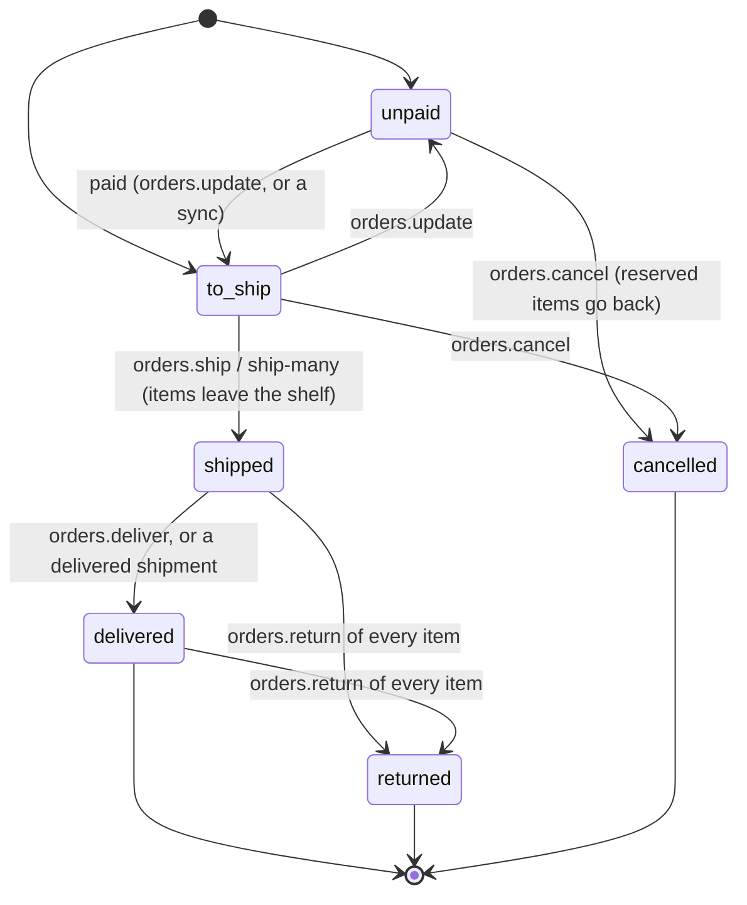
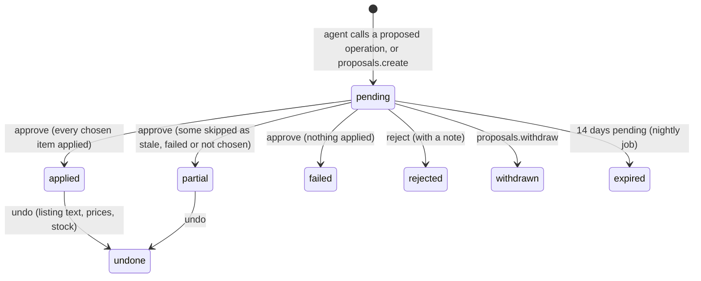

# Requirements: Store OS

PART A — REQUIREMENTS (SRS). User-approved before build; frozen after; changes via ## Changes.

## Introduction

### Purpose
Store OS is a multichannel e-commerce back office for one seller who runs one or several online shops across platforms (Shopify, WooCommerce, Shopee, Lazada, TikTok Shop, Amazon, eBay, Etsy and more), used in the browser with no accounts or sign-in. Its one job is to run every shop from one place. The seller opens new shops with a setup checklist or adds the ones already running. They keep one catalog with a listing per shop, feed every shop from one stock ledger, and work every order, parcel and buyer message from every shop in one queue. Sales and profit show by shop in the base currency. The seller's AI agent works on the same data through A2App, through the same operations the screens call. It syncs shops, writes listings, drafts and sends buyer replies, checks tracking and helps set shops up. Its listing, price, stock and order changes wait in Approvals unless the seller set that kind of change to automatic. The app hands it one piece of work at a time, each kind through its own trigger naming the record, when the seller asks (or an automatic request they switched on applies).

### Scope
**Goals**
1. A shop can be added on any of 16 platforms in three steps. A shop being opened gets its platform's setup checklist, with links to the platform's own sign-up and seller-centre pages, and becomes active when every step is ticked.
2. Every order from every shop lands in one queue with its ship-by clock. Shipping an order in Store OS takes its items off the shelf through one stock ledger, and importing the same order export twice changes nothing.
3. Every listing is checked against its platform before it goes live (title limit, price, pictures, SKU, description, price below cost, live without stock), and a changed live listing shows that its changes are not on the shop yet.
4. A change the AI agent makes to listing text and price, SKU prices, stock or orders waits in Approvals unless the seller set that kind to automatic. Each change is checked again on approval, and listing text, prices and stock can be undone after approval.
5. Overview shows net sales, orders, profit and margin across every shop in the base currency, against the period before.

**Core functionalities:** shops on 16 platforms · setup checklists · one catalog with a listing per shop · pre-flight listing checks · stock ledger with a stock rule per shop · one order queue across shops · shipments and tracking · buyer inbox with reply clocks and drafts · customers across shops · approvals with undo · overview and profit report · seller-centre file imports · exchange rates · buyer-data purge · full export · agent chat and tasks

### Approval
Approved by the user: 2026-11-04 — carried over from the published marketplace app `store-os` 1.0.0, whose requirements were approved when it was built; this document restates them in the framework's form without changing any feature.

## Product Description

### Product Perspective
`authMode: none`. Store OS is for one seller: one settings row holds the business, base currency, country and time zone, and there are no accounts or sign-in. It serves on loopback, and its own operation routes still require a caller (the View or the agent's credential). manifest.json declares no integrations (`capabilities.integrations: []`). The backend alone calls two keyless exchange-rate services: currency-api on jsDelivr (`cdn.jsdelivr.net/npm/@fawazahmed0/currency-api`) first, then the European Central Bank's rates through Frankfurter (`api.frankfurter.dev`). The app deliberately has no connection of its own to any platform and never holds a platform password or key. Shop data reaches Store OS three ways: the AI agent reads and writes the shop with its own tools (its integrations, or the seller centre in its browser) through the operations; the seller imports seller-centre exports (CSV or Excel); or the seller adds orders by hand (AGENT_APP.md § External data). No platform's API can open a seller account (identity, bank and tax checks happen on the platform's own pages). So the setup checklist links to those pages and records what is done (`lib_platforms.js`). Every collection is closed to the raw records API, and screens and agents change data only through the operations. The look follows the two reference designs the seller gave, the look only and never their content (Original requirement 3).

### User Characteristics
One seller (with an optional own name the greeting uses) who runs shops on marketplaces, on their own online stores, and through direct sales by chat, social media or in person. They work on a desktop with the full sidebar (from 1024 px), and on tablets and phones, where the sidebar opens from a menu button and tables become stacked lists. Touch input gets larger tap areas. The work follows each shop's clocks: a ship-by time counted in days ("Ship within") and a reply deadline counted in hours ("Reply within").

### Constraints
- C-1: Money is stored as integers in minor units. Product prices and costs are in the base currency; a listing's price is in its shop's currency; an order's amounts are in the order's currency, and its cost of goods in the base currency. Operation parameters take major units ("59.90", not 5990).
- C-2: The base currency is set once on the first screen. The Settings screen locks it once any product exists, and the server refuses a change once any SKU has a price or a cost ("the base currency cannot change once products have prices").
- C-3: Exchange rates are one table of today's rates against the base currency, from currency-api, else the European Central Bank through Frankfurter. An amount whose currency has no rate is left out of a total and counted, never guessed.
- C-4: The platforms are fixed: Shopify, WooCommerce, Shopee, Lazada, TikTok Shop, Amazon, eBay, Etsy, Tokopedia, Zalora, Rakuten Ichiba, Yahoo! Shopping, Walmart Marketplace, Mercado Libre, Direct and Other. A shop's country is one of 26 countries, and a currency one of 28. Firm title limits are checked only where known (Shopify 255, Amazon 200, Etsy 140, Shopee 120, eBay 80 characters); a limit of 0 means the title length is not checked.
- C-5: Exactly one Direct shop exists (seeded: active, orders added by hand, ship within 2 days, reply within 24 hours, shows 100 % of available stock). It cannot be deleted, and no second one can be added. Shop names are unique ignoring case.
- C-6: Order status is one of unpaid, to_ship, shipped, delivered, returned, cancelled, and moves only forward when orders are brought in again. By hand, status changes only between unpaid and to_ship. Payment is one of paid, pending, cod, refunded, partial_refund. Only an order that has not shipped can be cancelled, and only a shipped or delivered order can have returns.
- C-7: On hand changes only through a stock move, whose reason is one of opening, received, sale, return, adjust, damage, count, and each move keeps the balance after it. Reserved stock is what open orders (unpaid or to ship) hold; available is on hand minus reserved. Shipping an order in Store OS records a sale move; an order that arrives already shipped moves no stock.
- C-8: A shop shows floor(available × its share % ÷ 100) minus its hold-back, never below 0, and at most its "at most" (0 means no limit).
- C-9: Profit = net sales (items − discount + shipping charged − refunds) − platform fees − the seller's shipping cost − cost of goods. Fees are estimated from the shop's fee rates (commission %, payment fee %, fee per order) until real fees are given. Each order line keeps the unit cost it sold at, and a cost added later fills in lines that sold without one.
- C-10: Ship-by comes from the shop's days to ship unless the platform gave a date. An order is late past its ship-by and due soon within a day of it. A shipment with no new tracking event for 7 days is stalled.
- C-11: A buyer message starts the shop's reply clock (its "reply within" hours), and an answer stops it.
- C-12: A buyer is one customer across shops when the email matches, else the phone number (at least 7 digits), else the name within one shop.
- C-13: A SKU is unique ignoring case; a product has at most one listing per shop; an order number is unique within its shop.
- C-14: A product holds at most 12 pictures of up to 10 MB each, as JPEG, PNG, WebP, GIF or AVIF files (the screens' copy names JPG, PNG and WebP). A new product has at most three options and 100 SKUs.
- C-15: The kinds of change the AI agent may make on its own are listings, prices, stock, replies and orders, each "ask" (the default) or "auto". The proposed operations are listings.draft, variants.set-price, stock.adjust, stock.count, orders.cancel, orders.refund and orders.return. Cancelling, refunding and returning orders cannot be undone; listing text and price, SKU prices and stock changes can (stock by an opposite move). A pending proposal expires after 14 days.
- C-16: Guards: a proposed price drop larger than the largest price drop (default 30 %) is high risk, and the minimum margin (default 0 %) flags prices below it.
- C-17: Addresses and phone numbers of orders delivered, cancelled or returned more than the buyer-data period ago (default 30 days, 7 to 3650) are removed every night. Names, emails and the orders themselves stay.
- C-18: Work for the AI agent is a task of one of ten kinds: sync, publish, push_stock, setup_help, prepare_listing, draft_reply, send_reply, tracking, exception, chat. Each kind has its own trigger (events.json): shop_sync_requested, setup_help_requested, listing_prep_requested, listings_publish_requested, stock_push_requested, reply_draft_requested, reply_send_requested, tracking_check_requested, order_exception and question_asked, each with its own params (the record it is about) and cooldown (10 to 30 s). One fire is one piece of work. A task's state is asked (fired, or not sent), working, done, failed or cancelled, and a record has at most one open task of a kind.
- C-19: Seeds: one settings row (`storesettings01`) with no business and no base currency, every kind of change on "ask", guards 30 % and 0 %, buyer data kept 30 days, low-stock level 5; and the Direct shop. Nothing else is seeded.
- C-20: The copy has no emoji and no em dashes, and it calls the agent "your AI agent". Platform marks come from Simple Icons, with the platform's initial where none is published.

### Assumptions
- A-1: Volume ceiling: 1,000 SKUs. The Stock view loads up to 1,000 SKUs at once (`stock.overview` answers at most 1,000). The catalog list shows up to 500 products, and search finds the rest. Orders and customers load 100 more rows at a time as the list scrolls, at most 500 per call.
- A-2: The machine running the app is the seller's own. The screens keep the store's UTC offset equal to the time zone set in Settings (or the device's clock), so reports count the seller's own days.
- A-3: A platform's real fees, tracking events and buyer messages reach Store OS only when the AI agent syncs them or the seller imports or types them. Until then profit uses estimated fees.

## Features

### Module: Frame
- F-FRM-1: On wide screens (from 1024 px) the seller can reach every page from a sidebar. It holds the "Store OS" mark with the business name; "Main menu" with Overview, Orders, Products, Inbox, Customers and Approvals; the shops as a tree ("Shops", with "All" and a "+" to add a shop); and Settings at the bottom.
- F-FRM-2: The seller sees live counts in the menu: orders to ship on Orders (red when any are late), open messages on Inbox (red when any are overdue), and waiting approvals on Approvals.
- F-FRM-3: The seller sees each shop in the tree with its platform mark, its orders to ship, and a status dot with its meaning on hover. The dot shows that your AI agent is working on it, that orders are late to ship, that the shop is setting up (with its steps done), paused, or active.
- F-FRM-4: The seller can collapse the sidebar to an icon rail with tooltips, and the choice is remembered.
- F-FRM-5: Below 1024 px the seller can open the sidebar as a drawer from the "Menu" button, and it closes on navigation.
- F-FRM-6: The seller sees a top bar with search ("Search orders, products, buyers", Ctrl K), today's date, a bell "What needs you" and "Ask your AI agent", which shows a dot while tasks are in progress. The bell counts approvals, overdue messages and late orders, and opens Approvals. A store menu holds Settings, All shops and Your AI agent's tasks.
- F-FRM-7: WHEN the host switches between light and dark mode THE SYSTEM SHALL switch the app between its light and dark palettes.
- F-FRM-8: The seller sees the agent called "your AI agent" everywhere, no emoji, and platform marks from Simple Icons (the platform's initial where none is published, a shopping bag for Direct).
- F-FRM-9: WHEN a newer build of the app is served THE SYSTEM SHALL reload an open page onto it after the server comes back or when the tab is shown again, waiting while a dialog is open or a field has focus.
- F-FRM-10: WHEN the app cannot load its settings or shops THE SYSTEM SHALL show "Store OS cannot reach its data" with the reason.

### Module: Set up (settings, platforms)
- F-ONB-1: WHEN the store has no base currency THE SYSTEM SHALL show "Set up your store" in place of every page. It asks for the business name (required), the seller's name, the country and the base currency.
- F-ONB-2: WHEN the seller picks a country THE SYSTEM SHALL preselect its currency. The base currency field notes "Cannot change once products have prices".
- F-ONB-3: WHEN the seller continues THE SYSTEM SHALL save the business, store the browser's time zone and mark the store onboarded.
- F-ONB-4: WHEN the only shop is Direct THE SYSTEM SHALL show "Add your first shop" on Overview, with "Add a shop", "Take a direct order" and up to seven platforms that sell in the seller's country.

### Module: Overview (app, reports)
- F-OVR-1: The seller sees a greeting by time of day with their name and "Here is what is happening across your store / your shop / your N shops today", with "New order" and "Add shop".
- F-OVR-2: The seller sees four figures for the chosen range, each against the period before: Net sales (the orange highlighted card), Orders (with units sold), Profit (with the average order, or the orders missing a cost) and Margin (its change in points, with what was refunded).
- F-OVR-3: WHEN profit leaves something out THE SYSTEM SHALL mark the Profit figure with a warning. The warning names the orders with a product that has no cost, the share of fees estimated from shop fee rates, and the orders without the seller's shipping cost.
- F-OVR-4: The seller sees the "Sales report" line chart across every shop and can switch it between Net sales, Profit and Orders. Net sales shows the previous period dashed, and hovering shows a dark tooltip with that day's orders. The ranges are 7d, 30d, 90d and 12m (by month for 12m), and the choice is remembered.
- F-OVR-5: The seller sees "Needs you", each line with its count and a link to the list behind it. The lines are: orders to ship (late or due today), buyer messages (overdue or drafts ready), approvals, delivery problems, waiting for payment, listing issues, low or out of stock, stock to set on shops, products missing a cost and order lines without a SKU. It shows "All clear" when nothing waits, and a link to the open tasks with your AI agent.
- F-OVR-6: The seller sees "Recent orders" from every shop (order, item, date, total, shop, status), and each row opens its order.
- F-OVR-7: The seller sees "Best sellers" for the range as a carousel of product pictures (arrows, dots and swipe), with units sold and net sales.
- F-OVR-8: The seller sees "Sales by shop": stacked bars of each shop's net sales over the range, and per shop its orders, margin, sparkline, net sales and change.
- F-OVR-9: WHEN orders are in a currency with no exchange rate today THE SYSTEM SHALL leave them out of the totals and say how many.

### Module: Shops (shops, platforms)
- F-SHP-1: The seller can add a shop in three steps. They choose the path (open a new shop, or add a shop they have) and the platform (16 platforms, searchable, those selling in the seller's country first). Then they enter the details: shop name, country, currency, shop link and how orders come in.
- F-SHP-2: WHEN a shop name equals another shop's ignoring case THE SYSTEM SHALL refuse it ("You already have a shop with this name").
- F-SHP-3: WHEN the seller opens a new shop THE SYSTEM SHALL give it its platform's setup checklist. A marketplace gets: create the seller account, verify identity and business, add a payout account, choose couriers and shipping, write return and shipping policies, list the first products, choose how orders come into Store OS. An own store gets: create the store, turn on payments, set shipping zones and rates, write policies, add the first products, remove the password and launch, choose how orders come in. Direct gets: decide how buyers pay you, write return and delivery policies.
- F-SHP-4: The seller sees each setup step with its explanation and ticks it done or not done. A step can have an "Open" link to the platform's own sign-up or seller-centre page for the shop's country, and "Ask your AI agent" on the steps the agent can help with.
- F-SHP-5: WHEN every step of a shop being opened is done THE SYSTEM SHALL make the shop active ("Setup done. The shop is open").
- F-SHP-6: The seller sees every shop as a card on Shops. It shows the platform, country and status (Setting up, Active, Paused), how its data comes in and when it last did, orders to ship, late orders, open messages, live listings, setup progress and any task your AI agent is on.
- F-SHP-7: The seller sees one shop's page. It holds its figures (to ship, open messages, live listings, all orders), its latest orders, its policies, stock to set (when any), how orders come in, its rules and its details.
- F-SHP-8: The seller can choose how a shop's orders come in: your AI agent syncs it, import files, or add them yourself. The shop's main button follows the choice ("Sync now", "Import orders" or "New order").
- F-SHP-9: The seller can set a shop's fees (commission %, payment fee %, fee per order), its deadlines (ship within days, reply within hours) and the stock it shows (share of available %, hold back, at most), with a live example. Each saves when its field is left. The Direct shop leaves out commission and the stock it shows.
- F-SHP-10: The seller can write a shop's returns, shipping, FAQ and reply-voice text, which your AI agent quotes when it answers buyers, or ask your AI agent to draft them.
- F-SHP-11: The seller can edit a shop's details (name, country, currency, shop link, seller centre), pause or activate it, mark a shop being opened as open, and open its seller centre.
- F-SHP-12: The seller can delete any shop but Direct after confirming and typing its name, and its orders, listings and conversations are deleted too.
- F-SHP-13: The seller can ask your AI agent to sync a shop (its new orders, buyer messages and listings). The shop shows its last sync time and the agent's note.

### Module: Products (products)
- F-PRD-1: The seller sees the catalog with one row per product: its picture, SKUs, price range, stock state, and a mark per shop with that listing's status (Live, Ready to publish, Paused, Draft, or its number of issues).
- F-PRD-2: The seller can filter the catalog by All, Listing issues, Not listed, Low stock, Out of stock, Missing cost, Drafts and Archived (each with its count) and by shop, and search title, SKU and brand.
- F-PRD-3: The catalog loads 100 more products as it scrolls, up to 500, then says "Search to find the rest".

### Module: Product editor (products, variants)
- F-PED-1: The seller can add a product on one page with these cards: details (title, description), media, pricing (price, cost per item, with profit and margin), inventory (SKU, barcode, low-stock alert, weight, opening stock), options, facts, status (Active or Draft), organization (brand, category, tags) and the shops to start a draft listing on. The product is checked and created in one go, and the pictures upload after it.
- F-PED-2: The seller can give a new product up to three options (such as Size, Colour, Material). Their values make up to 100 SKU rows ("Red / M"), each with its own price, cost, SKU and opening stock, and any row can be left out.
- F-PED-3: WHEN a field of a new product is wrong THE SYSTEM SHALL mark it in red and create nothing ("Check the fields marked in red").
- F-PED-4: The seller can edit a saved product field by field, each saved when its field is left. The Variants card edits every SKU in place (option, price, cost, low-stock level), shows on hand, reserved and available, and adds a SKU.
- F-PED-5: The seller can add up to 12 pictures by picker or drop, open them large (arrow keys move between them), make one the cover and remove one.
- F-PED-6: The seller can record product facts (material, size, care) with where each came from. Your AI agent writes listings and answers from them.
- F-PED-7: The seller can make a product draft, active or archived, restore an archived one, and delete it with its SKUs, pictures, stock history and listings (past orders keep their lines).
- F-PED-8: The seller can set a SKU's barcode and weight, and delete a SKU (warned when it is the last one).
- F-PED-9: WHEN a price's margin is below the seller's minimum margin THE SYSTEM SHALL flag the margin on the pricing card.

### Module: Listings (listings)
- F-LST-1: The seller can give a product a listing on any shop ("Add" on the product's Shops card), with its own title, description, price in the shop's currency, keywords and status (Draft or Ready).
- F-LST-2: The seller sees each listing checked against its platform. Blocking issues are: no title, a title over the platform's limit, no price, no pictures, no SKU to sell. Warnings are: no or a very short description, a price below cost, live with no stock available. A clean listing reads "Passes every check for <platform>".
- F-LST-3: WHEN a live listing is changed THE SYSTEM SHALL keep it live and show "Changes not on the shop yet" until it is published again.
- F-LST-4: The seller can ask your AI agent to publish a listing. They can also mark it live (with its listing id and link), pause it, make it live again, and remove it from Store OS (it is not taken off the platform).
- F-LST-5: The seller can ask your AI agent to write listings of a product for chosen shops, with an optional note. Its drafts come back to Approvals.

### Module: Stock (stock)
- F-STK-1: The seller sees every SKU's stock: totals (stock value, SKUs, units on hand, low, out), and per SKU on hand, reserved ("Ordered but not shipped yet"), available, low-stock level and value. The view filters by All, Needs attention, Low and Out, and searches SKU or product.
- F-STK-2: The seller can record stock received, a count, damaged stock, returned stock or an adjustment for a SKU, with a reference or note. Each becomes a move in the SKU's ledger.
- F-STK-3: The seller can open a SKU's history: every move with its reason (Opening stock, Received, Sold, Returned, Adjusted, Damaged, Counted), who made it (You, Your AI agent, Automatic) and the balance after.
- F-STK-4: The seller sees "Set on shops": per shop, the SKUs whose live listing should show a different quantity under the shop's stock rule (available, shop shows now, should show). They can mark them set ("I set them") or "Ask your AI agent to set them".
- F-STK-5: WHEN a SKU's available stock falls to its low-stock level (its own, else the store's) THE SYSTEM SHALL count it as low, and as out at zero or below.

### Module: Orders (orders)
- F-ORD-1: The seller sees every order from every shop in one queue by view: To ship (soonest ship-by first), At risk, Unpaid, Shipped, Problems, SKU not in catalog, Delivered, Returns, Cancelled and All. Each view has its count; the queue has a shop filter and search by order number or buyer.
- F-ORD-2: The seller sees each order's shop, buyer, items, placed time, ship-by clock (tracking on the shipped views), total and status (late orders, delivery problems and parcels with no update say so).
- F-ORD-3: The seller can add an order by hand, in the Direct shop by default or in any shop. It takes items from the catalog or typed in, shipping charged, discount, payment (Paid, Pending, Cash on delivery), status (To ship, Unpaid), the buyer, a delivery address and a note, and is numbered for you or as on the shop.
- F-ORD-4: The seller can select orders and mark them shipped together (carrier and tracking optional, the carriers of the shop's country first). They can also save a pick list CSV of what is still to ship (SKU, title, option, quantity, orders).
- F-ORD-5: The seller can open an order in a side panel. It holds the next actions; ship-by (editable), payment and total; items with their SKU links; money down to profit and margin, with fees and the seller's shipping cost editable (fees estimated until set); the buyer; shipments with tracking events; conversations; a private note; the timeline; and your AI agent's tasks.
- F-ORD-6: The seller can mark an order shipped or delivered, add tracking, record a refund in the order's currency, and record a return per line, optionally putting the items back in stock. They can cancel an order that has not shipped, and its items go back to available.
- F-ORD-7: The seller can link an order line whose SKU is not in the catalog to one of their SKUs; other lines with the same SKU are linked too. Or they can mark the line as not a product (a gift card, gift wrap, a fee) with its cost, which Store OS remembers for later orders.
- F-ORD-8: The seller can ask your AI agent to check an order's tracking or sort out a delivery problem, or to check the tracking of every parcel on its way ("Check tracking").
- F-ORD-9: The seller can delete an order after confirming. Stock already moved stays in the ledger.
- F-ORD-10: WHEN an order is shipped in Store OS THE SYSTEM SHALL take its items off the shelf. An order that arrives already shipped moves no stock.

### Module: Shipments (shipments)
- F-TRK-1: The seller sees each shipment's carrier, tracking number (with copy), link, status, latest event and estimated delivery. The status is one of Waiting for pickup, Label created, In transit, Out for delivery, Ready for pickup, Delivered, Delivery attempt failed, Problem, Returned to you.
- F-TRK-2: WHEN a shipment is recorded as delivered THE SYSTEM SHALL mark its order delivered.
- F-TRK-3: WHEN a shipped order's parcel has a failed delivery attempt, a problem or a return, or no new tracking event for 7 days, THE SYSTEM SHALL list it under Problems.

### Module: Inbox (inbox)
- F-INB-1: The seller sees buyer conversations from every shop by view: Due (soonest reply deadline first), Drafted, Waiting and Closed. There is a shop filter and a search of buyers, orders and text. Each row shows the buyer, shop, subject or last message, reply clock, intent, and the draft or task.
- F-INB-2: The seller sees the open conversation: messages in and out and private notes, with the reply composer below.
- F-INB-3: The seller sees your AI agent's draft, labelled "Draft by your AI agent" with "Why:" and its reasons. They can edit it in place (saved when the box is left) or write their own.
- F-INB-4: WHEN a reply for a marketplace shop has a link, an email address or what looks like a phone number THE SYSTEM SHALL warn before it goes out, because marketplaces penalise them. The conversation's own order and tracking numbers do not count. Any reply over 2,000 characters gets "Long reply: buyers read short answers."
- F-INB-5: The seller can send a reply three ways: copy it and open the shop's seller centre ("Copy and mark as sent" when the shop has none), "Send with your AI agent", or "Mark as sent". A reply sent through the agent shows sending until the agent confirms. The choice is remembered per shop, and the conversation can be closed after sending.
- F-INB-6: WHEN your AI agent cannot send a reply THE SYSTEM SHALL mark the message failed, reopen the conversation, and offer the text to send again.
- F-INB-7: The seller can ask your AI agent to draft a reply, with an optional note, or choose "Draft all with your AI agent" for every open conversation without a draft.
- F-INB-8: The seller can set a conversation's status (Open, Waiting, Closed), link or unlink an order, and add a private note (only the seller and the agent see it). They can also log a buyer message that came by chat, email, WhatsApp, phone or social.
- F-INB-9: The seller sees the buyer panel: the buyer, the linked order with its status and tracking, their other orders, and the shop's policies.
- F-INB-10: WHEN a buyer writes THE SYSTEM SHALL start the shop's reply clock, and an answer stops it.

### Module: Customers (customers)
- F-CUS-1: The seller sees buyers across every shop as one list: customer, contact, orders, spent (base currency) and last order. The list shows All or Repeat buyers and searches by name, email or phone.
- F-CUS-2: WHEN orders share an email, or else a phone number, THE SYSTEM SHALL count them as one customer, even on different shops. Without either, buyers match by name within one shop.
- F-CUS-3: The seller can open a buyer's panel, edit their name, email, phone, tags and private note (each saved when left), and see their orders on every shop and their conversations.

### Module: Approvals (proposals)
- F-APR-1: The seller sees the changes your AI agent proposes as one card per set. Each change shows what it changes before and after, its risk (Low, Medium, High risk), its notes and the agent's reason.
- F-APR-2: The seller can approve all or chosen changes of a set (the rest are rejected), or reject the set with a note for your AI agent.
- F-APR-3: WHEN a set is high risk, or holds a change that cannot be undone (cancelling, refunding or returning an order), THE SYSTEM SHALL ask before approving.
- F-APR-4: WHEN a change is approved THE SYSTEM SHALL check it again first and skip it as stale if what it changes moved since it was proposed.
- F-APR-5: The seller can move between cards with J/K or the arrow keys, approve with A and reject with R.
- F-APR-6: The seller sees History: decided sets with their outcome (Applied, Partly applied, Failed, Rejected, Withdrawn, Expired, Undone). They can undo the listing text, price and stock changes of an applied set; order changes stay.
- F-APR-7: WHEN a proposal has waited 14 days THE SYSTEM SHALL mark it expired.
- F-APR-8: WHEN the agent proposes a price drop larger than the seller's largest price drop, or a SKU price below cost, THE SYSTEM SHALL mark the change high risk. Order changes are always high risk.

### Module: Settings (settings, activity)
- F-STG-1: The seller can change the business name, their own name, the country, the base currency (locked once products exist) and the time zone. Each saves when its field is left.
- F-STG-2: The seller can set, for each kind of change, whether your AI agent asks first ("Ask me": changes wait in Approvals) or acts on its own ("Automatic"). The kinds are listing text and price, SKU prices, stock changes, sending buyer replies, and cancelling and refunding orders. Only the seller can change this.
- F-STG-3: The seller can set the guards: the largest price drop and the minimum margin.
- F-STG-4: The seller can set the store's low-stock level in units; each SKU can set its own.
- F-STG-5: The seller can set how many days buyer addresses and phone numbers are kept after an order is finished (7 to 3650).
- F-STG-6: The seller sees the exchange rates (base currency, date, source, number of currencies) and can refresh them now.
- F-STG-7: The seller can download everything in one JSON file: shops, products, stock, orders, customers and conversations.
- F-STG-8: The seller sees the activity trail: the last 100 changes by you, your AI agent and Store OS, each linking to what it changed.
- F-STG-9: The seller can switch on requests your AI agent gets without a click ("Ask on its own"): a draft when a buyer message comes in, and sorting out a parcel whose tracking turns to a failed delivery, a problem or a return. Both start off, and only the seller can change them.

### Module: Imports (imports)
- F-IMP-1: The seller can import a seller centre's export (CSV, .xlsx or .xls), read in the browser. They choose the shop (needed for orders; optional for products, to record listings on it) and the file, by picker or drop.
- F-IMP-2: WHEN a file is read THE SYSTEM SHALL match its columns to Store OS fields from the usual export headers, and the seller can change each match. Orders cover order, buyer, item, money and delivery fields plus fee columns; products cover product, price and stock fields, and listing fields when a shop is chosen.
- F-IMP-3: The seller can map the file's order statuses to Store OS statuses, or leave rows of a status out. They check a preview of the first rows, then import in batches of 200 rows.
- F-IMP-4: The seller can choose what a product file's stock column does: set stock only for new SKUs, set every count, or ignore stock.
- F-IMP-5: The seller sees the result: new, updated, unchanged (orders) or listed (products on a shop), skipped with each problem, and the lines whose SKU is not in the catalog.
- F-IMP-6: WHEN the same file is imported again THE SYSTEM SHALL change nothing. Orders match on their number in the shop, and products on SKU.
- F-IMP-7: The seller sees a shop's last import, with what it did, under how its orders come in.

### Module: Your AI agent panel (chats, todos, activity)
- F-AGP-1: The seller can tell your AI agent what to do in a chat (where they are in the app goes along as context) and read its replies.
- F-AGP-2: The seller sees every task handed to your AI agent (Sync, Publish listings, Set stock, Setup help, Write listings, Draft a reply, Send a reply, Check tracking, Delivery problem, Your message). Each shows its state (Asked, Working, Done, Could not finish, Cancelled), its note, the status of its request (waiting, taken, done, turned down) and a link to what it is about, and an open one can be cancelled. One that was not sent, not picked up within 24 hours, or left unfinished for 3 hours says so and has a Retry.
- F-AGP-3: The seller sees the store's activity trail in the panel.
- F-AGP-4: The seller sees a task badge wherever work is with the agent ("Your AI agent is on it" while it works).

### Module: Search (app)
- F-SRC-1: The seller can search orders (number, buyer), products (title, SKU, barcode), buyers and conversations at once from the top bar or Ctrl K, from two characters on. Arrow keys and Enter move through and open the results.

### Agent (via A2App)
- F-AGT-1: The agent can perform every declared operation: the 96 operations in ## Operations Design, across the modules app, platforms, settings, activity, shops, products, variants, listings, stock, orders, shipments, inbox, customers, proposals, todos, chats, reports and imports.
- F-AGT-2: The agent can read the rules, the row formats for orders, conversations and products, and a recipe per task kind from `app.guide`, and where the store stands from `app.status`.
- F-AGT-3: The agent can take a request of any of the ten triggers. It opens the work with `tasks.start --request <id>` (the answer lists what is still open; nothing open means report the request done and stop), does the job by that trigger's instruction, and ends with the operation that closes it or `tasks.finish --request <id>` and a note the seller reads.
- F-AGT-4: The agent can bring a shop's data in with `orders.upsert-many`, `inbox.add-many` and `products.upsert-many` (or `listings.link`), matched on the shop's own numbers and ids, so sending the same rows again changes nothing. It records the end of a sync with `shops.sync-finish`.
- F-AGT-5: WHEN the agent calls `listings.draft`, `variants.set-price`, `stock.adjust`, `stock.count`, `orders.cancel`, `orders.refund` or `orders.return` and the seller set that kind to "Ask me" THE SYSTEM SHALL store the call as a proposal in Approvals instead of running it. `proposals.create` puts several such changes in one set, and `proposals.withdraw` takes a pending set back.
- F-AGT-6: The agent can draft replies (`inbox.draft`, with why), confirm a reply the seller handed it (`inbox.sent`), or report that it could not send one (`inbox.send-failed`). It sends a reply of its own only when replies are set to automatic.
- F-AGT-7: The agent can record tracking (`shipments.update`), record the stock shops now show (`stock.mark-pushed`), and answer the seller's chat (`chats.reply`).
- F-AGT-8: WHEN the agent calls an operation the seller keeps for themselves (`settings.autonomy`, `settings.automation`, `shops.remove`, `inbox.reply`, `proposals.approve`, `proposals.reject`, `proposals.undo`, `chats.send`, `tasks.retry`, `orders.remove`) THE SYSTEM SHALL refuse it and name what the seller presses in the app.
- F-AGT-9: WHEN the agent calls a destructive operation THE SYSTEM SHALL answer `approval_required` until the person has approved that call. `products.remove`, `variants.remove` and `listings.remove` also delete nothing without `--confirm true`.
- F-AGT-10: WHEN a task was not sent, was not picked up within 24 hours, or was started three hours ago and never finished THE SYSTEM SHALL show it with a Retry that fires the same trigger once for that record. Nothing asks again on its own.
- F-AGT-11: WHEN the seller asks for work on a record that already has an open task of that kind THE SYSTEM SHALL fire nothing and say the agent was already asked. "Draft all" and "Check tracking" on every parcel fire once, naming only the records without an open task.
- F-AGT-12: WHEN an automatic request the seller switched on applies (a buyer message comes in; a parcel's tracking turns to a problem) THE SYSTEM SHALL fire its trigger once for that record; with the switch off it fires nothing.

## Non-Functional Requirements
- N-1: A change made by the agent, a background job or another window appears on every open screen without a manual refresh. After each operation or job the server sends one message on the realtime topic `store` naming the changed collections. The tab gathers these for 100 ms, and each view reloads 120 ms after the last change to a collection it reads. The tab's own writes reload at once, and a hidden tab catches up when it is shown again.
- N-2: Exchange rates are fetched at boot when they are missing or older than six hours, and every six hours after that (job `store_fx` at minute 17). Each request times out after 8 s.
- N-3: No job and no boot step fires a trigger: requests come only from the seller's clicks and the automatic requests they switched on. Whether a task waits too long (24 hours unpicked, 3 hours unfinished) is worked out when it is read, and shown with a Retry.
- N-4: Every night at 03:23 (job `store_nightly`) the buyer-data purge runs, and proposals pending for 14 days expire.
- N-5: Lists stay bounded. Orders and customers load 100 more rows at a time as the list scrolls, at most 500 per call; the catalog shows up to 500 products; the Stock view loads up to 1,000 SKUs; imports are sent in batches of 200 rows, and an upsert of more than 2,000 rows in one call is refused.
- N-6: Every page has a narrow layout. The Orders, Customers and Stock tables become stacked lists below 1024 px, and the smaller tables below 640 px. Below 1024 px the sidebar becomes a drawer. The main column is at most 1480 px wide.

## Data Requirements
- **settings** (module: settings): business_name (string, max 120), owner_name (string, max 80), country (string, max 4), base_currency (string, max 3), timezone (string, max 60), autonomy (json), guards (json), pii_days (number), low_stock (number), fx (json), fx_at (string, max 40), fx_error (string, max 300), utc_offset (number), extras (json), onboarded (boolean), created (datetime, server-set), updated (datetime, server-set), automation (json).
- **shops** (module: shops): name (string, required, max 80), platform (string, required, max 30), region (string, max 4), currency (string, max 3), url (string, max 500), admin_url (string, max 500), status (string, max 20), connection (string, max 20), setup (json), commission_bps (number), payment_bps (number), fixed_fee_minor (number), ship_days (number), reply_hours (number), stock_share (number), stock_buffer (number), stock_max (number), policies (json), sync_at (string, max 40), sync_note (string, max 2000), sort (number), created (datetime, server-set), updated (datetime, server-set).
- **products** (module: products): title (string, required, max 300), brand (string, max 120), category (string, max 200), description (string, max 20000), status (string, max 20), images (binary), facts (json), tags (json), note (string, max 2000), created (datetime, server-set), updated (datetime, server-set).
- **variants** (module: variants): product (ref, required → products), sku (string, required, max 120), option (string, max 120), price_minor (number), cost_minor (number), barcode (string, max 60), weight_g (number), low_stock (number), on_hand (number), sort (number), created (datetime, server-set), updated (datetime, server-set).
- **stock_moves** (module: stock): variant (ref, required → variants), qty (number), reason (string, max 20), ref (string, max 120), note (string, max 300), actor (string, max 10), balance (number), created (datetime, server-set), updated (datetime, server-set).
- **listings** (module: listings): product (ref, required → products), shop (ref, required → shops), status (string, max 20), title (string, max 500), description (string, max 20000), price_minor (number), keywords (json), external_id (string, max 120), url (string, max 500), source (string, max 10), pushed (json), pushed_at (string, max 40), published_at (string, max 40), changed_at (string, max 40), created (datetime, server-set), updated (datetime, server-set).
- **customers** (module: customers): name (string, max 200), email (string, max 200), phone (string, max 60), key (string, max 200), note (string, max 2000), tags (json), created (datetime, server-set), updated (datetime, server-set).
- **orders** (module: orders): shop (ref, required → shops), number (string, required, max 120), placed_at (string, max 40), currency (string, max 3), customer (ref → customers), buyer_name (string, max 200), buyer_email (string, max 200), buyer_phone (string, max 60), address (json), purged (boolean), status (string, max 20), payment (string, max 20), ship_by (string, max 40), subtotal_minor (number), shipping_minor (number), discount_minor (number), tax_minor (number), total_minor (number), fees_minor (number), fees_estimated (boolean), ship_cost_minor (number), refund_minor (number), cogs_minor (number), cost_missing (boolean), note (string, max 2000), source (string, max 10), import_id (string, max 40), shipped_at (string, max 40), delivered_at (string, max 40), cancelled_at (string, max 40), cancel_reason (string, max 300), created (datetime, server-set), updated (datetime, server-set).
- **order_lines** (module: records): order_ref (ref, required → orders), variant (ref → variants), sku (string, max 120), title (string, max 300), option (string, max 120), qty (number), price_minor (number), cost_minor (number), qty_shipped (number), qty_returned (number), kind (string, max 10), sort (number), created (datetime, server-set), updated (datetime, server-set).
- **shipments** (module: shipments): order_ref (ref, required → orders), carrier (string, max 80), tracking (string, max 120), url (string, max 500), status (string, max 30), last_event (string, max 500), last_event_at (string, max 40), shipped_at (string, max 40), delivered_at (string, max 40), eta (string, max 40), events (json), checked_at (string, max 40), created (datetime, server-set), updated (datetime, server-set).
- **threads** (module: inbox): shop (ref → shops), customer (ref → customers), order_ref (ref → orders), subject (string, max 300), channel (string, max 20), status (string, max 20), intent (string, max 30), due_at (string, max 40), last_at (string, max 40), unread (boolean), draft (string, max 10000), draft_by (string, max 10), draft_why (string, max 2000), draft_at (string, max 40), external_id (string, max 120), created (datetime, server-set), updated (datetime, server-set).
- **messages** (module: inbox): thread (ref, required → threads), direction (string, max 10), author (string, max 10), body (string, max 20000), via (string, max 20), state (string, max 20), error (string, max 500), at (string, max 40), external_id (string, max 120), created (datetime, server-set), updated (datetime, server-set).
- **proposals** (module: proposals): kind (string, max 20), title (string, max 300), why (string, max 4000), origin (string, max 10), status (string, max 20), risk (string, max 10), items (json), result (json), undo (json), target (string, max 120), decided_at (string, max 40), note (string, max 1000), created (datetime, server-set), updated (datetime, server-set).
- **chats** (module: chats): text (string, max 4000), reply (string, max 6000), state (string, max 20), task (string, max 40), context (string, max 200), created (datetime, server-set), updated (datetime, server-set).
- **tasks** (module: todos): kind (string, max 30), target (string, max 120), label (string, max 300), params (json), state (string, max 20), request (string, max 40), note (string, max 4000), asked_at (string, max 40), started_at (string, max 40), done_at (string, max 40), by (string, max 10), created (datetime, server-set), updated (datetime, server-set), trigger (string, max 60), requests (json).
- **imports** (module: imports): kind (string, max 20), shop (ref → shops), file_name (string, max 200), rows (number), created_n (number), updated_n (number), skipped_n (number), problems (json), by (string, max 10), created (datetime, server-set), updated (datetime, server-set).
- **activity** (module: activity): actor (string, max 10), text (string, max 600), target (string, max 120), created (datetime, server-set), updated (datetime, server-set).

## External Interfaces
- **Human (browser):** one single-seller View served by PocketBase at the app's own origin, with these hash routes: `#/overview`, `#/orders/<view>/<order id>`, `#/products/<filter>` (also `#/products/stock` and `#/products/push`), `#/product/<id>` (`#/product/new` for a new product), `#/inbox/<view>/<thread id>`, `#/customers/<filter>/<customer id>`, `#/approvals/<pending|history>`, `#/shops`, `#/shop/<id>` and `#/settings/<section>`. The frame adds the AI agent panel (Chat, Tasks, Activity), the search palette, the add-shop dialog and the import dialog. File input is seller-centre exports (`.csv`, `.xlsx`, `.xls`) and product pictures. File output is the pick-list CSV and the JSON download of everything.
- **Agent (A2App):** the modules and collections in AGENT_APP.md § Modules; operations exactly as declared in ## Operations Design; tasks with the ten capabilities in events.json, one per kind of work. No other machine interface is offered to agents; the app's own screens call their own routes.
- **Third-party services (backend only):** `api.frankfurter.dev`, `cdn.jsdelivr.net`.

## Out of Scope
- More than one seller: accounts, sign-in, staff roles or permissions.
- A connection of the app's own to any platform's API, or holding a platform password or key. Shops are read and written by the AI agent with its own tools, by file imports, or by hand.
- Opening a seller account for the seller: identity, bank and tax checks happen on the platform's own pages, which the checklist links to. Adding the payout or bank account ("Only you can do this").
- Posting a reply into a marketplace's chat by the app itself. A reply goes out by copying it into the seller centre, through the AI agent, or is marked as sent.
- Moving money. A refund is recorded, and the money itself is returned on the platform; the AI agent never pays for anything.
- The AI agent typing passwords, one-time codes, bank details or identity documents.
- Undoing an order cancellation, refund or return.
- Changing the base currency once products have prices.
- Changing data through the raw records API, even as a superuser.
- Export formats other than the JSON download of everything and the pick-list CSV.
- The reference designs' content: their look only (Original requirement 3).
- Emoji, em dashes in copy, and naming a particular AI agent.

## Quality of Life
- The greeting follows the time of day ("Good morning", "Good afternoon", "Good evening") and uses the seller's name.
- The Overview range, the collapsed sidebar, the last carrier used and the way of sending replies per shop are remembered in the browser.
- Returning to a view paints its last data at once while it reloads.
- An approved or rejected set folds away in Approvals instead of vanishing.
- Inline fields save on Enter or when left, and Escape puts the saved value back.
- Relative times ("just now", "5 min ago", "3 h ago") show when shops last synced and when activity happened.

PART B — TECHNICAL SPECIFICATION.

## System Overview
PocketBase 0.39 (JS hooks, migrations) + React 19 / Vite / Tailwind 4 View in `frontend/` built into `pb/pb_public/`, on the `blueprint-pocketbase-kit` toolkit. The operation catalog lives in `pb/pb_hooks/cat_*.js`. `node tools/gen.mjs` generates from it the app's own routes `/api/ops/<group>/<verb>` (`routes.pb.js`), `operations.json` and the View's `lib/ops.gen.ts`. Every route runs through `lib_ops.js`: caller, parameters, propose-or-run, handler, JSON errors, live-update flush. The generated `a2app_routes.pb.js` serves the declared operations to agents as `POST /api/ops/<name>`. Domain logic lives in `pb/pb_hooks/lib_*.js`; boot, write guards and jobs in `hooks.pb.js`.

Modules → navigation map:

| Module (manifest) | Where a person meets it | Route |
| --- | --- | --- |
| `app` | Overview (`app.home`); search palette (`app.search`); Settings › Data (`app.export`) | `#/overview` |
| `platforms` | Set up your store; add-shop dialog (platforms, countries, currencies) | — |
| `settings` | Set up your store; Settings (business, your AI agent, guards, stock, buyer data, exchange rates) | `#/settings/<section>` |
| `activity` | Settings › Activity; the agent panel's Activity tab | `#/settings/activity` |
| `shops` | Shops; one shop's page; the sidebar's shop tree; add-shop dialog | `#/shops`, `#/shop/<id>` |
| `products`, `variants` | Products › Catalog; the product editor | `#/products`, `#/product/<id>` |
| `listings` | The product's Shops card and its listing panel | `#/product/<id>` |
| `stock` | Products › Stock and Set on shops; stock dialogs | `#/products/stock`, `#/products/push` |
| `orders`, `shipments` | Orders and the order panel; Recent orders on Overview; a shop's orders | `#/orders/<view>/<id>` |
| `inbox` | Inbox (conversation list, conversation, buyer panel) | `#/inbox/<view>/<id>` |
| `customers` | Customers and the buyer panel | `#/customers/<filter>/<id>` |
| `proposals` | Approvals (Waiting, History) | `#/approvals/<pending\|history>` |
| `todos`, `chats` | The agent panel (Chat, Tasks); task badges on shops, products, orders and conversations | — |
| `reports` | Overview figures, sales chart and Needs you; the sidebar counts and the bell | `#/overview` |
| `imports` | The import dialog (Orders, Products, a shop's "Import orders") | — |
| `records` | No screen of its own: stock moves show in a SKU's history, order lines in the order panel | — |

Sidebar order: Overview, Orders, Products, Inbox, Customers, Approvals · the shops (All, +) · Settings. Below 1024 px the same sidebar opens as a drawer from the top bar's Menu button.

## UI Design
- **Design system:** the agent-app UI kit 0.6.0 is vendored in `frontend/src/kit` (system-managed). It supplies the shell with its error boundary, the theme bridge that sets `data-theme` light or dark from the host, and the PocketBase client. The app's look is its own palette of `--so-*` tokens in `frontend/src/app/theme.css`, with one light and one dark set: canvas, frame, card, tile, row hover, tile hover, line, border, ink, ink-2, muted, faint, primary, one orange accent, green, red, amber and blue (each with soft and text variants), six chart colors, and tooltip, shadow and overlay. The font is Inter Variable (`@fontsource-variable/inter`), on one type scale of 12, 13, 14, 15 and 26 px and a 4 px spacing grid. The app's widgets are written once in `components/ui.tsx`: Card, CardHeader, Tile, PageHeader, Button, LinkButton, IconButton, IconBadge, Delta, StatusDot, Pill, TaskBadge, Avatar, Empty, Skeleton, Meter, Tabs (a black pill that slides between tabs), Segmented, Field, TextInput, TextArea, Select, SearchField, Checkbox, Toggle, Drawer, Dialog, Menu, Tip, the confirm dialog (`confirmAsk`), table cells and the phone list. Its notices are `lib/toast.tsx`. Charts are app-drawn SVG (`components/Charts.tsx`): the sales line with the previous period dashed, a dark tooltip and a crosshair; stacked bars by shop; sparklines; legends. Icons are lucide-react, and platform marks are Simple Icons (Shopify, WooCommerce, Shopee, eBay, Etsy, Rakuten, TikTok) or the platform's initial.
- **Layout:** a grey canvas holds one rounded frame (28 px corners and a 12 px margin from 1024 px). On it sit the 248 px sidebar (76 px when collapsed) and the main column, which is at most 1480 px wide. A 64 px top bar holds search, the date, the bell, "Ask your AI agent" and the store menu. Pages are white cards on the frame (20 px corners; dialogs and drawers 24 px; buttons and pills fully rounded), with grey tiles and inputs inside the cards. Every page opens with a header of a 26 px title, a subtitle and its actions, and at most one black primary pill. Overview is a grid of one column, two columns from 640 px for the figures, and 8 + 4 columns of 12 from 1280 px. Shop and Product pages are a main column with a 360 px side column from 1024 px (400 px from 1280 px). An order, a buyer and the agent panel open as drawers from the right (680, 600 and 480 px wide).
- **Screen — Set up your store:** primary object: the business and its base currency · primary action: "Continue" (disabled until the business name is filled, spinner while saving) · states: country picks its currency; refusals show as a red notice · narrow: one column below 640 px.
- **Screen — Overview:** primary object: sales and what needs the seller, across every shop · primary actions: "New order", "Add shop" · loading: skeleton figure and chart cards · empty: "Add your first shop" while only Direct exists; the chart's "No sales in this period" ("Orders from every shop add up here."); "No orders yet" with "Add an order"; best sellers' "No sales yet"; Needs you's "All clear" ("Every order, message and listing is in order.") · notes: profit warning tooltip, "N% of fees estimated", orders in a currency without a rate left out · narrow: figures in one column, then two from 640 px and four from 1280 px; chart, Needs you, recent orders and best sellers stack below 1280 px; recent orders become a list below 640 px.
- **Screen — Shops:** primary object: every shop as a card · primary action: "Add shop" · loading: three skeleton cards · empty: "Add your first online shop" ("Shopee, Lazada, Shopify, TikTok Shop and more, in one place.") · narrow: one column, two from 640 px, three from 1280 px.
- **Screen — Add a shop (dialog):** "Step 1 of 3", "Step 2 of 3: the platform", "Step 3 of 3: the details" · primary action: "Add shop" · states: the name error under the field; no platform found: "No platform called "<q>". Pick Other for any other site."; a refusal shows in a red box in the dialog; success notices "Shop started" or "Shop added" and opens the shop's page · narrow: tiles in two columns, three from 640 px.
- **Screen — Shop:** primary object: one shop · primary action: the way its orders come in ("Sync now", "Import orders" or "New order"); everything else in "More for this shop" · loading: skeleton header and columns · not found: "This shop is not here" ("It may have been deleted.") with "All shops" · states: the setup checklist folds and shows "N of M done"; each saved field notices "Saved"; a wrong number notices "<field> is a number" or "<field> is from X to Y" and goes back; the delete dialog "Delete <shop>" ("Type the shop name to delete it.") enables "Delete shop" only when the name matches · narrow: one column below 1024 px; figures two to a row.
- **Screen — Products:** primary object: the catalog · primary actions: "Add product", "Import" · tabs: Catalog, Stock, Set on shops (with its count) · loading: skeleton rows · empty: "No products yet" ("Add what you sell once; every shop is fed from here."); "Nothing matches" with "Show all products"; Stock's "No stock yet"; Set on shops' "Every shop shows the right stock" with "Open stock" · states: "Showing N of M. Search to find the rest."; "Mark N SKUs as set on <shop>?" ("Do this once <shop> shows these numbers.") · narrow: the catalog's column header shows from 768 px; the stock table becomes a list below 1024 px.
- **Screen — Product (new or saved):** primary object: one product · primary action: "Save product" for a new one (with "Discard", which asks "Discard this product?" when anything was typed); "Write listings with your AI agent" for a saved one, with Make draft / Make active / Archive / Delete product in "Product actions" · loading: skeleton · not found: "Cannot open this product" · states: red-ringed fields with "Check the fields marked in red"; "Product added" or "Product added, but the pictures did not upload. Add them again here."; each saved field notices what was saved; deletes ask "Delete <title>?", "Delete <SKU>?", "Remove this picture?" and "Remove "<fact>"?" · narrow: one column below 1024 px.
- **Screen — Listing panel:** primary object: one product's listing on one shop · primary action: "Save", then "Mark as live" or "Publish with your AI agent" · states: the checks list ("Fix before it goes live" or "Worth fixing", or "Passes every check for <platform>"), the title counter against the platform's limit, "Not a price", "Changes not on the shop yet"; remove asks "Remove the <shop> listing?" ("It is not taken off <shop> itself.") · narrow: the drawer takes the full width.
- **Screen — Orders:** primary object: the order queue · primary actions: "Add order", "Import"; per row Open, Mark shipped, Mark delivered, Ask your AI agent to check tracking, Cancel order · loading: skeleton rows · empty: one line per view, e.g. "Nothing to ship" ("New orders from every shop land here, soonest ship-by first."), "No delivery problems" ("A failed delivery, or a parcel with no news for 7 days, shows here."); "No orders match "<q>"" with "Clear search"; a failed load shows "Orders did not load" with "Try again" · states: a floating dark bar for the selection ("N selected", "Mark shipped" or "Ship N", "Pick list"); "Pick list saved"; "Everything in these orders has shipped" · narrow: the table becomes a list below 1024 px; the selection bar scrolls sideways.
- **Screen — Order panel:** primary object: one order · primary actions: "Mark shipped" or "Mark delivered"; "Ask your AI agent" (Check the tracking, Sort out a delivery problem); More actions (Record refund, Record return, Add tracking, Open <shop> admin, Cancel order, Delete order) · not found: "This order is not here" · states: ship, refund, return and cancel dialogs ("Cancel order <n>?": "Its items go back to available. Cancel it on the shop too."); delete asks "Delete order <n>?" ("It leaves Store OS for good. Stock already moved stays in the ledger."); "No tracking yet"; notices such as "Order <n> shipped", "Refund recorded", "Fees estimated again" · narrow: the drawer takes the full width.
- **Screen — Inbox:** primary object: buyer conversations · primary actions: "Log a message", the reply's send button, "Draft all with your AI agent" · empty: "Nothing due" ("Every buyer has an answer."), "No drafts", "No one waiting", "Nothing closed", "No buyer messages yet" with "Log a message", "No matches" with "Clear search"; no conversation open: "Pick a conversation" ("The buyer, their order and your AI agent's draft open here.") · not found: "Could not open this conversation" · states: the draft with "Why:", the warnings, "Your AI agent is drafting a reply", sending and failed messages, notices "Copied and marked as sent", "Handed to your AI agent", "Marked as sent" · narrow: the list and the conversation sit side by side from 700 px of the page's width (one pane at a time below); the buyer panel shows from 1040 px and opens as a drawer below.
- **Screen — Customers:** primary object: buyers across shops · primary action: open a buyer · empty: "No customers yet" with "Go to orders"; "No repeat buyers yet" with "See all customers"; "No customers match "<q>""; a failed load shows "Customers did not load" with "Try again" · states: the buyer panel's fields save when left ("Name saved"; "That email does not look right") · narrow: the table becomes a list below 1024 px.
- **Screen — Approvals:** primary object: the AI agent's proposed changes · primary action: "Approve" or "Approve selected" (with A), and Reject (with R) · tabs: Waiting (with its count), History · empty: "Nothing waiting" ("Changes your AI agent proposes land here for you to approve.") with "See history"; "No decisions yet" with "See waiting" · states: before and after for each change, risk pills, "Approve "<title>"?" for high-risk or irreversible sets, the reject dialog "Reject this change?" with a note, "Undo "<title>"?" ("Listing text, prices and stock go back to what they were. Order changes stay as they are."), notices "N changes applied", "Rejected", "Undone" · narrow: one column.
- **Screen — Settings:** primary object: the store's settings · sections: Business, Your AI agent, Guards, Stock, Buyer data, Exchange rates, Data, Activity · states: each field notices "Saved" when left; exchange rates show "Not fetched yet" before the first fetch, with "Refresh now" ("Rates refreshed"); "No base currency yet" with "Set it"; activity's "Nothing yet" with "Open shops"; "Download everything" ("Downloaded") · narrow: a 240 px section list beside the section from 1024 px; tabs above it below.
- **Screen — Your AI agent (panel):** primary object: the conversation with the AI agent and its work · primary action: send a message (Enter; Shift+Enter for a new line) · tabs: Chat, Tasks, Activity · empty: "Tell your AI agent what to do" ("Sync a shop, write listings, answer buyers, or ask how sales went."), "No tasks yet", "Nothing yet" · states: each message's task badge; open tasks with "Cancel" · narrow: the drawer takes the full width.
- **Screen — Search palette:** primary object: results across orders, products, buyers and conversations · primary action: Enter opens the highlighted result · states: results from two characters; "Nothing found for "<q>"" · Escape closes.
- **Screen — Import (dialog):** "Import orders" or "Import products", "Step N of M: the file / match columns / statuses / check" · primary action: "Import N orders" (or products) · states: the drop zone ("Drop the export here", "CSV or Excel, as the seller centre gives it"); file errors ("This file has no rows under its header.", "Choose a .csv, .xlsx or .xls file."); a progress bar while importing; "Stopped at part X of Y: <reason>"; the result with New, Updated, Unchanged or Listed, Skipped, the problems and "Not in your catalog" · narrow: tables scroll inside the dialog.
- **Formatting:** money uses `Intl.NumberFormat('en', { style: 'currency', currencyDisplay: 'narrowSymbol' })` with the currency's own decimals, and S$, A$, C$, NZ$, HK$, NT$, MX$ and R$ for those dollars ("RM1,299.00", "S$39.00", "¥5,000"). Chart axes use compact amounts ("12.4k"), and some figures use whole amounts. Numbers use tabular figures (`.num`), and percentages one decimal ("12.5%"). Margin changes are in "pts", and deltas are green up and red down. Dates read "30 Oct 2026", "30 Oct" or "30 Oct, 14:05" (en-GB, 24-hour). Times ago read "just now", "5 min ago", "3 h ago", "2 days ago", then the date. Deadlines read "3h 20m left", "2 days left" or "5h late" (red when late, amber within a day). Screens show order numbers as the shop gives them, SKUs and names, never record ids. Empty values are words: "Not set", "No name given", "No subject", "Not listed", "No price", "Missing" (cost), "None", "Not recorded", "No sales" (margin).

## Quality Conformance

- **Q1 Completeness & IA:** orientation comes from the sidebar. The current page is a black pill with `aria-current="page"`, and the current shop is a card-white row in the shop tree. Live counts sit on Orders, Inbox and Approvals, and a status dot on each shop. Every page has a 26 px title header, and a shop or product page has a back link. Every module is reachable from the sidebar, the top bar or a page, as mapped in ## System Overview; only `records` has no screen of its own. Every figure and every Needs you line opens the list behind it. Names hold app-wide: shop, product, SKU, listing, stock, order, shipment, conversation, customer, approval, task, "your AI agent". The working sets that outgrow a screen have views, filters and search: orders (ten views, shop filter, search), products (eight filters, shop filter, search), stock (four filters, search), conversations (four views, shop filter, search) and customers (All or Repeat buyers, search). Search across everything is Ctrl K.
- **Q2 Design system:** the tokens are the app's own `--so-*` set in light and dark (see ## UI Design and ### Conventions and overrides), and components use only those tokens (shadows and overlays too). The only fixed colors outside it are white text on the red and accent fills and the platform marks' brand colors. Semantic roles: black primary pills; orange accent for the highlighted figure, chart series and work with your AI agent; green and red only for up and down, good and bad; amber for warnings and setting up; muted text for secondary lines. Type is Inter Variable on the 12/13/14/15/26 px scale. Icons are lucide-react only, plus the Simple Icons platform marks, with no emoji. Light and dark follow the host's mode through the kit's theme bridge.
- **Q3 Layout & composition:** spacing follows a 4 px grid, and Overview aligns to a 12-column grid from 1280 px. Each layer differs from the next (canvas, frame, card, tile, hover), and a hover never takes the color of what it sits on. Each page header has at most one black primary pill, with secondary actions as white pills. Figures and amounts use tabular figures and sit right-aligned in tables. Long names, items and messages truncate with an ellipsis in their row, and the full text is in the record's panel. Long lists load more as they scroll (orders and customers 100 at a time, the catalog up to 500), and the dashboard and shop pages show the latest few rows with a link to all.
- **Q4 Interaction:** every clickable element has a pointer cursor (a `theme.css` base rule), a hover fill, a 0.98 press scale (`so-press`), and `disabled:opacity-50` with a not-allowed cursor. Destructive actions use the app's own confirm dialog (`confirmAsk`, an `alertdialog`; never `window.confirm`), and its copy names the target and the consequence. The confirms are "Delete <shop>?" (then typing the shop's name), "Delete <title>?", "Delete <SKU>?", "Remove this picture?", "Remove "<fact>"?", "Remove the <shop> listing?", "Delete order <n>?", "Discard this product?", "Mark N SKUs as set on <shop>?", "Approve "<title>"?" for high-risk or irreversible sets, and "Undo "<title>"?". Cancelling an order, recording a refund or a return and rejecting a proposal go through their own dialogs. An applied listing, price or stock change can be undone from Approvals' History. Keyboard: Ctrl K opens search; Escape closes dialogs, drawers, menus and the palette; inline fields save on Enter or when left, and Escape puts the saved value back. In Approvals, J/K or the arrow keys move, A approves and R rejects. The arrow keys move through pictures. In the agent chat, Enter sends and Shift+Enter adds a line; in the reject note, Ctrl or Cmd+Enter rejects. Inputs are constrained: number fields refuse non-numbers and out-of-range values with a notice and go back, and Add shop stays disabled while the name clashes.
- **Q5 State & feedback:** each screen's states are listed in ## UI Design. Loading shows skeletons shaped like the cards and rows they replace, and a return visit paints the view's last data at once. Every async button shows a spinner and is disabled while it runs, which guards against double submission. Success reads back where the seller looks: a notice at the bottom ("Saved", "Order <n> shipped", "Asked your AI agent"), and every open view reloads through the realtime topic. Work handed to the agent shows a task badge (waiting, asked, "Your AI agent is on it", done, "Could not finish") on its shop, product, order or conversation and in the agent panel. Errors show as a red notice with the operation's message. Lists that fail to load show "Orders did not load" or "Customers did not load" with "Try again", and other views show the error in red in place.
- **Q6 Motion:** cards settle 6 px into place once when a page opens (`so-rise`, 260 ms ease-out). Drawers slide in from the right over 220 ms on `cubic-bezier(0.22, 1, 0.36, 1)`, dialogs zoom from 0.98 over 160 ms, menus drop 4 px over 140 ms, and notices rise over 200 ms. The tab pill slides between tabs, and a decided proposal folds away over 220 ms. Nothing bounces, and only the dot on something your AI agent is working on loops (`so-breathe`, 2 s), beside the 1.2 s spinner. Entrance keyframes fill backwards only. Under `prefers-reduced-motion: reduce` every animation is removed and transitions take 0 ms.
- **Q7 Content:** the voice is plain and second person ("Here is what is happening across your shops today.", "your AI agent"), in sentence case, with no em dashes and no emoji. Error copy says what to do: "Enter a price, for example 29.90", "Fees must be a number, like 12.50", "<field> is from X to Y", "A shop needs a name", "Cannot reach the app right now. Try again in a moment." Operation errors name the parameter and its accepted values ("Unknown parameter "x" for orders.list (did you mean y?). It takes: …", "<param> must be one of: …", "<param> is required, e.g. --<param> <example>"), and refusals say what to do instead ("Set the store's base currency first …"). Terminology is fixed: shop, listing, SKU, stock, order, shipment, conversation, approval, task.
- **Q8 Accessibility:** contrast is set by the fixed light and dark palettes (ink #111113 on white, and #fafafa on #18181b; muted text #6e6e76 and #a1a1aa) rather than computed at runtime. Focus: inputs show a 2 px ink ring on `:focus-visible`, and buttons keep the browser's focus outline. Dialogs and drawers are `role="dialog"` with `aria-modal`; Escape or the backdrop closes them, and the confirm dialog focuses its confirm button. Icon-only buttons carry `aria-label` and `title`. Navigation marks the current page with `aria-current="page"`. Switches, checkboxes, radio groups and tabs carry their roles and checked state, and charts are `role="img"` with a label. Notices are `role="status"` with `aria-live="polite"`. Targets: sidebar rows and main buttons are 40 px tall, small buttons 32 px, and icon buttons 28 to 40 px. On coarse pointers `.hit` adds 8 px around small controls, tabs reach the full bar height, controls shown on hover always show, and iOS inputs use 16 px text to avoid zoom. Meaning is never color alone: statuses are written words (Late, Delivery problem, Out of stock), and status dots carry a label.
- **Q9 Responsiveness:** the main column is at most 1480 px. Below 1024 px the sidebar becomes a drawer, the frame loses its margin and corners, and the Orders, Customers and Stock tables become stacked lists. The smaller tables (recent orders, set on shops) become lists below 640 px. Shop, Product and Settings use two columns from 1024 px, and Overview its 12-column grid from 1280 px. The Inbox panes follow the page's own width (container queries): list and conversation from 700 px, plus the buyer panel from 1040 px, else that panel is a drawer. Drawers take the full width on phones. Wide tables scroll sideways inside their card. Tab rows and filter chips scroll without a visible bar.
- **Q10 Performance:** at A-1, views load bounded pages. Orders, products, conversations and customers answer 1 to 500 rows per call; `stock.overview` 1 to 1,000; `stock.moves` 1 to 500; `activity.list` 1 to 300; `proposals.list` 1 to 300; `tasks.list` 1 to 200; `tasks.recent` 1 to 100. The upserts take at most 2,000 rows per call, and the import dialog sends 200 at a time. Exchange rates are read once per request from an in-memory table. Each view keeps its last data in memory, so a return visit paints at once. The font is one variable font. Product pictures have 200×200, 400×400 and 800-wide thumbnails declared. Each operation answers with a `Server-Timing` header.
- **Q11 Caching & freshness:** static: built files under `/assets/` carry a content hash and are served `public, max-age=31536000, immutable` (`hooks.pb.js`), and the toolkit's SPA header keeps the document shell uncached. Data: operation responses carry no cache headers and are kept only as in-memory view state. Freshness comes from one realtime topic, `store`, which names the collections each operation or job changed, plus the platform's agent-request queue. The View subscribes once at startup, and each view reloads what it reads (N-1). A sequence guard drops stale responses, so the latest load wins. An open page compares its script with the served one on every reconnect after the first and whenever the tab becomes visible, then reloads, waiting while a dialog is open or a field has focus.
- **Q12 Data integrity:** money is stored as integers in minor units, and stock changes only through moves that keep the balance after them. Unique indexes cover `variants.sku` (ignoring case), `listings (product, shop)` and `orders (shop, number)`. Indexes also cover shop sort, variant product, stock moves by variant and time, listing shop, customer key, order placed time, status and customer, order lines by order and variant, shipments by order, threads by status and due time, messages by thread and time, proposal status, task state and target, and activity time. Relations are real relation fields: variant → product, stock move → variant, listing → product and shop, order → shop and customer, order line → order and variant, shipment → order, thread → shop, customer and order, message → thread, import → shop. Every collection is closed to the raw records API (rules null), and request hooks refuse direct creates, updates and deletes even by a superuser. Imports and upserts match on the shop's own numbers and ids, so repeating them changes nothing, and order status only moves forward. A proposal's items are checked again on approval and skipped as stale if their target moved. One migration (`1700000100_store_schema.js`) builds the schema and seeds the settings row and the Direct shop.
- **Q13 API:** beyond the adapter, the app's own routes `/api/ops/<group>/<verb>` (GET reads, POST writes) are what the View calls, and agents reach the same handlers through the adapter. Every call runs through `lib_ops.js`. It looks the operation up in the catalog and works out the caller, refusing seller-only operations to the agent. It checks every parameter against the declaration (unknown names with a suggestion, required ones, enums, numbers, booleans). It stores a proposal or runs the handler, and answers JSON. Errors share PocketBase's shape plus a machine code (`{ status, message, code, data }`), with 400, 403, 404 and 409 used for their meaning. A 5xx answers only "Something went wrong on the server; it has been logged. Try again." (or "That would duplicate an existing record."), and stack traces are never returned. Lists are bounded as in Q10, and the bulk operations are safe to repeat.
- **Q14 Architecture:** the UI is in `frontend/src/app` (pages, components, lib), and the operation catalog in `pb/pb_hooks/cat_*.js`. Domain logic is in `lib_*.js`, the dispatcher in `lib_ops.js`, caller identity in `lib_auth.js`, live updates in `lib_bus.js`, and boot, write guards and jobs in `hooks.pb.js`. `tools/gen.mjs` generates the routes, `operations.json` and the View's `ops.gen.ts` from the catalog, and `tools/gen_triggers.mjs` writes the trigger's text from `lib_guide.js`. The UI calls the same operations the agent calls through one door (`lib/api.ts`), so every rule has one server implementation. App-wide data (settings, platforms, shops, attention counts) has one source, `lib/store.tsx`, and formatting one module, `lib/format.ts`. Shared widgets exist once in `components/ui.tsx`.
- **Q15 Resilience:** each exchange-rate request has an 8 s timeout, and currency-api is asked first, then Frankfurter. When neither answers, the app keeps the last rates and records "The exchange-rate services did not answer; totals use the last rates (<date>)." Totals leave out what has no rate and say so. Agent work survives refused or lost asks: the minute job asks again, re-queues work asked and never started, and fails work left unfinished (N-3), and waiting tasks are asked for once at boot. When the backend is unreachable, calls answer "Cannot reach the app right now. Try again in a moment.", and the page reloads onto the current build when the server comes back. A render crash shows the kit's "Something went wrong" panel with "Reload app". Hook and job errors are caught and logged, and never shown raw.
- **Q16 Security & privacy:** with `authMode: none` the app is single-seller and binds loopback. Collections are closed (rules null) and refuse direct writes. The framework adapter runs its host check, framing policy and credential checks before any app hook. The app's own operation routes require a caller: the View, or the agent's `.agent-token` sent as `X-A2App-Token`, compared in constant time (`$security.equal`). Eight operations are the seller's alone and refused to the agent. Destructive operations need the person's approval through the adapter, and the three remove operations also need `--confirm true`. The toolkit sets rate limits (300 requests per minute on `/api/ops/`). The app holds no platform password or key, the agent's guide forbids typing passwords, codes, bank details or identity documents and paying for anything, and it treats orders, messages and pages as data. Buyer addresses and phone numbers are purged after the buyer-data period. Exchange-rate calls send only the base currency. Runtime credentials (`.agent-token`, `.principal`, `.superuser`) are git-ignored and never shipped.
- **Q17 Observability:** hook errors log prefixed lines: `[store] <operation> failed:` for 5xx operation errors, `[store] fx request failed:` with the URL, `[store] task job failed:`, `[store] rates job failed:`, `[store] nightly job failed:`, `[store] boot rates:`, `[store] boot tasks:` and `[store] activity log failed:`. The toolkit adds `[handler-error] <METHOD> <path>: <message>` for uncaught handler errors. The UI kit's console relay ships browser `console.error`/`console.warn` and uncaught errors to `logs/frontend_console.log` (capped at 2 MB). The `activity` collection records who (seller, agent or system) changed what. Each operation answers with `Server-Timing: op;dur=<ms>`. Health is `/api/_a2app`, the adapter's identity document.
- **Q18 Version control:** commits are per app and per change; the app was committed as one change ("Added store os agent app"). `.gitignore` excludes credentials, `pb/pb_data/`, the PocketBase binary, the built View `pb/pb_public/`, `frontend/node_modules/`, framework runtime state under `.a2app/` and `logs/`. The app builds from a clean checkout with the manifest pipeline alone (`install`, `build`, `start`).

### Conventions and overrides
The published app is restated here unchanged, so these are standing decisions of the approved build, not new work. Revisit any of them when the app is next modified.
- UI Design / Q2.1 (extending the kit tokens): the palette is the app's own `--so-*` set, in one light and one dark version, instead of an extension of the kit's `--agent-app-*` colors. It follows the host's light or dark mode but not its theme packs or custom colors, which keeps the reference designs' look (Original requirement 3; AGENT_APP.md § Look).
- Q8 (contrast): contrast comes from the fixed palettes, with no runtime contrast check.
- Q4.2 (confirm irreversible actions): "Mark delivered" applies at once without a confirmation, although order status only moves forward.
- Q11.2 (declared data policy): operation responses carry no Cache-Control. They are kept only as in-memory view state and refreshed by the realtime topic.
- Q15.1 (timeouts): exchange-rate calls time out after 8 s. The View's calls to its own backend use the PocketBase SDK without a client-side timeout.
- Q17.1 (structured logs): app log lines are `[store]`-prefixed text, not a structured schema. The `activity` collection is the structured audit trail.
- Mirrored global rules: none recorded for this app.

## Process Flows

Work the app asks an agent for (one trigger per kind of work): the request row follows the A2App task.

```mermaid
stateDiagram-v2
  [*] --> pending: the seller's click (or an automatic request they switched on) fires the kind's trigger once, naming the record (cooldown checked)
  pending --> claimed: agent takes the task (tasks next); tasks.start --request marks the work working
  claimed --> done: tasks complete with a summary
  claimed --> rejected: task failed or canceled
  pending --> rejected: task canceled
  done --> [*]
  rejected --> [*]
```

A task for the AI agent (`tasks` row):

```mermaid
stateDiagram-v2
  [*] --> asked: shops.sync, products.prepare, inbox.ask-draft, orders.help, chats.send ... (its trigger fired once; or not sent)
  asked --> asked: Retry (not sent, or not picked up within 24 hours)
  asked --> working: tasks.start --request
  working --> asked: Retry (left unfinished for 3 hours)
  working --> done: the operation that does the work, or tasks.finish (note)
  working --> failed: tasks.finish --failed
  asked --> cancelled: tasks.cancel
  working --> cancelled: tasks.cancel
  done --> [*]
  failed --> [*]
  cancelled --> [*]
```



Order status:



A proposal (`proposals` row):



A shop's status moves from setting_up to active when every setup step is done (or with "Mark as open"); an active shop can be paused and activated again. A listing is draft or ready until it is published, then live (its status set with `listings.status`), and a live listing can be paused and made live again; changing a live listing keeps it live with changes to publish. A reply sent through the AI agent is "sending" until `inbox.sent` marks it sent or `inbox.send-failed` marks it failed and reopens the conversation.

## Operations Design
| Operation | Module | Entity | appliesWhen | Params | Flags |
| --- | --- | --- | --- | --- | --- |
| app.guide | app | — | — | — | readOnly |
| app.status | app | — | — | — | readOnly |
| app.convert | app | — | — | amount: number!, from: string, to: string! | readOnly |
| app.home | app | — | — | range: enum, shop: string | readOnly |
| app.search | app | — | — | q: string! | readOnly |
| app.export | app | — | — | — | readOnly |
| platforms.list | platforms | — | — | — | readOnly |
| settings.get | settings | — | — | — | readOnly |
| settings.update | settings | — | — | business_name: string, owner_name: string, country: string, base_currency: string, timezone: string, utc_offset: number, pii_days: number, low_stock: number, max_price_drop_pct: number, min_margin_pct: number, onboarded: boolean | — |
| settings.fx-refresh | settings | — | — | — | — |
| activity.list | activity | — | — | limit: number, target: string | readOnly |
| shops.list | shops | — | — | — | readOnly |
| shops.get | shops | — | — | shop: string! | readOnly |
| shops.add | shops | — | — | platform: enum!, opening: boolean, name: string, region: string, currency: string, url: string, admin_url: string, connection: enum | — |
| shops.update | shops | — | — | shop: string!, status: enum, commission_pct: number, payment_pct: number, fixed_fee: number, ship_days: number, reply_hours: number, stock_share: number, stock_buffer: number, stock_max: number, name: string, region: string, currency: string, url: string, admin_url: string, connection: enum | — |
| shops.policies | shops | — | — | shop: string!, returns: string, shipping: string, faq: string, voice: string | — |
| shops.step | shops | — | — | shop: string!, step: string!, done: boolean | — |
| shops.sync | shops | — | — | shop: string! | — |
| shops.help | shops | — | — | shop: string!, step: string!, note: string | — |
| shops.sync-finish | shops | — | — | shop: string!, note: string, failed: boolean | — |
| products.list | products | — | — | q: string, status: enum, shop: string, filter: enum, limit: number, offset: number | readOnly |
| products.get | products | — | — | product: string! | readOnly |
| products.add | products | — | — | title: string!, brand: string, category: string, description: string, sku: string, option: string, price: number, cost: number, stock: number, barcode: string, status: enum | — |
| products.create | products | — | — | title: string!, description: string, brand: string, category: string, status: enum, tags: string, facts: string, variants: string!, shops: string | — |
| products.update | products | — | — | product: string!, title: string, brand: string, category: string, description: string, status: enum, note: string, tags: string | — |
| products.facts | products | — | — | product: string!, facts: string! | — |
| products.add-images | products | — | — | product: string!, paths: string | — |
| products.remove-image | products | — | — | product: string!, name: string! | — |
| products.cover | products | — | — | product: string!, name: string! | — |
| products.remove | products | — | — | product: string!, confirm: boolean | destructive |
| products.upsert-many | products | — | — | items: string!, shop: string, stock_mode: enum | — |
| products.prepare | products | — | — | product: string!, shops: string, note: string | — |
| variants.add | variants | — | — | product: string!, sku: string, option: string, price: number, cost: number, stock: number, barcode: string, weight_g: number, low_stock: number | — |
| variants.update | variants | — | — | variant: string!, sku: string, option: string, cost: number, barcode: string, weight_g: number, low_stock: number | — |
| variants.set-price | variants | — | — | variant: string!, price: number!, why: string | — |
| variants.remove | variants | — | — | variant: string!, confirm: boolean | destructive |
| listings.draft | listings | — | — | product: string!, shop: string!, title: string, description: string, price: number, keywords: string, status: enum, why: string | — |
| listings.link | listings | — | — | product: string!, shop: string!, external_id: string, url: string, status: enum, title: string, description: string, price: number, stock: number | — |
| listings.status | listings | — | — | listing: string, product: string, shop: string, status: enum!, external_id: string, url: string | — |
| listings.remove | listings | — | — | listing: string, product: string, shop: string, confirm: boolean | destructive |
| listings.publish | listings | — | — | shop: string!, listings: string | — |
| stock.overview | stock | — | — | q: string, filter: enum, limit: number | readOnly |
| stock.moves | stock | — | — | variant: string!, limit: number | readOnly |
| stock.adjust | stock | — | — | variant: string!, qty: number!, reason: enum, ref: string, note: string, why: string | — |
| stock.count | stock | — | — | variant: string!, on_hand: number!, note: string, why: string | — |
| stock.plan | stock | — | — | shop: string, sku: string | readOnly |
| stock.mark-pushed | stock | — | — | shop: string, items: string, all: boolean, sku: string | — |
| stock.push | stock | — | — | shop: string! | — |
| orders.list | orders | — | — | view: enum, shop: string, q: string, from: string, to: string, limit: number, offset: number | readOnly |
| orders.get | orders | — | — | order: string!, shop: string | readOnly |
| orders.add | orders | — | — | shop: string, number: string, lines: string!, buyer_name: string, buyer_email: string, buyer_phone: string, address: string, shipping: number, discount: number, tax: number, total: number, fees: number, ship_cost: number, payment: enum, status: enum, currency: string, placed_at: string, ship_by: string, note: string | — |
| orders.upsert-many | orders | — | — | shop: string!, items: string! | — |
| orders.ship | orders | — | — | order: string!, shop: string, carrier: string, tracking: string, url: string, shipped_at: string | — |
| orders.ship-many | orders | — | — | items: string! | — |
| orders.deliver | orders | — | — | order: string!, shop: string, delivered_at: string | — |
| orders.cancel | orders | — | — | order: string!, shop: string, reason: string, why: string | — |
| orders.refund | orders | — | — | order: string!, shop: string, amount: number!, reason: string, why: string | — |
| orders.return | orders | — | — | order: string!, shop: string, lines: string, restock: boolean, why: string | — |
| orders.update | orders | — | — | order: string!, shop: string, buyer_name: string, buyer_email: string, buyer_phone: string, address: string, note: string, ship_by: string, payment: enum, status: enum, shipping: number, discount: number, tax: number, fees: string, ship_cost: number | — |
| orders.link-line | orders | — | — | line: string!, variant: string!, all: boolean | — |
| orders.line-extra | orders | — | — | line: string!, cost: number, all: boolean | — |
| orders.help | orders | — | — | order: string!, shop: string, task: enum!, note: string | — |
| orders.track-all | orders | — | — | — | — |
| shipments.update | shipments | — | — | shipment: string, order: string, shop: string, status: enum, event: string, event_at: string, carrier: string, tracking: string, url: string, eta: string | — |
| inbox.list | inbox | — | — | view: enum, shop: string, q: string, limit: number | readOnly |
| inbox.get | inbox | — | — | thread: string! | readOnly |
| inbox.add | inbox | — | — | thread: string, shop: string, buyer_name: string, buyer_email: string, buyer_phone: string, subject: string, order: string, text: string!, at: string, channel: enum, intent: enum, direction: enum | — |
| inbox.add-many | inbox | — | — | shop: string!, items: string! | — |
| inbox.draft | inbox | — | — | thread: string!, text: string!, why: string, intent: enum | — |
| inbox.sent | inbox | — | — | message: string, thread: string, text: string, at: string | — |
| inbox.send-failed | inbox | — | — | message: string!, error: string! | — |
| inbox.note | inbox | — | — | thread: string!, text: string! | — |
| inbox.update | inbox | — | — | thread: string!, status: enum, intent: string, subject: string, order: string | — |
| inbox.ask-draft | inbox | — | — | thread: string!, note: string | — |
| inbox.ask-draft-all | inbox | — | — | — | — |
| customers.list | customers | — | — | q: string, filter: enum, limit: number, offset: number | readOnly |
| customers.get | customers | — | — | customer: string! | readOnly |
| customers.update | customers | — | — | customer: string!, name: string, email: string, phone: string, note: string, tags: string | — |
| proposals.list | proposals | — | — | status: enum, limit: number | readOnly |
| proposals.get | proposals | — | — | proposal: string! | readOnly |
| proposals.create | proposals | — | — | title: string, why: string, items: string! | — |
| proposals.withdraw | proposals | — | — | proposal: string! | — |
| tasks.list | todos | — | — | state: enum, limit: number | readOnly |
| tasks.recent | todos | — | — | limit: number | readOnly |
| tasks.get | todos | — | — | task: string! | readOnly |
| tasks.start | todos | — | — | request: string, task: string | — |
| tasks.finish | todos | — | — | request: string, task: string, note: string, failed: boolean | — |
| tasks.cancel | todos | — | — | task: string! | — |
| chats.list | chats | — | — | limit: number | readOnly |
| chats.reply | chats | — | — | chat: string!, text: string! | — |
| reports.overview | reports | — | — | range: enum, shop: string | readOnly |
| reports.attention | reports | — | — | — | readOnly |
| reports.profit | reports | — | — | range: enum, shop: string | readOnly |
| imports.orders | imports | — | — | shop: string!, items: string!, file_name: string | — |
| imports.products | imports | — | — | items: string!, shop: string, file_name: string, stock_mode: enum | — |
| imports.list | imports | — | — | limit: number | readOnly |

## Original requirements

The requirements as published for CraftBot, kept verbatim as the source the sections above restate.

1. An agent app to set up and manage one or several online shops across platforms (Shopify, Shopee, Lazada, TikTok Shop, Amazon and others): opening a shop, connecting the ones already running.
2. Automate preparing products for each shop, customer support, order and shipment tracking, and a dashboard.
3. The look, design and vibe of the two reference designs the seller gave (a sales dashboard with a grouped sidebar, KPI tiles, a sales line chart with a dark tooltip, a transactions table with platform chips and a best-seller carousel; a finance dashboard with white rounded cards, black pill buttons, an orange highlighted card, stacked bars and a recent-activity table). The look only, never their content.
4. Production level, for a very important client: intuitive UI and UX, with features complete enough for running real shops.
5. Learn from the other agent apps how to build an agent app.
6. Built on the research and design in `reports/Multichannel ecommerce landscape and design.md`.
