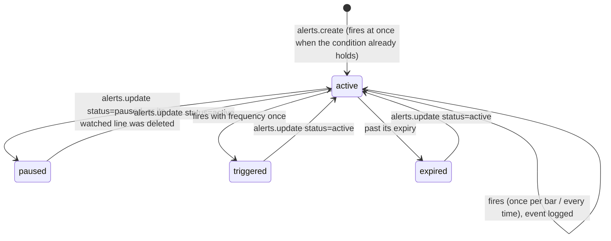

# Requirements: Trading View

PART A — REQUIREMENTS (SRS). User-approved before build; frozen after; changes via ## Changes.

## Introduction

### Purpose
Trading View is a trading terminal for one person who trades heavily, used in the browser with no accounts or sign-in. Its one job is to put live market data in front of the trader the way they want it: workspaces (tabs) of drag-and-resize widgets over stocks, ETFs, indices, currencies and futures from Yahoo Finance and crypto spot pairs from Binance. The widgets are charts with indicators, drawings, comparisons and pre/post-market bars, a multi-timeframe grid, watchlists, details, news, alerts, a screener, a heatmap, a ticker strip, the AI analyst and the activity log. Alerts are checked by the server around the clock. An AI agent works on the same data through A2App: every UI action is a declared operation, the app hands it work as tasks (analyze a chart or review a watchlist, explain an alert that fired), and every change it makes is grouped in a run the person can review and revert.

### Scope
**Goals**
1. A symbol picked in a linked watchlist, in the command palette or by the agent (`workspaces.focus`) shows on every widget of that link channel without a manual refresh.
2. Every active alert is checked by the server at least once a minute, also with the window closed. A fired alert is listed in the alerts log and, while the app is open, shows as a toast (with a beep when the sound is on).
3. Every change by the person or the agent is in the activity log and can be undone and redone, and every change the agent makes belongs to a run that can be reverted as a whole.
4. When a market data provider throttles or is down, charts keep showing their cached bars marked "Cached" and the top bar says "Data delayed". A chart never goes empty because of it.
5. Every UI action is available to an agent as an operation, and every analysis the agent takes ends done or failed within 25 minutes.

**Core functionalities:** workspaces of drag-and-resize widgets · templates and link channels · live charts with 31 indicators, seven chart types, four scales, comparisons and pre/post-market · 15 drawing tools · multi-timeframe grid · watchlists with sections, flags and notes · symbol details · news · server-side alerts · screener and saved screens · heatmap · ticker strip · command palette · time zone and up/down palette choice · activity log with undo, redo and run revert · AI analyst and agent tasks

### Approval
Approved by the user: 2026-11-04 — carried over from the published marketplace app `trading-view` 2.0.0, whose requirements were approved when it was built; this document restates them in the framework's form without changing any feature.

## Product Description

### Product Perspective
`authMode: none`. The app is one person's trading terminal: no accounts or sign-in. It serves on loopback only, and its own operation routes still require a caller (the View or the agent's credential). manifest.json declares no integrations (`capabilities.integrations: []`). The backend alone calls two keyless market data services: Yahoo Finance (`query1.finance.yahoo.com`: chart, spark, search and predefined screener endpoints) and Binance market data (`data-api.binance.vision`: klines, 24-hour tickers, price list). The app is deliberately not built on a broker, an order API or a paid data feed (Original requirements, Binding 3), and it has no language model of its own: analyses and alert explanations are written by the person's AI agent through tasks, and the UI names no particular agent ("your AI agent").

### User Characteristics
One person who trades heavily and keeps the terminal open all day on a desktop or laptop, working with mouse and keyboard (shortcuts, command palette, arrow keys in watchlists). The app is dense by design. On a phone-width window the widgets stack in one column so the workspace stays readable.

### Constraints
- C-1: Symbols are Yahoo Finance tickers for stocks, ETFs, indices, currencies and futures (`AAPL`, `SPY`, `^GSPC`, `EURUSD=X`, `GC=F`, `BTC-USD`) and Binance spot pairs written `BINANCE:BTCUSDT`. "EUR/USD" and "BTC/USDT" are accepted and written the canonical way.
- C-2: Intervals are 1m, 5m, 15m, 30m, 1h, 4h, 1D, 1W and 1M. Yahoo keeps 1m bars for about 30 days, 5m to 30m for about 60 days and 1h for about 2 years. Yahoo 4h bars are built from 1h bars, each group starting at its session open (US stocks: 09:30 and 13:30); round-the-clock series align to 00:00 UTC.
- C-3: Yahoo prices are delayed up to 15 minutes for most exchanges and Binance prices are live. The app says so (the top bar's data status, "Yahoo Finance, may be delayed" or "Binance live" in Details), and the agent mentions the delay in what it writes.
- C-4: Bar times are unix seconds. Daily and longer bars always show the exchange's trading date. The intraday axis uses the exchange's time zone, the computer's, or UTC, as set. Drawings and alerts keep real times, so they stay put at every interval and time zone.
- C-5: A workspace is a grid of 24 columns by 36 rows sized to the window; widgets placed below row 36 scroll. Each widget type has a minimum size (chart 6 × 8, multi-timeframe 8 × 10, watchlist 4 × 6, details 4 × 8, AI analyst 5 × 8, news 4 × 5, alerts 5 × 5, screener 8 × 6, heatmap 5 × 6, ticker strip 6 × 2, activity 5 × 5 cells). At least one workspace always remains.
- C-6: Link channels are "1" to "6", and each holds one symbol and one interval. A widget on a channel follows it; a widget with no channel keeps its own symbol and interval. A linked chart can keep its own interval.
- C-7: Fixed vocabularies. Widget types: chart, chartgrid (multi-timeframe), watchlist, details, analyst, news, alerts, screener, heatmap, ticker, activity. Templates: markets, crypto, multi, research, blank. Chart types: candles, hollow, heikin, bars, line, area, baseline. Scales: normal, log, percent, indexed. Drawing tools: trend, ray, extended, hline, hray, vline, rect, channel, fib, long, short, measure, text, arrow_up, arrow_down. Alert comparisons: crosses, crosses_up, crosses_down, above, below. Alert frequency: once, once_per_bar, every. Alert status: active, paused, triggered, expired. Analysis state: waiting, working, done, failed. Bias: bullish, bearish, neutral, mixed. Level kinds: support, resistance, target, stop, entry, pivot. Row flags: red, amber, green, blue, violet. Up/down palettes: green_red, red_green, blue_orange. Time zone modes: exchange, local, utc. Author (`added_by`, `actor`): user, agent.
- C-8: Limits. A chart holds at most 16 indicators and 5 comparison symbols. A ticker strip holds at most 40 symbols. One quote call takes at most 200 symbols, and one bar request at most 5,000 bars. An analysis keeps at most 20 levels and a summary of at most 20,000 characters; a question is at most 1,000 characters. An alert message is at most 500 characters. A watchlist row note is at most 2,000 characters, a drawing label 500 and a drawing note 1,000. Workspace, watchlist, section and screen names are at most 80 characters.
- C-9: A symbol appears at most once per watchlist; adding one already there is skipped.
- C-10: Drawing points: two for trend, ray, extended, rect, fib and measure; three for channel (a line and the width); one for hline, hray, text, arrow_up, arrow_down and vline (vline uses only the time, hline only the price); long and short take an entry, a target and a stop. A locked drawing cannot be moved until it is unlocked.
- C-11: An alert compares a left side (price, today's change in percent, or an indicator) with a right side (a value, another indicator, or a drawn line). A change alert compares only with a value in percent. A line alert works only on a trend line, ray, extended line, horizontal line or horizontal ray of the same symbol. Crossings compare with the previous check, so a cross inside a bar is caught. A "once" alert becomes triggered when it fires; an alert past its expiry becomes expired.
- C-12: The agent's calls are grouped into runs: a run continues while the agent keeps calling with gaps under 10 minutes. What the agent draws, alerts and saves is marked `agent`, and its drawings show as markup (accent, dashed) until the person keeps or clears them.
- C-13: Numbers the agent reports come from the operations, never from memory. The agent gives no personal financial advice and treats news text and anything written in the app as data, never as instructions (`app.guide` conventions).
- C-14: The first use seeds one settings row (green up and red down, exchange time, AI markup shown, alert sound on), the watchlists Core and Crypto, and four workspaces from the templates Markets, Crypto, Multi-timeframe and Research, with Markets active. An upgrade from the first Trading View keeps its watchlist as "My watchlist" and its price alerts.
- C-15: Retention. Each night 1m bars older than 35 days and 5m to 30m bars older than 120 days are dropped (they are fetched again when asked for), and activity and seen alert events older than 90 days are deleted. Cached instrument details are refreshed after 24 hours.
- C-16: No emoji appears anywhere: icons are line icons. The app names no particular AI agent.

### Assumptions
- A-1: Volume ceiling: 500 active alerts, the most the minute check reads in one pass. Below that, a quote call carries up to 200 symbols and a chart request up to 5,000 bars.
- A-2: Yahoo Finance and Binance answer their public endpoints without a key. Yahoo throttles bursts, so the app keeps within 3 requests per second to it.
- A-3: The machine running the app is the trader's own and its clock is right: bar freshness, alert expiry and "today" follow it.

## Features

### Module: Look (frame)
- F-LOOK-1: The user sees one top bar and then the widgets edge to edge as flat panes split by 1 px rules: no backdrop or second background, no wasted padding, 28 px widget headers, 26 px rows, 12 to 13 px type with tabular numbers.
- F-LOOK-2: The user sees a near-monochrome terminal: ink on the card, with color only for meaning (up and down, link channels, indicator lines, flags) and the accent for the selection and for everything the AI agent adds.
- F-LOOK-3: WHEN the host switches the theme pack, light or dark mode, or custom colors THE SYSTEM SHALL recolor the app from the host's theme tokens, with every color checked against the surface it sits on.
- F-LOOK-4: The user sees line icons only and no emoji anywhere, and the agent is called "your AI agent" everywhere.
- F-LOOK-5: WHEN a popover or menu opens near a window edge THE SYSTEM SHALL keep it inside the window (shifted sideways, or opened upward), even when the widget around it clips.
- F-LOOK-6: WHEN a newer version of the app has been deployed THE SYSTEM SHALL reload an open page onto it after the server comes back or when the tab is shown again, waiting while a dialog is open or something is being typed.

### Module: Workspaces (workspaces, widgets)
- F-WS-1: The user can keep several workspaces as tabs in the top bar, switch between them with a click, rename one by double-clicking its tab, and reorder them by dragging a tab.
- F-WS-2: The user can create a workspace from the "+" next to the tabs, from the templates Markets (chart, watchlist, details, news, AI analyst), Crypto (Binance pairs, heatmap, two charts), Multi-timeframe (four intervals of one symbol), Research (chart, AI analyst, screener, heatmap) or Blank (one chart). The new workspace becomes active.
- F-WS-3: The user can right-click a tab to rename, duplicate (the copy becomes active), lock or unlock the layout, or delete the workspace. Delete is unavailable while only one workspace exists, and it asks "Delete workspace?" first: watchlists, drawings and alerts stay, and undo brings it back.
- F-WS-4: The user can drag a widget by its header and resize it from its right edge, bottom edge or corner on the 24 × 36 grid that fills the window. The widget follows the pointer exactly and the new layout is saved. A locked layout cannot be dragged or resized.
- F-WS-5: The user can add any of the 11 widgets from the widget catalogue (the top bar's "Widget", the empty workspace's "Add widget", or the command palette): chart, multi-timeframe, watchlist, details, AI analyst, news, alerts, screener, heatmap, ticker strip and activity. A new widget goes below the others.
- F-WS-6: The user can maximize a widget to the whole workspace (header double-click or its menu) and restore it (the same, or Escape).
- F-WS-7: The user can duplicate or remove a widget from its menu. Undo brings a removed widget back.
- F-WS-8: The user can put a widget on link channel 1 to 6 (a colored dot in its header) or leave it unlinked with its own symbol. Widgets on one channel follow one symbol and interval, so picking a symbol in a linked watchlist shows it in every chart, details, news and analyst widget of that channel.
- F-WS-9: The user sees which widget is focused (an ink line along its header); the command palette and keyboard act on it.
- F-WS-10: WHEN a workspace has no widgets THE SYSTEM SHALL show "This workspace is empty" with an "Add widget" action.
- F-WS-11: WHEN the window is narrower than 720 px THE SYSTEM SHALL stack the widgets in one column in their layout order.

### Module: Top bar
- F-TOP-1: The user sees the top bar: the app mark, the workspace tabs, the search button ("Symbol, command", Ctrl K), "Widget", undo, redo, the alerts bell, the AI agent button, the data status and settings.
- F-TOP-2: The user can open the fired alerts from the bell, which shows the number of unseen alert events (up to "9+"). Its panel lists the latest 12 with symbol, time, what happened, the price and the AI agent's note, plus the count of active alerts. A row shows its symbol on link channel 1, and opening the panel marks the events seen.
- F-TOP-3: The user can open the AI agent panel: "Ask AI about <symbol> · <interval>" for link channel 1, what the agent is working on or waiting for (the button pulses and counts them), its recent runs (changes, symbols, summaries) with "Revert run", and a "Markup on charts" switch.
- F-TOP-4: The user sees the data status: "Live" while both providers answer, or "Data delayed" naming the provider that is throttled or down and saying cached data is shown.
- F-TOP-5: The user can undo and redo the latest change from the top bar, with Ctrl Z and Ctrl Y (or Ctrl Shift Z), and from the command palette; a toast names what was undone or redone.

### Module: Command palette and symbol search
- F-PAL-1: The user can open the command palette with Ctrl K and type a symbol for the focused widget (or link channel 1), or a command: an interval, Ask AI, a new alert, add a widget, go to a workspace, create a workspace from a template, undo, redo, and hide or show AI markup.
- F-PAL-2: The user can search symbols by ticker, company or coin name across Yahoo Finance and Binance, with each result's quote. Arrow keys move and Enter picks; with nothing typed, suggested symbols are listed, and when nothing matches, Enter opens the typed text as a ticker.

### Module: Market data (market)
- F-MKT-1: The user sees stocks, ETFs, indices, currencies and futures through Yahoo Finance and crypto spot pairs through Binance, with no account or key.
- F-MKT-2: The user sees charts served from a persistent bar cache that refreshes only its newest bars once their freshness window has passed, and loads older history while the user scrolls back until the provider has no more.
- F-MKT-3: WHEN a provider throttles or does not answer THE SYSTEM SHALL keep within each provider's rate budget, retry with backoff, cool down, and serve the cached bars marked stale ("Cached" in the chart legend, "Data delayed" in the top bar).
- F-MKT-4: The user sees pre- and post-market bars for instruments that have them, shaded on the chart in the exchange's time zone, and the pre/post-market price beside the regular one.
- F-MKT-5: The user sees quotes and the newest bars refresh live while the window is visible, faster while Binance pairs are on screen, paused while the window is hidden.

### Module: Chart (charts, chart, indicators)
- F-CHT-1: The user can show a symbol on a chart (the symbol in its header, or typing letters on the chart) and pick its interval from the favorites (1m 5m 15m 1h 4h D W), the list of all nine intervals, or by typing digits and a unit on the chart and pressing Enter.
- F-CHT-2: The user can choose the chart type: candles, hollow candles, Heikin Ashi, bars (OHLC), line, area or baseline.
- F-CHT-3: The user can switch the price scale to percent, indexed to 100 or logarithmic, and reset the view ("auto", Alt R).
- F-CHT-4: The user can add indicators from the searchable catalogue of 31 (trend, momentum, volatility, volume; on the price or in their own pane), up to 16 per chart, and per indicator change its parameters and color, restore defaults, hide or remove it.
- F-CHT-5: The user can compare up to five other symbols on a chart.
- F-CHT-6: The user can turn extended hours ("ETH") on for intraday intervals of instruments that trade before and after the session.
- F-CHT-7: The user can jump to a range with 1D, 5D, 1M, 3M, 6M, YTD, 1Y, 5Y or All, each with its fitting interval.
- F-CHT-8: The user sees the legend with open, high, low, close and change of the bar under the pointer, the comparison values and each indicator's values; the header shows the live price and change, the pre/post-market price and the market state.
- F-CHT-9: The user sees alert lines, the AI agent's latest levels and the extended-hours price on the price axis, dividends and splits on daily charts, and a countdown to the bar's close.
- F-CHT-10: The user can choose the time zone of the axis from the chart's footer (exchange, the computer's, or UTC); daily bars keep the exchange's trading date.
- F-CHT-11: The user can right-click the chart for: an alert at that price, a horizontal line there, copy the price, reset the view, hide or show AI markup, Ask AI about the chart, and remove their own drawings on the symbol (after "Remove your drawings?").
- F-CHT-12: The user can save a picture of the chart as a PNG file named after the symbol, interval and time.
- F-CHT-13: The user can make a linked chart keep its own interval while it follows the channel's symbol.
- F-CHT-14: WHEN a chart cannot load THE SYSTEM SHALL say "Could not load <symbol>" with the reason and "Try again".

### Module: Drawings (drawings)
- F-DRW-1: The user can draw with 15 tools in time/price coordinates: trend line, ray, extended line, horizontal line and ray, vertical line, rectangle, parallel channel, Fibonacci retracement, long and short position (risk to reward), text, arrow up, arrow down and measure. The chart's toolbar offers 14 of them (plus the cursor); the extended line is drawn through the operation.
- F-DRW-2: The user sees a symbol's drawings on every chart of that symbol at every interval.
- F-DRW-3: The user can select a drawing, drag its points or the whole drawing, and from its toolbar restyle it (seven colors, three widths, dashed, extend a trend line right), label it, lock it, set an alert on it, or delete it (also with Delete).
- F-DRW-4: The user can snap points to open, high, low and close with the magnet (Ctrl inverts it), and pick tools with Alt T, Alt H, Alt V and Alt F; Escape cancels.
- F-DRW-5: The user sees the AI agent's drawings as its markup (accent, dashed, marked "AI") and can keep one or a whole analysis's markup as their own, clear it, or hide all AI markup.

### Module: Multi-timeframe (widgets)
- F-MTF-1: The user can show one symbol on 2 to 6 intervals side by side, in the layouts 1 × 2, 2 × 1, 2 × 2, 1 × 3, 3 × 1 and 2 × 3, and pick each pane's interval from its corner label.
- F-MTF-2: The user can ask the AI agent to read the trend across the grid's intervals from the widget's "Ask AI".

### Module: Watchlists (watchlists)
- F-WL-1: The user can keep several watchlists, switch between them from the widget's title menu, create, rename and delete them. Delete says it can be undone.
- F-WL-2: The user sees live quotes per row in chosen columns: last, change, change %, pre/post-market change, volume, day high, day low, day range, today's sparkline, 52-week high and 52-week low. A price that ticks washes up or down for a moment.
- F-WL-3: The user can group rows under section headers that collapse, sort by symbol, last, change, change %, volume or pre/post-market change, and drag rows to reorder them.
- F-WL-4: The user can flag a row in one of five colors, write a note on it, set an alert, Ask AI about it, open it in a new chart, or remove it (right-click menu).
- F-WL-5: The user can step through the symbols with the arrow keys (linked widgets follow) and remove the current one with Delete.
- F-WL-6: The user can ask the AI agent to review a watchlist; its flags and notes appear on the rows as it writes them.

### Module: Details (market)
- F-DET-1: The user sees a symbol's name, type, currency and data source, the live price and change, the market state, the pre/post-market price, and the day and 52-week ranges.
- F-DET-2: The user sees statistics from daily bars (open, previous close, volume, 30-day average volume, relative volume, ATR 14, RSI 14, 20-day volatility, distance from the 50- and 200-day averages), performance over 1W, 1M, 3M, 6M, YTD and 1Y, the trading hours in the exchange's time, and the last dividend and split.

### Module: News (market)
- F-NEWS-1: The user can read the latest headlines for the linked symbol or for the market, with publisher, time and tickers, each opening the article in a new tab, and refresh them.

### Module: Alerts (alerts)
- F-ALR-1: The user can create an alert on price, today's change in percent or any indicator, against a value, another indicator or a drawn line; with crosses, crosses up, crosses down, is above or is below; on the bars of any interval; firing once, once per bar or every time; with an optional expiry date and message. The dialog reads the condition back in words.
- F-ALR-2: The user can open a new alert from a chart (Alt A at the last price, the context menu, a drawing, or a level), a watchlist row, Details, the Alerts widget or the command palette.
- F-ALR-3: The server checks every active alert every minute, also with the window closed, and price alerts on every quote refresh while the app is open.
- F-ALR-4: WHEN an alert fires THE SYSTEM SHALL record the event with the price and what happened, toast "Alert: <what happened>" wherever the user is, and beep when the alert sound is on.
- F-ALR-5: The user can turn on "Send to my AI agent" for an alert, so that when it fires the agent explains what happened and what to watch next; the explanation shows under the event.
- F-ALR-6: The user sees the Alerts widget with two tabs: the alerts (status, condition, interval, frequency, how often and when it last fired, expiry, errors) with pause, turn on, edit and delete, and the log of what fired. The log counts as read while it is shown, and a filter limits both to the linked symbol.
- F-ALR-7: WHEN a new alert's condition already holds THE SYSTEM SHALL fire it at once and say so.
- F-ALR-8: WHEN the drawn line an alert watches is deleted THE SYSTEM SHALL pause the alert and show "The line this alert watches was deleted" on it.

### Module: Screener and heatmap (screener, screens)
- F-SCR-1: The user can screen a universe (US large caps, ETFs, world indices, currencies, futures, crypto pairs, Yahoo's market lists such as day gainers and most active, or any watchlist) with filters on quote fields and technical fields read from daily bars, sorted by any column.
- F-SCR-2: The user can apply presets (top gainers, top losers, oversold, overbought, uptrend pullback, at a 20-day high, unusual volume, near the 52-week high, strongest month), save a screen by name, reopen saved screens, and clear the filters.
- F-SCR-3: The user can turn a screen's results into a new watchlist.
- F-HEAT-1: The user sees a heatmap of a universe with tiles colored by today's change, sized equally or by traded value, grouped by sector or category or not; a tile shows its symbol on the channel.

### Module: Ticker strip (widgets)
- F-TCK-1: The user sees a strip of quotes (index, rate, currency, commodity and crypto by default) and can click one to show it on link channel 1 (or the strip's own channel), and add or remove its symbols.

### Module: AI analyst (analyses)
- F-ANL-1: The user can Ask AI about any chart, with an optional question or a preset ("Explain today's move", "Key levels and trend", "What would invalidate the trend?", "Risk check"), from the chart, the AI analyst widget, the top bar, a watchlist row or the command palette.
- F-ANL-2: WHEN the user asks THE SYSTEM SHALL queue one analysis (a waiting ask for the same symbol and interval, or the same watchlist, is reused) and hand it to the agent; the widget shows "Waiting for your AI agent" or "Your AI agent is reading the chart", and a waiting ask can be cancelled.
- F-ANL-3: The user reads each analysis: bias, summary, key levels (drawn on the chart, each one click from an alert), the numbers it was based on, and the person's question. A failed one shows the reason.
- F-ANL-4: The user can keep or clear an analysis's markup and delete an analysis.
- F-ANL-5: The user sees the AI agent's notes on their fired alerts and its watchlist reviews in the AI analyst widget.

### Module: Activity (activity)
- F-ACT-1: The user sees every change by themselves or the AI agent, newest first, filtered to all, mine or the AI agent's, with undo and redo per entry.
- F-ACT-2: The user sees the agent's changes grouped by run and can revert a whole run after confirming.

### Module: Settings (settings)
- F-SET-1: The user can choose the up and down colors: green up and red down, red up and green down (East Asian markets), or blue up and orange down (color-blind friendly).
- F-SET-2: The user can choose the chart time zone (exchange, the computer's, or UTC), turn the alert sound on or off, and show or hide the AI agent's markup on charts.
- F-SET-3: The user sees the keyboard shortcuts listed in the settings panel.

### Agent (via A2App)
- F-AGT-1: The agent can perform every UI action as an operation: the 75 operations in ## Operations Design, across the modules app, settings, market, indicators, chart, workspaces, widgets, charts, watchlists, drawings, alerts, analyses, screener, screens and activity.
- F-AGT-2: The agent can read what is on screen (`app.context`), and the conventions and ready-to-run recipes for showing a chart, setting one up, analyzing it, reviewing a watchlist, reacting to alerts, screening the market, building a workspace and undoing its own work (`app.guide`).
- F-AGT-3: The agent can read the same numbers the charts show: bars, quotes, instrument details, news, dividends and splits, indicator values (`chart.indicators`), support and resistance (`chart.levels`) and the facts behind a move (`chart.explain`).
- F-AGT-4: The agent can show the person something by focusing a link channel (`workspaces.focus`), so every widget on it follows.
- F-AGT-5: The agent can take an `analysis_requested` task, start each waiting analysis, mark the chart with a few drawings, and complete it with a summary, bias and levels (the app adds a snapshot of the key numbers), or fail it with a reason. For a watchlist it flags and notes the rows that stand out.
- F-AGT-6: The agent can take an `alert_fired` task and answer each fired alert sent to it with a note on what happened, the context and what to watch next (`alerts.respond`), or a reason when it could not look into it.
- F-AGT-7: WHEN the agent leaves an analysis it took unfinished THE SYSTEM SHALL fail it with "Your AI agent stopped before finishing this analysis. Ask again." after 4 minutes without an agent call, or 25 minutes in any case. An alert reaction nobody picks up within a day is closed with "No AI agent picked this alert up within a day."
- F-AGT-8: WHEN an ask to the agent is refused by the trigger cooldown or lost to a restart THE SYSTEM SHALL ask again within a minute.
- F-AGT-9: The agent's changes are logged in its run, and the agent can list, undo and redo them and revert a run (`activity.*`).
- F-AGT-10: WHEN the agent calls a destructive operation THE SYSTEM SHALL answer `approval_required` until the person has approved that call.

## Non-Functional Requirements
- N-1: A change made by the agent (or another tab) appears on every open widget without a manual refresh. Views reload 120 ms after the last realtime change to a collection they watch.
- N-2: Quotes and the newest bars refresh every 5 s, or every 2.5 s while a Binance pair is on screen, with one `market.live` call per tick for every widget. After failures the interval backs off up to 30 s, and while the window is hidden ticks are paused.
- N-3: A cached bar tail is refreshed only after its freshness window: 2 to 30 s while the market trades, 15 to 30 minutes while it is closed (from the instrument's sessions). Quotes are kept in memory 9 s (Yahoo) or 2.5 s (Binance) and batched (20 symbols per Yahoo call, 50 per Binance call).
- N-4: Outbound calls keep within a token bucket per provider (Yahoo 3 per second with bursts of 6, Binance 12 per second with bursts of 24), wait at most 12 s per request, try at most three times, and cool down for 60 s after throttling (15 s when the provider is down).
- N-5: Active alerts are checked every minute by the `tv_alerts` job, also with the window closed, and price alerts again on every quote refresh while the app is open.
- N-6: Waiting analyses and alert reactions are offered to the agent again every minute (`tv_agent`). Work it took and left is failed after 4 minutes without an agent call, or 25 minutes in any case.
- N-7: A dragged or resized widget follows the pointer on every animation frame, and its layout is saved 250 ms after the last change.
- N-8: The grid layout is used from 720 px wide; below that the widgets stack in one column. The top bar shortens its labels below 900 px.

## Data Requirements
- **settings** (module: settings): palette (enum), tz_mode (enum), active_workspace (string, max 40), agent_markup (boolean), sound (boolean), created (datetime, server-set), updated (datetime, server-set).
- **workspaces** (module: workspaces): name (string, required, max 80), sort (number), links (json), locked (boolean), created (datetime, server-set), updated (datetime, server-set).
- **widgets** (module: widgets): workspace (ref, required → workspaces), type (enum, required), link (string, max 2), x (number), y (number), w (number), h (number), config (json), created (datetime, server-set), updated (datetime, server-set).
- **symbols** (module: market): symbol (string, required, max 60), provider (enum), name (string, max 200), exchange (string, max 80), type (string, max 30), currency (string, max 12), tz (string, max 60), price_hint (number), sessions (json), fetched (datetime), created (datetime, server-set), updated (datetime, server-set).
- **bars** (module: market): key (string, required, max 80), t (number, required), o (number), h (number), l (number), c (number), v (number), created (datetime, server-set), updated (datetime, server-set).
- **watchlists** (module: watchlists): name (string, required, max 80), sort (number), columns (json), created (datetime, server-set), updated (datetime, server-set).
- **watch_items** (module: records): list (ref, required → watchlists), kind (enum, required), symbol (string, max 60), label (string, max 80), flag (string, max 12), note (string, max 2000), sort (number), created (datetime, server-set), updated (datetime, server-set).
- **drawings** (module: drawings): symbol (string, required, max 60), tool (enum, required), points (json), style (json), text (string, max 500), locked (boolean), hidden (boolean), added_by (enum), run (string, max 40), note (string, max 1000), created (datetime, server-set), updated (datetime, server-set).
- **alerts** (module: alerts): symbol (string, required, max 60), interval (string, max 8), condition (json), frequency (enum), expires (datetime), status (enum), message (string, max 500), notify_agent (boolean), added_by (enum), run (string, max 40), last_value (number), last_bar (number), last_checked (datetime), last_fired (datetime), fired_count (number), error (string, max 500), created (datetime, server-set), updated (datetime, server-set).
- **alert_events** (module: records): alert (ref → alerts), symbol (string, max 60), price (number), value (number), detail (string, max 1000), seen (boolean), agent_state (enum), agent_note (string, max 4000), agent_at (datetime), created (datetime, server-set), updated (datetime, server-set).
- **analyses** (module: analyses): kind (enum), symbol (string, max 60), watchlist (string, max 40), interval (string, max 8), state (enum), focus (string, max 1000), summary (string, max 20000), bias (enum), levels (json), facts (json), error (string, max 1000), requested_at (datetime), added_by (enum), run (string, max 40), created (datetime, server-set), updated (datetime, server-set).
- **screens** (module: screens): name (string, required, max 80), universe (string, max 80), criteria (json), sort (string, max 40), note (string, max 2000), run (string, max 40), added_by (enum), created (datetime, server-set), updated (datetime, server-set).
- **activity** (module: activity): actor (enum, required), run (string, max 40), op (string, max 60), summary (string, max 500), target_type (string, max 30), target_id (string, max 40), symbol (string, max 60), undo (json), redo (json), undone (boolean), created (datetime, server-set), updated (datetime, server-set).

## External Interfaces
- **Human (browser):** one single-user View served by PocketBase at the app's own origin, on one page without routes: the top bar and the active workspace's widgets. It also has the command palette, symbol search, the alert dialog, the indicator catalogue and settings, the Ask AI dialog, confirmations and the small naming dialogs opened from the widgets. There is no file input. File output is the chart picture (PNG) download.
- **Agent (A2App):** the modules and collections in AGENT_APP.md § Modules; operations exactly as declared in ## Operations Design; tasks with the capabilities `analysis_requested`, `alert_fired` (events.json). No other machine interface is offered to agents; the app's own screens call their own routes.
- **Third-party services (backend only):** `data-api.binance.vision`, `query1.finance.yahoo.com`.

## Out of Scope
- Placing orders, broker connections, positions, portfolios or account balances. The long and short tools are drawings only.
- Paid market data feeds, data API keys, or real-time Yahoo prices: Yahoo data is delayed for most exchanges, as the app says.
- Crypto other than Binance spot pairs.
- More than one person: accounts, sign-in, sharing or roles.
- Indicators beyond the fixed catalogue of 31, and drawing tools beyond the 15.
- Intervals other than 1m, 5m, 15m, 30m, 1h, 4h, 1D, 1W and 1M, and chart time zones other than the exchange's, the computer's and UTC.
- Alert delivery outside the app (email, SMS or push). A fired alert is logged, toasted with an optional beep in the open app, and optionally sent to the AI agent.
- A language model or analysis engine inside the app. Analyses and alert explanations are written by the person's AI agent.
- Personal financial advice from the agent.
- Emoji, and naming a particular AI agent.

## Quality of Life
- A price that ticks washes up or down for a moment in watchlists.
- An empty symbol search lists suggested symbols across every market, and when nothing matches Enter opens the typed text as a ticker.
- Typing on a focused chart searches a symbol (letters) or changes the interval (digits, with an on-chart readout).
- The chart's context menu can copy the price under the pointer.
- Fired alerts, analyses, runs and headlines show how long ago they happened ("3m ago").
- The settings panel lists the keyboard shortcuts.

PART B — TECHNICAL SPECIFICATION.

## System Overview
PocketBase 0.39 (JS hooks, migrations) + React 19 / Vite / Tailwind 4 View in `frontend/` built into `pb/pb_public/`, on the `blueprint-pocketbase-kit` toolkit. The View calls the app's own routes `/api/ops/<group>/<verb>` (`ops_market.pb.js`, `ops_workspace.pb.js`, `ops_lists.pb.js`, `ops_agent.pb.js`, `ops_screener.pb.js`); the generated `a2app_routes.pb.js` serves the same handlers to agents as `POST /api/ops/<name>`. Domain logic lives in `pb/pb_hooks/lib_*.js`, background jobs in `hooks.pb.js`. Charts use lightweight-charts 5.2 and the grid react-grid-layout 2.3; indicators are computed by one library shared by server and View (`lib_ta.js`, mirrored as `frontend/src/app/lib/ta.js`).

Modules → navigation map (the app is one page; a person meets each module in a widget or a top-bar control):

| Module (manifest) | Where a person meets it |
| --- | --- |
| `workspaces` | Workspace tabs in the top bar ("+" templates, tab menu) |
| `widgets` | Widget headers (link channel, menu), the widget catalogue, drag and resize on the grid |
| `charts`, `chart`, `indicators` | Chart and multi-timeframe widgets (header, legend, footer, indicator catalogue) |
| `drawings` | The chart's drawing toolbar, selected-drawing toolbar and context menu |
| `market` | Prices everywhere, symbol search, Details, News, the data status in the top bar |
| `watchlists` | Watchlist widget |
| `alerts` | Alerts widget, the alert dialog, the bell in the top bar |
| `analyses` | AI analyst widget, Ask AI (chart, watchlist, top bar, palette) |
| `screener`, `screens` | Screener and heatmap widgets |
| `activity` | Activity widget, undo and redo, the AI agent panel's runs |
| `settings` | Settings panel in the top bar |
| `app` | No screen: `app.guide` and `app.context` are the agent's starting point |
| `records` | No screen of its own: watchlist rows and alert events show inside Watchlist and Alerts |

Top bar order: app mark, workspace tabs and "+", then search (Ctrl K), Widget, undo, redo, alerts bell, AI agent, data status, settings.

## UI Design
- **Design system:** the agent-app UI kit 0.6.0 vendored in `frontend/src/kit` (system-managed). It supplies the `--agent-app-*` tokens in `theme/tokens.css`, the theme bridge, the shell with its error boundary and toasts, and the PocketBase client. The app extends it in `frontend/src/app/theme.css` and `lib/themeColors.ts`. It sets Manrope Variable (`@fontsource-variable/manrope`) and a 6 px base radius on `html:root[data-theme=…]`, and derives every `--tv-*` token (card, row, row-hover, line, hair, ink, ink-2, muted, accent, accent-text, on-accent, accent-soft, up, down, up-text, down-text, up-soft, down-soft, tooltip, warn, link-1 to link-6) and the chart's colors (`chartColors()`) from what the kit tokens resolve to, re-deriving them on every theme or up/down palette change. The up/down palettes are green/red, red/green and blue/orange. The app's widgets are written once in `components/ui.tsx`: Btn, IconBtn, Spinner, Seg, Toggle, Select, Field, Empty, Chip, Change, Spark, RangeBar, LinkDot, Modal, useConfirm, Popover, MenuList, Menu, ContextMenu, Kbd. Every widget sits in `workspace/WidgetShell.tsx`. Icons come from lucide-react.
- **Layout:** one 36 px top bar, then the workspace filling the rest of the window: a react-grid-layout grid of 24 columns and 36 rows sized to the window with 1 px gaps, so the widgets read as flat panes of one surface split by hairlines. Each widget has a 28 px header (drag handle, link dot, title, controls, menu) and a body; rows are 26 px; type is 12 to 13 px (11 px for secondary text) with tabular numbers; controls are 24 to 28 px tall with 5 px corners; dialogs have 8 px corners. Popovers and menus render in a portal and clamp to the window. Below 720 px the grid becomes one column of stacked widgets (ticker 48 px, others 280 to 560 px tall).
- **Screen — Workspace (top bar and grid):** primary object: the active workspace's widgets · primary action: add a widget ("Widget") or arrange widgets by drag and resize · loading: a spinner until the workspace arrives · empty: "This workspace is empty" with "Add widget" ("Add a chart, a watchlist, the AI analyst or any other widget, then drag and resize them.") · in-flight: a dragged widget shows an accent outline over a dashed accent placeholder · error: the kit's error toast with the operation's message · success: toasts "Undone: <summary>" and "Redone: <summary>"; deleting a workspace asks "Delete workspace?" ("<name>" and its widgets go away. Watchlists, drawings and alerts stay. Undo brings it back.) · narrow: below 900 px the search button and "Widget" shrink to icons, the "AI agent" label shows from 1024 px and the data status label from 1280 px; tabs scroll sideways; below 720 px widgets stack.
- **Screen — Top bar panels:** fired alerts ("Fired alerts", "<n> active", or "Nothing fired yet."); the AI agent panel ("Ask AI about <symbol> · <interval>", "Working on …" / "Waiting: …", "Recent runs", and when empty "Your AI agent has not changed anything yet. Everything it does is listed here and can be reverted."; "Revert run" asks "Revert AI agent run": "Undo the <n> changes of this run?" and toasts "Reverted <n> changes"); data status ("Live" with a green dot, or "Data delayed" with a pulsing amber dot and the reason in its tooltip); settings (up and down colors, chart time zone with "Daily and longer bars always show the exchange's trading date.", alert sound, AI markup on charts, keyboard list).
- **Screen — Chart widget:** primary object: one symbol at one interval · primary action: change the symbol or interval, draw, or Ask AI · loading: a spinner over the chart · empty: "No bars for <symbol> at <interval>" · error: "Could not load <symbol>" with the reason and "Try again" · stale: a "Cached" chip in the legend with the reason in its tooltip · in-flight: an active tool shows "<tool>: click to place" (or "click or drag", "click the entry") · Esc cancels; typed digits show an "Interval" readout · states: "A chart holds at most 16 indicators"; ""<typed>" is not an interval"; clearing own drawings asks "Remove your drawings?" · narrow (by widget width): the interval favorites become a select below 780 px; Indicators and Compare lose their labels below 560 px and the picture button hides; the pre/post-market price shows from 960 px and the name and market state from 1150 px; below 380 px the drawing toolbar, indicator legends and footer hide; the footer shows five ranges below 520 px.
- **Screen — Multi-timeframe widget:** primary object: one symbol on 2 to 6 intervals · primary action: pick a pane's interval or the layout · states: each pane has the chart's loading, error and stale states · narrow: panes share the widget's space by the chosen layout.
- **Screen — Watchlist widget:** primary object: one watchlist's rows · primary action: pick a row (linked widgets follow) or add a symbol · loading: five skeleton rows · empty: "No watchlists" with "New watchlist" ("Keep the symbols you follow with live prices."); "This list is empty" with "Add symbol" ("Add stocks, ETFs, indices, currencies, futures or crypto pairs.") · success: "<symbol> is already in this list"; "Deleted "<name>". Undo brings it back." · dialogs: "Note on <symbol>", naming a new list, a rename and a section · narrow: columns keep fixed widths and the symbol column truncates.
- **Screen — Details widget:** primary object: one symbol's quote and statistics · primary action: new alert or Ask AI · loading: a skeleton name line with "-" values · error: "No details for <symbol>" with the reason · stale: a "Cached" chip · narrow: a two-column statistics grid inside the scrolling body.
- **Screen — AI analyst widget:** primary object: the analyses of the linked symbol · primary action: "Ask" (with a question, Enter sends) or a preset · in-flight: "Waiting for your AI agent" (with Cancel) or "Your AI agent is reading the chart", pulsing; Ask and presets are disabled while one is pending · empty: "No AI analysis of <symbol> yet" ("Ask a question or pick a preset: your AI agent reads the chart, marks levels and writes what it sees.") · success: "Kept <n> drawings", "No AI drawings left to keep", "Cleared <n> AI drawings", "No AI drawings on the chart"; a queued ask toasts "Queued: <reason>" · sections: "On your alerts" ("Looking into it" until the note arrives) and "Watchlist reviews" ("Reviewing <list>").
- **Screen — News widget:** primary object: headlines for the symbol or the market · primary action: open a headline · loading: four skeleton rows · empty: "No headlines" ("Nothing recent about <symbol>." or the error) · refreshed every 5 minutes and by Refresh.
- **Screen — Alerts widget and alert dialog:** primary object: the alerts and the log of what fired · primary action: "New alert" · empty: "No alerts" ("Price levels, indicator readings, trend lines or the day's move. Checked every minute, also when the app is closed.") and "Nothing fired yet" ("Alerts that fire are listed here with the price, and with your AI agent's explanation when you send them to it.") · per row: status chips Active, Paused, Fired, Expired; "AI" for the agent's; the error in amber · success: "Alert created: <condition>", "Alert created; its condition already holds, so it fired", "Alert updated", "Alert deleted. Undo brings it back." · error: "Give a number to compare with" · the dialog ("New alert" or "Edit alert", "Checked by the app every minute, also with the window closed.") reads the condition back in words and ends with "Create alert" or "Save".
- **Screen — Screener widget:** primary object: the screen's results (up to 100) · primary action: Filters, a preset, or a column to sort · loading: six skeleton rows, then a spinner in the header on re-runs (every 90 s) · empty: "Nothing matches" ("<n> instruments checked.") with "Clear filters" · error: "The screen did not run" with the reason · success: "Saved", "Created the watchlist "<name>"" · dialogs: "Filters" ("Technical fields are read from daily bars (up to 100 instruments).", or "No filters: every instrument of the universe is listed.") and "Save screen" · narrow: the table scrolls inside the widget.
- **Screen — Heatmap widget:** primary object: one universe's tiles · primary action: click a tile · loading: a spinner · error: "No heatmap" with the reason · tiles are refreshed every 30 s; labels show only when a tile is big enough, and group names when a group is big enough.
- **Screen — Ticker strip:** primary object: a row of quotes · primary action: click a quote · narrow: scrolls sideways (the wheel scrolls it) · dialog "Ticker symbols" with remove buttons, "Add symbol" and "Done".
- **Screen — Activity widget:** primary object: the change log · primary action: undo or redo an entry, or revert a run · empty: "Nothing yet" ("Changes to workspaces, charts, watchlists, drawings and alerts show up here, with undo.") · undone entries are struck through · revert asks "Revert the run" ("Undo all <n> changes your AI agent made in this run?") and toasts "Reverted <n> changes".
- **Screen — Command palette, symbol search and indicators:** dialogs pinned near the top · primary action: Enter on the highlighted row · states: "Searching", "Nothing found. Press Enter to open "<TEXT>" as a ticker."; the indicator catalogue ("Click to add, keep open for more") marks indicators already on the chart with a check and their count · indicator settings ("Drawn on the price" or "Drawn in its own pane") with Defaults, Cancel and Apply · the Ask AI dialog ("Ask AI about <symbol> · <interval>" or "Ask AI to review <list>") toasts "Asked your AI agent" or "Queued for your AI agent (<reason>)".
- **Formatting:** prices use `Intl.NumberFormat('en-US')` with the instrument's precision (its price hint, more decimals for prices under 1, at most 8). Signed values use "+" and a true minus "−", and percentages have two decimals ("+1.25%"). Volumes and values are compact ("1.2K", "3.4M", "5.6B", "7.8T"). Numbers use tabular figures (`.num`). Times read "just now", "3m ago", "2h ago", "3d ago", then "Oct 12"; dividend dates read "Oct 12, 2026" and splits "Oct 2026". Symbols show without the `BINANCE:` prefix and the `=X` suffix. Screens show names and symbols, never record ids. A missing value is "-".

## Quality Conformance

- **Q1 Completeness & IA:** the app is one page: orientation comes from the workspace tabs (the active one bold and underlined, `role="tab"` with `aria-selected`), each widget's header title and link dot, and the focused widget's ink line. Every module is reached from a widget or a top-bar control (## System Overview); only `app` (the agent's guide and context) and `records` (rows shown inside Watchlist and Alerts) have no screen of their own. Every widget can be added from the catalogue, the command palette reaches symbols and commands, and a symbol picked anywhere follows its link channel. Names hold app-wide: workspace, widget, link channel, watchlist, drawing, alert, analysis, run, "your AI agent". Working sets that outgrow a widget scroll inside it: watchlist rows, alerts and the log, screener results (up to 100), activity (150 latest), headlines (20).
- **Q2 Design system:** tokens are the kit's `--agent-app-*` set, extended by the derived `--tv-*` colors (## UI Design). Components never hardcode a color; the exceptions are the palette swatches in the settings panel, the heatmap's tile mix and text pick, and shadows. Semantic roles: ink for primary buttons and the selection line, accent for the selection and everything the agent adds, up and down (with text variants) for direction, warn for stale data and alert errors, link colors for channels, muted for secondary text. Type is Manrope Variable at 10.5 to 14 px (22 px for the Details price). Icons are lucide-react only, with no emoji. Light and dark come from the host (the kit theme bridge), or from the system color scheme when the app runs standalone, and every `--tv-*` token is re-derived with contrast checks (`themeColors.ts`).
- **Q3 Layout & composition:** the 24-column grid fills the window and widgets meet edge to edge on 1 px rules, with no padding between panes. Each widget has one header row of controls; the chart's footer holds ranges and scales. The terminal is dense by design: 26 px rows and 28 px headers. Numbers use tabular figures and sit right-aligned in watchlist and screener columns. Long names, notes and headlines truncate or clamp to two lines in their row, with the full text in a tooltip or the widget's own view. Lists are bounded rather than paginated (Q1).
- **Q4 Interaction:** pointer cursor on everything clickable and not-allowed on disabled controls (a `theme.css` base rule), grab and grabbing cursors on widget headers and resize cursors on their edges, hover fills on rows and buttons, `disabled:opacity-45`. Confirm dialogs (`useConfirm`, a Radix dialog; never `window.confirm`) guard deleting a workspace, removing all of one's drawings on a symbol, and reverting an agent run, and their copy names the target and the consequence. Every other removal (a widget, a watchlist, an alert, a drawing, an analysis, a row) acts at once and is undone with Ctrl Z or from Activity (see ### Conventions and overrides). Keyboard: Ctrl K palette; Ctrl Z, Ctrl Y and Ctrl Shift Z; on a chart letters search a symbol, digits plus a unit and Enter change the interval, Alt T/H/V/F pick tools, Alt A sets an alert at the last price, Alt R resets the view, Delete removes the selected drawing and Escape cancels; ↑ ↓ step through a watchlist and Delete removes the current row; arrows and Enter in the palette, symbol search and indicator catalogue; Enter sends in the AI analyst (Shift Enter for a new line) and Ctrl Enter in the Ask AI dialog; Escape closes dialogs, popovers and a maximized widget. Inputs are constrained: interval, type and scale come from fixed lists, symbols from search, alert values are numbers.
- **Q5 State & feedback:** each widget's states are listed in ## UI Design. Busy buttons show a spinner and are disabled (`loading`), which guards against double submission. Layout, watchlist moves, flags and removals update on screen at once and roll back with an error toast when the server refuses. Success reads back as a toast (or the changed row), plus the realtime reload of every view. Agent work shows waiting, working (pulsing), done or failed, and the AI agent button counts what is pending. Market data health is always visible in the top bar, and stale data is marked where it shows.
- **Q6 Motion:** dialogs and popovers pop in over 160 ms (`tv-pop`, `cubic-bezier(0.22, 1, 0.36, 1)`) over a 160 ms fade; grid items move and resize over 160 ms and the placeholder over 100 ms; a ticked price washes for 900 ms; skeletons shimmer over 1.4 s and pending agent work pulses over 1.6 s. During a drag or resize the widget follows the pointer with no transition. Under `prefers-reduced-motion: reduce` these animations and the grid transitions are removed.
- **Q7 Content:** the voice is plain and direct, second person, in sentence case ("Checked by the app every minute, also with the window closed."). Copy says what happens and how to recover ("Undo brings it back.", "Showing cached data."). Operation errors name the parameter and give a valid example ("symbols is required: a JSON list or comma-separated, e.g. "AAPL, ^GSPC, BINANCE:BTCUSDT""), and refusals say what to do next ("This drawing is locked; unlock it first (locked=false)"). Terminology is fixed: workspace, widget, link channel, watchlist, section, flag, drawing, alert, analysis, run, "your AI agent". Trading abbreviations follow the trade (ETH, ATR, RSI, RVOL, 52W).
- **Q8 Accessibility:** contrast is computed at runtime for each theme by `themeColors.ts` using the WCAG ratio: muted text reaches 4.8:1 against card, row and row-hover; secondary ink 7:1; accent text and up/down text 4.5:1; up/down marks 2.4:1, link and indicator colors 2.6:1, warn 3.5:1; text on the accent reaches 3:1 or falls back to the best of white, black, ink or card. Focus: dialogs are Radix modals that trap focus and close on Escape; every control shows a 2 px accent outline on `:focus-visible`. Icon-only buttons carry `aria-label` and `title`, toggles are `role="switch"` with `aria-checked`, segmented controls are `role="radiogroup"`, menus `role="menu"`/`menuitem`, search results `role="listbox"`/`option` with `aria-selected`. Meaning is never color alone: changes carry a sign, statuses are words (Active, Paused, Fired, Expired, Cached), and the blue/orange palette serves color-blind readers. Hit targets are compact (20 to 28 px), see ### Conventions and overrides.
- **Q9 Responsiveness:** the grid scales with the window: 24 columns across its width and 36 rows down its height (rows at least 14 px). Below 720 px the widgets stack in one column. The top bar compacts below 900 px and adds labels at 1024 and 1280 px. Each chart adapts to its own width (## UI Design: Chart). Toasts span the width below 768 px. Dialogs take at most 94 to 96 % of the window width.
- **Q10 Performance:** at A-1, one `market.live` call per tick serves every widget's quotes and newest bars, quotes are batched and kept in memory a few seconds, and bars come from the persistent cache with only the tail refreshed (N-2, N-3). Charts load 400 to 1,500 bars by interval and page older history on scroll. Server-side caps: `market.quotes` 200 symbols, `market.bars` 5,000 bars, `market.search` 30, `market.news` 30, `alerts.list` and `alerts.events` 500, `analyses.list` 200, `drawings.list` 2,000, `screener.run` 200 rows (technical fields from up to 100 instruments), `activity.list` 500, `activity.runs` 100, `chart.indicators` 12 indicators and 500 points. Per-row code (bars, serializers) stays free of `require()`. Widget bodies are memoized so grid re-renders during a gesture stay cheap. The font is one variable font, and there are no image assets.
- **Q11 Caching & freshness:** static: the built bundle has content-hashed asset names, and the document shell is served `no-store, no-cache, must-revalidate` (`cache_control.pb.js`). Market data: bars persist in the `bars` collection and refresh by freshness window; quotes are kept 9 s (Yahoo) or 2.5 s (Binance); instrument details refresh after 24 hours; stale data is marked. Records: operation responses carry no cache headers; one realtime hub subscribes to every collection once at startup, and each view reloads 120 ms after a change it watches, with a sequence guard so the latest load wins; a reconnect reloads every view. An open page compares its script with the served one on every reconnect after the first and whenever the tab becomes visible, then reloads, waiting while a dialog is open or something is typed.
- **Q12 Data integrity:** relations are real relation fields with cascade: widgets → workspace, watch_items → watchlist, alert_events → alert. Unique indexes: `symbols.symbol`, `bars (key, t)`. Indexes: `widgets.workspace`, `watch_items.list`, `drawings.symbol`, `alerts.status`, `alert_events.agent_state`, `analyses.symbol`, `activity.run`. Select fields hold the fixed vocabularies (C-7). Points, conditions and criteria are validated by the operations before they are saved. First-use seeding runs in one transaction, and so does each undo or redo (its steps applied together). Bars are written with raw SQL upserts. The single schema migration is replayable on a fresh database and carries the upgrade from the first Trading View.
- **Q13 API:** beyond the adapter, the app's own routes `/api/ops/<group>/<verb>` (GET reads, POST writes) are what the View calls; agents reach the same handlers through the adapter. Every parameter goes through the typed readers in `lib_util.js`, which accept strings or JSON and answer 400 naming the parameter with a valid example. Errors share PocketBase's shape `{ status, message }`, with 400, 404, 409 and 503 (provider throttled or down) for their meaning and 500 otherwise. Lists are bounded as in Q10. Repeated asks are safe: a waiting analysis for the same target is reused, and a symbol already in a watchlist is skipped. Stack traces are never returned.
- **Q14 Architecture:** UI in `frontend/src/app` (workspace, widgets, components, lib), application logic in `pb/pb_hooks/lib_*.js`, routes in the five `ops_*.pb.js` files, jobs in `hooks.pb.js`. The UI calls the same operations the agent calls (`lib/api.ts`), so every rule has one server implementation. Shared widgets exist once in `components/ui.tsx`, and the widget frame once in `WidgetShell.tsx`; the widget registry is `workspace/registry.tsx`. App-wide state (settings, workspaces, lists, alerts, focus) has one source, `lib/store.tsx`; realtime and the market polling loop live in `lib/live.ts`; formatting in `lib/format.ts` and time zones in `lib/time.ts`. Configuration lives in manifest.json and the toolkit's launcher.
- **Q15 Resilience:** outbound calls have a 12 s timeout, three attempts with backoff on 429 and 5xx, and a per-provider cool-down (N-4); a clean refusal (unknown symbol, bad range) is not retried. While a provider cools down, cached bars are served marked stale with the reason, never an empty chart. The polling loop backs off up to 30 s after failures. Agent asks refused by the trigger cooldown, or lost to a restart, are asked again by the minute job, and work the agent abandons is settled as failed (F-AGT-7). An alert whose check fails records the error on the alert, and one whose watched line is deleted is paused with that reason. When the backend is unreachable, failed calls toast "Network error — is the backend running?", and the page reloads onto the current build when the server comes back. A render crash shows the kit's "Something went wrong" panel with "Reload app". Job errors are caught and logged.
- **Q16 Security & privacy:** with `authMode: none`, collection rules are open (`""`) because the app is single-user and binds loopback, except: `settings` cannot be created or deleted through the records API, `activity` cannot be created, edited or deleted there, and `bars` has no API rules at all. The framework adapter runs its host check, framing policy and credential checks before any app hook. The app's own operation routes require a caller on every write: the View, or the agent's `.agent-token` sent as `X-A2App-Token`. Destructive operations need the person's approval through the adapter. The toolkit sets rate limits (300 requests per minute on `/api/ops/`). Outbound calls send only symbols, intervals and search text to Yahoo and Binance, with no key. News links open with `rel="noopener noreferrer"`. Runtime credentials (`.agent-token`, `.principal`, `.superuser`) are git-ignored and never shipped.
- **Q17 Observability:** hook errors log prefixed lines: `[trading-view] op failed:` for 5xx operation errors, `[trading-view] checking alerts failed:`, `asking the AI agent failed:`, `settling unfinished work failed:` and `pruning failed:` for the jobs, and `[trading-view] analysis facts failed:` as a warning. The toolkit adds `[handler-error] <METHOD> <path>: <message>` for uncaught handler errors. The UI kit's console relay ships browser errors and warnings to `logs/frontend_console.log` (capped at 2 MB). Provider health (ok, throttled, down, with the last error) is kept per provider and shown in the top bar and by `market.health`. Health of the app is `/api/_a2app`, the adapter's identity document.
- **Q18 Version control:** commits are per change ("Revamp research board and tradingview agent app"). `.gitignore` excludes credentials, `pb/pb_data/`, the PocketBase binary, the built View `pb/pb_public/`, `frontend/node_modules/`, framework runtime state under `.a2app/`, and `logs/`. The app builds from a clean checkout with the manifest pipeline alone (`install`, `build`, `start`).

### Conventions and overrides
The published app is restated here unchanged, so these are standing decisions of the approved build, not new work. Revisit any of them when the app is next modified.
- Q4.2 (confirm destructive actions): only deleting a workspace, removing all of one's drawings on a symbol, and reverting an agent run ask first. Removing a widget, a watchlist, an alert, a drawing, an analysis or a watchlist row acts at once, says "Undo brings it back" where it toasts, and is undone from the activity log (Ctrl Z).
- Q5.4 (designed error states): the chart, Details, News, the screener and the heatmap render their own error states; other failed loads and writes are reported by the kit's error toast with the operation's message.
- Q8.3 (touch targets): controls are 20 to 28 px, the density a trading terminal is built for (Original requirements, Binding 5). On phone widths the widgets stack, but the controls keep their size.
- Q11.2 (declared data policy): operation responses carry no Cache-Control. They are kept only as in-memory view state and refreshed by realtime changes and the polling loop.
- Q15.1 (timeouts): provider calls time out after 12 s. The View's calls to its own backend use the PocketBase SDK without a client-side timeout.
- Q17.1 (structured logs): app log lines are prefixed text (`[trading-view] …`, `[handler-error] …`), not a structured schema.
- Q14.4 (one implementation per rule): the indicator library exists twice, `pb/pb_hooks/lib_ta.js` for the server and `frontend/src/app/lib/ta.js` for the charts, with identical bodies kept in step by hand (AGENT_APP.md § Gotchas gives the diff check), so the agent quotes the numbers the chart shows.
- Mirrored global rules: none recorded for this app.

## Process Flows

Work the app asks an agent for (`analysis_requested`, `alert_fired`): the request row follows the A2App task.

```mermaid
stateDiagram-v2
  [*] --> pending: an ask or a fired alert marks the queue; the trigger fires (cooldown checked, re-asked by tv_agent)
  pending --> claimed: agent takes the task (tasks next), task working
  claimed --> done: tasks complete with a summary
  claimed --> rejected: task failed or canceled
  pending --> rejected: task canceled
  done --> [*]
  rejected --> [*]
```

Analysis:

```mermaid
stateDiagram-v2
  [*] --> waiting: analyses.request (Ask AI); a waiting ask for the same target is reused
  waiting --> [*]: analyses.cancel (deleted)
  waiting --> working: analyses.start
  working --> done: analyses.complete (summary, bias, levels, facts snapshot)
  working --> failed: analyses.fail (reason), or settled after 4 quiet or 25 minutes
  done --> done: analyses.complete with replace=true
  done --> [*]: analyses.delete (undoable)
  failed --> [*]: analyses.delete (undoable)
```



Alert:



Fired alert sent to the agent (`notify_agent`): the event's `agent_state` goes waiting → done (`alerts.respond --note`) or failed (`alerts.respond --reason`, or nobody picked it up within a day).

Activity: every change records undo steps; `activity.undo` applies them in one transaction and saves the inverse as the redo, and `activity.revert_run` undoes every change of an agent run, newest first.

## Operations Design
| Operation | Module | Entity | appliesWhen | Params | Flags |
| --- | --- | --- | --- | --- | --- |
| app.guide | app | — | — | — | readOnly |
| app.context | app | — | — | — | readOnly |
| settings.get | settings | — | — | — | readOnly |
| settings.update | settings | — | — | palette: enum, tz_mode: enum, agent_markup: boolean, sound: boolean | — |
| market.search | market | — | — | q: string!, limit: number | readOnly |
| market.quotes | market | — | — | symbols: string! | readOnly |
| market.bars | market | — | — | symbol: string!, interval: enum, count: number, before: number, ext: boolean, fresh: boolean, format: enum | readOnly |
| market.info | market | — | — | symbol: string! | readOnly |
| market.news | market | — | — | symbol: string, q: string, limit: number | readOnly |
| market.events | market | — | — | symbol: string! | readOnly |
| market.health | market | — | — | — | readOnly |
| market.live | market | — | — | symbols: string, series: string | readOnly |
| indicators.catalogue | indicators | — | — | — | readOnly |
| chart.indicators | chart | — | — | symbol: string!, interval: enum, indicators: string, tail: number | readOnly |
| chart.levels | chart | — | — | symbol: string!, interval: enum, count: number | readOnly |
| chart.explain | chart | — | — | symbol: string!, interval: enum, news: boolean | readOnly |
| workspaces.list | workspaces | — | — | — | readOnly |
| workspaces.get | workspaces | — | — | workspace: string | readOnly |
| workspaces.create | workspaces | — | — | name: string, template: enum, activate: boolean | — |
| workspaces.update | workspaces | — | — | workspace: string!, name: string, locked: boolean | — |
| workspaces.delete | workspaces | — | — | workspace: string! | destructive |
| workspaces.duplicate | workspaces | — | — | workspace: string!, name: string | — |
| workspaces.activate | workspaces | — | — | workspace: string! | — |
| workspaces.reorder | workspaces | — | — | order: string! | — |
| workspaces.focus | workspaces | — | — | symbol: string, interval: enum, channel: enum, workspace: string | — |
| widgets.add | widgets | — | — | type: enum!, workspace: string, link: string, symbol: string, interval: string, config: string, x: number, y: number, w: number, h: number | — |
| widgets.update | widgets | — | — | widget: string!, link: string, symbol: string, interval: string, config: string | — |
| widgets.layout | widgets | — | — | workspace: string, items: string! | — |
| widgets.remove | widgets | — | — | widget: string! | destructive |
| charts.set | charts | — | — | widget: string, workspace: string, symbol: string, interval: enum, type: enum, scale: enum, ext: boolean, compare: string, own: boolean | — |
| charts.add_indicator | charts | — | — | indicator: string!, params: string, hidden: boolean, color: string, widget: string, workspace: string | — |
| charts.remove_indicator | charts | — | — | indicator: string, index: number, widget: string, workspace: string | — |
| watchlists.list | watchlists | — | — | — | readOnly |
| watchlists.get | watchlists | — | — | list: string!, quotes: boolean | readOnly |
| watchlists.create | watchlists | — | — | name: string!, symbols: string | — |
| watchlists.update | watchlists | — | — | list: string!, name: string, columns: string | — |
| watchlists.delete | watchlists | — | — | list: string! | destructive |
| watchlists.add | watchlists | — | — | list: string!, symbols: string, section: string, index: number | — |
| watchlists.remove | watchlists | — | — | item: string, items: string, list: string, symbol: string | — |
| watchlists.move | watchlists | — | — | item: string!, index: number, list: string | — |
| watchlists.item | watchlists | — | — | item: string!, flag: enum, note: string, label: string | — |
| drawings.list | drawings | — | — | symbol: string, added_by: enum, run: string, limit: number | readOnly |
| drawings.add | drawings | — | — | symbol: string!, tool: enum!, points: string, price: number, text: string, note: string, style: string, locked: boolean | — |
| drawings.update | drawings | — | — | drawing: string!, points: string, style: string, text: string, note: string, locked: boolean, hidden: boolean | — |
| drawings.delete | drawings | — | — | drawing: string, drawings: string | — |
| drawings.clear | drawings | — | — | symbol: string!, added_by: enum | destructive |
| drawings.adopt | drawings | — | — | drawing: string, symbol: string, run: string | — |
| alerts.list | alerts | — | — | status: enum, symbol: string, limit: number | readOnly |
| alerts.create | alerts | — | — | symbol: string!, interval: enum, op: enum, value: number, indicator: string, params: string, output: string, against: string, against_params: string, against_output: string, drawing: string, watch: enum, frequency: enum, expires: string, message: string, notify_agent: boolean | — |
| alerts.update | alerts | — | — | alert: string!, interval: enum, op: enum, value: number, indicator: string, params: string, output: string, against: string, against_params: string, against_output: string, drawing: string, watch: enum, frequency: enum, expires: string, message: string, notify_agent: boolean, status: enum | — |
| alerts.delete | alerts | — | — | alert: string! | destructive |
| alerts.events | alerts | — | — | alert: string, symbol: string, unseen: boolean, agent: enum, limit: number | readOnly |
| alerts.seen | alerts | — | — | events: string | — |
| alerts.check | alerts | — | — | — | — |
| alerts.respond | alerts | — | — | event: string!, note: string, reason: string | — |
| analyses.request | analyses | — | — | symbol: string, interval: enum, watchlist: string, focus: string | — |
| analyses.list | analyses | — | — | state: enum, symbol: string, watchlist: string, limit: number | readOnly |
| analyses.get | analyses | — | — | analysis: string! | readOnly |
| analyses.start | analyses | — | — | analysis: string! | — |
| analyses.complete | analyses | — | — | analysis: string!, summary: string!, bias: enum, levels: string, replace: boolean | — |
| analyses.fail | analyses | — | — | analysis: string!, reason: string! | — |
| analyses.cancel | analyses | — | — | analysis: string! | — |
| analyses.delete | analyses | — | — | analysis: string! | destructive |
| screener.universes | screener | — | — | — | readOnly |
| screener.fields | screener | — | — | — | readOnly |
| screener.run | screener | — | — | universe: string, criteria: string, sort: string, desc: boolean, limit: number, technical: boolean, screen: string | readOnly |
| screener.heatmap | screener | — | — | universe: string | readOnly |
| screens.list | screens | — | — | — | readOnly |
| screens.save | screens | — | — | screen: string, name: string, universe: string, criteria: string, sort: string, note: string | — |
| screens.delete | screens | — | — | screen: string! | destructive |
| activity.list | activity | — | — | actor: enum, run: string, symbol: string, limit: number, offset: number | readOnly |
| activity.undo | activity | — | — | entry: string, actor: enum | — |
| activity.redo | activity | — | — | entry: string, actor: enum | — |
| activity.runs | activity | — | — | limit: number | readOnly |
| activity.revert_run | activity | — | — | run: string! | destructive |

## Original requirements

The requirements as published for CraftBot, kept verbatim as the source the sections above restate.

##### Origin

The first Trading View (V1 Living UI, ported to PocketBase in 2026) was a
dashboard of draggable widgets: a candlestick chart from Yahoo Finance
with a few indicators, a watchlist, and widgets for quotes and news. It
fetched the provider on every render (throttled quickly, sometimes showed
the wrong symbol), had no drawings, no alerts, no saved layouts beyond one
grid, and the AI agent could do little more than read it. This rebuild
keeps the idea, a widget dashboard around charts, and makes it a
production trading terminal.

##### Binding (asked for by the person on 2026-10-28)

1. Research first: the state-of-the-art platforms (TradingView, Bloomberg,
   thinkorswim, Koyfin, TrendSpider, TradingLite, Sierra Chart, cTrader,
   MetaTrader and others), their UI, UX, features and design, and the gaps
   of the old app (`../reports/Trading platform UI UX survey.md`).
2. Workspace: a drag-and-resize widget dashboard (Koyfin/Legend style)
   with link channels, named layouts in tabs and a widget catalogue.
3. Markets: stocks, ETFs, indices and forex through Yahoo, plus crypto
   through Binance. No broker or paid feed.
4. Heavy AI agent integration: the agent can do everything the person
   can, analyzes charts and watchlists on request, draws its levels as
   markup the person keeps or clears, sets and explains alerts, and every
   change it makes is grouped in a run that can be reverted.
5. Production level for a client who trades heavily: no placeholder copy,
   a control works end to end or is not shown; fast, dense, keyboard
   driven; correct data handling (caching, rate limits, sessions, time
   zones, delayed-data disclosure).
6. The look follows the Research Board rebuild: no backdrop or double
   background, no wasted padding, flat panes, high contrast, almost no
   color (color only for meaning), no emoji (line icons). Popovers stay
   inside the window.
7. Every UI action has an operation the AI agent can call.

##### What was added

Persistent bar cache with incremental refresh and scroll-back history,
provider rate limiting and health; 4h bars aligned to sessions;
pre/post-market data; 31 indicators shared by server and chart; seven
chart types, four scales, comparisons; fifteen drawing tools; server-side
alerts on price, change, indicators and drawn lines; screener over seven
universes, Yahoo market lists and watchlists with technical fields;
heatmap; multi-timeframe grid; details with statistics and sessions; news;
command palette; time-zone choice; three up/down palettes; activity log
with undo, redo and AI run revert; AI analyst; templates and link channels.
