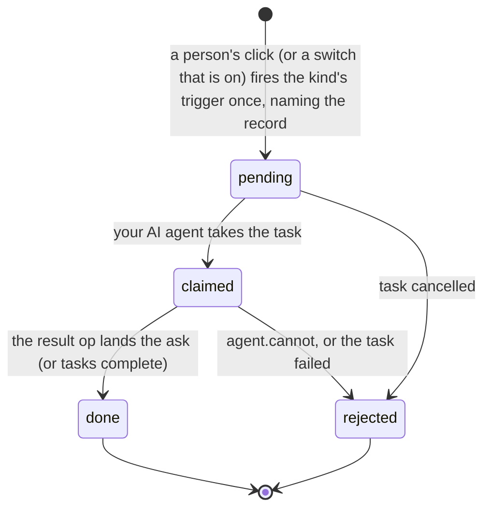
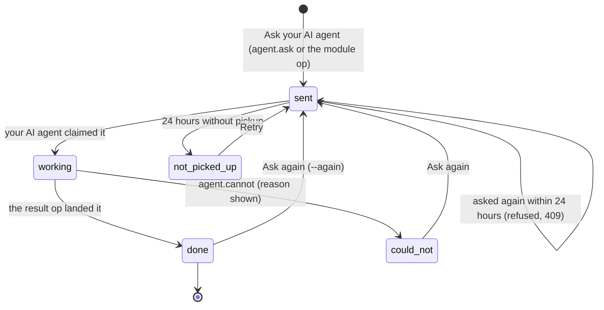
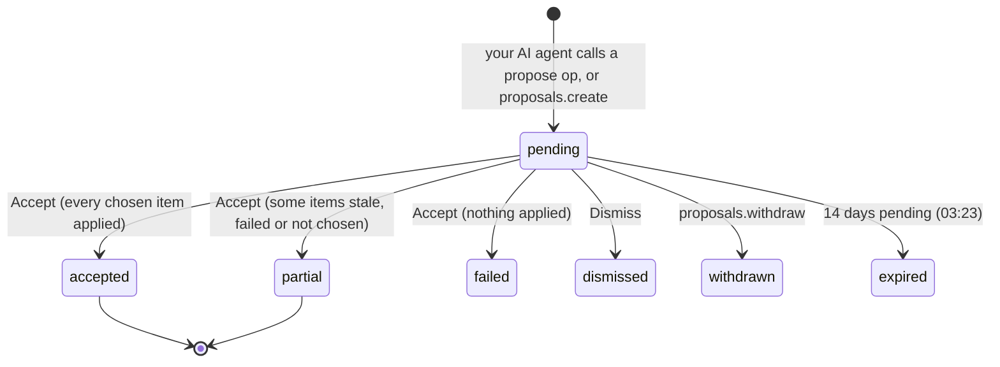
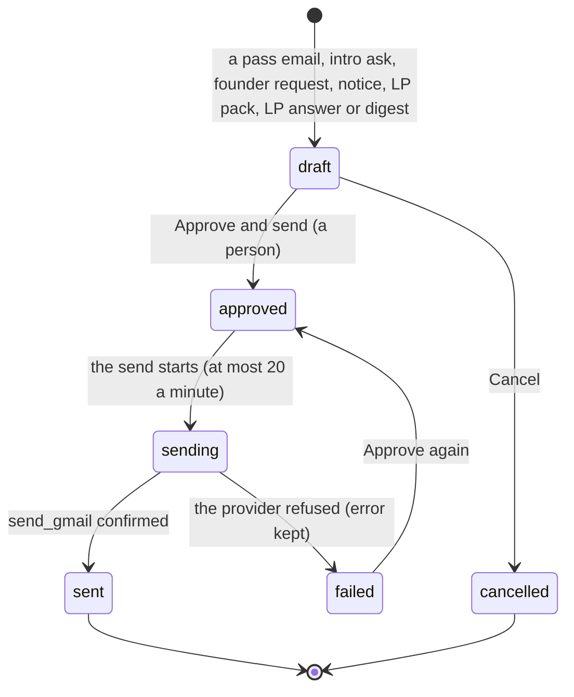

# Requirements: Venture OS

PART A — REQUIREMENTS (SRS). User-approved before build; frozen after; changes via ## Changes.

## Introduction

### Purpose
Venture OS is the operating system of a venture capital firm, used in the browser by the whole investment team (owner, partners, principals, analysts, platform, finance, venture partners and scouts), each signed in with their own account, role and approval PIN. Its one job is to run the firm from one place: inbound deal flow and its triage, the pipelines, diligence, the investment committee, the portfolio, the funds with their LPs and quarterly reporting, the firm's network and its market research. People decide, and every number on screen comes from the app's engines or from a value a person verified. The firm's AI agent works on the same data through A2App, through the same operations the screens call. It reads decks into graded facts with page citations, answers diligence questions with sources, drafts memo sections, pass emails, intro asks, meeting and board briefs, marks and LP letters, stages KPI values from founder updates and screens sourcing signals. Its changes to records people wrote arrive as proposals a person accepts in Next, everything that leaves the firm waits as a draft a person approves and sends, and the app asks it for one piece of work at a time through 28 triggers, each naming the record, when a person asks (or a switch the firm turned on applies).

### Scope
**Goals**
1. A deck dropped anywhere in the app, added through "Add deal" or arriving on the Gmail deals label becomes an Inbox item with a reply-by day counted in business days. Once your AI agent has read it, the item shows graded facts with page citations, its thesis checks as met, unmet or unknown and its missing slides, and a person advances it to a deal at Screen, passes it with a reason chip (with an optional pass email a person approves) or holds it.
2. A deal at IC joins the next committee meeting. Eligible members cast sealed votes with their PIN that nobody, your AI agent included, sees before the facilitator's reveal, and the recorded decision keeps its rule, tally and the frozen memo's hash and is never edited.
3. A capital call or distribution goes Amount, Preview, Issue: the preview shows every LP's line computed by the capital engine (fees only on fee-paying LPs), and one PIN issues it, books the ledger rows and sends one PDF notice and ILPA CSV per LP as approved Gmail messages; payments are tracked until the event is settled.
4. Fund metrics (TVPI, DPI, RVPI, net IRR, gross MOIC and IRR), runway, SAFE ownership, pro rata, reserves and the waterfall come from the engines in `pb/pb_hooks/lib_eng_*.js`; an unknown input answers null with a reason, never zero.
5. Your AI agent cannot itself advance, pass or hold a deal, vote, record a decision, verify a KPI, approve a mark, issue a notice, see wire details or send anything outside the firm: those operations are among the 152 refused to it, and 38 of its write operations (a suggested pass among them) become proposals a person accepts in Next.

**Core functionalities:** team sign-in with roles, fund scope and an approval PIN · the Next queue and Focus mode · the Inbox with deck triage · pipelines on boards with a cohort funnel · deal pages · meeting notes with transcripts · the deal room with versions, NDA files and one citation reader · diligence checklists with cited answers · references · comparison grids · investment memos with citations · IC meetings with sealed votes · decisions, conditions and the anti-portfolio · holdings, rounds, securities and SAFE conversion · founder updates with KPI staging and verification · runway and alerts · founder asks and board meetings · funds, LPs and commitments · sealed wire details · capital calls and distributions with PDF notices · payments, ledger and statement reconciliation · marks, NAV and fund metrics · reserves and scenarios · the quarter close with LP letters and packs · the LP fund raise · relationship capture and strength · warm intro paths · meeting briefs · theses and sourcing radars · market maps · news, insights and market briefs · imports and exports · proposals, outbound drafts and run-level undo · your AI agent's triggers and questions

### Approval
Approved by the user: 2026-11-16 — carried over from the published marketplace app `venture-os` 1.0.0, whose requirements were approved when it was built; this document restates them in the framework's form without changing any feature.

## Product Description

### Product Perspective
`authMode: none` at the platform level, because Venture OS carries its own team sign-in inside the app. The `members` auth collection holds each member's email, hashed password, role, fund scope and status; the View sends PocketBase's 30-day session token as the Authorization header. Every operation route resolves its caller first (`lib_auth.context`): a member by that token, your AI agent by the app's `.agent-token` sent as `X-A2App-Token` and compared in constant time (`$security.equal`), or nobody (only `setup.status`, `setup.complete`, `auth.login`, `auth.accept-invite`, `auth.recover` and the news picture `news.image` are public). It then checks the catalog's permission. The first run (`setup.complete`) creates the firm, its first fund, the management company, the owner account and the owner's six-digit approval PIN, and shows a recovery code once. Members join by invite code; a role gives a level (none, view, edit, full) on each of ten modules; a member may be limited to some funds; the PIN, hashed with bcrypt in the hidden `pin_vault` auth collection, guards 26 operations. manifest.json declares no integrations (`capabilities.integrations: []`). The backend itself calls keyless public hosts: exchange rates (Frankfurter, then currency-api on jsDelivr), sourcing (SEC EDGAR, the Hacker News API, GitHub repository search) and news (Bing News RSS, then Google News RSS, with Bing's thumbnails). Mail and calendar go through the host's bridge (`_craftbot_bridge.callAction` with `search_gmail`, `get_gmail`, `download_gmail_attachment`, `send_gmail` and `list_google_calendar_events`), which exists only when CraftBot hosts the app; elsewhere it answers 503 and Settings shows "Connect Gmail in CraftBot". The app deliberately makes no LLM call of its own (every judgment is a trigger for your AI agent), is not a portal for founders or LPs (everything external leaves as an approved Gmail message), is not a fund administrator or accounting system (administrator and bank statements are imported and reconciled), never moves money, and has no connection to LinkedIn, PitchBook, Crunchbase, Carta, DocSend or Affinity (data enters by email, upload, CSV or XLSX import and your AI agent's own research). Every collection is closed to the raw records API.

### User Characteristics
The members of one venture firm, each with one of the eight seeded roles (or a role the owner adds): the owner (managing partner), partners and principals who source and work deals, analysts who screen the Inbox and do diligence, platform staff who work the network and founder asks, finance (the CFO) who runs funds, LPs, capital and marks, venture partners who see the pipeline and vote, and scouts who only submit deals and see their own. Partners live on the deal pages, the board and Focus mode; finance lives on Funds. They work on desktops with the full sidebar and on phones (below 768 px) through the owner's share link, where a bottom bar holds Home, Next, Deals, Portfolio and More. The rhythm is daily (Next, Inbox verdicts, meetings and their notes), weekly (the IC meeting), quarterly (marks, the close, LP letters and packs) and as needed (capital calls and distributions).

### Constraints
- C-1: Money is stored as integers in minor units of the currency named with it (`_minor`; JPY none, KWD three), ownership and rates in millionths (`_ppm`), prices per share, exchange rates and multiples scaled by 10^8 (`_e8`), days as `YYYY-MM-DD` text in the firm's zone (`_day`) and timestamps as UTC (`_at`). Operation parameters take major-unit text ("1250.50") and percent text ("2.5"). No float is ever stored.
- C-2: Permissions are a level per module (none < view < edit < full) over network, intake (Inbox), pipeline (Deals), diligence, committee, portfolio, funds, lps, markets and settings. The seeded roles are owner (full everywhere, votes), partner (edit on network, intake, pipeline, diligence, committee, portfolio and markets; view on funds, lps and settings; votes), principal, analyst, platform, finance (full on funds and lps), venture_partner (committee edit, votes) and scout (intake edit, sees only its own items). The last active owner cannot be disabled or given another role, and only an invite never used can be deleted (a member who used the app is disabled instead).
- C-3: Scope. A member limited to some funds (`members.funds`) sees only those funds and their deals and holdings; the owner sees all. A restricted deal is visible only to its deal team and the owner, and to your AI agent only while the deal's "Your AI agent may work on it" is on. LP data (LPs, commitments, capital accounts, payments, ledger, LP letters) needs LPs view, and is visible to your AI agent only while "Fund data visible to your AI agent" is on (on by default). Reads that withhold rows say `hidden: n`.
- C-4: The approval PIN is six digits, never one digit six times. It is asked by the 26 confirm operations (member and role changes, PIN reset and a new recovery code, votes.cast, votes.reveal, decisions.record, calls.issue, calls.void, distributions.issue, ledger.opening, marks.approve, quarters.freeze, reports.finalize, exports.ilpa, bank.view, bank.change, bank.approve, exports.all), by imports into a target marked `pin: true` (opening balances and opening holdings) and by accepting a proposal of one. Five wrong PINs lock the PIN for 15 minutes; ten failed sign-ins lock the account for 15 minutes. Passwords have at least 8 characters, invite codes are 10 characters in two groups of five and last 7 days, sessions last 30 days, and the owner's recovery code is shown once and stored hashed.
- C-5: Every operation carries an agent rule: allow, propose or deny. A propose operation called by your AI agent is first run inside a rolled-back transaction (an impossible call is refused at once) and then stored as a proposal with its why, evidence and confidence, unless the owner promoted its kind to automatic. Only five kinds can be promoted: note_fields (non-financial field changes from notes), merges, asks, map_entries and stage_moves (only to Screen). A pending proposal expires after 14 days, and accepting one checks every item again and refuses an item whose target moved since.
- C-6: Deals. A deal's status is open, invested, passed, lost or hold. The seeded Deal flow pipeline has the stages Sourced 7, Screen 7, First meeting 7, Diligence 21, Partner meeting 14, IC 7, Term sheet 21 and Closed 0 (stall days); SPV, Fund raise and Program pipelines are made with their own stages on first use. A deal is stalled once its calendar days in the stage pass the stage's stall days. A company has at most one open or held deal per pipeline, deals are numbered D-0001 onwards, and your AI agent opens deals only at the first stage of a pipeline.
- C-7: Inbox items are numbered IN-0001 onwards, arrive by email, upload, scout, csv or sourced, and are new, held, passed, advanced or merged. The reply is due within the firm's reply days (default 5 business days, Saturday and Sunday off). Advance makes a deal at Screen with the person as point partner and needs a company. A hold lasts 7, 30 or 90 days by chip (14 by default). The pass reasons are Team, Market, Product, Traction, Valuation, Fit with thesis, Timing and Other. A fact a person saved is confirmed and never overwritten by your AI agent, and your AI agent never saves a computed number.
- C-8: Committee. The vote scales are "1 to 5, no 3" (default), "1 to 5", "1 to 10, no 5 or 6" and "Yes or no"; the rules are consensus (every vote for), champion (the champion votes for) and majority (more than half for), and any veto makes the rule's answer pass. Outcomes are invest, pass, more diligence and hold. Ballots are sealed until the reveal, which needs every eligible vote (or voting closed) and the cooling-off (default 24 hours) over. A decision is never edited; later outcomes are appended as reviews. A memo's thesis, recommendation and scenarios are written by people only, and submitting a memo freezes a version with a SHA-256 hash.
- C-9: Diligence answers are typed (text, number with a unit, yes or no, date) and graded (artifact, founder reported, public, unverifiable, unknown). Your AI agent's answer must cite: an anchor inside the deal's citation scope (its room, or files of its company that belong to no deal) or a public link; grade artifact needs an anchor and grade public a link. Your AI agent never answers a computed number (`agent_no_compute`): it answers the figures a source states and leaves derived ones to people, whose computed numbers need their formula. A value a person rejected is not proposed again, and a person's own answer is confirmed at once.
- C-10: Portfolio. A KPI value is staged, verified, rejected or superseded, with one live value per company, metric, period (1, 3 or 12 months) and forecast flag. A verified value stays until a person verifies a restated one, and your AI agent's values without a source are refused. Runway uses only verified cash and net burn over a complete three-month window, else it is unknown with the missing months. Alerts fire once per breach: runway under 6 months, cash under 3 months of burn, net burn up 30% quarter on quarter, and no update 45 days after a requested period. Mark invested is refused (409) while the committee's latest decision is not invest or conditions are open, unless an owner or partner overrides it (audited).
- C-11: Funds. A capital event is a call or a distribution and is draft, previewed, issued, settled or void; issuing re-runs the preview (refused as `stale_preview` when anything moved) and needs approved wire details (`no_wire`). The notice is due 10 business days after the notice day. The ledger is append-only and a void writes reversing rows. Fees follow the LPA from the first close, on the committed or invested basis only. A wire details change needs a second member's approval with their PIN, and a revealed sealed value shows for 5 minutes. A quarter is open, frozen, final or sent, and freezing is refused while draft marks wait. Marks, the letter and finalising are approved by finance (funds edit) or a partner (portfolio and committee edit).
- C-12: Everything that leaves the firm is an `outbound` message (kinds pass, intro, request, notice, lp_pack, digest, reply) that a person approves; sending goes through `send_gmail` with a send key so a retry never sends twice, at most 20 sends in any 60 seconds, and only after every attachment path is checked.
- C-13: Work for your AI agent is one trigger per kind of work (28 in events.json), each naming its record in its params. A record's ask of a trigger is never fired again while it is pending (asked less than 24 hours ago and neither landed nor refused). Cooldowns are 10 s, 300 s for radar_sweep and map_refresh, and 72,000 s for anti_portfolio, news_digest and news_insights. The eight automatic switches are off by default, and a demo firm never fires.
- C-14: Relationship capture is opt-in per member, reads mail headers only (never bodies), never captures firm addresses or excluded domains, skips bulk mail by its labels and headers, and never makes a company from a free-mail domain. Calendar events are read without consent. Strength decays with a 60-day half-life over a 365-day window.
- C-15: Markets. One radar per thesis. A signal is screened out by structured filters or an unmet required thesis criterion (unknown is never unmet), known when the company is already in the firm's records, else new; screened-out and known signals are deleted after 60 days, and nothing reaches the Inbox without a person's click. A fact licensed `internal_only` never reaches an LP output. News items are kept 60 days (Funding items that report a round 400 days).
- C-16: Copy names no particular agent ("your AI agent"), uses no emoji and no em or en dashes, icons are lucide-react, and companies show their uploaded logo, else their website's icon, else a letter avatar.
- C-17: Seeds: one settings row (date style iso, week starting Monday, every promotable kind on "ask", every automatic switch off, fund data visible to your AI agent), the eight roles, the Deal flow pipeline, ten KPI definitions (revenue, ARR, MRR, gross margin, net burn, cash, runway, headcount, customers, NRR), five note templates (First call, Partner meeting, Reference, Board, Free), the 13-section memo template and the seed (51 questions) and Series A (68 questions) diligence checklists.

### Assumptions
- A-1: Volume ceiling: about 5,000 deals. Home's summary was measured on a firm with 5,000 deals and the board on 600 deals; list operations answer at most 500 rows per call (50 by default), a board column at most 500 deals (100 by default), and an import takes at most 20,000 rows per file in batches of 200.
- A-2: CraftBot hosts the app on the owner's machine: Gmail and Google Calendar are the owner's connected account plus one optional capture mailbox; per-member mailboxes are not read.
- A-3: Node is on the host's PATH: the text layer (`engine/textlayer.mjs`, the PDF reader `engine/pdftext.mjs`) and the notice and pack PDFs (`engine/funds/render.mjs`) run as spawned Node processes. Without it files get no text layer and issuing a notice is refused (424 `pdf_engine`).
- A-4: The firm's time zone is one of the 101 zones of `lib_eng_days`; every day in the app is a day in that zone.
- A-5: Real-world figures reach the app only when a person types or imports them, your AI agent stages them from documents, or the firm's mail and calendar are captured; the app never invents or estimates a missing value.

## Features

### Module: Frame (app, search, notifications)
- F-FRM-1: A member reaches every place their role may view from the sidebar: "Venture OS" with a telescope icon (or the firm's uploaded logo), the black "Add deal" for Inbox editors, then Home, Inbox (count of verdicts and replies overdue), Deals, Committee (count of my votes due), Portfolio, Funds (with the tree child "Fund raise"), Network and Markets, and at the foot the "Your AI agent" card and Settings.
- F-FRM-2: WHEN the firm has two or more funds THE SYSTEM SHALL show a fund scope row under the title ("All funds" or one fund), remembered in the browser and passed to the pages' reads.
- F-FRM-3: A member can fold the sidebar to a 60 px icon rail with tooltips (232 px open), and only their click folds it; the choice is remembered.
- F-FRM-4: A member sees a top bar with the page title, Search (Ctrl K), the Next count (opens Focus mode) and a bell with an unread dot. The bell lists notifications with their time; one opens its link and is marked read, and "Mark all read" clears them.
- F-FRM-5: Below 768 px a member gets a bottom bar with Home, Next (with its count), Deals, Portfolio and More, which opens the whole sidebar as a drawer.
- F-FRM-6: A member can search from Ctrl K: from two characters it searches people, companies, deals, files (never NDA files), funds and SPVs, LPs, Inbox items, notes, meetings and memos, portfolio companies, theses, market maps and grids, grouped by kind and limited to what the member may see; it also lists matching commands (Add deal, Import a deal list, New call, Fund raise, New thesis, Who knows, Start Next, Deal board, Deals table, Portfolio, Request updates, Check Gmail for founder updates, Next meeting, Your AI agent) and places, and from three characters a "Your AI agent" row that asks the typed text. Arrow keys and Enter open a row and Escape closes.
- F-FRM-7: WHEN a member drops or pastes a PDF, PPT, PPTX or Keynote file anywhere THE SYSTEM SHALL add it as a new Inbox item and open it; WHEN they drop files or more than 40 characters of text on a portfolio company page THE SYSTEM SHALL file them as that company's founder update.
- F-FRM-8: WHEN the host switches light or dark mode or its theme pack THE SYSTEM SHALL recompute every `--vo-*` colour from the host's tokens with contrast checks.
- F-FRM-9: WHEN anything a view reads changes (another member, your AI agent or a scheduled job) THE SYSTEM SHALL reload that view without a refresh.
- F-FRM-10: An unknown route shows "Page not found" with Home, a route the role may not open shows "Not for your role", and an unreachable backend shows "Cannot reach the app" with "Try again".

### Module: Access (setup, auth, pin, members, roles)
- F-ACC-1: WHEN the firm is not set up THE SYSTEM SHALL show a four-step setup with the StepTrack Firm, Fund, You, PIN: firm name, currency chips (USD, EUR, GBP, SGD, JPY, INR, or Other with a code) and time zone; the first fund's name, size (typed "50m") and vintage; your name, email and password (at least 8 characters); the six-digit PIN twice ("Use different digits." for one digit six times). "Finish" shows the recovery code once with Copy, then "Open Venture OS".
- F-ACC-2: A member signs in with email and password on a page titled with the firm's name, with a "Recover" link; ten failed attempts lock the account for 15 minutes, and a session lasts 30 days.
- F-ACC-3: The owner (settings full) can invite a member by email, name and role in Settings, Members, with the PIN; the invite code (two groups of five characters, valid 7 days) opens "Join your firm" at `#/invite?email=&code=`, where the member sets a name and password.
- F-ACC-4: The owner can change a member's role and fund scope, disable or enable them, give them a new sign-in code (an expired invite or a forgotten password), delete an unused invite and change a role's levels, each with the PIN, and sign a member out of every session.
- F-ACC-5: A member can set or change their PIN and their password and sign out their sessions in Settings, Security; the owner can make a new recovery code (PIN) and clear another member's PIN (PIN), who then sets a new one with their password. At `#/recover` the owner's recovery code sets a new password (and optionally a new PIN) and shows a new recovery code once.
- F-ACC-6: WHEN a member runs an operation that needs the PIN THE SYSTEM SHALL ask for it in the same dialog (six boxes) before the operation runs, and say how many attempts are left after a wrong one.

### Module: Home (home)
- F-HOM-1: A member sees the title "Good morning", "Good afternoon" or "Good evening" with their first name, by the device's clock, and nothing under it.
- F-HOM-2: A member sees "Your firm" as a drawing: the firm as a turning sphere, committed capital as a circle (solid for the share called, dashed for dry powder, "N% called"), one orbit per fund sized by the fund, one node per holding placed by the day first invested and sized by value, a red ring on a holding whose runway is under the threshold or valued below cost, TVPI and DPI on the axes. Hover shows the details and pauses the motion; a click opens the company or the fund; with reduced motion it is still.
- F-HOM-3: A member sees beside the drawing the key numbers they may see and that are known: "Firm NAV" (or "<fund> NAV" when scoped), TVPI, Net IRR, Dry powder, Portfolio companies and Open deals; NAV, companies and deals open their pages. An empty firm reads "Add a fund to see your firm here" with "Add fund".
- F-HOM-4: A member sees "Today's meetings" ("No meetings today") beside "Waiting for you": the top items of Next as rows (kind icon, title, one figure, the primary action inline), the item count and "Start", which opens Focus mode ("Nothing waiting for you" when empty).
- F-HOM-5: A member with Markets view sees "News": category tabs, a lead story, cards that open the article in a new tab and "Your AI agent's take" (the latest insights with their impact), with "Ask your AI agent" when there is none.
- F-HOM-6: A member sees "New deals by source" (deals in each month of the last 12 months by Email, Upload, Scout, Sourced and Introduced) beside "This quarter's deals" (the quarter's cohort flowing through the stages).
- F-HOM-7: A member sees "Portfolio by value" (each company's value as a tile, coloured Under 1x, At cost, 1x to 2x, 2x to 3x, 3x and more) beside "<fund> performance" (TVPI, DPI, RVPI and gross MOIC by quarter, with calls and distributions).
- F-HOM-8: A member sees "Runway" (bars per company, shortest first, the red line at the alert threshold), "Invested by sector" or "Open deals by sector" (switchable) and "<metric> growth" (each company's main figure, unverified points dashed).
- F-HOM-9: WHEN a member's role may not see a block's data THE SYSTEM SHALL leave the block out, and a block that fails says so alone without hiding the others.
- F-HOM-10: A member can switch on the "Morning digest" (Settings, Digest; off by default): an email at 07:00 their time with the day's meetings, items past due, votes and decisions due and alerts, each linking back, and "Send now".

### Module: Next and Focus (next, proposals, outbound, todos)
- F-NXT-1: A member sees in Next everything that needs them from every module, of 14 kinds (verdict, stall, draft, proposal, vote, decision, verify, alert, condition, payment, mark, candidate, note, task), ordered by rank then time; actions they may not run are left out.
- F-NXT-2: A member can work Next in Focus mode (`#/focus`): one card at a time with the result prepared for it and one to three actions; J and K move, A takes the primary action, X skips, E edits, Esc leaves; the next card slides in and the end reads "All clear".
- F-NXT-3: WHEN an action needs a choice (a pass reason, a hold length, a vote, a company) THE SYSTEM SHALL show it as chips on the card, and WHEN it needs the PIN THE SYSTEM SHALL ask it first; a done action shows its result toast with Undo when the action has one.
- F-NXT-4: A member can open a proposal (`#/next/proposal/:id`): each change as "<label>: <before> -> <after>", the kind as a tag, your AI agent's reason and evidence quote; they accept all or some items (with the PIN when an item needs it) or dismiss it, and an item whose target moved since is refused as stale.
- F-NXT-5: A member can open an outgoing draft (`#/next/draft/:id`): its recipients and full text, edit the subject and body (E in Focus), "Approve and send" or cancel it; a failed send shows its error and can be approved again.
- F-NXT-6: A member can mark a task done or snooze it until tomorrow 08:00, and add next steps to a deal (tasks with an assignee and a due day).

### Module: Inbox (intake, triage, passes, scouts)
- F-INB-1: A member with Inbox view sees the Inbox: a strip ("N ready to decide", "N reply overdue", "Typical reply: N days", the median business days to a verdict over 90 days), then New, Waiting and Held with counts and a search. Rows show the company, received day, one line, the best thesis chip with "+n", "Reply overdue" or the StepTrack Received, Reading, Facts, Ready. From 1024 px the list (380 px) and the open card sit side by side; below, they take turns.
- F-INB-2: A member can add a deal in "Add deal": a drop zone ("Choose deck") and "Paste a link or email" (Enter adds a link), with Company, From, Scout and Thesis behind More. A dropped deck shows at the top of New at once and opens.
- F-INB-3: WHEN "Check email" is on (default) THE SYSTEM SHALL file the Gmail deals label ("Venture OS/Deals") every 5 minutes, once per message, with its documents (PDF, PPTX, PPT, Keynote, DOCX, DOC; pictures only when no document came); "Check now" runs it at once. Items also come from uploads, scouts, deal-list imports and sourcing.
- F-INB-4: A member sees each item's reply-by day ("Reply by", "Reply today", "Reply overdue" or "Held until"); WHEN an item passes its reply day THE SYSTEM SHALL put it in Next as a stall item and notify the deciders at 08:00.
- F-INB-5: A member sees the item's card in sections: who it is (logo, name, one line, from and when), "Key numbers", "About the deal" (facts with grade dots and citations: "p.7" opens the deck page with the quote marked), "Fit with your theses" ("Fits <thesis>: N of M checks met", each check met, unmet or unknown), "Missing", "Seen before" and the deck and email; while it is being read, "Waiting for your AI agent" with the StepTrack, and "Ask your AI agent" or "Ask again".
- F-INB-6: A member with Inbox edit can Advance (A), which makes a deal at Screen with them as point partner and moves the deck into the deal room (asking for the company when there is none); Pass (P) with a reason chip (keys 1 to 8), an optional "What was missing", a milestone or day to look again and an optional pass email; or Hold (H) for 1 week, 1 month or 3 months. Each verdict shows at once with an Undo toast, and J and K move between items.
- F-INB-7: A member can select several items and pass them together with one reason, with Undo.
- F-INB-8: A member can have the pass email drafted by your AI agent from the firm's template, or "Write it myself"; its state reads Drafting, Draft, Sending, Sent, Not sent, Cancelled or No email, and the draft is approved and sent from the card or Next.
- F-INB-9: WHEN a passed item's look-again day comes THE SYSTEM SHALL offer it in Next with "Re-open" or "Keep passed"; WHEN a held item's day comes it returns to New.
- F-INB-10: A member can set the reply days, the deals label, Check email, the firm's pass reasons and the pass email template, and add and pause scouts (Settings, Intake).
- F-INB-11: A scout sees and adds only the items they submitted.
- F-INB-12: A member can import a deal list (CSV or Excel) into the Inbox.

### Module: Deals (deals, pipelines)
- F-DEA-1: A member with Deals view sees the Deals page: the funnel strip of this quarter's cohort ("N inbound", then per stage its deals and "N% moved on"), the Board or the Table (icon switch), and a Pipeline switch when the firm has more than one pipeline.
- F-DEA-2: A member sees the Board as one column per stage, filling the window, with cards showing the logo, name, round amount, days in stage and point partner; a stalled card has a warn edge. They can drag a card to another stage (moved, with Undo) or within its column (reordered), or use its Move menu or Alt+Arrow keys.
- F-DEA-3: A member sees the Table with Active, Mine, Passed and All, a column picker, saved views and scroll paging; selecting two or more rows offers Compare (a comparison grid).
- F-DEA-4: A member sees the deal page header: logo, name, the stage track (a click on a stage asks one line, then moves with Undo), status, a lock when restricted, point partner and team; and the strip Round, Raise, Valuation, Check and Ownership (check over post-money; left out when all are unknown).
- F-DEA-5: A member sees the stage's one black action: Advance; at Diligence "Schedule IC"; at Partner meeting and IC the committee's next step for them (Vote, Reveal, Record decision, Open meeting or Schedule IC); at Term sheet "Mark invested"; on hold "Reopen". The More menu holds Assign, Team, Restrict, Pass, Lost, Hold, Merge and Reopen, each a small dialog of chips and pickers.
- F-DEA-6: A member sees the deal's tabs Overview, Diligence, IC, Investment, Files and Notes (Diligence and IC not on Fund raise deals; Investment once the deal is invested or open at IC, Term sheet or Closed). Overview holds the deal's facts, the deck's facts with grades and citations, thesis checks and missing slides, the next meeting's brief, next steps and the timeline from every module.
- F-DEA-7: A member can restrict a deal to its deal team (with "Your AI agent may work on it"), assign the point partner, add or remove team members, merge a duplicate deal (its old ids still resolve) and set its status to passed, lost or hold with a reason, or reopen it.
- F-DEA-8: WHEN an open deal stays in a stage past its stall days THE SYSTEM SHALL give its point partner a stall item in Next (Move, Pass, Snooze a week) and one notification at 08:00 for that stall.
- F-DEA-9: WHEN the committee records a decision THE SYSTEM SHALL move the deal: invest to Term sheet, more diligence to Diligence, pass to passed, hold to on hold.
- F-DEA-10: A member with settings edit can edit pipelines (stages with their stall days, add a pipeline) and note templates (name, sections, the stages they open at) in Settings, Pipelines.

### Module: Meeting notes (notes)
- F-NTS-1: A member sees a deal's Notes tab (and a company's): each note's template, headline, pending changes, review state, author and day.
- F-NTS-2: A member can write a note: template chips while empty (First call, Partner meeting, Reference, Board, Free), meeting day, sections, consent chips (Informed, Not recorded), a transcript drop (.txt, .vtt, .srt, .docx); it saves itself 800 ms after typing (a new note is stored with its first words) and "Save" marks it saved.
- F-NTS-3: A member can ask your AI agent to review a saved note; the note then shows its summary, each proposed deal change (before and after, with the sentence it rests on; Accept, Dismiss or Accept all), the tasks for stated next steps and the reference calls, with the StepTrack Saved, Reading, Summary, Ready.
- F-NTS-4: WHEN an external meeting a member attended ends without a note THE SYSTEM SHALL give them a note item in Next ("Add note" opens the meeting's note on the deal or company; "No note" clears it), and an open deal's meeting gets an empty draft in its stage's template.
- F-NTS-5: Only the author or the owner changes a note's body, and your AI agent changes only notes it wrote.

### Module: Files and the reader (files, pages, anchors)
- F-FIL-1: A member sees a deal's room in its Files tab: folders, each file's versions and its text state; they can upload by drop (up to 200 MB a file, with "Under NDA"), open, download, add a new version, see versions and delete (soft, with Undo).
- F-FIL-2: WHEN a file is added THE SYSTEM SHALL read its text layer in the background (PDF pages, a page per PPTX slide, DOCX and text), and mark a page with under 20 characters of text as needing OCR; "Ask your AI agent" then reads the scanned pages.
- F-FIL-3: A file under NDA is readable only by its deal team (and by your AI agent while an NDA ask about the deal is pending); everyone else gets its quotes withheld, and it never shows in search.
- F-FIL-4: A member can open any citation in one shared reader over the page, at the quote (PDF pages drawn with the marked rectangles, other files as page text with the passage marked), also as a tab at `#/source`; an anchor whose quote is no longer on its page or outside the deal's scope says so.

### Module: Diligence (dd, refs, compare)
- F-DIL-1: A member sees a deal's Diligence tab: answers waiting first ("To check", with Confirm all and a High grade filter), then the checklist folded by area, each area with its ring (confirmed of total), counts and a Sparkle count of answers waiting.
- F-DIL-2: WHEN a deal enters Diligence without questions THE SYSTEM SHALL apply the checklist for its round (seed for pre-seed and seed, Series A later); a member can also apply it from the empty tab.
- F-DIL-3: A member can ask your AI agent to answer the open questions from the room and public sources; each answer shows its typed value, grade dot and source chip (the quote in its tooltip, a click opens the reader), and is confirmed or rejected with one click in the tab, the reader or Focus. A member can answer by hand.
- F-DIL-4: A member sees a Next verify card per deal with answers waiting, for its point partner and team: "Confirm N high grade" or every answer.
- F-DIL-5: A member can log a reference call (provided, backchannel, customer, expert; positive, neutral, negative) and ask your AI agent to suggest back-channel names from the firm's own records, then dismiss or call them.
- F-DIL-6: A member can open a comparison grid (`#/compare/:id`): companies as rows, questions as columns, every cell cited; made from a deals table or a market map selection. Companies with a room are answered through their deal's questions, others by your AI agent from public sources; a member can fill or delete a grid.
- F-DIL-7: A member can edit the checklist templates (areas, questions, types) in Settings, Diligence.

### Module: Committee (memos, meetings, votes, decisions, conditions)
- F-COM-1: A member with Committee view sees the Committee page: the next meeting (time, facilitator, agenda rows with kind and champion, a vote dot per voter: hollow waiting, grey voted, coloured after the reveal, and the cooling-off countdown), then Meetings, Decisions (date, company, outcome, rule, tally) and Anti-portfolio. The black button is "Vote" while a vote is due, else "New meeting".
- F-COM-2: WHEN a deal moves to IC THE SYSTEM SHALL add it to the next planned meeting (creating one on the meeting day when none is planned), and at 07:00 on the meeting day it assembles the agenda from deals at IC; a member can also create a meeting with its day and time.
- F-COM-3: A member can run a meeting in its room (`#/committee/:id`): the agenda on the left and one item at a time with the StepTrack Pre-read, Cooling, Votes, Reveal, Decided; the header's one black button is the next step (Start, Vote, Reveal, Record decision, Next item, Close).
- F-COM-4: A voter can cast a vote with the PIN on the fund's scale, with a rationale and an optional veto; casting again replaces it, and before the reveal everyone sees only who voted.
- F-COM-5: The facilitator can reveal with the PIN once every eligible member voted (or voting is closed) and the cooling-off is over; the room then shows the tally chart and every rationale, junior first, with the rule's answer preselected.
- F-COM-6: The facilitator can record the decision with the PIN: outcome chips (Invest, Pass, More diligence, Hold), rule chips (Consensus, Champion, Majority) and pass reasons; the decision keeps the tally, the memo version and hash and a snapshot of the deal's facts and confirmed diligence, and later outcomes are added beside it.
- F-COM-7: A member can add conditions to a decision (text, owner, due day); the owner marks one done with proof from Next or the IC tab, and owners are notified at 08:00 on the due day.
- F-COM-8: A member sees the deal's IC tab: the latest decision on top, the memo below. The memo has the template's sections with citations ("[n]" must resolve, "[?]" marks an uncited figure); your AI agent drafts chosen sections as tracked changes to keep or discard per block (never the thesis, recommendation or scenarios); submitting freezes a version with its hash; "Export Word" saves it; the AI-use counts show typed, pasted and your AI agent's characters.
- F-COM-9: A member can ask your AI agent for an agenda item's bear case (cited risks and contrary evidence, no recommendation).
- F-COM-10: A member sees the anti-portfolio: passed companies with the reason, the raise then and later outcomes with their sources; "Check outcomes" asks your AI agent.
- F-COM-11: A member can set the vote scale (firm and per fund), who votes, the cooling-off hours, the rule and the meeting day and time in Settings, Committee.

### Module: Portfolio (holdings, rounds, securities, kpis, updates, requests, alerts, asks, board)
- F-POR-1: A member with Portfolio view sees the Portfolio page: Companies, Invested, Value, MOIC and "Runway < 6 mo", then one row per holding (company, fund when several, stage, KPI sparkline, growth, runway meter, reporting dot, last update); "Request updates" is the black button.
- F-POR-2: A member can mark a deal invested in its Investment tab in three steps (Terms, Preview, Done): instrument chips (SAFE cap, SAFE discount, SAFE MFN, Note, Priced), amount, day, fund and the round's terms, then the preview of ownership from the SAFE engine and the conversion at a next round, and closing documents that your AI agent reads into proposed round and security terms. The holding, round and security are created in one step.
- F-POR-3: A member sees a portfolio company (`#/portfolio/:company`): the hero (logo, one line, sector, stage, HQ, founded, team size; Website, Latest deck, Data room, Latest update, Board deck, Email the founders; the fund position), then Overview, Updates, Holdings, Asks and Board. Overview shows KPI tiles (ARR or revenue, growth, net burn, cash, runway on a 0 to 24 month track with the 6-month line, headcount), the latest update, open asks, the next board meeting, files, news and the KPI charts.
- F-POR-4: A member can edit the company (logo, details, founders and team), its numbers month by month (entered values are verified at once) and the investment (round, security, amount, date, valuation).
- F-POR-5: A member can add a founder update by dropping files or pasting text; WHEN mail arrives on the updates label or from a portfolio company's domains or founders ("Company mail", on by default) THE SYSTEM SHALL file it as an update every 5 minutes; an update without a company waits to be filed to one or dismissed.
- F-POR-6: A member sees the values your AI agent staged from an update beside their source quote, with flags (contracted not live, gross not net, bookings not revenue, run rate, period unclear, currency unclear, restated), and can "Verify all", fix one or reject one, in the Updates tab or Focus.
- F-POR-7: A member sees KPI charts converted to one currency (flows at the period's average rate, balances at its end; no rate answers null with a reason), with staged points dashed, and the runway from verified cash and burn or why it is unknown.
- F-POR-8: A member can turn on founder requests for a company (metrics chips, cadence, recipients, subject and email): the request for the period just ended goes out on the request day after it (3 days by default), reminders follow at 7 and 14 days while no update came, and each message is released by the member who turned it on.
- F-POR-9: WHEN a company's runway drops under 6 months, its cash under 3 months of burn, its net burn rises 30% quarter on quarter, or its update is 45 days late THE SYSTEM SHALL fire one alert per breach (daily at 07:30) into Next, to be acknowledged, and resolve it when the condition ends; the thresholds are editable.
- F-POR-10: A member can track founder asks (intro, hire, customer, fundraising, advice, other) on a board by Open, In progress and Done, with owner and due day, and reorder them.
- F-POR-11: A member can add board meetings (day, time, title, deck, note) and ask for a brief; with the switch on, your AI agent writes it 48 hours before.
- F-POR-12: A member can set the alert thresholds, the request email, the updates label and company mail in Settings, Portfolio.

### Module: Funds (funds, lps, commitments, calls, distributions, payments, marks, reserves, quarters, reports, statements)
- F-FND-1: A member with Funds view sees a fund: TVPI, DPI, RVPI, Net IRR and Gross MOIC side by side over the J-curve (calls below the line, distributions above, NAV as a line), then Overview, LPs (with LP data), Capital, Marks, Reserves and Reports. "New call" is the black button; More holds New distribution, Fund raise, Import statement, ILPA export and Excel.
- F-FND-2: A member with LPs edit can add and edit LPs (kind, contacts, country, a sealed tax id shown masked) and their commitments (soft or signed, amount, fee-paying, own fee rate, waiver, side-letter chips, closing day), and see an LP's page with its capital account.
- F-FND-3: A member with funds full can change the firm's wire details for a fund (shown as the bank and last four); a second member approves the change with their PIN, and "Show" reveals the full details with the PIN for 5 minutes.
- F-FND-4: A member with funds edit can make a call in three steps (Amount, Preview, Issue): purpose chips (Investment, Fees, Expenses, Recall, Line repayment), one amount, the holding and "Add fees"; then every LP's line with the exact total and your AI agent's review; then the total, LPs, due day and wire account, and "Issue call" with the PIN.
- F-FND-5: WHEN a call or distribution is issued THE SYSTEM SHALL book its ledger rows on the due day, draw one PDF notice and one ILPA CSV per LP with a non-zero line, and approve their Gmail messages, which the minute job sends.
- F-FND-6: A member can make a distribution (amount, holding, proceeds, recallable part); the waterfall estimate (European or American, hurdle, catch-up, carry) splits it into carry and the LPs' return of capital and gain.
- F-FND-7: A member sees a call's page with its paid bar, every LP's line and its notice, and records a receipt ("Record received"); overdue lines are payment items in Next with "Remind" and "Record received", and a fully paid event becomes settled (daily at 08:12).
- F-FND-8: A member with funds full can void an issued call or distribution (PIN): reversing ledger rows are written and void notices wait for approval for every LP already sent one.
- F-FND-9: A member can import an administrator or bank statement (CSV or Excel), see its differences, ask your AI agent to match receipts and explain the differences, and resolve them.
- F-FND-10: A member sees a quarter's marks (method, value, change, rationale), can ask your AI agent to draft them, and finance or a partner approves them all with the PIN.
- F-FND-11: A member sees NAV (holdings at their latest approved mark, else at cost, plus cash) and the metrics from the engines, net beside gross.
- F-FND-12: A member sees the fund's reserves by holding (target ownership, rounds to follow with sourced assumptions; needed, allocated and available) and can save a holding's reserve plan.
- F-FND-13: A member can close a quarter in Reports: open it, freeze it with the PIN (a snapshot with its hash), have your AI agent draft the LP letter, keep or edit each paragraph, finalise with the PIN (one pack PDF per LP) and send the packs; the quarter turns sent once every pack left.
- F-FND-14: A member can download the ILPA CSV (funds full, PIN) and an Excel workbook.
- F-FND-15: A member with LPs view sees the fund raise board (`#/funds/raise`): prospects as deals of the Fund raise pipeline by stage, with soft circles and targets; they add prospects and move them.
- F-FND-16: A member can log an LP's question, which asks your AI agent to draft an answer from the fund's records as a reply a person approves.
- F-FND-17: A member with settings or funds full can add funds and SPVs (name, short name, currency, kind, size, vintage) with LPA terms (fee, fee basis, step-downs, carry, waterfall, hurdle, compounding, catch-up, recycling), and the owner can archive one; Settings, Fund terms holds the legal name, first close, compounding and wire details.

### Module: Network (capture, interactions, network, intros, briefs, calendar)
- F-NET-1: A member with Network view sees the Network page: a "Who knows" search for a person or company, the ranked warm paths drawn as nodes and edges (member, connector, target, strength on each edge) and as rows, "Ask for intro" on the chosen path, the coverage ring of pipeline and portfolio companies by warmest connection (All, Pipeline, Portfolio), and People and Companies tables (strength band, last contact, the member who knows them best).
- F-NET-2: A member can opt in to "Capture my email and meetings" and exclude domains; the firm sets its domains, the never-captured domains and an optional capture mailbox (Settings, Capture). WHILE at least one member opted in THE SYSTEM SHALL read the mailboxes' headers every 15 minutes into touches; the owner's calendar is read every 10 minutes (two days back, eight ahead) for everyone, and its past external meetings become touches for the opted-in members who attended.
- F-NET-3: A member sees each person's and company's strength from 0 to 100 (strong, good, weak, none), from meetings, calls, emails and messages, recomputed after capture, every minute for people just touched and nightly at 02:35.
- F-NET-4: A member can ask for an intro on a path (one open ask per target); your AI agent drafts the ask with a forwardable blurb, the asker approves and sends it from Next, and records the outcome (made, declined, no reply).
- F-NET-5: A member sees today's meetings and can ask for a brief of a meeting (who they are, the firm's history with them, the deal, questions to ask, recent news with links); with the switch on, your AI agent writes it 18 hours before each external meeting.
- F-NET-6: A member sees a company page and a person page: header, figures, timeline and tabs (company: Overview, Network, Portfolio when held, Notes; person: Overview, Network); a network editor changes the company logo and details.
- F-NET-7: A member can import people and companies (CSV or Excel).

### Module: Records (people, companies, records)
- F-REC-1: People and companies have one identity each: a person by email, a company by its root domain (a free-mail domain never makes a company), and merged records keep resolving by their old ids.
- F-REC-2: Each field keeps its source; your AI agent fills empty fields directly with its source, and its change to a value a person wrote becomes a proposal.
- F-REC-3: A company lists its founders first (a founder seat on a deal, or a current job marked founder), then its team; editors add, mark and unlink them.
- F-REC-4: A member sees the timeline of a company, person or deal, merged from every module.
- F-REC-5: A company's logo is a PNG, JPG, WebP or SVG of at most 2 MB; the firm's own logo replaces "Venture OS" in the sidebar.

### Module: Markets (theses, radars, signals, maps, news, research)
- F-MKT-1: A member with Markets view sees Markets with News, Overview, Sectors, Theses and Research.
- F-MKT-2: A member sees the news dashboard: category tabs with counts (Portfolio, Pipeline, Competitors, Funding, Exits and M&A, Markets and macro, Policy, Sectors), search, sector, company, 7, 30 or 60 days, All stories or Saved, "Check now", the lead story, featured stories, three cards per category with "See all N stories", and the side card with your AI agent's take, trending topics and sources. A member saves or hides items.
- F-MKT-3: WHEN two hours pass (at :11) or someone checks now THE SYSTEM SHALL pull news from Bing News RSS (else Google News RSS) for each portfolio company, each deal-flow company from Diligence to Term sheet, competitor tiles, thesis sectors and market topics, keeping pictures from Bing.
- F-MKT-4: A member can ask your AI agent for insights on the week's news (3 to 6, each citing its items, with impact Positive, Negative or Watch, what it affects and a next step) and dismiss one.
- F-MKT-5: A member sees the market pulse per sector (news, funding rounds found, new companies, latest take) and a sector's view (funding activity over 6 months, its market map, news, key companies, competitors of the portfolio).
- F-MKT-6: A member can create a thesis in one sheet (Name, Sector and Stage chips; Geography, Round size, Sources, Schedule and Keywords behind More), which saves the thesis with its radar and runs it; theses show as cards with their criteria as plain chips and their companies to review.
- F-MKT-7: A member sees a thesis's New companies: candidates from SEC Form D filings, Show HN and GitHub (pulled by the app) and from your AI agent's own research (Companies House and the Japan registry), each with its source; they add one to the Inbox or dismiss it, with Undo, and run the radar now.
- F-MKT-8: A member can work a thesis's market map: segments as columns of company tiles coloured by relation (In portfolio, In pipeline, Passed, Watching, Competitor), drag to move or reorder, add a company, rename or add columns, compare selected companies in a grid, view Today or Last quarter, and accept or dismiss your AI agent's suggested tiles.
- F-MKT-9: A member can ask your AI agent for a market brief on a topic or sector (seven sections with numbered sources), export it as Markdown, print it or save it as PDF, and remove it.
- F-MKT-10: A member sees one Next card per radar run with its candidates: "Add all" or "Dismiss all".
- F-MKT-11: A member can set the EDGAR User-Agent and the pull limits per source in Settings, Sourcing.

### Module: Settings and data (settings, entities, imports, exports, audit, ai)
- F-STG-1: A member sees Settings as a list of the sections their role may open (Firm, Funds, Fund terms, Members, Pipelines, Intake, Sourcing, Diligence, Committee, Portfolio, Your AI agent, Digest, Capture, Data, Security) beside the chosen one.
- F-STG-2: The owner can change the firm's name, logo, base currency, time zone and date style (Settings, Firm).
- F-STG-3: The owner can set, in Settings, Your AI agent: the promotable kinds (Switches), "Fund data visible to your AI agent", the eight automatic switches beside every trigger and what asks it ("What asks it"), the rules your AI agent follows (Rules) and the AI use inventory (Inventory).
- F-STG-4: A member can import a CSV or Excel file into a target (a deal list, people, companies, holdings, KPI values, LP commitments, statement lines, bank lines, opening balances, opening holdings): the columns are matched from usual headers, a preview shows what each row would do, and the rows go in batches of 200, each batch one undo unit.
- F-STG-5: The owner can export everything as one ZIP (one JSON file per collection, secrets and sealed fields left out) with the PIN, and read the audit log (Settings, Data).

### Module: Your AI agent (agent, chat, activity)
- F-AGP-1: A member sees the "Your AI agent" card in the sidebar with its state (Working, Asked, Ready) and the number of open requests; it opens a panel with "Tell your AI agent" (Enter sends, Shift+Enter adds a line), what was asked, what finished and the answers.
- F-AGP-2: A member can ask from Ctrl K with three characters or more; the question carries the page they are on.
- F-AGP-3: A member sees the page "Your AI agent" (`#/agent`) with Asked (Not picked up or could not, Working, Sent, Done, with Retry), Questions and Runs, where each run of your AI agent shows its changes and can be undone.
- F-AGP-4: A member can ask your AI agent from a record ("Ask your AI agent", Brief, Draft, Check outcomes, Run, Refresh); the line beside the button follows the request: sent, "Waiting for your AI agent" after 20 seconds, "Your AI agent is on it", done with its answer, or could not with the reason, and Retry after 24 hours without pickup or after a refusal.
- F-AGP-5: Content your AI agent prepared carries a small Sparkle mark, in black and white.

### Agent (via A2App)
- F-AGT-1: The agent can perform every declared operation: the 264 operations in ## Operations Design (160 reads and 104 writes, none destructive) across 90 modules, from `activity` to `waterfall`.
- F-AGT-2: The agent can read the rules, conventions, every module and each trigger's recipe from `app.guide` (`--module`, `--recipe`), the firm's state from `app.status` and the day from `app.today`, run up to 12 reads at once with `app.batch`, search with `search.query` and read what it may do from `ai.inventory`.
- F-AGT-3: WHEN the agent calls one of the 38 propose operations THE SYSTEM SHALL dry-run it in a rolled-back transaction (refusing an impossible call at once) and store a proposal with its `--why`, `--evidence` and `--confidence` for a person in Next, unless the owner promoted its kind (note_fields, merges, asks, map_entries, stage_moves to Screen) to automatic. `proposals.create` sets several changes as one proposal and `proposals.withdraw` takes back a pending one.
- F-AGT-4: WHEN the agent calls one of the 152 person-only operations (not declared; among them every verdict, vote, reveal, decision, verification, approval, issue, void, PIN, member, setting and send) THE SYSTEM SHALL refuse it with `agent_not_permitted` before any parameter or PIN check, naming the screen where a person does it and suggesting `tasks.save` for that person.
- F-AGT-5: The agent never holds a PIN: a propose operation that needs one is always stored as a proposal.
- F-AGT-6: The agent can take the 28 triggers in events.json (`memo_sections`, `bear_case`, `anti_portfolio`, `note_review`, `diligence_answers`, `refs_suggest`, `page_ocr`, `grid_answers`, `mark_notes`, `notice_review`, `reconcile`, `lp_letter`, `lp_answer`, `deck_triage`, `deck_fetch`, `pass_draft`, `question_asked`, `radar_sweep`, `map_refresh`, `news_digest`, `news_insights`, `market_brief`, `meeting_brief`, `company_research`, `intro_draft`, `update_extract`, `closing_extract`, `board_brief`) as A2App tasks whose params name the record. A person's click fires them; eight switches (email decks, meeting briefs, email updates, board briefs, the news digest, radar sweeps, the weekly map refresh, the yearly anti-portfolio) fire the automatic ones, all off by default.
- F-AGT-7: The agent ends a task with the result operation its recipe names (for example `triage.facts-save`, `dd.answer`, `memos.draft-block`, `bearcase.save`, `kpis.stage`, `marks.draft`, `reports.letter-draft`, `briefs.save`, `board.brief-save`, `notes.summary-save`, `passes.draft`, `intros.draft`, `signals.screen`, `maps.propose`, `news.summarize`, `news.insight-save`, `research.save`, `chat.answer`), which marks the record's ask landed; `agent.cannot --trigger --record --reason` records why it could not, and the person sees it on the record.
- F-AGT-8: WHEN a person asks a trigger for a record whose ask of it is still pending (asked less than 24 hours ago, neither landed nor refused) THE SYSTEM SHALL fire nothing and answer 409 in plain words; WHEN the platform refuses a fire (cooldown, hourly cap) THE SYSTEM SHALL fire it again from the minute job, once a minute per trigger, for up to a day.
- F-AGT-9: The agent sees a restricted deal only when its team let it in, a deal's NDA files only while a person's NDA ask about that deal is pending (24 hours, every read audited), LP data only while fund data is visible to it, and never a sealed value or a ballot before the reveal.
- F-AGT-10: The agent gets answers shaped for it: provenance left out, list texts over 600 characters clipped with a marker naming the operation that reads them in full, write answers over 2,000 characters shortened to ids and states, everything with `--full true`; references take ids, display ids (D-0012, IN-0007) or exact names, a miss answers 404 with `data.matches` and a tie 409 with `data.candidates`.
- F-AGT-11: The agent can draft anything that leaves the firm only as an outbound draft (`outbound.draft`, `passes.request`, `intros.request`), change or cancel only its own untouched drafts, and never send.
- F-AGT-12: The agent can answer a member's question with `chat.get` (with the asker's Next) and `chat.answer`, and read that member's Next with `next.list --member` while the question waits.
- F-AGT-13: Every write the agent makes in a run is one undo unit a person can undo from Your AI agent, Runs (`activity.list --run`).
- F-AGT-14: The agent can also record what people do not do on screen: log calls and meetings (`interactions.log`), comment on records (`comments.add`), fill empty fields with a source (`records.enrich`), ignore duplicate pairs (`records.ignore-dupe`), open deals at a pipeline's first stage (`deals.create`), add founders and contacts (`deals.people`), move room files (`files.move`), store OCR text (`pages.set-ocr`), assemble a meeting's agenda (`meetings.agenda`), run the alerts (`alerts.run`), add sourced Inbox items (`intake.add`) and signals (`signals.add`).

## Non-Functional Requirements
- N-1: A change made by another member, your AI agent or a scheduled job appears on every open screen without a refresh. After each operation or job the server sends one message on the realtime topic `vo` naming the changed collections; the tab gathers these for 100 ms, and each view reloads 150 ms after the last change to a collection it reads. The tab's own writes show at once (`act()` lays the edit over every view and withdraws it when the operation fails).
- N-2: A page's first reads travel together: GET reads asked for within 8 ms of each other go as one `app.batch` request of at most 12 reads, and each answers or fails on its own. A read that fails with 429, a network error or 502, 503 or 504 is tried again up to 3 times with growing waits from 250 ms.
- N-3: Lists stay bounded: list operations answer 1 to 500 rows per call (50 by default) and scroll for more; a board column holds at most 500 deals (100 by default); an import file has at most 20,000 rows and goes in calls of 200; a file upload is at most 200 MB, a transcript 25 MB and a logo 2 MB.
- N-4: Every write operation runs in one transaction: it either applies whole or not at all, and leaves one undo unit and one audit row. Every operation answers with a `Server-Timing: op;dur=<ms>` header.
- N-5: Request limits per client address and minute: 1,800 on `/api/ops/`, 30 for sign-in and accepting an invite, 10 for recovery and 300 for setup.
- N-6: Outside calls time out: exchange rates after 8 s, sourcing pulls and news feeds after 20 s, news pictures after 15 s. SEC EDGAR requests carry the declared User-Agent and wait 150 ms between them; outgoing mail is paced at 20 messages in any 60 seconds.
- N-7: Scheduled work runs in the firm's zone: every minute (re-firing refused agent asks, sending approved mail, the text layer, due radars, strength of people just touched), every 5 minutes (the Gmail deals and updates sweeps), 10 minutes (calendar), 15 minutes (mail capture, the digest tick), hourly (board briefs at :20, database optimise at :05, radar prefetch four times an hour), every 2 hours (news at :11), and daily: 02:35 strength, 03:23 proposal expiry, 03:41 snooze cleanup, 03:47 signal cleanup, 03:53 news cleanup, 06:17 exchange rates, 07:00 committee agenda, 07:30 portfolio alerts and the news digest, 08:00 reply-due, stall and condition notices, 08:12 fund settlement, 08:15 news insights, 09:00 founder requests; Monday 07:00 map refresh, 15 January 09:00 anti-portfolio. Daily jobs marked catch-up run once at boot when missed.
- N-8: No scheduled job and no boot step asks your AI agent unless the switch for that kind of work is on; everything else is asked by a person's click.
- N-9: Home's summary keeps its funnel, fund and runway blocks under a fingerprint of the rows they read and rebuilds only when those rows change; Next is cached per person for at most a minute and rebuilt after any committed change.
- N-10: Every page has a phone layout below 768 px: a bottom bar replaces the sidebar, tables become stacked rows, touch targets are 40 px and inputs use 16 px text on iOS.

## Data Requirements
- **settings** (module: settings): firm_name (string, max 160), base_currency (string, max 3), zone (string, max 60), date_style (enum), week_start (number), autonomy (json), agent_sees_fund_data (boolean), mail (json), retention (json), modules (json), seq (json), cron (json), rate_limits (json), setup_done (boolean), extra (json), created (datetime, server-set), updated (datetime, server-set), logo (binary), agent_policy (json), agent (json).
- **roles** (module: roles): code (string, required, max 40), name (string, required, max 80), levels (json), votes (boolean), own_items (boolean), system (boolean), description (string, max 400), sort (number), created (datetime, server-set), updated (datetime, server-set).
- **members** (module: members): name (string, required, max 120), role (ref → roles), funds (json), status (enum, required), title (string, max 120), zone (string, max 60), invite_hash (string, max 100), invite_expires (string, max 40), fails (number), locked_until (string, max 40), last_seen (string, max 40), pin_set_at (string, max 40), pin_fails (number), pin_locked_until (string, max 40), recovery_hash (string, max 100), recovery_set_at (string, max 40), prefs (json), created (datetime, server-set), updated (datetime, server-set), password (string, required), tokenKey (string, required, max 60), email (string, required), emailVisibility (boolean), verified (boolean).
- **pin_vault** (module: records): member (ref, required → members), created (datetime, server-set), updated (datetime, server-set), password (string, required), tokenKey (string, required, max 60), email (string, required), emailVisibility (boolean), verified (boolean).
- **entities** (module: entities): kind (enum, required), name (string, required, max 160), short_name (string, max 40), legal_name (string, max 200), currency (string, max 3), vintage (number), size_minor (number), target_minor (number), status (enum), fiscal_year_end (string, max 5), first_close_day (string, max 10), final_close_day (string, max 10), lpa (json), settings (json), deal (string, max 30), notes (string, max 4000), archived (boolean), actor (enum), member (ref → members), created (datetime, server-set), updated (datetime, server-set), parent (ref → entities).
- **audit** (module: audit): actor (enum, required), member (ref → members), op (string, max 80), collection (string, max 60), record (string, max 30), summary (string, max 600), run (string, max 40), before (json), after (json), data (json), created (datetime, server-set).
- **activity** (module: activity): actor (enum, required), member (ref → members), run (string, max 40), op (string, max 80), summary (string, max 600), target_collection (string, max 60), target_id (string, max 30), steps (json), changes (number), undone (boolean), undone_by (ref → members), undone_at (string, max 40), created (datetime, server-set), updated (datetime, server-set).
- **proposals** (module: proposals): kind (string, required, max 40), title (string, required, max 300), why (string, max 4000), evidence (json), confidence (json), origin (enum, required), status (enum, required), risk (enum), items (json), target (string, max 80), deal (string, max 30), note (string, max 2000), decided_by (ref → members), decided_at (string, max 40), run (string, max 40), created (datetime, server-set), updated (datetime, server-set).
- **tasks** (module: todos): title (string, required, max 300), ref_collection (string, max 60), ref_id (string, max 30), deal (string, max 30), assignee (ref → members), due_day (string, max 10), status (enum, required), done_at (string, max 40), done_by (ref → members), note (string, max 4000), source (enum), actor (enum), member (ref → members), created (datetime, server-set), updated (datetime, server-set).
- **comments** (module: comments): ref_collection (string, required, max 60), ref_id (string, required, max 30), deal (string, max 30), body (string, required, max 10000), mentions (json), actor (enum), member (ref → members), created (datetime, server-set), updated (datetime, server-set).
- **notifications** (module: notifications): member (ref, required → members), kind (string, max 40), title (string, required, max 200), body (string, max 2000), link (string, max 300), facts (json), ref (string, max 200), read (boolean), created (datetime, server-set), updated (datetime, server-set).
- **snoozes** (module: next): member (ref, required → members), key (string, required, max 200), until (string, required, max 40), created (datetime, server-set), updated (datetime, server-set).
- **outbound** (module: outbound): kind (enum, required), module (string, required, max 40), to (json), subject (string, required, max 300), body (string, max 100000), attachments (json), status (enum, required), ref_collection (string, max 60), ref_id (string, max 30), deal (string, max 30), approver (ref → members), approved_by (ref → members), approved_at (string, max 40), sent_at (string, max 40), send_key (string, required, max 60), error (string, max 2000), result (json), ai_chars (number), typed_chars (number), actor (enum), member (ref → members), attempts (number), created (datetime, server-set), updated (datetime, server-set).
- **fx_rates** (module: fx): day (string, max 10), base (string, max 3), quote (string, max 3), rate_e8 (number), source (string, max 80), created (datetime, server-set), updated (datetime, server-set).
- **imports** (module: imports): target (string, required, max 60), file_name (string, max 200), status (enum, required), rows (number), created_n (number), updated_n (number), skipped_n (number), error_n (number), batches (number), problems (json), mapping (json), actor (enum), member (ref → members), created (datetime, server-set), updated (datetime, server-set).
- **saved_views** (module: records): member (ref, required → members), page (string, required, max 80), name (string, required, max 80), config (json), shared (boolean), sort (number), created (datetime, server-set), updated (datetime, server-set).
- **companies** (module: companies): name (string, required, max 200), name_key (string, max 200), domain (string, max 200), domains (json), website (string, max 300), description (string, max 4000), kind (enum, required), sector (string, max 80), subsector (string, max 80), hq_country (string, max 2), hq_city (string, max 120), founded_year (number), team_size (number), business_model (enum), linkedin (string, max 300), tags (json), origin (enum), prov (json), merged_into (string, max 20), deleted_at (string, max 40), actor (enum, required), member (ref → members), created (datetime, server-set), updated (datetime, server-set), logo (binary), stage (enum), agent (json).
- **people** (module: people): name (string, max 160), name_key (string, max 160), email (string, max 254), emails (json), phone (string, max 60), title (string, max 160), company (ref → companies), linkedin (string, max 300), location (string, max 160), bio (string, max 4000), tags (json), origin (enum), prov (json), merged_into (string, max 20), deleted_at (string, max 40), actor (enum, required), member (ref → members), created (datetime, server-set), updated (datetime, server-set).
- **employments** (module: refs): person (ref, required → people), company (ref, required → companies), title (string, max 160), current (boolean), start_day (string, max 10), end_day (string, max 10), origin (enum), actor (enum, required), member (ref → members), created (datetime, server-set), updated (datetime, server-set), founder (boolean).
- **aliases** (module: records): kind (enum, required), old_id (string, required, max 20), new_id (string, required, max 20), run (string, max 40), actor (enum, required), member (ref → members), created (datetime, server-set), updated (datetime, server-set).
- **dupe_ignores** (module: records): kind (enum, required), a (string, required, max 20), b (string, required, max 20), actor (enum, required), member (ref → members), created (datetime, server-set), updated (datetime, server-set).
- **pipelines** (module: pipelines): key (string, required, max 40), name (string, required, max 80), kind (enum, required), stages (json), archived (boolean), sort (number), actor (enum, required), member (ref → members), created (datetime, server-set), updated (datetime, server-set).
- **deals** (module: deals): number (string, max 12), name (string, max 200), company (ref, required → companies), pipeline (ref, required → pipelines), stage (string, required, max 40), stage_entered_at (string, max 40), status (enum, required), status_reason (string, max 600), status_at (string, max 40), point (ref → members), source (enum), source_person (ref → people), round (json), currency (string, max 3), check_minor (number), instrument (enum), fund (ref → entities), restricted (boolean), agent_allowed (boolean), tags (json), intake_item (string, max 20), prov (json), last_activity_at (string, max 40), deleted_at (string, max 40), actor (enum, required), member (ref → members), created (datetime, server-set), updated (datetime, server-set), board_rank (number), agent (json).
- **deal_people** (module: records): deal (ref, required → deals), member (ref → members), person (ref → people), role (enum, required), team (boolean), actor (enum, required), added_by (ref → members), created (datetime, server-set), updated (datetime, server-set).
- **stage_events** (module: records): deal (ref, required → deals), pipeline (ref → pipelines), kind (enum, required), from_stage (string, max 40), to_stage (string, max 40), from_status (string, max 20), to_status (string, max 20), days_in_from (number), note (string, max 1000), at (string, required, max 40), run (string, max 40), actor (enum, required), member (ref → members), created (datetime, server-set), updated (datetime, server-set).
- **files** (module: files): owner_collection (string, required, max 40), owner_id (string, required, max 20), deal (ref → deals), folder (string, max 300), name (string, required, max 300), file (binary), bytes (number), mime (string, max 120), ext (string, max 12), version (number), current (boolean), origin (enum, required), source_ref (string, max 300), nda (boolean), meta (json), deleted_at (string, max 40), run (string, max 40), actor (enum, required), member (ref → members), created (datetime, server-set), updated (datetime, server-set), prev (ref → files), agent (json).
- **file_texts** (module: records): file (ref, required → files), state (enum, required), error (string, max 2000), started_at (string, max 40), attempts (number), sha256 (string, max 64), pages (number), pages_with_text (number), ocr_pages (number), engine (string, max 60), same_as (string, max 20), meta (json), created (datetime, server-set), updated (datetime, server-set).
- **pages** (module: pages): file (ref, required → files), page_no (number), width (number), height (number), rotate (number), text (string, max 1000000), items (json), lines (json), chars (number), needs_ocr (boolean), origin (enum, required), created (datetime, server-set), updated (datetime, server-set).
- **anchors** (module: anchors): kind (enum, required), file (ref → files), page_no (number), start (number), end (number), quote (string, max 40000), rects (json), area (json), message_id (string, max 200), ref_collection (string, max 40), ref_id (string, max 20), deal (ref → deals), run (string, max 40), actor (enum, required), member (ref → members), created (datetime, server-set), updated (datetime, server-set).
- **theses** (module: theses): name (string, required, max 160), statement (string, max 4000), criteria (json), status (enum, required), fund (ref → entities), owner (ref → members), sort (number), prov (json), actor (enum, required), member (ref → members), created (datetime, server-set), updated (datetime, server-set).
- **capture_state** (module: capture): kind (enum, required), who (ref → members), source (string, max 40), consent (boolean), consent_at (string, max 40), exclude_domains (json), config (json), state (enum), error (string, max 600), last_try_at (string, max 40), last_ok_at (string, max 40), cursor (json), counts (json), actor (enum, required), member (ref → members), run (string, max 40), created (datetime, server-set), updated (datetime, server-set).
- **cal_events** (module: notes): ext_id (string, required, max 300), calendar (string, max 200), owner (ref → members), title (string, max 300), location (string, max 300), meet (string, max 500), link (string, max 1000), start_at (string, required, max 40), end_at (string, required, max 40), all_day (boolean), attendees (json), external (boolean), company (ref → companies), deal (ref → deals), status (enum, required), ended_at (string, max 40), note_state (enum), synced_at (string, max 40), created (datetime, server-set), updated (datetime, server-set), agent (json).
- **interactions** (module: interactions): kind (enum, required), direction (enum), at (string, required, max 40), who (ref, required → members), people (list<ref> → people), company (ref → companies), deal (ref → deals), cal_event (ref → cal_events), subject (string, max 300), source (enum, required), ext_id (string, max 300), body_kept (boolean), actor (enum, required), member (ref → members), run (string, max 40), created (datetime, server-set), updated (datetime, server-set).
- **strengths** (module: network): kind (enum, required), who (ref → members), person (ref → people), company (ref → companies), score (number), band (enum, required), s (number), counted (number), last_at (string, max 40), people_known (number), computed_at (string, max 40), created (datetime, server-set), updated (datetime, server-set).
- **intros** (module: intros): target (ref, required → people), target_company (ref → companies), via (ref, required → members), connector (ref → people), path_kind (enum, required), path (json), requested_by (ref → members), deal (ref → deals), note (string, max 2000), status (enum, required), outbound (ref → outbound), to_email (string, max 254), drafted_at (string, max 40), sent_at (string, max 40), outcome_at (string, max 40), outcome_by (ref → members), actor (enum, required), member (ref → members), run (string, max 40), created (datetime, server-set), updated (datetime, server-set), agent (json).
- **briefs** (module: briefs): cal_event (ref → cal_events), company (ref → companies), deal (ref → deals), person (ref → people), state (enum, required), error (string, max 600), sections (json), requested_by (ref → members), prepared_at (string, max 40), actor (enum, required), member (ref → members), run (string, max 40), created (datetime, server-set), updated (datetime, server-set).
- **scouts** (module: scouts): name (string, required, max 160), email (string, max 200), person (ref → people), account (ref → members), status (enum, required), note (string, max 1000), actor (enum, required), member (ref → members), created (datetime, server-set), updated (datetime, server-set).
- **facts** (module: intake): item (ref, required → intake_items), key (enum, required), value (json), currency (string, max 3), grade (enum, required), num_kind (enum), status (enum, required), source (enum, required), file (ref → files), page (number), quote (string, max 2000), anchor (ref → anchors), url (string, max 1000), note (string, max 600), run (string, max 30), actor (enum, required), member (ref → members), created (datetime, server-set), updated (datetime, server-set).
- **passes** (module: passes): item (ref → intake_items), company (ref → companies), reason (enum, required), criterion (string, max 300), revisit_milestone (string, max 300), revisit_day (string, max 10), revisit_state (enum, required), note (string, max 2000), email_state (enum, required), outbound (ref → outbound), to (json), snapshot (json), decided_at (datetime), actor (enum, required), member (ref → members), created (datetime, server-set), updated (datetime, server-set), deal (ref → deals), agent (json).
- **note_templates** (module: records): key (string, required, max 40), name (string, required, max 60), sections (json), stages (json), sort (number), archived (boolean), builtin (boolean), actor (enum, required), member (ref → members), created (datetime, server-set), updated (datetime, server-set).
- **notes** (module: notes): deal (ref → deals), company (ref → companies), template (string, required, max 40), title (string, max 200), body (json), body_text (string, max 400000), meeting_day (string, max 10), cal_event (string, max 40), consent (enum, required), status (enum, required), saved_at (string, max 40), transcript (string, max 30), summary (json), summary_at (string, max 40), summary_by (enum), review (json), author (ref → members), run (string, max 40), deleted_at (string, max 40), actor (enum, required), member (ref → members), created (datetime, server-set), updated (datetime, server-set), agent (json).
- **dd_templates** (module: dd): key (string, required, max 40), name (string, required, max 80), areas (json), questions (json), archived (boolean), sort (number), actor (enum, required), member (ref → members), created (datetime, server-set), updated (datetime, server-set).
- **compare_grids** (module: compare): name (string, required, max 120), rows (json), columns (json), origin (enum, required), market_ref (string, max 40), deleted_at (string, max 40), run (string, max 40), actor (enum, required), member (ref → members), created (datetime, server-set), updated (datetime, server-set), agent (json).
- **dd_questions** (module: dd): deal (ref, required → deals), key (string, max 60), template (string, max 40), area (string, required, max 40), area_label (string, max 60), text (string, required, max 300), type (enum, required), unit (string, max 20), sort (number), source (enum, required), state (enum, required), checked_at (string, max 40), check_note (string, max 600), deleted_at (string, max 40), run (string, max 40), actor (enum, required), member (ref → members), created (datetime, server-set), updated (datetime, server-set), answer (ref → dd_answers).
- **dd_answers** (module: dd): question (ref → dd_questions), deal (ref → deals), grid (ref → compare_grids), company (ref → companies), col_key (string, max 60), type (enum, required), value_text (string, max 4000), value_minor (number), value_ppm (number), value_e6 (number), value_bool (boolean), value_day (string, max 10), unit (string, max 20), num_kind (enum), formula (string, max 300), grade (enum, required), anchors (json), cites (json), sources (json), note (string, max 600), status (enum, required), run (string, max 40), confirmed_by (ref → members), confirmed_at (string, max 40), rejected_by (ref → members), rejected_at (string, max 40), reason (enum), actor (enum, required), member (ref → members), created (datetime, server-set), updated (datetime, server-set).
- **references** (module: notes): deal (ref, required → deals), person (ref → people), name (string, max 120), title (string, max 120), company (ref → companies), founder (ref → people), kind (enum, required), signal (enum), note (string, max 600), status (enum, required), why (json), day (string, max 10), called_by (ref → members), run (string, max 40), actor (enum, required), member (ref → members), created (datetime, server-set), updated (datetime, server-set).
- **memo_templates** (module: records): name (string, required, max 80), sections (json), is_default (boolean), archived (boolean), actor (enum, required), member (ref → members), created (datetime, server-set), updated (datetime, server-set).
- **memos** (module: memos): number (string, max 12), deal (ref, required → deals), company (ref → companies), template (ref → memo_templates), version (number), status (enum, required), hash (string, max 64), snapshot (json), frozen (json), prev (string, max 20), author (ref → members), submitted_at (string, max 40), submitted_by (ref → members), typed_chars (number), pasted_chars (number), agent_chars (number), actor (enum, required), member (ref → members), created (datetime, server-set), updated (datetime, server-set), agent (json).
- **memo_blocks** (module: records): memo (ref, required → memos), section (string, required, max 40), state (enum, required), content (string, max 40000), citations (json), data (json), uncited (number), base (string, max 20), base_updated (string, max 40), typed_chars (number), pasted_chars (number), agent_chars (number), decided_by (ref → members), decided_at (string, max 40), actor (enum, required), member (ref → members), created (datetime, server-set), updated (datetime, server-set).
- **ic_meetings** (module: records): number (string, max 12), title (string, max 120), fund (ref → entities), starts_at (string, required, max 40), day (string, max 10), status (enum, required), facilitator (ref → members), current_item (string, max 20), started_at (string, max 40), closed_at (string, max 40), auto (boolean), actor (enum, required), member (ref → members), created (datetime, server-set), updated (datetime, server-set).
- **agenda_items** (module: meetings): meeting (ref, required → ic_meetings), kind (enum, required), deal (ref → deals), company (ref → companies), title (string, max 200), sort (number), memo (ref → memos), memo_version (number), memo_hash (string, max 64), champion (ref → members), skeptic (ref → members), fund (ref → entities), preread_at (string, max 40), cooling_end_at (string, max 40), voting (enum, required), voting_closed_at (string, max 40), voting_closed_by (ref → members), scale (string, max 20), rule (string, max 20), eligible (json), revealed_at (string, max 40), revealed_by (ref → members), tally (json), status (enum, required), bearcase (json), bearcase_at (string, max 40), bearcase_by (string, max 10), decision (string, max 20), source (enum), actor (enum, required), member (ref → members), created (datetime, server-set), updated (datetime, server-set), agent (json).
- **votes** (module: votes): item (ref, required → agenda_items), meeting (ref → ic_meetings), member (ref, required → members), ballot_sealed (string, max 4000), choice (string, max 10), rationale (string, max 300), veto (boolean), revealed (boolean), scale (string, max 20), seniority (number), cast_at (string, max 40), actor (enum, required), created (datetime, server-set), updated (datetime, server-set).
- **decisions** (module: decisions): deal (ref, required → deals), company (ref → companies), item (ref → agenda_items), meeting (ref → ic_meetings), fund (ref → entities), outcome (enum, required), rule (enum, required), rule_result (string, max 20), reason (string, max 40), note (string, max 1000), tally (json), memo (ref → memos), memo_version (number), memo_hash (string, max 64), snapshot (json), decided_by (ref → members), decided_at (string, required, max 40), corrects (string, max 20), reviews (json), actor (enum, required), member (ref → members), created (datetime, server-set), updated (datetime, server-set).
- **conditions** (module: conditions): decision (ref → decisions), deal (ref, required → deals), text (string, required, max 300), owner (ref → members), due_day (string, max 10), status (enum, required), evidence (string, max 1000), completed_at (string, max 40), completed_by (ref → members), actor (enum, required), member (ref → members), created (datetime, server-set), updated (datetime, server-set).
- **holdings** (module: holdings): company (ref, required → companies), fund (ref → entities), deal (ref → deals), status (enum, required), currency (string, max 3), pro_rata (boolean), major_investor (boolean), board_role (enum), first_day (string, max 10), exit_day (string, max 10), proceeds_minor (number), fy_end_month (number), report_currency (string, max 3), lead (ref → members), note (string, max 2000), prov (json), deleted_at (string, max 40), actor (enum, required), member (ref → members), created (datetime, server-set), updated (datetime, server-set), agent (json).
- **rounds** (module: rounds): company (ref, required → companies), holding (ref → holdings), day (string, max 10), type (enum), label (string, max 80), currency (string, max 3), pre_money_minor (number), post_money_minor (number), raised_minor (number), price_e8 (number), pre_shares (number), post_shares (number), pool_increase_shares (number), cap_table (json), anchors (json), conversion (json), note (string, max 2000), prov (json), actor (enum, required), member (ref → members), created (datetime, server-set), updated (datetime, server-set).
- **securities** (module: securities): holding (ref, required → holdings), round (ref → rounds), kind (enum, required), class (string, max 80), day (string, max 10), shares (number), cost_minor (number), cap_minor (number), discount_ppm (number), rate_ppm (number), liq_pref_e8 (number), participating (boolean), status (enum, required), converted_into (string, max 20), converted_day (string, max 10), anchors (json), prov (json), actor (enum, required), member (ref → members), created (datetime, server-set), updated (datetime, server-set).
- **ownership** (module: ownership): holding (ref, required → holdings), day (string, required, max 10), ppm (number), shares (number), fd_shares (number), basis (enum, required), round (ref → rounds), security (ref → securities), note (string, max 300), actor (enum, required), member (ref → members), created (datetime, server-set), updated (datetime, server-set).
- **kpi_defs** (module: records): key (string, required, max 40), label (string, required, max 60), kind (enum, required), unit (enum, required), sort (number), active (boolean), seeded (boolean), actor (enum, required), member (ref → members), created (datetime, server-set), updated (datetime, server-set).
- **updates** (module: updates): company (ref → companies), holding (ref → holdings), source (enum, required), from_email (string, max 200), from_name (string, max 200), subject (string, max 400), body (string, max 100000), message_id (string, max 200), thread_id (string, max 200), received_at (string, max 40), files (json), period_end (string, max 10), status (enum, required), note (string, max 1000), actor (enum, required), member (ref → members), created (datetime, server-set), updated (datetime, server-set), agent (json).
- **kpi_values** (module: records): company (ref, required → companies), holding (ref → holdings), key (string, required, max 40), def (ref → kpi_defs), period_start (string, max 10), period_end (string, required, max 10), months (number), value (number), currency (string, max 3), forecast (boolean), status (enum, required), source (enum, required), update (ref → updates), anchor (string, max 20), quote (string, max 1000), flags (json), note (string, max 600), verified_by (ref → members), verified_at (string, max 40), run (string, max 40), prov (json), actor (enum, required), member (ref → members), created (datetime, server-set), updated (datetime, server-set).
- **requests** (module: requests): company (ref, required → companies), holding (ref → holdings), enabled (boolean), cadence (enum, required), metrics (json), to (json), period_end (string, max 10), sent_at (string, max 40), reminders (number), reminded_at (string, max 40), received_at (string, max 40), outbound (string, max 20), error (string, max 600), enabled_by (ref → members), enabled_at (string, max 40), actor (enum, required), member (ref → members), created (datetime, server-set), updated (datetime, server-set).
- **alerts** (module: alerts): company (ref, required → companies), holding (ref → holdings), rule (enum, required), level (enum, required), breach (string, required, max 40), title (string, required, max 200), figure (json), fired_at (string, required, max 40), status (enum, required), acked_by (ref → members), acked_at (string, max 40), resolved_at (string, max 40), note (string, max 600), actor (enum, required), member (ref → members), created (datetime, server-set), updated (datetime, server-set).
- **asks** (module: asks): company (ref, required → companies), holding (ref → holdings), update (ref → updates), kind (enum, required), title (string, required, max 300), detail (string, max 2000), owner (ref → members), status (enum, required), outcome (string, max 1000), intro (string, max 20), due_day (string, max 10), anchor (string, max 20), quote (string, max 1000), done_at (string, max 40), prov (json), actor (enum, required), member (ref → members), created (datetime, server-set), updated (datetime, server-set), rank (number).
- **board_meetings** (module: board): company (ref, required → companies), holding (ref → holdings), day (string, required, max 10), time (string, max 5), title (string, max 200), note (string, max 20000), brief (json), brief_at (string, max 40), deck (string, max 20), prov (json), actor (enum, required), member (ref → members), created (datetime, server-set), updated (datetime, server-set), agent (json).
- **lps** (module: lps): name (string, required, max 200), kind (enum, required), company (ref → companies), person (ref → people), contacts (json), country (string, max 2), tax_id_sealed (string, max 2000), tax_id_mask (string, max 40), notes (string, max 4000), prov (json), deleted_at (string, max 40), actor (enum, required), member (ref → members), created (datetime, server-set), updated (datetime, server-set).
- **commitments** (module: commitments): fund (ref, required → entities), lp (ref, required → lps), status (enum, required), amount_minor (number), currency (string, max 3), fee_paying (boolean), fee_override (boolean), fee_rate_ppm (number), waiver_ppm (number), side_letter (json), closing_day (string, max 10), deal (string, max 30), notes (string, max 2000), actor (enum, required), member (ref → members), created (datetime, server-set), updated (datetime, server-set).
- **bank_blocks** (module: records): entity (ref, required → entities), status (enum, required), bank_name (string, max 200), details_sealed (string, max 8000), last4 (string, max 12), currency (string, max 3), changed_by (ref → members), approved_by (ref → members), approved_at (string, max 40), actor (enum, required), member (ref → members), created (datetime, server-set), updated (datetime, server-set).
- **capital_events** (module: records): fund (ref, required → entities), kind (enum, required), number (string, max 12), status (enum, required), notice_day (string, required, max 10), due_day (string, required, max 10), currency (string, max 3), purposes (json), total_minor (number), carry_minor (number), preview (json), note (string, max 8000), note_by (enum), note_at (string, max 40), narrative (string, max 4000), hash (string, max 80), issued_at (string, max 40), issued_by (ref → members), voided_at (string, max 40), voided_by (ref → members), void_reason (string, max 600), prov (json), actor (enum, required), member (ref → members), created (datetime, server-set), updated (datetime, server-set), agent (json).
- **capital_lines** (module: records): event (ref, required → capital_events), lp (ref, required → lps), commitment (ref → commitments), amounts (json), total_minor (number), balances (json), notice (binary), notice_csv (binary), outbound (string, max 30), created (datetime, server-set), updated (datetime, server-set).
- **payments** (module: payments): event (ref, required → capital_events), line (ref, required → capital_lines), lp (ref, required → lps), amount_minor (number), day (string, required, max 10), reference (string, max 200), source (enum, required), statement (string, max 30), voided_at (string, max 40), actor (enum, required), member (ref → members), created (datetime, server-set), updated (datetime, server-set).
- **ledger** (module: ledger): fund (ref, required → entities), lp (ref → lps), holding (string, max 30), event (ref → capital_events), day (string, required, max 10), type (enum, required), amount_minor (number), recallable_minor (number), currency (string, max 3), origin (enum, required), reverses (string, max 30), note (string, max 600), actor (enum, required), member (ref → members), created (datetime, server-set), updated (datetime, server-set).
- **quarters** (module: quarters): fund (ref, required → entities), period_end (string, required, max 10), label (string, max 20), status (enum, required), opened_at (string, max 40), frozen_at (string, max 40), frozen_by (ref → members), hash (string, max 80), snapshot (json), finalized_at (string, max 40), finalized_by (ref → members), sent_at (string, max 40), actor (enum, required), member (ref → members), created (datetime, server-set), updated (datetime, server-set), agent (json).
- **nav** (module: metrics): fund (ref, required → entities), quarter (ref → quarters), period_end (string, required, max 10), nav_minor (number), holdings_value_minor (number), cash_minor (number), currency (string, max 3), actor (enum, required), member (ref → members), created (datetime, server-set), updated (datetime, server-set).
- **marks** (module: marks): fund (ref, required → entities), holding (string, required, max 30), quarter (ref → quarters), as_of_day (string, required, max 10), value_minor (number), prior_minor (number), currency (string, max 3), method (enum, required), rationale (string, max 8000), inputs (json), status (enum, required), approved_by (ref → members), approved_at (string, max 40), prov (json), actor (enum, required), member (ref → members), created (datetime, server-set), updated (datetime, server-set).
- **reserves** (module: reserves): fund (ref, required → entities), holding (string, required, max 30), target_ppm (number), rounds (number), assumptions (json), allocated_minor (number), notes (string, max 2000), prov (json), actor (enum, required), member (ref → members), created (datetime, server-set), updated (datetime, server-set).
- **scenarios** (module: scenarios): fund (ref, required → entities), name (string, required, max 120), budget_minor (number), holdings (json), notes (string, max 2000), prov (json), actor (enum, required), member (ref → members), created (datetime, server-set), updated (datetime, server-set).
- **reports** (module: reports): quarter (ref, required → quarters), fund (ref, required → entities), kind (enum, required), lp (ref → lps), paragraphs (json), status (enum, required), file (binary), outbound (string, max 30), ai_chars (number), typed_chars (number), actor (enum, required), member (ref → members), created (datetime, server-set), updated (datetime, server-set).
- **statements** (module: statements): fund (ref, required → entities), source (enum, required), period_end (string, max 10), file (string, max 30), name (string, max 200), rows (json), differences (json), status (enum, required), actor (enum, required), member (ref → members), created (datetime, server-set), updated (datetime, server-set), agent (json).
- **radars** (module: radars): thesis (ref, required → theses), name (string, max 160), sources (json), filters (json), query (string, max 300), schedule (json), status (enum, required), next_run_at (string, max 40), last_run_at (string, max 40), runs (number), last_counts (json), cursors (json), prov (json), actor (enum, required), member (ref → members), created (datetime, server-set), updated (datetime, server-set), agent (json).
- **signals** (module: signals): radar (ref, required → radars), thesis (ref, required → theses), run (number), source (enum, required), kind (enum, required), ext_id (string, max 120), name (string, max 200), domain (string, max 200), website (string, max 500), company (ref → companies), title (string, max 300), summary (string, max 240), source_url (string, max 1000), payload (json), facts (json), fit (json), context (json), licence (enum, required), status (enum, required), reason (string, max 300), known_as (string, max 80), intake_item (string, max 30), screened_at (string, max 40), decided_at (string, max 40), decided_by (ref → members), run_at (string, max 40), actor (enum, required), member (ref → members), created (datetime, server-set), updated (datetime, server-set).
- **maps** (module: maps): name (string, required, max 160), thesis (ref → theses), segments (json), status (enum, required), sort (number), last_refresh_at (string, max 40), prov (json), actor (enum, required), member (ref → members), created (datetime, server-set), updated (datetime, server-set), agent (json).
- **map_entries** (module: records): map (ref, required → maps), company (ref, required → companies), segment (string, required, max 60), role (enum, required), note (string, max 240), source_url (string, max 1000), source_ref (string, max 300), licence (enum, required), status (enum, required), added_day (string, max 10), removed_day (string, max 10), moves (json), prov (json), actor (enum, required), member (ref → members), created (datetime, server-set), updated (datetime, server-set), position (number).
- **news** (module: news): title (string, required, max 500), url (string, required, max 2000), source (string, max 200), source_url (string, max 500), published_at (string, max 40), summary (string, max 400), summarized_at (string, max 40), about_kind (enum, required), about_id (string, max 30), about_key (string, max 60), about_name (string, max 200), query (string, max 300), origin (enum, required), fetched_at (string, max 40), licence (enum, required), hidden (boolean), hidden_at (string, max 40), hidden_by (ref → members), actor (enum, required), member (ref → members), created (datetime, server-set), updated (datetime, server-set), category (enum, required), sector (string, max 60), topic (string, max 120), snippet (string, max 600), feed (enum), image (binary), image_source (string, max 1000), image_by (enum), round_company (string, max 200), round_amount_usd (number), round_stage (string, max 40).
- **news_saves** (module: news): news (ref → news), member (ref → members), created (datetime, server-set), updated (datetime, server-set).
- **news_insights** (module: news): title (string, required, max 200), analysis (string, required, max 1500), impact (enum, required), affects (json), news_ids (json), next_step (string, max 400), refs (string, max 4000), status (enum, required), dismissed_by (ref → members), dismissed_at (string, max 40), actor (enum, required), member (ref → members), created (datetime, server-set), updated (datetime, server-set).
- **research_reports** (module: research): title (string, required, max 200), topic (string, max 300), sector (string, max 60), status (enum, required), sections (json), citations (json), summary (string, max 600), requested_by (ref → members), ready_at (string, max 40), error (string, max 400), actor (enum, required), member (ref → members), created (datetime, server-set), updated (datetime, server-set), agent (json).
- **agent_asks** (module: agent): question (string, required, max 8000), context (string, max 300), status (enum, required), answer (string, max 20000), failure (string, max 2000), request (string, max 40), asked_by (ref → members), answered_at (string, max 40), agent (json), created (datetime, server-set), updated (datetime, server-set).
- **lp_questions** (module: records): lp (ref, required → lps), fund (ref → entities), question (string, required, max 8000), asked_by (ref → members), outbound (string, max 30), agent (json), created (datetime, server-set), updated (datetime, server-set).

## External Interfaces
- **Human (browser):** one team View served by PocketBase at the app's own origin, behind the app's own sign-in: the first-run setup, sign in, `#/invite?email=&code=` and `#/recover`, then these hash routes: `#/` (Home), `#/focus` (Next, `?at=<item>`), `#/next/proposal/<id>`, `#/next/draft/<id>`, `#/inbox` (`?item=IN-0007&seg=`), `#/deals` (`?pipeline=&view=table`), `#/deals/<D-0001>` (`?tab=overview|diligence|ic|investment|files|notes`), `#/compare/<grid>`, `#/committee` (`?tab=`), `#/committee/<meeting>`, `#/portfolio`, `#/portfolio/<company>` (`?tab=`), `#/portfolio/updates/<update>`, `#/funds`, `#/funds/<fund>` (`?tab=`), `#/funds/<fund>/events/<event>`, `#/funds/lps/<lp>`, `#/funds/raise`, `#/network`, `#/companies/<id>`, `#/people/<id>`, `#/markets` (`/news`, `/overview`, `/sectors`, `/theses`, `/research`) and `#/markets/<thesis>/<radar|map|grid|news>`, `#/agent`, `#/settings/<section>` and `#/source` (the citation reader). The frame adds the search palette, the agent panel, the notifications list, the Add deal dialog, the import dialog and the drop overlay. File input: decks (PDF, PPTX, PPT, Keynote), room files, transcripts (.txt, .vtt, .srt, .docx), founder update files, closing documents, CSV and XLSX imports, statements and logos. File output: the memo as Word, PDF notices with their ILPA CSV, LP pack PDFs, the ILPA CSV and Excel exports, the export ZIP and market briefs as Markdown or a print view.
- **Agent (A2App):** the modules and collections in AGENT_APP.md § Modules; operations exactly as declared in ## Operations Design; tasks with the capabilities `memo_sections`, `bear_case`, `anti_portfolio`, `note_review`, `diligence_answers`, `refs_suggest`, `page_ocr`, `grid_answers`, `mark_notes`, `notice_review`, `reconcile`, `lp_letter`, `lp_answer`, `deck_triage`, `deck_fetch`, `pass_draft`, `question_asked`, `radar_sweep`, `map_refresh`, `news_digest`, `news_insights`, `market_brief`, `meeting_brief`, `company_research`, `intro_draft`, `update_extract`, `closing_extract`, `board_brief` (events.json). No other machine interface is offered to agents; the app's own screens call their own routes.
- **Third-party services (backend only):** `api.frankfurter.dev`, `api.github.com`, `cdn.jsdelivr.net`, `hacker-news.firebaseio.com`, `news.google.com`, `news.ycombinator.com`, `www.bing.com`, `www.sec.gov`.

## Out of Scope
- Portals or accounts for founders, LPs or co-investors: everything external leaves as an approved Gmail message.
- An LLM call made by the app itself: every judgment is a trigger for your AI agent, and no number on screen is computed by a model.
- Moving money: calls, distributions and payments are recorded and notified; the money moves through the bank.
- Fund administration and accounting: administrator and bank statements are imported and reconciled, and an LP's NAV share is pro rata of signed commitments (an estimate), not a capital-account NAV.
- Connections to LinkedIn, PitchBook, Crunchbase, Carta, DocSend, Affinity, Attio, Airtable or Sheets; Companies House and the Japan corporate registry are searched by your AI agent with its own access, never by the app.
- Reading mail bodies for the network (headers only), per-member mailboxes and calendars beyond the owner's and one capture mailbox, Outlook calendars, and cc or bcc on outgoing mail.
- Your AI agent advancing, passing or holding a deal, voting, seeing votes before the reveal, recording decisions, verifying KPIs, approving marks, issuing or voiding notices, seeing or changing wire details, changing commitments, sending anything, changing members, roles, PINs, autonomy, capture consent or exports, writing a memo's thesis or recommendation, judging founders' personal traits or contacting a founder.
- Editing a recorded committee decision (later outcomes are added beside it), per-member recusal from a vote, and seeing one's own sealed ballot before the reveal.
- A PDF export of the memo (Word only), and text layers for XLSX, legacy .doc and .ppt files.
- Pre-money SAFEs, note maturity events, option pool shuffles, escrow in the American waterfall, recycling caps as an engine, and Monte Carlo reserves.
- A purge of passed deals: the retention setting (passed deals after 12 months) is stored, and no job acts on it.
- Changing data through the raw records API, even as a superuser.
- Emoji, em and en dashes in copy, drawn logos or illustrations, and naming a particular AI agent.

## Quality of Life
- The greeting follows the time of day by the device's clock and uses the member's first name.
- Each view remembers its last data, so going back to a page paints at once while it refreshes.
- The folded sidebar and the fund scope are remembered in the browser; the table's columns and saved views are kept per member.
- Verdicts, stage moves, passes, dismissals and removals end with an Undo toast instead of a confirmation.
- Money inputs take "3.2m", "250k" or "1,500,000"; days default to today, the fund to the scoped fund and the point partner to the member.
- Every page chunk is fetched in the background after the first paint, so moving between pages does not wait.

PART B — TECHNICAL SPECIFICATION.

## System Overview
PocketBase 0.39 (JS hooks, migrations) + React 19 / Vite / Tailwind 4 View in `frontend/` built into `pb/pb_public/`, on the `blueprint-pocketbase-kit` toolkit. The operation catalog is 416 operations in `pb/pb_hooks/cat_*.js` (plain data: name, method, handler, permission, agent rule, proposal kind, effect, params). `node tools/gen.mjs` generates from it the app's own routes `/api/ops/<group>/<verb>` (`routes.pb.js`), `operations.json` (the 264 operations offered to agents) and the View's `lib/ops.gen.ts`; `tools/gen_triggers.mjs` writes the triggers from the modules' `events_*.js` and `guide_*.js`. Every route runs through `lib_ops.js` (caller, permission, params, PIN, propose-or-run, one tracked transaction, audit, JSON errors, the realtime flush). The generated `a2app_routes.pb.js` serves the declared operations to agents as `POST /api/ops/<name>` through the adapter. Domain logic lives in `lib_*.js` per module, the engines in `lib_eng_*.js` (pure, Node-tested in `tools/engine_tests/`), scheduled work in `cron_*.js` (registered by `lib_events.js` and run by one minute cron in `hooks.pb.js`), and two Node helpers in `engine/` are spawned by hooks: `textlayer.mjs` (with the PDF reader `pdftext.mjs`) for text layers and `funds/render.mjs` (pdf-lib with Noto fonts) for notices and packs. The View is assembled from a module registry (`registry.ts`): each `pages/<module>/index.tsx` exports its routes, sidebar place, Focus cards, deal, company and person tabs, Settings sections, drop handlers and Ctrl K commands.

Modules → navigation map:

| Module (manifest) | Where a person meets it | Route |
| --- | --- | --- |
| `app`, `search`, `notifications`, `views` | The frame: sidebar, top bar, Ctrl K, the bell; saved table views | every page |
| `setup`, `auth`, `members`, `roles`, `settings`, `entities`, `fx`, `imports`, `audit`, `ai` | Setup, sign in, invite, recovery; Settings (Firm, Funds, Members, Your AI agent, Data, Security) | `#/settings/<section>` |
| `home` | Home and Settings, Digest | `#/` |
| `next`, `proposals`, `outbound`, `todos` | Focus mode, the proposal and draft pages, Home's Waiting for you, next steps on a deal | `#/focus`, `#/next/proposal/<id>`, `#/next/draft/<id>` |
| `intake`, `triage`, `passes`, `scouts` | Inbox, the Add deal dialog, the drop overlay, Settings, Intake | `#/inbox` |
| `deals`, `pipelines` | Deals (funnel, board, table), the deal page, Settings, Pipelines | `#/deals`, `#/deals/<D-0001>` |
| `notes` | The Notes tab of a deal or company; the meeting note items in Next | `?tab=notes` |
| `files`, `pages`, `anchors` | The deal room (Files tab), citations and the reader | `?tab=files`, `#/source` |
| `dd`, `refs`, `compare` | The Diligence tab, the comparison grid, Settings, Diligence | `?tab=diligence`, `#/compare/<id>` |
| `memos`, `meetings`, `bearcase`, `votes`, `decisions`, `conditions`, `committee` | Committee, the meeting room, the IC tab, Settings, Committee | `#/committee`, `#/committee/<id>`, `?tab=ic` |
| `holdings`, `portfolio`, `rounds`, `securities`, `ownership`, `safe`, `prorata`, `kpis`, `kpi-defs`, `updates`, `requests`, `alerts`, `asks`, `board` | Portfolio, the portfolio company page, the Investment tab, Settings, Portfolio | `#/portfolio`, `#/portfolio/<company>`, `?tab=investment` |
| `funds`, `metrics`, `lps`, `commitments`, `calls`, `distributions`, `waterfall`, `payments`, `ledger`, `statements`, `marks`, `reserves`, `scenarios`, `quarters`, `reports`, `raise`, `lpq` | Funds (fund tabs), the call or distribution page, the LP page, the fund raise board, Settings, Fund terms | `#/funds/...` |
| `network`, `capture`, `interactions`, `intros`, `briefs`, `calendar` | Network, the company and person pages, Home's meetings, Settings, Capture | `#/network`, `#/companies/<id>`, `#/people/<id>` |
| `people`, `companies`, `records` | The company and person pages, the Edit company sheet, timelines | `#/companies/<id>`, `#/people/<id>` |
| `theses`, `radars`, `signals`, `maps`, `news`, `markets`, `research` | Markets (News, Overview, Sectors, Theses, Research), a thesis's tabs, Home's News, Settings, Sourcing | `#/markets/...` |
| `chat`, `agent`, `activity` | The agent panel, Your AI agent page (Asked, Questions, Runs), every "Ask your AI agent" | `#/agent` |
| `comments` | No screen: comments are your AI agent's notes on records | none |

Sidebar order: Add deal · Home, Inbox, Deals, Committee, Portfolio, Funds (Fund raise), Network, Markets · Your AI agent, Settings. Below 768 px the bottom bar holds Home, Next, Deals, Portfolio and More (the same sidebar as a drawer).

## UI Design
- **Design system:** the agent-app UI kit 0.6.0 is vendored in `frontend/src/kit` (system-managed): the shell, the theme bridge that sets light or dark from the host, the PocketBase client and `useAgentRequest`. The app's look is its own `--vo-*` token set in `frontend/src/app/theme.css`, derived from the host's `--agent-app-*` tokens with `color-mix` (page, side, panel, raised, sunk, line, line-2, hair, ink, ink-2, muted, faint, hover, active, active-hover, the agent's ink) plus meaning colours `--vo-a` (blue, the primary series), `--vo-b` (teal, the secondary series), bad, warn and good, each with a soft variant, two shadows and an overlay. `lib/themeColors.ts` rewrites every colour on each theme change from what the host's pack resolves to, checking contrast (text 4.5:1, hover apart from every surface) across the 16 host packs in light and dark. Type is Inter Variable at 13 px with JetBrains Mono for every figure, on a 12, 13, 14, 15 and 26 px scale (10.5 px only for small mono labels), a 4 px grid and radii of at most 8 px (round only for dots, switches, avatars and counts). Widgets live once in `components/ui.tsx`: Button, IconButton, Input, SearchInput, Textarea, Select, Toggle, Checkbox, Segmented, Tabs, Field, Row, More, Panel, Section, Sections, SubHeader, Empty, LoadError, Count, StatusDot, Tag, Tip, Hint, Popover, Menu, Dialog, Sheet, the confirm and PIN dialogs, toasts, Money, MoneyInput, PctInput, DayPicker, Avatar, PersonChip, Picker, StatTile, FigureStrip, Fact, StepTrack, StageTrack, GradeDot, CheckChip, AgentMark, AgentTag, Citation, ChipPicker, Board, DataTable, PhoneList, FileDrop, PageHeader and PageBody. Charts are app-drawn SVG in `components/charts.tsx` (LineChart with dashed forecasts, BarChart with calls below the axis, Sparkline, Ring, Funnel, Meter, Tally, PathGraph, TileMap, Legend). Icons are lucide-react; your AI agent is black and white with a Sparkle.
- **Layout:** a fixed frame: the 232 px sidebar (60 px rail) and the main column, which scrolls inside itself. Every page opens with a sticky 56 px header: the 15 px title on the left (nothing under it) and the page's actions on the right, at most one black. The body is at most 1440 px wide with 16 px gutters on phones and 20 px from 768 px, blocks 12 px apart. Panels are hairline-bordered with 16 px padding; a card's sections are separated by full-width hairlines, each with its title at the top left. Records open as pages with at most six tabs; side detail opens as sheets docked right (the agent panel 440 px) and choices as centred dialogs. Home is a 12-column grid from 1024 px; the Inbox puts the 380 px list beside the card from 1024 px. Below 768 px the bottom bar replaces the sidebar.
- **Screen — Setup:** primary object: the firm · primary action: "Continue", then "Finish" · states: StepTrack Firm, Fund, You, PIN; "Use different digits.", "The PINs differ."; the recovery code shown once with Copy, then "Open Venture OS" · narrow: one column.
- **Screen — Sign in, Join your firm, Recover:** primary object: the member's session · primary action: "Sign in" (or "Join", "Recover") · states: the firm's name as the title; the field error under the password; a new recovery code shown once · narrow: one column.
- **Screen — Home:** primary object: the firm today · primary action: "Start" (in Waiting for you) · loading: skeleton figures and blocks · empty: "Add a fund to see your firm here" (Add fund), "No meetings today", "Nothing waiting for you", "News for your firm shows here" (Open Markets), "New deals show here" (Add deal), "This quarter's deals show here", "Your investments show here", "Nothing called yet", "Runways show once companies report", "Growth shows once companies report" · narrow: the drawing first, the key numbers in two columns below it, then Waiting for you, Today and News; Start hides (the bottom bar's Next is Start).
- **Screen — Next (Focus):** primary object: one Next item · primary action: the card's primary (A) · states: Previous (K), Next (J), Skip (X), Edit (E) on drafts, chips for choices, the PIN before a guarded action, the Undo toast; "All clear" · narrow: one card with big buttons.
- **Screen — Proposal and Draft pages:** primary object: one proposal or outgoing draft · primary action: "Accept" or "Approve and send" · states: each change as label, before and after; the reason and quote; a stale item refused; the draft's recipients, subject and text editable; a failed send's error · narrow: one column.
- **Screen — Inbox:** primary object: inbound deals · primary action: the card's "Advance" (the sidebar's "Add deal" adds) · empty: "No new deals", "No match" · states: the strip, New, Waiting, Held, the StepTrack while read, "Waiting for your AI agent", the verdict chips, the selection bar for bulk Pass, the pass email states · narrow: the list and the card take turns below 1024 px.
- **Screen — Add deal (dialog):** primary object: a new Inbox item · primary action: drop a deck or press Enter on a link · states: "Choose deck", "Paste a link or email", More (Company, From, Scout, Thesis) · narrow: full-width dialog.
- **Screen — Deals:** primary object: the pipeline · primary action: "Add deal" · empty: "No deals yet", "No deals here" · states: the funnel strip, Board or Table, Pipeline switch, the drag placeholder, Undo after a move · narrow: stage count tiles to filter and the deals as rows with Move to.
- **Screen — Deal:** primary object: one deal · primary action: by stage (Advance, Schedule IC, the committee's next step, Mark invested, Reopen) · not found: "No such deal"; restricted: "Restricted deal" · states: the stage track with a one-line confirm, the figure strip, tabs Overview, Diligence, IC, Investment, Files, Notes; the Files tab's "No files yet"; Notes' "No notes yet" · narrow: tabs scroll, the strip wraps.
- **Screen — Comparison grid:** primary object: one grid · primary action: "Ask your AI agent" · empty: "No companies" · states: cited cells, Add column, Remove column, "Empty" cells · narrow: the grid scrolls sideways.
- **Screen — Committee:** primary object: the next meeting · primary action: "Vote" when due, else "New meeting" · empty: "No meeting planned", "No meetings", "No decisions yet", "No passes yet" · states: vote dots, cooling-off countdown, tabs Meetings, Decisions, Anti-portfolio · narrow: tables become rows.
- **Screen — Meeting room:** primary object: one agenda item · primary action: the next step (Start, Vote, Reveal, Record decision, Next item, Close) · not found: "Meeting not found"; empty agenda: "No items" · states: StepTrack Pre-read, Cooling, Votes, Reveal, Decided; the PIN for Vote, Reveal and Record decision; the tally and rationales; outcome, rule and reason chips; conditions · narrow: the agenda above the item.
- **Screen — Portfolio:** primary object: the holdings · primary action: "Request updates" · empty: "No holdings yet", "No holdings here" · states: the figure strip, runway meters, reporting dots · narrow: rows stacked.
- **Screen — Portfolio company:** primary object: one held company · primary action: "Add update" (or "Verify all" while values wait) · empty: "Founder updates appear here", "Founder asks appear here", "Board meetings appear here", "Decks and updates appear here", "No investment recorded" · states: the hero, tabs Overview, Updates, Holdings, Asks, Board with counts; Edit company, Edit numbers, Edit investment sheets · narrow: the hero stacks, tiles two to a row.
- **Screen — Funds:** primary object: one fund · primary action: "New call" · empty: "No funds yet", "No calls yet", "No LPs yet", "No holdings yet", "No reserve plans", "No quarter closed yet" · states: the figure strip and J-curve, tabs Overview, LPs, Capital, Marks, Reserves, Reports; More (New distribution, Fund raise, Import statement, ILPA export, Excel) · narrow: tables become rows.
- **Screen — New call or distribution (sheet):** primary object: one capital event · primary action: "Issue call" (PIN) · states: StepTrack Amount, Preview, Issue; purpose chips; every LP's line and the exact total; your AI agent's review; the due day and wire account; `stale_preview` and `no_wire` refusals · narrow: the sheet takes the full width.
- **Screen — Call or distribution page, LP page, Fund raise:** primary objects: one event, one LP, the LP prospects · primary actions: "Record received", the LP's edit, "Add prospect" · empty: "No prospects yet" · states: the paid bar, notices and their send states, the LP's capital account, the raise board with soft circles · narrow: rows stacked; the board scrolls.
- **Screen — Network:** primary object: warm paths · primary action: "Ask for intro" · empty: "Find a warm path", "No warm path yet", "Nobody known yet" · states: the path graph and rows, the coverage ring (All, Pipeline, Portfolio), People and Companies · narrow: the ring under the paths.
- **Screen — Company, Person:** primary object: one company or person · primary action: by tab · empty: "Nothing yet", "Nobody yet" · states: logo picker and Edit for editors, the timeline, tabs (Overview, Network, Portfolio when held, Notes) · narrow: one column.
- **Screen — Markets:** primary object: the firm's markets · primary action: "New thesis" · empty: "Companies your theses find will appear here", "Add a thesis with sectors to see their pulse", "Add a thesis with sectors to research them", "Briefs you ask for appear here" · states: News, Overview, Sectors, Theses, Research; a thesis with New companies, Market map, Compare and News; "Waiting for your AI agent", "Your AI agent is writing it" · narrow: cards stack; the map board scrolls sideways.
- **Screen — Your AI agent (panel and page):** primary object: what was asked of your AI agent · primary action: send ("Tell your AI agent") · empty: "What you ask your AI agent shows here", "No questions yet", "No runs yet", "None yet" · states: Asked, Finished, Answers; Not picked up or could not, Working, Sent, Done; Retry; Undo per run · narrow: the panel takes the full width.
- **Screen — Settings:** primary object: the firm's settings · primary action: one per section · empty: "Just you" (members), "No funds yet", "No imports yet", "Nothing yet" · states: sections by role; PIN dialogs for member and role changes; Switches, What asks it, Rules, Inventory · narrow: the section list, then the section with Back.
- **Screen — Search palette:** primary object: results and commands · primary action: Enter opens · states: results from two characters, "Nothing found", the Your AI agent row from three · Escape closes.
- **Screen — Import (dialog):** primary object: one file into one target · primary action: "Import" · states: StepTrack File, Check, Import, Done; "Nothing to import yet"; column matches; the preview of each row; the PIN for opening balances and holdings · narrow: tables scroll inside the dialog.
- **Screen — Reader:** primary object: one cited page · primary action: Confirm or Reject beside a diligence answer · empty: "No source", "Source closed" · states: Previous page, Next page, the quote marked · Escape closes.
- **Formatting:** money is "USD 3,200,000.00", "USD 3,200,000" (whole) or "USD 3.2M" (compact), exact for any size (BigInt), with the currency's own decimals; percents "12.5%"; multiples "2.4x"; counts with units ("35 items", "12 deals", "6.5 mo"). Figures are mono and tabular, right-aligned in tables. Days follow the firm's date style (iso "2026-11-16", dmy "16 Nov 2026", mdy "Nov 16, 2026", ymd "2026/11/16") in the firm's zone; times "14:05"; relative days "today", "in 3 days", "3 days ago" and "5 min ago". People see display ids (deals D-0001, Inbox items IN-0001, memos M-001, meetings IC-001, calls CC-001, distributions DI-001), never record ids. Unknown values are left empty or read "Unknown", never 0.

## Quality Conformance

- **Q1 Completeness & IA:** orientation comes from the sidebar (the current place carries a 2 px ink bar and `aria-current="page"`), the page title in the sticky header and back links on record pages. Live counts sit on Inbox (verdicts and replies overdue), Committee (my votes due), the Next count in the top bar and the bell. Every module is reachable from the sidebar, a record page's tabs, Settings or Next, as mapped in ## System Overview; only `comments` has no screen. One queue, Next, gathers everything that needs a person, and Home shows its top. Names hold app-wide: deal, company, founder, fund, LP, call, distribution, mark, memo, Next, "your AI agent". Working sets that outgrow a screen have views, filters and search: the Inbox (New, Waiting, Held, search), deals (pipelines, board or table with Active, Mine, Passed, All and saved views), news (categories and filters), people and companies; Ctrl K searches everything.
- **Q2 Design system:** the tokens are the app's own `--vo-*` set derived from the host's kit tokens and recomputed per pack (see ## UI Design); components use only those tokens. Colour carries meaning only: blue primary series, teal secondary series, red bad, amber warn, green good; everything else is ink and grey, and your AI agent is black and white with a Sparkle, never an accent. Type is Inter Variable with JetBrains Mono figures on the 12/13/14/15/26 px scale. Icons are lucide-react only; companies show their logo, website icon or letter; no emoji. Light and dark follow the host.
- **Q3 Layout & composition:** spacing follows a 4 px grid with 12 px between blocks and 16 px panel padding; Home aligns to 12 columns from 1024 px. Each surface differs from the next (page, side, panel, raised, sunk), and hover uses its own token that never equals the surface or a selected row (`--vo-active-hover`). Each page has at most one black button, and the sidebar's "Add deal" is the other. Figures are mono, tabular and right-aligned; free text wraps (`overflow-wrap: anywhere`) and flex and grid children carry `min-w-0`. Long lists page by scroll, never "Show more" (news uses Load more by cursor).
- **Q4 Interaction:** every clickable element has a pointer cursor (a base rule in `theme.css`), a hover fill and a disabled state. Irreversible or guarded steps use the app's own dialogs: `confirmAsk` and `confirmPin` (the PIN in the same dialog). Reversible steps (verdicts, stage moves, dismissals, removals, file deletes) run at once and end with an Undo toast. Keyboard: Ctrl K search; Focus J, K, A, X, E, Esc; Inbox J, K, A, P, H and 1 to 8 for reason chips; the board's Alt+Arrow keys and Move menu; chip pickers take number keys; Escape closes dialogs, sheets, menus and the palette. Inputs are constrained: money inputs parse "3.2m", PIN boxes take six digits, chips replace typed choices, and buttons stay disabled until a form is complete.
- **Q5 State & feedback:** each screen's states are listed in ## UI Design. Loading shows skeletons shaped like the blocks they replace, and a return visit paints the last data at once. Async buttons show a spinner and are disabled while they run. Results show in place (the deck's facts on its card, the call's lines in the preview, the tally after a reveal); toasts are kept for Undo and errors. Work with your AI agent shows a StepTrack and "Waiting for your AI agent", "Your AI agent is on it", its answer, or why it could not, with Retry. A view that fails to load shows `LoadError` with "Try again".
- **Q6 Motion:** a panel settles 6 px into place once when a page opens (`vo-in`, 260 ms), overlays fade in over 160 ms, the next Focus card slides 6 px over 200 ms, rows fold away on delete, charts sweep once on first draw, colours transition over 150 to 200 ms, and one breathing dot (`vo-pulse`, 1.6 s) marks work in progress. Home's drawing turns and moves its companies slowly, paused on hover and off screen. Under `prefers-reduced-motion: reduce` none of it runs.
- **Q7 Content:** the voice is plain and short: no text under any title, labels of one to three words, explanations in tooltips, empty states of one icon, at most four words and one button. Buttons are verbs (Add deal, Advance, Pass, Hold, Vote, Reveal, Approve and send, Issue call, Verify all). Errors say what to do: operation errors name the parameter and its accepted values ("Unknown parameter "x" for deals.list (did you mean y?). It takes: ...", "<param> must be one of: ...", "<param> is required, e.g. --<param> <example>"), and refusals name the screen where a person does it. No em or en dashes and no emoji; the agent is "your AI agent".
- **Q8 Accessibility:** contrast is checked at runtime by `themeColors.ts` (text 4.5:1 against its surface in every pack, light and dark). Focus shows a `vo-focus` ring. Dialogs and sheets are `role="dialog"` with `aria-modal`; toasts are `role="status"` with `aria-live="polite"`; charts, grade dots and the agent's mark are `role="img"` with labels; icon buttons carry `aria-label` and a tooltip; navigation marks the current page with `aria-current`; Home's drawing lists its companies as buttons for screen readers. On touch screens `vo-tap` and `vo-tap-sq` give 40 px targets, board Move buttons always show and iOS inputs use 16 px text. Meaning is never colour alone: states are words (Reply overdue, Restricted deal, Not picked up) and dots carry labels.
- **Q9 Responsiveness:** the body is at most 1440 px. Below 768 px the bottom bar and drawer replace the sidebar, DataTables become stacked rows (`PhoneList`), and record pages stack their columns; Home uses its 12-column grid from 1024 px and stacks below; the Inbox shows list and card side by side from 1024 px; Settings shows its section list beside the section from 768 px. Wide tables, the board, the grid and the market map scroll sideways inside their panel, never the page.
- **Q10 Performance:** at A-1, reads are bounded (1 to 500 rows a call, a board column at most 500), a page's first reads go as one `app.batch`, and pages load as their own chunks, prefetched after the first paint. Home's heavy blocks and Next are cached under data fingerprints (N-9). Deal cards for the board and list come from one SQL query; heavy work (text layers, PDF drawing) runs in spawned Node processes outside the request. Each operation answers with a `Server-Timing` header.
- **Q11 Caching & freshness:** the document shell is served `no-store` (the toolkit's SPA header) and built assets are fingerprinted by `pb-build.mjs`. Operation answers carry no cache header and live only as in-memory view state, except protected files (`private, max-age=300`) and news pictures (`public, max-age=2592000, immutable`). Freshness comes from the realtime topic `vo` (N-1) and the platform's request queue for your AI agent's work; each view reloads what it reads, and the latest load wins.
- **Q12 Data integrity:** money is integer minor units with exact BigInt arithmetic in the engines; ownership in ppm and prices in e8. Every write op is one transaction with one undo unit (`lib_activity`), and a run of your AI agent undoes as one. Unique indexes cover display numbers, message ids, a person's primary email, a company's root domain, a pipeline's key and more per module; relations are real relation fields within a module's range and ids as text across ranges, checked in code. Every collection is closed to the raw records API (rules null) and request hooks refuse direct creates, updates and deletes even by a superuser. The ledger is append-only, decisions are never edited, memos freeze with a hash, a quarter's snapshot keeps its hash, outgoing mail has a send key, imports and the Gmail sweeps dedupe by number and message id, and proposals are checked again at accept.
- **Q13 API:** beyond the adapter, the app's own routes `/api/ops/<group>/<verb>` (GET reads, POST writes) are what the View calls, and agents reach the same handlers through the adapter. Every call goes through `lib_ops.js`: catalog lookup, caller and permission (agent-denied operations refused first), parameter checks (unknown names with a suggestion, required ones, enums, numbers, booleans; lists and objects as JSON), the PIN, propose-or-run, the handler in one transaction, audit and the realtime flush. Errors share one shape (`{ status, message, code, data }`) with 400, 401, 403, 404, 409 and 424 used for their meaning; a 5xx answers only "Something went wrong on the server; it has been logged. Try again, and tell the owner if it keeps happening." (or "That would duplicate an existing record.") and never a stack trace.
- **Q14 Architecture:** the View is in `frontend/src/app` (shell, `components/ui.tsx`, `components/charts.tsx`, `lib/*`, and one `pages/<module>` and `components/<module>` folder per module, joined by `registry.ts`). The backend is the catalog (`cat_*.js`), the dispatcher (`lib_ops.js`), caller identity (`lib_auth.js`), the kernel libraries (`lib_util`, `lib_money`, `lib_activity`, `lib_audit`, `lib_bus`, `lib_proposals`, `lib_agent`, `lib_next`, `lib_outbound`, `lib_mail`, `lib_imports`, `lib_fx` and more), per-module libraries and the pure engines. Modules talk through named contracts (`lib_intake.add`, `lib_portfolio.holdingsOf`, `lib_funds.metrics`, `lib_committee.decisionOf` and others) and events (`deal.moved`, `decision.recorded`, `file.text_ready`, ...). The UI calls the same operations the agent calls, so every rule has one server implementation.
- **Q15 Resilience:** outside calls have timeouts (N-6); exchange rates fall back from Frankfurter to currency-api, and news from Bing to Google; a rate or value that cannot be found answers null with a reason. Every bridge answer is checked for the provider's 200-with-error shape, and outside CraftBot the bridge's 503 shows "Connect Gmail in CraftBot" once in Settings, Capture instead of blocking a screen. Outgoing mail never sends twice (send key; a message stuck "sending" can be cancelled after 5 minutes). A refused trigger fire is fired again by the minute job. Reads are retried with backoff on 429, network errors and 502 to 504. A render crash shows the kit's error panel; hook and job errors are caught and logged, never shown raw.
- **Q16 Security & privacy:** the app has its own sign-in with bcrypt passwords and PINs, 30-day tokens, lockouts and request limits (N-5); roles, fund scope, restricted deals and NDA files decide what each member and your AI agent sees, and withheld rows are counted. The agent's token is compared in constant time and never holds a PIN. Wire details and LP tax ids are sealed with the app's key (`.seal-key`), shown masked, and revealed with the PIN for 5 minutes (audited); ballots stay sealed until the reveal and are left out of the export and the audit. Network capture is opt-in, headers only. Every write is audited with who did it (person, agent or system). Runtime credentials (`.agent-token`, `.principal`, `.superuser`, `.seal-key`) are git-ignored and never shipped.
- **Q17 Observability:** hook errors log `[vo]`-prefixed lines (`[vo] <operation> failed:` for 5xx answers, `[vo] fx request failed:`, `[vo] markets pull failed:`, `[vo] news pull failed:`, `[vo] cron failed:`, `[vo] boot: caches ...`). The `audit` collection records every write with before and after, and `activity` groups them into undoable units by run (Settings, Data, Audit; Your AI agent, Runs). Each operation answers with `Server-Timing: op;dur=<ms>` and writes carry `X-VO-Activity`. Health is `/api/_a2app`, the adapter's identity document.
- **Q18 Version control:** commits are per app and per change. In this repository the `venture-os` folder has not been committed yet. `.gitignore` excludes credentials, `pb/pb_data/`, the PocketBase binary, the built View `pb/pb_public/`, `frontend/node_modules/`, framework runtime state under `.a2app/` and `logs/`. The app builds from a clean checkout with the manifest pipeline alone (`install`, `build`, `start`).

### Conventions and overrides
The published app is restated here unchanged, so these are standing decisions of the approved build, not new work. Revisit any of them when the app is next modified.
- UI Design / Q2.1 (extending the kit tokens): the palette is the app's own `--vo-*` set, derived from the host's `--agent-app-*` tokens with `color-mix` and rewritten at runtime per theme pack by `lib/themeColors.ts`, instead of the kit's components and colours used directly.
- Q7 (content density): the owner's brief forbids secondary text under any title, label, figure or card (BUILD_SPEC U1, U2); every explanation lives in a tooltip, and empty states have at most four words.
- Q4.2 (confirm irreversible actions): verdicts, stage moves, dismissals and removals run at once with an Undo toast instead of a confirmation; only PIN-guarded and destructive steps ask first.
- Q11.2 (declared data policy): operation answers carry no Cache-Control and are kept only as in-memory view state refreshed by the realtime topic.
- Q15.1 (timeouts): outside calls time out (8 s rates, 20 s pulls); the View's calls to its own backend have no client-side timeout and retry reads with backoff.
- Q17.1 (structured logs): app log lines are `[vo]`-prefixed text; the `audit` and `activity` collections are the structured trail.
- Agent work: the app fires one trigger per kind of work from the operation where a person asks, and the eight automatic triggers fire only while their switch is on. A fire the platform refused (cooldown, hourly cap) is fired again by the minute job, once a minute per trigger for up to a day; nothing re-asks an ask that was delivered.
- Mirrored global rules: none recorded for this app.

## Process Flows

Work the app asks your AI agent for (one trigger per kind of work): the platform's request row follows the A2App task.



A record's ask of one trigger (its `agent` field, as the screens show it):



An Inbox item:

```mermaid
stateDiagram-v2
  [*] --> new: email sweep, upload, scout, import or sourcing
  new --> new: read by your AI agent (Received, Reading, Facts, Ready)
  new --> advanced: Advance (a deal at Screen)
  new --> passed: Pass (reason; optional pass email)
  new --> held: Hold (7, 30 or 90 days)
  new --> merged: merge into another item
  held --> new: the hold day comes, or Reopen
  passed --> new: Re-open on the look-again day
  advanced --> [*]
  merged --> [*]
```



A deal (status; an open deal moves through its pipeline's stages):

```mermaid
stateDiagram-v2
  [*] --> open: Advance from the Inbox (Screen), import, or your AI agent (first stage)
  open --> open: move to another stage (board drag, stage track, Advance, Schedule IC; decision more diligence returns it to Diligence)
  open --> invested: Mark invested (holding, round, security)
  open --> passed: Pass, or a pass decision
  open --> lost: Lost
  open --> hold: Hold, or a hold decision
  hold --> open: Reopen
  passed --> open: Reopen
  lost --> open: Reopen
  invested --> open: Reopen (the deal page's menu)
  invested --> [*]
```



An IC agenda item:

```mermaid
stateDiagram-v2
  [*] --> waiting: the deal moves to IC (or added to a meeting)
  waiting --> voting: the first vote is cast (PIN)
  voting --> revealed: Reveal (PIN; every eligible vote in or voting closed, cooling-off over)
  revealed --> decided: Record decision (PIN; outcome, rule, reasons)
  waiting --> skipped: the deal is closed, or the meeting closes undecided
  voting --> skipped: the meeting closes undecided
  decided --> [*]
  skipped --> [*]
```

A capital call or distribution:

```mermaid
stateDiagram-v2
  [*] --> draft: New call or New distribution (amount, purpose)
  draft --> previewed: Preview (every LP's line from the engine)
  previewed --> draft: amount or purpose changed
  previewed --> issued: Issue (PIN; notices drawn, ledger booked, messages approved)
  issued --> settled: every line paid (daily 08:12)
  issued --> void: Void (PIN; reversing rows, void notices to approve)
  settled --> [*]
  void --> [*]
```



A quarter close:

```mermaid
stateDiagram-v2
  [*] --> open: Open quarter
  open --> frozen: Freeze (PIN; no draft marks left; snapshot and hash)
  frozen --> final: Finalize (PIN; letter final, one pack PDF per LP)
  final --> sent: every LP pack sent
  sent --> [*]
```



A proposal:



An outgoing message (`outbound`):



A KPI value staged from a founder update moves staged, then verified (Verify all, or fixed and verified), rejected or superseded (a restated value verified over it); a value a person enters is verified at once. A memo is draft until submitted (a frozen version with its hash), and final once its decision is recorded.

## Operations Design
| Operation | Module | Entity | appliesWhen | Params | Flags |
| --- | --- | --- | --- | --- | --- |
| activity.list | activity | — | — | run: string, actor: enum, target: string, op: string, mine: boolean, view: enum, limit: number, offset: number, full: boolean | readOnly |
| agent.cannot | agent | — | — | trigger: string!, record: string, reason: string! | — |
| ai.inventory | ai | — | — | full: boolean | readOnly |
| alerts.list | alerts | — | — | status: enum, company: string, full: boolean | readOnly |
| alerts.run | alerts | — | — | company: string | — |
| anchors.create | anchors | — | — | file: string, page: number, lines: string, from_char: number, to_char: number, start: number, end: number, quote: string, area: string, message_id: string, ref_collection: string, ref_id: string, deal: string, passages: string | — |
| anchors.resolve | anchors | — | — | anchor: string, anchors: string, deal: string, full: boolean | readOnly |
| app.batch | app | — | — | calls: string!, full: boolean | readOnly |
| app.guide | app | — | — | module: string, recipe: string, full: boolean | readOnly |
| app.status | app | — | — | detail: boolean, full: boolean | readOnly |
| app.today | app | — | — | full: boolean | readOnly |
| asks.list | asks | — | — | company: string, status: enum, owner: string, full: boolean | readOnly |
| asks.save | asks | — | — | ask: string, company: string, kind: enum, title: string, detail: string, owner: string, due_day: string, update: string, quote: string, anchor: string, why: string, evidence: string, confidence: number | — |
| audit.list | audit | — | — | collection: string, record: string, member: string, actor: enum, op: string, run: string, q: string, from: string, to: string, limit: number, offset: number, full: boolean | readOnly |
| auth.me | auth | — | — | full: boolean | readOnly |
| bearcase.save | bearcase | — | — | item: string!, points: string! | — |
| board.brief-save | board | — | — | meeting: string!, brief: string! | — |
| board.list | board | — | — | company: string, upcoming: boolean, full: boolean | readOnly |
| board.save | board | — | — | meeting: string, company: string, day: string, time: string, title: string, note: string, deck: string, why: string, evidence: string, confidence: number | — |
| briefs.get | briefs | — | — | brief: string, event: string, full: boolean | readOnly |
| briefs.list | briefs | — | — | deal: string, company: string, from_at: string, state: enum, limit: number, full: boolean | readOnly |
| briefs.request | briefs | — | — | event: string!, again: boolean | — |
| briefs.save | briefs | — | — | brief: string, event: string, sections: string! | — |
| calendar.list | calendar | — | — | day: string, days: number, all: boolean, full: boolean | readOnly |
| calls.draft | calls | — | — | event: string, fund: string, purpose: enum, amount: string, holding: string, label: string, fees: boolean, fee_from: string, fee_to: string, expenses: string, purposes: string, notice_day: string, due_day: string, narrative: string, why: string, evidence: string, confidence: number | — |
| calls.get | calls | — | — | event: string!, full: boolean | readOnly |
| calls.list | calls | — | — | fund: string, kind: enum, status: enum, limit: number, offset: number, full: boolean | readOnly |
| calls.note | calls | — | — | event: string!, note: string! | — |
| calls.preview | calls | — | — | event: string! | — |
| capture.status | capture | — | — | full: boolean | readOnly |
| capture.sync | capture | — | — | what: enum | — |
| chat.answer | chat | — | — | ask: string!, answer: string! | — |
| chat.get | chat | — | — | ask: string!, full: boolean | readOnly |
| chat.list | chat | — | — | status: enum, mine: boolean, limit: number, full: boolean | readOnly |
| comments.add | comments | — | — | ref_collection: string!, ref_id: string!, body: string!, mentions: string | — |
| comments.list | comments | — | — | ref_collection: string!, ref_id: string!, limit: number, offset: number, full: boolean | readOnly |
| commitments.list | commitments | — | — | fund: string, lp: string, full: boolean | readOnly |
| committee.next-step | committee | — | — | deal: string!, full: boolean | readOnly |
| companies.get | companies | — | — | company: string!, full: boolean | readOnly |
| companies.list | companies | — | — | q: string, kind: enum, sector: string, hq_country: string, tag: string, deleted: boolean, sort: enum, limit: number, offset: number, full: boolean | readOnly |
| companies.logo | companies | — | — | company: string!, v: string, full: boolean | readOnly |
| companies.logo-set | companies | — | — | company: string!, paths: string, source_ref: string, why: string, evidence: string, confidence: number | — |
| companies.merge | companies | — | — | keep: string!, drop: string!, why: string, evidence: string, confidence: number | — |
| companies.timeline | companies | — | — | company: string!, limit: number, before: string, full: boolean | readOnly |
| companies.update | companies | — | — | company: string!, name: string, domain: string, domains: string, website: string, description: string, kind: enum, sector: string, subsector: string, stage: enum, hq_country: string, hq_city: string, founded_year: string, team_size: string, business_model: enum, linkedin: string, tags: string, source_ref: string, why: string, evidence: string, confidence: number | — |
| companies.upsert | companies | — | — | company: string, origin: enum, name: string, domain: string, domains: string, website: string, description: string, kind: enum, sector: string, subsector: string, stage: enum, hq_country: string, hq_city: string, founded_year: string, team_size: string, business_model: enum, linkedin: string, tags: string, source_ref: string | — |
| compare.get | compare | — | — | grid: string!, full: boolean | readOnly |
| compare.list | compare | — | — | market_ref: string, origin: enum, limit: number, offset: number, full: boolean | readOnly |
| compare.save | compare | — | — | grid: string, name: string, deals: string, companies: string, columns: string, origin: enum, market_ref: string, fill: boolean | — |
| conditions.complete | conditions | — | — | condition: string!, proof: string, why: string, evidence: string, confidence: number | — |
| conditions.list | conditions | — | — | status: enum, deal: string, decision: string, mine: boolean, full: boolean | readOnly |
| dd.answer | dd | — | — | answers: string, rest_not_found: string, deal: string | — |
| dd.get | dd | — | — | deal: string!, state: enum, area: string, full: boolean | readOnly |
| dd.questions-save | dd | — | — | deal: string!, questions: string, remove: string, why: string, evidence: string, confidence: number | — |
| dd.template-apply | dd | — | — | deal: string!, template: string | — |
| dd.template-save | dd | — | — | template: string, name: string, areas: string, questions: string, archived: boolean, why: string, evidence: string, confidence: number | — |
| dd.templates | dd | — | — | full: boolean, all: boolean | readOnly |
| deals.assign | deals | — | — | deal: string!, point: string!, why: string, evidence: string, confidence: number | — |
| deals.board | deals | — | — | pipeline: string, status: enum, point: string, fund: string, company: string, q: string, restricted: boolean, limit: number, full: boolean | readOnly |
| deals.create | deals | — | — | company: string!, pipeline: string, stage: string, name: string, source: enum, source_person: string, point: string, fund: string, restricted: boolean, agent_allowed: boolean, people: string, source_ref: string, round_type: enum, raise: string, pre_money: string, post_money: string, check: string, currency: string, instrument: enum | — |
| deals.funnel | deals | — | — | pipeline: string, quarter: string, fund: string, full: boolean | readOnly |
| deals.get | deals | — | — | deal: string!, full: boolean | readOnly |
| deals.list | deals | — | — | pipeline: string, status: enum, point: string, fund: string, company: string, q: string, restricted: boolean, stage: string, min_days: number, sort: enum, limit: number, offset: number, full: boolean | readOnly |
| deals.members | deals | — | — | full: boolean | readOnly |
| deals.merge | deals | — | — | keep: string!, drop: string!, why: string, evidence: string, confidence: number | — |
| deals.move | deals | — | — | deal: string!, stage: string!, note: string, on_day: string, why: string, evidence: string, confidence: number | — |
| deals.people | deals | — | — | deal: string!, add: string, remove: string, source_ref: string | — |
| deals.stalls | deals | — | — | pipeline: string, point: string, days: number, limit: number, full: boolean | readOnly |
| deals.team | deals | — | — | deal: string!, add: string, remove: string, why: string, evidence: string, confidence: number | — |
| deals.update | deals | — | — | deal: string!, name: string, source: enum, source_person: string, fund: string, tags: string, source_ref: string, round_type: enum, raise: string, pre_money: string, post_money: string, check: string, currency: string, instrument: enum, why: string, evidence: string, confidence: number | — |
| decisions.anti-portfolio | decisions | — | — | limit: number, offset: number, full: boolean | readOnly |
| decisions.get | decisions | — | — | decision: string, deal: string, full: boolean | readOnly |
| decisions.list | decisions | — | — | outcome: enum, deal: string, limit: number, offset: number, full: boolean | readOnly |
| decisions.review-note | decisions | — | — | decision: string!, event: enum!, text: string!, source_url: string, source_name: string, day: string | — |
| distributions.draft | distributions | — | — | event: string, fund: string, amount: string, holding: string, proceeds: string, recallable: string, notice_day: string, due_day: string, narrative: string, why: string, evidence: string, confidence: number | — |
| distributions.preview | distributions | — | — | event: string! | — |
| entities.get | entities | — | — | entity: string!, full: boolean | readOnly |
| entities.list | entities | — | — | kind: enum, include_archived: boolean, full: boolean | readOnly |
| files.delete | files | — | — | file: string!, why: string, evidence: string, confidence: number | — |
| files.download | files | — | — | file: string!, download: boolean, full: boolean | readOnly |
| files.get | files | — | — | file: string!, full: boolean | readOnly |
| files.list | files | — | — | deal: string, company: string, person: string, owner_collection: string, owner_id: string, folder: string, q: string, all_versions: boolean, deleted: boolean, limit: number, offset: number, full: boolean | readOnly |
| files.move | files | — | — | file: string!, folder: string, deal: string, company: string, person: string | — |
| files.text | files | — | — | file: string!, from: number, to: number, full: boolean | readOnly |
| files.upload | files | — | — | deal: string, company: string, person: string, owner_collection: string, owner_id: string, for_deal: string, folder: string, nda: boolean, origin: enum, name: string, paths: string, source_ref: string | — |
| files.version | files | — | — | file: string!, paths: string, origin: enum, source_ref: string | — |
| funds.get | funds | — | — | fund: string, day: string, full: boolean | readOnly |
| funds.holdings | funds | — | — | fund: string, full: boolean | readOnly |
| funds.list | funds | — | — | full: boolean | readOnly |
| fx.convert | fx | — | — | amount: string!, from: string!, to: string!, day: string, mode: enum, from_day: string, full: boolean | readOnly |
| fx.list | fx | — | — | base: string, quote: string, limit: number, full: boolean | readOnly |
| fx.refresh | fx | — | — | — | — |
| holdings.company | holdings | — | — | company: string!, full: boolean | readOnly |
| holdings.get | holdings | — | — | holding: string!, fund: string, full: boolean | readOnly |
| holdings.invest-check | holdings | — | — | deal: string!, full: boolean | readOnly |
| holdings.list | holdings | — | — | fund: string, status: enum, q: string, limit: number, offset: number, full: boolean | readOnly |
| holdings.update | holdings | — | — | holding: string!, fund: string, status: enum, exit_day: string, proceeds: string, pro_rata: boolean, major_investor: boolean, board_role: enum, fy_end_month: number, report_currency: string, lead: string, note: string, source_ref: string, why: string, evidence: string, confidence: number | — |
| home.summary | home | — | — | fund: string, full: boolean | readOnly |
| imports.list | imports | — | — | target: string, limit: number, full: boolean | readOnly |
| imports.preview | imports | — | — | target: string!, rows: string, headers: string, csv: string, path: string, mapping: string, file_name: string | — |
| imports.run | imports | — | — | import: string, target: string!, rows: string, headers: string, csv: string, path: string, mapping: string, file_name: string, pin: string, why: string, evidence: string, confidence: number | — |
| imports.targets | imports | — | — | full: boolean | readOnly |
| intake.add | intake | — | — | channel: enum, paths: string, url: string, text: string, company: string, name: string, website: string, source_person: string, scout: string, thesis: string, received_at: string, licence: enum | — |
| intake.get | intake | — | — | item: string!, full: boolean | readOnly |
| intake.list | intake | — | — | segment: enum, q: string, channel: enum, limit: number, offset: number, full: boolean | readOnly |
| intake.merge | intake | — | — | item: string!, into: string!, why: string, evidence: string, confidence: number | — |
| intake.settings | intake | — | — | full: boolean | readOnly |
| intake.sweep | intake | — | — | — | — |
| intake.verdict | intake | — | — | deal: string!, full: boolean | readOnly |
| interactions.list | interactions | — | — | person: string, company: string, deal: string, member: string, kind: enum, limit: number, offset: number, full: boolean | readOnly |
| interactions.log | interactions | — | — | kind: enum!, people: string!, member: string, direction: enum, at: string, subject: string, deal: string, ext_id: string | — |
| intros.draft | intros | — | — | intro: string!, subject: string!, body: string! | — |
| intros.get | intros | — | — | intro: string!, full: boolean | readOnly |
| intros.list | intros | — | — | person: string, company: string, status: enum, mine: boolean, limit: number, offset: number, full: boolean | readOnly |
| intros.request | intros | — | — | target: string!, via: string!, connector: string, company: string, deal: string, note: string, why: string, evidence: string, confidence: number | — |
| kpi-defs.list | kpi-defs | — | — | full: boolean | readOnly |
| kpis.fund | kpis | — | — | fund: string, quarter: string, period_end: string, full: boolean | readOnly |
| kpis.list | kpis | — | — | company: string!, currency: string, keys: string, from_day: string, to_day: string, full: boolean | readOnly |
| kpis.stage | kpis | — | — | update: string, company: string, values: string!, period_end: string, currency: string | — |
| ledger.list | ledger | — | — | fund: string, lp: string, holding: string, type: string, from: string, to: string, limit: number, offset: number, full: boolean | readOnly |
| lpq.list | lpq | — | — | lp: string, limit: number, full: boolean | readOnly |
| lpq.log | lpq | — | — | lp: string!, question: string!, fund: string | — |
| lps.get | lps | — | — | lp: string!, full: boolean | readOnly |
| lps.list | lps | — | — | fund: string, q: string, limit: number, offset: number, full: boolean | readOnly |
| lps.upsert | lps | — | — | lp: string, name: string, kind: enum, company: string, person: string, contacts: string, country: string, notes: string, tax_id: string, why: string, evidence: string, confidence: number | — |
| maps.get | maps | — | — | map: string!, as_of: string, full: boolean | readOnly |
| maps.list | maps | — | — | thesis: string, status: enum, full: boolean | readOnly |
| maps.propose | maps | — | — | map: string, thesis: string, company: string, name: string, website: string, segment: string, role: enum, note: string, source_url: string, source_ref: string, licence: enum, remove: boolean, position: number, why: string, evidence: string, confidence: number | — |
| maps.save | maps | — | — | map: string, name: string, thesis: string, segments: string, status: enum, sort: number, source_ref: string, why: string, evidence: string, confidence: number | — |
| markets.pulse | markets | — | — | full: boolean | readOnly |
| markets.sector | markets | — | — | sector: string!, full: boolean | readOnly |
| marks.draft | marks | — | — | holding: string!, fund: string, quarter: string, method: enum!, value: string, rationale: string!, inputs: string | — |
| marks.list | marks | — | — | fund: string, quarter: string, full: boolean | readOnly |
| meetings.add-item | meetings | — | — | meeting: string, deal: string, company: string, kind: enum, title: string, champion: string, why: string, evidence: string, confidence: number | — |
| meetings.agenda | meetings | — | — | meeting: string | — |
| meetings.get | meetings | — | — | meeting: string, full: boolean | readOnly |
| meetings.list | meetings | — | — | when: enum, limit: number, offset: number, full: boolean | readOnly |
| members.get | members | — | — | member: string!, full: boolean | readOnly |
| members.list | members | — | — | q: string, status: enum, role: string, limit: number, offset: number, full: boolean | readOnly |
| memos.draft-block | memos | — | — | memo: string, deal: string, section: string!, text: string!, citations: string | — |
| memos.export | memos | — | — | memo: string, deal: string, version: number, full: boolean | readOnly |
| memos.get | memos | — | — | memo: string, deal: string, version: number, full: boolean | readOnly |
| memos.list | memos | — | — | status: enum, deal: string, limit: number, offset: number, full: boolean | readOnly |
| memos.templates | memos | — | — | full: boolean | readOnly |
| metrics.bridge | metrics | — | — | fund: string, from: string, to: string, full: boolean | readOnly |
| metrics.fund | metrics | — | — | fund: string, day: string, full: boolean | readOnly |
| metrics.holding | metrics | — | — | fund: string, holding: string!, day: string, full: boolean | readOnly |
| metrics.lp | metrics | — | — | fund: string, lp: string!, day: string, full: boolean | readOnly |
| metrics.sources | metrics | — | — | fund: string, day: string, full: boolean | readOnly |
| network.companies | network | — | — | q: string, band: enum, relation: enum, known: boolean, sort: enum, limit: number, offset: number, full: boolean | readOnly |
| network.coverage | network | — | — | scope: enum, limit: number, full: boolean | readOnly |
| network.find | network | — | — | q: string!, limit: number, full: boolean | readOnly |
| network.paths | network | — | — | person: string, company: string, full: boolean | readOnly |
| network.people | network | — | — | q: string, band: enum, company: string, member: string, known: boolean, sort: enum, limit: number, offset: number, full: boolean | readOnly |
| network.recompute | network | — | — | person: string, company: string | — |
| network.record | network | — | — | person: string, company: string, full: boolean | readOnly |
| network.strength | network | — | — | person: string, company: string, full: boolean | readOnly |
| news.insight-save | news | — | — | title: string!, analysis: string!, impact: enum!, affects: string, news_ids: string!, next_step: string | — |
| news.insights | news | — | — | limit: number, ref: string, full: boolean | readOnly |
| news.list | news | — | — | scope: enum, ref: string, category: enum, sector: string, company: string, from: string, to: string, q: string, saved: boolean, unsummarized: boolean, limit: number, cursor: string, full: boolean | readOnly |
| news.refresh | news | — | — | — | — |
| news.set-image | news | — | — | id: string!, paths: string!, source_url: string! | — |
| news.stats | news | — | — | scope: enum, ref: string, category: enum, sector: string, company: string, from: string, to: string, q: string, saved: boolean, unsummarized: boolean, full: boolean | readOnly |
| news.summarize | news | — | — | items: string! | — |
| next.count | next | — | — | member: string, full: boolean | readOnly |
| next.list | next | — | — | limit: number, cursor: string, kinds: string, member: string, full: boolean | readOnly |
| notes.attach-transcript | notes | — | — | note: string!, path: string, consent: enum | — |
| notes.create | notes | — | — | deal: string, company: string, template: string, title: string, meeting_day: string, consent: enum, sections: string, cal_event: string, save: boolean | — |
| notes.get | notes | — | — | note: string!, text: boolean, full: boolean | readOnly |
| notes.list | notes | — | — | deal: string, company: string, author: string, status: enum, limit: number, offset: number, full: boolean | readOnly |
| notes.summary-save | notes | — | — | note: string!, headline: string, sections: string, proposals: string, tasks: string, refs: string | — |
| notes.template-save | notes | — | — | template: string, name: string, sections: string, stages: string, archived: boolean, why: string, evidence: string, confidence: number | — |
| notes.templates | notes | — | — | full: boolean | readOnly |
| notes.update | notes | — | — | note: string!, sections: string, title: string, meeting_day: string, consent: enum, template: string, save: boolean | — |
| notifications.list | notifications | — | — | unread: boolean, limit: number, offset: number, full: boolean | readOnly |
| outbound.cancel | outbound | — | — | outbound: string! | — |
| outbound.draft | outbound | — | — | kind: enum!, module: enum!, to: string!, subject: string!, body: string!, attachments: string, ref_collection: string, ref_id: string, deal: string, approver: string | — |
| outbound.get | outbound | — | — | outbound: string!, full: boolean | readOnly |
| outbound.list | outbound | — | — | status: enum, kind: enum, module: string, ref_collection: string, ref_id: string, deal: string, limit: number, offset: number, full: boolean | readOnly |
| outbound.update | outbound | — | — | outbound: string!, to: string, subject: string, body: string, attachments: string | — |
| ownership.get | ownership | — | — | holding: string!, fund: string, full: boolean | readOnly |
| pages.get | pages | — | — | file: string!, from: number, to: number, full: boolean | readOnly |
| pages.set-ocr | pages | — | — | file: string!, page: number!, words: string, text: string | — |
| passes.draft | passes | — | — | pass: string, item: string, deal: string, subject: string!, body: string!, to: string | — |
| passes.list | passes | — | — | pass: string, reason: enum, company: string, from_day: string, to_day: string, limit: number, offset: number, full: boolean | readOnly |
| passes.request | passes | — | — | deal: string!, reason: string!, criterion: string, revisit_milestone: string, revisit_day: string, note: string, to: string, email: boolean, why: string, evidence: string, confidence: number | — |
| payments.list | payments | — | — | event: string, fund: string, open: boolean, full: boolean | readOnly |
| payments.record | payments | — | — | line: string, event: string, lp: string, amount: string, day: string, reference: string, source: enum, statement: string, why: string, evidence: string, confidence: number | — |
| people.get | people | — | — | person: string!, full: boolean | readOnly |
| people.link | people | — | — | person: string!, company: string!, title: string, current: boolean, founder: boolean, start_day: string, end_day: string, source_ref: string | — |
| people.list | people | — | — | q: string, company: string, tag: string, origin: enum, deleted: boolean, sort: enum, limit: number, offset: number, full: boolean | readOnly |
| people.merge | people | — | — | keep: string!, drop: string!, why: string, evidence: string, confidence: number | — |
| people.timeline | people | — | — | person: string!, limit: number, before: string, full: boolean | readOnly |
| people.unlink | people | — | — | person: string!, company: string!, why: string, evidence: string, confidence: number | — |
| people.update | people | — | — | person: string!, name: string, email: string, emails: string, phone: string, title: string, company: string, linkedin: string, location: string, bio: string, tags: string, source_ref: string, why: string, evidence: string, confidence: number | — |
| people.upsert | people | — | — | person: string, origin: enum, name: string, email: string, emails: string, phone: string, title: string, company: string, linkedin: string, location: string, bio: string, tags: string, source_ref: string | — |
| pipelines.list | pipelines | — | — | full: boolean | readOnly |
| portfolio.company | portfolio | — | — | company: string!, full: boolean | readOnly |
| proposals.create | proposals | — | — | title: string, why: string, evidence: string, confidence: number, items: string! | — |
| proposals.get | proposals | — | — | proposal: string!, full: boolean | readOnly |
| proposals.list | proposals | — | — | status: enum, kind: string, limit: number, offset: number, full: boolean | readOnly |
| proposals.withdraw | proposals | — | — | proposal: string! | — |
| prorata.preview | prorata | — | — | holding: string!, fund: string, raise: string, post_money: string, new_shares: number, price: string, full: boolean | readOnly |
| quarters.get | quarters | — | — | quarter: string!, parts: string, lp_offset: number, lp_limit: number, full: boolean | readOnly |
| quarters.list | quarters | — | — | fund: string, full: boolean | readOnly |
| radars.get | radars | — | — | radar: string!, full: boolean | readOnly |
| radars.list | radars | — | — | thesis: string, status: enum, full: boolean | readOnly |
| radars.options | radars | — | — | full: boolean | readOnly |
| radars.run | radars | — | — | radar: string! | — |
| radars.save | radars | — | — | radar: string, thesis: string, name: string, sources: string, filters: string, query: string, schedule: string, status: enum, source_ref: string, why: string, evidence: string, confidence: number | — |
| raise.board | raise | — | — | fund: string, full: boolean | readOnly |
| records.dupes | records | — | — | kind: enum, limit: number, full: boolean | readOnly |
| records.enrich | records | — | — | person: string, company: string, deal: string, fields: string!, source_ref: string | — |
| records.ignore-dupe | records | — | — | kind: enum!, a: string!, b: string! | — |
| records.timeline | records | — | — | deal: string, company: string, person: string, limit: number, before: string, full: boolean | readOnly |
| refs.candidates | refs | — | — | deal: string!, full: boolean | readOnly |
| refs.list | refs | — | — | deal: string!, full: boolean | readOnly |
| refs.log | refs | — | — | deal: string, reference: string, person: string, name: string, kind: enum, signal: enum, note: string, day: string, offered: boolean | — |
| refs.suggest | refs | — | — | deal: string!, suggestions: string! | — |
| reports.letter-draft | reports | — | — | quarter: string!, paragraphs: string! | — |
| reports.statement-preview | reports | — | — | quarter: string!, lp: string!, full: boolean | readOnly |
| requests.list | requests | — | — | full: boolean | readOnly |
| research.get | research | — | — | report: string!, full: boolean | readOnly |
| research.list | research | — | — | limit: number, full: boolean | readOnly |
| research.save | research | — | — | report: string!, sections: string!, citations: string!, summary: string, title: string | — |
| reserves.get | reserves | — | — | fund: string, full: boolean | readOnly |
| reserves.plan-save | reserves | — | — | fund: string, holding: string!, target: string, rounds: string, allocated: string, assumptions: string, notes: string, why: string, evidence: string, confidence: number | — |
| reserves.preview | reserves | — | — | fund: string, holdings: string, full: boolean | readOnly |
| roles.list | roles | — | — | full: boolean | readOnly |
| rounds.save | rounds | — | — | round: string, company: string, day: string, type: enum, label: string, currency: string, pre_money: string, post_money: string, raise: string, price: string, pre_shares: number, post_shares: number, pool_increase_shares: number, cap_table: string, anchors: string, convert: boolean, note: string, source_ref: string, why: string, evidence: string, confidence: number | — |
| safe.preview | safe | — | — | deal: string, scenario_pre_money: string, scenario_raise: string, fund: string, instrument: enum, amount: string, currency: string, day: string, cap: string, discount: string, rate: string, round_type: enum, pre_money: string, post_money: string, raise: string, price: string, pre_shares: number, post_shares: number, shares: number, class: string, full: boolean | readOnly |
| scenarios.compare | scenarios | — | — | fund: string, full: boolean | readOnly |
| scenarios.save | scenarios | — | — | fund: string, name: string!, holdings: string, notes: string, why: string, evidence: string, confidence: number | — |
| scouts.list | scouts | — | — | status: enum, full: boolean | readOnly |
| search.query | search | — | — | q: string!, limit: number, full: boolean | readOnly |
| securities.save | securities | — | — | security: string, holding: string, fund: string, round: string, kind: enum, class: string, day: string, shares: number, cost: string, cap: string, discount: string, rate: string, liq_pref: string, participating: boolean, anchors: string, source_ref: string, why: string, evidence: string, confidence: number | — |
| settings.get | settings | — | — | full: boolean | readOnly |
| settings.logo | settings | — | — | v: string, full: boolean | readOnly |
| setup.status | setup | — | — | full: boolean | readOnly |
| signals.add | signals | — | — | radar: string, thesis: string, name: string, domain: string, website: string, title: string, summary: string, kind: enum, source: enum, source_url: string, ext_id: string, context: string, facts: string, licence: enum | — |
| signals.list | signals | — | — | radar: string, thesis: string, status: string, source: enum, run: number, limit: number, offset: number, full: boolean | readOnly |
| signals.screen | signals | — | — | items: string! | — |
| statements.explain | statements | — | — | statement: string!, index: number!, explanation: string! | — |
| statements.get | statements | — | — | statement: string!, full: boolean | readOnly |
| statements.import | statements | — | — | fund: string!, source: enum, period_end: string, rows: string, csv: string, name: string, file: string, why: string, evidence: string, confidence: number | — |
| statements.list | statements | — | — | fund: string, full: boolean | readOnly |
| tasks.list | todos | — | — | view: enum, ref_collection: string, ref_id: string, deal: string, status: enum, limit: number, offset: number, full: boolean | readOnly |
| tasks.save | todos | — | — | task: string, title: string, ref_collection: string, ref_id: string, deal: string, assignee: string, due_day: string, note: string, job: string | — |
| theses.fit | theses | — | — | thesis: string!, facts: string!, full: boolean | readOnly |
| theses.get | theses | — | — | thesis: string!, full: boolean | readOnly |
| theses.keys | theses | — | — | full: boolean | readOnly |
| theses.list | theses | — | — | status: enum, fund: string, full: boolean | readOnly |
| theses.save | theses | — | — | thesis: string, name: string, statement: string, criteria: string, status: enum, fund: string, owner: string, sort: number, source_ref: string, why: string, evidence: string, confidence: number | — |
| theses.summary | theses | — | — | status: enum, full: boolean | readOnly |
| triage.facts-save | triage | — | — | item: string!, facts: string, company: string, one_liner: string, founders: string, missing: string, questions: string | — |
| triage.fit | triage | — | — | item: string!, full: boolean | readOnly |
| triage.start | triage | — | — | item: string! | — |
| updates.add | updates | — | — | company: string!, text: string, subject: string, paths: string | — |
| updates.assign | updates | — | — | update: string!, company: string!, why: string, evidence: string, confidence: number | — |
| updates.get | updates | — | — | update: string!, full: boolean | readOnly |
| updates.list | updates | — | — | company: string, status: enum, limit: number, offset: number, full: boolean | readOnly |
| views.list | views | — | — | page: string!, full: boolean | readOnly |
| votes.status | votes | — | — | item: string, meeting: string, full: boolean | readOnly |
| waterfall.preview | waterfall | — | — | fund: string, amount: string!, day: string, holding: string, full: boolean | readOnly |
