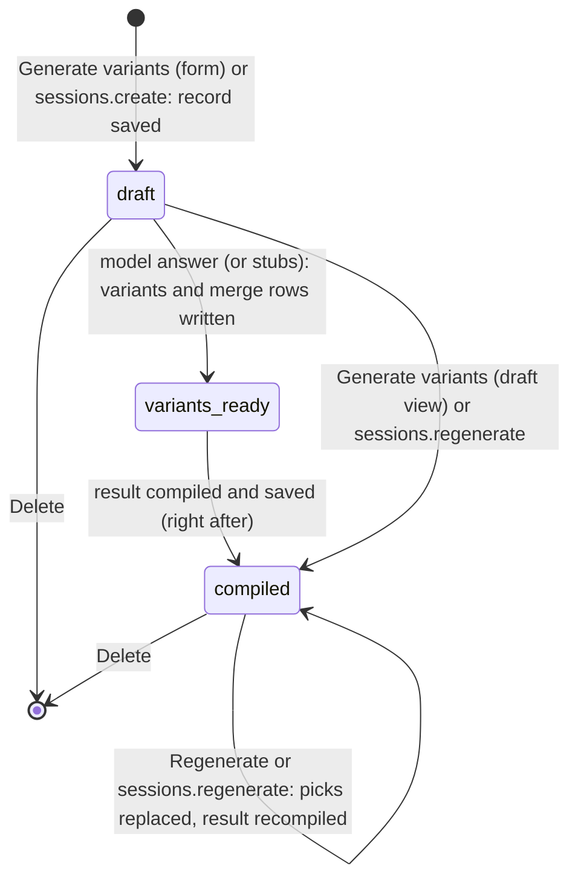

# Requirements: Word Improve

PART A — REQUIREMENTS (SRS). User-approved before build; frozen after; changes via ## Changes.

## Introduction

### Purpose
Word Improve is a git-style merge tool for prose. It is for one person in the browser, with no accounts. Its one job is to turn a text the person wrote into a better version they choose sentence by sentence.

The person pastes a text, picks a mode (Improve, Tone shift with a tone, or Custom with an instruction) and asks for 2 to 5 variants. A language model writes that many whole-text rewrites in one call. The app lines every variant up against the original's sentences:

- sentences that every variant agrees on stay as plain text;
- each disagreement becomes a numbered conflict with lettered choices;
- each sentence a variant adds becomes an addition to include or skip.

Every pick recompiles the result, shown as a word diff against the original and as plain text to copy. An AI agent works on the same sessions through A2App: every UI action is a declared operation or a record update.

### Scope
**Goals**
1. A pasted text turns into a merge view in one action. When no language model answers, the view holds visibly marked placeholder variants and a warning says so; it never fails silently.
2. Every pick, include or skip shows the updated compiled result and word diff at once, without a manual refresh.
3. An unpicked conflict always compiles as the original sentence, so the compiled result is complete at every moment.
4. Sessions persist: closing the page and coming back shows every session with its picks and result.
5. An agent can do every UI action through the CLI. A session it makes is stored exactly like one made in the UI from the same text and the same model answer.

**Core functionalities:** session list · new session (text, mode, tone or instruction, variant count) · one-call variant generation with stub fallback · sentence alignment into a git-style merge · conflict picks and addition include/skip · live compiled result with word diff · copy · regenerate · rename · delete · agent operations

### Approval
Approved by the user: 2026-11-11 — carried over from the published marketplace app `word-improve` 1.0.0, whose requirements were approved when it was built; this document restates them in the framework's form without changing any feature.

## Product Description

### Product Perspective
`authMode: none`. The app is single-user and has no sign-in. It serves on loopback only. manifest.json declares no integrations (`capabilities.integrations: []`), and the app calls no third-party service.

It has no language model or API key of its own: generation goes to the host's model through `_craftbot_bridge.callLLM`. That model is CraftBot's when CraftBot launched the app, or the Agent App Framework bridge's (the harness's own model) when one runs.

The person's screen asks the model only when `integrations.status` reports one: CraftBot's bridge, or a framework bridge that answers. The agent operations always ask the bridge.

The app deliberately keeps one session per record, with no chunk or variant tables. It offers no editing of variant text and no export beyond copying.

### User Characteristics
One person polishing prose they wrote, a few paragraphs at a time, in occasional sessions. They use a desktop or laptop browser, either inside CraftBot or opened on its own, with pointer and keyboard. The layout is built for wide screens and has no phone layout.

### Constraints
- C-1: A session is one `sessions` record. Its whole-text variants (`variants`) and merge rows (`segments`) are stored on it as JSON.
- C-2: Fixed vocabularies:
  - mode: `improve`, `tone_shift`, `custom`;
  - tone: Formal, Casual, Persuasive, Concise, Friendly, Academic;
  - variant count: 2, 3, 4 or 5;
  - status: `draft`, `variants_ready`, `compiled`;
  - merge row kind: `auto`, `conflict`, `addition`.
- C-3: A tone is stored only with `tone_shift`, and an instruction only with `custom` (otherwise both are empty). The text must not be blank, and `custom` needs a non-blank instruction.
- C-4: Paragraphs are split at blank lines. Within a paragraph, a sentence ends at ".", "!" or "?" followed by whitespace and then a capital letter, a quote, "(" or "[". The split never happens after the abbreviations Mr, Mrs, Ms, Dr, St, etc, e.g, i.e, vs or fig.
- C-5: Each generation is one model call for all variants. The model returns JSON: a 3–6 word title and, for each variant, sentences that each name the original sentence they express (`from_original`), or none for new content.
  - Two or more variant sentences on one original sentence are joined and marked "merged from multiple".
  - None marks the variant "remove this sentence".
  - A sentence out of its original order is marked "reordered".
  - A row where every choice has the same text is not a conflict.
  - New content becomes an addition placed after the last original sentence that variant expressed before it.
- C-6: An answer that is not usable JSON counts as no answer, and so does a missing answer. Variants the model did not deliver are filled with placeholder stubs (`"<sentence> [stub rewrite #n] (connect an AI agent for real output)"`, with the label naming the mode). In that case the title becomes `"<first line, up to 32 characters> (stub)"`.
- C-7: The title is set from the generation only while the session has none. A title from the model is cut to 255 characters, and any title is at most 500.
- C-8: The compiled text joins, in order:
  - each conflict's picked choice, or the original when none is picked;
  - included additions;
  - agreed sentences.

  Sentences are separated by single spaces and paragraphs by a blank line.
- C-9: Regenerating replaces the variants, every pick and the compiled result. The title is kept.

### Assumptions
- A-1: Volume ceiling: the 500 most recently updated sessions, which is what the sidebar loads in one request. Texts are a few paragraphs: the browser diffs any length, and the agent's server-side diff stops at about 1,200 × 1,200 words (N-4).
- A-2: The connected language model follows the JSON shape in the prompt. Any other answer leads to placeholder variants (C-6).
- A-3: The machine running the app is the person's own, and the host's language model is the one the person has chosen.

## Features

### Module: Sessions (sessions)
- F-SES-1: The user sees every session in a left sidebar, most recently updated first. Each shows its title (or the start of its first line when it has none), its status ("draft", "<n> variants ready", or "compiled" with a check) and its mode.
- F-SES-2: The user can open a session by clicking it in the sidebar, and the open session is highlighted. WHEN the app opens THE SYSTEM SHALL open the most recently updated session.
- F-SES-3: The user can start another session with "New session", which shows the new-session form.
- F-SES-4: The user can rename a session in a dialog, opened from its "⋯" menu in the sidebar or from Rename in the session header. Enter saves and Escape cancels. An empty or unchanged name changes nothing.
- F-SES-5: The user can delete a session from its "⋯" menu or from Delete in the header. WHEN the user deletes a session THE SYSTEM SHALL ask "Delete this session? This cannot be undone." and delete it only when confirmed.
- F-SES-6: The user sees in the sidebar footer whether a language model is connected: "LLM connected" or "No LLM (stubs)". WHEN none is connected THE SYSTEM SHALL show the warning "No language model connected", with the text "Variants are placeholder stubs. Connect an AI agent to this app (CraftBot, or any agent harness running the app's bridge) to get real rewrites."
- F-SES-7: The user sees the open session's title and its mode, tone and variant count as tags in the session header.

### Module: New session (sessions)
- F-NEW-1: The user can paste the text to improve: one or more paragraphs separated by blank lines.
- F-NEW-2: The user can pick a mode: Improve ("Polish wording, keep meaning"), Tone shift ("Rewrite in a tone") or Custom ("Free-form instruction").
- F-NEW-3: WHEN the mode is Tone shift THE SYSTEM SHALL offer a tone: Formal (default), Casual, Persuasive, Concise, Friendly or Academic. WHEN the mode is Custom THE SYSTEM SHALL offer an instruction field.
- F-NEW-4: The user can choose 2, 3 (default), 4 or 5 variants.
- F-NEW-5: WHEN the text is empty THE SYSTEM SHALL refuse with "Paste some text first". WHEN Custom has no instruction THE SYSTEM SHALL refuse with "Add a custom instruction or pick a different mode".
- F-NEW-6: WHEN the user presses "Generate variants" THE SYSTEM SHALL save the session and open it, showing "Generating variants…" until the model's single answer arrives. It then shows the merge view with the toast "Variants ready — pick the best lines", or "Generation failed" on an error.
- F-NEW-7: WHEN no language model answers, or its answer is unusable or short, THE SYSTEM SHALL fill the missing variants with marked placeholder stubs and give the session a "(stub)" title (C-6).

### Module: Merge (sessions)
- F-MRG-1: The user sees the original as a git-style merge. Sentences that every variant agrees on are plain text, and paragraph breaks are gaps.
- F-MRG-2: The user sees each disagreement as a numbered conflict (#1, #2 …) marked "Choose a version" or "Picked". It shows cards for Original, Variant A, Variant B …, and each card notes when its variant reordered the sentence, merged several into it ("merged from multiple") or removed it ("remove this sentence").
- F-MRG-3: The user can pick one card per conflict, and clicking the picked card again unpicks it. Once a variant is picked, the other variant cards dim. A card with no text, other than a removal, is disabled.
- F-MRG-4: The user sees each sentence a variant adds as a numbered addition ("+1", "Variant B adds"), with Skip (the default) and Include.
- F-MRG-5: The user sees the merge counts: "<n> sentences", "<picked>/<conflicts> picked", and "<n> to go" while conflicts remain.
- F-MRG-6: The user can press "Regenerate" to get fresh variants of the session, which replaces every pick. A session without variants shows "This session has no variants yet." and "Generate variants", which does the same.

### Module: Result (sessions)
- F-RES-1: WHEN a pick, include or skip changes, or a session is opened or generated, THE SYSTEM SHALL recompile and save the result (C-8) and show it at once.
- F-RES-2: The user sees the compiled result as a word-level diff against the original, with added words in green and removed words struck through in red. It also shows the plain text and the counts "+<n> words" and "−<n> words". WHEN nothing changed THE SYSTEM SHALL say "No changes — the compiled output matches the original."
- F-RES-3: The user can copy the compiled text with Copy. The button reads "Copied" for 2 s, and the toast "Compiled text copied to clipboard" confirms it ("Could not access the clipboard" on failure).
- F-RES-4: The user can drag the divider between the merge view and the result pane to resize the pane. The two sit side by side on wide screens and stack below 1024 px.

### Agent (via A2App)
- F-AGT-1: The agent can perform every UI action: the 9 operations in ## Operations Design, across the modules `sessions`, `integrations` and `ai`. Renaming uses `a2app <app> data sessions update <id> --title`.
- F-AGT-2: The agent can create a session (`sessions.create`) with the form's choices and validation. The stored session is identical to one made in the UI from the same text and the same model answer.
- F-AGT-3: The agent can read the session list (`sessions.list`), the merge view with its numbering, choices and counts (`sessions.get`), and the compiled result with its word diff and word counts (`sessions.result`). All of these are computed as the screens compute them, and none of these reads writes anything.
- F-AGT-4: The agent can pick versions, unpick with `none`, and include or skip additions (`sessions.pick`), one at a time or as an all-or-nothing batch. Picks the screen does not allow are refused.
- F-AGT-5: WHEN no language model answers an agent's `sessions.create` or `sessions.regenerate` THE SYSTEM SHALL store the same placeholder stubs as the UI and report `llm.answered: false` with a message.
- F-AGT-6: WHEN the agent calls `sessions.regenerate` or `sessions.delete` THE SYSTEM SHALL answer `approval_required` until the person has approved that call.
- F-AGT-7: The agent can check with `integrations.status` whether the person's own screen will call a language model.

## Non-Functional Requirements
- N-1: Each generation (new session, Regenerate, `sessions.create`, `sessions.regenerate`) makes one language-model call. It waits at most the bridge's timeout: 120 s through CraftBot's bridge, 300 s through the framework bridge.
- N-2: A pick shows its new compiled result without a manual refresh, with one save and one compile per click.
- N-3: The sidebar loads at most 500 sessions in one request.
- N-4: `sessions.result` computes the word diff on the server for up to 1,500,000 word-pair cells (about 1,200 × 1,200 words). A 1,150-word text took about 3 s on PocketBase 0.39.7. Above that size it returns the compiled text without a diff.
- N-5: The agent's engine (`lib_agent_text.js`) gives byte-identical results to the browser's (`apiAdapter.ts`) for splitting, prompts, merge rows, picks, compile and diff (parity test, 2026-11-11).
- N-6: The layout is built for widths of 768 px and up. Below 1024 px the result pane stacks under the merge view.

## Data Requirements
- **sessions** (module: sessions): title (string, max 500), original_text (string, max 2000000), mode (string, max 32), tone (string, max 32), custom_instruction (string, max 100000), variant_count (number), compiled_text (string, max 2000000), status (string, max 32), variants (json), segments (json), created (datetime, server-set), updated (datetime, server-set).

## External Interfaces
- **Human (browser):** one single-page View served by PocketBase at the app's own origin, with no routes. It has:
  - the sessions sidebar;
  - the main area: the new-session form, or the open session's merge view and result pane;
  - the rename dialog and the delete confirmation.

  Input is pasted text. Output is the compiled text copied to the clipboard.
- **Agent (A2App):** the modules and collections in AGENT_APP.md § Modules; operations exactly as declared in ## Operations Design. No other machine interface is offered to agents; the app's own screens call their own routes.
- **Host services:** the host's language model through `_craftbot_bridge.callLLM`. That is CraftBot's bridge (`CRAFTBOT_BRIDGE_URL`/`CRAFTBOT_BRIDGE_TOKEN`) or the Agent App Framework bridge (`.a2app/bridge-llm.json`). The prompt carries the session's sentences and the mode's instruction.

## Out of Scope
- More than one person: accounts, sign-in, sharing or roles.
- An app-owned language model, provider choice or API key settings.
- Editing a variant's text, writing a variant by hand, or editing the original after the session is created. A different text means a new session.
- Changing an existing session's mode, tone, instruction or variant count.
- An Auto-complete (continuation) mode, per-paragraph or per-sentence regeneration, and a separate Compile step.
- More than 5 variants, and tones other than the six listed.
- Export beyond copying to the clipboard: no file download and no Markdown export.
- History or versions of a session, and undo of Regenerate or Delete.
- Search or filtering of sessions.
- A phone layout.
- Live updates of the open screen when another tab or an agent changes a session.
- App-to-agent tasks: the app queues no work for agents.

## Quality of Life
- Conflicts and additions are numbered (#1, +1) so the person and the agent can refer to them.
- Clicking the picked card again unpicks it, and the other variant cards dim once one is picked.
- The result pane can be resized by dragging its divider.
- The form's subtitle says what will happen: "The LLM will produce <n> whole-text variants in a single call. You'll then merge sentence-by-sentence in a git-style diff view."

PART B — TECHNICAL SPECIFICATION.

## System Overview
PocketBase 0.39 (JS hooks, migrations) + React 19 / Vite / Tailwind 4 View in `frontend/` built into `pb/pb_public/`, on the `blueprint-pocketbase-kit` toolkit.

**The View** is the original Word Improve frontend, unchanged. Its controller calls V1 REST paths, and a fetch shim (`frontend/src/app/services/apiAdapter.ts`) answers them in the browser. The shim does all the domain work: splitting, the prompt, answer validation and stubs, merge rows, compile and word diff. It stores results through the PocketBase record API (`sessions`). It reaches the model through the app's routes `POST /api/ops/ai/generate` and `GET /api/ops/integrations/status` (`pb/pb_hooks/ops.pb.js`).

**The agent operations** are served by these files:

- `pb/pb_hooks/agent_ops.pb.js`: the routes, at `/api/ops/sessions/<verb>`;
- `lib_agent.js`: the operations;
- `lib_agent_text.js`: a function-by-function port of the shim's engine.

The generated `a2app_routes.pb.js` serves all of them to agents as `POST /api/ops/<name>`.

Modules → navigation map:

| Module (manifest) | Where a person meets it | Route |
| --- | --- | --- |
| `sessions` | Sidebar (list, open, rename, delete); new-session form; merge view; result pane | — (one page) |
| `integrations` | "LLM connected" / "No LLM (stubs)" in the sidebar footer; the "No language model connected" warning | — |
| `ai` | No screen of its own: the model call behind "Generate variants" and "Regenerate" | — |

## UI Design
- **Design system.**
  - **Tokens.** The app keeps its own V1 design system, the "CraftBot Browser Interface", in `frontend/src/app/styles/global.css`. Its CSS tokens are:
    - colors: primary `#FF4F18`, a gray scale, and semantic success, warning, error and info;
    - fonts: Inter and JetBrains Mono, with a 12/13/14/16/18/20 px type scale;
    - spacing on a 4 px grid, and radii of 4, 6, 8 and 12 px;
    - the 150 ms base transition.
  - **Themes.** `frontend/src/app/theme/themes.ts` adds host-selected themes (CraftBot, Normal, Ocean, Forest, Pastel, Custom), each in dark and light. CraftBot dark is the default.
  - **Components and icons.** Preset components (Button, Textarea, Select, Alert, Modal and others) are in `components/ui/index.tsx`, icons come from lucide-react, and toasts from react-toastify.
  - **Kit.** The vendored agent-app kit 0.5.0 in `frontend/src/kit` (system-managed) supplies the shell: error boundary, theme bridge, console relay and the kit toaster.
- **Layout.**
  - **Grid.** The page is a full-height two-column grid: a 220 px sidebar (180 px below 768 px) and the main area.
  - **Main area.** It holds the optional LLM warning, then either the centered new-session form (at most 720 px wide) or the open session. The session view is a header (title, mode, tone and variant tags, Rename and Delete), then the merge view, then the result pane.
  - **Result pane.** It sits beside the merge view, 480 px wide by default and resizable from 280 px to 75 % of the window. Below 1024 px it stacks under the merge view, 320 px tall by default and resizable from 160 px to 80 % of the window height.
  - **Density.** Text is 12–14 px, with tight padding.
- **Screen — Sidebar:**
  - Primary object: the sessions. Primary action: "New session".
  - Items: each card shows title, status and mode. A "⋯" menu (Rename, Delete) appears on hover and on the open session.
  - Empty: "No sessions yet." and "Click "New session" above to start."
  - Footer: "LLM connected" or "No LLM (stubs)".
  - Narrow: the sidebar is 180 px below 768 px, and titles truncate with an ellipsis.
- **Screen — New session:**
  - Header: "Start a new improvement session", with a subtitle that names the variant count.
  - Fields: a textarea ("Paste a paragraph (or several) you want to improve, continue, or rewrite..."); three mode chips with descriptions; the Tone select (Tone shift) or the Instruction field (Custom; placeholder "e.g. Make it sound like an internal Slack message from a manager"); and the Variants select.
  - Primary action: "Generate variants".
  - States: the inputs disable and the button shows a spinner while the session is created. Validation shows the warnings "Paste some text first" and "Add a custom instruction or pick a different mode". Success toasts "Variants ready — pick the best lines", and failure toasts "Generation failed".
  - Narrow: the mode chips wrap, from three across down to one per row.
- **Screen — Session (merge view):**
  - Primary object: the merge rows of one session. Primary action: pick a card for each conflict.
  - Header: "<n> sentences", "<picked>/<conflicts> picked", "<n> to go" in the warning color, and "Regenerate".
  - Rows: agreed sentences as plain text; paragraph breaks as gaps; conflicts "#n" with "Choose a version" or "Picked" and their cards (labels ORIGINAL, VARIANT A …; note; check on the picked card; "— nothing here —" for an empty removal or skip); additions "+n" "Variant X adds" with Skip and Include.
  - Loading: a spinner with "Generating variants…" while generating or regenerating.
  - Empty (draft): "This session has no variants yet." with "Generate variants".
  - Errors: an error alert "Something went wrong" with the message.
  - Narrow: the merge view takes the full width, with the result pane stacked below.
- **Screen — Compiled result:**
  - Primary object: the compiled text. Primary action: Copy.
  - Content: "Compiled result" with "+<n> words" and "−<n> words"; "Diff vs original" with insertions highlighted in green and deletions struck through in red; and "Plain text".
  - States: before a result exists, "Pick a variant on the left to populate the result."; "(empty)" for an empty result; "No diff data." and "No changes — the compiled output matches the original." as hints.
  - Success: Copy turns into "Copied" with a check for 2 s, and a toast.
  - Narrow: stacked below the merge view.
- **Screen — Rename dialog:**
  - Primary object: the session's name. Primary action: Save, which is disabled while the field is empty.
  - Behavior: the field is focused and selected on open. Enter saves, and Escape or Cancel closes. Success toasts "Session renamed" (from the header).
  - Narrow: the dialog is at most 320 px wide.
- **Formatting:**
  - Modes read in lower case with spaces ("tone shift"), and variants are lettered A–E.
  - Counts are plain integers ("+12 words", "−3 words").
  - No dates or record ids are shown. A session without a title shows the start of its first line (up to 48 characters, then "…") or "Untitled session #<id>".
  - Empty values are words: "— nothing here —", "no text in this variant", "(empty)".

## Quality Conformance

- **Q1 Completeness & IA:** everything lives on one page: the sidebar is the navigation, and the main area shows either the form or the open session. The open session is highlighted in the sidebar (`aria-current`), and its title heads the main area. Every session is one click away, and the newest opens on load. The module map is in ## System Overview. Names are fixed app-wide: session, variant (A–E), conflict (#n), addition (+n), pick, compiled result. The one list that grows, sessions, is capped at the 500 most recent (A-1), and the app does not search or filter it (## Out of Scope).
- **Q2 Design system:** tokens come from the app's `global.css` and the host-selected theme variables (`themes.ts`), and components use the tokens.
  - Semantic roles:
    - primary orange marks the selected mode chip, the open session, the focus ring and spinners;
    - success green marks a picked card, an included addition, inserted words and "+n words";
    - error red marks deleted words, "−n words" and the Delete menu item;
    - warning yellow marks "<n> to go" and the LLM warning.
  - Type is Inter (mono: JetBrains Mono for the diff and the plain text). Icons are lucide-react only.
  - Light and dark mode and the theme come from the host (`craftbot-theme` and `livingui-theme` messages). Standalone, the app starts in the CraftBot dark theme.
  - The fixed exceptions are the diff highlight fills (`rgba` green and red) and the compact select chevron.
- **Q3 Layout & composition:** spacing follows the 4 px tokens. The page has one primary action per state: "Generate variants" in the form, picking in the merge view, Copy in the result.
  - Merge rows are separated by 1 px lines.
  - Picked cards and included additions carry a 3 px green inset bar.
  - Long titles truncate with an ellipsis, while sentence and variant texts wrap.
  - The merge view and the result scroll independently, and the result pane is resizable.
- **Q4 Interaction:** every clickable element is a native button with a pointer cursor and a hover fill; disabled elements show 0.5 opacity and a not-allowed cursor.
  - Clicking the picked card unpicks it.
  - Delete asks for confirmation through the browser's confirm dialog ("Delete this session? This cannot be undone."). Regenerate replaces the picks without confirming.
  - Keyboard: Tab and Enter or Space work on every control. In the rename dialog Enter saves and Escape closes.
  - Inputs are constrained rather than validated: the mode chips, the tone and variant selects, and Save disabled for an empty name.
- **Q5 State & feedback:** each screen's states are in ## UI Design.
  - While a request runs: Generate variants and Regenerate show spinners and disable their inputs, which guards against double submission, and the merge area shows "Generating variants…".
  - Toasts (react-toastify, top right, 3 s): "Variants ready — pick the best lines", "Generation failed", "Session renamed", "Session deleted", "Compiled text copied to clipboard", "Could not access the clipboard", "Paste some text first", "Add a custom instruction or pick a different mode".
  - Errors from the controller show in the "Something went wrong" alert in the session view.
  - The missing-model state is the persistent "No language model connected" warning and the "No LLM (stubs)" footer.
- **Q6 Motion:** controls change over 150 ms ease (`--transition-base`). The modal backdrop fades in and the dialog slides up, each over 150 ms. Spinners turn once a second, linearly. Nothing else animates. Reduced motion is not handled (see ### Conventions and overrides).
- **Q7 Content:** the copy is plain and in sentence case, and uses the git-merge words the app is built around ("merge", "Choose a version", "Picked", "to go").
  - Validation copy says what to do ("Paste some text first", "Add a custom instruction or pick a different mode").
  - Placeholder stubs say how to get real output ("connect an AI agent for real output"), and so does the warning ("Connect an AI agent to this app … to get real rewrites.").
  - Operation errors name the parameter and its valid values (for example "position 3: choice must be one of original, A, B, C or none").
- **Q8 Accessibility:**
  - Focus: `:focus-visible` draws a 2 px primary outline.
  - States are exposed to assistive technology: mode chips and choice cards carry `aria-pressed`, the open session carries `aria-current`, and the Skip and Include buttons carry `aria-pressed`.
  - Every choice card has an `aria-label` that names its label and text. The sidebar list is a `navigation` landmark ("Sessions"), the "⋯" button has `aria-label="Session menu"`, and its items are `menuitem`s.
  - The resize divider is a `separator` with an `aria-label`. Decorative icons are `aria-hidden`.
  - The rename dialog is `role="dialog"` and `aria-modal`, focuses its field and closes on Escape.
  - Meaning never rests on color alone: picks read "Picked", deletions are struck through, and the counts are written.
  - Gaps are recorded in ### Conventions and overrides.
- **Q9 Responsiveness:** desktop-first. Below 1024 px the result pane stacks under the merge view and resizes vertically. Below 768 px the sidebar narrows to 180 px. The mode chips wrap. There is no phone layout (## Out of Scope); see ### Conventions and overrides.
- **Q10 Performance:** at A-1:
  - The sidebar loads one request of up to 500 summaries.
  - A generation is one model call.
  - A pick costs one record update and one compile; compile is linear in the number of rows.
  - The browser's word diff is O(words²) per compile, which is instant at the assumed sizes.
  - The agent's server diff is capped (N-4) and uses integer-coded words in a flat `Int32Array`.
  - `require()` is called once per module per operation, never per row.
  - There are no images or web fonts to load.
- **Q11 Caching & freshness:** static assets are the hashed Vite build. Data is not cached: the View refetches after each of its own actions and keeps the result only as in-memory state. A compile answer for a session that is no longer open is dropped.
  - There is no realtime subscription. Changes made by an agent or another tab show after the session is reopened or the page is reloaded (recorded in ### Conventions and overrides).
  - Operation responses carry no cache headers.
- **Q12 Data integrity:**
  - **Storage.** One record per session, with no relations. The migration (`1700000000_init_sessions.js`) creates the one collection, with length limits on every text field and size limits on the JSON fields (5 MB each).
  - **UI writes.** The UI's pick is a read-modify-write of the `segments` array, sent as two requests: a pick, then the compile.
  - **Agent writes.**
    - `sessions.pick` runs one transaction, re-reads the record, validates every pick first (all or nothing), and saves the picks and the compiled text together.
    - `sessions.create` validates like the form.
    - Generation re-reads the record after the model call. It writes onto the current record, keeps a rename made in the meantime, and answers 404 if the session was deleted.
  - **Record API.** Raw agent writes through it pass the adapter's field guard.
- **Q13 API:**
  - **The View** uses the record API for `sessions` plus `POST /api/ops/ai/generate` and `GET /api/ops/integrations/status`.
  - **Agents** call the declared operations at `POST /api/ops/<name>` through the adapter: credential and argument checks, approval for the destructive ones, idempotency keys, and the `{a2app, ok, operation, result}` envelope.
  - **Errors.** The app's routes answer errors as `{ error }` with 400 (a bad parameter, named), 404 (session not found), 409 (no variants yet, no choice on that row, or the card cannot be picked) and 500. Stack traces are never returned.
  - **Bounds and safety.** Lists are bounded (N-3). Repeating a pick is safe.
- **Q14 Architecture:**
  - **Domain engine.** It lives in the browser shim (`apiAdapter.ts`), so the V1 frontend runs unchanged (`AppController.ts` and the `components/`). Its server port (`lib_agent_text.js`) backs the agent operations.
  - **Server routes.** The model call is `ops.pb.js`; the agent operations are `agent_ops.pb.js` with `lib_agent.js`.
  - **One stored shape.** Both engines write the same record shape.
  - **The duplicate engine** is a recorded override (### Conventions and overrides).
  - **Configuration** lives in manifest.json and the toolkit's launcher.
- **Q15 Resilience:**
  - `callLLM` answers an empty string on any error or timeout (120 s for CraftBot's bridge, 300 s for the framework bridge), and an unusable answer counts the same. Either way the session is still created, with marked stubs (C-6), rather than failing.
  - The shim never throws: an unknown path answers empty JSON, and a handler error answers `{}`.
  - Controller errors show in the session view's alert. A render crash shows the kit's "Something went wrong" panel with "Reload app".
  - Agent operations survive a deletion during generation (404) and a rename during generation (kept).
- **Q16 Security & privacy:**
  - **Access.** With `authMode: none`, the collection rules are open (`""`) because the app is single-user and binds loopback.
  - **The adapter** runs its host check and framing policy (`frame-ancestors 'self'` and loopback) before any app hook. Agent record writes and declared operations are credential-checked and guarded, and the destructive operations need the person's approval.
  - **Rate limits.** The toolkit sets 300 requests per minute on `/api/ops/` and 1,200 on `/api/collections/`.
  - **Data leaving the app.** The session's text leaves the app only to the host's language model through the bridge. The app stores no API keys.
  - **Credentials.** Runtime credentials (`.agent-token`, `.principal`, `.superuser`) are git-ignored and never shipped.
- **Q17 Observability:**
  - The kit's console relay ships browser `console.error`/`console.warn` and uncaught errors to `logs/frontend_console.log`, capped at 2 MB.
  - A failed agent operation logs `[word-improve] agent op failed:`, and the toolkit adds `[handler-error] <METHOD> <path>: <message>` for uncaught handler errors.
  - The adapter audits every agent call.
  - Health is `/api/_a2app`, the adapter's identity document.
- **Q18 Version control:** commits are per app and per change ("Port word-improve Living UI to the V2 (PocketBase) platform"). `.gitignore` excludes credentials, `pb/pb_data/`, the PocketBase binary, the built View `pb/pb_public/`, `frontend/node_modules/`, framework runtime state under `.a2app/`, and `logs/`. The app builds from a clean checkout with the manifest pipeline alone (`install`, `build`, `start`).

### Conventions and overrides
The published app is restated here unchanged, so these are standing decisions of the approved build, not new work. Revisit any of them when the app is next modified.
- Q6 (reduced motion): there is no `prefers-reduced-motion` rule. The only animations are the 150 ms transitions, the dialog fade and slide, and the spinners.
- Q8 (focus management): the rename dialog does not trap focus, and the delete confirmation is the browser's native `confirm()`.
- Q9 (narrow screens): the layout is desktop-first. Below 768 px the sidebar keeps 180 px and the main area narrows, and there is no phone layout.
- Q11.2 (freshness): no realtime. The View refetches only after its own actions, so changes made elsewhere show after the session is reopened.
- Q14.4 (one implementation per rule): the text engine exists twice, in `frontend/src/app/services/apiAdapter.ts` (the unchanged UI) and `pb/pb_hooks/lib_agent_text.js` (the agent operations). A parity test keeps them identical, and any change to one must be made to the other.
- Q5 (model availability shown to the person): the person's screen asks the model only when `integrations.status` reports one (CraftBot's bridge, or a framework bridge that answers, probed and cached for 10 s). The agent operations always ask `_craftbot_bridge.callLLM`, so both get real rewrites under any harness that runs the bridge (AGENT_APP.md § Conventions).
- Mirrored global rules: none recorded for this app.

## Process Flows

A session's status:

A generation, in the UI and in the agent operations alike: split the text into sentences (C-4) → build the prompt (mode, tone or instruction, variant count, and the regeneration line when regenerating) → one model call → parse and validate the JSON, filling missing variants with stubs (C-6) → build the merge rows (C-5) → save the variants, rows and status, plus the title while there is none (C-7) → compile (C-8).

## Operations Design
| Operation | Module | Entity | appliesWhen | Params | Flags |
| --- | --- | --- | --- | --- | --- |
| ai.generate | ai | — | — | system: string, prompt: string! | — |
| integrations.status | integrations | — | — | — | readOnly |
| sessions.list | sessions | — | — | — | readOnly |
| sessions.get | sessions | — | — | session_id: string! | readOnly |
| sessions.result | sessions | — | — | session_id: string! | readOnly |
| sessions.create | sessions | — | — | text: string!, mode: enum, tone: enum, instruction: string, variants: number | — |
| sessions.regenerate | sessions | — | — | session_id: string! | destructive |
| sessions.pick | sessions | — | — | session_id: string!, position: number, choice: string, picks: json | — |
| sessions.delete | sessions | — | — | session_id: string! | destructive |
