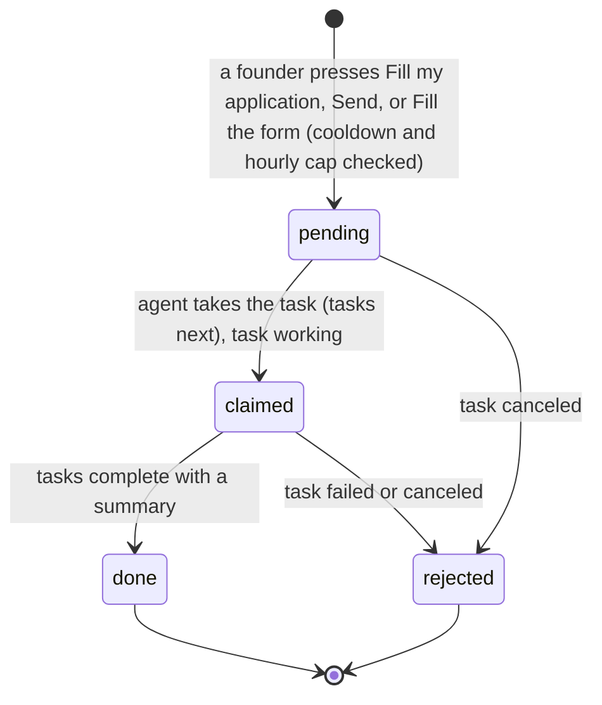
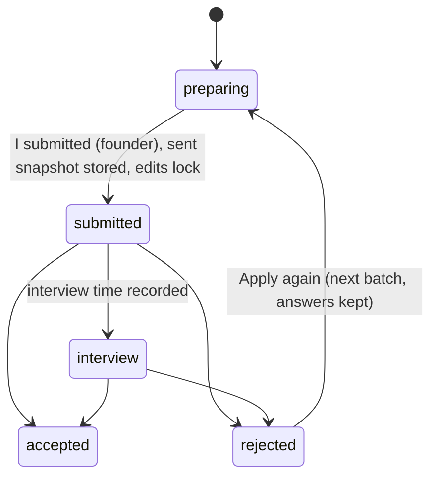
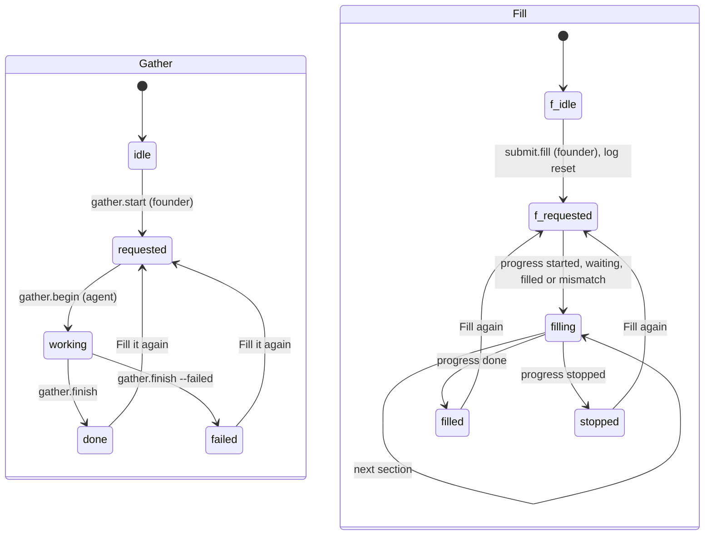
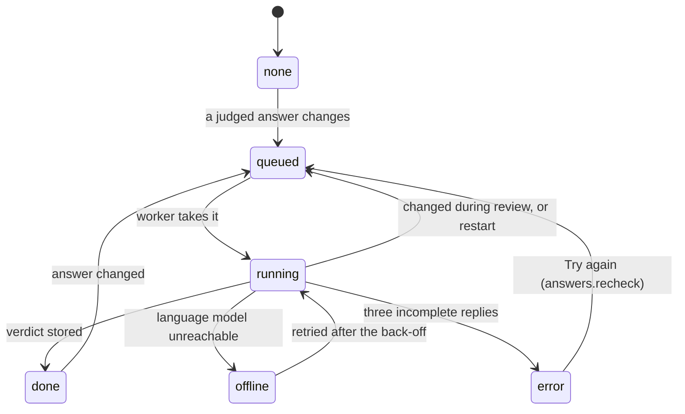

# Requirements: YC Application

PART A — REQUIREMENTS (SRS). User-approved before build; frozen after; changes via ## Changes.

## Introduction

### Purpose
YC Application is a pipeline that takes the founders of one startup from their links to a submitted Y Combinator application, without overcomplicating the preparation. The founders add their website, profiles and files. Their AI agent reads them, fills every answer it can, and asks the founders only for what it cannot find. A reviewer reads each answer the way a YC partner would. The app checks the whole application against YC's published guidance and estimates the chance of getting in. The agent types the application into YC's form, and a founder presses Submit. The agent works on the same application through A2App: 39 declared operations, plus three kinds of task the app queues (gather and fill, act on a founder's message, fill YC's form).

### Scope
**Goals**
1. One press of "Fill my application" asks the agent to read every link and file and fill the answers it can. Each question the agent cannot answer is shown to the founders on that answer until it is answered.
2. Every judged answer gets the reviewer's reading. The application is checked against about 50 checks from YC's guidance (48 always, 3 more when they apply), and the failing ones are listed as "Fix next" and "Before you apply".
3. Once at least one founder and five answers are in, the app shows an estimated chance of getting in (a 100-point model in five bands), with the moves worth most.
4. The agent fills YC's form section by section and stops before Submit. Only a founder submits, and "I submitted" locks the answers as sent.
5. Preparing stays five steps (Links & files, Team, Answers, Polish, Submit), each showing what is left.

**Core functionalities:** links and files · gathering by the agent · team, roles and equity · the YC form's 43 questions with yes/no gates · founder profiles · answer review · checks against YC's guidance · odds estimate · founder confirmations · messages to the agent · form filling by the agent · submission and decision tracking · batch and deadline · copy and Markdown export

### Approval
Approved by the user: 2026-11-04 — carried over from the published marketplace app `yc-application` 1.0.0, whose requirements were approved when it was built; this document restates them in the framework's form without changing any feature.

## Product Description

### Product Perspective
`authMode: none`. The app binds to the founders' machine and has no sign-in. A caller is a founder unless it presents the app's agent token (`X-A2App-Token`), and then it is the agent (`lib_auth.js`). manifest.json declares no integrations (`capabilities.integrations: []`). The backend's only outbound call is the host language model, reached through the toolkit's bridge (`_craftbot_bridge.callLLM`: CraftBot's bridge, or the framework bridge's harness). The reviewer uses it in JSON mode. The app deliberately makes no third-party HTTP calls. Websites, LinkedIn and YC's form are read and filled by the agent in its own tools, never by the app. Checks never match words in the founders' text. All six collections are closed to the raw record API, so screens and agents use the operations. The look is the app's own neutral palette, not the host style pack.

### User Characteristics
The founders of one startup preparing one YC application for one batch. They work in bursts before a deadline, often with two or three cofounders sharing the machine's app. Writing happens mostly on a desktop. Tablet and phone widths are supported: the stepper collapses to numbered circles below 768 px, and touch pointers get larger tap areas.

### Constraints
- C-1: One install holds one application, a single settings row (`ycsettings00001`) for one batch.
- C-2: The form has 43 questions in six sections: Founders 4, Company 8, Progress 13, Idea 6, Equity 10, Curious 2. 35 are required and 8 optional (c_url, c_demo, c_product, c_location_why, p_session, p_accel, i_other, e_raising_detail). Question types are long, short, url, yesno, number, choice and months. The wording follows the most recent published application (Spring 2025). Each founder adds four profile questions keyed `fp.<founder id>.<field>`: impressive, hack, built, awards.
- C-3: The only hard character limit is the one-liner (`c_desc`, 50 characters). Word counts are aims, never limits, and an answer is flagged long above 1.5 times its aim.
- C-4: Eight follow-up questions open only on the answer before them: p_users and p_find when p_using = yes, p_launch when p_using = no, p_revenue_months when p_revenue = yes, p_prev_change when p_prev = yes, e_entities when e_entity = yes, e_investments when e_invested = yes, e_raising_detail when e_raising = yes.
- C-5: The category is one of B2B, Consumer, Developer tools, Education, Fintech, Government, Healthcare, Industrials, Real estate and construction, Other.
- C-6: Monthly revenue covers the six months ending with the current one, keyed `YYYY-MM`. Each month stands on its own (not cumulative, not GMV).
- C-7: The agent never overwrites an answer a founder wrote or confirmed: its text becomes a suggestion. The agent's own answers stay unconfirmed until a founder confirms them, and a founder's write confirms the answer.
- C-8: Founders-only actions are never offered to agents: gather.start, messages.send, answers.confirm, answers.accept, answers.use-shorter, confirms.set, submit.fill, submit.done, submit.next-batch, founders.confirm.
- C-9: Neither the app nor the agent ever presses Submit on YC's site. A founder does.
- C-10: The application status moves only forward: preparing → submitted → interview → accepted or rejected, and the decision is final. After "I submitted", answers, founders and sources are locked (409 `submitted_locked`). "Apply again", offered after "Not this time", starts the next batch with the answers kept.
- C-11: There are ten founder confirmations. Video: one_minute, all_founders, unscripted, no_extras. Before applying: full_time_if_accepted, one_application, vesting, ip_clear, goals_aligned. Revenue: revenue_monthly.
- C-12: A founder's technical and full-time facts are yes, no or unknown, and unknown is not no. Equity runs from 0 to 100, and 0 means not given. The agent never guesses equity, technical or full-time.
- C-13: Fixed vocabularies. Source kind: link, file, website, linkedin, github, x, deck, doc, video, metrics, other. Source state: new, reading, read, failed. Check group: before, team, clarity, progress, idea, video, form. Check severity: blocker, warning, tip. Check status: pass, fail, wait, na. Message state: sent, queued, failed, answered.
- C-14: The odds model has 100 points over seven factors: Team 15, Builds in-house 15, Founder signal 20, Progress 20, Idea 10, Writing 15, Complete 5. Caps: no video 54, no technical founder 59, inconsistent or overstated 44, part-time and not committed 44. Modifiers: reapplying with progress +5 (without −5), recommended +3, after the deadline −3, a coding-agent session +2. Five bands: Exceptional (90+, 15–35 %, top 2 %), Strong (75+, 5–15 %), Above the base rate (60+, 1.5–5 %), Near the base rate (45+, 0.5–1.5 %), Long shot (below 45, 0.2–0.5 %). The odds are ready with at least one founder and five answers. A one-liner over 50 characters makes them "Not scorable". The odds are an estimate from public YC evidence, never YC's number.
- C-15: Checks are decided from structured facts or the reviewer's structured verdicts, never from word lists.
- C-16: An application nobody has touched (no founders, sources, answers, messages or activity) moves to the next batch still open. Known deadlines live in `lib_batches.js` (`KNOWN`). A later batch has no deadline until the agent or a founder sets one, and a passed deadline shows as late.
- C-17: No emoji and no em dashes appear in copy. The app says "your AI agent".

### Assumptions
- A-1: Volume ceiling: one application per install. That is 43 form questions plus 4 profile questions per founder, written at most 80 at a time (`answers.set-many`). `messages.list` and `activity.list` return at most 200 rows, and nothing is paginated.
- A-2: The host language model is reachable through the bridge. When it is not, answers read "offline" and are reviewed once it is back.
- A-3: The agent has its own web, file and browser tools, and a founder can sign in to YC in the agent's browser.
- A-4: YC's form follows the most recent published application (Spring 2025), and deadlines are confirmed on ycombinator.com/apply.

## Features

### Module: Frame (pipeline, app)
- F-FRM-1: The user sees a header with YC's logo and "YC Application", which links to the current step, and a five-step stepper: Links & files, Team, Answers, Polish, Submit. Each step has a meta line ("<n> links, <n> files", "<n> need you", "<n> to fix", "Send to YC").
- F-FRM-2: The user sees a green check on each finished step, an orange dot on a step that needs attention, and the current step highlighted.
- F-FRM-3: WHEN the app opens without a route THE SYSTEM SHALL open the first step that is not done.
- F-FRM-4: WHEN the odds are ready THE SYSTEM SHALL show an odds pill ("<n>% odds"). WHILE the application is being prepared THE SYSTEM SHALL show a deadline pill ("<n> days left", "<n> hours left", or late) with the batch and deadline on hover.
- F-FRM-5: The user sees beside every step a rail holding the next thing to do ("Next"), the odds gauge (hidden on Polish), and "Tell your AI agent".
- F-FRM-6: The user sees one neutral, high-contrast look in light and dark, the same in every host style pack. YC's orange marks only the main actions, the current step, the odds gauge and the attention dots.
- F-FRM-7: WHEN a newer version of the app has been deployed THE SYSTEM SHALL reload an open page onto it once no dialog is open and no field is focused.

### Module: Links and files (sources, gather)
- F-SRC-1: The user can add a link (website, LinkedIn or GitHub).
- F-SRC-2: The user can upload a file by choosing or dropping it (PDF, PowerPoint, Word and similar documents, up to 50 MB). A larger file is refused with "<name> is over 50 MB".
- F-SRC-3: The user sees each source with its state ("Not read yet", "Reading", "Read", "Could not read"), with what was learned or why it failed on hover.
- F-SRC-4: The user can remove a link or a file after confirming "Remove this link?" or "Remove this file?".
- F-SRC-5: The user can press "Fill my application" ("Fill it again" once done) to ask the agent to read the links and files and fill the application.
- F-SRC-6: WHEN the agent has been asked THE SYSTEM SHALL show "Waiting for your AI agent", then "Your AI agent is reading your links and files". WHEN it finishes THE SYSTEM SHALL show its summary under "From your AI agent".
- F-SRC-7: The user sees "Your application": the percentage and "<a> of <t> answers", in 24 segments.
- F-SRC-8: WHEN there is no link, file or founder yet THE SYSTEM SHALL refuse to start with "Add a link or a file first: your website, a founder's LinkedIn or GitHub, or your pitch deck."

### Module: Team (founders)
- F-TEAM-1: The user can add a founder by name. WHEN the name matches an existing founder ignoring case THE SYSTEM SHALL refuse it.
- F-TEAM-2: The user can edit a founder's name and title, "Writes code" and "Full-time" (Yes or No), equity percent, and contact details (email, location, LinkedIn, GitHub).
- F-TEAM-3: The user can confirm a founder's facts with "Looks right", which then shows "Confirmed".
- F-TEAM-4: The user can remove a founder after confirming "Remove <name>?" ("Their profile answers go too.").
- F-TEAM-5: The user sees the equity ring ("YC checks that the founders split it fairly") and "Team checks", with up to four failing checks or "All good".
- F-TEAM-6: The user can answer each founder's four profile questions (most impressive thing, hack story, things built, awards) on that founder's card.
- F-TEAM-7: The user sees the agent's question for a founder on that founder's card.

### Module: Answers (answers, questions)
- F-ANS-1: The user can move between the six sections (Founders, Company, Progress, Idea, Equity, Curious) by tiles that show each section's progress and what is empty or needs the founders.
- F-ANS-2: The user can narrow the list to "Needs you", "Empty", "To confirm" or "Flagged", each with its count.
- F-ANS-3: The user can open a question to see YC's full wording with a tip, and answer it in the editor its type needs: yes/no, choice, the month grid for revenue, long text, or one line.
- F-ANS-4: The user sees a counter (characters against the limit, or words against the aim). Answers save by themselves while the user types.
- F-ANS-5: WHEN a yes/no answer opens a follow-up question THE SYSTEM SHALL show it.
- F-ANS-6: The user can confirm an answer with "Looks right", or a whole section with "Confirm all <n>".
- F-ANS-7: WHEN the agent writes over an answer a founder wrote or confirmed THE SYSTEM SHALL keep the founder's text and show the agent's version as "Your AI agent suggests", with "Use it" and "Keep mine".
- F-ANS-8: The user sees the reviewer's reading of each judged answer: "Reads as: …", its issues, and a "Shorter version" with "Use it". WHEN the reviewer could not read an answer THE SYSTEM SHALL show "Could not read this one" with "Try again". WHEN the language model is unreachable THE SYSTEM SHALL show "Your AI agent reads this as soon as it is online".
- F-ANS-9: The user sees the agent's question on an answer ("Your AI agent asks: …") until a founder answers it.
- F-ANS-10: WHEN nothing is answered yet THE SYSTEM SHALL offer "Add links or files" and "Answer myself".

### Module: Polish (review)
- F-POL-1: The user sees "Your odds" as a gauge with its band, and the three moves worth most, in points.
- F-POL-2: The user sees every check as a bar, grouped, with "<n> done", "<n> must fix" and "<n> should fix", and can click a bar to go to its fix.
- F-POL-3: The user sees "Fix next", the most important fixes first, each with a link to the place to fix it.
- F-POL-4: The user can turn on the five "Before you apply" confirmations: full-time if accepted, one application, vesting, IP clear, goals aligned.
- F-POL-5: The user can open "How the odds are worked out": every factor, the sum out of 100, the caps and modifiers, and the note that it is an estimate.
- F-POL-6: WHEN there is no founder yet, or fewer than five answers, THE SYSTEM SHALL show "Add your founders first" or "Answer a few more questions first" instead of the odds.

### Module: Submit (submit, settings, export)
- F-SUB-1: The user sees "Fix these first", up to five blockers.
- F-SUB-2: The user can paste the founder video link and confirm its four rules (one minute, all founders, unscripted, no extras), with a link to YC's guide.
- F-SUB-3: The user can press "Fill the form" ("Fill again" after) so the agent types the application into YC's form and stops before Submit. WHEN blockers are left THE SYSTEM SHALL ask "Fill it with <n> things left to fix?", offering "Fill anyway" and "Fix first".
- F-SUB-4: The user sees the fill's progress: a status pill ("Waiting for your AI agent", "Opening YC's form", "Filling now…", "Every section filled", "Stopped…") and "<n> of 6 sections".
- F-SUB-5: The user can open YC (apply.ycombinator.com) to check the form and press Submit there.
- F-SUB-6: The user can press "I submitted". After confirming "Did you press Submit on YC?" the answers lock as sent.
- F-SUB-7: The user can record the interview time, "Interview booked", "Accepted" or "Not this time", and sees "Where it stands".
- F-SUB-8: WHEN the application was not accepted THE SYSTEM SHALL offer "Apply again for <next batch>?". The answers stay.
- F-SUB-9: The user can choose the batch (the next four) and set its deadline, and sees the time left or that it is late.
- F-SUB-10: The user can copy every answer and download the whole application as Markdown.
- F-SUB-11: The user can mark "A YC founder recommends us".
- F-SUB-12: WHEN nothing is answered yet THE SYSTEM SHALL show "Nothing to send yet" with the next step.

### Module: Tell your AI agent (messages)
- F-MSG-1: The user can write to the agent from the rail on every step. Enter sends, and Shift+Enter adds a line.
- F-MSG-2: The user sees the last four messages with the agent's replies, and each message's delivery: waiting, working on it, or not delivered.
- F-MSG-3: WHEN the agent cannot be asked right then THE SYSTEM SHALL queue the message and deliver it within a minute.

### Agent (via A2App)
- F-AGT-1: The agent can work on the application through the 39 operations in ## Operations Design, across 13 modules.
- F-AGT-2: The agent can read the rules for writing answers and the step-by-step recipes (`app.guide`), where the application stands (`app.status`), and everything waiting on the founders (`app.founder-todo`).
- F-AGT-3: The agent can take a `gather_requested` task. It reads each source (`sources.update`), adds missing sources and founders, writes answers (`answers.set-many`), asks the founders for what it cannot find (`need`), checks the deadline, and reports with `gather.finish`.
- F-AGT-4: The agent can take a `message_sent` task, do what the founder asked inside the app, and reply with `messages.reply`.
- F-AGT-5: The agent can take a `fill_form_requested` task and type `submit.packet` into YC's form section by section, reporting each step with `submit.progress`, and stopping before Submit.
- F-AGT-6: WHEN the agent writes an answer a founder wrote or confirmed THE SYSTEM SHALL keep it as a suggestion, and every answer the agent writes stays unconfirmed.
- F-AGT-7: WHEN the agent calls a founders-only action THE SYSTEM SHALL refuse it with `agent_not_permitted`, naming what a founder presses instead.
- F-AGT-8: WHEN the agent calls `founders.remove` or `sources.remove` THE SYSTEM SHALL require the person's approval and `--confirm true`.
- F-AGT-9: WHEN the application is submitted THE SYSTEM SHALL refuse changes to answers, founders and sources with `submitted_locked`.
- F-AGT-10: WHEN an answer to a judged question changes THE SYSTEM SHALL have the host language model review it. The whole application is reviewed once its answers are reviewed and something changed.

## Non-Functional Requirements
- N-1: When the language model is reachable, a saved answer to a judged question is reviewed within about a minute. The `yc_review` worker runs for 55 s of every minute, wakes on a saved answer, and reviews up to six answers at a time once each has rested 3 s.
- N-2: When the language model is unreachable, the reviewer marks answers "offline", pauses for 60 s and tries again. An answer whose reply is incomplete three times is marked "Could not read this one".
- N-3: A change made by the agent appears on open screens without a refresh, about 220 ms after it lands (a 100 ms batch plus a 120 ms delay per view). The tab's own writes reload at once.
- N-4: An answer is saved 700 ms after the founder stops typing, and an unchanged value is never sent again.
- N-5: A message written while the agent could not be asked is delivered by the `yc_messages` job within a minute.
- N-6: Uploaded files may be up to 50 MB.

## Data Requirements
- **settings** (module: settings): batch (string, max 60), deadline (string, max 40), deadline_note (string, max 300), status (string, max 20), submitted_at (string, max 40), interview_at (string, max 40), decided_at (string, max 40), recommended (boolean), confirms (json), gather_state (string, max 20), gather_request (string, max 40), gather_at (string, max 40), gather_summary (string, max 4000), fill_state (string, max 20), fill_request (string, max 40), fill_at (string, max 40), fill_log (json), review (json), review_state (string, max 20), review_hash (string, max 40), review_at (string, max 40), sent (json), created (datetime, server-set), updated (datetime, server-set). Deletion/retention: exactly one row (`ycsettings00001`), seeded preparing for Winter 2027 and never deleted. `fill_log` keeps its last 80 entries, and `sent` keeps the snapshot of what was submitted. "Apply again" resets the batch, deadline, dates and fill, and keeps the answers.
- **founders** (module: founders): name (string, required, max 120), role (string, max 60), email (string, max 200), linkedin (string, max 400), github (string, max 400), x (string, max 400), website (string, max 400), location (string, max 120), education (string, max 2000), work (string, max 4000), technical (string, max 3), full_time (string, max 3), equity (number), origin (string, max 10), confirmed (boolean), need (string, max 600), sort (number), created (datetime, server-set), updated (datetime, server-set). Deletion/retention: kept until removed. `founders.remove` deletes the founder and their `fp.<id>.*` profile answers in one transaction.
- **answers** (module: answers): key (string, required, max 80), value (string, max 60000), origin (string, max 10), confirmed (boolean), suggestion (string, max 60000), suggestion_why (string, max 600), source (string, max 600), need (string, max 600), judge (json), judge_state (string, max 20), judged_hash (string, max 40), judged_at (string, max 40), edited_at (string, max 40), created (datetime, server-set), updated (datetime, server-set). Deletion/retention: one row per key (unique index). A row is deleted only with its founder (profile answers); clearing an answer empties its value.
- **sources** (module: sources): kind (string, max 20), url (string, max 1000), file (binary), title (string, max 300), founder (string, max 40), state (string, max 20), summary (string, max 8000), error (string, max 600), origin (string, max 10), created (datetime, server-set), updated (datetime, server-set). Deletion/retention: kept until removed. Removing a source leaves the answers alone and reports which ones still mention it.
- **messages** (module: messages): role (string, max 10), text (string, max 8000), state (string, max 20), request (string, max 40), reply_to (string, max 40), created (datetime, server-set), updated (datetime, server-set). Deletion/retention: kept, with no purge.
- **activity** (module: activity): actor (string, max 10), text (string, max 600), target (string, max 120), created (datetime, server-set). Deletion/retention: an append-only trail of who changed what, kept, with no purge.
- Every collection's API rules are closed (`null`), and record hooks refuse direct creates, updates and deletes: changes go only through the app's operations.

## External Interfaces
- **Human (browser):** one View for the founders, served by PocketBase at the app's own origin, with hash routes `#/links`, `#/team`, `#/answers[/<section>|/<filter>][@<key>]`, `#/polish[@<check>]` and `#/submit`. The header (logo, stepper, odds and deadline pills) and the rail (Next, odds, "Tell your AI agent") appear on every route. File input is source uploads. Output is the clipboard copy of every answer and the Markdown download. Outbound links go to `apply.ycombinator.com` and YC's guidance pages, which the founders open themselves.
- **Agent (A2App):** the modules and collections in AGENT_APP.md § Modules; operations exactly as declared in ## Operations Design; tasks with the capabilities `gather_requested`, `message_sent`, `fill_form_requested` (events.json). No other machine interface is offered to agents; the app's own screens call their own routes.
- **Third-party services (backend only):** none. The backend's only outbound call is the host language model through the toolkit's bridge (`_craftbot_bridge.callLLM`, JSON mode, used by the reviewer). `apply.ycombinator.com` and `www.ycombinator.com` are never called by the app. The founders open them as links, and the agent works in them with its own tools (gather step 7, form filling).

## Out of Scope
- Pressing Submit on YC's site. Only a founder submits, and the agent stops on the last page.
- Editing an application after it is submitted. YC allows no edits, and material changes go through YC's update form.
- More than one application, company or batch per install.
- Reading websites, LinkedIn or YC's form from the app itself. The agent does this with its own tools.
- Sign-in, accounts and roles inside the app, and storing YC account credentials.
- Filling other founders' YC profiles. Each founder completes their own on their own YC account.
- Predicting YC's decision or reproducing YC's scoring. The odds are an estimate from public evidence.
- Checks that match words or keyword lists.
- Undo for removals or for recorded decisions.
- Screens for reordering founders, editing a founder's X, website, education and work, or reading the activity trail. These exist only as agent operations.
- Applications to other accelerators.

## Quality of Life
- The app opens on the first step that is not done, and a fresh install starts on the next YC batch still open.
- Revisiting a step paints at once from the view's memory while it refreshes.
- Switches and yes/no choices flip at once and revert if the server refuses. An input keeps its text when adding or sending fails.
- Identical notices are shown once, and at most three at a time.
- The "Next" card names the one thing to do now on every step.

PART B — TECHNICAL SPECIFICATION.

## System Overview
PocketBase 0.39 (JS hooks, migrations) + React 19 / Vite / Tailwind 4 View in `frontend/` built into `pb/pb_public/`, on the `blueprint-pocketbase-kit` toolkit. The operation catalog (`pb/pb_hooks/cat_*.js`) generates, through `node tools/gen.mjs`, the app's 49 routes `/api/ops/<group>/<verb>` (`routes.pb.js`), `operations.json` and `frontend/src/app/lib/ops.gen.ts`. Every route runs through `lib_ops.run`, which handles the caller, parameters, handler, JSON errors with a `code`, and the live-update flush. The generated `a2app_routes.pb.js` serves the 39 agent operations as `POST /api/ops/<name>` through the same handlers. The reviewer, checks and odds live in `lib_judge.js`, `lib_checks.js` and `lib_odds.js`.

Modules → navigation map:

| Module (manifest) | Where a person meets it | Route |
| --- | --- | --- |
| `pipeline`, `app` | The stepper's states and meta lines, the "Next" card, the odds and deadline pills | every route |
| `sources`, `gather` | Step 1, Links and files ("Fill my application") | `#/links` |
| `founders` | Step 2, Your team (founder profiles answered on each card) | `#/team` |
| `answers`, `questions` | Step 3, Your answers (sections, filters, question cards) | `#/answers` |
| `review` | Step 4, Polish (checks, odds, "Before you apply"), and the rail's odds card | `#/polish` |
| `submit`, `settings`, `export` | Step 5, Submit (video, form filling, status, batch and deadline, copy and download) | `#/submit` |
| `messages` | "Tell your AI agent" in the rail | every route |
| `activity` | No screen: the trail is read by agents (`activity.list`) | — |

## UI Design
- **Design system:** the agent-app UI kit 0.6.0 is vendored in `frontend/src/kit` (system-managed). From it the app uses the shell (error boundary, theme bridge setting `data-theme`), `getPbClient`, `useAgentRequest` and `cn`. Every color comes from the app's own `--yc-*` tokens in `frontend/src/app/theme.css`, with light values on `html:root` and dark values on `html:root[data-theme='dark']`. The tokens are canvas, shell, card, border, row, hover, line, ink, ink-2, muted, slice-2/3, accent #fb651e with on-accent and accent-soft, the dark-card set, red and green with their text variants, solid/on-solid, and shadow. `.yc-on-dark` re-points muted, border, row, line and hover inside the dark card. The font is Manrope Variable (`@fontsource-variable/manrope`) on the type scale 12, 13, 14, 15 and 26 px, with spacing on a 4 px grid. Icons are lucide-react; YC's logo is an SVG copied path for path (`components/YcLogo.tsx`). The app's widgets are written once: pills, CircleButton, Toggle, TwoWay, Tip, Segments, StatusPill, Empty, StartCard and the confirm dialog in `components/ui.tsx`; the gauge, rings and bars as library-free SVG in `components/Charts.tsx`; `QuestionCard.tsx`; notices in `lib/toast.tsx`; motion in `lib/motion.tsx`.
- **Layout:** a grey page holds one rounded panel (36 px corners from 768 px). The header carries the logo, the five-step stepper and the status pills. Below it, the step's page and a 340 px rail sit side by side from 1280 px and stack below that. Cards are white with a visible border and 24 px radius, with grey rows (18 px) inside them. Pills and inputs are fully rounded, dialogs have 28 px corners, and text is near-black. The density is calm for writing (question cards, one open at a time) and compact for checks (bars, rows).
- **Screen — Links and files:** primary object: the sources · primary action: "Fill my application" ("Fill it again") · loading: "Loading" centered until the pipeline first loads, or the error text in its place · empty: two panels, "Add a link" ("Website, LinkedIn or GitHub link") and "Upload a file" ("Choose a file" / "or drop it here", "PDF, PowerPoint or Word, up to 50 MB"); when locked, "The application is sent, so nothing new can be added." · in-flight: "Uploading" with a spinner; "Waiting for your AI agent" and then "Your AI agent is reading your links and files" (pulsing) · success: rows show "Read" with the summary on hover, plus the "From your AI agent" summary · error: a red notice with the server's message, or "<name> is over 50 MB" · narrow: the two add panels stack below 768 px.
- **Screen — Your team:** primary object: the founders · primary action: "Add a founder" · empty: "Start with your founders" ("Add each founder by name…") · locked: "The application is sent, so the team can no longer change." · content: the equity ring, "Team checks", and one card per founder (facts, contacts, profile questions, "Looks right") · error and removal: a removed card fades out and comes back if the server refuses, with a red notice · narrow: the equity and checks cards stack below 768 px, the facts go from three columns to one, and the contacts from two columns to one below 640 px.
- **Screen — Your answers:** primary object: the 43 questions in six sections · primary action: answer a question, or "Looks right" · empty: "Nothing answered yet" or "Your AI agent is filling it in", with "Add links or files" and "Answer myself"; an empty filter shows "Nothing here" · in-flight: " · saving" beside the counter; "Reading" on a question under review · error: a red notice; a review that failed shows "Could not read this one" with "Try again" · narrow: the section tiles go from six columns (from 1536 px) to three (from 640 px) to two; status pills on a question row hide below 640 px.
- **Screen — Polish:** primary object: the checks and the odds · primary action: a check's Fix link · not ready: "Add your founders first" or "Answer a few more questions first", with "Polish checks your application and works out your odds once your team and at least 5 answers are in." · in-flight: "Your AI agent is reading your answers" · narrow: the two columns (from 1024 px) stack; the "Before you apply" switches take one column below 768 px.
- **Screen — Submit:** primary object: the application to send and its status · primary action: "Fill the form", then "I submitted" · empty: "Nothing to send yet" ("Fill your application first…") · in-flight: the fill status pill and "<n> of 6 sections", with the button disabled while filling · success: "Sent to YC" ("Submitted <ago>") and the dark "Where it stands" card · narrow: the three step cards and the video rules stack below 768 px.
- **Rail (on every step):** "Next" (the one thing to do), "Your odds" (the gauge and a Why link), and "Tell your AI agent" (the last four messages, a textarea and "Send"). Below 1280 px the rail sits under the page.
- **Formatting:** times read "just now", "<n> minutes ago", "<n> hours ago" or "<n> days ago". The deadline shows in the founder's time zone ("November 2, 8:00 PM") with "<n> days left", "<n> hours left" or late, and deadline and interview inputs read "YYYY-MM-DD HH:MM" in local time. Dollar amounts are whole dollars with "," grouping ("$12,000"), and months read "Sep 2026". Percentages and points are whole numbers, and all of these use tabular figures (`.num`). Record ids are not shown. Empty answers read "Empty", optional ones "Optional", and unknown facts stay unset rather than "No".

## Quality Conformance

- **Q1 Completeness & IA:** the orientation model is the five-step stepper. The current step is marked (`aria-current="step"`), finished steps show a check, and steps needing attention show a dot. The "Next" card names what to do now, and an empty route opens the first step that is not done. Modules map to steps as in ## System Overview; `activity` has no screen. One name per concept: links and files (sources), team and founders, answers, checks, odds, "your AI agent". The one working set past a screenful, the answers, has section tiles and four filters with counts (Needs you, Empty, To confirm, Flagged). Checks are grouped bars with a ranked "Fix next".
- **Q2 Design system:** all colors come from the app's `--yc-*` tokens, with light and dark resolved separately (see ## UI Design). Semantic roles: YC orange is reserved for main actions, the current step, the odds gauge and attention dots; red marks blockers, failures and error notices, and green marks done and pass; ink/solid is used for primary dark pills, and muted text for secondary copy. Manrope Variable on the 12–26 px scale. Icons are lucide-react only, and the logo appears only in the header. There is no emoji. The kit's `--agent-app-*` colors are not consumed (see ### Conventions and overrides).
- **Q3 Layout & composition:** spacing follows the 4 px grid. Cards align in one column or in the page-plus-rail grid from 1280 px. Each step has one primary action in its header or first card. Numbers (percentages, counts, revenue) use tabular figures. The month grid aligns revenue inputs per month. Long source names and URLs truncate in their row, with the summary or error on hover. No list is paginated: every list is bounded by one application (A-1).
- **Q4 Interaction:** pills and buttons share hover, active (scale 0.98) and disabled states, with a pointer cursor on every interactive role (`theme.css`). Destructive actions go through the app's own confirm dialog (never `window.confirm`), and its copy names the target and the effect: "Remove this file?" / "Remove this link?" (with its label), "Remove <name>?" ("Their profile answers go too."), "Fill it with <n> things left to fix?" (listing them), "Did you press Submit on YC?" ("Your answers lock, because YC allows no edits after submitting."), "Apply again for <batch>?" ("Your answers stay…"). There is no undo toast: a removed row fades out and is restored only if the server refuses. Keyboard: Escape cancels the confirm dialog. Enter adds a link or a founder and saves single-line fields on blur. In "Tell your AI agent", Enter sends and Shift+Enter adds a line. Inputs are constrained where the type allows: yes/no and two-way choices, the month grid, the equity percent, and a live character or word counter. Controls are disabled once the application is locked.
- **Q5 State & feedback:** each screen's states are listed in ## UI Design. Every async button shows a spinner and is disabled while busy, and the message box has a busy guard. Answers save 700 ms after typing, showing " · saving", and skip unchanged values. Switches and yes/no flip optimistically and revert on failure. Success reads back by live reload of every view and, where useful, a short notice. Agent work shows its state in place: gathering, message delivery (waiting, working on it, not delivered), and the fill's status pill with its section count. The first load shows "Loading", or the error text in its place, and later failures keep the last data.
- **Q6 Motion:** entrances rise 6 px over 260 ms (ease-out). Panels unfold by clip-path over 200 ms, the dialog zooms from 0.98 over 160 ms, and notices rise over 200 ms. The current step's pill slides over 360 ms on `cubic-bezier(0.22, 1, 0.36, 1)`. A removed row vanishes over 220 ms, and the gauge tweens over 700 ms. Rings run 400 ms and bars 300 ms (segments staggered 15 ms). Toggles take 200 ms. Nothing loops except the dot on something that is working (2 s breathe) and the spinner. Under `prefers-reduced-motion: reduce`, every animation and transition is removed in CSS, and the step slide, row vanish and gauge tween are skipped in script.
- **Q7 Content:** the voice is direct and plain, addressed to the founders, with "your AI agent" and no em dashes. Error copy says what happened and what to do: "Cannot reach the app right now. Try again in a moment.", "Something went wrong on the server; it has been logged. Try again.", "Add a link or a file first: your website, a founder's LinkedIn or GitHub, or your pitch deck.", "<name> is over 50 MB". Refusals to the agent name the next step ("Nothing was deleted. … If a founder asked for this, run it again with --confirm true."). YC's own question wording is shown verbatim, with the app's tip beside it.
- **Q8 Accessibility:** contrast comes from the fixed `--yc-*` palette, with near-black ink on white and grey and separate dark values. Orange is reserved for emphasis, not for body text. Notices are announced (`role="status"`, `aria-live="polite"`). Switches use `role="switch"` with `aria-checked`, two-way choices use `role="radiogroup"`/`role="radio"`, tooltips use `role="tooltip"` and open on hover or focus, and question cards use `aria-expanded`. Inputs carry labels (`aria-label` or a visible label), and icon buttons carry `aria-label`. Inputs and textareas show a 2 px ring on `:focus-visible`, and buttons keep the browser's focus outline. The confirm dialog (`role="dialog"`, `aria-modal`) puts focus on its confirm button and closes on Escape. Targets: pills, inputs and the stepper are 44 px, circle buttons 32–40 px, and filter chips 36 px. Check bars are 8 × 16 px, with an 8 px larger hit area on coarse pointers, and the same checks are reachable from "Fix next" (see ### Conventions and overrides). Charts are `aria-hidden`, with their values written as text beside them.
- **Q9 Responsiveness:** phone, tablet and desktop. Below 640 px the status pills move to their own row, and question-row pills hide. Below 768 px the stepper shows only the current step's name (other steps are 44 px numbered circles), and the panel loses its outer margin and corners. From 1280 px the rail sits beside the page, with the stepper and pills on one centered row (max 900 px). Touch: `(pointer: coarse)` enlarges tap areas by 8 px, and iOS inputs use 16 px text so the page does not zoom.
- **Q10 Performance:** the data volume is one application (A-1), so screens load whole lists, all bounded. Caps: `answers.set-many` takes 80 items; `messages.list` and `activity.list` 1–200 rows (default 30); `pipeline.get` returns 12 activity rows and the top 8 failing checks; the UI shows 4 messages, 6 "Fix next" rows, 5 blockers and 4 team fails. The reviewer works in batches of six, inside a 55 s budget per minute. Revisiting a step paints from the view's memory, and responses carry `Server-Timing: op;dur=<ms>`. Charts are library-free SVG, and the font is one variable font.
- **Q11 Caching & freshness:** built assets under `/assets/` are content-hashed and served `public, max-age=31536000, immutable`, and the document shell is `no-store` (toolkit). Data: operation responses carry no cache headers. Each view keeps its last result in memory and revalidates in the background. Freshness comes from one realtime topic, `yc`: record hooks mark the changed collections, and `lib_bus.flush()` sends `{"c":[…]}` after every operation, job and review step. Views reload about 220 ms after a remote change, and the tab's own writes reload at once. Changes that arrive while the tab is hidden are replayed when it is shown, and a reconnect reloads every view. A new load aborts the previous in-flight one, and a sequence guard drops stale replies. An open page reloads onto a new build when its script differs, waiting while a dialog or field has focus.
- **Q12 Data integrity:** answers have a unique index on `key` and an index on `judge_state`, and activity is indexed on `created`. Founder and source links are stored as ids in text fields (`sources.founder`, `fp.<founder id>.*` keys), not relation fields. Every collection refuses direct record writes through hooks, so every write goes through an operation's validation. The operations check unknown parameters with a "did you mean", required values, types and enums, and they normalise answers by type, founder field lengths, equity 0–100, URLs up to 1,000 characters and ISO deadlines. Multi-step writes run in one transaction where partial completion would corrupt: founder removal with its profile answers. Status moves only forward, and edits after submission are refused (409 `submitted_locked`). Deadlines and timestamps are stored as ISO strings (the deadline in UTC). The single migration rebuilds the schema on a fresh database.
- **Q13 API:** beyond the adapter, the app's own 49 routes `/api/ops/<group>/<verb>` (GET reads, POST writes) are generated from one catalog and all run through `lib_ops.run`. One error shape: `{ status, message, code, data }`, with codes such as `missing_param`, `invalid_param`, `too_long`, `not_found`, `agent_not_permitted`, `confirm_required`, `submitted_locked`, `founder_owned`, `duplicate`, `cooldown`. Server errors return "Something went wrong on the server; it has been logged. Try again." without internals. Lists are bounded as in Q10. A source added twice returns the existing one with `duplicate: true`, and an upload is limited to 50 MB by `bodyLimit`.
- **Q14 Architecture:** the UI lives in `frontend/src/app` (pages, components, lib), the operation catalog in `cat_*.js`, domain logic in `lib_*.js`, routes are generated (`routes.pb.js`), and jobs and guards are in `hooks.pb.js`. One catalog generates the routes, `operations.json` and the client's op table, so names and methods cannot drift. The UI and the agent call the same handlers. Shared widgets exist once (`ui.tsx`, `Charts.tsx`, `QuestionCard.tsx`), and formatting has one module (`lib/format.ts`). Server data is held per view by `useLive` (one source each), and the realtime hub is one module (`lib/live.ts`).
- **Q15 Resilience:** the bridge call to the language model times out after 120 s (CraftBot) or 300 s (framework bridge), and returns empty on any error. The reviewer then marks answers "offline", backs off 60 s, and gives up on an answer after three incomplete replies; the whole-application review is retried at most every 20 s. On restart, answers left "running" go back to "queued" and the whole review resets; the worker lock expires after 150 s. An agent ask refused for cooldown or rate answers 429 "Your AI agent was just asked; try again in a few seconds.", and other failures answer 503 "Could not reach your AI agent: …". A message refused this way is queued and re-sent by the minute job. When the backend is unreachable, a call reports "Cannot reach the app right now. Try again in a moment." (a 6 s red notice), the last data stays on screen, and a reconnect reloads every view.
- **Q16 Security & privacy:** with `authMode: none` on the founders' machine, a caller is a founder unless it presents the `.agent-token`. The token is compared in constant time and never logged. Founders-only operations refuse the agent (403 `agent_not_permitted`). Destructive agent calls need the person's approval and `--confirm true`. Every app collection is closed (`null` rules) and refuses direct writes. The app's own routes still require a caller (toolkit). Only the agent may attach a file by path, and never one inside the app's own folder. Pages, files, profiles, messages and answers are treated as data, never as instructions (`app.guide` rules). Privacy: answers and founder facts are sent to the host language model for review, and nowhere else. Credentials (`.agent-token`, `.principal`, `.superuser`, `.a2app/bridge-llm.json`) are git-ignored.
- **Q17 Observability:** hook logs are `[yc]`-prefixed lines. Server errors (status 500 and above) are logged in full while the client gets the generic message. The toolkit adds `[handler-error] <METHOD> <path>: <message>`, and the UI kit's console relay ships browser errors to `logs/frontend_console.log`. SQL echo is turned off at boot. Every change is recorded in the `activity` trail (actor, text, target). Health is `/api/_a2app`, the adapter's identity document, which answers once PocketBase, the migration and the hooks are up.
- **Q18 Version control:** the app entered the marketplace repository in one commit shared with another app ("Added life os and yc applicant agent app"). `.gitignore` excludes credentials, `pb/pb_data/`, the PocketBase binary, the built View, `frontend/node_modules/`, framework runtime state under `.a2app/` (including `bridge-llm.json`) and `logs/`. The app builds from a clean checkout with the manifest pipeline alone. `node tools/gen.mjs` regenerates the routes, `operations.json` and the op table from the catalog, and it fails on catalog problems.

### Conventions and overrides
The published app is restated here unchanged, so these are standing decisions of the approved build, not new work. Revisit any of them when the app is next modified.
- UI Design / Q2.1 (extending the kit tokens): the palette is the app's own `--yc-*` set instead of an extension of the kit's `--agent-app-*` colors. This keeps the look the same in every host style pack (AGENT_APP.md § Look). It replaced the Hacker News look of Original requirement 2 when the app was redesigned.
- Q4.2 (confirm irreversible actions): "Accepted" and "Not this time" record a final decision without a confirmation dialog, and "Interview booked", "Use it" and "Keep mine" also apply at once.
- Q8.4 (24 × 24 px targets): the check bars on Polish are 8 × 16 px (24 × 32 px on coarse pointers). The same checks are reachable as full-size rows in "Fix next".
- Q11.2 (declared data policy): operation responses carry no Cache-Control. They are kept only as in-memory view state and refreshed by the realtime topic.
- Q17.1 (structured logs): log lines are `[yc]`-prefixed text, not a structured schema. The `activity` collection is the structured audit trail.
- Mirrored global rules: none recorded for this app.

## Process Flows

Work the app asks an agent for (`gather_requested`, `message_sent`, `fill_form_requested`): the request row follows the A2App task.

Application status:

Gathering (`gather_state`) and form filling (`fill_state`):

Answer review (`judge_state`):

Sources move from new (added or uploaded) to reading, then to read or failed, all set by the agent. Messages move from sent or queued (re-sent by the minute job) or failed, to answered when the agent replies.

## Operations Design
| Operation | Module | Entity | appliesWhen | Params | Flags |
| --- | --- | --- | --- | --- | --- |
| app.guide | app | — | — | — | readOnly |
| app.status | app | — | — | — | readOnly |
| app.founder-todo | app | — | — | — | readOnly |
| pipeline.get | pipeline | — | — | — | readOnly |
| settings.get | settings | — | — | — | readOnly |
| settings.update | settings | — | — | batch: string, deadline: string, deadline_note: string, recommended: boolean | — |
| activity.list | activity | — | — | limit: number | readOnly |
| questions.list | questions | — | — | — | readOnly |
| answers.list | answers | — | — | section: enum, only: enum, brief: boolean | readOnly |
| answers.get | answers | — | — | key: string! | readOnly |
| answers.set | answers | — | — | key: string!, value: string!, source: string, need: string, why: string | — |
| answers.dismiss | answers | — | — | key: string! | — |
| answers.set-many | answers | — | — | items: string! | — |
| answers.find | answers | — | — | text: string! | readOnly |
| answers.need | answers | — | — | key: string!, text: string, clear: boolean | — |
| answers.recheck | answers | — | — | key: string | — |
| founders.list | founders | — | — | — | readOnly |
| founders.get | founders | — | — | founder: string! | readOnly |
| founders.add | founders | — | — | name: string!, role: string, email: string, linkedin: string, github: string, x: string, website: string, location: string, education: string, work: string, technical: boolean, full_time: boolean, equity: number, need: string | — |
| founders.update | founders | — | — | founder: string!, name: string, role: string, email: string, linkedin: string, github: string, x: string, website: string, location: string, education: string, work: string, technical: boolean, full_time: boolean, equity: number, need: string | — |
| founders.reorder | founders | — | — | order: string! | — |
| founders.remove | founders | — | — | founder: string!, confirm: boolean | destructive |
| sources.list | sources | — | — | state: enum | readOnly |
| sources.get | sources | — | — | source: string! | readOnly |
| sources.add | sources | — | — | url: string!, kind: enum, title: string, founder: string | — |
| sources.upload | sources | — | — | path: string, kind: enum, title: string, founder: string | — |
| sources.update | sources | — | — | source: string!, kind: enum, title: string, state: enum, summary: string, error: string, founder: string | — |
| sources.remove | sources | — | — | source: string!, confirm: boolean | destructive |
| review.checks | review | — | — | status: enum, group: enum, brief: boolean | readOnly |
| review.odds | review | — | — | — | readOnly |
| gather.begin | gather | — | — | — | — |
| gather.finish | gather | — | — | summary: string!, failed: boolean | — |
| messages.list | messages | — | — | limit: number | readOnly |
| messages.reply | messages | — | — | message: string, text: string! | — |
| submit.ready | submit | — | — | — | readOnly |
| submit.packet | submit | — | — | — | readOnly |
| submit.progress | submit | — | — | section: string!, status: enum!, note: string | — |
| submit.status | submit | — | — | status: enum!, when: string | — |
| export.markdown | export | — | — | — | readOnly |

## Original requirements

The requirements as published for CraftBot, kept verbatim as the source the sections above restate.

1. A pipeline for creating, perfecting and submitting a YC application. Do not overcomplicate preparing and submitting it.
2. The look of Hacker News and YC's official website.
3. The pipeline makes sure the applicant did everything right; your AI agent checks it and flags it. Examples: zero marketing speak, two or three cofounders, the startup explained in one sentence, something accomplished in the past, and the rest of the published YC guidance.
4. Your AI agent warns, flags, helps fill the application, and suggests things to do before preparing it.
5. Rank the probability of getting into the batch.
6. Your AI agent gets all the information and infers it, so the applicant does not type everything; it fills as much as it can.
7. Production-level code and professional UI and UX. Learn how to build an agent app from Research OS and CAD Workshop, but never copy their UI, design or content.
